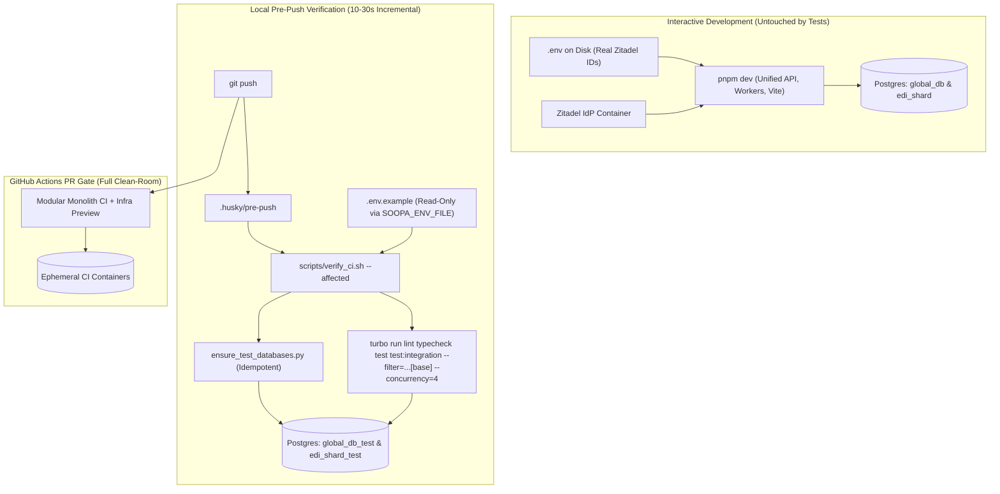
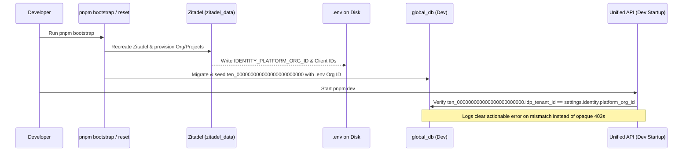

# Enterprise Local Verification, Configuration Parity, and Database Isolation Design

- **Status:** Proposed Architecture Specification
- **Scope:** Monorepo Developer Experience, Local Git Hooks (`.husky/*`), Verification Harness (`scripts/verify_ci.sh`), Configuration Loader (`seedwork.infra.config`), and Local PostgreSQL Topology (`infra/local/*`)
- **Related Records:** `TECHNICAL_DEBT.md` (Local Infrastructure & Identity State Drift), `.agents/AGENTS.md` (Integration Testing & `.env` Parity Standards)

---

## 1. Executive Summary

Developers need fast, trustworthy pre-push feedback without waiting 8–12 minutes on cloud CI runners, while keeping their local runtime environment (`pnpm dev`, Zitadel OIDC login, and seeded development databases) intact and responsive.

Currently, `git push` invokes `scripts/verify_ci.sh`, which enforces CI parity by renaming the developer's `.env` file on disk, copying `.env.example` over it, deleting all static-analysis caches (`.mypy_cache`, `.ruff_cache`, `.pytest_cache`), and running full-monorepo migrations, seeds, typechecks, and integration tests against the **live development databases** (`global_db`, `edi_shard`) with unbounded Turborepo concurrency.

This design eliminates all shared-state collisions and workstation freezes while preserving sub-minute local defect detection before code reaches GitHub Actions:

1. **Logical Database Isolation on Existing Containers:** Separate development databases (`global_db`, `edi_shard`) from dedicated test databases (`global_db_test`, `edi_shard_test`) inside the existing PostgreSQL containers (zero extra containers or idle RAM).
2. **In-Memory Clean-Room Configuration (`SOOPA_ENV_FILE`):** Load `.env.example` strictly into child-process memory during verification runs without ever renaming, overwriting, or touching `.env` on disk.
3. **Graph-Aware Incremental `pre-push` Verification:** Execute lint, typecheck, unit, and integration suites only across affected packages and their transitive dependents (`turbo run ... --filter="...[<base-ref>]"`), retaining incremental compiler caches and bounding worker concurrency.
4. **Deterministic Identity & Reset Guarantees:** Keep Zitadel OIDC state and `global_db` synchronized across resets and surface clear startup diagnostics if `IDENTITY_PLATFORM_ORG_ID` ever drifts from `identity.tenants.idp_tenant_id`.

---

## 2. Problem Statement & Root-Cause Analysis

Three recurring developer pain points trace back to shared mutable state between local development and local CI simulation:

### 2.1 Silent Corruption of Local Zitadel Identity Mapping (`403 auth_middleware_tenant_not_provisioned`)

1. During `pnpm bootstrap`, `infra/local/zitadel/bootstrap.py` provisions a local Zitadel instance and writes the live Snowflake organization ID (for example, `IDENTITY_PLATFORM_ORG_ID="397365687661625347"`) to `.env`, then seeds `identity.tenants` (`id = 'ten_000000000000000000000000'`) in `global_db`.
2. During every `git push`, `.husky/pre-push` runs `scripts/verify_ci.sh`:
   - Moves `.env` to `.env.bak` and copies `.env.example` (`IDENTITY_PLATFORM_ORG_ID=384772010141548547`) to `.env`.
   - Executes `pnpm infra:up`, which runs `db-seed` (`core/ucp/packages/ucp/scripts/seed.py`) against the **live `global_db` database**.
   - `seed.py` runs `ON CONFLICT (id) DO UPDATE SET idp_tenant_id = '384772010141548547'`, overwriting the developer's real Zitadel organization ID in `global_db`.
   - On exit, `_cleanup` restores `.env.bak` to `.env` on disk **without re-seeding `global_db`**.
3. Immediately after `git push`, the browser JWT and `.env` carry the real Zitadel organization ID, whereas `global_db` holds `.env.example`'s placeholder ID — causing `JwtStrategy._resolve_tenant_mappings` to raise `TenantNotProvisionedError` (`HTTP 403`) on `/api/v1/auth/me`.

### 2.2 Workstation Memory Exhaustion and System Freezes

1. `scripts/verify_ci.sh` deletes all `.mypy_cache`, `.ruff_cache`, and `.pytest_cache` directories prior to every push.
2. It then invokes `turbo run typecheck`, `cov:python`, and `test:integration` across 35–42 workspace packages using Turborepo's default concurrency (`10`).
3. Ten simultaneous cold-cache `mypy` or `pytest` processes (each consuming 0.8–1.5 GB RSS), combined with Docker containers and IDE language servers, spike memory usage by 10–15 GB and trigger severe macOS swap thrashing.
4. Additionally, swapping `.env` on disk triggers filesystem watchers in running `uvicorn --reload` and Vite dev servers, causing mid-push live reload storms.

### 2.3 Slow Feedback When Relying Exclusively on Cloud CI

Simply deleting local `pre-push` checks shifts failure discovery to GitHub Actions (8–12 minutes round-trip per push). An enterprise workflow must catch configuration drift, type errors, architectural violations, and broken unit/integration contracts **locally in seconds**, while running full clean-room verification in cloud CI as the final merge gate.

---

## 3. Target Architecture & Core Invariants

### 3.1 Architectural Invariants

| Invariant | Enforcement Mechanism |
| :--- | :--- |
| **Immutability of `.env` During Verification** | Verification and test scripts MUST NEVER move, rename, or overwrite `.env` on disk. Alternate env files are selected via `SOOPA_ENV_FILE` in process memory. |
| **Strict Dev vs. Test Database Separation** | Test suites and `verify_ci` MUST connect exclusively to `*_test` databases (`global_db_test`, `edi_shard_test`, `<domain>_shard_test`), never `global_db` or `edi_shard`. |
| **Fail-Closed Test Harness Guard** | Integration test `conftest.py` fixtures MUST assert that the target database name ends with `_test` before executing schema mutations or truncations. |
| **Cache Preservation** | Local hooks MUST preserve `.mypy_cache`, `.ruff_cache`, `.pytest_cache`, and `.turbo` caches to keep incremental runs fast. |
| **Bounded Local Concurrency** | Local Turborepo invocations MUST cap concurrency (`--concurrency=4` default, overridable via `TURBO_CONCURRENCY`) to protect workstation responsiveness. |
| **Transactional Test Isolation** | Integration tests MUST seed required fixtures inside nested SQLAlchemy `SAVEPOINT` transactions (`connection.begin_nested()`) and roll back on teardown, without relying on global `db-seed` state. |

### 3.2 End-to-End Architecture Diagram



---

## 4. Detailed Component Design

### 4.1 Pillar 1: Physical Database Isolation Without Extra Containers

Running a second set of PostgreSQL Docker containers would waste 400–800 MB of idle RAM. Instead, we host isolated `*_test` databases inside the **same** PostgreSQL instances already running in `infra/local/docker-compose.yml` and bounded-context compose files:

| PostgreSQL Container | Port | Interactive Dev Database | Isolated Test Database |
| :--- | :--- | :--- | :--- |
| `postgres_global` | `5432` | `global_db` | `global_db_test` |
| `edi_postgres_shard` | `5433` | `edi_shard` | `edi_shard_test` |
| `<domain>_postgres_shard` | `<port>` | `<domain>_shard` | `<domain>_shard_test` |

#### Bootstrap & Schema Synchronization (`infra/local/scripts/ensure_test_databases.py`)
1. **Idempotent Creation:** Connects to `postgres` maintenance DB on each running container; creates `global_db_test` and `<domain>_shard_test` if missing (`SELECT 1 FROM pg_database WHERE datname = ...`).
2. **RLS Function Bootstrap:** Applies `infra/local/init.sql` (`platform.current_tenant_id()` and `platform.bypass_rls()`) to `global_db_test`.
3. **Fast Migration Check:** Compares current Alembic revision head in `global_db_test` / `edi_shard_test` against repository head files. Runs `platform_migrator migrate` / shard migrations **only** when revision heads differ (making steady-state startup < 300 ms).
4. **Centralized Engine-Level Safety Guard (`database.pytest_plugin`):** A single repository-wide Pytest plugin attaches a SQLAlchemy `Engine` `"do_connect"` listener (`_guarded_postgresql_do_connect`) and `TransactionalTestRouter` check (`assert_test_database_url`) that aborts before opening a network socket if any test attempts to connect to a non-`*_test` PostgreSQL database, while redirecting bare `dotenv.load_dotenv()` calls in test suites to `SOOPA_ENV_FILE` when set.

---

### 4.2 Pillar 2: In-Memory Clean-Room Configuration (`SOOPA_ENV_FILE`)

#### Root Problem in `seedwork/infra/config.py`
Currently, `_inject_env_file_to_environ()` in `core/platform/packages/seedwork/src/seedwork/infra/config.py` hardcodes:

```python
env_path = repo_root / ".env"
```

Because of that hardcoded filename, simply exporting variables from `.env.example` in bash was insufficient: if a developer added `NEW_REQUIRED_VAR=foo` to `.env` and forgot `.env.example`, `_inject_env_file_to_environ()` would silently read `NEW_REQUIRED_VAR` from `.env` on disk and hide the missing `.env.example` entry until GitHub Actions failed.

#### Clean Architectural Solution
Update `_inject_env_file_to_environ()` in `seedwork/infra/config.py` (and remove ad-hoc `load_dotenv()` calls in scripts in favor of centralized settings/env loading):

1. Introduce `SOOPA_ENV_FILE` (default `".env"`):
   - When `SOOPA_ENV_FILE` is unset, `repo_root / ".env"` is loaded (normal interactive development).
   - When `SOOPA_ENV_FILE=".env.example"`, `_inject_env_file_to_environ()` reads **only** `repo_root / ".env.example"` and **never** reads `repo_root / ".env"`.
2. In `scripts/verify_ci.sh`, construct a clean child environment in memory:
   - Export `SOOPA_ENV_FILE=".env.example"`.
   - Load key-value pairs from `.env.example` into the subshell environment.
   - Override `DATABASE_URL`, `GLOBAL_DATABASE_URL`, `EDI_DATABASE_URL`, and `DATABASE__SHARD_OVERRIDES__*` in memory to point to `global_db_test` and `<domain>_shard_test`.
   - Set `AWS_SHARED_CREDENTIALS_FILE=/dev/null` and `AWS_CONFIG_FILE=/dev/null` to block ambient cloud credentials.

**Result:**
- Missing variables in `.env.example` fail deterministically during local verification, matching GitHub Actions 1:1.
- `.env` on disk is **never** touched, even if the terminal crashes, receives `SIGKILL`, or loses power.
- Running `pnpm dev` servers experience zero file-watcher reloads during `git commit` or `git push`.

---

### 4.3 Pillar 3: Tiered Verification & Change-Aware Execution

To keep local feedback under 30 seconds while maintaining strict CI parity, verification is split into three coordinated tiers:

| Tier | Trigger | Scope | Cache Policy | Target Duration |
| :--- | :--- | :--- | :--- | :--- |
| **Tier 1: `pre-commit`** | `git commit` | Staged files (`ruff`, `biome`, `check-yaml`, `detect-secrets`, `semgrep` on changed files, workspace dep sync) | Warm caches retained | **3–8 sec** |
| **Tier 2: `pre-push`** | `git push` (`verify_ci.sh --affected`) | Changed packages + transitive dependents (`--filter="...[<base-ref>]"`), escalated to full repo if global config files changed | `.mypy_cache`, `.ruff_cache`, `.turbo` retained; `--concurrency=4` | **10–35 sec** |
| **Tier 3: Cloud PR Gate** | Pull Request / Merge (`ci.yml`, `preview-infra.yml`, `preview-app-iac.yml`) | Full monorepo from scratch on clean Ubuntu runners + live OIDC Pulumi previews | Clean-room / GHA cache | **5–8 min (async)** |

*(Developers can also invoke `pnpm verify:ci --full` explicitly at any time to run a full-monorepo local verification against `*_test` databases without touching `global_db` or `.env`.)*

#### Base-Ref & Escalation Logic in `verify_ci.sh --affected`
1. Resolve comparison base ref automatically:
   - Use upstream tracking branch if pushing updates to a feature branch, otherwise `origin/development` (or `origin/main` when targeting `main`).
2. **Global Escalation Trigger:** If `git diff --name-only <base>..HEAD` touches cross-cutting files (`pyproject.toml`, `package.json`, `pnpm-lock.yaml`, `uv.lock`, `turbo.json`, `.env.example`, `semgrep-architecture.yml`), automatically widen scope from `--filter="...[<base>]"` to all packages — still against `*_test` databases and with `--concurrency=${TURBO_CONCURRENCY:-4}` and warm `.mypy_cache`.
3. **Coverage Threshold Compatibility (`scripts/aggregate_coverage.py`):**
   - Clean stale `.coverage*` artifacts at the start of `verify_ci.sh` (lightweight file removal, keeping compiler caches intact).
   - Run both unit coverage (`cov`) and integration coverage (`test:integration`) with the **identical** `--filter` expression so every tested package produces its full combined unit + integration coverage report before `aggregate_coverage.py` enforces `--fail-under=80`.

#### Concurrency & Resource Guardrails
- Set `TURBO_CONCURRENCY="${TURBO_CONCURRENCY:-4}"` in `verify_ci.sh` and `.husky/pre-commit` (down from Turborepo's default of `10`).
- Retain `.mypy_cache` and `.ruff_cache` across runs (adding `--clean-caches` only as an explicit troubleshooting flag on `verify_ci.sh`). Incremental `mypy` daemon/cache checks use ~80% less CPU and ~70% less memory than cold-cache runs.

---

### 4.4 Pillar 4: Deterministic Reset & Identity Drift Diagnostics



1. **Clear Separation of Commands:**
   - `pnpm bootstrap`: Full clean-slate initialization (tears down Zitadel + Postgres + LocalStack, provisions Zitadel, writes `.env`, migrates and seeds `global_db`, and initializes `global_db_test`).
   - `pnpm reset`: Resets domain data (`global_db`, `edi_shard`, LocalStack queues) while keeping Zitadel intact, then immediately runs `db:migrate` + `db:seed` from `.env` so `ten_000000000000000000000000.idp_tenant_id` in `global_db` always matches Zitadel.
2. **Startup Identity Drift Check (Local Development Observability):**
   - During `unified-api` lifespan startup in `local` / `development` environment, compare `IDENTITY_PLATFORM_ORG_ID` against `SELECT idp_tenant_id FROM identity.tenants WHERE id = 'ten_000000000000000000000000'`.
   - If mismatched or missing, emit a structured `logger.error("local_identity_org_id_mismatch", env_org_id=..., db_org_id=..., remedy="Run 'pnpm db:seed' to sync global_db with .env")` immediately at boot rather than failing silently until the first browser request hits `/api/v1/auth/me`.

---

## 5. Phased Implementation Plan

### Phase 1: Non-Destructive Env Loading & Test DB Provisioning
1. Update `core/platform/packages/seedwork/src/seedwork/infra/config.py` (`_inject_env_file_to_environ`) to honor `SOOPA_ENV_FILE` (default `.env`) without falling back to `.env` when an explicit env file is configured.
2. Create `infra/local/scripts/ensure_test_databases.py` to idempotently create `global_db_test` and `<domain>_shard_test`, apply `infra/local/init.sql`, and migrate schemas when Alembic heads advance.
3. Register a centralized `database.pytest_plugin` (`pytest11` entry point + `PYTEST_PLUGINS`) enforcing `*_test` PostgreSQL URLs at the SQLAlchemy `Engine` `"do_connect"` boundary and redirecting bare `load_dotenv()` calls to `SOOPA_ENV_FILE`.

### Phase 2: Refactor `scripts/verify_ci.sh` & Git Hooks
1. Remove `.env` file swapping (`mv .env .env.bak`, `cp .env.example .env`, and `_cleanup` file restoration) from `scripts/verify_ci.sh`.
2. Inject `SOOPA_ENV_FILE=.env.example` and `*_test` database URLs exclusively in process memory inside `scripts/verify_ci.sh`.
3. Remove unconditional `.mypy_cache` and `.ruff_cache` deletion from default runs (move behind an opt-in `--clean-caches` flag).
4. Add `--affected` mode (using Turborepo `--filter="...[<base-ref>]"` with automatic full-repo escalation on root config changes) and cap default concurrency at `TURBO_CONCURRENCY=4`.
5. Point `.husky/pre-push` to `./scripts/verify_ci.sh --affected` and cap `.husky/pre-commit` typechecks with `--concurrency=4`.

### Phase 3: Local Identity Drift Guard & Documentation Alignment
1. Add the non-blocking local startup drift check in `unified-api` lifespan logging `local_identity_org_id_mismatch` with exact remediation instructions if `global_db` and `.env` diverge.
2. Update `README.md` and close the corresponding item in `TECHNICAL_DEBT.md`.

---

## 6. Acceptance Criteria

1. **Zero `.env` Mutation:** `stat -f "%m" .env` (inode & modification timestamp) before, during, and after `git push` and `pnpm verify:ci` remains identical, even if `verify_ci.sh` is terminated mid-execution with `kill -9`.
2. **Zero Dev DB Pollution:** Querying `SELECT idp_tenant_id FROM identity.tenants WHERE id = 'ten_000000000000000000000000'` in `global_db` before and after `git push` returns the developer's real Zitadel organization ID unchanged; `/api/v1/auth/me` continues returning `200 OK` without running `pnpm db:seed`.
3. **True `.env.example` Parity Enforcement:** Removing a required variable from `.env.example` while keeping it in `.env` causes `scripts/verify_ci.sh` to fail locally with `ValidationError`, proving `.env` on disk does not mask missing `.env.example` entries.
4. **Workstation Responsiveness & Speed:** Pushing an isolated single-package change completes `pre-push` verification in under 35 seconds with peak concurrent `mypy`/`pytest` worker count <= 4 and zero IDE re-indexing storms.
