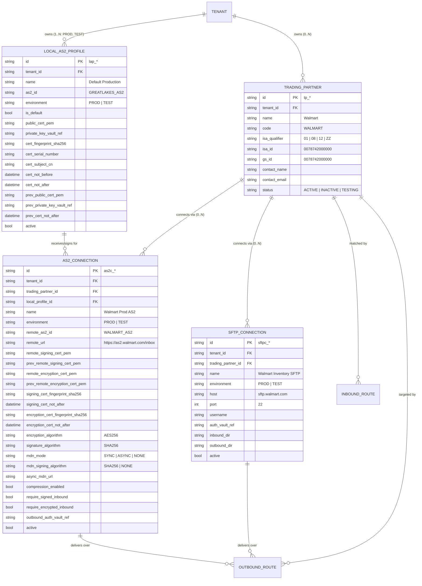
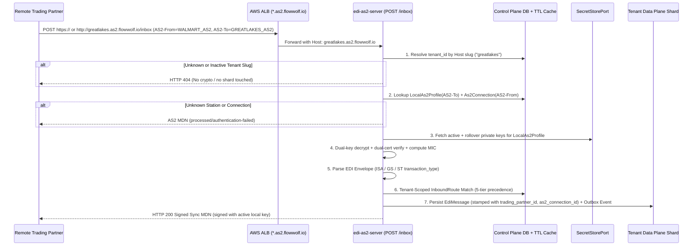
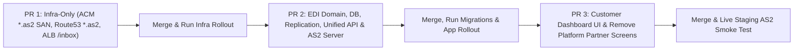

# Architecture Specification: Self-Service Multi-Tenant EDI & AS2 Platform (V1)

> [!IMPORTANT]
> **Status:** Architecture Specification (V1 Clean-Slate — Zero Backward Compatibility)
> **Scope:** EDI Bounded Context (`apps/edi`), Unified API (`core/platform/apps/unified-api`), Customer Dashboard (`core/ucp/apps/dashboard`), and AWS Edge/Routing Infrastructure (`infra/cloud/aws`).
> **Design Policy:** Built strictly as **Version 1** with **zero backward compatibility**, zero legacy facades, zero dual routes, and zero OpenAS2 schema baggage. Legacy `AS2Partner`, `AS2Partnership`, `SFTPPartner`, `edi.<domain>/as2/*`, `AS2_RECEIVE_URL`, and Platform Dashboard partner forms are cleanly deleted and replaced.
> **Explicit Exclusions:** Unrouted inbound message quarantine/replay UX (deferred to Phase 2); Notification Bell `LISTEN/NOTIFY` (out of scope).

---

## 1. Executive Summary & Architectural Vision

Flowwolf EDI implements a **Self-Service Multi-Tenant Cloud EDI Architecture** where:

1. **Every tenant receives a dedicated, auto-provisioned AS2 endpoint** on day one — supporting **both HTTPS (recommended) and HTTP (legacy AS2 partner compatibility)**:
   - Production: `https://<tenant-slug>.as2.flowwolf.io/inbox` (and `http://<tenant-slug>.as2.flowwolf.io/inbox`)
   - Staging: `https://<tenant-slug>.as2.staging.flowwolf.io/inbox` (and `http://<tenant-slug>.as2.staging.flowwolf.io/inbox`)
   - Local Dev: `http://<tenant-slug>.as2.localhost:8001/inbox`
   - *Why HTTP + HTTPS:* In RFC 4130 (AS2), payload confidentiality and authenticity are enforced at the S/MIME message layer, and many legacy enterprise partners only support plain HTTP POST (an ALB `HTTP 301` redirect breaks AS2 POST bodies!). All non-AS2 hosts (`api.`, `dashboard.`, `auth.`) remain strictly `301 → HTTPS`, while `*.as2.<domain>/inbox` forwards directly on **both** port 443 and port 80. Outbound `As2Connection.remote_url` likewise accepts both `https://` and `http://`.
2. **Zero local AS2 setup for customers:** Upon tenant creation / EDI enablement, Flowwolf automatically provisions the tenant's default `LocalAs2Profile` with a human-readable, customer-editable `as2_id` (e.g., `GREATLAKES_AS2`) and an X.509 certificate + Vault-backed private key.
3. **One-click Configuration Export:** Customers click **Export** to download/copy their exact AS2 configuration (`as2_id`, endpoint URL, supported algorithms, MDN policy, public `.cer` certificate, SHA-256 fingerprint, expiry) to share with remote trading partners — private keys never leave the secret store.
4. **Customer-only Remote Trading Partner Onboarding (< 2 minutes):** Customers configure **only** the Remote Trading Partner in the **Customer Dashboard** (`/tenant/edi`). Everything else — local station binding, cryptographic defaults, certificate rollover, and Data Plane shard replication — happens automatically.
5. **Pure V1 Domain Model (Zero OpenAS2 Legacy, 100% Protocol-Symmetric):** Protocol-agnostic `TradingPartner` sits at the center, linked to strongly-typed transport connections (`As2Connection`, `SftpConnection`, and future protocols) alongside the tenant's auto-provisioned `LocalAs2Profile` — replacing legacy `AS2Partner(is_local=bool)`, `AS2Partnership`, and `SFTPPartner`.
6. **True Zero-Downtime Certificate Rollover:** Both active and rollover (`prev_*`) keys/certificates are wired end-to-end into `ProcessInboundAs2MessageUseCase` with parsed X.509 expiry metadata.
7. **Tenant-First Inbound Routing:** `Host`-header tenant resolution happens before a single byte is decrypted, eliminating global cross-tenant ISA lookups and enabling clean, Partner-first `InboundRoute` configuration.

---

## 2. Target System Architecture & End-to-End Topology

```mermaid
flowchart LR
    RemoteTP["Remote Trading Partner (e.g. Walmart AS2)"]
    R53["Route53 Wildcard (*.as2.flowwolf.io)"]
    ALB["AWS ALB + ACM SNI Cert (*.as2.flowwolf.io)"]
    AS2Srv["edi-as2-server (POST /inbox)"]
    CPDB["Global Control Plane DB (identity + edi schemas)"]
    DPDB["Tenant Data Plane Shard (edi_shard_db)"]
    Vault["SecretStorePort (Encrypted Vault / Secrets)"]
    Watch["edi-config-sync-worker (HTTPS/SSE Watch)"]
    Orch["edi-orchestrator-worker (Inbound/Outbound Pipeline)"]
    Deliv["edi-delivery-worker (As2DeliveryStrategy)"]
    CustUI["Customer Dashboard (/tenant/edi)"]
    API["unified-api (/v1/edi)"]

    RemoteTP -->|"HTTPS / HTTP POST /inbox"| R53
    R53 --> ALB
    ALB -->|"Host: greatlakes.as2.flowwolf.io"| AS2Srv
    AS2Srv -->|"1. Resolve tenant via Host slug"| CPDB
    AS2Srv -->|"2. Lookup LocalAs2Profile + As2Connection"| CPDB
    AS2Srv -->|"3. Fetch Active + Rollover Private Keys"| Vault
    AS2Srv -->|"4. Persist EdiMessage + Outbox Event"| DPDB
    DPDB --> Orch
    Orch --> Deliv
    Deliv -->|"Outbound AS2 + Active Cert/Key"| RemoteTP

    CustUI --> API
    API --> CPDB
    API --> Vault
    CPDB -->|"Config Changefeed (SSE)"| Watch
    Watch -->|"Topological Sync (REPLICATION_GRAPH)"| DPDB
```



---

## 3. Domain-Driven Design: Orthogonal Aggregates (Pure V1)

Legacy `AS2Partner` (`is_local: bool`), `AS2Partnership`, and `SFTPPartner` are completely removed and replaced with a clean, protocol-symmetric DDD architecture:
- **Tenant's Own Hosted Station:** `LocalAs2Profile`
- **Generic External Business Entity:** `TradingPartner` (100% protocol-agnostic — zero AS2 or SFTP fields)
- **Strongly-Typed Transport Connections:** `As2Connection` and `SftpConnection` (pluggable channels attached 1:N to `TradingPartner`)

### 3.1 Entity Relationship & Bounded Context Model



### 3.2 Aggregate Responsibilities & Invariants

#### Aggregate 1: `LocalAs2Profile` (`apps/edi/packages/edi/src/edi/domain/partner/as2/local_profile.py`)
Represents the **tenant's own Flowwolf-hosted AS2 station/mailbox**.
- **ID Prefix:** `EdiIdPrefix.EDI_LOCAL_AS2_PROFILE` (`lap_`)
- **Invariants:**
  - `as2_id` must match RFC 4130 printable ASCII (`^[A-Za-z0-9._-]{1,128}$` — no whitespace, quotes, or control chars).
  - Uniqueness constraint: `UNIQUE(tenant_id, as2_id)` — scoped to the tenant because every tenant has an isolated `<tenant-slug>.as2.<domain>` hostname.
  - Default constraint: Partial unique index `UNIQUE(tenant_id, environment) WHERE is_default = true` — guarantees at most one default `PROD` and one default `TEST` profile per tenant.
  - Private key is **mandatory** for every active profile (`private_key_vault_ref` stored exclusively in `SecretStorePort`, never persisted in SQL).
  - Inbound endpoint URLs are **computed dynamically** via pure domain helpers: `build_local_as2_endpoint_urls(tenant_slug, as2_base_domain)` → primary `https://{tenant_slug}.{as2_base_domain}/inbox` and HTTP fallback `http://{tenant_slug}.{as2_base_domain}/inbox` — never stored as stale strings in DB rows.
  - Immutable Certificate Metadata Value Object (`X509CertificateMetadata`): `@dataclass(frozen=True)` parsed via `cryptography.x509` containing `subject_cn`, `issuer_cn`, `serial_number`, `sha256_fingerprint`, `not_before`, `not_after`.
- **Behavioral Methods (all returning `Result[Self, EdiPartnerError]`):**
  - `LocalAs2Profile.provision_default(tenant_id, tenant_slug, environment, cert_bundle)`
  - `profile.update(name=..., as2_id=..., is_default=...)`
  - `profile.rotate_certificate(new_cert_bundle)` — shifts active cert/key + metadata into `prev_*` rollover slots and installs the new active keypair.
  - `profile.clear_rollover_certificate()` — revokes the old rollover key immediately once remote partners confirm cutover.

#### Aggregate 2: `TradingPartner` (`apps/edi/packages/edi/src/edi/domain/partner/trading_partner.py`)
Represents an **external business company** (e.g., Walmart, Target, McKesson), completely decoupled from transport protocol.
- **ID Prefix:** `EdiIdPrefix.EDI_TRADING_PARTNER` (`tp_`)
- **Invariants:**
  - `UNIQUE(tenant_id, code)` (normalized uppercase business code, e.g., `WALMART`).
  - Optional default EDI Envelope Identifiers (`isa_qualifier`, `isa_id`, `gs_id`) used to pre-populate and bind `InboundRoute` and `OutboundRoute`.
  - Protocol-agnostic: zero AS2/SFTP/HTTP transport columns — `TradingPartner` exists independently of any transport mechanism.
  - Unified parent entity for all transport channels: `As2Connection` (1:N), `SftpConnection` (1:N), and any future protocol connection (`ApiConnection`, `PeppolConnection`) — zero protocol silos, zero dual-architectures.

#### Aggregate 3: `As2Connection` (`apps/edi/packages/edi/src/edi/domain/partner/as2/connection.py`)
Replaces both Remote `AS2Partner` and `AS2Partnership` in a single cohesive aggregate.
- **ID Prefix:** `EdiIdPrefix.EDI_AS2_CONNECTION` (`as2c_`)
- **Invariants:**
  - `UNIQUE(tenant_id, local_profile_id, remote_as2_id)` — guarantees deterministic, unambiguous inbound message lookup for any `(tenant, AS2-To, AS2-From)` triple.
  - `remote_url` explicitly accepts **both `https://` and `http://`** schemes so customers can seamlessly connect to legacy AS2 trading partners that do not support TLS (message confidentiality & authenticity are enforced via S/MIME encryption and signing).
  - Supports **1 primary certificate by default** (`remote_signing_cert_pem` used for both inbound signature verification and outbound encryption) plus an **optional separate encryption certificate** (`remote_encryption_cert_pem`) for enterprise retailers that split signing vs. encryption keys.
  - Effective outbound encryption cert resolution: `remote_encryption_cert_pem or remote_signing_cert_pem`.
  - Enterprise defaults on creation:
    - `encryption_algorithm = EncryptionAlgorithm.AES256`
    - `signature_algorithm = SignatureAlgorithm.SHA256`
    - `mdn_mode = MdnMode.SYNC`
    - `mdn_signing_algorithm = SignatureAlgorithm.SHA256`
    - `compression_enabled = False`
    - `require_signed_inbound = True`
    - `require_encrypted_inbound = True`
  - **Behavioral Methods:**
    - `connection.rotate_remote_signing_cert(new_cert_pem, metadata)` (preserves previous cert in `prev_remote_signing_cert_pem`).
    - `connection.rotate_remote_encryption_cert(new_cert_pem, metadata)` (preserves previous cert in `prev_remote_encryption_cert_pem`).
    - `connection.update_protocol_policy(...)`.

#### Aggregate 4: `SftpConnection` (`apps/edi/packages/edi/src/edi/domain/partner/sftp/connection.py`)
Cleanly replaces legacy `SFTPPartner` as a strongly-typed transport connection attached to a generic `TradingPartner`.
- **ID Prefix:** `EdiIdPrefix.EDI_SFTP_CONNECTION` (`sftpc_`)
- **Invariants:**
  - Belongs strictly to `(tenant_id, trading_partner_id)` — every SFTP channel is anchored to a `TradingPartner` just like `As2Connection`.
  - Stores SFTP-specific transport configuration (`host`, `port`, `username`, `auth_vault_ref`, `inbound_dir`, `outbound_dir`, `environment`) with full PostgreSQL constraints and static type safety rather than a polymorphic JSONB blob.
  - Credentials (SSH private key / password) live strictly in `SecretStorePort`, never in plaintext SQL.

---

## 4. Zero-Touch Auto-Provisioning & One-Click Export

### 4.1 Auto-Provisioning Lifecycle (`EnsureDefaultLocalAs2ProfileUseCase`)

Every customer receives an active AS2 station automatically with zero manual setup.

1. **Human-Readable Default AS2 ID (`derive_default_as2_id`):**
   - Normalize `tenant.slug`: uppercase, strip hyphens/non-alphanumeric characters (e.g., `great-lakes` → `GREATLAKES`), truncate to max 110 chars.
   - `PROD`: `{NORMALIZED_SLUG}_AS2` (e.g., `GREATLAKES_AS2`).
   - `TEST`: `{NORMALIZED_SLUG}_AS2_TEST` (e.g., `GREATLAKES_AS2_TEST`).
   - Customers can edit `as2_id` at any time (e.g., to match an existing partner contract ID).
2. **Automatic Keypair & Certificate Generation:**
   - Generates an RSA 2048-bit (configurable 4096-bit) X.509 v3 self-signed certificate via `CertificateGeneratorPort` (`CN={as2_id}`, `O=Flowwolf EDI`, 730-day validity).
   - Stores encrypted private key in `SecretStorePort` under `edi/{tenant_id}/local-as2/{profile_id}/key-{version}`.
   - Parses and stores `X509CertificateMetadata`.
3. **Dual Provisioning Trigger (Idempotent & Race-Safe):**
   - **Primary (Async Event-Driven):** Subscribe to tenant creation / EDI app entitlement activation outbox event → invoke `EnsureDefaultLocalAs2ProfileUseCase(tenant_id, tenant_slug)`.
   - **Secondary (Idempotent Ensure-on-Read):** `GET /v1/edi/as2/profiles` transparently calls `EnsureDefaultLocalAs2ProfileUseCase` if no default `PROD` profile exists yet (covers pre-existing tenants and instantaneous post-signup navigation).
   - **Concurrency Safety:** Protected by `uq_local_as2_default_per_env (tenant_id, environment) WHERE is_default = true`. On concurrent `IntegrityError`, the losing call cleans up its generated vault key and returns the winning profile.
4. **One-Click Test Profile:**
   - Customer clicks **"+ Add Test Profile"** → `CreateLocalAs2ProfileUseCase(environment=TEST)` provisions `{SLUG}_AS2_TEST` with its own keypair.

### 4.2 One-Click Customer Configuration Export

`GET /v1/edi/as2/profiles/{profile_id}/export` returns a ready-to-share payload:

```json
{
  "profile_id": "lap_01J...",
  "environment": "PROD",
  "as2_id": "GREATLAKES_AS2",
  "as2_url": "https://greatlakes.as2.flowwolf.io/inbox",
  "as2_http_url": "http://greatlakes.as2.flowwolf.io/inbox",
  "supported_encryption_algorithms": ["AES256", "AES128", "3DES"],
  "supported_signature_algorithms": ["SHA256", "SHA1"],
  "recommended_encryption": "AES256",
  "recommended_signature": "SHA256",
  "mdn_mode": "SYNC_SIGNED",
  "certificate": {
    "filename": "GREATLAKES_AS2.cer",
    "pem": "-----BEGIN CERTIFICATE-----\n...",
    "sha256_fingerprint": "AB:CD:...",
    "serial_number": "...",
    "not_before": "2026-11-28T00:00:00Z",
    "not_after": "2028-11-28T00:00:00Z"
  }
}
```

> [!CAUTION]
> **Security Invariant:** Customer export endpoints MUST **NEVER** expose private keys (`private_key_pem`). Private keys stay strictly in `SecretStorePort` and are read exclusively in-memory by `edi-as2-server` and `edi-delivery-worker`.

---

## 5. Inbound & Outbound Execution Flows

### 5.1 Inbound AS2 Receive & Zero-Downtime Dual-Key Rollover

`edi-as2-server` exposes a single canonical ingress endpoint: **`POST /inbox`** (legacy `/as2/inbox` is deleted).



#### Host-Header Tenant Extraction Guardrails
Pure domain parser `extract_tenant_slug_from_host(host_header: str, as2_base_domain: str) -> Result[str, As2InboundError]`:
- Strip optional `:port` suffix and lowercase.
- Strictly require `host.endswith(f".{as2_base_domain}")`.
- Extract the single leftmost label `<slug>` (reject multi-level labels like `a.b.as2.flowwolf.io`).
- Validate RFC 1123 DNS label regex `^[a-z0-9](?:[a-z0-9-]{0,61}[a-z0-9])?$`.
- Resolve `slug -> TenantRoutingInfo(tenant_id, status)` via an in-memory TTL cache (60s positive TTL, 10s negative TTL) backed by `identity.tenants.slug`.

#### Zero-Downtime Dual-Key Cryptographic Rollover
1. **Inbound Decryption:**
   - Try `local_profile.private_key_vault_ref`.
   - On failure, if `local_profile.prev_private_key_vault_ref` exists, retry with `prev_private_key_vault_ref` and emit structured log `as2_inbound_decrypted_with_rollover_key`.
2. **Inbound Signature Verification:**
   - Try `as2_connection.remote_signing_cert_pem`.
   - On failure, if `as2_connection.prev_remote_signing_cert_pem` exists, retry with `prev_remote_signing_cert_pem` and emit structured log `as2_inbound_verified_with_rollover_cert`.
3. **Outbound MDN Signing:**
   - Always sign outbound MDNs using the **active** `local_profile.private_key_vault_ref` and `local_profile.public_cert_pem`.

---

### 5.2 Inbound Route Architecture (Tenant-First & Partner-First)

Global cross-tenant ISA lookup (`_resolve_tenant_for_isa`) is completely deleted. Because `tenant_id`, `trading_partner_id`, and `as2_connection_id` are resolved at transport ingress:

- **`InboundRoute` Schema:**
  - `trading_partner_id`: proper `ForeignKey("edi.trading_partners.id")` (nullable only for pure ISA-only routes).
  - `isa_sender_id` and `isa_receiver_id`: **optional** when `trading_partner_id` is set, enabling customers to route by **Trading Partner + Transaction Type** without memorizing ISA qualifiers.
  - Database `CheckConstraint`: `trading_partner_id IS NOT NULL OR (isa_sender_id IS NOT NULL AND isa_receiver_id IS NOT NULL)`.
- **Deterministic 5-Tier Matching Precedence (Strictly Scoped to `tenant_id`):**
  1. `trading_partner_id` + `isa_sender_id` + `isa_receiver_id` + `transaction_type`
  2. `trading_partner_id` + `transaction_type` *(Primary Self-Service UX)*
  3. `isa_sender_id` + `isa_receiver_id` + `transaction_type` *(SFTP / VAN fallback)*
  4. `trading_partner_id` + `transaction_type IS NULL` *(Partner catch-all)*
  5. `isa_sender_id` + `isa_receiver_id` + `transaction_type IS NULL` *(ISA catch-all)*

*(Unrouted inbound messages when all 5 tiers miss continue to return a structured `routing_error` and log cleanly; quarantine/replay UX attaches at this seam in Phase 2.)*

---

### 5.3 Outbound Route & Delivery Pipeline

- `RouteDestination` uses `as2_connection_id` (`RouteDestination.for_as2(as2_connection_id)`) and `sftp_connection_id` (`RouteDestination.for_sftp(sftp_connection_id)`), retiring legacy `as2_partner_id` and `sftp_partner_id`.
- `OutboundRoute.trading_partner_id` is a proper `ForeignKey("edi.trading_partners.id")`.
- `As2DeliveryStrategy` loads `As2Connection` + linked `LocalAs2Profile` directly from the Tenant Data Plane shard (no partnership reverse-lookup):
  - `AS2-From` = `local_profile.as2_id`
  - `AS2-To` = `as2_connection.remote_as2_id`
  - Target URL = `as2_connection.remote_url`
  - Sign with `local_profile.private_key_vault_ref`
  - Encrypt with `as2_connection.remote_encryption_cert_pem or as2_connection.remote_signing_cert_pem`
  - Enforce `encryption_algorithm`, `signature_algorithm`, `mdn_mode`, `compression_enabled`, and optional outbound HTTP auth from `outbound_auth_vault_ref`.

---

## 6. Database Schema, Migrations & Data Plane Replication

### 6.1 Single-Migration-File Updates (Clean V1 Schema)
Per `.agents/AGENTS.md`, we amend the two existing single development migration files in place:
1. **Control Plane Global DB** (`apps/edi/packages/edi/src/edi/adapters/outbound/database/migrations/global/versions/4741975849db_initial_schema.py`):
   - Delete `edi.as2_partners`, `edi.as2_partnerships`, and `edi.sftp_partners`.
   - Define `edi.local_as2_profiles`, `edi.trading_partners`, `edi.as2_connections`, and `edi.sftp_connections` (both connection tables with mandatory FK `trading_partner_id -> edi.trading_partners.id`).
   - Update `edi.inbound_routes` and `edi.outbound_routes` (`trading_partner_id` FK, `as2_connection_id` and `sftp_connection_id` FKs replacing legacy `as2_partner_id` / `sftp_partner_id`, updated `CheckConstraint`s and partial unique indexes).
2. **Tenant Data Plane DB** (`apps/edi/packages/edi/src/edi/adapters/outbound/database/migrations/tenant/versions/f509500b75a4_tenant_initial_schema.py`):
   - Mirror the exact replicated config tables (`local_as2_profiles`, `trading_partners`, `as2_connections`, `sftp_connections`, `inbound_routes`, `outbound_routes`).
   - Add `trading_partner_id` and `as2_connection_id` columns on `edi_messages` for full trace lineage.

### 6.2 Declarative `REPLICATION_GRAPH` (Zero Shared Cross-Tenant Entities)
In `apps/edi/packages/edi/src/edi/adapters/outbound/database/replication_registry.py`, `include_shared=False` across every single entity:

| Topological Layer | Replicated Entities | FK Dependencies | `include_shared` |
| :--- | :--- | :--- | :--- |
| **Layer 0 (Leaf)** | `local_as2_profile`, `trading_partner`, `webhook`, `outbound_edi_header` | None | `False` |
| **Layer 1 (Connections)** | `as2_connection`, `sftp_connection` | `as2_connection -> (local_as2_profile, trading_partner)`; `sftp_connection -> trading_partner` | `False` |
| **Layer 2 (Routes)** | `inbound_route`, `outbound_route` | `trading_partner`, `as2_connection`, `sftp_connection`, `webhook` | `False` |

The existing Queue-Free HTTPS/SSE Dynamic Watch (`EdiConfigSyncWorkerModule` + `EdiShardConfigSink`) automatically replicates all 3 layers to tenant shards with zero new worker services.

---

## 7. Control Plane API & Customer Dashboard UX

### 7.1 Unified API Endpoints (`/v1/edi`, Tenant-Scoped via Local PDP AuthZ)

Legacy routers (`as2_partners.py`, `as2_partnerships.py`, `trading_partners/as2.py`, `trading_partners/sftp.py`) and `AS2_RECEIVE_URL` are deleted. Replaced with pure V1 tenant-scoped routers:

| Endpoint | Purpose | AuthZ Capability |
| :--- | :--- | :--- |
| `GET /v1/edi/as2/profiles` | List tenant's `LocalAs2Profile`s (idempotently ensures default `PROD` profile) | `edi:as2:read` |
| `POST /v1/edi/as2/profiles` | Create additional station (e.g., `TEST` profile `GREATLAKES_AS2_TEST`) | `edi:as2:write` |
| `PATCH /v1/edi/as2/profiles/{id}` | Edit human-readable `as2_id`, name, or default flag | `edi:as2:write` |
| `POST /v1/edi/as2/profiles/{id}/rotate-certificate` | Generate or upload new keypair (retains previous key for rollover) | `edi:as2:write` |
| `DELETE /v1/edi/as2/profiles/{id}/rollover-certificate` | Clear/revoke previous rollover key after cutover | `edi:as2:write` |
| `GET /v1/edi/as2/profiles/{id}/export` | One-click export payload (URL, AS2 ID, algos, public cert PEM & metadata) | `edi:as2:read` |
| `GET /v1/edi/as2/profiles/{id}/certificate.cer` | Direct downloadable `.cer` public certificate file | `edi:as2:read` |
| `GET/POST/PATCH/DELETE /v1/edi/trading-partners` | CRUD for generic, protocol-agnostic `TradingPartner`s | `edi:partners:read/write` |
| `POST /v1/edi/trading-partners/onboard-as2` | **Composite 1-Step Onboarding:** atomically creates `TradingPartner` + `As2Connection` (+ optional default `InboundRoute` & `OutboundRoute`) | `edi:partners:write` |
| `GET/POST/PATCH/DELETE /v1/edi/as2/connections` | Manage `As2Connection`s attached to a `TradingPartner` | `edi:as2:read/write` |
| `POST /v1/edi/as2/connections/{id}/rotate-certificate` | Upload new remote partner signing or encryption cert (retaining rollover cert) | `edi:as2:write` |
| `GET/POST/PATCH/DELETE /v1/edi/sftp/connections` | Manage `SftpConnection`s attached to a `TradingPartner` | `edi:sftp:read/write` |

### 7.2 Customer Dashboard IA (`core/ucp/apps/dashboard/src/routes/_authenticated/tenant/edi/`)

- **Deleted from Platform Dashboard:** Remove `platform/edi/as2partners.tsx` and `platform/edi/as2partnerships.tsx` completely.
- **Customer Dashboard (`/tenant/edi/`):**
  1. **My AS2 Configuration** (`/tenant/edi/as2-profile`):
     - Ready on Day 1: displays Inbound URLs (primary `https://<slug>.as2.flowwolf.io/inbox` + legacy partner fallback `http://<slug>.as2.flowwolf.io/inbox` with copy buttons), editable AS2 ID (`GREATLAKES_AS2`), certificate expiry badge, **Rotate Certificate** drawer (with active rollover indicator), **"+ Add Test Profile"**, and **"Export & Share Configuration"** (copy partner onboarding sheet + download `.cer`).
  2. **Trading Partners** (`/tenant/edi/partners`):
     - Unified directory showing each company ("Walmart", "McKesson") with connection pills (`AS2 PROD`, `AS2 TEST`, `SFTP`) and certificate health indicators.
     - **"Add Trading Partner" 1-Screen Onboarding (< 2 minutes):**
       - *Required (4 fields):* Partner Name, Remote AS2 ID, Remote AS2 URL, Partner Public Certificate (`.cer`/`.pem`).
       - *Auto-wired:* Tenant's default `LocalAs2Profile` + enterprise defaults (`AES-256`, `SHA-256`, `Signed Sync MDN`).
       - *Optional Collapsible Sections:* EDI IDs (ISA/GS), Separate Encryption Certificate, Advanced AS2 Settings (MDN mode, compression, legacy 3DES/SHA-1, HTTP auth).
  3. **Routing** (`/tenant/edi/routes`):
     - Inbound Route form: select Trading Partner + Transaction Type (or All) + Destination; optional ISA/GS override.
     - Outbound Route form: select Trading Partner + target AS2/SFTP Connection.

---

## 8. AWS Infrastructure Architecture (Dedicated Infra PR #1)

> [!IMPORTANT]
> **Strict Deployment Rule:** All AWS infrastructure changes MUST ship in a **separate Infra PR** and complete `Infra Rollout` BEFORE the App PR is merged.

### 8.1 Wildcard TLS Requirement
A standard `*.staging.flowwolf.io` ACM certificate only matches one DNS label and does **not** cover `greatlakes.as2.staging.flowwolf.io`. We provision a dedicated `*.as2.<domain>` ACM certificate with DNS validation and attach it to the existing ALB HTTPS listener via **SNI (`aws.lb.ListenerCertificate`)**.

### 8.2 Exact Pulumi Stack Changes (Strict CI/CD Pipeline Segregation)

Per `.github/workflows/provision-infra.yml` vs `.github/workflows/deploy.yml`, Stateful Infra stacks (`platform`, `routing`, `openas2`) ship in **PR 1 (Infra-Only)** so `as2_base_domain` is exported into Pulumi state before Stateless App stacks (`apps/edi/as2`, `apps/api`) consume it in **PR 2 (Backend & App IaC)**:

| Rollout PR | Pulumi Stack | File | Exact V1 Changes |
| :--- | :--- | :--- | :--- |
| **PR 1 (Infra)** | **Seedwork** | `infra/cloud/aws/packages/seedwork/infra_seedwork/network.py` | Add domain-agnostic `AlbResources`, `SniCertificateResources`, `attach_listener_rule`, `provision_dns_validated_sni_certificate`, and `provision_route53_alias_record` primitives. |
| **PR 1 (Infra)** | **Platform Stack** | `infra/cloud/aws/platform/__main__.py` | Provision DNS-validated `*.as2.{staging_domain}` ACM cert attached to `main_listener` via ALB SNI (`aws.lb.ListenerCertificate`) and export `as2_base_domain`, `as2_wildcard_domain`, `as2_wildcard_cert_arn`, and `main_alb_http_listener_arn` (for dual HTTP/HTTPS AS2 ingress while preserving port 80 `301 → HTTPS` for all other hosts). |
| **PR 1 (Infra)** | **Routing Stack** | `infra/cloud/aws/apps/routing/__main__.py` | Replace `edi_dns_record` (`edi.<domain>`) with wildcard Route53 Alias `A` record `*.as2.<domain>` → `main_alb` via `provision_route53_alias_record`. Export `as2_wildcard_domain`. |
| **PR 1 (Infra)** | **OpenAS2 Test Stack** | `infra/cloud/aws/apps/openas2/__main__.py` | Update `flowwolf_as2_url` from legacy `https://edi.{domain}/as2/inbox` to `https://{test_tenant_slug}.as2.{domain}/inbox`. |
| **PR 2 (App)** | **EDI AS2 Stack** | `infra/cloud/aws/apps/edi/as2/__main__.py` | Replace legacy `edi.<domain>` + `/as2/*` listener rule with `host_header = *.as2.{domain}` + `path_pattern = "/inbox"` → `as2_tg` attached to **both** `main_alb_listener_arn` (HTTPS:443) and `main_alb_http_listener_arn` (HTTP:80, direct forward without 301 redirect), and inject `AS2_BASE_DOMAIN` from `platform.require_output("as2_base_domain")`. |
| **PR 2 (App)** | **API Stack** | `infra/cloud/aws/apps/api/__main__.py` | Replace `AS2_RECEIVE_URL` env var with `AS2_BASE_DOMAIN` from `platform.require_output("as2_base_domain")`. |

### 8.3 Local Development Parity (`.env.example`)
Replace `AS2_RECEIVE_URL` with:
- `AS2_BASE_DOMAIN=as2.localhost` (native wildcard resolution to `127.0.0.1` on macOS/Linux — `http://greatlakes.as2.localhost:8001/inbox` works out of the box with zero `/etc/hosts` edits).

---

## 9. Security, Observability & Enterprise Compliance Checklist

- **Hexagonal & DDD Isolation:** Zero SQLAlchemy/FastAPI/boto3 imports inside `edi.domain.*` or `edi.application.*`. All repositories use explicit Data Mappers (zero `getattr()`, zero dynamic reflection).
- **First-Class Error Handling:** All domain & inbound AS2 validation operations return `Result[T, E]`.
- **Structured Observability (`structlog`):**
  - Bind `tenant_id`, `tenant_slug`, `local_profile_id`, `trading_partner_id`, `as2_connection_id`, `as2_from`, `as2_to`, `message_id` on every inbound/outbound lifecycle log.
  - Emit `logger.info` for rollover key/cert usage (`as2_inbound_decrypted_with_rollover_key`, `as2_inbound_verified_with_rollover_cert`); emit `logger.error` for all terminal rejections and security violations.
- **Certificate Hygiene:**
  - Validate X.509 PEM structure on upload (reject malformed PEM, expired certificates, or accidentally pasted private keys).
  - Schedule certificate expiry alerts (30/14/7 days before `cert_not_after`) via `edi-cp-jobs-worker` → 3-Stage Notification Pipeline.
- **Testing Strategy (Red-Green-Refactor, Zero Mocks for Pure Logic):**
  - **Pure Unit Tests:** `LocalAs2Profile`, `TradingPartner`, `As2Connection`, `SftpConnection`, `derive_default_as2_id`, `extract_tenant_slug_from_host`, X.509 metadata parser, 5-tier `InboundRoute` specificity resolver, `REPLICATION_GRAPH` validation.
  - **Narrow Integration Tests (Nested SAVEPOINT Rollbacks):**
    - `EnsureDefaultLocalAs2ProfileUseCase` idempotency & concurrency test against PostgreSQL.
    - `ProcessInboundAs2MessageUseCase` end-to-end with real S/MIME encrypt/sign using **active and rollover keys/certs**, real tenant slug resolution, and 5-tier inbound route matching.
    - `As2DeliveryStrategy` outbound signing/encryption (including separate signing vs. encryption cert test).
    - Pulumi contract tests in `infra/cloud/aws/tests/` verifying `*.as2.<domain>` ACM SAN, Route53 wildcard alias, and ALB `/inbox` rule.

---

## 10. Phased Execution & Rollout Plan



### PR 1 — Infrastructure Only (Separate Infra PR — `provision-infra.yml` Stacks)
- `infra/cloud/aws/packages/seedwork/infra_seedwork/network.py`: Domain-agnostic `provision_dns_validated_sni_certificate` and `provision_route53_alias_record` primitives.
- `infra/cloud/aws/platform/__main__.py`: ACM `*.as2.{domain}` cert + Route53 DNS validation + `ListenerCertificate` SNI + `as2_base_domain` / `as2_wildcard_domain` / `as2_wildcard_cert_arn` exports.
- `infra/cloud/aws/apps/routing/__main__.py`: Replace `edi.<domain>` with `*.as2.<domain>` wildcard alias using `provision_route53_alias_record`.
- `infra/cloud/aws/apps/openas2/__main__.py`: Target `https://{test_tenant_slug}.as2.{domain}/inbox`.
- `infra/cloud/aws/tests/`: Contract & Pulumi runtime tests covering ACM SNI, Route53 wildcard, seedwork purity, and OpenAS2 V1 target.

### PR 2 — Backend & App IaC: Domain, DB, Replication, Unified API, AS2 Server & Workers (`deploy.yml` Stacks)
- `infra/cloud/aws/apps/edi/as2/__main__.py` & `infra/cloud/aws/apps/api/__main__.py`: Replace legacy `edi.<domain>/as2/*` rule and `AS2_RECEIVE_URL` with `*.as2.<domain>/inbox` and `AS2_BASE_DOMAIN` (consuming `platform.require_output("as2_base_domain")` already deployed by PR 1).
- Pure V1 Domain Aggregates (`LocalAs2Profile`, `TradingPartner`, `As2Connection`, `SftpConnection`), X.509 metadata parser, Host slug extractor, 5-tier `InboundRoute` resolver, updated `OutboundRoute` / `RouteDestination`.
- Single dev migration files (`global` + `tenant`), updated ORM models, explicit Data Mappers, and 3-layer `REPLICATION_GRAPH` (`include_shared=False`).
- Use Cases: `EnsureDefaultLocalAs2ProfileUseCase`, `ExportLocalAs2ProfileUseCase`, `OnboardAs2TradingPartnerUseCase`, certificate rotation, dual-key `ProcessInboundAs2MessageUseCase`, updated `As2DeliveryStrategy`.
- Adapters: `edi-as2-server` `POST /inbox` (delete `/as2/inbox`); new tenant-scoped `unified-api` routers (delete legacy `as2_partners` / `as2_partnerships` routers & `AS2_RECEIVE_URL`).
- Full verification: `ruff`, `mypy`, `tach check`, unit + narrow integration test suites.

### PR 3 — Frontend: Customer Self-Service Dashboard
- Build **My AS2 Configuration** (`/tenant/edi/as2-profile`), **Trading Partners** (`/tenant/edi/partners`) with **< 2 min Add Trading Partner** flow, and updated **Routing** (`/tenant/edi/routes`).
- Delete `platform/edi/as2partners.tsx` and `platform/edi/as2partnerships.tsx`.
- Live staging smoke test: verify real signed+encrypted AS2 delivery over **both** `https://<tenant-slug>.as2.staging.flowwolf.io/inbox` and `http://<tenant-slug>.as2.staging.flowwolf.io/inbox` (no 301 redirect) with signed MDN + full trace lineage in Customer Dashboard.
