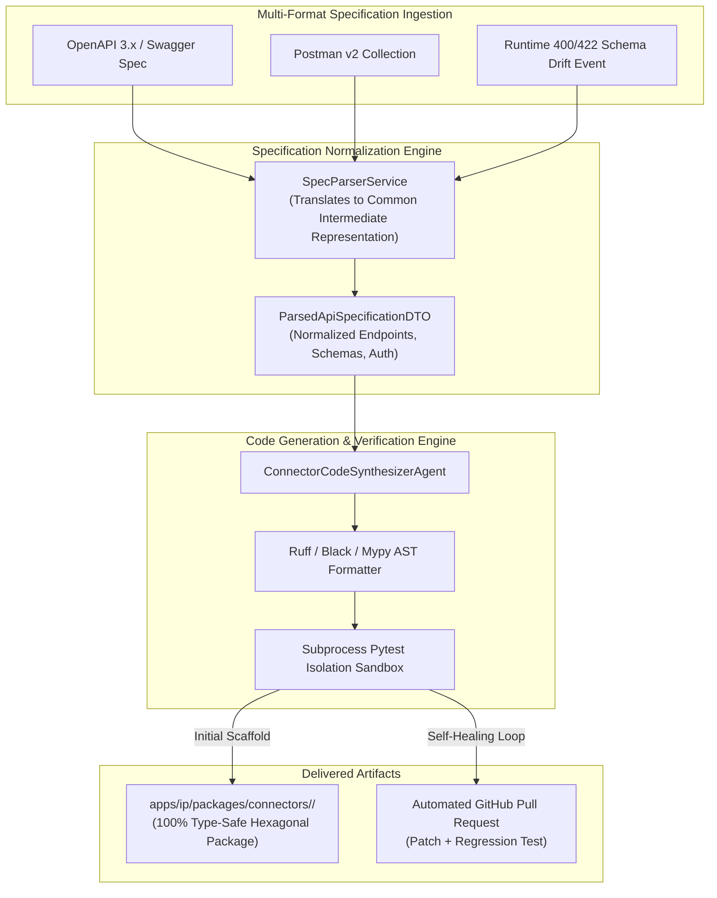
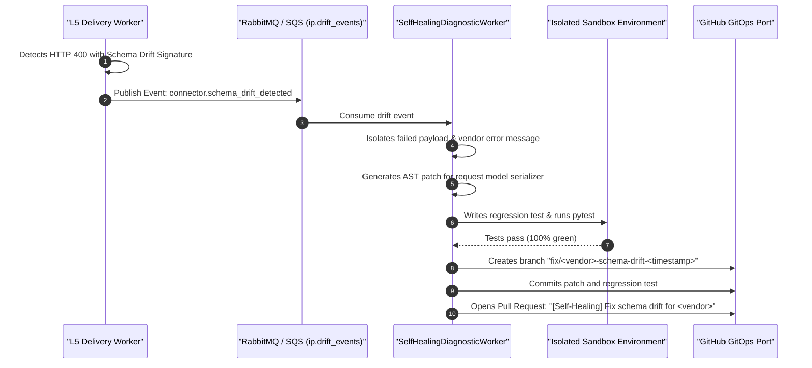

# System Architecture & Engineering Design: Autonomous Connector Factory & Self-Healing Runtime

- **Document:** ARCH-IP-015 — Agentic Connector Scaffolding, Spec Compilation & Self-Healing Pipeline
- **Product:** Soopa Integration Platform (`apps/ip`)
- **Status:** Approved Architecture Specification (Gold Standard)
- **Bounded Context:** External Connectivity & Ingress/Egress Adapters
- **Related Specs:** [ai_autonomous_connector_factory_prd.md](ai_autonomous_connector_factory_prd.md), [generic_http_connector_design.md](generic_http_connector_design.md)
- **Architecture Style:** Hexagonal Architecture • Common Intermediate Representation (IR) • Automated CI/CD Feedback Loop

---

## 1. Architectural Overview & Component Pipeline



---

## 2. Open-Source Reference Architecture & Reused Foundations

Rather than building custom OpenAPI compilers, code formatters, and autonomous PR engines:
- **[OpenAPI Generator](https://github.com/OpenAPITools/openapi-generator) & [datamodel-code-generator](https://github.com/koxudaxi/datamodel-code-generator):** Battle-tested open-source code generators that compile OpenAPI 3.x and JSONSchema definitions directly into strictly typed Pydantic v2 data models.
- **[Airbyte Connector Builder (PyAirbyte)](https://github.com/airbytehq/airbyte):** The gold-standard open-source declarative connector paradigm. Informs our standardized authentication adapters, async cursor stream paginators, and rate-limiting policies.
- **[OpenHands](https://github.com/All-Hands-AI/OpenHands) / [Aider](https://github.com/paul-gauthier/aider):** Autonomous coding agent architectures that inform our self-healing background worker: isolating failed reproduction test cases, generating localized AST diffs, and automating GitHub Pull Requests.
- **[Ruff](https://github.com/astral-sh/ruff):** High-speed Rust-based linter and AST formatter enforcing strict PEP-8 compliance and eliminating dead code before disk persistence.

---

## 3. Standardized Hexagonal Connector Package Taxonomy

Every scaffolded connector follows an identical folder and file taxonomy, guaranteeing consistency across all 500+ connectors in `apps/ip/packages/connectors/`:

```text
apps/ip/packages/connectors/<vendor_slug>/
├── pyproject.toml                                  # Independent package manifest & dependencies
├── README.md                                       # Auto-generated usage documentation & endpoints
├── src/<vendor_slug>/
│   ├── __init__.py                                 # Explicit top-level exports
│   ├── client.py                                   # Concrete client adapter wrapping platform shttp
│   ├── constants.py                                # Endpoints, rate-limit thresholds, error enums
│   ├── auth/                                       # Authentication adapters
│   │   ├── __init__.py
│   │   └── oauth2_handler.py                       # Token refresh with distributed Redis locking
│   ├── models/                                     # Immutable Pydantic request and response DTOs
│   │   ├── __init__.py
│   │   ├── requests.py                             # Query params, path params, request bodies
│   │   └── responses.py                            # Fully typed response models with validators
│   └── pagination/                                 # Async stream paginators
│       ├── __init__.py
│       └── paginator.py                            # Async generators yielding individual records
└── tests/
    ├── __init__.py
    ├── conftest.py                                 # Mock HTTP fixtures & recorded cassettes
    ├── test_client.py                              # Unit tests for operations, auth, and retries
    └── test_regressions.py                         # Self-healing regression tests
```

---

## 3. Hexagonal Domain Interfaces & Common Intermediate Representation (IR)

```python
# apps/ip/packages/ip/src/ip/domain/models/connector_ir.py
from dataclasses import dataclass
from enum import StrEnum
from typing import Any, Protocol
from seedwork.result import Result


class AuthMechanism(StrEnum):
    OAUTH2_CLIENT_CREDENTIALS = "OAUTH2_CLIENT_CREDENTIALS"
    OAUTH2_AUTH_CODE_PKCE = "OAUTH2_AUTH_CODE_PKCE"
    API_KEY_HEADER = "API_KEY_HEADER"
    API_KEY_QUERY = "API_KEY_QUERY"
    BEARER_TOKEN = "BEARER_TOKEN"
    MUTUAL_TLS = "MUTUAL_TLS"


class PaginationPattern(StrEnum):
    RFC5988_LINK_HEADER = "RFC5988_LINK_HEADER"
    CURSOR_TOKEN = "CURSOR_TOKEN"
    OFFSET_LIMIT = "OFFSET_LIMIT"
    PAGE_NUMBER = "PAGE_NUMBER"
    NONE = "NONE"


@dataclass(frozen=True, kw_only=True)
class EndpointFieldDefinition:
    field_name: str
    python_type: str
    is_required: bool
    description: str | None
    example_value: Any | None
    nested_schema_name: str | None


@dataclass(frozen=True, kw_only=True)
class NormalizedOperationDTO:
    operation_id: str
    http_method: str  # GET, POST, PUT, DELETE, PATCH
    path_template: str  # e.g., "/meters/{meter_id}/readings"
    summary: str
    auth_required: bool
    pagination_pattern: PaginationPattern
    pagination_cursor_param: str | None
    rate_limit_requests_per_minute: int | None
    request_body_model: str | None
    response_body_model: str
    fields: tuple[EndpointFieldDefinition, ...]


@dataclass(frozen=True, kw_only=True)
class ParsedApiSpecificationDTO:
    vendor_slug: str
    display_title: str
    base_url: str
    auth_mechanism: AuthMechanism
    operations: tuple[NormalizedOperationDTO, ...]


class SpecParserPort(Protocol):
    async def parse_specification(
        self, spec_raw: str, spec_format: str
    ) -> Result[ParsedApiSpecificationDTO, str]: ...


class ConnectorCodeGeneratorPort(Protocol):
    async def generate_package_files(
        self, spec: ParsedApiSpecificationDTO
    ) -> Result[dict[str, str], str]:  # Map of file_path -> python_source_code
        ...


class IsolatedTestRunnerPort(Protocol):
    async def run_package_validation(
        self, package_directory: str
    ) -> Result[bool, str]: ...
```

---

## 4. Code Generation Engine with AST Verification

The Code Generation Engine uses a hybrid approach:
1. **Deterministic Structural Templates:** Jinja2 templates render the boilerplate: `pyproject.toml`, `conftest.py`, and standard `BaseHttpClientAdapter` inheritance.
2. **AI Model Synthesis:** The LLM generates the specific Pydantic models, custom serializers/deserializers, and pagination token extractors based on the `NormalizedOperationDTO`.
3. **AST Linting & Static Typing:** All generated code runs through `ruff check --fix` and `mypy --strict`. Any syntax error or type mismatch triggers an automated feedback loop back to the synthesizer to fix the error before writing to disk.

---

## 5. Autonomous Self-Healing Feedback Loop

When an external vendor updates their API in production:



1. **Drift Event Payload:** Contains `vendor_slug`, `endpoint_url`, `request_payload`, `http_status_code`, and `error_response_body`.
2. **Automated Reproduction Test:** The healer writes a test reproducing the exact wire payload in `tests/test_regressions.py`, proving that the new model serializes the format demanded by the external API.
3. **PR Security Review:** Self-healing PRs cannot be auto-merged into production without human approval or passing all CI status checks, maintaining strict change management.
