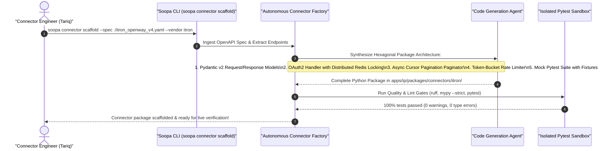
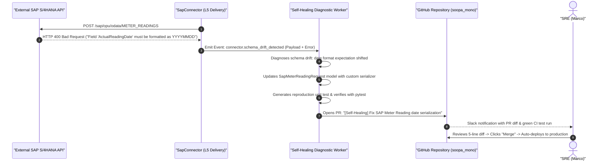

# Product Requirements Document (PRD): Autonomous Connector Factory & Self-Healing Runtime

- **Document:** PRD-IP-015 — AI-Assisted Connector Scaffolding & Autonomous Self-Healing Connectors
- **Product:** Soopa Integration Platform (`apps/ip`)
- **Status:** Approved Specification (Gold Standard)
- **Bounded Context:** External Connectivity & Ingress/Egress Adapters
- **Target Audience:** Platform Engineers, Connector Developers, Third-Party Ecosystem Integrators
- **Related Specs:** [generic_http_connector_design.md](file:///Users/apple/soopa_mono/apps/ip/docs/generic_http_connector_design.md), [architecture.md](file:///Users/apple/soopa_mono/apps/ip/docs/architecture.md)

---

## 1. Executive Summary & Problem Statement

### 1.1 The Scalability Bottleneck of 500+ Enterprise Connectors
To compete with MuleSoft and Airbyte, Soopa must maintain hundreds of robust, production-grade connectors across enterprise ERPs (SAP, Oracle, NetSuite), billing engines (Salesforce, Zuora), SCADA systems (OSIsoft PI, Schneider), AMI head-ends (Itron, Landis+Gyr, Sensus), and modern SaaS endpoints.

Building and maintaining these connectors manually introduces two fatal bottlenecks:
1. **Enormous Development Cost:** Building an enterprise-grade Hexagonal connector (OAuth2 PKCE, distributed refresh locks, pagination cursors, rate-limiting token buckets, Pydantic v2 schemas, and mock unit tests) takes **2 to 3 developer-weeks per application**. Scaling to 500 connectors represents over 20 developer-years of pure boilerplate labor.
2. **Maintenance Drag & Schema Rot:** Third-party APIs change without notice. An upstream vendor introduces a new required field, deprecates an endpoint, or alters error payload structures, causing production connectors to fail with `400 Bad Request` or `422 Unprocessable Entity`. Senior engineers are pulled away from core features to debug minor API contract shifts.

### 1.2 The Product Solution: The "Autonomous Connector Factory"
Soopa introduces an **Autonomous Connector Factory & Self-Healing Runtime**:
1. **Spec-to-Package Generator:** Feed an OpenAPI 3.x spec, Postman v2 collection, or raw API documentation into the CLI $\rightarrow$ an AI Agent scaffolds a complete, enterprise-compliant Hexagonal connector package in minutes.
2. **Autonomous Self-Healing Runtime:** When a connector encounters unexpected 4xx client errors indicating an upstream schema shift, a background agent diagnoses the drift, updates the connector models, and generates an automated GitHub Pull Request with passing unit tests for human review.

---

## 2. Personas & Core Workflows

### 2.1 Target Personas
1. **Connector Engineer (Tariq):** Develops and certifies new application adapters. Needs fast scaffolding tools that adhere strictly to monorepo enterprise standards without writing repetitive boilerplate.
2. **Ecosystem Partner (Sophia):** Third-party vendor building a certified connector for Soopa Marketplace. Relies on spec-driven generation and automated linting/test gates.
3. **Site Reliability Engineer (Marco):** Maintains uptime across 500 live connectors. Relies on self-healing automation to triage and fix third-party schema drift before it causes SLA breaches.

---

### 2.2 User Workflow 1: Scaffolding a New Connector in Minutes

---

### 2.3 User Workflow 2: Autonomous Self-Healing on Schema Drift

---

## 3. Detailed Functional Requirements

### 3.1 Multi-Spec Ingestion & Normalization

| ID | Requirement | Description | Acceptance Criteria |
| :--- | :--- | :--- | :--- |
| **FR-SCD-01** | Multi-Format Ingestion | Ingests OpenAPI 3.0/3.1, Swagger 2.0, Postman Collections v2.1, or raw API markdown/HTML documentation. | Accurately extracts all paths, operations, parameters, request bodies, and responses. |
| **FR-SCD-02** | Normalization to Common Intermediate Representation (IR) | Translates diverse input specs into a standardized `ParsedApiSpecificationDTO` containing normalized operations, auth schemes, and schemas. | Standardized IR generated in $< 2\text{ seconds}$ regardless of input format. |
| **FR-SCD-03** | Semantic Entity Classification | Automatically identifies key domain entities (e.g., Meter, Customer, Invoice, Outage, Asset) from endpoint paths and descriptions. | Tags endpoints with primary entity type to assist GEM linking. |

---

### 3.2 Hexagonal Connector Code Synthesis

| ID | Requirement | Description | Acceptance Criteria |
| :--- | :--- | :--- | :--- |
| **FR-SYN-01** | Pure Enterprise Hexagonal Taxonomy | Generates a clean, modular package in `apps/ip/packages/connectors/<vendor>/` conforming strictly to `AGENTS.md`. | Zero `# type: ignore`, zero `Any`, zero global suppressions; passes `mypy --strict` and `ruff`. |
| **FR-SYN-02** | Strict Pydantic v2 Models | Synthesizes immutable, frozen Pydantic models for all request payloads, query parameters, and response bodies. | Uses standard field types, optionality flags, and regex validators. |
| **FR-SYN-03** | Enterprise Authentication Handling | Generates robust auth adapters based on the spec: OAuth2 (Client Credentials, Auth Code with PKCE), API Key (header/query), Bearer token, or mutual TLS. | OAuth2 handlers include distributed Redis lock to prevent token refresh race conditions across worker pods. |
| **FR-SYN-04** | Autonomous Pagination Synthesis | Detects and implements the correct pagination pattern: RFC 5988 `Link` headers, cursor tokens, offset/limit, or page-based. | Implements async generators yielding individual records with zero in-memory collection bloat. |
| **FR-SYN-05** | Rate Limiting & Backoff | Scaffolds token-bucket rate limiters respecting vendor limits (e.g., 100 requests/minute) with exponential jittered backoff on HTTP 429. | Reads `Retry-After` headers and dynamically paces outbound delivery. |
| **FR-SYN-06** | Mock Test Suite & Cassettes | Synthesizes a comprehensive `pytest` suite testing authentication refresh, pagination iteration, 429 rate-limiting, and error parsing using mock fixtures. | Generated test suite achieves $\ge 85\%$ line coverage out of the box. |

---

### 3.3 Autonomous Self-Healing Runtime

| ID | Requirement | Description | Acceptance Criteria |
| :--- | :--- | :--- | :--- |
| **FR-HEL-01** | Runtime Schema Drift Detection | The L5 delivery client detects when a 4xx error indicates an external schema drift rather than a transient failure (keywords: `unknown field`, `invalid type`, `missing required property`). | Categorizes error as `SCHEMA_DRIFT` and enqueues self-healing event. |
| **FR-HEL-02** | Automated Patch Generation | A background self-healing worker analyzes the failed wire request, the external error response, and the connector Pydantic models, synthesizing a targeted code patch. | Patch modifies only the affected field or serialization validator. |
| **FR-HEL-03** | Automated Reproduction Test | The worker generates a new unit test reproducing the exact failure scenario and proving that the patched model passes validation. | Test is added to `tests/test_regressions.py`. |
| **FR-HEL-04** | Automated Pull Request Creation | Automatically opens a GitHub PR with the patch, reproduction test, and a detailed explanation of the third-party API drift. | PR passes all monorepo CI checks (`ruff`, `mypy`, `pytest`) automatically. |

---

## 4. Success Metrics & KPIs

| Metric | Industry Baseline (Manual Coding) | Target with Soopa Connector Factory |
| :--- | :--- | :--- |
| **Time to Build New Enterprise Connector** | 2 to 3 weeks per connector | **$< 30\text{ minutes}$** |
| **Developer Boilerplate Labor** | 80% of integration engineering time | **$< 10\%$ of integration engineering time** |
| **Test Coverage on Initial Scaffold** | ~40% (often skipped due to deadlines) | **$\ge 85\%$ automated line coverage** |
| **MTTR for Upstream API Contract Shifts** | 2 to 5 business days | **$< 15\text{ minutes}$ (automated PR opened)** |
