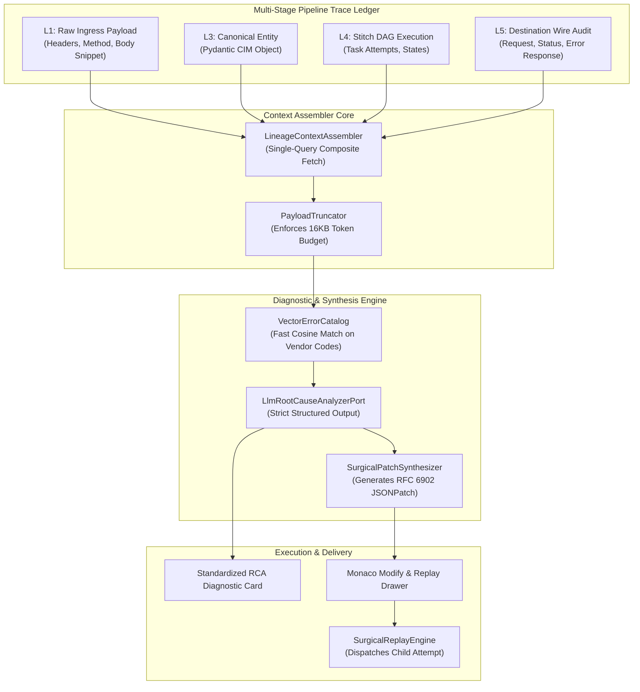

# System Architecture & Engineering Design: AI Operational Root-Cause Analysis & Surgical Replay

- **Document:** ARCH-IP-014 — L9 AI Diagnostic Engine, Semantic Search & Surgical Replay Architecture
- **Product:** Soopa Integration Platform (`apps/ip`)
- **Status:** Approved Architecture Specification (Gold Standard)
- **Bounded Context:** Lineage, Traceability & Support Operations (`L9 Operational Glass Box`)
- **Related Specs:** [ai_operational_rca_and_replay_prd.md](ai_operational_rca_and_replay_prd.md), [l9_timeline_and_replay_design.md](l9_timeline_and_replay_design.md)
- **Architecture Style:** Hexagonal Architecture • Vector Catalog Pre-Matching • Immutable Parent-Child Lineage

---

## 1. Architectural Overview & Context Assembly Pipeline

The Operational Diagnostic subsystem enables sub-second diagnosis of failed integration records by assembling a unified context payload across all pipeline stages:



---

## 2. Open-Source Reference Architecture & Reused Foundations

Rather than developing custom vector databases and AIOps diagnostic pipelines from scratch:
- **[Qdrant](https://github.com/qdrant/qdrant) / [ChromaDB](https://github.com/chroma-core/chroma):** Self-hostable, lightweight vector databases powering the `VectorErrorCatalog` to match vendor-specific error responses (SAP, Oracle, Itron, Salesforce) against known incident resolutions in $< 10\text{ ms}$.
- **[Keep](https://github.com/keephq/keep) & [Robusta](https://github.com/robusta-dev/robusta):** Open-source AIOps and alert correlation platforms that inspire our multi-stage context aggregation, automated root-cause extraction, and automated remediation playbooks.
- **[Fastembed](https://github.com/qdrant/fastembed):** Ultra-fast, lightweight in-process embedding generator (ONNX runtime) enabling sub-10ms semantic parsing of `Cmd+K` natural language queries without external API dependencies.

---

## 3. Hexagonal Domain Model & DTO Contracts

```python
# apps/ip/packages/ip/src/ip/domain/models/operational_ai.py
from dataclasses import dataclass
from enum import StrEnum
from typing import Any


class ErrorCategory(StrEnum):
    DESTINATION_AUTHENTICATION = "DESTINATION_AUTHENTICATION"
    DATA_VALIDATION = "DATA_VALIDATION"
    ENTITY_NOT_FOUND_IN_GEM = "ENTITY_NOT_FOUND_IN_GEM"
    DESTINATION_RATE_LIMITED = "DESTINATION_RATE_LIMITED"
    DESTINATION_SERVER_ERROR = "DESTINATION_SERVER_ERROR"
    TRANSFORMATION_BUG = "TRANSFORMATION_BUG"


class ReplayStage(StrEnum):
    RETRY_INGEST = "RETRY_INGEST"
    RETRY_NORMALIZE = "RETRY_NORMALIZE"
    RETRY_STITCH = "RETRY_STITCH"
    RETRY_DELIVER = "RETRY_DELIVER"


@dataclass(frozen=True, kw_only=True)
class TraceContextDTO:
    trace_id: str
    tenant_id: str
    stream_id: str
    l1_raw_body_snippet: str
    l1_headers: dict[str, str]
    l3_canonical_json: dict[str, Any]
    l4_failed_task_name: str | None
    l5_http_status: int
    l5_request_url: str
    l5_error_response_body: str
    vendor_error_code: str | None


@dataclass(frozen=True, kw_only=True)
class SuggestedRemediationDTO:
    remediation_type: str  # "PAYLOAD_PATCH" | "GEM_ALIAS_UPDATE" | "DESTINATION_RETRY"
    description: str
    json_patch: list[dict[str, Any]] | None
    gem_target_entity_type: str | None
    gem_new_external_id: str | None
    recommended_replay_stage: ReplayStage


@dataclass(frozen=True, kw_only=True)
class DiagnosticReportDTO:
    trace_id: str
    category: ErrorCategory
    confidence: float
    headline: str
    detailed_explanation: str
    offending_field_path: str | None
    remediation: SuggestedRemediationDTO | None
```

---

## 3. Database Schema: Operational Diagnostics & Attempt Lineage

```sql
-- Migration: 20261030_03_add_operational_diagnostics.sql

CREATE TABLE ip_operational_diagnostics (
    trace_id VARCHAR(36) PRIMARY KEY,
    tenant_id VARCHAR(64) NOT NULL,
    category VARCHAR(32) NOT NULL,
    confidence NUMERIC(4, 3) NOT NULL,
    headline VARCHAR(255) NOT NULL,
    detailed_explanation TEXT NOT NULL,
    offending_field_path VARCHAR(255),
    remediation_type VARCHAR(32),
    suggested_json_patch JSONB,
    recommended_replay_stage VARCHAR(32),
    created_at TIMESTAMPTZ NOT NULL DEFAULT NOW()
);

-- Enhancing ip_traces for sub-15ms Natural Language Search & Attempt Trees
ALTER TABLE ip_traces 
ADD COLUMN IF NOT EXISTS parent_trace_id VARCHAR(36),
ADD COLUMN IF NOT EXISTS attempt_number INT NOT NULL DEFAULT 1,
ADD COLUMN IF NOT EXISTS root_cause_category VARCHAR(32);

CREATE INDEX idx_ip_traces_parent_attempt 
ON ip_traces (tenant_id, parent_trace_id, attempt_number);

CREATE INDEX idx_ip_traces_search_composite 
ON ip_traces (tenant_id, status, created_at DESC, root_cause_category);

ALTER TABLE ip_operational_diagnostics ENABLE ROW LEVEL SECURITY;
ALTER TABLE ip_operational_diagnostics FORCE ROW LEVEL SECURITY;

CREATE POLICY tenant_isolation_ip_diagnostics ON ip_operational_diagnostics
FOR ALL USING (tenant_id = current_setting('platform.current_tenant_id', true));
```

---

## 4. LLM Structured Output Pydantic Schema

The interaction with the diagnostic LLM is enforced via Pydantic response models, preventing hallucinated formatting:

```python
# apps/ip/packages/ip/src/ip/adapters/outbound/llm_diagnostic_schemas.py
from pydantic import BaseModel, Field


class JsonPatchOperation(BaseModel):
    op: str = Field(description="JSONPatch operation: add, replace, or remove")
    path: str = Field(description="JSONPath RFC 6901 target path, e.g. /d/ActualMeterReadingDate")
    value: Any | None = Field(default=None, description="New value for replace or add")


class DiagnosticRemediationPlan(BaseModel):
    remediation_type: str = Field(description="PAYLOAD_PATCH, GEM_ALIAS_UPDATE, or DESTINATION_RETRY")
    description: str = Field(description="Plain-English explanation of the fix")
    patch_operations: list[JsonPatchOperation] = Field(default_factory=list)
    gem_entity_type: str | None = None
    gem_suggested_id: str | None = None
    replay_stage: str = Field(description="RETRY_INGEST, RETRY_NORMALIZE, RETRY_STITCH, or RETRY_DELIVER")


class LlmDiagnosticResponse(BaseModel):
    category: str = Field(description="Exact error category enum string")
    confidence: float = Field(ge=0.0, le=1.0)
    headline: str = Field(description="Single-sentence summary of the incident")
    explanation: str = Field(description="Technical diagnostic breakdown")
    offending_field: str | None = None
    remediation: DiagnosticRemediationPlan | None = None
```

---

## 5. Sub-15ms Natural Language Search Parser

When an operator searches in the `Cmd+K` Command Palette:
1. The conversational string is parsed by a lightweight classifier into a structured query object:
   ```python
   # apps/ip/packages/ip/src/ip/domain/models/search.py
   @dataclass(frozen=True, kw_only=True)
   class TraceFilterCriteria:
       tenant_id: str
       status: str | None  # "FAILED", "SUCCESS"
       app_slug: str | None  # "sap_cis", "itron"
       correlation_id: str | None  # "MTR-700"
       error_category: ErrorCategory | None
       start_time: str | None
       end_time: str | None
   ```
2. The query maps directly to indexed PostgreSQL columns:
   ```sql
   SELECT id, correlation_key, status, error_summary, created_at, duration_ms
   FROM ip_traces
   WHERE tenant_id = :tenant_id
     AND (:status IS NULL OR status = :status)
     AND (:category IS NULL OR root_cause_category = :category)
     AND created_at >= :start_time
   ORDER BY created_at DESC
   LIMIT 50;
   ```
3. PostgreSQL evaluates the query using the composite index in $< 12\text{ ms}$, delivering instantaneous Omnibar results.
