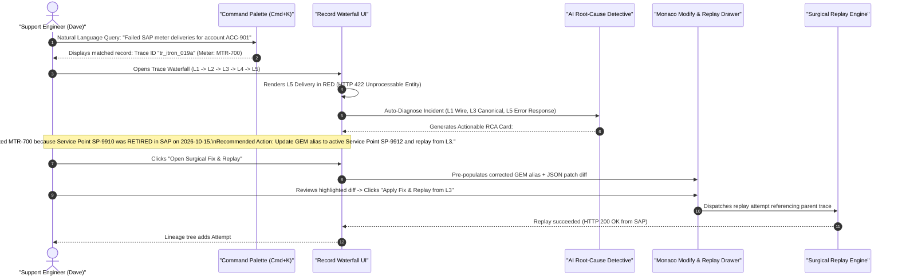

# Product Requirements Document (PRD): AI Operational Root-Cause Analysis & Surgical Replay

- **Document:** PRD-IP-014 — AI-Powered Root-Cause Analysis, 1-Click Surgical Replay & Semantic Command Palette
- **Product:** Soopa Integration Platform (`apps/ip`)
- **Status:** Approved Specification (Gold Standard)
- **Bounded Context:** Lineage, Traceability & Support Operations (`L9 Operational Glass Box`)
- **Target Audience:** Tier-1/Tier-2 Support Engineers, Utility Operations Specialists, Integration Architects
- **Related Specs:** [l9_timeline_and_replay_design.md](file:///Users/apple/soopa_mono/apps/ip/docs/l9_timeline_and_replay_design.md), [frontend_architecture_design.md](file:///Users/apple/soopa_mono/apps/ip/docs/frontend_architecture_design.md)

---

## 1. Executive Summary & Problem Statement

### 1.1 The High Cost of Integration Support Escalations
In enterprise integration pipelines handling millions of transactions, failures are inevitable: an external billing API rejects an invalid account code, an AMI head-end delivers an unmapped status flag, or a partner endpoint is temporarily unreachable.

However, resolving these failures is plagued by severe operational inefficiencies:
1. **Cryptic, Unactionable Vendor Errors:** Destination systems return opaque error bodies:
   - SAP S/4HANA: `<error><code>BAPI_001</code><message>E_INV_PL_VAL_048: Plant 1000 not found for division 01</message></error>`
   - Oracle MDMS: `{"status": 422, "fault": "ORA-20001: Device serial not registered in current operating cycle"}`
   - Itron OpenWay: `HTTP 400 Bad Request: Incompatible interval duration for register profile`
2. **Context Fragmentation & Long MTTR:** Tier-1 support engineers cannot understand what these errors mean. They have to grep raw log files, guess which field was wrong, and escalate tickets to senior backend engineers. Mean Time to Resolution (MTTR) averages **45 to 90 minutes per ticket**.
3. **High-Risk Manual Database Patches:** Fixing a failed record often involves an engineer writing dangerous one-off SQL `UPDATE` scripts directly against production databases.

### 1.2 The Product Solution: The "Support-First Operational Glass Box"
Soopa pairs our sub-15ms record-level trace waterfall (`L1` $\rightarrow$ `L5`) with an **AI Operational Diagnostic Co-Pilot**:
1. **Automated Plain-English Root-Cause Analysis (RCA):** Within $< 1\text{ second}$ of opening a failed trace, the AI cross-references the raw L1 wire request, the L3 canonical object, and the L5 destination error response, producing an actionable explanation.
2. **1-Click Surgical Fix & Replay:** The AI diagnoses the exact root cause, proposes a validated payload patch in the Monaco editor (or updates an obsolete foreign-key alias in the Global Entity Map), and offers a 1-click **"Apply Fix & Replay"** button.
3. **Semantic Natural Language Command Palette (`Cmd+K`):** Support operators query historical traces using conversational language (e.g., *"Find all failed SAP meter deliveries in the North region with negative pulses yesterday"*) instead of memorizing complex database primary keys.

---

## 2. Personas & Core Workflows

### 2.1 Target Personas
1. **Tier-1 Support Engineer (Dave):** First line of defense for customer integration tickets. Needs fast, plain-English answers and safe 1-click remediation tools without reading backend code.
2. **Operations Supervisor (Priya):** Monitors SLA compliance and recurring failure trends across utility feeders. Needs pattern clustering to identify fleet-wide firmware or network issues.
3. **Enterprise Solutions Architect (Alex):** Analyzes recurring schema rejection patterns to proactively refine Canonical and Destination Stitch mappings.

---

### 2.2 User Workflow: End-to-End Incident Diagnosis & Replay

---

## 3. Detailed Functional Requirements

### 3.1 Automated Root-Cause Analysis (RCA)

| ID | Requirement | Description | Acceptance Criteria |
| :--- | :--- | :--- | :--- |
| **FR-RCA-01** | Multi-Stage Context Synthesis | Evaluates the complete execution context (L1 raw body + headers, L3 canonical JSON, L4 task attempts, L5 outbound URL + body + HTTP status + error response) to synthesize the root cause. | Generates complete diagnosis in $< 1.2\text{ seconds}$ without truncating vital vendor error codes. |
| **FR-RCA-02** | Structured Diagnostic Card | The UI presents a standardized diagnostic card containing: | Card renders prominently above the L5 wire inspector. |
| | *1. Headline Summary* | One-sentence plain-English summary of the failure (e.g., *"Customer Account ACC-901 is locked in SAP S/4HANA"*). | Readable by non-technical operators. |
| | *2. Error Classification* | Categorized into standard enums: `AUTH_FAILURE`, `DATA_VALIDATION`, `GEM_UNRESOLVED_ENTITY`, `RATE_LIMITED`, `DESTINATION_DOWN`, `SCHEMA_DRIFT`. | Classification accuracy $\ge 98\%$ on benchmark error suites. |
| | *3. Offending Field Pointer* | Exact JSONPath or field name responsible for the failure (e.g., `d.ActualMeterReadingDate`). | Highlights offending field visually in Monaco. |
| | *4. Actionable Next Step* | Concrete instructions on how to fix the issue (e.g., *"Update GEM alias"*, *"Check destination credentials"*, *"Wait for rate-limit reset"*). | Clear remediation path provided for 100% of classified errors. |
| **FR-RCA-03** | Vector Error Catalog Matching | The engine maintains an embedded vector catalog of known vendor error messages (SAP, Oracle, Itron, Salesforce, Workday), matching raw responses using cosine similarity before LLM synthesis. | Sub-10ms lookup for previously seen error codes. |

---

### 3.2 1-Click Surgical Modify & Replay

| ID | Requirement | Description | Acceptance Criteria |
| :--- | :--- | :--- | :--- |
| **FR-RPL-01** | Pre-Populated JSON Patch | When opening the Monaco Modify & Replay drawer, the AI automatically computes and pre-populates the corrected field values based on the RCA. | Shows visual side-by-side diff: original payload vs. proposed patch. |
| **FR-RPL-02** | Global Entity Map (GEM) Inline Linking | If the error is due to an unlinked foreign key (e.g., source meter serial `ITR-9988` has no known SAP equipment ID), the AI queries GEM candidates and offers a 1-click **"Bind & Save Alias"** action. | Automatically updates GEM alias registry and re-evaluates L3 normalization. |
| **FR-RPL-03** | Multi-Stage Replay Selectivity | Operators can choose which pipeline stage to replay from: | Defaults to the optimal stage suggested by AI. |
| | *1. `RETRY_INGEST` (L1)* | Re-injects the raw wire payload into L2 Ingestion. | Useful when source payload parsing failed. |
| | *2. `RETRY_NORMALIZE` (L3)* | Re-runs L3 Canonical Normalization with updated transformer or GEM rules. | **Most common:** fixes mapping and identity issues without re-ingesting. |
| | *3. `RETRY_STITCH` (L4)* | Re-executes L4 business stitching DAG. | Useful when downstream routing or tariff calculation rules changed. |
| | *4. `RETRY_DELIVER` (L5)* | Retries exact outbound HTTP POST to destination. | Useful after destination maintenance outage resolves. |
| **FR-RPL-04** | Immutable Parent-Child Audit Lineage | Replaying a record creates a new child attempt row (`parent_trace_id = original_trace_id`, `attempt_number = 2`). The original failed attempt is NEVER overwritten. | Full audit ledger preserved for compliance and regulatory reporting. |

---

### 3.3 Semantic Natural Language Command Palette (`Cmd+K`)

| ID | Requirement | Description | Acceptance Criteria |
| :--- | :--- | :--- | :--- |
| **FR-CMD-01** | Conversational Search Query Parsing | Translates freeform queries (e.g., *"failed solar meter deliveries in Austin yesterday"*) into structured database filter criteria. | Correctly parses time ranges, statuses, entity IDs, and geographical/app tags with $\ge 95\%$ accuracy. |
| **FR-CMD-02** | Sub-15ms Query Execution | The parsed query executes against PostgreSQL composite indexes (`tenant_id`, `status`, `created_at`, `correlation_key_hash`). | Returns search results in $< 15\text{ ms}$ across tables with $> 10{,}000{,}000$ records. |
| **FR-CMD-03** | Instant Context Switching | Selecting a search result immediately loads the full 5-stage lineage waterfall without full-page reloads. | Smooth client-side route navigation via TanStack Router. |

---

## 4. Success Metrics & KPIs

| Metric | Industry Baseline (Manual Troubleshooting) | Target with Soopa AI Glass Box |
| :--- | :--- | :--- |
| **Mean Time to Resolve (MTTR)** | 45–90 minutes per ticket | **$< 30\text{ seconds}$** |
| **Tier-1 First-Contact Resolution** | 15% (85% escalated to backend devs) | **$\ge 80\%$ resolved by Tier-1 support** |
| **Support Escalations to Core Engineering** | 20+ escalations per week | **$< 2$ escalations per week** |
| **Audit Compliance** | Manual notes in Jira/ServiceNow | **100% automated immutable attempt lineage** |
