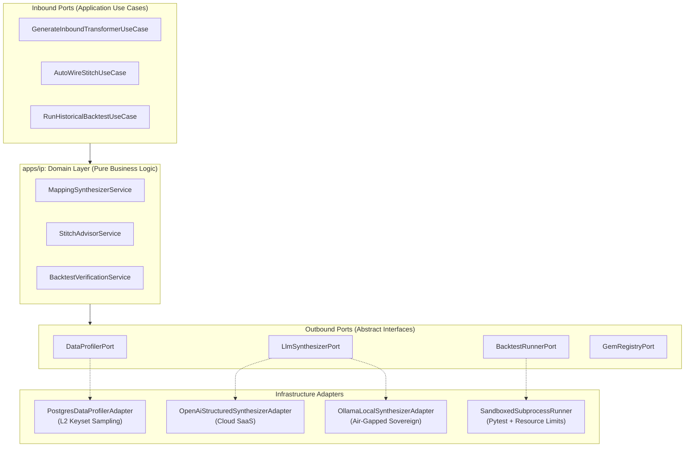
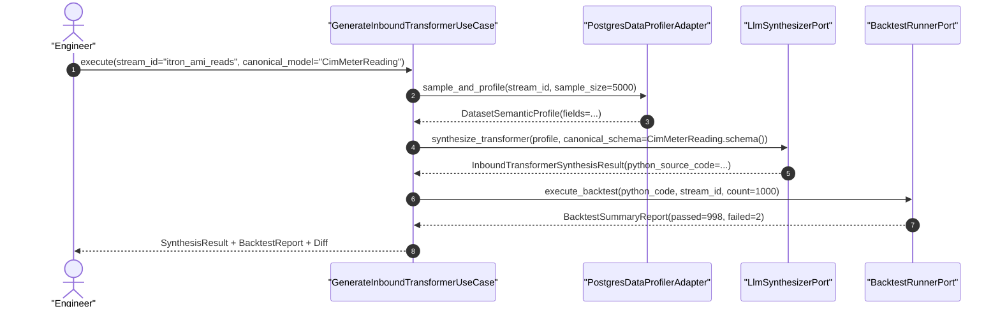
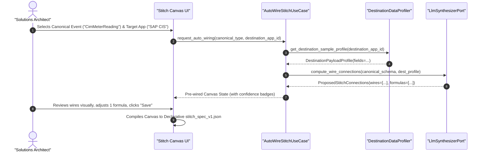

# System Architecture & Engineering Design: Data-Driven AI Schema Mapping & Stitch Co-Pilot

- **Document:** ARCH-IP-012 — AI-Assisted Schema Profiling, Inbound Code Synthesis & Visual Stitch Engine
- **Product:** Soopa Integration Platform (`apps/ip`)
- **Status:** Approved Architecture Specification
- **Related Specs:** [ai_schema_mapping_prd.md](file:///Users/apple/soopa_mono/apps/ip/docs/ai_schema_mapping_prd.md), [l3_normalization_design.md](file:///Users/apple/soopa_mono/apps/ip/docs/l3_normalization_design.md), [frontend_architecture_design.md](file:///Users/apple/soopa_mono/apps/ip/docs/frontend_architecture_design.md)
- **Architecture Style:** Hexagonal Architecture • Decoupled 5-Stage Pipeline • Offline AI Synthesis + Deterministic Fast-Path Execution

---

## 1. Architectural Philosophy & Guiding Invariants

### 1.1 The Fast-Path vs. Control-Plane Separation
In high-throughput enterprise integration (processing millions of meter reads or EDI transactions an hour), **calling an external LLM inside the streaming runtime is an anti-pattern**: it introduces unpredictable latency, high compute costs, rate-limit failures, and the risk of hallucination.

Soopa strictly separates the system into two operational planes:
1. **Control-Plane / Authoring Time (AI-Powered):** AI acts as an asynchronous assistant—profiling historical L2 data, discovering enums, generating type-safe Python transformers (L2 $\rightarrow$ L3), and auto-wiring visual Stitch canvases (L3 $\rightarrow$ L5).
2. **Data-Plane / Runtime Fast-Path (100% Deterministic):** The streaming engine executes **only** compiled Python/Pydantic code (L3) or declarative JSON expressions (L5). Execution is sub-15ms, zero-hallucination, and strictly reproducible.

```text
┌────────────────────────────────────────────────────────────────────────┐
│                   CONTROL PLANE (Asynchronous / AI)                     │
│  L2 Historical Data Profiler  ──>  LLM Synthesizer  ──>  Backtester    │
│  (Samples 5,000 real rows)         (Pydantic Output)     (1,000 runs)  │
└───────────────────────────────────┬────────────────────────────────────┘
                                    │ Generates Deterministic Artifacts
                                    ▼
┌────────────────────────────────────────────────────────────────────────┐
│               DATA PLANE RUNTIME FAST-PATH (Deterministic)              │
│  L1 Ingress  ──>  L2 Replica  ──>  L3 Python  ──>  L4 DAG  ──>  L5 Wire│
│  (Raw Audit)      (Dedupe)         (Compiled)      (Stitch)     (JSON) │
└────────────────────────────────────────────────────────────────────────┘
```

### 1.2 Core Architectural Invariants
1. **Zero Raw Spec Upload Required:** Profiling occurs directly against real data already synced in L2 Source and Destination tables.
2. **Zero PII Leakage:** Customer PII (names, emails, street addresses, credentials) is masked by a local tokenizer before sending structural schema representations to the AI model.
3. **Pluggable AI Backends:** The engine interfaces via abstract Hexagonal ports, supporting **Cloud LLMs** (OpenAI / Claude / AWS Bedrock) for SaaS, and **Self-Hosted Local Models** (Ollama / vLLM Llama 3) for Air-Gapped Sovereign Cells (Tier 3B).
4. **First-Class Error Handling:** All profiling, synthesis, and backtesting operations return strongly-typed `Result[T, E]` objects; exceptions are never used for predictable validation or parsing errors.

### 1.3 Open-Source Reference Architecture & Reused Foundations
Rather than building statistical engines and schema profilers from scratch, Soopa orchestrates proven open-source technologies behind abstract Hexagonal Ports:
- **[Great Expectations](https://github.com/great-expectations/great_expectations) & [YData-Profiling](https://github.com/ydataai/ydata-profiling):** Powers the `DataProfilerPort` adapter to compute column cardinality, value distributions, null percentages, and categorical enums across sampled L2 records.
- **[Evidently AI](https://github.com/evidentlyai/evidently):** Provides the mathematical drift detection engine in L2 to detect subtle data distribution shifts and upstream schema changes without manual rule maintenance.
- **Pydantic v2 & JSONSchema Core:** Generates the deterministic validation constraints and OpenAI Structured Outputs formats.

---

## 2. Hexagonal Architecture: Ports & Adapters



---

## 3. Data Contracts & Domain Models (DTO-First)

All boundary DTOs are immutable frozen dataclasses (`@dataclass(frozen=True)`):

```python
# apps/ip/packages/ip/src/ip/domain/models/ai_mapping.py
from dataclasses import dataclass
from enum import StrEnum
from typing import Any


class SemanticDataType(StrEnum):
    STRING = "STRING"
    INTEGER = "INTEGER"
    FLOAT = "FLOAT"
    BOOLEAN = "BOOLEAN"
    TIMESTAMP_ISO8601 = "TIMESTAMP_ISO8601"
    TIMESTAMP_EPOCH_SEC = "TIMESTAMP_EPOCH_SEC"
    TIMESTAMP_EPOCH_MS = "TIMESTAMP_EPOCH_MS"
    ENERGY_KWH = "ENERGY_KWH"
    ENERGY_MWH = "ENERGY_MWH"
    POWER_KW = "POWER_KW"
    IDENTIFIER = "IDENTIFIER"
    CATEGORICAL_ENUM = "CATEGORICAL_ENUM"
    JSON_OBJECT = "JSON_OBJECT"
    ARRAY = "ARRAY"


@dataclass(frozen=True, kw_only=True)
class FieldSemanticProfile:
    path: str
    inferred_type: SemanticDataType
    null_percentage: float
    sample_values: tuple[str, ...]
    distinct_enum_values: tuple[str, ...]
    is_candidate_business_key: bool


@dataclass(frozen=True, kw_only=True)
class DatasetSemanticProfile:
    stream_id: str
    sample_count: int
    fields: tuple[FieldSemanticProfile, ...]


@dataclass(frozen=True, kw_only=True)
class FieldMappingRule:
    source_path: str
    target_path: str
    confidence_score: float
    transformation_expression: str | None
    gem_lookup_required: bool
    gem_entity_type: str | None
    explanation: str


@dataclass(frozen=True, kw_only=True)
class InboundTransformerSynthesisResult:
    transformer_class_name: str
    python_source_code: str
    field_rules: tuple[FieldMappingRule, ...]
    pydantic_target_model: str


@dataclass(frozen=True, kw_only=True)
class BacktestRecordResult:
    record_index: int
    source_id: str
    success: bool
    error_message: str | None
    output_canonical_json: dict[str, Any] | None


@dataclass(frozen=True, kw_only=True)
class BacktestSummaryReport:
    total_evaluated: int
    passed_count: int
    failed_count: int
    pass_percentage: float
    failures: tuple[BacktestRecordResult, ...]
    duration_ms: float
```

---

## 4. Gate 1: Inbound Mapping (L2 Source $\rightarrow$ L3 Canonical) Deep Dive

### 4.1 Sequence Diagram: Zero-Spec Synthesis with Backtest



### 4.2 LLM Prompt Engineering & Structured Pydantic Output
The LLM interaction uses **Strict Structured Outputs** (OpenAI tool calling / JSON Schema enforcement), guaranteeing that the response parses cleanly into our domain DTOs with zero markdown wrapping or syntax bugs:

```python
# Output Pydantic Schema enforced on LLM Response
from pydantic import BaseModel, Field


class FieldMappingProposal(BaseModel):
    source_field: str = Field(description="JSONPath or dot-path in source L2 record")
    canonical_field: str = Field(description="Target field in Canonical Pydantic model")
    confidence: float = Field(ge=0.0, le=1.0)
    transform_logic: str | None = Field(description="Python expression for unit or datetime conversion")
    gem_resolution_key: str | None = Field(description="If business key, the entity type to resolve in GEM")
    rationale: str = Field(description="Reasoning for mapping choice")


class GeneratedTransformerPlan(BaseModel):
    transformer_name: str
    python_code: str = Field(description="Complete PEP-8 compliant Python transformer class")
    mappings: list[FieldMappingProposal]
```

### 4.3 Sandboxed Backtest Harness
The generated Python code is compiled and executed in a dedicated subprocess with strict resource bounds:
- **Memory limit:** 256 MB.
- **Timeout:** 10.0 seconds for 1,000 records.
- **Network access:** Disabled (pure in-memory transformation).
- Any runtime exception (`ValueError`, `KeyError`, Pydantic `ValidationError`) is caught and wrapped into a `BacktestRecordResult` with record index and payload snippet, displayed in the UI's Edge-Case Review Drawer.

---

## 5. Gate 2: Outbound Stitch Mapping (L3 Canonical $\rightarrow$ L5 Destination) Deep Dive

### 5.1 Architecture of the Visual Stitch Auto-Wirer
Unlike Gate 1 (which generates Python code for high-throughput normalization), **Gate 2 generates declarative JSON Stitch configurations** for the interactive visual canvas.



### 5.2 Declarative Stitch Specification (`stitch_spec_v1.json`)
The output of the visual Stitch canvas is a versioned, declarative JSON spec executed at runtime by our fast JSONata/CEL evaluation engine:

```json
{
  "stitch_id": "stitch_cim_to_sap_cis_v2",
  "version": "1.0.0",
  "source_canonical_model": "CimMeterReading",
  "destination_adapter": "sap_s4hana_odata_v2",
  "mappings": [
    {
      "source_path": "reading_value",
      "target_path": "d.MeterReadingResult",
      "confidence": 0.99,
      "expression": "source.reading_value"
    },
    {
      "source_path": "read_timestamp",
      "target_path": "d.ActualMeterReadingDate",
      "confidence": 0.95,
      "expression": "format_date(source.read_timestamp, 'yyyyMMdd')"
    },
    {
      "source_path": "device_id",
      "target_path": "d.EquipmentID",
      "confidence": 0.98,
      "expression": "gem.resolve('METER', source.device_id, 'SAP_EQUIPMENT_NUM')"
    }
  ]
}
```

---

## 6. Privacy, Security & Sovereign Cloud Isolation

Enterprise utilities and financial institutions operate under strict data-protection laws (NERC-CIP, SOC 2, HIPAA, GDPR).

### 6.1 Anonymization & Tokenization Pipeline
Before any schema metadata or sample records are passed to the `LlmSynthesizerPort`:
1. **PII Masking:** Names, street addresses, phone numbers, and customer emails are replaced with token markers (`<MASKED_CUSTOMER_NAME>`, `<MASKED_EMAIL>`).
2. **Value Blinding:** High-entropy fields (passwords, tokens, API keys) are completely stripped.
3. **Only Distributions & Structural Samples Sent:** The profiler sends data types, field names, and normalized representative values (e.g., `12.45`, `2026-10-30T10:00:00Z`, `'ACTUAL'`).

### 6.2 Sovereign & Air-Gapped Mode (Local Ollama / vLLM)
For **Tier 3B Sovereign Cells** deployed inside customer private clouds:
- The `OllamaLocalSynthesizerAdapter` connects directly to a containerized local model (such as `codellama:13b` or `llama3:8b-instruct`) running within the customer's Kubernetes cluster.
- **Zero outbound internet calls are made.** All synthesis, profiling, and backtesting execute 100% within the customer's private security boundary.

---

## 7. Phased Implementation Plan

| Phase | Milestone | Deliverables |
| :--- | :--- | :--- |
| **Phase 1: L2 Semantic Profiler** | Profiling Core | `PostgresDataProfilerAdapter` with keyset sampling (5,000 rows), enum detection, type inference, and PII anonymization tokenizer. |
| **Phase 2: Gate 1 Inbound Synthesizer** | L2 $\rightarrow$ L3 AI Engine | `LlmSynthesizerPort`, OpenAI Structured Output adapter, `SandboxedSubprocessRunner`, and automated 1,000-record backtest report generator. |
| **Phase 3: Gate 2 Stitch Auto-Wirer** | L3 $\rightarrow$ L5 Visual Co-Pilot | `StitchAutoWireAdapter`, declarative `stitch_spec_v1.json` compiler, and integration with the `@soopa/ip-ui` visual canvas. |
| **Phase 4: Sovereign Air-Gap Adapter** | Private Cloud Portability | `OllamaLocalSynthesizerAdapter` integration, local model benchmarking, and Helm chart subchart packaging for offline Kubernetes cells. |
