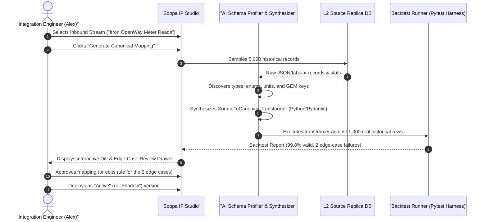
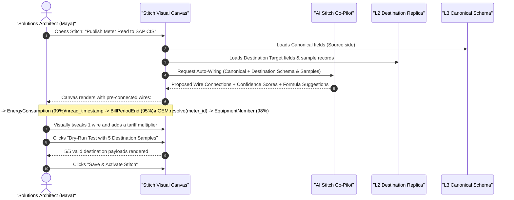

# Product Requirements Document (PRD): Data-Driven AI Schema Mapping & Stitch Co-Pilot

- **Document:** PRD-IP-012 — AI-Assisted Schema Mapping & Visual Stitching
- **Product:** Soopa Integration Platform (`apps/ip`)
- **Target Audience:** Integration Engineers, Utility Operations Teams, Solutions Architects
- **Status:** Approved Specification
- **Related Specs:** [architecture.md](architecture.md), [l3_normalization_design.md](l3_normalization_design.md), [frontend_architecture_design.md](frontend_architecture_design.md)

---

## 1. Executive Summary & Problem Statement

### 1.1 The Enterprise Integration Bottleneck
In traditional enterprise integration (MuleSoft, Boomi, Informatica), building an end-to-end integration between a legacy utility system (such as an Itron AMI Head-End, Landis+Gyr, or ABB SCADA) and an enterprise destination (such as SAP S/4HANA CIS, Oracle MDMS, or ESRI GIS) takes **3 to 6 weeks of senior engineering effort per connection**.

Over 70% of this time is consumed by:
1. **Deciphering undocumented schemas:** Reading outdated PDFs or incomplete Swagger specs that omit custom user-defined fields, internal enum codes (e.g., `'NORM'`, `'VEE_CORR'`), and proprietary date/time serializations.
2. **Manual Field-to-Field Mapping:** Dragging lines between 100+ source fields and target fields across deep nested objects.
3. **Identity & Unit Confusion:** Manually figuring out which foreign key links a source device to a target asset, and which units of measure require conversions (e.g., Wh to kWh, US Gallons to Liters).
4. **Fear of Regressions:** Deploying mapping changes to production without the ability to verify them against real historical data.

### 1.2 The Core Product Breakthrough: Data-Driven Mapping
Soopa operates on a fundamental structural advantage: **we already sync real data from both Source and Destination into our system (L2 Replicas).**

Instead of forcing users to upload abstract OpenAPI/XSD schemas, Soopa's **Data-Driven AI Mapping Engine** leverages the real production data already stored in L2:
- It profiles the real historical distributions, true data types, and enum values.
- At **Gate 1 (Inbound L2 $\rightarrow$ L3)**: AI synthesizes deterministic, type-safe Python/Pydantic Canonical Normalization code and **instantly backtests it against 1,000 real past records**.
- At **Gate 2 (Outbound L3 $\rightarrow$ L5)**: AI acts as a **Visual Co-Pilot inside the Stitch UI**, auto-wiring field connections on the visual canvas with confidence badges, so the user simply reviews, tweaks, and saves—**zero manual coding required**.

---

## 2. Personas & Core User Workflows

### 2.1 Target Personas
1. **Utility Integration Engineer (Alex):** Writes and maintains mission-critical AMI/MDM data flows. Needs 100% type safety, deterministic Python code for compliance audits, and zero downtime.
2. **Citizen Solutions Architect / Operations Lead (Maya):** Configures outbound business workflows (Stitches) connecting Canonical models to SAP/Salesforce. Prefers visual drag-and-drop, automated suggestions, and zero-code configuration.
3. **Tier-1 Support Engineer (Dave):** Diagnoses why a specific meter reading failed delivery. Relies on the sub-15ms record lineage waterfall and 1-click error remediation.

---

### 2.2 User Workflow 1: Inbound Canonical Mapping (L2 $\rightarrow$ L3 Code-Assisted)



---

### 2.3 User Workflow 2: Outbound Stitch Mapping (L3 $\rightarrow$ L5 Visual Co-Pilot)



---

## 3. Detailed Functional Requirements

### 3.1 Data-Driven Semantic Profiler (L2 Layer)

| ID | Requirement | Description | Acceptance Criteria |
| :--- | :--- | :--- | :--- |
| **FR-PRF-01** | Zero-Spec Profiling | The system MUST profile schemas directly from L2 table records without requiring user-uploaded Swagger/OpenAPI/XSD files. | Generates complete structural schema from a sample of 1,000–10,000 rows in `< 3 seconds`. |
| **FR-PRF-02** | Deep Type & Format Inference | The profiler MUST distinguish specific semantic formats beyond generic JSON types: ISO-8601 strings, UNIX epoch (sec vs. ms), UUIDs, email, phone, currency, and energy units (Wh, kWh, MWh). | Correctly identifies datetime format and energy units with $\ge 98\%$ accuracy across test corpora. |
| **FR-PRF-03** | Enum & Category Extraction | The profiler MUST scan all sampled records to collect complete discrete sets of string/int status codes, computing frequency distribution. | Flags fields with $\le 50$ distinct values as categorical enums and lists all discovered variants. |
| **FR-PRF-04** | Anonymized Structural Sampling | When sending sample data to LLMs for mapping synthesis, the profiler MUST redact PII (names, emails, street addresses, SSNs/tax IDs) and replace them with synthetic semantic equivalents. | 100% of PII fields scrubbed before external LLM inference; enterprise customers can configure local private SLMs (e.g., Ollama / Llama 3). |

---

### 3.2 Inbound Mapping & Transformer Synthesis (Gate 1: L2 $\rightarrow$ L3)

| ID | Requirement | Description | Acceptance Criteria |
| :--- | :--- | :--- | :--- |
| **FR-INB-01** | Python/Pydantic Code Generation | The engine MUST generate deterministic, PEP-8 compliant Python code implementing `SourceToCanonicalTransformer`. | Code passes `mypy --strict`, has zero `Any`, zero `# type: ignore`, and compiles cleanly. |
| **FR-INB-02** | Unit & Timezone Normalization | Inferred transformations MUST explicitly normalize timestamps to UTC and convert source physical units to Canonical units (e.g., Wh $\rightarrow$ kWh). | Generated code contains explicit arithmetic scaling and timezone conversions. |
| **FR-INB-03** | Global Entity Map (GEM) Linking | The AI MUST detect business foreign keys (e.g., `serial_number`, `meter_ext_id`) and inject `gem_client.resolve_entity(...)` calls. | Automatically identifies candidate business keys with $\ge 90\%$ match to existing GEM registries. |
| **FR-INB-04** | Automated 1,000-Record Backtest | Before presenting generated code for approval, the system MUST execute the transformer against 1,000 real past L2 records in an isolated sandbox. | Produces an interactive Backtest Report showing pass rate, failure count, and exact error stack traces for invalid records. |
| **FR-INB-05** | Shadow Mode Deployment | Users MUST be able to deploy new mapping versions in `SHADOW` mode, running side-by-side with live traffic to generate Monaco diffs without writing to L4. | Shadow executions record output diffs for 24h with zero impact on live processing latency. |

---

### 3.3 Outbound Stitch Canvas & Visual Co-Pilot (Gate 2: L3 $\rightarrow$ L5)

| ID | Requirement | Description | Acceptance Criteria |
| :--- | :--- | :--- | :--- |
| **FR-STH-01** | Visual Canvas Auto-Wiring | When opening a Stitch mapping, the AI MUST automatically connect source Canonical ports to target Destination ports based on semantic similarity and historical destination payloads. | Pre-connects fields with confidence score $\ge 75\%$; highlights high-confidence ($\ge 95\%$) in green and medium-confidence ($75\text{--}94\%$) in amber, while leaving scores $< 75\%$ disconnected in the Suggested Mappings drawer. |
| **FR-STH-02** | Formula & Lookup Suggestions | For fields requiring transformation (e.g., concatenating `first_name + ' ' + last_name` or multiplying `kwh * rate`), the AI MUST suggest declarative formulas. | Formulas are written in standard declarative Stitch expressions (e.g., `JSONata` or CEL), editable visually. |
| **FR-STH-03** | Interactive Review & Tweak | The user MUST be able to break any AI-generated wire, drag a new wire, change formulas, or map constant values visually on the canvas. | Any manual edit immediately updates the live preview drawer. |
| **FR-STH-04** | Declarative JSON Serialization | Saving the visual Stitch MUST compile the canvas into an immutable, declarative JSON Stitch specification (`stitch_spec_v1`). | Zero Python code generation required for L3 $\rightarrow$ L5; executes via deterministic high-throughput JSONata/CEL runtime. |
| **FR-STH-05** | Live Dry-Run with Destination Samples | The UI MUST provide a "Test with 5 Destination Samples" button that runs the Stitch against real canonical events and validates against destination schema. | Displays side-by-side Canonical Input vs. Output Payload formatted exactly as the destination API expects. |

---

## 4. Confidence Thresholds & Guardrails

To prevent incorrect mappings and hallucinated data in regulated industries, the system enforces strict confidence gates:

```text
Confidence Score >= 95%: Auto-connected on canvas; green badge; pre-selected for approval.
Confidence Score 75% - 94%: Auto-connected on canvas; amber badge; flagged with "Review Recommended".
Confidence Score < 75%: Not connected; displayed in "Suggested Mappings" drawer for manual drag-and-drop.
```

### Non-Negotiable Reliability Invariants

1. **Never Execute AI in the Fast-Path:** The real-time streaming engine (processing 10M records/hr) NEVER calls LLMs. It executes compiled Python code (L2 $\rightarrow$ L3) or declarative JSON specs (L3 $\rightarrow$ L5) with `<15ms` execution time.
2. **Mandatory Human-in-the-Loop for Active Deployment:** AI-generated mappings can run in `SHADOW` or `DRAFT` mode automatically, but promoting to `ACTIVE` production traffic requires an explicit human click and review.
3. **Audit Trail:** Every AI-suggested field mapping stores metadata: model version, prompt hash, confidence score, and timestamp of human approval.

---

## 5. Success Metrics & KPIs

| Metric | Baseline (Manual MuleSoft/Boomi) | Target with Soopa AI Mapping | Impact |
| :--- | :--- | :--- | :--- |
| **Time to Map New Inbound Source** | 3–5 business days | **< 15 minutes** | 95% reduction in integration engineering time |
| **Time to Build Outbound Stitch** | 1–2 business days | **< 5 minutes** | Near-instant visual review & activation |
| **First-Pass Historical Accuracy** | N/A (bugs found in staging/prod) | **$\ge 99.5\%$ backtest pass rate** | Zero production regressions on schema deploy |
| **Support Root-Cause Resolution** | 45 minutes per ticket | **< 30 seconds** | Sub-15ms trace + AI explanation |
