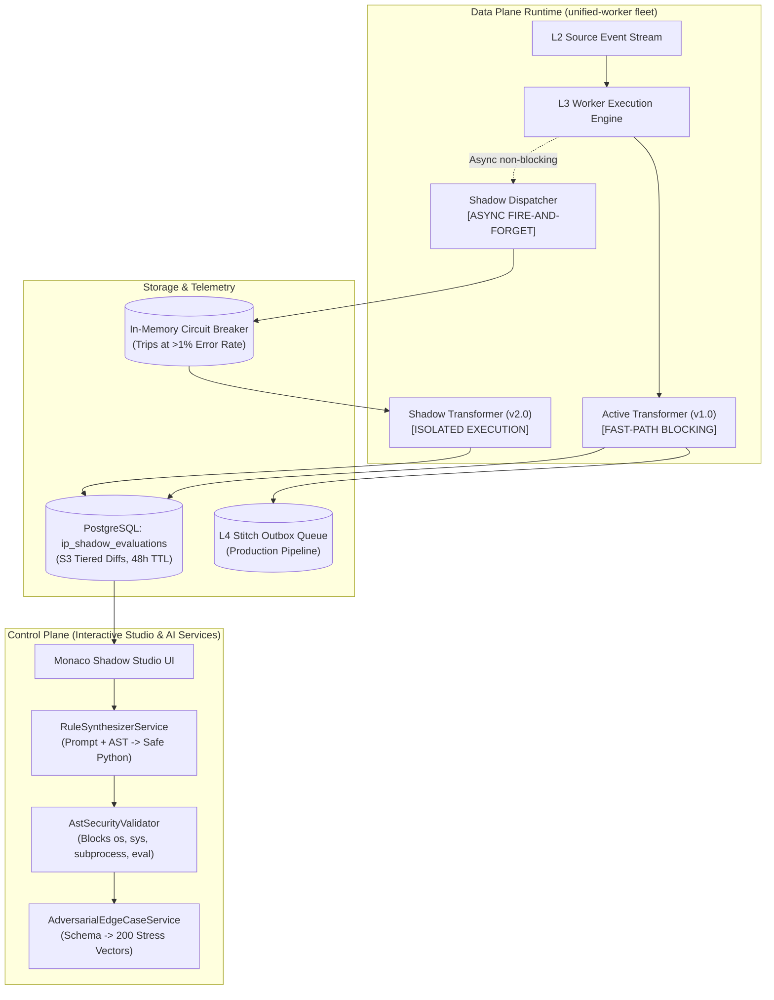

# System Architecture & Engineering Design: AI Shadow Testing & Natural Language Rule Engine

- **Document:** ARCH-IP-013 — Shadow Transformer Execution, Adversarial Synthesis & AST Rule Engine
- **Product:** Soopa Integration Platform (`apps/ip`)
- **Status:** Approved Architecture Specification (Gold Standard)
- **Bounded Context:** Normalization & Transformation (`L3 Normalization`)
- **Related Specs:** [ai_shadow_testing_and_rules_prd.md](file:///Users/apple/soopa_mono/apps/ip/docs/ai_shadow_testing_and_rules_prd.md), [l3_normalization_design.md](file:///Users/apple/soopa_mono/apps/ip/docs/l3_normalization_design.md)
- **Architecture Style:** Hexagonal Architecture • Asynchronous Shadow Dispatch • Deterministic AST Compilation

---

## 1. Architectural Overview & Component Pipeline

The Shadow Transformation & Rule Synthesis subsystem bridges interactive developer tooling in the Control Plane with high-throughput streaming execution in the Data Plane:



---

## 2. Open-Source Reference Architecture & Reused Foundations

Rather than custom-crafting traffic mirroring proxies, diffing engines, or fuzzers, this subsystem is powered by proven open-source technologies:
- **[Hypothesis](https://github.com/HypothesisWorks/hypothesis):** The industry-standard Python property-based testing library. Powers the `AdversarialEdgeCaseService` to synthesize boundary values (DST time jumps, numeric overflows, unicode strings, floating-point precision edge cases) directly from Pydantic schemas.
- **[Diffy](https://github.com/opendiffy/diffy) (Twitter OSS) & [Keploy](https://github.com/keploy/keploy):** Architecture inspiration for zero-impact production traffic capture, side-by-side execution mirroring, and automated noise-filtering diffing.
- **[jsonpatch](https://github.com/stefankoegl/python-json-patch):** Standard RFC 6902 compliant JSON Patch generation for deterministic semantic delta computation.

---

## 3. Core Invariants & Engineering Guarantees

1. **Production Pipeline Immunity:** A bug, memory leak, slow execution, or fatal exception inside a Shadow transformer MUST NEVER:
   - Delay active L3 $\rightarrow$ L4 transformation latency.
   - Halt worker execution loops.
   - Corrupt production database transactions.
2. **Deterministic AST Static Analysis:** Code generated from natural language prompts passes through Python's `ast.parse` and an immutable security visitor. Code is verified to contain **zero dynamic imports, zero file system access, and zero network calls** before saving to the database.
3. **Bounded Shadow Telemetry & Chunked Purging:** `ip_shadow_evaluations` stores diff records with a 48-hour expiration. A background cron job purges expired rows strictly in **chunked batches (`DELETE ... WHERE ctid IN (SELECT ctid FROM ... WHERE created_at < NOW() - INTERVAL '48 hours' LIMIT 1000)` + `commit()` + `await asyncio.sleep(0.1)`)** to prevent table lock escalation and WAL contention.

---

## 3. Hexagonal Domain Model & DTO Contracts

All contracts adhere strictly to our **DTO-First Standard** using frozen dataclasses (`@dataclass(frozen=True)`):

```python
# apps/ip/packages/ip/src/ip/domain/models/shadow_testing.py
from dataclasses import dataclass
from enum import StrEnum
from typing import Any


class TransformerState(StrEnum):
    DRAFT = "DRAFT"
    SHADOW = "SHADOW"
    ACTIVE = "ACTIVE"
    ARCHIVED = "ARCHIVED"


class AdversarialCategory(StrEnum):
    TEMPORAL_DISCONTINUITY = "TEMPORAL_DISCONTINUITY"
    PHYSICAL_INVARIANT_ROLLOVER = "PHYSICAL_INVARIANT_ROLLOVER"
    MULTI_PHASE_ELECTRICAL = "MULTI_PHASE_ELECTRICAL"
    MISSING_AND_INCOMPLETE = "MISSING_AND_INCOMPLETE"
    STRUCTURAL_FUZZING = "STRUCTURAL_FUZZING"


@dataclass(frozen=True, kw_only=True)
class RuleSynthesisCommand:
    transformer_id: str
    tenant_id: str
    active_source_code: str
    natural_language_prompt: str
    canonical_model_class_name: str


@dataclass(frozen=True, kw_only=True)
class RuleSynthesisResult:
    transformer_id: str
    patched_source_code: str
    modified_functions: tuple[str, ...]
    explanation_markdown: str
    ast_validation_passed: bool


@dataclass(frozen=True, kw_only=True)
class AdversarialVectorDTO:
    vector_id: str
    category: AdversarialCategory
    description: str
    input_payload: dict[str, Any]
    expected_valid: bool


@dataclass(frozen=True, kw_only=True)
class ShadowEvaluationDTO:
    evaluation_id: str
    tenant_id: str
    stream_id: str
    source_record_id: str
    active_version: str
    shadow_version: str
    has_diff: bool
    json_patch: list[dict[str, Any]]
    active_duration_ms: float
    shadow_duration_ms: float
    shadow_error: str | None
```

---

## 4. Database Schema Specification (`apps/ip`)

```sql
-- Migration: 20261030_02_add_shadow_transformers_and_evaluations.sql

CREATE TABLE ip_transformers (
    id VARCHAR(36) PRIMARY KEY,
    tenant_id VARCHAR(64) NOT NULL,
    stream_id VARCHAR(64) NOT NULL,
    version VARCHAR(32) NOT NULL,
    state VARCHAR(16) NOT NULL DEFAULT 'DRAFT', -- DRAFT, SHADOW, ACTIVE, ARCHIVED
    canonical_model VARCHAR(128) NOT NULL,
    python_source_code TEXT NOT NULL,
    author_id VARCHAR(64) NOT NULL,
    sampling_rate_percent INT NOT NULL DEFAULT 100,
    created_at TIMESTAMPTZ NOT NULL DEFAULT NOW(),
    updated_at TIMESTAMPTZ NOT NULL DEFAULT NOW(),
    CONSTRAINT uq_ip_transformers_tenant_stream_version UNIQUE (tenant_id, stream_id, version)
);

CREATE TABLE ip_shadow_evaluations (
    id VARCHAR(36) PRIMARY KEY,
    tenant_id VARCHAR(64) NOT NULL,
    stream_id VARCHAR(64) NOT NULL,
    source_record_id VARCHAR(128) NOT NULL,
    active_version VARCHAR(32) NOT NULL,
    shadow_version VARCHAR(32) NOT NULL,
    has_diff BOOLEAN NOT NULL DEFAULT FALSE,
    active_output JSONB NOT NULL,
    shadow_output JSONB,
    diff_patch JSONB, -- RFC 6902 JSONPatch array
    shadow_error TEXT,
    execution_delta_ms NUMERIC(8, 3) NOT NULL,
    created_at TIMESTAMPTZ NOT NULL DEFAULT NOW()
);

-- Indices for sub-15ms Monaco Diff Viewer queries and chunked retention purging
CREATE INDEX idx_ip_shadow_evaluations_stream_diff 
ON ip_shadow_evaluations (tenant_id, stream_id, has_diff, created_at DESC);

CREATE INDEX idx_ip_shadow_evaluations_retention 
ON ip_shadow_evaluations (created_at);

ALTER TABLE ip_transformers ENABLE ROW LEVEL SECURITY;
ALTER TABLE ip_transformers FORCE ROW LEVEL SECURITY;
ALTER TABLE ip_shadow_evaluations ENABLE ROW LEVEL SECURITY;
ALTER TABLE ip_shadow_evaluations FORCE ROW LEVEL SECURITY;

CREATE POLICY tenant_isolation_ip_transformers ON ip_transformers
FOR ALL USING (tenant_id = current_setting('platform.current_tenant_id', true));

CREATE POLICY tenant_isolation_ip_shadow_evaluations ON ip_shadow_evaluations
FOR ALL USING (tenant_id = current_setting('platform.current_tenant_id', true));
```

---

## 5. AST Parsing & Safety Visitor Implementation

Before any generated Python code is saved or compiled into executable bytecode, it is audited by a custom `ast.NodeVisitor`:

```python
# apps/ip/packages/ip/src/ip/adapters/outbound/ast_security_validator.py
import ast
from seedwork.result import Result


class SecurityViolationError(Exception):
    pass


class TransformerAstSecurityVisitor(ast.NodeVisitor):
    ALLOWED_MODULES = frozenset(
        {"math", "datetime", "decimal", "typing", "pydantic", "uuid", "re"}
    )
    FORBIDDEN_CALLS = frozenset(
        {"eval", "exec", "compile", "open", "getattr", "setattr", "__import__"}
    )

    def visit_Import(self, node: ast.Import) -> None:
        for alias in node.names:
            if alias.name.split(".")[0] not in self.ALLOWED_MODULES:
                raise SecurityViolationError(
                    f"Forbidden module import: {alias.name}"
                )
        self.generic_visit(node)

    def visit_ImportFrom(self, node: ast.ImportFrom) -> None:
        if node.module and node.module.split(".")[0] not in self.ALLOWED_MODULES:
            raise SecurityViolationError(
                f"Forbidden from-import module: {node.module}"
            )
        self.generic_visit(node)

    def visit_Call(self, node: ast.Call) -> None:
        if isinstance(node.func, ast.Name) and node.func.id in self.FORBIDDEN_CALLS:
            raise SecurityViolationError(
                f"Forbidden built-in call: {node.func.id}"
            )
        self.generic_visit(node)


def validate_python_code_security(source_code: str) -> Result[bool, str]:
    try:
        tree = ast.parse(source_code)
        visitor = TransformerAstSecurityVisitor()
        visitor.visit(tree)
        return Result.ok(True)
    except SecurityViolationError as err:
        return Result.err(str(err))
    except SyntaxError as err:
        return Result.err(f"Python Syntax Error: {err}")
```

---

## 6. Real-Time Monaco Semantic Diff Engine

To power the side-by-side diff in the Monaco Studio, the system computes standard RFC 6902 JSON patches:

1. **Normalizing Dictionaries:** Both `Active Output` and `Shadow Output` dictionaries are keyset-sorted and normalized.
2. **Computing Patch:**
   ```python
   import jsonpatch

   diff = jsonpatch.make_patch(active_dict, shadow_dict)
   has_diff = len(diff.patch) > 0
```
3. **Streaming via WebSocket / SSE:** The Studio client connects to:
   `GET /api/v1/ip/streams/{stream_id}/shadow-diffs/stream`
   The backend pushes new evaluation events as they occur, allowing the engineer to watch live production records evaluate in real time with side-by-side diff highlighting.
4. **1-Click Atomic Promotion:**
   When the engineer promotes the shadow version, `PromoteShadowVersionUseCase` executes an atomic SQL transaction:
   ```sql
   UPDATE ip_transformers SET state = 'ARCHIVED' WHERE tenant_id = :tid AND stream_id = :sid AND state = 'ACTIVE';
   UPDATE ip_transformers SET state = 'ACTIVE' WHERE tenant_id = :tid AND stream_id = :sid AND version = :shadow_version;
```
   The worker fleet receives an instant Postgres `NOTIFY ip_transformer_cache_invalidated` event, refreshing in-memory compiled bytecode within $< 100\text{ ms}$ with zero dropped stream messages.
