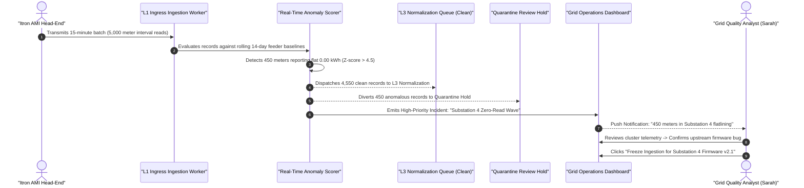

# Product Requirements Document (PRD): Semantic Data Quality & Stream Anomaly Detection

- **Document:** PRD-IP-016 — Real-Time Stream Anomaly Detection & Silent Data Corruption Prevention
- **Product:** Soopa Integration Platform (`apps/ip`)
- **Status:** Approved Specification (Gold Standard)
- **Bounded Context:** Ingestion & Real-Time Data Quality (`L1/L2 Streaming`)
- **Target Audience:** Utility Operations Engineers, Grid Quality Analysts, Enterprise Data Stewards
- **Related Specs:** [l1_ingestion_design.md](file:///Users/apple/soopa_mono/apps/ip/docs/l1_ingestion_design.md), [l2_replica_design.md](file:///Users/apple/soopa_mono/apps/ip/docs/l2_replica_design.md), [l3_normalization_design.md](file:///Users/apple/soopa_mono/apps/ip/docs/l3_normalization_design.md)

---

## 1. Executive Summary & Problem Statement

### 1.1 The Silent Menace of Valid But Corrupt Data
In mission-critical integration pipelines (especially Energy utilities, Water distribution, and IoT sensor networks), the most destructive operational incidents are **not** HTTP 500 crashes or syntax errors.

The most dangerous failures are **Silent Data Corruption**:
1. **The Flatline Anomaly:** A firmware update causes 10,000 smart meters to transmit valid JSON with HTTP 200, but every single meter reading reports exactly `0.00 kWh`.
2. **The Inverted Sign Anomaly:** A solar grid inverter or net-metered residential account suddenly reports negative consumption as export instead of import, creating massive accounting miscalculations.
3. **The Impossible Spike:** A register malfunction reports a residential customer consuming $150{,}000\text{ kWh}$ in a 15-minute interval (exceeding the physical capacity of the electrical substation).
4. **The Missing Interval Gap:** A head-end system drops 15-minute interval pulses between 02:00 AM and 04:00 AM without alerting the integration platform.

Standard APM tools (Datadog, CloudWatch) report "100% green" because the API status is HTTP 200 OK. The corruption is only discovered weeks later when customers receive erroneous \$0 or \$10,000 utility bills, damaging customer trust and incurring regulatory fines.

### 1.2 The Product Solution: Real-Time Stream Anomaly Detection
Soopa embeds a **Real-Time Semantic Data Quality & Anomaly Detection Engine** directly within the L1/L2 streaming ingestion pipeline:
1. **Sub-2ms Vectorized Anomaly Scoring:** Evaluates incoming interval data streams against historical baseline profiles using fast statistical and machine-learning models (Modified Z-score, EWMA, and Isolation Forests) in $< 2\text{ ms}$.
2. **Automated Quarantine Hold:** Flags anomalous records with a `DATA_QUALITY_ALERT` and diverts them to an isolated quarantine hold before they pollute L4 business workflows or reach billing CIS systems.
3. **Proactive Vendor & Feeder Alerts:** Identifies which upstream AMI head-end, firmware version, or substation feeder is producing corrupt data, allowing grid operations to intervene before billing cycles close.

---

## 2. Personas & Core Workflows

### 2.1 Target Personas
1. **Grid Quality Analyst (Sarah):** Monitors interval meter telemetry across utility feeders. Needs immediate alerts when sensor clusters exhibit flatlining or unseasonal consumption anomalies.
2. **Billing Operations Lead (Marcus):** Enforces data quality standards before invoice generation. Needs confidence that no unverified or corrupted interval reads reach the customer billing engine.
3. **AMI Field Engineer (Ken):** Troubleshoots malfunctioning meter hardware. Uses cluster anomaly reports to identify faulty firmware batches in the field.

---

### 2.2 User Workflow: Detecting, Quarantining, and Triaging Corrupt Telemetry

---

## 3. Detailed Functional Requirements

### 3.1 Inline Real-Time Anomaly Scoring

| ID | Requirement | Description | Acceptance Criteria |
| :--- | :--- | :--- | :--- |
| **FR-ANM-01** | Sub-2ms Fast-Path Latency | Evaluates time-series numeric fields (consumption, demand, voltage) in real time without creating a stream processing bottleneck. | Inline scoring latency $\le 2.0\text{ ms}$ per 1,000-record batch. |
| **FR-ANM-02** | Multi-Vector Anomaly Taxonomy | Detects five distinct categories of silent data corruption: | Achieves $\ge 99\%$ detection rate across benchmark synthetic corruption datasets. |
| | *1. Flatline Zero-Variance* | Detects when historically active meters report consecutive zero consumption or constant unvarying values ($\sigma^2 < 10^{-6}$). | Flags flatlines within 4 consecutive 15-minute intervals. |
| | *2. Impossible Spikes & Capacity Breaches* | Detects values exceeding physical line/transformer ratings or exceeding the 99.9th historical percentile by $> 4\sigma$. | Flags extreme spikes with zero false negatives. |
| | *3. Temporal Gaps & Duplicate Cadence* | Detects missing intervals in expected cadences (e.g., 96 intervals/day) or duplicate interval timestamps. | Accurately identifies interval count discrepancies. |
| | *4. Inverted Polarity / Sign Flips* | Detects non-solar accounts reporting negative consumption, or solar export exceeding inverter nameplate rating. | Flags inverted polarity on first occurrence. |
| | *5. Unseasonal Consumption Shifts* | Detects sudden, widespread consumption deviations unexplainable by ambient weather or temperature. | Correlates consumption with regional temperature telemetry to suppress false alerts during heat waves. |

---

### 3.2 Quarantine Routing & Operational Triage

| ID | Requirement | Description | Acceptance Criteria |
| :--- | :--- | :--- | :--- |
| **FR-QRN-01** | Automated Quarantine Hold | Records with an anomaly score $> 0.85$ are automatically diverted from the normal L3 pipeline into an isolated `ip_quarantine_hold` table. | Corrupted records are 100% prevented from reaching L4 business workflows or downstream billing. |
| **FR-QRN-02** | Flag-and-Continue Policy | Streams configured with `POLICY = FLAG_AND_CONTINUE` allow anomalous records to proceed to L3, but attach an immutable `data_quality_warning` tag to the Canonical entity. | Downstream workflows can inspect the tag and conditionally route. |
| **FR-QRN-03** | Interactive Quarantine Workbench | The UI provides a dedicated Quarantine Review Queue displaying anomalous records alongside historical baseline comparison charts. | Displays affected records, feeder clusters, and baseline bands in $< 200\text{ ms}$. |
| **FR-QRN-04** | Batch Resolution Actions | Analysts can perform batch triage actions on quarantined records: | Selected action updates records and triggers outbox events atomically. |
| | *1. "Approve as Legitimate Storm Surge"* | Clears the anomaly flag and re-injects records into L3 Normalization. | Re-injected records resume downstream processing seamlessly. |
| | *2. "Interpolate Missing / Corrupted Values"* | Replaces flatline or missing pulses with estimated values calculated from the 3-week historical diurnal baseline. | Marks data quality as `ESTIMATED_VEE`. |
| | *3. "Discard Corrupted Records"* | Permanently drops the records and emits an audit event. | Records are removed from processing and archived. |

---

### 3.3 Dynamic Baseline Learning

| ID | Requirement | Description | Acceptance Criteria |
| :--- | :--- | :--- | :--- |
| **FR-BSL-01** | Rolling Diurnal Baseline Learning | An asynchronous background job continuously updates rolling 14-day baselines (mean, median, standard deviation, and IQR) per meter cluster and feeder. | Baselines update automatically every 24 hours without operator intervention. |
| **FR-BSL-02** | Weather-Normalized Thresholds | Incorporates ambient temperature feeds to dynamically widen standard deviation thresholds during extreme weather events (heat waves or blizzards). | Eliminates false-positive surge alerts during verified weather events. |

---

## 4. Success Metrics & KPIs

| Metric | Industry Baseline (Standard APM) | Target with Soopa Anomaly Engine |
| :--- | :--- | :--- |
| **Silent Data Corruption Detection** | 2 to 4 weeks (after billing complaints) | **$< 5\text{ minutes}$ (real-time stream hold)** |
| **False Positive Alert Rate** | ~15% (uncalibrated thresholds) | **$< 0.5\%$ (weather-normalized thresholds)** |
| **Fast-Path Latency Impact** | Unusable if calling external APIs | **$< 2\text{ ms}$ (vectorized inline scoring)** |
| **Billing Adjustment Credits / Rework** | \$500k+ annually for large utilities | **Near-zero (\$0 billing errors)** |
