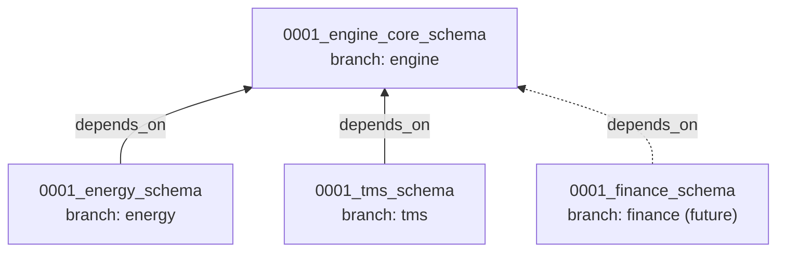

# Design: One Migration File per Domain (Engine Core, Energy, TMS)

**Status:** Proposed
**Scope:** `apps/ip/packages/ip` tenant shard schema

## 1. Problem

The ORM models are already split by owner:

| Owner | ORM module | Tables |
|---|---|---|
| Engine core (L1–L5 pipeline) | `ip/engine/adapters/outbound/database/models/data_plane.py` | inbound, replica, normalized, outbound, entity map, trace and outbox tables |
| Energy domain | `ip/application/domains/energy/models.py` | `mdm_meter_readings`, `mdm_service_points` |
| TMS domain | `ip/application/domains/tms/models.py` | `tms_loads`, `tms_carriers` |

The **DDL is not split**. A single tenant migration, `migrations/tenant/versions/0001_initial_tenant_schema.py`, creates:
- the engine core tables
- the Energy tables (section 6)
- the TMS tables (section 7)
- one shared `TENANT_TABLES` list that mixes all three

Consequences:
- **Ownership is broken.** Adding a domain (for example Finance) means editing the engine's migration.
- **Domains can't be installed independently.** Every shard gets every domain's tables.
- **Bounded contexts leak.** The engine's migration knows about Energy and TMS tables, so the dependency points the wrong way.

## 2. Target design

Each owner gets **its own migration file**, stored in its own package and linked as an **Alembic branch**.

```
ip/engine/adapters/outbound/database/migrations/tenant/
  env.py                                   # one env, loads all branches
  versions/
    0001_engine_core_schema.py             # branch_labels=("engine",)

ip/application/domains/energy/migrations/
  0001_energy_schema.py                    # branch_labels=("energy",), depends_on=engine core

ip/application/domains/tms/migrations/
  0001_tms_schema.py                       # branch_labels=("tms",), depends_on=engine core
```



### 2.1 Rules
1. **One migration file per domain.** While in development, each branch keeps exactly one squashed file: amend it, don't stack new revisions. This is how we apply the AGENTS.md "single migration file" rule to each domain.
2. **Each domain owns its DDL.** A domain migration only creates and drops its own tables.
3. **Dependencies point inward only.** Domains can `depends_on` engine core. Engine core never references a domain. Domains never depend on each other.
4. **Shared tenant safety stays in engine core.** Row-level security and tenant policies use a shared helper, `apply_tenant_isolation(op, table_name)`, defined once in the engine database package. Each domain migration calls it for its own tables. Domains may import from the engine (allowed by `tach`). The engine never imports from a domain.
5. **No cross-domain foreign keys.** Domain tables may reference engine core tables (`connections`, `replica_records`) by ID. Energy and TMS tables never reference each other.

### 2.2 Registry (one place to add a domain)
A tenant-schema registry in the composition root lists each domain's ORM module and migration folder:

```python
@dataclass(frozen=True)
class DomainMigrationModule:
    branch_label: str          # "engine", "energy", "tms"
    orm_module: ModuleType     # registers tables on IpTenantBase.metadata
    versions_dir: Path         # Alembic version location
    owned_tables: tuple[str, ...]

DOMAIN_MIGRATION_MODULES: tuple[DomainMigrationModule, ...] = (ENGINE_CORE, ENERGY, TMS)
```

- `env.py` loads `target_metadata` from the registry instead of hard-coded imports. It also sets `version_locations` to all `versions_dir` values.
- `run_migrations.py` runs `command.upgrade(cfg, "heads")`, plural, so every branch is applied.
- **Adding Finance** means: create `domains/finance/migrations/0001_finance_schema.py`, add one registry entry, and the engine stays untouched.

### 2.3 Autogenerate per domain
- `alembic revision --autogenerate --head=energy@head` changes only the Energy branch.
- `env.py` uses an `include_object` filter so each branch only sees the tables it owns, based on the registry.

## 3. Alternatives considered

| Option | Verdict |
|---|---|
| Keep one migration, split the DDL into helper modules | ❌ The engine still owns and runs domain DDL, so the dependency direction stays wrong |
| Separate Alembic environments per domain, each with its own `alembic_version_<domain>` table | ❌ More moving parts (several environments and several runs per shard), and no built-in way to express ordering against core |
| **Alembic branches with `depends_on` in one environment** | ✅ Real ownership, guaranteed ordering, one run per shard, standard Alembic feature |

## 4. Tests

**Narrow integration tests** (real Postgres, rolled back with SAVEPOINT):
1. `upgrade heads` on an empty shard creates every table registered in `IpTenantBase.metadata`.
2. **Ownership:** every table in the metadata is created by exactly one branch.
3. **Isolation:** downgrading only `energy@base` drops only the Energy tables, and core and TMS stay intact.
4. Every domain table has tenant isolation (RLS) enabled.

**Architecture tests (`tach`):**
- The engine package doesn't import from `ip.application.domains.*`.
- Domain packages don't import from each other.

## 5. Implementation steps
1. Add the failing tests from section 4.
2. Extract `apply_tenant_isolation(op, table_name)` into the engine database package.
3. Rename and trim the engine migration to `0001_engine_core_schema.py` (`branch_labels=("engine",)`), removing sections 6 and 7.
4. Create `domains/energy/migrations/0001_energy_schema.py` and `domains/tms/migrations/0001_tms_schema.py`, each with `depends_on` pointing at engine core.
5. Add the `TENANT_SCHEMA_MODULES` registry, then update `env.py` (metadata, `version_locations`, `include_object`) and `run_migrations.py` (`upgrade "heads"`).
6. Rebuild the local IP shard, then run `pnpm db:migrate`.
7. Run `ruff`, `mypy`, `tach check`, `test:integration` and `cov`.

> [!IMPORTANT]
> This rewrites tenant migration history. During development, drop and re-create the local IP shard database before running `pnpm db:migrate`.
