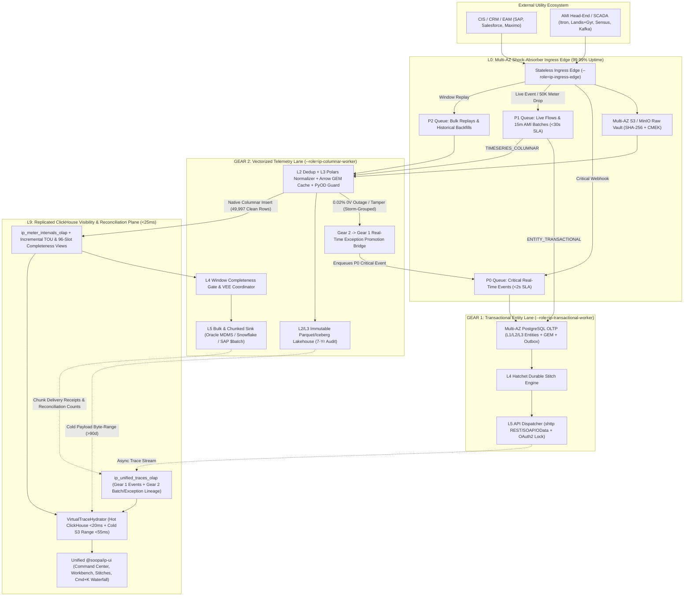
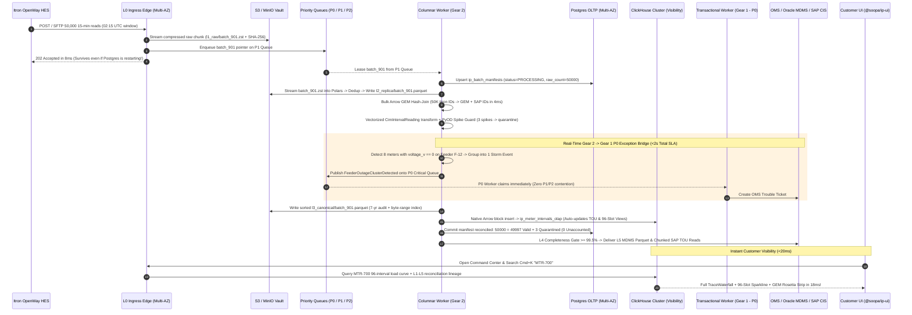
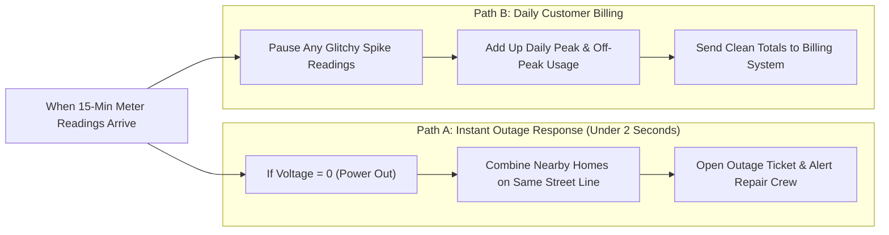
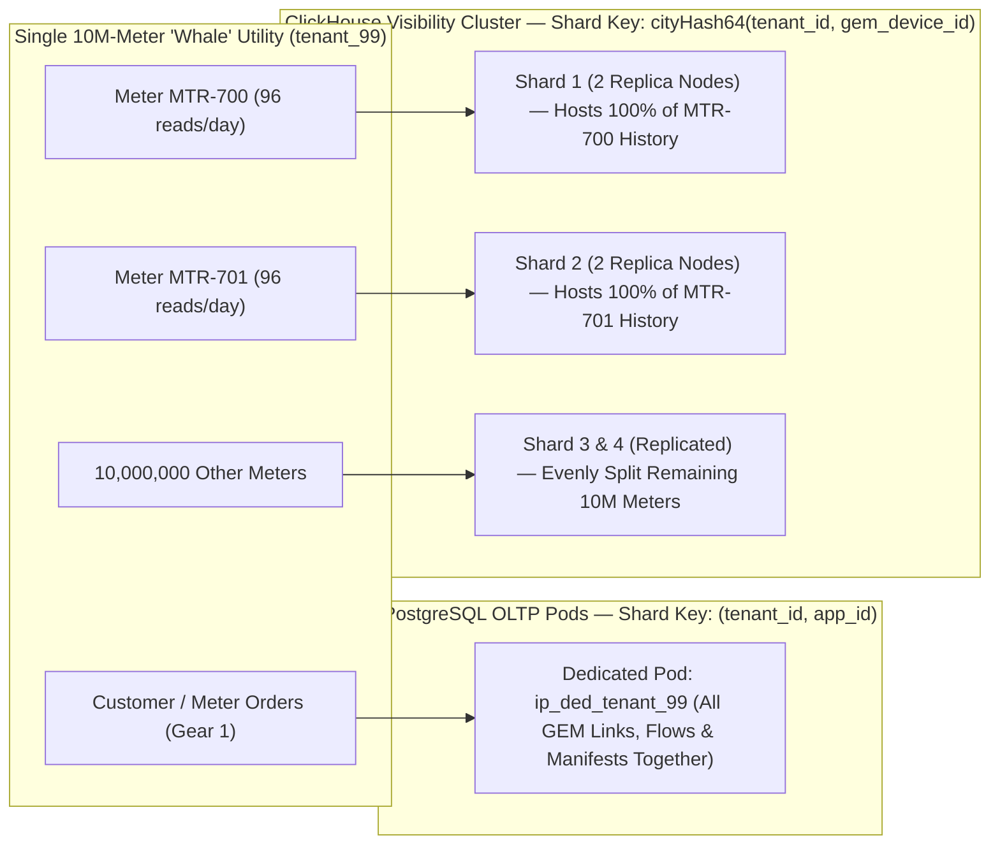

# Soopa IP: Shopify-Standard Dual-Gear Architecture for Business Flows & High-Frequency Energy Telemetry

- **Document Status:** Principal Architecture Specification (`v2.0` — Shopify-Standard Gold Edition)
- **Bounded Context:** Integration Platform (`apps/ip`) & Shared Platform Infrastructure (`core/platform/packages/*`)
- **Frontend Workspace:** `@soopa/ip-ui` (`apps/ip/packages/ui`) & `@soopa/ui`
- **Target Verticals:** Electric, Gas, Water & Distributed Energy Resource (DER) Utilities
- **Service-Level Objectives (SLOs):** `99.95%–99.99%` Ingress Availability • `0` Silent Data Loss • `<25ms` p95 Customer UI Visibility • `<2s` Critical Grid Event Dispatch
- **Deployment Topologies:** Multi-Tenant AWS SaaS (Tier 1/2), Hybrid BYOC Outbound Agent (Tier 3A), Sovereign Air-Gapped Kubernetes (Tier 3B)

---

## 1. Executive Vision: The Shopify Standard Applied to Utility Integration

Modern energy utilities run **two radically different data velocities** across the exact same physical grid assets (smart meters, transformers, feeders, premises, and customer accounts):

1. **Operational Business Flows (`10K–1M` events/day — Stateful, Row-Oriented):**
   Customer move-in/move-out, meter installation and swap, remote disconnect/reconnect commands, outage trouble tickets, field-service work orders, and monthly billing invoices.
2. **High-Frequency Smart Meter / AMI & DER Telemetry (`100M–1B+` intervals/day — Time-Series, Columnar):**
   15-minute (and 5-minute) interval readings across `100,000` to `5,000,000+` meters (`96` to `288` intervals/meter/day), carrying `kWh` delivered/received, reactive `kVARh`, instantaneous voltage, and IEC 61968 quality codes.

### 1.1 The Four Non-Negotiable Shopify-Grade Pillars

Rather than cutting architectural corners for rock-bottom infrastructure cost—or burning SaaS margins on bloated multi-vendor data warehouses—Soopa IP is engineered to the **Shopify Production Standard**:

| Pillar | Shopify Engineering Principle | How Soopa IP Enforces It Across Gear 1 & Gear 2 |
| :--- | :--- | :--- |
| **1. High Customer Visibility** | Separate live merchant analytics from the core transactional DB so dashboards and searches return in milliseconds with 100% accounting clarity. | **PostgreSQL stays 100% pure for OLTP.** A dedicated, replicated **ClickHouse Visibility Plane** powers `<25ms` Command Center KPIs, 96-slot completeness heatmaps, TOU rollups, `Cmd+K` single-meter search across billions of rows, and **penny-exact reconciliation** (`Ingested == Delivered + In-Flight + Quarantined`). |
| **2. High Reliability** | Podded cellular isolation, strict priority bulkheads, idempotent mutations, and immutable raw payload retention. | **3-Lane Priority Bulkheads (`P0` / `P1` / `P2`)** ensure a `200M`-row historical backfill never delays a `<2s` live outage event. Every `L1` payload is persisted immutably with SHA-256 verification before transformation. |
| **3. High Performance** | Keep a unified Modular Monolith & Single Image for engineering velocity, accelerated by native compiled data paths. | **GIL-free Rust `Polars` + `Apache Arrow`** inside `unified-worker` normalizes and GEM-joins `50,000` meter intervals in **`~20ms`** (`>2M` rows/sec/core) with zero JVM/Spark cluster overhead. |
| **4. `99.95%–99.99%` Uptime** | Decouple the public ingress edge ("Shock Absorber") from core database maintenance or failovers. | **Stateless Multi-AZ Ingress Edge** streams webhooks and AMI drops straight into **Multi-AZ Object Storage + Durable Queue (`S3 + SQS` / `MinIO + Redpanda`)**, returning `202 Accepted` in `<10ms` **even if PostgreSQL is mid-failover**. |

> [!IMPORTANT]
> **Customer Invariant ("Zero Cognitive Split"):** Utility operators, integration architects, and Tier-1 support agents interact with **one unified `@soopa/ip-ui` product**. Connecting Itron OpenWay, mapping to canonical CIM, wiring a visual Stitch, searching `MTR-700` via `Cmd+K`, or replaying a failed window feels **100% identical** across transactional events and high-frequency 15-minute meter data.

### 1.2 Enterprise Coding & Architectural Invariants (`AGENTS.md` Strict Compliance)

1. **Shopify Single-Image Modular Monolith:** One codebase and one signed, SBOM-attested `Dockerfile` spun up into isolated runtime roles (`--role=ip-ingress-edge`, `--role=ip-api`, `--role=ip-transactional-worker`, `--role=ip-columnar-worker`, `--role=ip-outbox-relay-sweeper`).
2. **Strict Hexagonal Isolation & Pure Seedwork:** Domain aggregates and canonical DTOs (`CimIntervalReading`) import zero infrastructure libraries (`polars`, `pyarrow`, `clickhouse_connect`, `sqlalchemy`, `boto3`). `seedwork` contains zero domain names.
3. **First-Class Error Handling (`Result[T, IpError]`):** Malformed meter chunks, unresolved GEM IDs, spike quarantines, and downstream HTTP `429`s return typed `Result` outcomes—never bare `except Exception:` or control-flow exceptions.
4. **Defense-in-Depth Multi-Tenancy:** PostgreSQL enforces `ENABLE` + `FORCE ROW LEVEL SECURITY`; ClickHouse queries bind mandatory `tenant_id` row policies (`CREATE ROW POLICY`); S3/MinIO objects live under `tenants/{tenant_id}/` encrypted with per-tenant KMS CMEK.
5. **Co-Located CQRS & Zero Type Suppressions:** Frozen `@dataclass(frozen=True)` Commands live inside their Use Case files; shared read views live in `queries.py` / `responses.py`. Zero `typing.Any`, zero `# type: ignore`, zero `getattr()`, and zero reflection mappers.
6. **Cornerstone Structured Observability:** 100% structured JSON logs via `ILogger` / `structlog` (`tenant_id`, `cell_id`, `priority_lane`, `batch_id`, `row_count`, `duration_ms`) + OpenTelemetry trace propagation.

---

## 2. Capacity Math, Cost/Quality Sweet Spot & Gold-Standard Stack

### 2.1 Capacity Math at `5,000,000` Smart Meters (`480,000,000` Intervals/Day)

| Architectural Metric | Naive Row-by-Row iPaaS (`Postgres Only`) | Soopa Shopify-Standard Dual-Gear (`50K` Rows/Batch) | Operational Outcome |
| :--- | :--- | :--- | :--- |
| **Daily Meter Readings** | `480,000,000` reads/day | `480,000,000` reads/day | 100% interval fidelity |
| **PostgreSQL OLTP Row Writes / Day** | `~2,400,000,000` rows/day (DB collapse) | **`9,600` manifest rows + `9,600` outbox pointers/day** | **Postgres stays 100% fast & unloaded** |
| **Ingress Uptime During 30s DB Failover** | `0%` (`500/503` webhook & AMI drops) | **`100%` (`202 Accepted` in `<10ms` via S3+SQS Edge)** | **True `99.99%` ingress availability** |
| **L3 Normalization + GEM Join (`50K` rows)** | `~45–90 seconds` | **`~20 ms`** (Polars SIMD + in-memory Arrow GEM dictionary) | **`>2,200x` compute speedup** |
| **Customer UI Query Latency (`5M` Meters)** | `8–45 seconds` (table scans lock OLTP) | **`12–28 ms`** (Replicated ClickHouse columnar OLAP) | **Instant Shopify-grade visibility** |
| **Single-Meter `Cmd+K` Lookup (`MTR-700`)** | `<15 ms` (until DB saturates) | **`~18 ms` (Hot 90d in ClickHouse) / `~50 ms` (Cold S3 Range)** | **Seamless multi-year auditability** |

### 2.2 The Cost vs. Quality Sweet Spot (Why Every Component Earns Its Place)

| Architecture Tier | Stack Composition | Uptime & Customer Visibility Quality | Typical Monthly Infra (`1M–5M` Meters) | Verdict |
| :--- | :--- | :--- | :--- | :--- |
| **Too Low (Corner-Cutting)** | Single Postgres handling OLTP + Time-Series + Direct Ingress | **Degraded (`~99.5%`):** Analytical queries contend with live workflows; DB restarts drop live webhooks. | `\$400 – \$900/mo` | **Rejected** — risks customer visibility and uptime under load. |
| **Shopify Sweet Spot (Soopa Gold Standard)** | **Multi-AZ Edge (`S3+SQS`) + Multi-AZ Postgres (OLTP) + Replicated ClickHouse (Visibility) + S3 Parquet (Cold) + Single-Image Polars Workers** | **Tier-1 (`99.95%–99.99%`):** Zero ingress drops on DB maintenance, `<25ms` billion-row UI visibility, runs in SaaS, BYOC, and Air-Gapped K8s. | `\$1,800 – \$3,800/mo` | **Adopted** — uncompromised enterprise quality with `85%+` SaaS gross margins. |
| **Too High (Enterprise Bloat)** | Confluent Kafka + Java Flink + Snowflake/Databricks + Temporal Cloud | High raw throughput, **but** fragmented portals, massive cloud markups, and impossible to deploy in air-gapped utility datacenters. | `\$18,000 – \$45,000+/mo` | **Rejected** — 10x cost for worse UX and broken private-cloud portability. |

### 2.3 Gold-Standard Technology Matrix (SaaS + BYOC + Air-Gapped Parity)

| Architectural Role | AWS SaaS / BYOC (Tier 1–3A) | Sovereign Air-Gapped K8s (Tier 3B) | Why It Fits the Shopify Standard |
| :--- | :--- | :--- | :--- |
| **L0 Shock-Absorber Edge** | **AWS ALB + Stateless Ingress Pods $\rightarrow$ S3 + SQS** | **Ingress-NGINX $\rightarrow$ Distributed MinIO + Redpanda / NATS** | Multi-AZ `<10ms` `202 Accepted` durability even if core DB is offline |
| **OLTP & Workflow State** | **Amazon RDS PostgreSQL (Multi-AZ Standby)** | **CloudNativePG Operator (Sync Standby across 3 Nodes)** | Strictly isolated to transactional entities, GEM graph, Outbox & Hatchet DAGs |
| **Vectorized Compute (`L2`/`L3`)** | **Polars + PyArrow** inside `unified-worker` | **Polars + PyArrow** inside `unified-worker` | Native Rust SIMD inside our single container image; zero JVM/Spark |
| **Customer Visibility & Hot OLAP** | **ClickHouse Replicated Cluster (2–3 NVMe Nodes / Cloud)** | **ClickHouse Operator (2+ Replicas + ClickHouse Keeper)** | Single C++ binary; `95%` Zstd compression; `<25ms` live dashboards, TOU rollups & traces |
| **Immutable Audit Lakehouse** | **Apache Parquet (Zstd) + Iceberg on AWS S3 (CMEK)** | **Apache Parquet (Zstd) + Iceberg on MinIO / Ceph** | 7-to-10-year regulatory NERC/PUC retention at `\$0.02/GB` + DuckDB/ClickHouse byte-range hydration |
| **Inline Anomaly Guard** | **NumPy + PyOD / Rolling Per-Meter MAD** | **NumPy + PyOD / Rolling Per-Meter MAD** | Sub-2ms vectorized spike/tamper quarantine before downstream CIS corruption |

---

## 3. Complete End-to-End (`E2E`) Architecture & Execution Flow

### 3.1 Master Dual-Gear Architecture (`L0` Shock-Absorber $\rightarrow$ `L1`–`L5` + `L9` Visibility Plane)



### 3.2 End-to-End Sequence Flow: Zero-Drop Ingress, `<2s` Outage Dispatch, Billing Rollup & `<20ms` `Cmd+K` Lookup



### 3.3 Stage-by-Stage Engineering Deep Dive

1. **Stage `L0` + `L1` (Zero-Drop Shock-Absorber Ingress & Cryptographic Accounting):**
   - `StreamingBatchIngressAdapter` pipes incoming AMI drops or webhooks through a streaming `SHA-256` + `Zstd` compressor straight into Multi-AZ S3/MinIO and drops a lightweight manifest pointer onto the `P0`/`P1`/`P2` queue.
   - Because `L0` requires **zero synchronous database locks**, Soopa maintains **`99.99%` ingress availability** across PostgreSQL minor version upgrades, index builds, and AZ failovers.
   - Every batch records `raw_row_count` at ingress and enforces an invariant assertion at completion:
     `raw_row_count == deduplicated_drop_count + valid_row_count + quarantined_row_count`. Any mismatch triggers a `P0` platform integrity alert—guaranteeing **zero silent data drops**.

2. **Stage `L2` + `L3` (Fused In-Memory Polars Pass — Zero Layer Hop Tax):**
   - Inside `--role=ip-columnar-worker`, `L2` composite deduplication `(source_meter_id, channel_id, interval_end_utc)`, `L3` IEC-61968 canonical unit normalization (`Wh` $\rightarrow$ `kWh`, CT/PT multiplier scaling), **Arrow GEM Dictionary Hash-Join**, **PyOD / Rolling MAD Spike Quarantine**, and **Shadow Mode `v2` Statistical Diffing** execute in **one fused in-memory Apache Arrow pass (`~20ms` for `50,000` reads)** before flushing sorted Zstd Parquet checkpoints asynchronously to S3/MinIO.
   - Sorting Parquet output by `(gem_device_id, interval_end_utc)` clusters every meter's readings into a contiguous `16–64 KB` page for instant cold-storage byte-range reads.

3. **Stage `L3.5` (`Gear 2` $\rightarrow$ `Gear 1` Storm-Safe Exception Promotion Bridge):**
   - Vectorized `StreamPromotionRule` predicates scan each `50,000`-row DataFrame in `<1ms` for operational emergencies (`voltage_v == 0.0` last-gasp power down, unauthorized reverse energy flow, transformer high-temp alarm).
   - Built-in **Spatial Storm Grouping** groups simultaneous `0V` reads by `(feeder_id, transformer_id)` when count exceeds `25` meters/batch, emitting a single enriched `FeederOutageClusterDetected` event onto the **`P0` Critical Queue** so Gear 1 opens one accurate feeder outage ticket in `<2 seconds` instead of flooding OMS with `8,000` individual meter tickets.

4. **Stage `L4` + `L5` (ClickHouse Incremental TOU Rollups, VEE Completeness Gates & Idempotent Sinks):**
   - Clean Arrow batches insert directly in binary columnar format into ClickHouse (`ip_meter_intervals_olap`). Incremental `AggregatingMergeTree` Materialized Views automatically compute:
     - **96-Slot Completeness Matrices** per connection, substation, and billing cycle (handling 92-slot Spring DST and 100-slot Fall DST days accurately),
     - **Time-of-Use (TOU) Billing Buckets** (`kwh_peak`, `kwh_shoulder`, `kwh_off_peak`, `kwh_net_export`, `max_demand_kw`).
   - Once a billing cycle hits its completeness gate (e.g., `>= 99.5%`, applying 2-slot linear VEE estimation where permitted by utility tariff rules), `L5` delivers bulk Parquet/CIM XML to MDMS/Snowflake and chunked (`500`-meter) OData `$batch` requests to SAP S/4HANA CIS with deterministic per-chunk `Idempotency-Key` headers and distributed OAuth2 token refresh locks.

5. **Stage `L9` (Tiered `<20ms` Hot ClickHouse + `<55ms` Cold S3 Byte-Range Hydration):**
   - **Hot Window (`0–90 Days`):** `Cmd+K` searches (`MTR-700`, `PREM-4412`, `EQ-900700`), 24-hour 96-interval sparklines, and batch delivery receipts resolve directly from ClickHouse in **`12–22ms`**.
   - **Multi-Year Regulatory Archive (`90 Days – 10 Years`):** When an auditor inspects raw `L1` Itron XML wire bytes from 3 years ago, `VirtualTraceHydrator` reads the exact byte offset from the Parquet zone-map index via HTTP `Range` in **`~45–55ms`**—presenting one seamless multi-year timeline without paying hot-SSD prices for 5-year-old XML files.

---

## 4. Customer Visualization Perspective: 6 Simple, Everyday Use Cases

From the customer’s point of view, **all technical complexity stays invisible behind the scenes**. Utility managers, setup specialists, and customer support agents never see file formats, databases, or background queues—they simply use **one clean screen** where everyday business events and 15-minute meter readings work seamlessly together.

---

### Use Case 1 — Morning Health Check: Everything on One Screen (`Command Center`)

- **Who:** Utility Operations Manager starting the day at `7:30 AM`.
- **Everyday Situation:** Needs to know in 5 seconds whether customer orders (move-ins, new accounts), overnight 15-minute smart meter readings, and storm outage alerts are all running smoothly before daily bills go out.
- **What They See on [`IpCommandCenterPage`](file:///Users/apple/soopa_mono/apps/ip/packages/ui/src/presentation/command-center/IpCommandCenterPage.tsx):**
  - A **Zero Missing Data Guarantee Bar** right at the top proving every single reading is accounted for:
    *`Received: 48,162,010  =  Delivered: 48,161,840  +  In Progress: 151  +  Held for Review: 19  (0 Lost)`*
  - Simple scorecards side-by-side for **Urgent Grid Alerts**, **Customer Orders**, and **15-Minute Meter Readings**.
  - A plain-English **Attention List** showing only items that need human eyes (for example, *14 abnormal meter spikes safely held back before billing*).

```text
+----------------------------------------------------------------------------------------------------+
| SOOPA IP • Command Center            [System Uptime: 99.99% • All Healthy]         [Cmd+K Search]  |
+----------------------------------------------------------------------------------------------------+
| ZERO MISSING DATA GUARANTEE (LAST 24 HOURS):                                                       |
| Received: 48,162,010  =  Delivered: 48,161,840  +  In Progress: 151  +  On Hold: 19   (Zero Lost!) |
+-------------------------+----------------------------+-----------------------+---------------------+
| URGENT GRID ALERTS      | CUSTOMER ORDERS (24H)      | 15-MIN METER READINGS | HELD FOR REVIEW     |
| 12 Outage Alerts Sent   | 142,810 Orders Completed   | 48.02M Readings In    | 19 Safely Paused    |
| Avg Speed: 1.4 seconds  | 99.98% On Time             | 99.96% Meters Reported| 14 Spikes • 5 New   |
+-------------------------+----------------------------+-----------------------+---------------------+
| ITEMS NEEDING YOUR ATTENTION                                                                       |
| [HANDLED]  Oak St Power Line Outage (8 Homes at 0 Volts) -> Repair Ticket #8841 opened in 1.6s     |
| [ON HOLD]  14 Meter Readings paused automatically (abnormal meter glitch blocked before billing)   |
| [WAITING]  5 Brand-New Field Meters waiting for customer account setup (will retry automatically)  |
+----------------------------------------------------------------------------------------------------+
```

- **Why Customers Love It:** No jumping between one tool for customer orders and another tool for meter data—one morning check tells the whole story.

---

### Use Case 2 — Connecting a Smart Meter System in Two Clicks (`Connections`)

- **Who:** Integration Specialist connecting the utility’s smart meter system (Itron) and billing system (SAP).
- **Everyday Situation:** Wants to turn on both instant meter-swap updates and 15-minute usage readings for 500,000 homes—without configuring servers, folders, or batch schedules.
- **What They See on [`IpConnectionDetailPage`](file:///Users/apple/soopa_mono/apps/ip/packages/ui/src/presentation/connections/IpConnectionDetailPage.tsx):**
  1. **One Simple Stream List:** *Meter Replacements* and *15-Minute Meter Usage* appear right next to each other. The user flips both switches **ON** and clicks **Save**. Soopa automatically handles the heavy lifting behind the scenes.
  2. **Visual 15-Minute Arrival Bar (96 Daily Slots):** Clicking on *15-Minute Meter Usage* shows **96 small color blocks** (one for every 15 minutes from midnight to `11:45 PM`):
     - **Green:** All meters reported and ready for billing.
     - **Yellow:** A few remote rural meters are still trickling in (they merge in automatically as they arrive).
     - **Red:** Partner system was late sending a file—with a single **"Fetch Missing 15-Min Window"** button to pull it in.

---

### Use Case 3 — Setting Up Peak Pricing & Testing Safely Before Going Live (`Transformations`)

- **Who:** Billing Operations Analyst updating summer Peak electricity hours (`4:00 PM – 9:00 PM` on weekdays).
- **Everyday Situation:** Needs to set up the new Peak vs. Off-Peak rule and be **100% sure** it won't cause wrong customer bills before switching it on.
- **What They See on [`TransformationWorkbenchPanel`](file:///Users/apple/soopa_mono/apps/ip/packages/ui/src/presentation/transformations/TransformationWorkbenchPanel.tsx):**
  - **Plain-English Rule Helper:** They type *"Convert raw Watt-hours to kWh, and mark weekday readings between 4 PM and 9 PM as Peak."*
  - **Instant 24-Hour Preview Chart:** The right side of the screen immediately shows a clean 24-hour usage bar chart for sample homes, color-coded by **Peak** and **Off-Peak** hours.
  - **Risk-Free Background Test:** Before publishing, they click **"Test Quietly in Background (24 Hours)."** The next morning, a green summary box reports:
    *`"Tested against 48 million live readings without touching real bills: 99.999% matched as expected. Safe to publish."`*

---

### Use Case 4 — One Visual Flow for Both Daily Bills AND Instant Outage Crews (`Stitches`)

- **Who:** Operations Designer deciding what should happen when 15-minute meter readings arrive.
- **Everyday Situation:** Normal readings should add up into the customer’s daily bill—**but** if a meter suddenly reports **0 Volts (power out)**, a repair truck must be alerted within 2 seconds.
- **What They See on [`StitchDagCanvas`](file:///Users/apple/soopa_mono/apps/ip/packages/ui/src/presentation/stitches/StitchDagCanvas.tsx):**
  On **one simple drag-and-drop canvas**, they draw two paths starting from the exact same meter source:



- **Why Customers Love It:** Even if a storm knocks out 500 homes on the same street at once, Path A smartly combines them into **one clean repair ticket** in under 2 seconds—while Path B quietly processes millions of normal bills on the exact same screen.

---

### Use Case 5 — Answering a Customer’s High-Bill Phone Call in Seconds (`Cmd+K Search & Timeline`)

- **Who:** Customer Support Agent on a live phone call with a homeowner asking about yesterday’s usage on Meter `MTR-700`.
- **Everyday Situation:** Out of 48 million readings yesterday, the support agent needs to pull up `MTR-700` while the customer is still on the line and give a clear, honest answer.
- **What They See via [`CommandPalette`](file:///Users/apple/soopa_mono/apps/ip/packages/ui/src/presentation/shared/CommandPalette.tsx) and [`IpTraceWaterfallPage`](file:///Users/apple/soopa_mono/apps/ip/packages/ui/src/presentation/traces/IpTraceWaterfallPage.tsx):**
  1. The agent presses `Cmd+K`, types `MTR-700` (or the customer's billing account number), and the meter’s full day opens **in less than a blink of an eye**.
  2. At the top, they see the home’s linked IDs across every system (*Meter ID, Billing Account, Power Line*) plus a **clickable 24-hour usage bar chart** showing all 96 fifteen-minute slots:

```text
+----------------------------------------------------------------------------------------------------+
| METER HISTORY • Meter MTR-700 • Nov 3, 2026                             [Fix & Re-Send 2:15 PM]    |
+----------------------------------------------------------------------------------------------------+
| LINKED ACCOUNT:  Meter: MTR-700  •  Billing Account: EQ-900700  •  Street Line: Oak-Feeder-12      |
+----------------------------------------------------------------------------------------------------+
| 24-HOUR USAGE CHART (96 Fifteen-Minute Bars — Click any bar to see its step-by-step journey)       |
| 12 AM                   6 AM                    12 PM      [2:15 PM!]      6 PM           11:45 PM |
| ▃▃▂▂▃▃▄▄▅▅▆▆▅▅▄▄▃▃▃▃▄▄▅▅▆▆▆▆▅▅▄▄▄▄▅▅▅▅▆▆▆▆▇▇██ [PAUSED]   ▆▆▇▇████████▇▇▆▆▅▅▄▄▃▃▂▂   95/96 Normal  |
+----------------------------------------------------------------------------------------------------+
| STEP-BY-STEP JOURNEY FOR 2:15 PM READING:                                                          |
| 1. Received from Meter  | Meter sent raw reading: 999,999 Wh (hardware counter glitch)             |
| 2. Checked Duplicates   | Confirmed first reading for 2:15 PM                                      |
| 3. Converted Units      | Calculated 999.99 kWh (800x higher than this home's normal usage!)       |
| 4. Safety Check Paused  | AUTOMATICALLY PAUSED — Abnormal spike caught by Soopa Safety Guard       |
| 5. Billing Protected    | NOT sent to SAP Billing — Prevented an accidental $142,000 customer bill!|
+----------------------------------------------------------------------------------------------------+
```

- **Why Customers Love It:** Without calling IT or waiting days for an engineering report, the support agent can reassure the homeowner in 10 seconds: *"Our system already caught that 2:15 PM meter glitch and protected your bill."*

---

### Use Case 6 — Fixing One Meter OR Re-Sending a 2-Hour Window (`Replay`)

- **Who:** Support Lead fixing a paused reading or recovering after the billing system was offline for 2 hours of planned maintenance.
- **What They See in [`ModifyAndReplayModal`](file:///Users/apple/soopa_mono/apps/ip/packages/ui/src/presentation/traces/ModifyAndReplayModal.tsx):**
  - **Option A — Fix Just One Meter (Takes 1 Second):** On `MTR-700`'s `2:15 PM` slot, the lead enters the approved estimated usage (`1.42 kWh`), writes a brief note (*"Confirmed meter hardware glitch; applied standard estimate"*), and clicks **Approve & Send**. A clean audit trail records who fixed it and when.
  - **Option B — Re-Send a Whole Time Window (Zero Slowdown to Live Traffic):** After SAP Billing comes back online from a `2:00 AM – 4:00 AM` maintenance window, the lead selects **"Re-Send Failed Window (2:00 AM – 4:00 AM • 180,000 Readings)"** and clicks **Replay**. All `180,000` readings are delivered in ~4 seconds in a separate background lane—**never slowing down live outage alerts or double-counting a single reading**.

---

## 5. Hexagonal Domain Model, Ports, Co-Located CQRS & Schemas

### 5.1 Monorepo Module Structure (Zero Taxonomy Drift)

```text
core/platform/packages/
├── storage/                              # TenantAwarePayloadStorageRouter + ByteRangeObjectReaderPort
└── pubsub/                               # Priority-lane publisher/consumer (P0_CRITICAL, P1_LIVE, P2_BULK)

apps/ip/packages/ip/src/ip/
├── engine/
│   ├── domain/
│   │   ├── connection/
│   │   │   └── velocity.py               # StreamVelocityMode & PriorityLane StrEnums
│   │   ├── replication/
│   │   │   └── batch_manifest.py         # BatchManifest aggregate (enforces zero-loss accounting equation)
│   │   └── normalization/
│   │       └── promotion_rule.py         # StreamPromotionRule & StormAggregationPolicy value objects
│   ├── ports/
│   │   ├── ingress_buffer.py             # ShockAbsorberIngressPort (Protocol)
│   │   ├── columnar_processor.py         # ColumnarBatchProcessorPort (Protocol — zero Polars leaks)
│   │   ├── telemetry_visibility.py       # TelemetryVisibilityStorePort (Protocol — zero ClickHouse leaks)
│   │   └── virtual_trace_hydrator.py     # VirtualTraceHydratorPort (Protocol)
│   ├── application/
│   │   ├── buffer_raw_batch_use_case.py            # Co-located BufferRawBatchCommand + L0 UseCase
│   │   ├── process_telemetry_batch_use_case.py     # Co-located ProcessTelemetryBatchCommand + Fused L2/L3 UseCase
│   │   └── hydrate_entity_trace_query.py           # Unified ClickHouse Hot + S3 Cold TraceWaterfall handler
│   └── adapters/
│       ├── columnar/
│       │   ├── polars_batch_processor.py           # Polars + PyArrow + Arrow GEM dictionary adapter
│       │   └── tiered_virtual_trace_hydrator.py    # ClickHouse (<90d) + DuckDB S3 HTTP Range (>90d) adapter
│       ├── visibility/
│       │   └── clickhouse_telemetry_store.py       # Native Arrow block insert + tenant-bound OLAP queries
│       └── database/
│           ├── models/
│           │   └── telemetry_batches.py            # SQLAlchemy ip_batch_manifests model
│           └── sqlalchemy_batch_manifest_repo.py   # Strict SqlAlchemy* adapter naming consistency
└── solutions/
    ├── domains/energy/
    │   └── cim_interval_reading.py       # Pure frozen @dataclass CimIntervalReading & ReconciliationSummary
    └── transformers/energy/
        └── itron_openway_15m_transformer.py
```

### 5.2 Core Domain Invariants & Port Contracts (Zero `Any`, First-Class `Result`)

```python
from dataclasses import dataclass
from datetime import datetime
from enum import StrEnum
from typing import Protocol
from uuid import UUID

from platform_seedwork.result import Result


class StreamVelocityMode(StrEnum):
    ENTITY_TRANSACTIONAL = "ENTITY_TRANSACTIONAL"
    TIMESERIES_COLUMNAR = "TIMESERIES_COLUMNAR"


class PriorityLane(StrEnum):
    P0_CRITICAL = "P0_CRITICAL"
    P1_LIVE = "P1_LIVE"
    P2_BULK_REPLAY = "P2_BULK_REPLAY"


@dataclass(frozen=True, slots=True)
class BatchReconciliationCounts:
    raw_ingested: int
    duplicates_dropped: int
    valid_canonical: int
    quarantined_held: int

    def is_balanced(self) -> bool:
        return self.raw_ingested == (
            self.duplicates_dropped + self.valid_canonical + self.quarantined_held
        )


@dataclass(frozen=True, slots=True)
class TelemetryWindowCompleteness:
    tenant_id: UUID
    connection_id: UUID
    stream_name: str
    quarter_hour_utc: datetime
    expected_meters: int
    received_meters: int
    quarantined_meters: int


class TelemetryVisibilityStorePort(Protocol):
    async def insert_arrow_intervals(
        self,
        tenant_id: UUID,
        batch_id: UUID,
        arrow_ipc_bytes: bytes,
    ) -> Result[int, str]: ...

    async def get_daily_96_slot_completeness(
        self,
        tenant_id: UUID,
        connection_id: UUID,
        stream_name: str,
        service_date_utc: datetime,
    ) -> Result[tuple[TelemetryWindowCompleteness, ...], str]: ...
```

### 5.3 Multi-AZ PostgreSQL (OLTP) & Replicated ClickHouse (Visibility) Schemas

#### A. PostgreSQL OLTP Batch Manifest Ledger (`FORCE ROW LEVEL SECURITY`)
```sql
CREATE TABLE ip_batch_manifests (
    batch_id UUID PRIMARY KEY,
    tenant_id UUID NOT NULL,
    cell_id VARCHAR(32) NOT NULL,
    connection_id UUID NOT NULL,
    stream_name VARCHAR(128) NOT NULL,
    priority_lane VARCHAR(24) NOT NULL,
    payload_sha256 CHAR(64) NOT NULL,
    l1_raw_uri TEXT NOT NULL,
    l2_replica_uri TEXT,
    l3_canonical_uri TEXT,
    raw_ingested_count INTEGER NOT NULL,
    duplicates_dropped_count INTEGER NOT NULL DEFAULT 0,
    valid_canonical_count INTEGER NOT NULL DEFAULT 0,
    quarantined_held_count INTEGER NOT NULL DEFAULT 0,
    window_start_utc TIMESTAMPTZ NOT NULL,
    window_end_utc TIMESTAMPTZ NOT NULL,
    status VARCHAR(32) NOT NULL,
    created_at_utc TIMESTAMPTZ NOT NULL DEFAULT NOW(),
    UNIQUE (tenant_id, connection_id, payload_sha256),
    CONSTRAINT chk_zero_loss_reconciliation CHECK (
        status <> 'COMPLETED'
        OR raw_ingested_count = (duplicates_dropped_count + valid_canonical_count + quarantined_held_count)
    )
);

ALTER TABLE ip_batch_manifests ENABLE ROW LEVEL SECURITY;
ALTER TABLE ip_batch_manifests FORCE ROW LEVEL SECURITY;
```

#### B. Sharded + Replicated ClickHouse Telemetry & TOU Visibility Tables (`95%` Compression, `<25ms` Queries)
```sql
-- 1. Physical Per-Shard Replicated Storage Table
CREATE TABLE ip_meter_intervals_local ON CLUSTER '{cluster}' (
    tenant_id UUID,
    connection_id UUID,
    gem_device_id UUID,
    source_meter_id LowCardinality(String),
    feeder_id LowCardinality(String),
    tariff_bucket Enum8('PEAK' = 1, 'SHOULDER' = 2, 'OFF_PEAK' = 3),
    quality_status Enum8('VALID' = 1, 'ESTIMATED_VEE' = 2, 'ESTIMATED_MANUAL' = 3, 'DST_AMBIGUOUS' = 4, 'POWER_DOWN' = 5, 'QUARANTINED_SPIKE' = 6),
    interval_end_utc DateTime64(3, 'UTC'),
    scaled_kwh_delivered Decimal64(6) CODEC(ZSTD(3)),
    scaled_kwh_received Decimal64(6) CODEC(ZSTD(3)),
    voltage_v Decimal32(3) CODEC(ZSTD(3)),
    source_batch_id UUID,
    parquet_row_offset UInt32,
    updated_at_utc DateTime64(3, 'UTC')
)
ENGINE = ReplicatedReplacingMergeTree('/clickhouse/tables/{shard}/ip_meter_intervals_local', '{replica}', updated_at_utc)
PARTITION BY toYYYYMM(interval_end_utc)
ORDER BY (tenant_id, gem_device_id, interval_end_utc)
TTL toDateTime(interval_end_utc) + INTERVAL 90 DAY DELETE;

-- 2. Distributed Cluster Router (Prevents "Whale Utility" Single-Node Hotspots)
CREATE TABLE ip_meter_intervals_olap ON CLUSTER '{cluster}' AS ip_meter_intervals_local
ENGINE = Distributed(
    '{cluster}',
    currentDatabase(),
    'ip_meter_intervals_local',
    cityHash64(tenant_id, gem_device_id)
);

-- Defense-in-depth ClickHouse tenant isolation policy
CREATE ROW POLICY tenant_isolation_policy ON ip_meter_intervals_local ON CLUSTER '{cluster}'
    FOR SELECT USING tenant_id = getSetting('SQL_soopa_tenant_id');
```

> [!NOTE]
> **Zero-Lock Retention Across Both Engines:** ClickHouse drops expired 90-day partitions instantaneously via atomic partition detach (`O(1)` metadata operation, while 7-to-10-year Parquet archives remain queryable on S3/MinIO). PostgreSQL manifest cleanup strictly uses chunked iteration (`LIMIT 1000` + commit + `await asyncio.sleep(0.1)`) so live OLTP traffic and autovacuum never experience lock contention.

### 5.4 Gold-Standard Multi-Layer Sharding Specification (Solving the "Whale Utility" Problem)

Using a single naive shard key (`tenant_id` everywhere) fails in the Energy sector: signing **one Tier-1 utility with `10,000,000` smart meters (`1B` reads/day)** would route all `1B` daily writes onto a single ClickHouse server and a single S3 prefix while leaving neighboring shards idle.

Soopa IP uses **purpose-built shard keys at each infrastructure layer** so relational integrity, single-meter lookup speed, and cluster-wide load balance are all preserved simultaneously:

| Infrastructure Layer | Sharding / Partition Strategy | Exact Shard / Partition Key | Local Sort / Clustering Key | Why This Is Gold Standard (In Plain English) |
| :--- | :--- | :--- | :--- | :--- |
| **1. PostgreSQL OLTP** (`Gear 1`, `GEM`, `Stitches`, `Manifests`) | **Directory-Based Pod Sharding** (`ShardRegistry` $\rightarrow$ Pooled or Dedicated Pod) | **`(tenant_id, app_id)`** $\rightarrow$ `shard_id` | B-Tree indexes prefixed by `tenant_id` + `FORCE RLS` | Keeps 100% of one customer’s accounts, workflows, and GEM links in **one ACID database** (zero slow cross-DB joins). Large utilities promote cleanly to a Dedicated DB Pod (`Tier 2`), and Gear 2 writes only `~9,600` manifest rows/day even at `5M` meters. |
| **2. ClickHouse Cluster** (`Gear 2` Meter Reads & `L9` Traces) | **Compound Hash Sharding** across `N` Replicated Shards (`Distributed` Engine) | **`cityHash64(tenant_id, gem_device_id)`** | `PARTITION BY toYYYYMM(interval_end_utc)` • `ORDER BY (tenant_id, gem_device_id, interval_end_utc)` | **Zero Whale Hotspots + Instant Single-Meter Reads:** Spreads a 10M-meter utility evenly across all ClickHouse shards (`2.5M` meters/shard on a 4-shard cluster), while guaranteeing **100% of `MTR-700`'s history lives on ONE shard** for `<18ms` single-shard lookup! |
| **3. Priority Queues** (`SQS FIFO` / `Redpanda` / `NATS`) | **Key-Ordered Partitioning** within `P0` / `P1` / `P2` Bulkhead Lanes | **Gear 1:** `hash(tenant_id, entity_id)` • **Gear 2:** `hash(tenant_id, batch_id)` | Strict FIFO within partition | Updates for the *same* meter/customer always process in exact chronological order, while thousands of other meters and `50K`-row AMI batches process in parallel across all workers. |
| **4. S3 / MinIO Cold Lakehouse** (`7–10 Yr` Parquet Archives) | **Bucketed Prefix Partitioning** + Sorted Row Groups | **`tenants/{tenant_id}/streams/{stream}/dt={yyyy-mm-dd}/bkt={hash(gem_device_id) % 16}/`** | Parquet rows sorted by `(gem_device_id, interval_end_utc)` | Prevents S3 per-prefix rate limits (`3,500 PUT/s` / `5,500 GET/s`) during top-of-quarter-hour AMI flushes and clusters each meter into one `16–64 KB` Parquet page for `<55ms` cold byte-range reads. |



> [!IMPORTANT]
> **Control-Plane Code Alignment Note:** In the live codebase, [`sharding.py`](../../../core/platform/packages/database/src/database/models/sharding.py) and [`tenant_shard_resolver.py`](../../../core/platform/packages/database/src/database/tenant_shard_resolver.py) already implement directory-based PostgreSQL shard resolution, while [`app_subscription_manager.py`](../../../core/ucp/packages/ucp/src/ucp/application/use_cases/app_subscription_manager.py) must replace its temporary hardcoded `edi_shard_1` assignment with `ShardAllocationStrategyPort` (`LeastLoadedPooledStrategy` / `DedicatedCellStrategy`) as specified in [hybrid_tenancy_and_private_cloud_design.md](hybrid_tenancy_and_private_cloud_design.md).

---

## 6. High-Availability Runtime Topology & 4-Phase Rollout

### 6.1 Single-Image Multi-AZ Container Roles (`99.95%–99.99%` Availability)

| Runtime Role Flag | Dedicated Responsibility | HA & Scaling Policy |
| :--- | :--- | :--- |
| `--role=ip-ingress-edge` | Stateless `L0` HTTP/Webhook/Stream receiver writing straight to Multi-AZ `S3+SQS` / `MinIO+Redpanda`. Zero DB dependency. | 3 AZs, `minReplicas=3`, HPA on CPU/RPS, `PDB maxUnavailable=1` |
| `--role=ip-api` | Pure FastAPI control plane serving `@soopa/ip-ui`, ClickHouse `<25ms` visibility reads, and `VirtualTraceHydrator`. | 3 AZs, `minReplicas=2`, zero background pollers |
| `--role=ip-transactional-worker` | Isolated pools per lane (`--lane=P0_CRITICAL`, `--lane=P1_LIVE`) running Gear 1 entity flows & promoted `<2s` outage Stitches. | KEDA / ECS Target Tracking on `P0` (`0` lag tolerance) and `P1` queue depth |
| `--role=ip-columnar-worker` | Isolated pools (`--lane=P1_LIVE`, `--lane=P2_BULK_REPLAY`) running fused Polars/Arrow `L2`+`L3`, GEM dictionary join, ClickHouse block inserts & `L5` bulk sinks. | Scales independently on `P1`/`P2` batch queue depth; `P2` capped so backfills never contend with `P1` |
| `--role=ip-outbox-relay-sweeper` | Dual-mechanism realtime Postgres `LISTEN/NOTIFY` Relay + fallback cron Sweeper. | Active-standby across AZs |

### 6.2 Four-Phase Red-Green-Refactor Rollout Plan

1. **Phase 1 — `L0` Zero-Drop Shock-Absorber Edge & `3-Lane` Priority Bulkheads:**
   Implement `ShockAbsorberIngressPort` (`S3+SQS` and `MinIO+Redpanda` adapters), `P0`/`P1`/`P2` priority queues, and PostgreSQL `ip_batch_manifests` enforcing `chk_zero_loss_reconciliation`. Verify with chaos integration tests (kill Postgres mid-ingestion $\rightarrow$ confirm `100%` `202 Accepted` and zero lost records upon DB recovery).
2. **Phase 2 — Fused `Polars` + `Arrow` Columnar Engine & `P0` Outage Promotion Bridge:**
   Deliver `PolarsBatchProcessorAdapter`, sorted Zstd Parquet writers, in-memory `ArrowGemDictionaryCache`, `PyOD`/MAD spike quarantine, and storm-deduplicated `Gear 2 -> Gear 1` promotion onto `P0_CRITICAL` (`<2s` E2E test).
3. **Phase 3 — Replicated `ClickHouse` Visibility Plane & Tiered `VirtualTraceHydrator`:**
   Deploy `ip_meter_intervals_olap` + incremental TOU & 96-slot completeness Materialized Views, tenant row policies, and `<20ms` hot ClickHouse / `<55ms` cold S3 byte-range trace hydration.
4. **Phase 4 — Shopify-Grade `@soopa/ip-ui` Experience:**
   Ship the Command Center Zero-Loss Reconciliation Bar, Connection 96-slot completeness ribbon, Workbench 24h load-curve + Shadow Mode rollout gate, Unified Stitch DAG velocity badges, `Cmd+K` 96-interval sparkline waterfall, and `P2`-isolated Replay modal.
