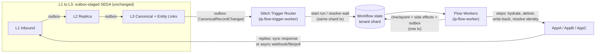
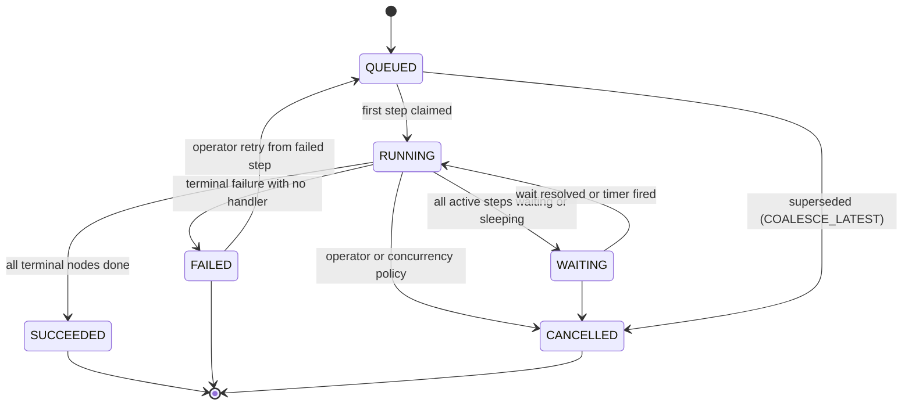
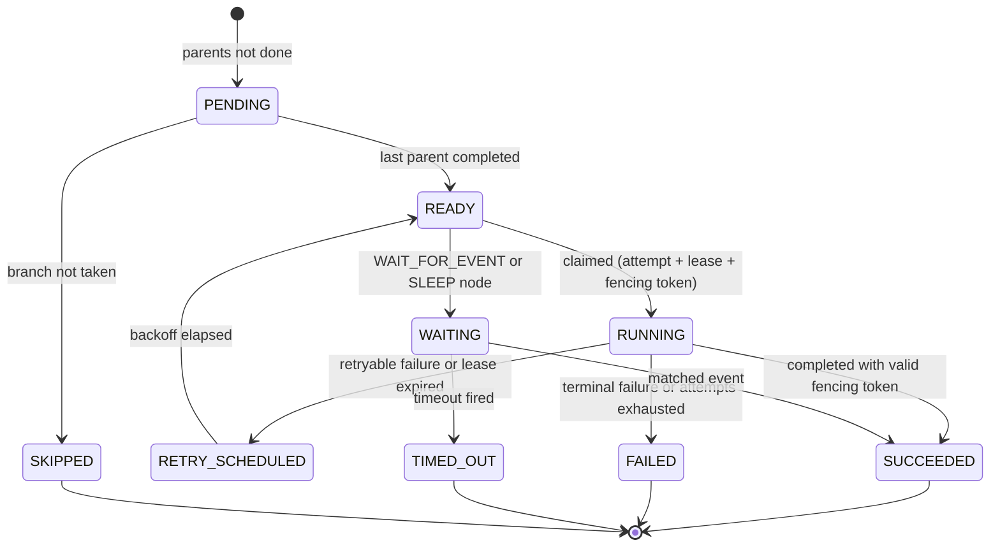

# Design: Durable Business Flow Orchestration (Stitch Engine)

**Status:** Proposed. For architecture review.
**Scope:** `core/platform/packages/workflow` (new, generic durable workflow engine) and `apps/ip/packages/ip` (Stitches: business flows between apps, built on that engine)
**Replaces:** the standalone L4 Hydrator and L5 Delivery workers in `architecture.md` §5 and `implementation_plan.md` Phases 7–8
**Related:** `architecture.md`, `l1_ingestion_design.md`, `l2_replica_design.md`, `l3_normalization_design.md`
**Reference implementations studied:** Hatchet (https://github.com/hatchet-dev/hatchet), Temporal, DBOS Transact, Airbyte, n8n, Activepieces

---

## 1. Executive Summary

Soopa IP is **not** a one-way data sync tool. It runs **business flows between apps**:

- AppA sends a record to AppB, and **AppB's reply is written back to AppA**.
- That change in AppB then flows to AppC, and **AppC's reply is written back to AppB**.
- Some replies come back **minutes or hours later** (for example a head-end system confirming a meter command).

Each of these is a multi-step conversation between systems that fail, throttle, time out and go offline. If our platform crashes halfway, it must **resume exactly where it stopped**, **never repeat a step that already had an effect**, and **never lose a reply**. This capability is called **durable orchestration**, and it is the core of the product.

This document specifies:

1. A **generic, Postgres-native durable workflow engine** in `core/platform/packages/workflow`. It is modelled on Hatchet's proven architecture and written in Python with Hexagonal Architecture.
2. **Stitches**: IP's business flows (our existing ubiquitous language). They are typed, versioned DAGs of steps built on the engine. They replace the separate L4/L5 workers.
3. The **integration intelligence** that generic engines lack: cross-app identity, write-back, echo/loop prevention, field authority, batching for high-volume Energy data, and Standard/Enterprise tier isolation.

**The key design decision:** workflow state lives **in the tenant's data plane shard**, next to the replica, canonical tables, entity map and outbox. So a step's checkpoint, its business side effects and its outgoing events are committed in **one PostgreSQL transaction**. No external orchestrator (Temporal, Hatchet, Airflow) can give this guarantee, because their state lives in a different database.

---

## 2. Goals and Non-Goals

### 2.1 Goals
| # | Goal |
|---|---|
| G1 | **Durability:** a committed flow run is never lost. A completed step is never re-executed. |
| G2 | **Effectively-once side effects** on external apps, through idempotency keys, reconciliation and fencing (§7.4). |
| G3 | **Bidirectional and chained flows** (X→Y→X, Y→Z→Y) without infinite loops (§8.4). |
| G4 | **Durable waits** for asynchronous replies, timers and timeouts, without holding worker resources. |
| G5 | **Multi-tenant fairness:** one Standard tenant's burst never starves another tenant. Enterprise tenants get physical isolation. |
| G6 | **Respect external API limits** per connection (token buckets, `Retry-After`, circuit breakers). |
| G7 | **Full traceability:** every run, step, attempt, retry and suppressed echo is visible on the business timeline by `correlation_id`. |
| G8 | **Safe evolution:** versioned Stitches. In-flight runs finish on their pinned version. |
| G9 | **No new infrastructure:** PostgreSQL plus the existing outbox/pub-sub. No Temporal cluster, no Go sidecar, no Redis requirement for the engine. |
| G10 | **Horizontal scale:** stateless workers, shard-level scale-out, a dedicated shard per Enterprise tenant. |

### 2.2 Non-Goals
- **No customer-facing flow designer.** Stitch *structure* (the step graph) is application code written and reviewed by us, consistent with `architecture.md` §1 ("Designed for Non-Tech Companies"). Customers bind and configure Stitches; they do not author them. *Field mappings* may later become UI-managed, versioned data (§8.9). The step graph never does.
- **No arbitrary code or expression evaluation at runtime.** We reject n8n-style JS expressions and Temporal-style replayed imperative code (§6.2).
- **Not a replacement for L1–L3.** Ingestion, replica and normalization stay as outbox-staged SEDA layers (§5.2).
- **No golden-record (MDM survivorship) logic.** That is deferred to the L3 Phase 2 design.

---

## 3. Requirements

### 3.1 Functional
| ID | Requirement |
|---|---|
| F1 | Start a flow run from: a canonical change (L3), a cron schedule, an API/manual action, a parent run (child flow), or a batch window. |
| F2 | Steps form a static DAG: sequential, parallel fan-out/fan-in, conditional branches, failure/timeout handlers. |
| F3 | `WAIT_FOR_EVENT` step: pause until a matching business event arrives (async reply) or a timeout fires. |
| F4 | `SLEEP` step: durable delay (e.g. "re-check status in 15 minutes"). |
| F5 | Per-step retry policy, error classification and rate-limit keys. |
| F6 | Per-run concurrency policy keyed by business entity (e.g. one active run per meter per Stitch). |
| F7 | Operator actions: retry from failed step, skip step with manual output, cancel, replay on a new version, bulk retry by filter, pause/resume a binding or connection. |
| F8 | Dry-run mode: execute everything except external writes, and record the payloads that *would* be sent. |
| F9 | Cross-app identity resolution and linking (AppA ID ↔ canonical ID ↔ AppB ID ↔ AppC ID). |
| F10 | Echo suppression and loop protection for write-backs and chained flows. |

### 3.2 Non-Functional (targets to be validated by the Phase C load test)
| Attribute | Target |
|---|---|
| Durability | RPO = 0 for committed runs (Postgres synchronous replica). No acknowledged trigger is ever dropped. |
| Schedule latency (step ready → step started), nominal load | p95 < 250 ms, p99 < 1 s |
| Noisy-neighbor bound (Standard pooled shard) | A tenant with 1 ready run starts within p99 < 2 s while another tenant has 100k queued |
| Throughput | ≥ 1,000 step transitions/s per Standard pooled shard; ≥ 3,000/s per Enterprise dedicated shard |
| Crash recovery | A crashed worker's in-flight steps resume within one lease TTL (default 30 s) |
| Availability | Engine availability equals the shard's availability. There is no extra single point of failure. |
| Retention | Run detail kept per tier (§9). Queue tables stay small and hot regardless of history size. |

---

## 4. Ubiquitous Language

| Term | Layer | Meaning |
|---|---|---|
| **Workflow** | Platform engine | Generic, versioned DAG of steps. It knows nothing about integration. |
| **Stitch** | IP | A business flow between apps, implemented as a Workflow (e.g. `energy.service_order_to_hes`). |
| **Stitch Binding** | IP control plane | A tenant enabling a Stitch for specific connections, with configuration and mode (`ACTIVE`, `DRY_RUN`, `PAUSED`). |
| **Run** | Engine | One execution of a Workflow version. |
| **Step Run** | Engine | One node of a Run. It holds the checkpointed input and output. |
| **Attempt** | Engine | One try of a Step Run, holding a lease and a fencing token. |
| **Queue Item** | Engine | A ready-to-execute Step Run. It is short-lived and lives in a hot table. |
| **Wait Condition** | Engine | A persisted "resume me when X happens or at time T". |
| **Concurrency Key** | Engine | A business key used to serialize, coalesce or fairly share runs (e.g. `tenant:meter:MTR-101`). |
| **Rate-Limit Key** | Engine | A token bucket key, usually one per target connection. |
| **Write Intent** | IP | A record of what we are about to write to an app. Used to recognize our own echo. |
| **Entity Link** | IP | Cross-app identity: one canonical entity ↔ N external IDs (evolution of the Global Entity Map). |
| **Causation Depth** | IP | The number of flow hops that led to this run. Used as a loop circuit breaker. |

---

## 5. Architecture Overview

### 5.1 Where orchestration sits



- **Synchronous replies** (an HTTP response body) become the **output of the delivery step** and are checkpointed immediately.
- **Asynchronous replies** (webhook, status file, polled status) re-enter through **L1 → L2 → L3**, like any other inbound data, so they get the same audit, replica and normalization. The Trigger Router then matches them to a waiting run (§7.7).
- This keeps a **single ingestion architecture**. Replies are never a side door.

### 5.2 Two coordination mechanisms with strict boundaries (not a dual architecture)

| Concern | Mechanism | Why |
|---|---|---|
| **Events between layers / bounded contexts** (L1→L2→L3→Trigger Router, notifications) | Transactional outbox + relay + sweeper + pub/sub (existing platform packages) | Fan-out, decoupling, cross-context isolation |
| **Work within a flow run** (step → next step, retries, waits, timers) | Workflow engine queue in the same shard (`workflow_queue_items`, `SKIP LOCKED`, `LISTEN/NOTIFY`) | Step completion and next-step enqueue must be **atomic** with business writes. Fairness, concurrency keys and rate limits need SQL-level control that SQS cannot provide. |

> [!IMPORTANT]
> The boundary is absolute. Layers never call the workflow engine directly. Workflow steps never publish inter-layer events except through the outbox. Using SQS between steps, or the workflow queue between layers, is a review-blocking violation. This mirrors Hatchet's own split between *events* and *tasks*.

### 5.3 Effect on the existing 5-stage pipeline

| Stage | Before | After |
|---|---|---|
| L1 Ingest, L2 Replica, L3 Normalize | Outbox-staged workers | **Unchanged** |
| L4 Hydrator | Standalone worker consuming `canonical_entity.normalized` | **A Stitch step type** (`HydratePayloadStep`, a pure mapper) |
| L5 Delivery | Standalone worker consuming `outbound_dispatch.enqueued` | **A Stitch step type** (`DeliverStep` / `WriteBackStep`). `outbound_records` stays as the delivery evidence ledger. |

This removes what would otherwise be a **dual architecture**: a linear L4/L5 chain alongside a flow engine that also delivers.

---

## 6. Build vs. Buy

### 6.1 Options evaluated

| Option | Strengths | Disqualifying gaps for us |
|---|---|---|
| **Temporal** | Gold-standard durability, mature | Extra cluster (Cassandra/Postgres, frontend, history, matching services). State lives **outside** the tenant shard, so checkpoints cannot commit atomically with replica/entity-link writes. Determinism constraints on workflow code. Heavy operations for a startup. |
| **Hatchet (self-hosted)** | Postgres-backed, fairness, rate limits, DAGs, durable waits | Separate Go engine and gRPC hop. Its own database, so again **no atomic commit with our shard**. Its own tenant model duplicates `ucp.shard_registry`. |
| **DBOS Transact (Python)** | Postgres-native library, durable steps, queues | Its system tables and conventions don't fit our sharding/RLS/hexagonal ports. Limited fairness model (no group round-robin), no wait-match on business events. **Kept as the fallback** at the Phase B gate (§18). |
| **Prefect / Airflow** | Rich DAG UX | Built for batch data pipelines: high per-run overhead, unsuitable for per-entity, low-latency flows |
| **Custom engine, Hatchet-inspired (chosen)** | Atomic commit with business state, our tenancy/sharding/RLS, our observability, no new infrastructure, full ownership | We must build it carefully. Mitigated by narrow scope, porting proven SQL patterns and rigorous testing (§17). |

### 6.2 What we take from Hatchet, and what we don't

| Hatchet pattern | Decision |
|---|---|
| Postgres as the durable queue (`FOR UPDATE SKIP LOCKED`, `LISTEN/NOTIFY` wakeups) | **Adopt** |
| Static DAG of steps with parent dependencies | **Adopt** as the primary model |
| Durable sleep / durable event wait with released worker slots | **Adopt** |
| Concurrency strategies `GROUP_ROUND_ROBIN`, `CANCEL_IN_PROGRESS`, `CANCEL_NEWEST` | **Adopt**, plus our own `COALESCE_LATEST` and `SERIAL` (§7.5.3) |
| Token-bucket rate limits keyed dynamically | **Adopt** (per connection) |
| Range-partitioned history tables, partition drop instead of `DELETE` | **Adopt** |
| Leases with heartbeat and reassignment | **Adopt**, plus fencing tokens |
| In-memory per-tenant slot scheduler | **Defer.** Start with SQL-side fair dequeue. Add the in-memory scheduler behind the same port only if load tests require it. |
| External gRPC dispatcher and multi-language SDK workers | **Reject.** Our workers are in-cluster Python in the single image. The extra hop adds latency and failure modes without benefit. |
| Imperative "durable task" with replay (Temporal-style) | **Reject for now.** Replay determinism is a known source of production incidents, and static DAGs are inspectable, renderable on the timeline and statically validated. Revisit only with a concrete need. |

---

## 7. Platform Engine Design (`core/platform/packages/workflow`)

The engine is **domain-agnostic**. It has no knowledge of connections, apps, canonical types or IP. It follows the platform's hexagonal taxonomy (same layout as `scheduler` and `outbox`).

### 7.1 Execution model: typed static DAG

A `WorkflowDefinition` is an immutable value object validated at registration time (acyclic, every parent exists, exactly one entry, handlers registered, all failure/timeout targets exist).

| Node kind | Behavior |
|---|---|
| `TASK` | Executes a registered `StepHandlerPort`. Its output is checkpointed. |
| `WAIT_FOR_EVENT` | Persists a `WaitCondition` (match key + timeout). Uses no worker slot while waiting. |
| `SLEEP` | Re-enqueues itself with `available_at = now + duration`. Uses no worker slot. |
| `BRANCH` | A pure predicate over checkpointed parent outputs. It selects which children become ready; unselected children are `SKIPPED`. |
| `CHILD_WORKFLOW` | Starts a child run (fan-out over a collection) and completes when the children reach a terminal state per its join policy (`ALL`, `ANY`, `ALL_SETTLED`). |
| `REPEAT_UNTIL` *(planned, §8.8)* | Bounded re-execution of a sub-sequence (e.g. poll a status every 10 minutes until terminal, max 12 times). The graph stays static: `max_iterations`, `interval` and the exit predicate are declared. Each iteration is a distinct, checkpointed step run. |

Edges carry a **run condition**: `ON_SUCCESS` (default), `ON_FAILURE`, `ON_TIMEOUT`. This is how compensation and failure write-backs are expressed (e.g. "if AppB rejects, write `FAILED: <reason>` back to AppA").

### 7.2 State machines





Transitions are implemented as **pure domain methods** on the `WorkflowRun` aggregate (e.g. `run.complete_step(step_key, attempt_id, output) -> Result[StepCompleted, TransitionError]`). Illegal transitions return typed errors and are unit-tested exhaustively without mocks.

### 7.3 Step contract (DTO-first, Result types, no exceptions for known failures)

```python
@dataclass(frozen=True)
class StepContext:
    tenant_id: str
    run_id: str
    step_run_id: str
    attempt_no: int
    idempotency_key: str          # stable across attempts: derived from step_run_id
    trace_id: str
    correlation_id: str | None
    deadline: datetime            # lease-bounded execution deadline

@dataclass(frozen=True)
class RetryableFailure:
    code: StepFailureCode         # Enum: TIMEOUT, RATE_LIMITED, UPSTREAM_5XX, CONNECTION_ERROR, ...
    detail: str
    retry_after: timedelta | None # honoured exactly; RATE_LIMITED does not consume an attempt

@dataclass(frozen=True)
class TerminalFailure:
    code: StepFailureCode         # Enum: VALIDATION_REJECTED, UPSTREAM_4XX, ENTITY_NOT_FOUND, ...
    detail: str

type StepFailure = RetryableFailure | TerminalFailure

class StepHandlerPort[TInput, TOutput](Protocol):
    @property
    def step_type(self) -> str: ...
    @property
    def effect_policy(self) -> EffectPolicy: ...   # Enum: PURE, IDEMPOTENT_EFFECT, RECONCILABLE_EFFECT, OPERATOR_GATED_EFFECT

    async def execute(self, context: StepContext, step_input: TInput) -> Result[TOutput, StepFailure]: ...

class ReconcilableStepHandlerPort[TInput, TOutput](StepHandlerPort[TInput, TOutput], Protocol):
    async def reconcile(
        self, context: StepContext, step_input: TInput
    ) -> Result[ReconcileOutcome[TOutput], StepFailure]: ...   # FOUND(output) | NOT_FOUND
```

- Step inputs and outputs are frozen dataclasses serialized through a **versioned codec registry**. There is no `dict[str, Any]` across the boundary.
- Unexpected exceptions are **explicitly handled** at the runtime boundary: `logger.exception("workflow_step_crashed", ...)` and classified as `RetryableFailure(code=UNHANDLED_EXCEPTION)` by the injected `StepErrorPolicyPort`. They are never swallowed.

### 7.4 Durability protocol and effectively-once side effects

**Rule:** never hold a database transaction open across network I/O.

| Phase | Transaction | Actions |
|---|---|---|
| **1. Claim** | Tx A (short) | Lock and delete the queue item (`SKIP LOCKED`), check concurrency capacity, consume a rate-limit token, insert an `Attempt` (`RUNNING`, `lease_expires_at`, `fencing_token`), mark the step `RUNNING`. Commit. |
| **2. Reconcile** (only `attempt_no > 1` and `RECONCILABLE_EFFECT`) | none | Ask the target whether the effect already happened (by idempotency key or external reference). `FOUND` adopts the output and skips execution. |
| **3. Execute** | none | Run the handler with a heartbeat that extends the lease. |
| **4. Complete** | Tx B (atomic) | Guarded update `WHERE attempt_id = :id AND fencing_token = :token AND status = 'RUNNING'`. If 0 rows, the worker lost its lease: discard and `logger.error`. Otherwise checkpoint the output, mark children ready, enqueue them, release the concurrency slot, **and**, through the IP unit of work, write entity links, write-intent confirmation, the `outbound_records` row, trace events and outbox events. Commit once. |

**Crash-window analysis**

| Crash point | State after restart | Outcome |
|---|---|---|
| Before Tx A commits | Queue item still present | Re-claimed. Nothing happened. |
| After Tx A, before the external call | Attempt `RUNNING`, lease expires | Reaper schedules a retry. Reconcile returns `NOT_FOUND`. Executes once. |
| After the external call succeeded, before Tx B | Lease expires | Retry → reconcile → `FOUND` → output adopted. **No duplicate write.** |
| After Tx B | Step `SUCCEEDED` | Never re-executed. Children proceed. |
| Zombie worker (GC pause, network partition) finishes after losing its lease | Fencing check fails | Result discarded. The new attempt's result wins. Error logged. |

**Effect policies** (declared per step type, validated at registration):

| Policy | Used when | Retry behavior |
|---|---|---|
| `PURE` | Hydration, branching, mapping | Retry freely |
| `IDEMPOTENT_EFFECT` | The target honours an idempotency key header, or the operation is a natural upsert (PUT by our key) | Retry freely, reusing `idempotency_key` |
| `RECONCILABLE_EFFECT` | The target can be queried by our external reference (e.g. `external_ref = step_run_id` stored on the created record) | Reconcile before re-executing |
| `OPERATOR_GATED_EFFECT` | The target has neither (rare legacy endpoints) | After an ambiguous crash, the run moves to `FAILED` with `AMBIGUOUS_EFFECT`. An operator confirms. Never auto-duplicates. |

> [!NOTE]
> Exactly-once delivery to an arbitrary external system is impossible in general. This protocol gives **effectively-once effects** where the target supports idempotency or lookup, and **never silent duplication** where it doesn't.

### 7.5 Scheduling

#### 7.5.1 Queue and wakeups
- `workflow_queue_items` is a **small, hot table** (rows exist only while ready or delayed). It uses aggressive autovacuum and `fillfactor` tuning.
- Indexed for efficient dequeue: `idx_queue_ready` on `(queue_name, available_at, priority DESC, id)` scans ready candidate tenants, while `idx_queue_tenant_priority` on `(queue_name, tenant_id, priority DESC, id)` supports the per-tenant lateral lookup's filtering and ordered `LIMIT`.
- Each claim is one short transaction. Workers wake on `LISTEN workflow_ready_<queue>` (`NOTIFY` is issued in the enqueue transaction), with a **fallback poll** (default 1 s). This is the same relay-plus-sweeper dual mechanism mandated for the outbox.
- Retry backoff, `SLEEP` and wait timeouts are all just queue items with a future `available_at`. **There is one timer mechanism, not three.**

#### 7.5.2 Fair dequeue (illustrative)
```sql
-- 1. Ensure the fairness cursor row exists and acquire an exclusive row lock BEFORE tenant selection
INSERT INTO workflow_queue_fairness_state (queue_name, last_serviced_tenant_id, updated_at)
VALUES (:queue, '', now())
ON CONFLICT (queue_name) DO NOTHING;

SELECT last_serviced_tenant_id
FROM workflow_queue_fairness_state
WHERE queue_name = :queue
FOR UPDATE;

-- 2. Select and interleave candidates fairly
WITH current_cursor AS (
    SELECT last_serviced_tenant_id AS last_tenant_id
    FROM workflow_queue_fairness_state
    WHERE queue_name = :queue
), active_tenants AS (
    SELECT tenant_id
    FROM (
        SELECT DISTINCT tenant_id
        FROM workflow_queue_items
        WHERE queue_name = :queue AND available_at <= now()
    ) ready
    CROSS JOIN current_cursor c
    -- Rotate eligible tenants starting immediately after last_serviced_tenant_id
    ORDER BY (ready.tenant_id > c.last_tenant_id) DESC, ready.tenant_id ASC
    LIMIT :max_active_tenants
), tenant_candidates AS (
    SELECT
        c.*,
        ROW_NUMBER() OVER (
            PARTITION BY c.tenant_id
            ORDER BY c.priority DESC, c.id ASC
        ) AS tenant_rank
    FROM active_tenants t
    CROSS JOIN LATERAL (
        SELECT q.id, q.tenant_id, q.priority
        FROM workflow_queue_items q
        WHERE q.queue_name = :queue
          AND q.tenant_id = t.tenant_id
          AND q.available_at <= now()
        ORDER BY q.priority DESC, q.id
        LIMIT :per_tenant_cap
        FOR UPDATE SKIP LOCKED         -- lock candidates per tenant so concurrent workers skip locked rows and pick other ready rows
    ) c
)
SELECT id, tenant_id, priority
FROM tenant_candidates
-- Balance slots across tenants first (round-robin interleaving), then break ties by priority and id
ORDER BY tenant_rank ASC, priority DESC, id ASC
LIMIT :free_slots;
```
Following the dequeue claim, the transaction advances the cursor state in `workflow_queue_fairness_state` to the tenant at the **end of the selected rotation order** (the last tenant yielded by the rotated `active_tenants` order in the selected batch, rather than lexicographically highest `MAX(tenant_id)`), ensuring wraparound cursor integrity:
```sql
UPDATE workflow_queue_fairness_state
SET last_serviced_tenant_id = :last_rotated_tenant_id,
    updated_at = now()
WHERE queue_name = :queue;
```
Because the fairness row is locked `FOR UPDATE` prior to tenant selection, concurrent dequeue transactions are serialized around cursor advancement, preventing concurrent claims from moving the rotation cursor backward.

Concurrency capacity and rate-limit tokens are checked for the selected rows in the same transaction. Rows that cannot run yet stay queued. Starvation-triggered fast wakeup (Hatchet's `onCapacityRestored`) is implemented by `NOTIFY` on slot release.

#### 7.5.3 Concurrency strategies (`ConcurrencyPolicy`, Strategy pattern)
| Strategy | Semantics | Typical Stitch |
|---|---|---|
| `SERIAL` | Max N running per key. The rest queue in order. | Financial or ordered events (meter exchange then activation) |
| `COALESCE_LATEST` | Max one running and one queued per key. A newer trigger **replaces** the queued run (`CANCELLED: SUPERSEDED`). | State sync: only the latest state of a meter matters |
| `CANCEL_IN_PROGRESS` | A new trigger cancels the running run at its next step boundary | Recomputations where stale work is waste |
| `CANCEL_NEWEST` | Reject new triggers while the key is at capacity | Idempotent "ensure exists" flows |
| `GROUP_ROUND_ROBIN` | Fair interleaving across group keys | Tenant fairness (always on in pooled shards), connection fairness within a tenant |

#### 7.5.4 Rate limits and circuit breakers
- **Token bucket per rate-limit key** (default: target `connection_id`): `capacity`, `refill_per_second`, `tokens`, `paused_until`. Consumed atomically in the claim transaction.
- A `429`/`503` with `Retry-After` sets `paused_until` on the bucket. Queued steps for that connection wait **without consuming attempts**.
- **Circuit breaker per connection:** if the failure ratio over a sliding window passes a threshold, the connection's queue is paused, an alert fires, and probe attempts are scheduled. This prevents thousands of runs from burning retries against a down system.

#### 7.5.5 Priority lanes
`priority` is an Enum: `INTERACTIVE` (operator retries, UI actions) > `REALTIME` (live triggers) > `BULK` (backfills, replays, batch catch-up). Enterprise bindings may reserve slots per lane.

### 7.6 Retries and error policy
- A `RetryPolicy` value object per step: `max_attempts`, exponential backoff with full jitter, `max_backoff`, and per-`StepFailureCode` overrides.
- An injected `StepErrorPolicyPort` (Strategy) decides **retry, fail, or route to the `ON_FAILURE` edge**. There is no boolean control coupling.
- Attempts exhausted → the step is `FAILED` → the run follows the `ON_FAILURE` edge if defined (e.g. write the failure status back to the source app), otherwise the run is `FAILED` and appears in the operator queue with the full attempt history.
- **Terminal domain failures are data**: typed codes, visible on the timeline, actionable. Only infrastructure failures are retried.

### 7.7 Durable waits and timers
- A `WAIT_FOR_EVENT` node writes a `workflow_wait_conditions` row: `match_kind`, `match_key` (e.g. `entity:energy.work_order:<canonical_id>` or `external:<connection_id>:<external_id>`), an optional `match_predicate_id` (a registered pure predicate, e.g. "status in {CONFIRMED, REJECTED}"), and `timeout_at`. It also enqueues a timeout queue item.
- Resolution: the IP Trigger Router calls `ResolveWaitConditionsUseCase` for each `CanonicalRecordChanged`. A matching condition is resolved, the event reference becomes the step output, and the children are enqueued, **in one transaction**. The timeout item becomes a no-op through a status guard.
- **Late events** (arriving after a timeout) are recorded as `WAIT_LATE_EVENT` on the timeline and do not resume the run. The Stitch's timeout branch decides the business outcome.

### 7.8 Versioning
- A run **pins** `(workflow_id, workflow_version)` at start. Steps execute on the definition they started with.
- A new version is a new registered definition. The binding chooses the active version for **new** runs, so old and new versions run side by side until old runs drain.
- **Startup safety check:** a worker refuses to claim steps of an unregistered version. Those runs move to `BLOCKED_VERSION_UNAVAILABLE` (alerted) instead of failing silently. CI checks that removed versions have zero non-terminal runs in any environment before merge.
- Input/output codecs are versioned. A step reads checkpoints written by the previous version of its parents.

### 7.9 Payloads
- Step inputs and outputs under 64 KB are stored inline (`JSONB`). Larger ones are offloaded through the platform `storage` package (S3/MinIO), using the same threshold as L1.
- **Secrets never enter checkpoints.** Steps carry `connection_id` references. Credentials are resolved at the HTTP client injection layer (`architecture.md` §9).

### 7.10 Package structure
```
core/platform/packages/workflow/src/workflow/
├── domain/
│   ├── constants.py            # RunStatus, StepStatus, NodeKind, EdgeCondition, ConcurrencyStrategy,
│   │                           # EffectPolicy, Priority, StepFailureCode
│   ├── definition.py           # WorkflowDefinition, NodeDefinition, RetryPolicy, ConcurrencyPolicy,
│   │                           # RateLimitPolicy + pure DAG validation
│   ├── run.py                  # WorkflowRun aggregate (pure state machine), StepRun, Attempt
│   ├── waits.py                # WaitCondition, WaitMatch
│   ├── failures.py             # RetryableFailure, TerminalFailure, TransitionError
│   └── events.py               # Frozen dataclass domain events: RunStarted, StepSucceeded, ...
├── application/
│   ├── start_run_use_case.py           # StartRunCommand co-located
│   ├── claim_steps_use_case.py
│   ├── complete_step_use_case.py
│   ├── fail_step_use_case.py
│   ├── resolve_wait_conditions_use_case.py
│   ├── reap_expired_leases_use_case.py
│   ├── cancel_run_use_case.py
│   ├── retry_run_use_case.py           # operator retry from failed step / skip step
│   └── scheduling/                     # fairness selection, concurrency + rate-limit evaluation (pure)
├── ports/
│   ├── inbound/                        # WorkflowRuntimePort (consumed by apps)
│   └── outbound/                       # WorkflowRepositoryPort, WorkflowQueuePort, WorkflowUnitOfWorkPort,
│                                       # StepHandlerRegistryPort, WakeupNotifierPort, PayloadStorePort,
│                                       # ClockPort, StepErrorPolicyPort, WorkflowEventSinkPort
├── adapters/
│   ├── inbound/postgres_wakeup_listener.py     # LISTEN/NOTIFY + fallback poll
│   ├── inbound/worker_runtime.py               # bounded asyncio slot pool, heartbeats, graceful drain
│   └── outbound/database/                      # Postgres* repositories (platform taxonomy), ORM models, UoW
└── testing/                                    # fakes for consumers' unit tests (never imported by src)
```
- The engine's `WorkflowUnitOfWorkPort` composes with the app's unit of work through the shared `seedwork.UnitOfWorkPort` and the `database` package's `TenantDataPlaneUnitOfWorkProvider`, so engine and IP writes share **one session per tenant shard**.
- Engine tables are migrated into **each IP shard** by the shard migration runner (`architecture.md` §6.4). The engine does not own a database. It is hosted by the app's data plane.

---

## 8. IP Integration: Stitches

### 8.1 Stitch definition (illustrative)

```python
SERVICE_ORDER_TO_HES = StitchDefinition(
    stitch_id="energy.service_order_to_hes",
    version=1,
    trigger=CanonicalChangeTrigger(
        canonical_type=CanonicalType.ENERGY_SERVICE_ORDER,
        on_fields=("status", "meter_serial_number"),      # field-level trigger (§8.4)
        source_role=ConnectionRole.CIS,
    ),
    concurrency=ConcurrencyPolicy(key=EntityConcurrencyKey(), strategy=ConcurrencyStrategy.COALESCE_LATEST),
    nodes=(
        Task("resolve_target_identity", ResolveEntityLinkStep, target_role=ConnectionRole.HES),
        Task("hydrate_hes_command", HydratePayloadStep, mapper="energy.hes_service_order@1",
             parents=("resolve_target_identity",)),
        Task("deliver_to_hes", DeliverStep, target_role=ConnectionRole.HES,
             parents=("hydrate_hes_command",),
             retry=RetryPolicy.standard_external(), rate_limit=ConnectionRateLimit(ConnectionRole.HES)),
        WaitForEvent("await_hes_confirmation", parents=("deliver_to_hes",),
                     match=EntityChangeMatch(CanonicalType.ENERGY_SERVICE_ORDER,
                                             predicate="hes_status_terminal"),
                     timeout=timedelta(hours=4)),
        Task("write_back_to_cis", WriteBackStep, target_role=ConnectionRole.CIS,
             mapper="energy.cis_service_order_status@1", parents=("await_hes_confirmation",)),
        Task("write_failure_to_cis", WriteBackStep, target_role=ConnectionRole.CIS,
             mapper="energy.cis_service_order_failure@1",
             parents=("deliver_to_hes", "await_hes_confirmation"),
             condition=EdgeCondition.ON_FAILURE_OR_TIMEOUT),
    ),
)
```

- Stitches compose a **small, fixed library of IP step types**. Business logic lives in **pure mappers and predicates** (same rules as L3 mappers: no I/O, golden fixtures, versioned).
- **Connection roles** (`CIS`, `HES`, `MDM`, `WFM`, `ERP`) decouple Stitch code from tenant-specific connections. The binding maps roles to the tenant's actual `connection_id`s.

| IP step type | Effect policy | Responsibility |
|---|---|---|
| `ResolveEntityLinkStep` | `PURE` (DB read) | Resolve canonical ID → external ID for the target role. Missing link → create path or typed terminal failure. |
| `HydratePayloadStep` | `PURE` | Run a pure outbound mapper: canonical record → target payload |
| `DeliverStep` | `IDEMPOTENT_EFFECT` / `RECONCILABLE_EFFECT` (per connector capability) | Send through the connector, write `outbound_records`, map the sync response through a pure response mapper, **create or update entity links** |
| `WriteBackStep` | same as Deliver | Deliver to the *source* role, plus register a **write intent** (§8.4) |
| `NotifyStep` | `IDEMPOTENT_EFFECT` | Business notification through the platform `notify()` facade (outbox, 3-stage pipeline) |
| `StartChildStitchStep` | `PURE` | Explicit chaining when the next flow must be causally linked rather than change-triggered |

### 8.2 Trigger Router (`ip-flow-trigger-worker`)
For each `CanonicalRecordChanged` (delivered by the outbox relay plus sweeper through `SqsConsumerManager → Dispatcher → RouteCanonicalChangeUseCase`):
1. **Resolve waits** (§7.7).
2. **Echo check** against write intents (§8.4).
3. **Match active Stitch bindings** for `(tenant, canonical_type, source connection role)` and the field-level trigger filter.
4. **Compute causation depth** and enforce the loop guard.
5. **Start runs** with a deterministic idempotency key `(binding_id, canonical_id, canonical_version)`, so redelivered events never start duplicate runs.

All of this happens in **one shard transaction**, together with trace events. Infrastructure failure → NACK → queue retry → DLQ. There are no silent drops.

### 8.3 Cross-app identity: Entity Links (Global Entity Map v2)
The current `global_entity_map` holds one source and **one** destination per row. That cannot represent AppA ↔ AppB ↔ AppC. Evolve it to:

```
entity_links (tenant_id, entity_domain, canonical_id, connection_id, external_id, link_origin, created_by_run_id, ...)
UNIQUE (tenant_id, entity_domain, connection_id, external_id)
UNIQUE (tenant_id, entity_domain, canonical_id, connection_id)
```
- One canonical entity has **N** links (one per connection). Created by L3 (for the inbound source) and by `DeliverStep` (when a target returns its new ID).
- When AppB replies with `ITRON-992`, the link is committed **in the same transaction as the step checkpoint**, so later steps and later flows can always resolve AppA `ORD-100` ↔ AppB `ITRON-992`.

### 8.4 Loop and echo prevention (four layered defenses)

| # | Defense | When | Mechanism |
|---|---|---|---|
| 1 | **Static cycle analysis** | Binding time | Build a graph of `(connection role, canonical type, field)` → written fields for all of a tenant's active bindings. Any cycle without a declared terminating condition **rejects the binding**. Most loops are caught before production. |
| 2 | **Field authority** | Binding time | For each Stitch pair, each written field has exactly one authoritative system. Two bindings writing the same field in opposite directions are rejected. This also prevents ping-pong conflicts. |
| 3 | **Write intents (echo suppression)** | Runtime | `WriteBackStep`/`DeliverStep` record `(connection_id, external_id, field_set, field_values_hash, run_id, expires_at)` before sending. When the change comes back through L1→L3, the router compares the changed fields: **if they are a subset of an intent's fields and the values hash matches, it is our echo**. The intent is consumed, triggers are suppressed, and `FLOW_TRIGGER_SUPPRESSED_ECHO` is traced. If *other* fields also changed (a human or the app itself edited them), triggers fire normally. |
| 4 | **Causation depth breaker** | Runtime | A change that matches an intent (even partially) inherits `causation_depth = run.depth + 1`. Runs beyond `max_causation_depth` (default 8, per binding) are not started. `FLOW_LOOP_GUARD_TRIPPED` is raised as an error-level alert with the full causal chain. |

> [!IMPORTANT]
> This requires L3 `CanonicalRecordChanged` to carry `changed_fields` and `canonical_version`. That is an additive change to `l3_normalization_design.md` (§19).

### 8.5 End-to-end: chained flows A → B → A and B → C → B

```mermaid
sequenceDiagram
    participant A as AppA (CIS)
    participant P as Soopa L1-L3
    participant R as Trigger Router
    participant W as Flow Worker
    participant B as AppB (HES)
    participant C as AppC (WFM)

    A->>P: Service order ORD-100 changed (pull/webhook)
    P->>R: CanonicalRecordChanged(service_order, fields=[status])
    R->>W: Start run A (Stitch A→B), depth 0
    W->>B: Deliver command (idempotency key = step_run_id)
    B-->>W: 202 Accepted, job ITRON-992
    W->>W: Checkpoint + entity link (ORD-100 ↔ ITRON-992) [one tx]
    Note over W: Run A WAITING (no worker slot held)
    B->>P: Async confirmation (webhook) for ITRON-992
    P->>R: CanonicalRecordChanged(hes_status=CONFIRMED)
    R->>W: Resolve wait for run A; start run B (Stitch B→C), depth 1
    W->>A: Run A write-back: status ACTIVE (write intent recorded)
    A->>P: ORD-100 changed (our own write)
    P->>R: CanonicalRecordChanged(fields=[status])
    R->>R: Matches write intent → echo suppressed
    W->>C: Run B: create field work ticket
    C-->>W: Ticket SAP-441
    W->>B: Run B write-back to AppB (write intent recorded)
```

### 8.6 High-volume Energy data: batch Stitches
**Not every record deserves a workflow run.** Interval meter reads (millions per day per Enterprise utility) would overwhelm any per-record orchestration.

- `BatchWindowTrigger(max_records, max_wait, group_by=(tenant, target_connection, canonical_type))` accumulates canonical change references in `stitch_batch_buffers`. When the window closes, it starts **one run per batch**.
- Batch delivery steps use the target's bulk API (or file drop via SFTP), and record per-item outcomes. Failed items get **per-item retries**, so one bad record doesn't fail the batch.
- Per-entity Stitches (service orders, meter exchanges, disconnect/reconnect commands) stay one run per business transaction.

### 8.7 Bindings and modes
`stitch_bindings` (control plane): `tenant_id`, `stitch_id`, `active_version`, `role → connection_id` map, typed configuration, `mode` (`ACTIVE`, `DRY_RUN`, `PAUSED`), `max_causation_depth`, priority lane, quotas. Every change is an audited control-plane event (`StitchBindingChanged`, `StitchVersionPromoted`), restricted by role. Cached in workers and invalidated through the outbox.

### 8.8 Flow expressiveness: what Stitches can and cannot express

A Stitch fixes the **shape** of a flow. Business **logic** lives in pure mappers and predicates, which can be arbitrarily complex typed Python. The static DAG covers the business flow patterns we expect in Energy and adjacent domains:

| Pattern | Expressed with |
|---|---|
| Sequential multi-app conversation (X → Y → reply to X) | `TASK` chain |
| Parallel delivery to several apps, then join | Fan-out edges plus a multi-parent node |
| Conditional routing (e.g. disconnect vs. reconnect command) | `BRANCH` with a pure predicate |
| Async reply with timeout | `WAIT_FOR_EVENT` plus `ON_TIMEOUT` edge |
| Failure write-back / compensation | `ON_FAILURE` edges |
| Per-item processing of a collection | `CHILD_WORKFLOW` with a join policy |
| Scheduled follow-up ("re-check in 15 minutes") | `SLEEP` |
| Bounded polling loop ("until status terminal, max N times") | `REPEAT_UNTIL` *(planned)* |

**Escalation path if a flow ever exceeds the DAG model:**
1. **First choice: decompose.** Split the flow into several Stitches linked by `StartChildStitchStep` or by change triggers. Each remains inspectable and statically analyzable.
2. **Second choice: add a declarative node kind** (like `REPEAT_UNTIL`) to the engine, with registration-time validation.
3. **Last resort: a durable code step.** This is an imperative, checkpointed function behind the same `StepHandlerPort`, so the engine, storage and timeline are unchanged. It requires an architecture review because it gives up static analysis (cycle detection, field authority) for that step.

> [!NOTE]
> None of these escalations changes the engine's storage model, durability protocol or scheduling. Expressiveness can grow without re-architecture.

### 8.9 Mapping evolution: code first, UI-managed mappings later

**Strategy:** Stitch structure stays in code permanently. **Field mappings** start in code and later gain a UI-managed, declarative form for repetitive, tenant-specific variations. Both forms run behind the same `MapperPort`, so this is one architecture, not two.

#### 8.9.1 Why code first
- We do not yet know which mappings repeat across Energy tenants. Code reveals the real patterns before we freeze a declarative model.
- Code mappers get `mypy`, code review, golden fixtures and versioning for free.
- Building a mapping language before the patterns are known is the most common way iPaaS products end up with weak, leaky mapping DSLs.

#### 8.9.2 Phases
| Phase | Who edits mappings | Form | Gate |
|---|---|---|---|
| **M1: Code (now)** | Soopa engineers | Pure Python mappers (`MapperPort`), versioned, golden fixtures | PR review plus CI |
| **M2: Internal mapping UI** | Soopa implementation team | Declarative mapping sets: a Soopa **base mapping** plus **tenant overlays** | Validation, dry-run with diffs, approval |
| **M3: Customer self-service (subset)** | Tenant admins | Overlays on fields marked `customer_editable` by the base mapping | Validation, dry-run with diffs, tenant approver plus optional Soopa approval |

Entry criterion for M2: at least three tenants share a Stitch where most mapper changes are field-level variations (renames, lookups, defaults, unit conversions), not logic.

#### 8.9.3 Rules that keep UI mappings compatible with durable execution
| # | Rule | Why it matters for durability |
|---|---|---|
| 1 | **Published mapping sets are immutable.** Each publish creates `mapping_set_id@version`; nothing is edited in place. | A retry or resume must produce the same payload as the first attempt. |
| 2 | **Runs pin mapping versions at start.** The run input records `(mapping_set_id, version)` for every mapper node, alongside `workflow_version`. | Editing a mapping while thousands of runs wait does not change their behavior. In-flight runs finish on their pinned version; new runs use the new one (same semantics as code versions, §7.8). |
| 3 | **One port.** `DeclarativeMapper` interprets a mapping set and implements `MapperPort`, exactly like code mappers. | The engine, step types and checkpoints are unaware of the mapper's origin. No dual architecture. |
| 4 | **Closed set of typed transforms.** Only copy, lookup table, concat, format, date/time conversion, unit conversion, default, conditional constant, and calls to registered pure code functions. No free-form scripts or expressions. | Mappings stay deterministic, safe, statically validated and replayable. This is the explicit rejection of n8n-style runtime JavaScript. |
| 5 | **Validate, dry-run, promote.** At publish: type-check against the canonical source schema and the target payload schema. Then run in `SHADOW` against recent real records and show field-level diffs. Then promote (audited). | A bad mapping never reaches production unseen. Reuses the L3 shadow-diff mechanism. |
| 6 | **Re-run static loop and field-authority analysis on every publish.** | A mapping change can alter which fields a Stitch writes back, which could create a write-back cycle (§8.4). |
| 7 | **Rollback is a new promotion of an older version.** | No mutation of history. In-flight runs are unaffected either way. |

#### 8.9.4 Storage (control plane, `ip` schema)
| Table | Purpose |
|---|---|
| `mapping_sets` | Identity, target mapper slot (e.g. `energy.hes_service_order`), owner (`SOOPA_BASE` or tenant overlay), editable-field policy |
| `mapping_set_versions` | Immutable, versioned, validated transform definitions (typed JSON schema), status (`DRAFT`, `SHADOW`, `ACTIVE`, `RETIRED`), audit fields |
| `mapping_shadow_diffs` (tenant shard) | Field-level diffs from shadow runs, reusing the L3 shadow-diff model |

Workers cache active versions in memory and resolve pinned versions by ID. Pinned versions are retained until no non-terminal run references them, using the same drain check as code versions.

#### 8.9.5 What stays out of the UI permanently
- **The step graph** (steps, order, branches, waits, failure paths) for regulated Energy flows.
- **Effect policies, retry policies and concurrency strategies.** These are engineering guarantees, not business configuration.
- **Binding-level options** (enabled optional branches, thresholds, timeouts, priority lane) *are* configurable, but as typed `stitch_bindings` configuration, not as mapping transforms.

---

## 9. Multi-Tenancy and Tiers

| Aspect | Standard | Enterprise |
|---|---|---|
| Data plane | Pooled IP shard, RLS (`platform.current_tenant_id()`) | Dedicated IP shard |
| Workflow state | In the pooled shard (RLS-protected) | In the dedicated shard |
| Flow workers | Shared `standard` pool serving all pooled shards | Dedicated pool per tenant (or per enterprise shard) |
| Fairness | `GROUP_ROUND_ROBIN` by tenant, always on | Round-robin by binding/connection within the tenant |
| Execution quota | Default max concurrent runs and steps per tenant (configurable) | Contracted, configurable, reserved priority-lane slots |
| Rate limits | Per connection | Per connection, custom profiles |
| Run detail retention | 30 days (default) | 13 months (default, configurable) |
| Tier upgrade | Runbook: pause bindings → park runs at step boundaries → shard move (workflow state moves **with** the data, a benefit of co-location) → resume | — |

> [!IMPORTANT]
> **Quotas limit execution concurrency, never intake.** Triggers are always accepted and persisted. A tenant over its quota queues longer; business events are never dropped.

---

## 10. Storage Schema (tenant shard, `public` schema, RLS on every table)

```sql
-- Engine (generic; owned by core/platform/packages/workflow)
CREATE TABLE workflow_runs (
    id VARCHAR(64) NOT NULL,                     -- wf_run_<os.urandom(12).hex()>
    tenant_id VARCHAR(128) NOT NULL,
    workflow_id VARCHAR(128) NOT NULL,
    workflow_version INT NOT NULL,
    status VARCHAR(32) NOT NULL,                 -- RunStatus Enum
    priority SMALLINT NOT NULL,
    concurrency_key VARCHAR(255),
    idempotency_key VARCHAR(255) NOT NULL,
    parent_run_id VARCHAR(64),
    input JSONB, input_ref VARCHAR(512),
    output JSONB, output_ref VARCHAR(512),
    trace_id VARCHAR(64) NOT NULL,
    correlation_id VARCHAR(255),
    failure_code VARCHAR(64), failure_detail TEXT,
    created_at TIMESTAMPTZ NOT NULL, started_at TIMESTAMPTZ, finished_at TIMESTAMPTZ,
    PRIMARY KEY (id, created_at)
) PARTITION BY RANGE (created_at);
CREATE UNIQUE INDEX uq_workflow_runs_idem ON workflow_runs (tenant_id, workflow_id, idempotency_key, created_at);
CREATE INDEX idx_workflow_runs_active ON workflow_runs (tenant_id, status) WHERE status IN ('QUEUED','RUNNING','WAITING');
CREATE INDEX idx_workflow_runs_corr ON workflow_runs (tenant_id, correlation_id);

CREATE TABLE workflow_step_runs (
    id VARCHAR(64) NOT NULL,                     -- wf_step_<...>; also the stable idempotency key
    run_id VARCHAR(64) NOT NULL,
    tenant_id VARCHAR(128) NOT NULL,
    node_key VARCHAR(128) NOT NULL,
    status VARCHAR(32) NOT NULL,                 -- StepStatus Enum
    pending_parent_count SMALLINT NOT NULL,
    attempt_count SMALLINT NOT NULL DEFAULT 0,
    input JSONB, input_ref VARCHAR(512),
    output JSONB, output_ref VARCHAR(512),
    failure_code VARCHAR(64), failure_detail TEXT,
    created_at TIMESTAMPTZ NOT NULL, finished_at TIMESTAMPTZ,
    PRIMARY KEY (id, created_at),
    UNIQUE (run_id, node_key, created_at)
) PARTITION BY RANGE (created_at);

CREATE TABLE workflow_step_attempts (
    id VARCHAR(64) NOT NULL,
    step_run_id VARCHAR(64) NOT NULL,
    tenant_id VARCHAR(128) NOT NULL,
    attempt_no SMALLINT NOT NULL,
    worker_id VARCHAR(128) NOT NULL,
    fencing_token BIGINT NOT NULL,
    status VARCHAR(32) NOT NULL,
    lease_expires_at TIMESTAMPTZ NOT NULL,
    outcome_code VARCHAR(64), outcome_detail TEXT,
    started_at TIMESTAMPTZ NOT NULL, finished_at TIMESTAMPTZ,
    PRIMARY KEY (id, started_at)
) PARTITION BY RANGE (started_at);
CREATE INDEX idx_attempts_lease ON workflow_step_attempts (lease_expires_at) WHERE status = 'RUNNING';

-- Hot tables: not partitioned, kept small
CREATE TABLE workflow_queue_items (
    id BIGSERIAL PRIMARY KEY,
    tenant_id VARCHAR(128) NOT NULL,
    step_run_id VARCHAR(64) NOT NULL,
    item_kind VARCHAR(32) NOT NULL,              -- EXECUTE, WAIT_TIMEOUT, SLEEP_WAKE
    queue_name VARCHAR(128) NOT NULL,
    priority SMALLINT NOT NULL,
    concurrency_key VARCHAR(255),
    rate_limit_key VARCHAR(255),
    available_at TIMESTAMPTZ NOT NULL,
    enqueued_at TIMESTAMPTZ NOT NULL
) WITH (fillfactor = 70);
CREATE INDEX idx_queue_ready ON workflow_queue_items (queue_name, available_at, priority DESC, id);
CREATE INDEX idx_queue_tenant_priority ON workflow_queue_items (queue_name, tenant_id, priority DESC, id);

CREATE TABLE workflow_queue_fairness_state (
    queue_name VARCHAR(128) PRIMARY KEY,
    last_serviced_tenant_id VARCHAR(128) NOT NULL DEFAULT '',
    updated_at TIMESTAMPTZ NOT NULL DEFAULT now()
);

CREATE TABLE workflow_wait_conditions (
    id VARCHAR(64) PRIMARY KEY,
    tenant_id VARCHAR(128) NOT NULL,
    run_id VARCHAR(64) NOT NULL,
    step_run_id VARCHAR(64) NOT NULL,
    match_key VARCHAR(255) NOT NULL,
    match_predicate_id VARCHAR(128),
    status VARCHAR(32) NOT NULL,                 -- WAITING, RESOLVED, TIMED_OUT, CANCELLED
    timeout_at TIMESTAMPTZ,
    created_at TIMESTAMPTZ NOT NULL
);
CREATE INDEX idx_wait_match ON workflow_wait_conditions (tenant_id, match_key) WHERE status = 'WAITING';

CREATE TABLE workflow_concurrency_slots (
    tenant_id VARCHAR(128) NOT NULL,
    concurrency_key VARCHAR(255) NOT NULL,
    run_id VARCHAR(64) NOT NULL,
    acquired_at TIMESTAMPTZ NOT NULL,
    PRIMARY KEY (tenant_id, concurrency_key, run_id)
);

CREATE TABLE workflow_rate_limits (
    tenant_id VARCHAR(128) NOT NULL,
    rate_limit_key VARCHAR(255) NOT NULL,
    capacity INT NOT NULL,
    refill_per_second NUMERIC(12,4) NOT NULL,
    tokens NUMERIC(12,4) NOT NULL,
    refilled_at TIMESTAMPTZ NOT NULL,
    paused_until TIMESTAMPTZ,
    PRIMARY KEY (tenant_id, rate_limit_key)
);

-- IP (owned by apps/ip engine core)
CREATE TABLE entity_links (...);           -- §8.3, replaces global_entity_map
CREATE TABLE write_intents (
    id VARCHAR(64) PRIMARY KEY,
    tenant_id VARCHAR(128) NOT NULL,
    connection_id VARCHAR(64) NOT NULL,
    external_id VARCHAR(255) NOT NULL,
    canonical_type VARCHAR(64) NOT NULL,
    field_set VARCHAR(64)[] NOT NULL,
    field_values_hash VARCHAR(64) NOT NULL,
    run_id VARCHAR(64) NOT NULL,
    causation_depth SMALLINT NOT NULL,
    status VARCHAR(32) NOT NULL,                 -- PENDING, CONFIRMED, CONSUMED, EXPIRED
    expires_at TIMESTAMPTZ NOT NULL,
    created_at TIMESTAMPTZ NOT NULL
);
CREATE INDEX idx_write_intents_lookup ON write_intents (tenant_id, connection_id, external_id) WHERE status IN ('PENDING','CONFIRMED');
CREATE TABLE stitch_batch_buffers (...);   -- §8.6
```

- **Partition maintenance** (create ahead, drop expired per tier retention) and expiry sweeps for write intents run as **chunked** jobs (`LIMIT`, commit per chunk, `await asyncio.sleep(0.1)`), scheduled through the existing `scheduler` package. They are not a second cron mechanism.
- Control plane (`ip` schema): `stitch_bindings`, `tenant_workflow_quotas`, `connection_rate_limit_profiles`.

---

## 11. Deployment Topology and Scaling

Single image, multiple entrypoints (Shopify-style):

| Container | Responsibility | Scales with |
|---|---|---|
| `ip-api` | Control plane, webhook ingress (L1 push), operator actions (they enqueue `INTERACTIVE` work; no execution in the API) | HTTP load |
| `ip-flow-trigger-worker` | `CanonicalRecordChanged` → waits, echo check, bindings, run start | Change event rate |
| `ip-flow-worker` (pool `standard`) | Claims and executes steps for all pooled shards. Lease reaper. | Ready-step volume |
| `ip-flow-worker` (pool `enterprise-<tenant>`) | Same binary, configured to serve only the dedicated shard | Per-enterprise demand |
| Existing outbox relay and sweeper workers | Deliver events emitted by step transactions | Unchanged |
| Existing `scheduler` workers | Cron triggers (start Stitch runs), partition and retention jobs | Unchanged |

**Scaling levers, in order:**
1. **More flow workers:** stateless. Throughput scales until the shard's write capacity is reached.
2. **Batch Stitches** for high-volume streams (§8.6): orders of magnitude fewer runs.
3. **Payload offload** and lean checkpoints: keep rows small and the hot queue in memory.
4. **More pooled shards:** Standard tenants are spread by `ucp.shard_registry`.
5. **Dedicated Enterprise shards:** physical isolation and independent scaling.
6. **In-memory leased scheduler** (Hatchet v1 style) behind `WorkflowQueuePort`: only if load tests show SQL dequeue is the bottleneck.

**Graceful operations:** on `SIGTERM`, workers stop claiming, finish in-flight steps until the drain deadline, then exit. Unfinished attempts recover through lease expiry. Rolling deploys therefore never lose work.

---

## 12. Observability

- **Business timeline** (`ip_trace_events`, written in the step transaction through `WorkflowEventSinkPort`): `FLOW_RUN_STARTED`, `FLOW_STEP_STARTED`, `FLOW_STEP_SUCCEEDED`, `FLOW_STEP_RETRY_SCHEDULED`, `FLOW_STEP_FAILED`, `FLOW_WAITING`, `FLOW_RESUMED`, `FLOW_WAIT_TIMED_OUT`, `FLOW_WAIT_LATE_EVENT`, `FLOW_RUN_SUPERSEDED`, `FLOW_TRIGGER_SUPPRESSED_ECHO`, `FLOW_LOOP_GUARD_TRIPPED`, `FLOW_RUN_SUCCEEDED`, `FLOW_RUN_FAILED`, `FLOW_RUN_CANCELLED`. Support searches `correlation_id = ORD-100` and sees L1 → L3 → the full Stitch DAG → the write-back.
- **Structured logs** (`structlog`, bound context: `tenant_id`, `run_id`, `step_run_id`, `attempt_no`, `trace_id`, `connection_id`). There are no f-string messages. Terminal failures are `logger.error`; only in-flight retries are `logger.warning`.
- **OpenTelemetry spans** per attempt, linked to the inbound trace through `trace_id`.
- **Metrics:** queue depth and oldest-ready age per tenant/queue, schedule latency histogram, step duration per step type, retries by failure code, rate-limit pauses, circuit-breaker state, waits outstanding, echo suppressions, loop-guard trips, runs by status per binding.
- **Alerts (error-level):** circuit breaker open, loop guard tripped, `AMBIGUOUS_EFFECT`, `BLOCKED_VERSION_UNAVAILABLE`, DLQ growth, oldest-ready age over SLO, lease reaper activity spike.

---

## 13. Operations and Support

| Action | Semantics | Audit |
|---|---|---|
| Retry from failed step | Re-queues the failed step with a fresh attempt budget. Completed steps are untouched. | Actor, reason |
| Skip step with manual output | Operator supplies a typed output (validated by the codec). Children proceed. | Actor, reason, output |
| Cancel run | Cancels at the next step boundary. Waits are cancelled. Optional `ON_CANCEL` compensation edge. | Actor, reason |
| Replay on new version | Starts a new run (new version) linked by `original_run_id`, `replay_count + 1` | Actor |
| Bulk retry | Filter by binding, failure code and time range. Chunked, `BULK` lane. | Actor, filter |
| Pause / resume connection or binding | Queue items stay persisted. Nothing is dropped. | Actor |

Each action is a use case with RBAC. Runbooks cover: target outage, credential expiry, loop guard trip, ambiguous effect, tier migration, and version drain.

---

## 14. Security and Compliance
- RLS on every engine and IP table in pooled shards. Workers set the tenant context per claimed item.
- No credentials in checkpoints, logs or traces. PII-bearing payload fields can be marked for redaction in timeline rendering.
- Operator actions and binding changes are immutable, audited control-plane events.
- Disaster recovery: Postgres PITR restores workflow state **consistently with business state**, because they share one database.

---

## 15. Testing Strategy (Red → Green → Refactor)

| Level | Scope | Notes |
|---|---|---|
| **Pure unit (≥ 95% business coverage, zero mocks)** | DAG validation, run/step state machines (exhaustive transition tables), fairness selection, concurrency strategies, token bucket math, retry/backoff, echo matching, causation depth, static cycle and field-authority analysis, mappers and predicates (golden fixtures) | Property-based tests (Hypothesis) for state machines and fairness invariants |
| **Narrow integration (real Postgres, nested SAVEPOINT rollback)** | Claim/complete with `SKIP LOCKED` under concurrent workers, fencing rejection, lease reaping, wait resolution plus timeout race, coalescing, rate-limit pause, idempotent run start, atomic checkpoint plus entity link plus outbox | Self-contained fixtures. No shared state. |
| **Fault injection** | Kill a worker at each crash point in §7.4. Database failover mid-transaction. Target returns 429/5xx/timeouts. Duplicate and out-of-order event delivery. | Assert no lost runs, no duplicate effects, correct final state |
| **Load and fairness** | Throughput per shard, schedule latency percentiles, noisy-neighbor scenario (100k vs 1) | Gates the §3.2 targets |
| **E2E** | HTTP connection "CIS" → L1–L3 → Stitch → mock HES (async webhook reply) → write-back to CIS, echo suppressed, full timeline | Runs in CI against containers |

---

## 16. Competitive Position

| Capability | Airbyte | n8n | Activepieces | Temporal / Hatchet | **Soopa Stitch Engine** |
|---|---|---|---|---|---|
| Durable step checkpoints with crash resume | No (batch sync jobs) | No resume from a node after a worker crash | Partial (retry from failed step) | Yes | **Yes** |
| Durable wait for an async business reply | No | Wait node (time/webhook) | Delay / pause | Yes (generic signals/events) | **Yes, matched on business entities via L3** |
| Write-back and cross-app ID mapping | No | Manual per workflow | Manual per flow | Build it yourself | **Built in (entity links)** |
| Echo and loop prevention | N/A | Manual | Manual | Build it yourself | **Four layered defenses, including static cycle analysis** |
| Multi-tenant fairness | Per-job | Limited | Limited | Hatchet yes, Temporal via task queues | **Round-robin plus tier isolation** |
| Per-connection rate limits and circuit breakers | Connector-level | Per node, manual | Limited | Hatchet yes | **Yes, shared across all Stitches of a connection** |
| Atomic checkpoint with business state | No | No | No | No (separate database) | **Yes (same shard transaction)** |
| Replay without re-pulling the source | Partial | No | No | Replay the workflow | **Yes (from L2/L3)** |
| Business timeline for support | Logs | Execution view | Run view | Technical history | **End-to-end by `correlation_id`** |
| Extra infrastructure | Temporal plus Java services | Redis (queue mode) | Redis | Cluster or Go engine | **None beyond Postgres** |

---

## 17. Risks and Mitigations

| Risk | Mitigation |
|---|---|
| Building a workflow engine is hard | Narrow scope (no imperative replay). Port Hatchet's proven SQL patterns. Exhaustive state-machine and fault-injection tests. **DBOS kept as the fallback** at the Phase B gate. |
| Hot queue table bloat | Small hot table, `fillfactor`, autovacuum tuning, history in partitioned tables, partition drop instead of `DELETE` |
| Noisy neighbor at the database level in pooled shards | Execution quotas, fairness, per-tenant metrics. Move heavy tenants to dedicated shards (runbook). |
| Running runs on removed code versions | Version pinning, startup registry check, `BLOCKED_VERSION_UNAVAILABLE`, CI drain check |
| Targets without idempotency or lookup | Effect policies. `OPERATOR_GATED_EFFECT` never auto-duplicates. |
| Loop storms in chained flows | Static cycle analysis, field authority, write intents, causation depth breaker |
| Per-record orchestration overload for telemetry | Batch Stitches (§8.6) |

---

## 18. Rollout Plan

| Phase | Deliverable | Exit criteria |
|---|---|---|
| **A. Engine core** | Domain model, DAG validation, state machines, policies, Result types, codecs | 95% pure coverage, property tests green, `mypy --strict`, `tach check` |
| **B. Engine persistence and runtime** | Postgres adapters, claim/complete, leases, fencing, reaper, LISTEN/NOTIFY plus poll, worker runtime, graceful drain | All §7.4 crash points pass fault injection. **Gate: build-vs-DBOS checkpoint review.** |
| **C. Scheduling policies** | Fair dequeue, concurrency strategies, rate limits, circuit breaker, priority lanes | §3.2 targets met in the load test, noisy-neighbor test passes, concurrent multi-worker fairness test with several workers running concurrently verified |
| **D. IP Stitch foundation** | Step library, entity links (GEM v2), write intents, Trigger Router, bindings, static cycle and field-authority analysis. Retire L4/L5 workers. | E2E: CIS → HES (sync reply) → write-back, echo suppressed |
| **E. Waits, timers, batching** | `WAIT_FOR_EVENT`, `SLEEP`, timeouts, late events, batch Stitches | E2E with an async HES confirmation and timeout branch. Batch interval-read Stitch at target volume. |
| **F. Operations and production readiness** | Operator actions, timeline UI APIs, metrics, alerts, runbooks, retention jobs | First Energy Stitch live for a pilot tenant. SLO dashboards green for 2 weeks. |
| **G. Declarative mappings (post-GA, M2 → M3)** | `DeclarativeMapper`, mapping sets and versions, run-level version pinning, publish validation, shadow diffs, internal mapping UI, later tenant overlays | §8.9.2 entry criterion met. Pinned-version replay is deterministic in fault-injection tests. Loop analysis re-runs on publish. |

---

## 19. Impact on Existing Documents and Code

| Item | Change |
|---|---|
| `architecture.md` §5 | L4/L5 become Stitch step types. Add the orchestration layer and the §5.2 boundary rule. |
| `implementation_plan.md` Phases 7–8 | Replace with Phases A–F above |
| `l3_normalization_design.md` | `CanonicalRecordChanged` must carry `canonical_version` and `changed_fields`. The global entity map evolves to `entity_links`. |
| `global_entity_map` table | Replaced by `entity_links` (single migration, development phase) |
| `core/platform/packages/scheduler` | Unchanged role: cron triggers and maintenance jobs only. It never executes flow steps. |
| Migrations | New engine and IP tables in the shard migration. Remember to run `pnpm db:migrate` after the schema lands. |

---

## 20. Decisions

| # | Decision | Recommendation |
|---|---|---|
| 1 | Build a Hatchet-inspired Python engine vs. adopt Temporal/Hatchet/DBOS | **Build** (atomic commit with shard state, no new infrastructure). DBOS is the fallback at the Phase B gate. |
| 2 | Engine package name | `core/platform/packages/workflow` (named by capability) |
| 3 | Ubiquitous language for IP business flows | **Stitch** (already used in `architecture.md`) |
| 4 | Static DAG vs. imperative replayed workflows | **Static DAG** with branches, waits and child workflows |
| 5 | Workflow state location | **Tenant data plane shard** (same transaction as replica, entity links and outbox) |
| 6 | Step queue: Postgres vs. SQS | **Postgres** within flows; outbox/pub-sub between layers (§5.2) |
| 7 | L4/L5 standalone workers | **Retire**, replaced by Stitch step types |
| 8 | Async replies path | **Through L1 → L3**, matched by the Trigger Router. No side door. |
| 9 | Global entity map | **Evolve to `entity_links`** (N external IDs per canonical entity) |
| 10 | In-memory slot scheduler | **Defer.** Only if Phase C load tests require it. |
| 11 | Flow structure and mappings: code vs. UI | **Code first for both.** Stitch structure stays in code permanently. Field mappings gain a UI-managed declarative form later (§8.9), behind the same `MapperPort`. |
| 12 | Mapping versions in durable runs | **Immutable, versioned mapping sets pinned per run** (same semantics as workflow versions) |
| 13 | Flows that exceed the DAG model | **Decompose first, then add declarative node kinds (`REPEAT_UNTIL`), and a durable code step only as a reviewed last resort** (§8.8) |
