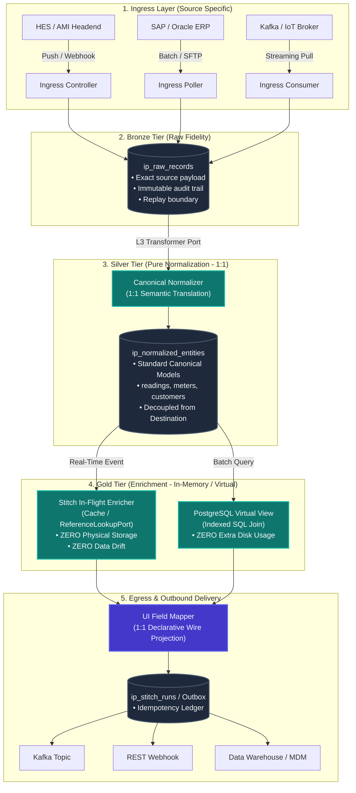
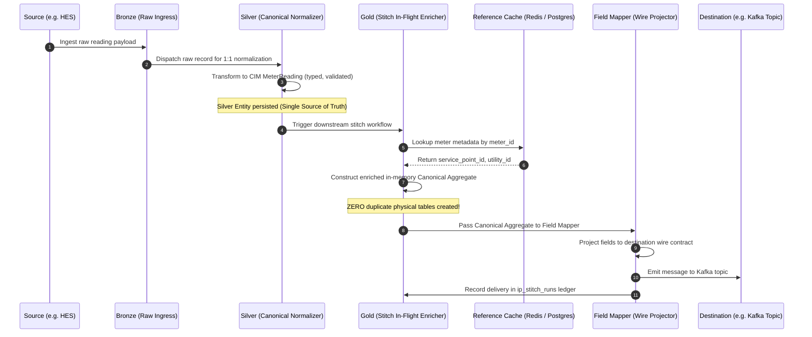

# Enterprise Integration Architecture: Data Tiering, Normalization & In-Memory Enrichment

## Executive Summary

Modern enterprise integration platforms (iPaaS, Event-Driven Architectures, and Medallion Data Platforms) require a rigorous boundary between **Data Ingestion**, **Semantic Normalization**, **Multi-Entity Enrichment**, and **Outbound Wire Delivery**.

A primary failure mode in legacy integration systems is **Eager Denormalization** (pre-populating duplicate joined physical tables during replication) and **Visual GUI Joins** (creating spaghetti drag-and-drop queries inside UI field mappers). 

This architectural standard establishes the enterprise gold standard:
1. **Bronze (L1 Raw Ingress)**: Raw source fidelity, immutable, append-only.
2. **Silver (L2/L3 Normalized Entities)**: 1:1 semantic canonical models. Single source of truth. Asynchronous and independent per stream. The universal decoupling boundary for $N$-way destination **Fan-Out**.
3. **Gold (Enrichment & Joins)**: Ephemeral and dynamic. Executed **in-memory** for real-time streams or via **virtual SQL views** for batch queries. **Zero duplicate physical tables**.
4. **Outbound / Egress**: Declarative 1:1 field mapping from Silver or Gold directly to the destination wire contract (e.g., Kafka, Webhook, ERP).

---

## The 4-Tier Architecture Specification



---

## Tier-by-Tier Invariants

### 1. Bronze Tier (L1 Raw Replicas)
* **Storage**: Physical, immutable table (`ip_raw_records`).
* **Responsibility**: High-throughput ingestion of raw payloads without mutation, interpretation, or schema validation.
* **Guarantees**:
  * Bit-level fidelity with what the external source transmitted.
  * Disaster recovery and zero-loss pipeline replayability.
  * Auditability for compliance and debugging.

### 2. Silver Tier (L2/L3 Normalized Entities)
* **Storage**: Physical, typed canonical tables (`ip_normalized_records` / entity tables).
* **Responsibility**: **1:1 Semantic Normalization**. Translates proprietary, vendor-specific schemas (e.g. Itron XML, Landis+Gyr CIM, Salesforce JSON) into clean, typed, platform-standard Canonical Models.
* **Key Invariants**:
  * **Strict 1:1 Isolation**: Normalizing `readings` only normalizes reading data. Normalizing `meters` only normalizes meter data.
  * **Zero Cross-Table Joins at Ingestion**: Entities sync completely independently and asynchronously. Syncing `readings` does not wait for, query, or depend on `meters`.
  * **Universal Decoupling**: The Silver tier has zero knowledge of downstream destinations. Downstream destinations have zero knowledge of upstream sources.
  * **Fan-Out Hub**: Any entity landing in Silver can immediately fan out to multiple destinations simultaneously.

### 3. Gold Tier (Composite Aggregates & Enrichment)
* **Storage**: **ZERO permanent duplicate relational tables**. Ephemeral in-memory payloads or dynamic database views.
* **Responsibility**: **N:1 Lookups, Joins, and Reference Enrichment**. Augmenting base entities with master data (e.g. attaching `service_point_id` and `customer_type` to a `meter_reading`).
* **Execution Paradigms**:
  * **Paradigm 1 (Real-Time Streams / iPaaS)**: The Stitch step uses an in-memory `ReferenceLookupPort` (backed by Redis or an indexed local DB cache) to construct the joined domain aggregate in-flight.
  * **Paradigm 2 (Batch Queries)**: PostgreSQL resolves an indexed `VIEW` dynamically at query execution time.
* **Why Gold Avoids Physical Storage**:
  * Eliminates **Data Drift**: Updates to master entities (e.g., customer account reassignments) are automatically reflected on the next event/query without running background database sync sweepers.
  * Eliminates **Storage Explosion**: Avoids duplicating massive historical fact tables across multiple permutations of joined columns.
  * Maximizes **Throughput**: Bypasses redundant database `INSERT` and `UPDATE` cycles.

### 4. Egress & Declarative Field Mapping
* **Storage**: Delivery Outbox & Execution Ledger (`ip_stitch_runs` / `ip_outbound_records`).
* **Responsibility**: Translating the normalized/enriched schema into the exact wire contract required by the target system.
* **The UI Field Mapper**:
  * **Strictly 1:1 Declarative Projection**: Renaming fields, dropping excluded fields, applying constant defaults, and formatting values.
  * **No Visual SQL Joins**: Complex multi-table joins are never configured via drag-and-drop UI spaghetti; they are resolved upstream by the Gold tier before entering the mapper.

---

## In-Flight Enrichment Sequence (Paradigm 1)



---

## Anti-Pattern Analysis & Architectural Guardrails

### Anti-Pattern 1: Eager Enrichment During Replication
```
❌ INGESTION PIPELINE:
[Raw Readings] ──► [Normalizer] ───(Query Meters DB)───► [Joined Physical Table]
                                            ▲
                            RACE CONDITION! Meter 42
                            is not synced yet!
```
* **Failure Mode**: Readings sync before meters sync. Ingestion fails or writes `NULL` service points. If a meter attribute updates later, historical records in the joined table become permanently stale.
* **Enterprise Rule**: Replicate and normalize 1:1. Never perform cross-entity enrichment during replication.

### Anti-Pattern 2: The Visual Multi-Entity Join GUI
* **Failure Mode**: Exposing visual SQL join builders, foreign key lookups, and aggregation graphs in the browser UI. Creates unmaintainable visual spaghetti, untestable runtime race conditions, and lack of Git version control.
* **Enterprise Rule**: Keep the UI Field Mapper strictly 1:1. Expose pre-joined Canonical Models or SQL Views as single unified source schemas in the UI dropdown.

### Anti-Pattern 3: Pre-Populating Physical Joined Tables
* **Failure Mode**: Creating permanent physical database tables (`tbl_readings_with_meters_and_customers`) for every integration scenario.
* **Enterprise Rule**: The database write path is sacred. Store base facts in Silver; compute enriched projections in-memory or via dynamic views.

---

## Architectural Comparison Matrix

| Architectural Dimension | Legacy Eager Denormalization | Enterprise Medallion & In-Memory (Gold Standard) |
| :--- | :--- | :--- |
| **Sync Coupling** | High (Table A must sync after Table B) | **Zero (Every stream syncs independently)** |
| **Data Drift Risk** | Severe (Updates to master tables leave joined rows stale) | **Zero (Joins evaluated on-demand/in-flight)** |
| **Storage Overhead** | $3\times - 5\times$ duplicated rows on disk | **$1\times$ baseline storage (Raw + Silver)** |
| **UI Complexity** | Spaghetti join builder (Informatica style) | **Clean 1:1 field projection (Shopify style)** |
| **Testability** | Requires complex database fixtures with joined state | **Pure unit tests for normalizers; isolated lookups** |
| **Downstream Fan-Out** | Bound to proprietary joined tables | **Infinite fan-out from clean Silver entities** |

---

## Codebase Implementation Mapping (`apps/ip`)

| Architectural Concept | Codebase Component / Port | File Location |
| :--- | :--- | :--- |
| **Bronze Raw Ingestion** | `ip_raw_records`, `IngressRecord` | `ip/engine/domain/replication/` |
| **Silver Canonical Entity** | `TransformerPort`, `CanonicalDraft` | `ip/engine/ports/outbound/transformer_port.py` |
| **Domain Transformers (1:1)** | `AmiMeterReadingTransformer` | `ip/solutions/domains/energy/transformers/` |
| **Gold In-Flight Enrichment** | `StepHandlerPort`, `StitchExecutionEngine` | `ip/engine/adapters/outbound/stitches/step_handlers.py` |
| **Outbox / Egress Ledger** | `ip_stitch_runs`, `ip_outbound_records` | `ip/engine/domain/stitch/` |
| **Declarative Field Mapper** | `IpStitchFieldMapperPage.tsx` | `apps/ip/packages/ui/src/presentation/stitch-mapper/` |
| **Monaco Schema Contract** | `DestinationSchemaMonacoEditor.tsx` | `apps/ip/packages/ui/src/presentation/stitch-mapper/` |
