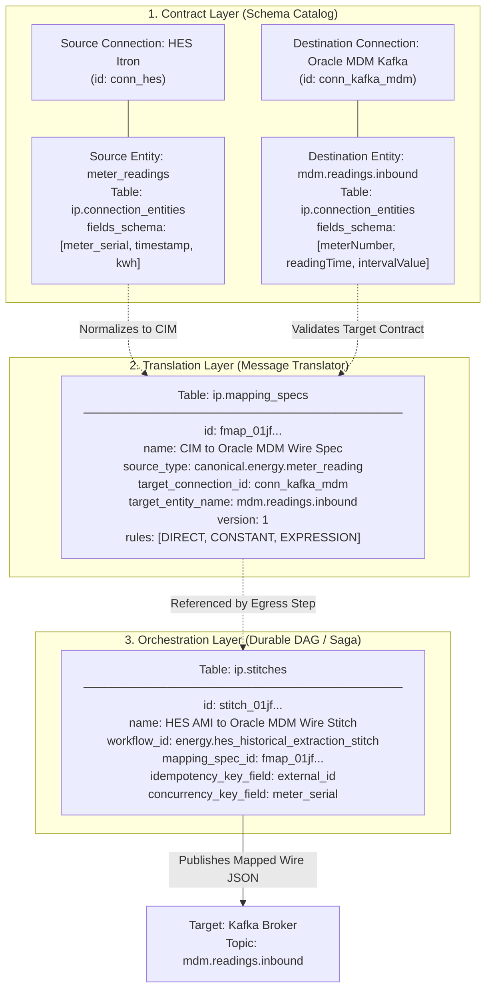
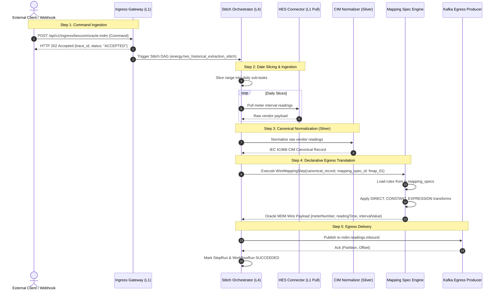

# Enterprise Integration Architecture: The Trinity Pattern
## Decoupling External Contracts, Transformation Specs, and Distributed Orchestration

- **Domain:** Integration Platform (`apps/ip`)
- **Document Status:** Architectural Standard & Implementation Blueprint
- **Target Audience:** Enterprise Software Architects, Principal Engineers, Platform Team, Core Developers
- **File Location:** `apps/ip/docs/enterprise_integration_trinity_architecture.md`

---

## 1. Executive Summary & Problem Statement

In enterprise integration platforms, a common architectural anti-pattern is **Monolithic Pipeline Conflation**: coupling the **Data Contract** (what the target system expects), the **Transformation Rules** (how source fields map to target fields), and the **Execution Flow** (retries, sagas, queues, and concurrency) into a single database row or procedural script.

### The Pitfalls of Conflation
1. **Zero Reusability:** If an on-demand batch pull job, a 24/7 real-time streaming webhook, and an automated reconciliation sweep all deliver to the same Kafka topic, baking mapping rules directly into the workflow requires duplicating the mapping spec across three different pipelines.
2. **Schema Drift & Versioning Fragility:** When an external vendor (e.g., Oracle MDM, SAP) releases v2 of their wire contract, updating a monolithic pipeline risks destabilizing the battle-tested orchestration DAG (sagas, idempotency keys, error handlers).
3. **Multi-Tenant Rigidity:** In a multi-tenant utility platform, Tenant A (BESCOM) might run Oracle MDM v1 (`meterNumber`), while Tenant B (MESCOM) runs Oracle MDM v2 (`meterSerialNumber`). Monolithic pipelines force engineers to fork the entire workflow DAG per tenant.
4. **Violation of the Single Responsibility Principle (SRP):** Orchestration (managing state machines and distributed side effects) is fundamentally orthogonal to Data Translation (stateless projection from Schema A to Schema B).

### The Solution: The Trinity Pattern
To achieve Tier-1 enterprise robustness (matching **MuleSoft Anypoint**, **Apache Camel**, and **AWS EventBridge Pipes**), the platform strictly decouples the problem space into three autonomous layers:

```
┌─────────────────────────────────────────────────────────────────────────────┐
│ 1. CONTRACT LAYER (ip.connection_entities)                                  │
│    What does the external system accept or produce? (Schemas & Data Types)   │
└─────────────────────────────────────────────────────────────────────────────┘
                                      │
                                      ▼
┌─────────────────────────────────────────────────────────────────────────────┐
│ 2. TRANSLATION LAYER (ip.mapping_specs)                                     │
│    How does enterprise Canonical CIM project to the target wire shape?       │
└─────────────────────────────────────────────────────────────────────────────┘
                                      │
                                      ▼
┌─────────────────────────────────────────────────────────────────────────────┐
│ 3. ORCHESTRATION LAYER (ip.stitches)                                        │
│    When does it run, in what sequence, with what retries, gates, and sagas?  │
└─────────────────────────────────────────────────────────────────────────────┘
```

---

## 2. The 3 Architectural Pillars



---

### Pillar 1: The Contract Layer (`ip.connection_entities`)
* **Role:** External Port & Schema Catalog.
* **Scope:** Owned entirely by the `Connection` (Source OR Destination).
* **Question It Answers:** *"What data structure does this specific endpoint, topic, or table support?"*
* **Key Characteristics:**
  * For **Source Connections** (e.g. HES AMI Simulator): Stores the inbound stream schema (`meter_readings`) discovered via connector introspection or manual configuration.
  * For **Destination Connections** (e.g. Oracle MDM Kafka, SAP ERP): Stores the target contract schema (`mdm.readings.inbound`) uploaded via the Monaco Editor, imported from Kafka Schema Registry, or parsed from an OpenAPI spec.
  * **Zero Duplicate Storage:** Any future Stitch targeting `Oracle MDM Kafka (mdm.readings.inbound)` immediately accesses the pre-existing schema from the dropdown without re-uploading.

---

### Pillar 2: The Translation Layer (`ip.mapping_specs`)
* **Role:** Message Translator (Enterprise Integration Pattern).
* **Scope:** Reusable, versioned, declarative data projection logic.
* **Question It Answers:** *"How do fields from the Enterprise Canonical Model (CIM) map to the Destination Wire Contract?"*
* **Key Characteristics:**
  * **Pure Logic:** Has zero awareness of queues, retries, worker threads, or network transports.
  * **Declarative Rules:**
    * `DIRECT`: 1:1 field rename (`meter_serial` $\longrightarrow$ `meterNumber`).
    * `CONSTANT`: Static value injection (`"unitOfMeasure": "KWH"`).
    * `EXPRESSION`: Deterministic math or string manipulation (`kwh_reading * 1000`).
    * `IGNORE`: Explicit field omission.
  * **First-Class Versioning:** When the external vendor modifies their payload, you create `version = 2` of the `MappingSpec`. The underlying Stitch DAG remains 100% untouched.
  * **Zero-Mock Testability:** Can be tested in nanoseconds via pure in-memory unit tests: `apply_mapping(canonical_json, rules) -> wire_json`.

---

### Pillar 3: The Orchestration Layer (`ip.stitches`)
* **Role:** Distributed Saga / Process Manager.
* **Scope:** Long-running, multi-step asynchronous workflow coordination.
* **Question It Answers:** *"When does this integration run, in what order, with what retries, and who gets notified?"*
* **Key Characteristics:**
  * Coordinates multi-stage DAGs:
    1. **Date Slicing**: Splits a 30-day range into 30 atomic daily tasks.
    2. **HES Ingestion**: Calls pull connectors with rate limiting and circuit breaking.
    3. **Event Wait Gates**: Suspends execution waiting for an asynchronous callback (`WAIT_FOR_EVENT`).
    4. **Silver Normalization**: Normalizes raw vendor data into IEC 61968 CIM entities.
    5. **Egress Translation**: Invokes the `WireMappingStepHandler` with the designated `mapping_spec_id`.
    6. **Reliable Dispatch**: Pushes the resulting payload to Kafka with transaction acknowledgment.
  * Enforces enterprise distributed systems guarantees:
    * Idempotency deduplication keys (`idempotency_key_field`).
    * Sharded concurrency sequencing (`concurrency_key_field`).
    * Exponential backoff, jitter, and dead-letter queues (DLQ).

---

## 3. Database Schema Definitions (Control Plane)

### 3.1 Destination Contract: `ip.connection_entities`
```sql
CREATE TABLE ip.connection_entities (
    id VARCHAR(64) PRIMARY KEY,
    tenant_id VARCHAR(64) NOT NULL,
    connection_id VARCHAR(64) NOT NULL REFERENCES ip.connections(id) ON DELETE CASCADE,
    stream_name VARCHAR(128) NOT NULL, -- e.g. "mdm.readings.inbound"
    sync_mode VARCHAR(32) NOT NULL DEFAULT 'INCREMENTAL',
    schedule VARCHAR(32) NOT NULL DEFAULT 'manual',
    is_enabled BOOLEAN NOT NULL DEFAULT true,
    primary_key JSONB NOT NULL DEFAULT '[]'::jsonb,
    fields_schema JSONB NOT NULL DEFAULT '[]'::jsonb, -- Target field types, nullability
    created_at TIMESTAMPTZ NOT NULL,
    updated_at TIMESTAMPTZ NOT NULL,
    CONSTRAINT uq_ip_connection_entities_tenant_conn_stream 
        UNIQUE (tenant_id, connection_id, stream_name)
);
```

### 3.2 Translation Rules: `ip.mapping_specs`
```sql
CREATE TABLE ip.mapping_specs (
    id VARCHAR(64) PRIMARY KEY, -- e.g. "fmap_01jf89kz..."
    tenant_id VARCHAR(64) NOT NULL,
    name VARCHAR(255) NOT NULL, -- e.g. "CIM to Oracle MDM Wire Contract"
    description TEXT NOT NULL DEFAULT '',
    source_type VARCHAR(128) NOT NULL, -- e.g. "canonical.energy.meter_reading"
    target_connection_id VARCHAR(64) NOT NULL REFERENCES ip.connections(id) ON DELETE RESTRICT,
    target_entity_name VARCHAR(128) NOT NULL, -- e.g. "mdm.readings.inbound"
    version INTEGER NOT NULL DEFAULT 1,
    rules JSONB NOT NULL DEFAULT '[]'::jsonb, -- Declarative mapping rule array
    is_active BOOLEAN NOT NULL DEFAULT true,
    created_at TIMESTAMPTZ NOT NULL,
    updated_at TIMESTAMPTZ NOT NULL,
    CONSTRAINT uq_ip_mapping_specs_tenant_target_version 
        UNIQUE (tenant_id, target_connection_id, target_entity_name, version)
);

CREATE INDEX idx_ip_mapping_specs_lookup 
    ON ip.mapping_specs(tenant_id, source_type, target_connection_id);
```

### 3.3 Orchestrator: `ip.stitches`
```sql
CREATE TABLE ip.stitches (
    id VARCHAR(64) NOT NULL,
    tenant_id VARCHAR(64) NOT NULL,
    name VARCHAR(255) NOT NULL DEFAULT '', -- User-facing pipeline name
    description TEXT NOT NULL DEFAULT '',
    workflow_id VARCHAR(128) NOT NULL, -- Registered DAG ID (e.g. "energy.hes_historical_extraction_stitch")
    workflow_version INTEGER NOT NULL DEFAULT 1,
    canonical_event_type VARCHAR(128) NOT NULL, -- Triggering event
    mapping_spec_id VARCHAR(64) REFERENCES ip.mapping_specs(id) ON DELETE SET NULL, -- Translation link
    is_trigger BOOLEAN NOT NULL DEFAULT true,
    condition_event_key VARCHAR(128),
    idempotency_key_field VARCHAR(128) NOT NULL DEFAULT 'id',
    concurrency_key_field VARCHAR(128),
    resource_hint_field VARCHAR(128),
    filter_conditions JSONB NOT NULL DEFAULT '{}'::jsonb,
    is_active BOOLEAN NOT NULL DEFAULT true,
    created_at TIMESTAMPTZ NOT NULL,
    updated_at TIMESTAMPTZ NOT NULL,
    PRIMARY KEY (id, tenant_id)
);
```

---

## 4. End-to-End Runtime Execution Trace



---

## 5. Comparison with Industry Gold Standards

| Architectural Concern | **Our Trinity Pattern** | **MuleSoft Anypoint** | **Apache Camel (EIP)** | **AWS EventBridge** |
| :--- | :--- | :--- | :--- | :--- |
| **Contract / Schema** | `ip.connection_entities` | Anypoint Exchange / RAML / OAS | Endpoint Components & DataFormat | EventBridge Schema Registry |
| **Translation Logic** | `ip.mapping_specs` | DataWeave Scripts (`.dwl`) | Message Translator / TypeConverter | EventBridge Input Transformers |
| **Workflow / Saga** | `ip.stitches` (DAG Engine) | CloudHub Flow / Mule Runtime | RouteBuilder / Process Manager | Step Functions / Pipes |
| **Execution Decoupling** | Step references `mapping_spec_id` | Flow invokes `<ee:transform>` | Route invokes `.transform()` | Pipe invokes Target Transformer |
| **Multi-Tenant Versioning** | Dynamic Spec Resolution per Tenant | Environment-scoped DWL Modules | Polymorphic Processor Beans | Parameterized JSONPath Specs |

---

## 6. Implementation Checklist & Architectural Invariants

### Architectural Invariants (Strictly Enforced)
1. **Never Save Target Schemas in React State Only:** Any custom schema pasted or uploaded in the Field Mapper Monaco Editor MUST immediately persist as an `ip.connection_entities` record on the target connection.
2. **Never Put Mapping Dictionaries into `ip.stitches`:** The `stitches` table must only hold orchestration metadata and a foreign key (`mapping_spec_id`) to the translation layer.
3. **Pure Logic Zero-Mock Testing:** The `MappingSpecEngine` must be a pure Python domain service (`def project(payload: JsonDict, spec: MappingSpec) -> JsonDict`) testable without database or network mocks.
4. **Mandatory Human-Readable Names:** Every `MappingSpec` and `Stitch` record MUST have a human-readable `name` and `description` in addition to its system UUID and routing keys.

### Implementation Checklist
- [ ] Create database migration for `ip.mapping_specs` table in `0001_initial_global_schema.py`.
- [ ] Create domain aggregate `MappingSpec` in `ip.engine.domain.mapping`.
- [ ] Create SQLAlchemy model `MappingSpecRecord` in `control_plane.py`.
- [ ] Implement `SqlAlchemyMappingSpecRepository` and UoW port integration.
- [ ] Add REST API endpoints under `/api/v1/tenants/{tenant_id}/ip/mapping-specs`:
  - `POST` (create or version a mapping spec)
  - `GET` (list / get latest version)
- [ ] Implement `WireMappingStepHandler` in the IP Worker to dynamically execute `mapping_spec_id`.
- [ ] Update `IpStitchFieldMapperPage.tsx`:
  - Saving custom schema creates/updates `ConnectionEntity` on destination connection.
  - Deploying creates/updates `MappingSpec` and binds it to the activated `Stitch`.
