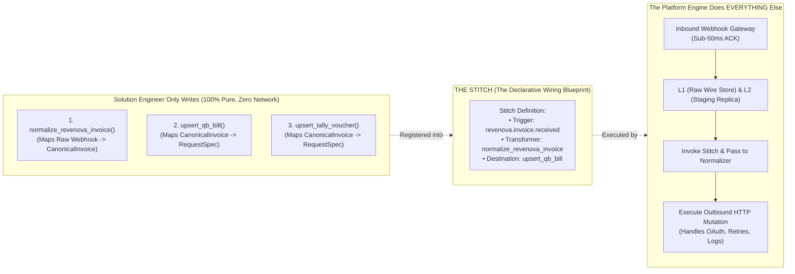
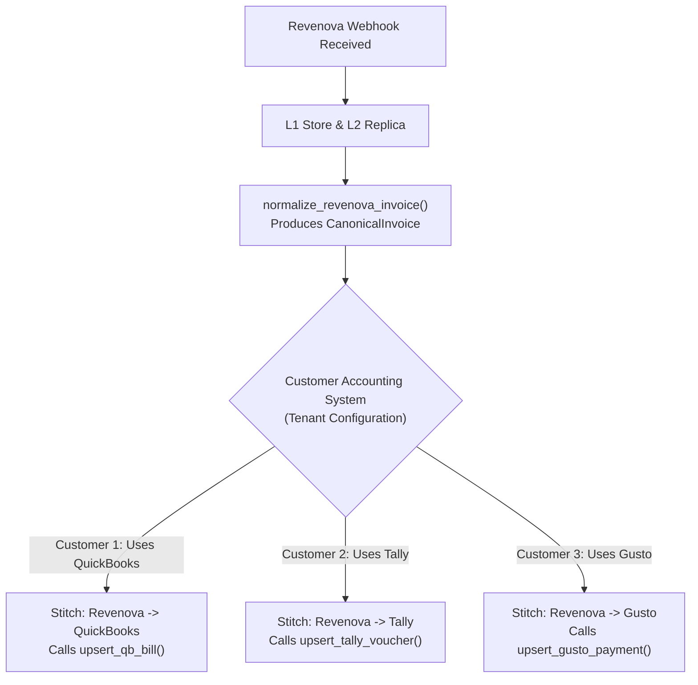
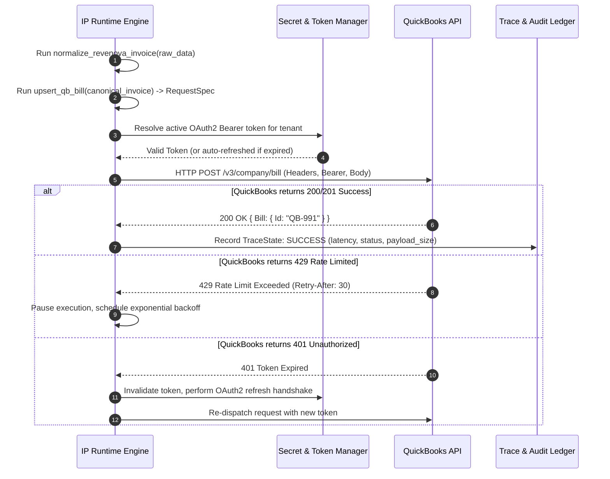

# Architectural Standard: Enterprise Stitches & Event-Driven Integrations

**Document Version:** 1.0.0  
**Status:** Approved Architectural Standard  
**Scope:** `apps/ip/packages/ip` (Integration Platform), Solution SDK, Runtime Engine, and Domain Solutions  
**Target Audience:** Solution Engineers, Enterprise Architects, and Platform Engineers  

---

## 1. Executive Summary & The Core Mental Model

In modern enterprise integration (iPaaS), developer ergonomics often fail because frameworks force solution engineers to write procedural plumbing—managing asynchronous HTTP sessions, parsing status codes, refreshing OAuth tokens, and orchestrating database transactions.

The SOOPA Integration Platform enforces a strict architectural boundary:
* **The Solution Engineer writes ONLY pure functions:** No network calls, no `async/await`, no `ctx.http.dispatch`, no database writes. Their code takes an input and returns a specification or canonical data model.
* **The Platform Engine owns all execution:** Executing HTTP calls, refreshing credentials, handling exponential backoffs, managing rate limits (429s), and recording audit ledgers.
* **The "Stitch" is the Wiring Blueprint:** A Stitch is the declarative thread that sews together a **Trigger/Source**, a **Canonical Transformer**, and a **Destination Mutation**.



---

## 2. The Core Taxonomy: Building Blocks vs. The Stitch

To prevent architectural drift and conceptual confusion, the platform defines four unambiguous primitives:

| Primitive | Architectural Role | Purity | Return Type | Who Writes It? | Example |
| :--- | :--- | :--- | :--- | :--- | :--- |
| **Connector** | Defines how to **Pull / Fetch** data from an external system | 100% Pure | `RequestSpec` | Solution Engineer | `get_landis_meter_readings(cmd)` |
| **Transformer** | Maps vendor raw payloads into **Canonical Domain Models** (L3) | 100% Pure | Domain DTO / `CanonicalModel` | Solution Engineer | `normalize_revenova_invoice(raw)` |
| **Mutation** | Defines how to **Write / Upsert** data to an external destination | 100% Pure | `RequestSpec` | Solution Engineer | `upsert_qb_bill(invoice)` |
| **STITCH** | **The Blueprint / Pipeline** that binds Trigger, Transformer, and Destination | Declarative Spec | `StitchSpec` / `Workflow` | Solution Engineer / UI Config | `Stitch(trigger, transformer, destination)` |

> [!IMPORTANT]
> A Solution Engineer should **NEVER** write `await ctx.http.dispatch(...)` or manually invoke network libraries. A function that returns a `RequestSpec` is completely pure, has zero external dependencies, and can be tested in 0.01 milliseconds.

---

## 3. Real-World End-to-End Walkthrough: Revenova TMS to QuickBooks

### 3.1 Step 1: Inbound Webhook Reception (L1 & L2)
Revenova TMS does not require polling; it emits an outbound webhook when a vendor freight invoice is created or approved.

1. **Revenova POSTs to the Platform Gateway:**
   ```http
   POST /ip/v1/inbound/webhook_revenova_prod
   Content-Type: application/json
   x-revenova-signature: sha256=a8f5b...

   {
     "Invoice_Number__c": "INV-88219",
     "Carrier_Account__c": "CARRIER-501",
     "Total_Payable__c": 2450.00,
     "Invoice_Date__c": "2026-11-18",
     "Due_Date__c": "2026-12-18",
     "Line_Items__r": {
       "records": [
         {"Description__c": "Line Haul Chicago to Dallas", "Amount__c": 2200.00, "GL_Account__c": "6010"},
         {"Description__c": "Fuel Surcharge", "Amount__c": 250.00, "GL_Account__c": "6020"}
       ]
     }
   }
   ```
2. **Platform Gateway Execution (Under 50ms):**
   * Validates HMAC signature.
   * Computes SHA-256 content digest.
   * Commits the exact wire bytes to **L1 (`inbound_records`)**.
   * Returns `200 OK` to Revenova.
3. **Platform Replica Engine Execution:**
   * Unpacks the payload into the local operational table **L2 (`replica_records`)** deduplicated by `Invoice_Number__c`.
   * Drops an event into the transactional outbox: `revenova.invoice.received`.

---

### 3.2 Step 2: What the Solution Engineer Writes

The Solution Engineer writes **only two pure functions** and one declarative Stitch.

#### Function 1: The Normalizer (L3 Canonical Mapping)
```python
# File: apps/ip/src/ip/solutions/domains/tms/revenova/normalizer.py
from __future__ import annotations

from ip.solutions.domains.tms.canonical import CanonicalInvoice, CanonicalLineItem
from seedwork.domain.types import JsonDict


def normalize_revenova_invoice(raw: JsonDict) -> CanonicalInvoice:
    """Pure domain mapping. Zero network, zero database, zero framework coupling."""
    if "Invoice_Number__c" not in raw or "Carrier_Account__c" not in raw:
        msg = "Missing required fields in Revenova invoice payload"
        raise ValueError(msg)

    raw_items = raw.get("Line_Items__r", {})
    records = raw_items.get("records", []) if isinstance(raw_items, dict) else []

    return CanonicalInvoice(
        invoice_number=str(raw["Invoice_Number__c"]),
        vendor_id=str(raw["Carrier_Account__c"]),
        amount=float(raw["Total_Payable__c"]),
        issue_date=str(raw["Invoice_Date__c"]),
        due_date=str(raw["Due_Date__c"]),
        line_items=tuple(
            CanonicalLineItem(
                description=str(line["Description__c"]),
                amount=float(line["Amount__c"]),
                gl_code=str(line["GL_Account__c"]),
            )
            for line in records
        ),
    )
```

#### Function 2: The Destination Mutation (QuickBooks Bill Request Builder)
```python
# File: apps/ip/src/ip/solutions/domains/tms/quickbooks/mutations.py
from __future__ import annotations

from ip.sdk import RequestBuilder, RequestSpec
from ip.solutions.domains.tms.canonical import CanonicalInvoice


def upsert_qb_bill(invoice: CanonicalInvoice) -> RequestSpec:
    """Pure request builder. Assembles target QuickBooks POST payload."""
    return (
        RequestBuilder.post("/v3/company/bill")
        .with_header("Accept", "application/json")
        .with_body({
            "DocNumber": invoice.invoice_number,
            "TotalAmt": invoice.amount,
            "VendorRef": {"value": invoice.vendor_id},
            "TxnDate": invoice.issue_date,
            "DueDate": invoice.due_date,
            "Line": [
                {
                    "Amount": item.amount,
                    "DetailType": "AccountBasedExpenseLineDetail",
                    "Description": item.description,
                    "AccountBasedExpenseLineDetail": {
                        "AccountRef": {"value": item.gl_code}
                    },
                }
                for item in invoice.line_items
            ],
        })
        .build()
    )
```

---

### 3.3 Step 3: The Stitch (Sewing Them Together)

The Solution Engineer registers the Stitch specification:

```python
# File: apps/ip/src/ip/solutions/domains/tms/stitches/revenova_to_qb_stitch.py
from __future__ import annotations

from ip.sdk import Stitch, retry_policy
from ip.solutions.domains.tms.quickbooks.mutations import upsert_qb_bill
from ip.solutions.domains.tms.revenova.normalizer import normalize_revenova_invoice

REVENOVA_TO_QUICKBOOKS_STITCH = Stitch(
    name="tms.revenova_invoice_to_quickbooks",
    trigger="revenova.invoice.received",
    transformer=normalize_revenova_invoice,
    destination=upsert_qb_bill,
    retry=retry_policy(max_attempts=3, backoff_seconds=5),
    description="Synchronizes approved Revenova TMS freight invoices to QuickBooks Online Bills",
)
```

---

## 4. Multi-Customer Routing Superpower ($N \to 1 \to M$)

A major challenge in multi-tenant enterprise platforms is routing the same upstream transaction to different customer accounting systems.

Because Revenova TMS is normalized **ONCE** into `CanonicalInvoice`, routing to different accounting systems is trivial:



### 4.1 Declarative Customer Stitches
To add support for Tally or Gusto, the Solution Engineer **does not touch** the Revenova webhook or normalizer. They simply author a single pure mutation function and declare the Stitch:

```python
# Additional Destination Mutation (Tally)
def upsert_tally_voucher(invoice: CanonicalInvoice) -> RequestSpec:
    return (
        RequestBuilder.post("/tally/api/v1/vouchers")
        .with_body({"voucher_number": invoice.invoice_number, "amount": invoice.amount})
        .build()
    )

# Customer 2 Stitch (Tally)
REVENOVA_TO_TALLY_STITCH = Stitch(
    name="tms.revenova_invoice_to_tally",
    trigger="revenova.invoice.received",
    condition=lambda ctx: ctx.customer_accounting_system == "tally",
    transformer=normalize_revenova_invoice,
    destination=upsert_tally_voucher,
)
```

---

## 5. What the Platform Engine Does Automatically

When `REVENOVA_TO_QUICKBOOKS_STITCH` triggers, the Solution Engineer wrote zero infrastructure code. The Platform Engine executes the entire lifecycle:



### Key Guarantees Enforced by the Platform:
1. **Zero Secret Exposure:** Credentials, API keys, and client secrets are injected by the platform at the wire level; solution code never handles raw secrets.
2. **Transparent OAuth2 Token Refresh:** If an access token expires mid-flight, the platform catches the 401, invokes the refresh flow, and re-executes the request seamlessly.
3. **Idempotency & Deduplication:** Every outbound mutation is stamped with an idempotency key derived from the invoice number, preventing duplicate bills in QuickBooks even if network timeouts occur.
4. **End-to-End Traceability:** Complete visual lineage from the inbound webhook payload in L1 through to the QuickBooks HTTP response code is stored in the central trace repository.

---

## 6. Unit Testing: The Proof of Architecture

Because all Solution Engineer functions are 100% pure, unit tests require **zero mocks, zero network simulators, and zero database harnesses**:

```python
# File: apps/ip/tests/unit/solutions/tms/test_revenova_to_qb.py
from ip.solutions.domains.tms.quickbooks.mutations import upsert_qb_bill
from ip.solutions.domains.tms.revenova.normalizer import normalize_revenova_invoice


def test_revenova_normalization_and_qb_mutation_end_to_end():
    # 1. Given raw Revenova webhook payload
    raw_webhook = {
        "Invoice_Number__c": "INV-100",
        "Carrier_Account__c": "CARR-9",
        "Total_Payable__c": 1500.50,
        "Invoice_Date__c": "2026-11-18",
        "Due_Date__c": "2026-12-18",
        "Line_Items__r": {
            "records": [{"Description__c": "Haul", "Amount__c": 1500.50, "GL_Account__c": "5000"}]
        },
    }

    # 2. When normalized (Zero mocks!)
    canonical = normalize_revenova_invoice(raw_webhook)
    assert canonical.invoice_number == "INV-100"
    assert canonical.amount == 1500.50

    # 3. When mutation request is built (Zero mocks!)
    request_spec = upsert_qb_bill(canonical)
    assert request_spec.method == "POST"
    assert request_spec.endpoint == "/v3/company/bill"
    assert request_spec.body["DocNumber"] == "INV-100"
    assert request_spec.body["TotalAmt"] == 1500.50
```
*Total execution time: ~0.002 seconds.*

---

## 7. Summary Checklist for Solution Engineers

When building a new integration:
* [x] **DO:** Write pure normalizer functions that convert vendor JSON to canonical domain dataclasses.
* [x] **DO:** Write pure mutation functions that return `RequestSpec` using `RequestBuilder`.
* [x] **DO:** Declare a `Stitch` tying the incoming event to the transformer and mutation.
* [ ] **DO NOT:** Write `await ctx.http.dispatch(...)` or import `httpx`/`requests`.
* [ ] **DO NOT:** Write database persistence code or manage staging tables (L1/L2 handles this).
* [ ] **DO NOT:** Write custom retry loops or token refresh handshakes (Platform Engine handles this).
