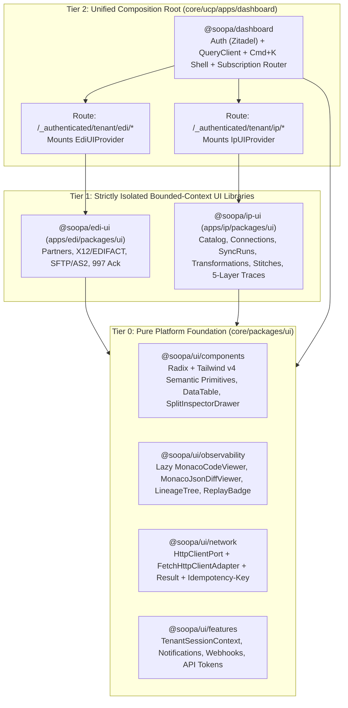
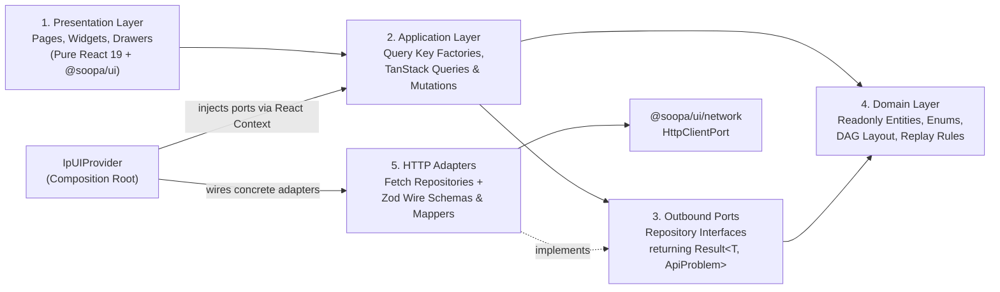
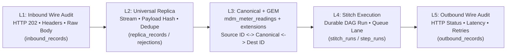
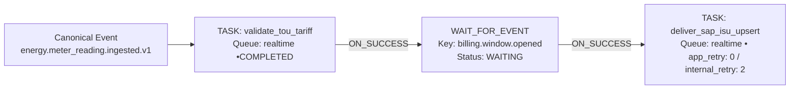

# Soopa Integration Platform (IP) — Enterprise Frontend Architecture & Presentation Layer Design

**Status:** Proposed Architecture (Gold Standard)  
**Bounded Context:** Integration Platform (`apps/ip/packages/ui` $\rightarrow$ `@soopa/ip-ui`)  
**Shared Foundation:** Platform Design System & Network Core (`core/packages/ui` $\rightarrow$ `@soopa/ui`)  
**Composition Host:** Unified Control Plane Shell (`core/ucp/apps/dashboard` $\rightarrow$ `@soopa/dashboard`)  

---

## 1. Executive Summary & Product Philosophy

Soopa operates **two strictly distinct integration products** within the monorepo:
1. **EDI (`@soopa/edi-ui`)**: Purpose-built for B2B supply-chain standards (X12/EDIFACT, ISA/GS envelopes, AS2/SFTP mailboxes, `997` Functional Acknowledgments, trading-partner compliance).
2. **Integration Platform (`@soopa/ip-ui`)**: Purpose-built for high-volume API, webhook, file, and event-driven business workflows across **500+ external applications**—starting with complex, multi-step **Energy Sector** operations (AMI Head-End Systems like Itron, Meter Data Management, CIS/Billing, Outage Management, and ERP).

> [!IMPORTANT]
> **Core Architectural Mandate:** `@soopa/ip-ui` and `@soopa/edi-ui` are **100% isolated bounded-context packages** that NEVER import from one another, NEVER share domain models, and NEVER duplicate infrastructure or generic UI primitives. Every shared visual primitive, code/diff inspector, and HTTP transport capability lives once—and only once—in `@soopa/ui`.

### 1.1 Product North Star: The "Support-First Operational Glass Box"

Most integration tools fail enterprise operations teams at Opposite Extremes:
- **Airbyte** excels at connector configuration and batch cursor state, but is a **black box at the individual business-record level** (no single-meter `MTR-700` search, no wire-level HTTP request/response audit, no single-record replay without resetting an entire stream).
- **n8n & Activepieces** excel at visual DAG clarity and frictionless OAuth2 setup, but push brittle "citizen-developer" flow authoring into the browser, lack a **Canonical Data Model (L3) + Global Entity Map (GEM)**, lack **zero-downtime Shadow Transformation rollouts**, and cannot safely correlate or bulk-replay millions of Energy interval records.

**Soopa IP's presentation layer takes the strongest UX mechanics from Airbyte, Activepieces, n8n, and Hatchet—and surpasses all four** by centering the entire experience around **Operational Certainty & Sub-15-Second Customer Support Resolution**:
1. **Code-Governed Workflows, Visualized Dynamically:** Engineers author versioned, type-safe L3 Transformers and L4 Stitch DAGs in Python; the UI renders interactive, read-only DAG topologies, live step telemetry, and dry-run shadow diffs without brittle drag-and-drop spaghetti.
2. **End-to-End 5-Layer Business Lineage (`L1` $\rightarrow$ `L5`):** A support engineer pastes any business identifier (e.g., `MTR-700`, `SP-9910`, `ORD-442`) into the `Cmd+K` Command Palette and sees in `<15ms` the exact wire request we received and answered (`L1`), the deduplicated source replica (`L2`), the normalized canonical entity + cross-app GEM IDs (`L3`), the durable Stitch DAG execution (`L4`), and the exact outbound destination HTTP call (`L5`).
3. **Surgical Self-Service Recovery:** Support teams can execute deterministic **Stage-Specific Replay** (`RETRY_INGEST`, `RETRY_NORMALIZE`, `RETRY_STITCH`, `RETRY_DELIVER`), **Bulk Replay**, or **Side-by-Side Monaco Modify & Replay** while preserving immutable parent-child audit lineage.

### 1.2 Competitive Benchmark Matrix

| Capability | Airbyte OSS/Cloud | Activepieces | n8n | **Soopa IP (`@soopa/ip-ui`)** |
| :--- | :--- | :--- | :--- | :--- |
| **Dynamic Spec-Driven Connector Forms + Live Pre-Save Check** | Best-in-class | Strong | Manual save/test | **Superior:** Spec-driven renderer + mandatory pre-save live `/check` gate + fingerprint dedupe |
| **OAuth2 Handshake, Token Expiry Radar & Credential Re-Link** | Basic re-auth | Popup OAuth2 | Per-credential modal | **Superior:** Popup OAuth2 + distributed refresh telemetry + Soft-Deactivate & in-place Re-Link preserving cursors |
| **Incremental Stream Cursor State & Generation Checkpoints** | Strong | Hidden internal store | Hidden `staticData` | **Superior:** Live per-stream cursor inspector, `generation_id` sync ledger, guarded checkpoint reset |
| **Record-Level Business Key Search (`<15ms` e.g. `MTR-700`)** | None (batch logs only) | None | Slow metadata scan | **Superior:** Instant `<15ms` correlation search across all 5 pipeline stages |
| **Immutable Wire-Level Audit (`L1` Inbound & `L5` Outbound)** | None | Step JSON only | Node JSON only | **Superior:** Full HTTP status, redacted headers, request & response wire bodies (tiered inline + S3 hydration) |
| **Cross-System ID Lineage (Global Entity Map / GEM)** | None | None | None | **Superior:** Visual Rosetta pill mapping `Source ID <-> Canonical ID <-> Destination ID` |
| **Zero-Downtime L3 Shadow Diff & One-Click Promotion** | Destructive resync | None | Manual flow clone | **Superior:** Interactive L2$\rightarrow$L3 Dry-Run Workbench + side-by-side `Active` vs `Shadow` diff + 1-click promote |
| **L4 Durable Workflow DAG & Retry Classification** | None | Linear/tree flow view | Interactive canvas | **Superior:** Clean topological DAG canvas displaying `TASK` / `WAIT_FOR_EVENT` / `SLEEP` + `app_retry` vs `internal_retry` |
| **Deterministic Stage Replay, Modify & Replay, & Bulk Replay** | Full stream reset only | Retry from failed step | Retry flow run | **Superior:** Single-record 4-stage replay, Monaco Diff Modify & Replay, Bulk Replay (100x), full Attempt Lineage Tree |

---

## 2. Eliminating Frontend Dual-Architectures & Code Duplication

A top-down dependency audit of the existing frontend packages uncovered **6 concrete Dual-Architecture & Duplication violations** across [`@soopa/dashboard`](file:///Users/apple/soopa_mono/core/ucp/apps/dashboard/package.json), [`@soopa/ui`](file:///Users/apple/soopa_mono/core/packages/ui/package.json), and [`@soopa/edi-ui`](file:///Users/apple/soopa_mono/apps/edi/packages/ui/package.json). Before building `@soopa/ip-ui`, our architecture consolidates these into a single enterprise standard.

### 2.1 Audit of Existing Frontend Violations & Resolution Plan

| # | Violation Discovered | Evidence in Codebase | Enterprise Resolution |
| :--- | :--- | :--- | :--- |
| **1** | **Triple HTTP Client Dual-Architecture + Mutable Singleton** | 1) [`api-client.ts`](file:///Users/apple/soopa_mono/core/ucp/apps/dashboard/src/lib/api-client.ts#L1-L78) mutates `let globalToken` singleton and throws `ApiError`.<br>2) [`createNetworkContext.tsx`](file:///Users/apple/soopa_mono/apps/edi/packages/ui/src/contexts/createNetworkContext.tsx#L1-L95) wraps `fetch` in `{ data: T }` Axios-style with `any` and no `Idempotency-Key`.<br>3) [`webhookRepository.ts`](file:///Users/apple/soopa_mono/core/packages/ui/src/features/webhooks/api/webhookRepository.ts#L1-L90) hand-rolls a third `fetch` + `AbortController` loop. | Extract **one** DI-injected `HttpClientPort` + `FetchHttpClientAdapter` into `@soopa/ui/network` returning `Result<T, ApiProblem>`, with automatic `Idempotency-Key` UUIDv4 on mutating methods, `AbortSignal` composition, and zero module singletons. Refactor `@soopa/dashboard`, `@soopa/ui`, `@soopa/edi-ui`, and `@soopa/ip-ui` to use this single client. |
| **2** | **Duplicate Platform Features & Contexts** | `webhooks` and `developers` exist in both [`core/packages/ui/src/features`](file:///Users/apple/soopa_mono/core/packages/ui/src/index.ts#L29-L41) and `apps/edi/packages/ui/src/features`. `TenantContext.tsx` is duplicated in both `dashboard` and `edi-ui`. | Establish `@soopa/ui` as the **sole owner** of `TenantSessionContext`, `webhooks`, `developers`, and `notifications`. Delete duplicated copies in `@soopa/edi-ui`. |
| **3** | **Generic Observability Primitives Trapped in `@soopa/edi-ui`** | [`code-viewer.tsx`](file:///Users/apple/soopa_mono/apps/edi/packages/ui/src/components/ui/code-viewer.tsx#L1-L65) (`@monaco-editor/react` is already in [`core/packages/ui/package.json`](file:///Users/apple/soopa_mono/core/packages/ui/package.json)!), `FormModal`, `ReplayBadge`, and Lineage Tree UI are locked inside `@soopa/edi-ui`. | Promote and generalize `MonacoCodeViewer`, `MonacoJsonDiffViewer`, `LineageTree`, `ReplayBadge`, `CopyableIdPill`, and `SplitInspectorDrawer` into `@soopa/ui` so both `@soopa/edi-ui` and `@soopa/ip-ui` consume them without cross-domain coupling. |
| **4** | **Hardcoded EDI Redirect in Tenant Transactions Route** | [`transactions.index.tsx`](file:///Users/apple/soopa_mono/core/ucp/apps/dashboard/src/routes/_authenticated/tenant/transactions.index.tsx) unconditionally redirects `/tenant/transactions` to `/tenant/edi/transactions`. | Scope EDI routes strictly under `/tenant/edi/*` and IP routes strictly under `/tenant/ip/*`, with subscription-aware navigation in [`tenant.tsx`](file:///Users/apple/soopa_mono/core/ucp/apps/dashboard/src/routes/_authenticated/tenant.tsx#L11-L39). |
| **5** | **Dead Standalone Vite Boilerplate in Domain UI Packages** | [`apps/edi/packages/ui/src/App.tsx`](file:///Users/apple/soopa_mono/apps/edi/packages/ui/src/App.tsx) ships unused Vite starter counter code and shadow marketing routes. | Architect `@soopa/ip-ui` strictly as a **pure, tree-shakeable Domain UI Library** mounted by `@soopa/dashboard` (zero standalone `App.tsx` boilerplate, zero duplicate router instances). |
| **6** | **Light-Only Hardcoded Palette & Unenforced `eslint-plugin-boundaries`** | [`TransactionTimeline.tsx`](file:///Users/apple/soopa_mono/apps/edi/packages/ui/src/features/transactions/components/TransactionTimeline.tsx) and [`data-table.tsx`](file:///Users/apple/soopa_mono/core/packages/ui/src/components/ui/data-table.tsx) hardcode `bg-white`/`bg-slate-50`; [`eslint.config.mjs`](file:///Users/apple/soopa_mono/eslint.config.mjs#L3) imports `eslint-plugin-boundaries` without active rules and leaves `no-explicit-any: 'off'`. | Replace hardcoded `slate-*`/`white` classes with semantic tokens in `@soopa/ui`, register `@source "../../../../../apps/ip/packages/ui";` in [`index.css`](file:///Users/apple/soopa_mono/core/ucp/apps/dashboard/src/index.css#L5-L6), and activate strict `eslint-plugin-boundaries` + `no-explicit-any: 'error'`. |

### 2.2 Target 3-Tier Monorepo Frontend Topology



> [!WARNING]
> **Strict Cross-Domain Isolation Invariant (`eslint.config.mjs`):**
> - `apps/ip/packages/ui/**` **MUST NEVER** import from `apps/edi/**` or `core/ucp/**`.
> - `apps/edi/packages/ui/**` **MUST NEVER** import from `apps/ip/**` or `core/ucp/**`.
> - `core/packages/ui/**` **MUST NEVER** import from `apps/**` or `core/ucp/**`.
> These invariants will be mathematically enforced via `eslint-plugin-boundaries` in [`eslint.config.mjs`](file:///Users/apple/soopa_mono/eslint.config.mjs) alongside `no-restricted-imports` forbidding `@/*` aliases in shared UI packages.

---

## 3. Hexagonal Frontend Architecture (`@soopa/ip-ui`)

To uphold `AGENTS.md` (**Hexagonal Architecture**, **First-Class Error Handling without Exceptions**, **No `Any`**, **Strict Boundary DTOs**, and **Zero Adapter-to-Adapter Coupling**), `@soopa/ip-ui` is structured into five clean concentric layers.



### 3.1 Layer Responsibilities & Enterprise Rules

1. **Domain Layer (`src/domain/`) — 100% Pure TypeScript (Zero React, Zero HTTP, Zero External Libs):**
   - Strongly-typed `as const` enums and discriminated unions mirroring backend ubiquitous language:
     - `ConnectionStatus`: `'ACTIVE' | 'AUTH_EXPIRED' | 'ERROR' | 'DEACTIVATED'`
     - `TransformationMode`: `'ACTIVE' | 'SHADOW' | 'DISABLED'` (strictly **Transformation**, never "Mapping" or "Binding")
     - `StitchNodeKind`: `'TASK' | 'WAIT_FOR_EVENT' | 'SLEEP'` (strictly **Stitch**, never `StitchSubscription`)
     - `ReplayStage`: `'RETRY_INGEST' | 'RETRY_NORMALIZE' | 'RETRY_STITCH' | 'RETRY_DELIVER'`
   - Pure domain services (100% testable with zero mocks):
     - `computeDagLayout(nodes: readonly StitchDagNode[]): PositionedDagGraph` — deterministic layered topological layout (Sugiyama rank assignment + barycenter edge-crossing minimization).
     - `deriveEligibleReplayStages(trace: IpTrace): readonly ReplayStageEligibility[]` — determines which replay stages (`RETRY_INGEST`, `RETRY_NORMALIZE`, `RETRY_STITCH`, `RETRY_DELIVER`) and `Modify & Replay` actions are valid for a trace's current state.
     - `computePipelineWaterfallSummary(trace: IpTrace): FiveLayerStageSummary` — maps L1, L2, L3, L4, and L5 artifacts + rejections into deterministic stage health statuses (`HEALTHY`, `REJECTED`, `FAILED`, `WAITING`, `SKIPPED`, `NOT_REACHED`).

2. **Ports Layer (`src/ports/`) — First-Class `Result<T, ApiProblem>` Contracts:**
   - Every repository method returns `Promise<Result<T, ApiProblem>>` where:
     ```ts
     export type Result<T, E = ApiProblem> =
       | { readonly ok: true; readonly value: T }
       | { readonly ok: false; readonly error: E };

     export interface ApiProblem {
       readonly code: IpApiErrorCode; // e.g. 'VALIDATION_ERROR' | 'NOT_FOUND' | 'CONFLICT' | 'RATE_LIMITED' | 'NETWORK_ABORTED' | 'SCHEMA_DRIFT'
       readonly status: number;
       readonly message: string;
       readonly correlationId?: string;
       readonly retryAfterSeconds?: number;
       readonly fieldErrors?: Readonly<Record<string, string>>;
     }
     ```
   - Known operational outcomes (`400` bad credential check, `404` unknown trace ID, `409` duplicate connection fingerprint, `422` validation failure, `429` rate limit) **NEVER throw uncaught JS exceptions**. Components render deterministic inline recovery states directly from `ApiProblem`.

3. **Adapters Layer (`src/adapters/http/`) — Strict Wire Validation & Explicit Data Mappers:**
   - Wire DTOs from the FastAPI routers (`snake_case`) are validated at the boundary via **Zod schemas** (`dtos/*.schema.ts`). If backend/frontend contracts ever drift, the adapter immediately returns `{ ok: false, error: { code: 'SCHEMA_DRIFT', ... } }` with structured observability telemetry rather than propagating `undefined` fields (`No Defensive getattr() / Optional-Masking`).
   - Explicit mapper functions (`toConnectionDomain`, `toIpTraceDomain`, `toStitchRunDomain`) map every field explicitly from wire DTO to `camelCase` readonly domain objects.

4. **Application Layer (`src/application/`) — Hierarchical Query Key Factories & Adaptive Polling:**
   - Centralized per-feature TanStack Query v5 key factories scoped by `tenantId`:
     ```ts
     export const ipTraceKeys = {
       all: (tenantId: string) => ['ip', tenantId, 'traces'] as const,
       list: (tenantId: string, filters: TraceListFilters) => [...ipTraceKeys.all(tenantId), 'list', filters] as const,
       search: (tenantId: string, correlationId: string) => [...ipTraceKeys.all(tenantId), 'search', correlationId] as const,
       detail: (tenantId: string, traceId: string, hydratePayloads: boolean) =>
         [...ipTraceKeys.all(tenantId), 'detail', traceId, { hydratePayloads }] as const,
       lineage: (tenantId: string, traceId: string) => [...ipTraceKeys.all(tenantId), 'lineage', traceId] as const,
     };
     ```
   - **Adaptive Live Polling (Zero Browser Battery/API Waste):** `SyncRun` and `StitchRun` detail queries use TanStack Query's functional `refetchInterval: (query) => isTerminalRunStatus(query.state.data) ? false : 2_000` with `refetchIntervalInBackground: false`, polling smoothly while a run is `RUNNING`/`QUEUED` and stopping the instant it completes.

5. **Presentation Layer (`src/presentation/`) — Strict Complexity & Design System Compliance:**
   - Every function/component obeys ESLint `complexity: ['error', 10]`, uses zero raw `<button>`/`<table>`/`<tr>`/`<td>`/`<th>` elements (consuming `<Button>` and `<DataTable>` from `@soopa/ui`), and uses zero Tailwind arbitrary values (`w-[...]`).

---

## 4. Design System, Visual Craft & Performance Engineering

### 4.1 Scoped Solar Yellow Product Theme & Semantic Token Architecture (Light & `.dark` Parity)

To give operators immediate visual spatial awareness between **EDI** (Electric Indigo) and **Integration Platform** (Energy-inspired **Solar Yellow**) *without* duplicating a single `@soopa/ui` component, `IpUIProvider` scopes semantic CSS custom properties via `document.documentElement.dataset.productTheme = 'ip'` (ensuring Radix portals like `<Dialog>`, `<DropdownMenu>`, and the `Cmd+K` Command Palette inherit the theme seamlessly and revert on unmount).

#### The Dual-Register OKLCH Solar Palette (Solar Yellow + Lighter Solar Wash)
Pure yellow with white text fails WCAG contrast (`~1.3:1`), and full-screen neon yellow causes operator eye fatigue. We combine **Crisp Solar Yellow** for primary CTAs with a **Lighter Soft Solar Yellow Wash** for ambient surfaces, active navigation, and row selection—achieving **WCAG 2.2 AA/AAA** compliance in both Light and Dark modes:

| Semantic Token | Light Mode (`[data-product-theme="ip"]`) | Dark Mode (`.dark[data-product-theme="ip"]`) | Visual & Accessibility Role |
| :--- | :--- | :--- | :--- |
| `--primary` | **Solar Yellow** `oklch(0.84 0.165 88)` (`~#FACC15`) | **Luminous Solar Ray** `oklch(0.87 0.155 88)` (`~#FDE047`) | Primary CTAs, active DAG `TASK` header accents, focus rings |
| `--primary-foreground` | **Deep Obsidian Ink** `oklch(0.18 0.02 85)` (`~#1C1917`) | **Deep Obsidian Ink** `oklch(0.17 0.02 85)` (`~#171717`) | **>10.5:1 AAA contrast** on Solar Yellow buttons (never unreadable white-on-yellow) |
| `--accent` / `--sidebar-accent` | **Lighter Solar Wash** `oklch(0.965 0.055 92)` (`~#FEF9C3`) | **Muted Solar Tint** `oklch(0.29 0.045 88)` | Soft, airy lighter Solar Yellow for active sidebar items, selected `<DataTable>` rows & hover states |
| `--brand-ink` | **Burnished Solar Gold** `oklch(0.54 0.145 72)` (`~#B45309`) | **Light Solar Yellow** `oklch(0.87 0.155 88)` | Inline text links, active tab labels & 1px icons on light cards (**$\ge$ 5.2:1 AA contrast**) |
| `bg-background` / `bg-card` | Warm Alabaster `#fafafa` / `#ffffff` | Deep Obsidian Slate `oklch(0.21 0.01 260)` / `oklch(0.26 0.01 260)` | Clean neutral canvas so Solar Yellow highlights pop effortlessly during 8-hour Support shifts |
| `status-healthy` | Emerald surface & AA foreground | Emerald surface & AA foreground | Active Connections, completed SyncRuns/StitchSteps, 2xx wire calls |
| `status-warning` | **Warm Copper/Tangerine (`Hue 58°`)** | **Warm Copper/Tangerine (`Hue 60°`)** | Deliberately shifted warmer than Brand Solar Yellow (`Hue 88°`) so warnings (`WAIT_FOR_EVENT`, `429`) never look like primary brand buttons |
| `status-critical` | Rose/Destructive surface & AA foreground | Rose/Destructive surface & AA foreground | `AUTH_EXPIRED`, L2/L3 rejections, terminal L5 failures |
| `status-shadow` | Violet/Indigo surface & AA foreground | Violet/Indigo surface & AA foreground | `SHADOW` mode Transformations & candidate dry-run diffs |
| `status-replay` | Cyan/Sky surface & AA foreground | Cyan/Sky surface & AA foreground | Replayed traces (`replayCount > 0`) & modified payload overrides |

[`core/ucp/apps/dashboard/src/index.css`](file:///Users/apple/soopa_mono/core/ucp/apps/dashboard/src/index.css) will also register `@source "../../../../../apps/ip/packages/ui";` so Tailwind v4 compiles all `@soopa/ip-ui` utility classes with zero hardcoded `slate-*` drift.

### 4.2 High-Density Operational Ergonomics

- **Tabular Numerals Everywhere:** All timestamps (ISO UTC + local timezone hover tooltip), durations (`14ms`), byte sizes (`1.42 MB`), Energy readings (`14,820.55 kWh`), and retry counts apply `tabular-nums` so columns never jitter during live polling.
- **Global `Cmd+K` / `Ctrl+K` Command Palette (`CommandPalette`):** Accessible from any IP screen via `@soopa/ui`'s `CommandDialog` (`cmdk`):
  - Paste `MTR-700` or any business string $\rightarrow$ *"Search Correlation ID `MTR-700` in Support Timeline"*.
  - Prefix `ip_trc_` $\rightarrow$ jumps directly to `/tenant/ip/traces/$traceId`.
  - Prefix `ip_conn_` $\rightarrow$ jumps directly to `/tenant/ip/connections/$connectionId`.
  - Prefix `ip_run_` $\rightarrow$ jumps directly to `/tenant/ip/stitches/runs/$runId`.
- **Performance Budgets for High-Volume Energy Workloads:**
  - **Lazy Heavy Primitives:** `@monaco-editor/react` (`MonacoCodeViewer`, `MonacoJsonDiffViewer`) and the SVG/Canvas DAG Viewport are isolated behind `React.lazy()` boundaries with dimension-matched `<Skeleton />` placeholders—zero Cumulative Layout Shift (`CLS = 0`) and `<180 KB` gzipped initial route bundle.
  - **Virtualized High-Volume Tables:** `@soopa/ui`'s `<DataTable>` gains an optional `enableRowVirtualization` mode (`@tanstack/react-virtual`) so inspecting 5,000+ AMI meter interval records or bulk-selecting 100 failed traces maintains locked `60fps` scrolling.
  - **Two-Stage S3 Payload Hydration:** `GET /transactions/{trace_id}?hydrate_payloads=false` paints the entire 5-layer waterfall metadata in `<15ms`. Inline payloads (`<= 64 KB`) render immediately; S3-offloaded payloads (`> 64 KB`) show an `Offloaded to S3 (2.8 MB)` pill with an explicit **"Hydrate Payload"** button (`?hydrate_payloads=true`) so multi-megabyte Energy batch files never freeze a support agent's browser tab unexpectedly.

---

## 5. Information Architecture, Routing & Screen-by-Screen UX Specification

### 5.1 Unified Navigation & TanStack Router Hierarchy

When `tenant.subscriptions.includes('ip')` in [`tenant.tsx`](file:///Users/apple/soopa_mono/core/ucp/apps/dashboard/src/routes/_authenticated/tenant.tsx), `TenantSidebar` renders a dedicated **Integration Platform** section cleanly separated from **EDI**:

```text
/_authenticated/tenant/ip                     -> IpLayout (<IpUIProvider> + Subscription Gate + Cmd+K Command Palette)
  ├── /                                       -> 1. IP Command Center (Overview, Dual-Lane Health, Hero Correlation Search)
  ├── /traces                                 -> 2. Support Timeline (Sub-15ms Correlation Search, Faceted Feed, Bulk Replay)
  ├── /traces/$traceId                        -> 3. 5-Layer Waterfall Inspector, Lineage Tree & Modify-and-Replay Studio
  ├── /connections                            -> 4. Connections Directory & 500-App Catalog Marketplace Drawer
  ├── /connections/$connectionId              -> 5. Connection Detail (Credentials/Re-Link, Schema Catalog, Stream Cursors & Sync Runs)
  ├── /transformations                        -> 6. L3 Stream Transformations & Shadow Diff Dry-Run Workbench
  ├── /stitches                               -> 7. L4 Stitches Registry & Recent Workflow Runs
  ├── /stitches/definitions/$workflowId       -> 8. Read-Only Interactive Stitch DAG Topology & Trigger Bindings
  └── /stitches/runs/$runId                   -> 9. Live Durable Stitch Run Inspector (Step States, Retry Split, Trace Jump)
```

---

### 5.2 Workspace 1: IP Operational Command Center (`/tenant/ip`)

Designed as an executive-and-support mission control screen—zero vanity charts, 100% actionable operational signal:
1. **Hero Support Search Bar:** Full-width prominent search input at top of page (`"Ask anything: Enter Meter ID (MTR-700), Service Point, Order ID, or Trace ID..."`) routing directly into the `<15ms` correlation index.
2. **Dual-Lane Isolation Posture:** Side-by-side status cards for the **Realtime Lane** (`ip-orchestrator-realtime` / `ip-delivery-realtime`) vs. **Bulk Backfill Lane** (`ip-orchestrator-bulk` / `ip-delivery-bulk`), proving visually during massive historical Energy backfills that realtime outage/billing events remain unaffected.
3. **5-Layer Pipeline Health Funnel (`L1` $\rightarrow$ `L2` $\rightarrow$ `L3` $\rightarrow$ `L4` $\rightarrow$ `L5`):** Displays 24h record counts and rejection/failure badges at each exact layer. Clicking `L3 Quality Rejections (12)` opens `/tenant/ip/traces` pre-filtered to L3 rejections.
4. **Connection Attention Radar:** Immediately surfaces any Connection in `AUTH_EXPIRED` or `ERROR` status, OAuth2 tokens expiring within 24h without recent refresh, or stalled pull sync streams—with a one-click **"Re-Link"** or **"Inspect Sync"** button.

---

### 5.3 Workspace 2: Support Timeline, 5-Layer Waterfall & Replay Studio (`/tenant/ip/traces` & `/tenant/ip/traces/$traceId`)

This workspace is the centerpiece of Soopa IP, directly backing every capability in [`transactions_router.py`](file:///Users/apple/soopa_mono/apps/ip/packages/ip/src/ip/engine/adapters/inbound/api/routers/transactions_router.py).

#### A. Support Timeline & Bulk Recovery (`/tenant/ip/traces`)
- **Instant Correlation Search (`GET /transactions/search?correlation_id=...`):** Sub-15ms lookup by external business key (e.g., `MTR-700`), alongside quick filters for Status, Source Connection, Canonical Type, and Replay state.
- **High-Signal `<DataTable>` Columns:** `Trace ID` (`CopyableIdPill` + `ReplayBadge` if `replayCount > 0`), `Correlation ID`, `Source -> Destination`, `5-Dot Stage Progress Pill (L1•L2•L3•L4•L5)` showing the exact stage reached or failed at a glance, `Timestamp`, and `Duration`.
- **Multi-Select Bulk Replay Bar:** Selecting 2–100 failed traces reveals a floating bottom command bar allowing Support to choose the recovery stage (`RETRY_INGEST`, `RETRY_NORMALIZE`, `RETRY_STITCH`, `RETRY_DELIVER`) and execute `POST /transactions/bulk-replay`, displaying per-trace dispatch confirmation.

#### B. 5-Layer Waterfall Inspector & Modify-and-Replay Studio (`/tenant/ip/traces/$traceId`)



- **Top Action Header:**
  - Trace ID, Correlation ID pill, End-to-End Duration, and **Attempt Lineage Selector** (`GET /transactions/{trace_id}/lineage`) rendering the full parent/child tree (`Original Trace #1 [FAILED at L3]` $\rightarrow$ `Child Replay #2 [MODIFIED -> COMPLETED]`) so Support never loses track of prior attempts.
  - **Deterministic Stage Replay Split-Button** (`POST /transactions/{trace_id}/replay`):
    - `Replay from L1 (Re-Ingest)` (`RETRY_INGEST`)
    - `Replay from L2 -> L3 (Re-Transform)` (`RETRY_NORMALIZE`)
    - `Replay from L3 -> L4 (Re-Run Stitches)` (`RETRY_STITCH`)
    - `Replay L5 Delivery Only` (`RETRY_DELIVER`)
  - **"Modify & Replay..." Button** (`POST /transactions/{trace_id}/modify-and-replay`): Opens the **Monaco Side-by-Side Override Studio** where Support inspects the original payload on the left, edits the malformed source field on the right (with live JSON syntax checking), selects `RETRY_INGEST` or `RETRY_STITCH`, and dispatches a child trace—**keeping the original L1/L2 wire audit 100% immutable**.
- **Master-Detail 5-Layer Split View:**
  - **L1 Inbound Wire Card:** Answers *"What exact HTTP request did the customer/head-end send us, and what exact HTTP status/body did we return?"* Shows Method, URL, Wire Status, secret-redacted headers (`Authorization: [REDACTED]`), Request Body, and Response Body (`MonacoCodeViewer` + S3 hydration button if offloaded).
  - **L2 Replica Card:** Shows Stream Name, `external_id`, `payload_hash` (cryptographic dedupe proof), and either the persisted `replica_record` or structured `ReplicaRejection` error code/details.
  - **L3 Canonical & GEM Rosetta Card:** Displays the normalized canonical record (e.g., `mdm_meter_readings` typed columns + `extensions` JSONB nicely separated) AND the **Global Entity Map (GEM) Cross-Reference Strip** (`Itron: MTR-700` $\leftrightarrow$ `Soopa Canonical: ip_sp_01J...` $\leftrightarrow$ `SAP ISU: 8800192`), or any `NormalizationRejection` validation rules triggered.
  - **L4 Stitch Run Card:** Links all triggered `StitchRun` instances, showing workflow version, priority lane, concurrency key, and one-click expansion into the DAG Run view.
  - **L5 Outbound Wire Card:** Shows Destination Connection, Operation (`UPSERT`), Idempotency Key, HTTP Status, Latency (`ms`), Error Classification badge (`RATE_LIMITED`, `AUTH_EXPIRED`, `VALIDATION_ERROR`, `TRANSIENT`, `TERMINAL`), `Retry-After` seconds, and exact outbound request/response wire payloads.

---

### 5.4 Workspace 3: Connections Marketplace, Lifecycle & Pull Sync Studio (`/tenant/ip/connections` & `/tenant/ip/connections/$connectionId`)

Directly powers [`catalog_router.py`](file:///Users/apple/soopa_mono/apps/ip/packages/ip/src/ip/engine/adapters/inbound/api/routers/catalog_router.py), [`connections_router.py`](file:///Users/apple/soopa_mono/apps/ip/packages/ip/src/ip/engine/adapters/inbound/api/routers/connections_router.py), and [`sync_runs_router.py`](file:///Users/apple/soopa_mono/apps/ip/packages/ip/src/ip/engine/adapters/inbound/api/routers/sync_runs_router.py):

1. **500-App Catalog Marketplace Drawer (`GET /catalog/apps` & `GET /catalog/apps/{app_id}/spec`):**
   - Instant category filtering (`Energy AMI/MDM`, `ERP`, `CRM`, `Database`, `File/SFTP`, `Generic HTTP/Webhook`) and search.
   - **Dynamic Spec Form Engine (`SpecFormRenderer`):** Automatically renders strongly-typed React Hook Form + Zod inputs from `AppSpecHttpResponse.properties`:
     - `shortText` $\rightarrow$ `<Input />` with description & placeholder
     - `secretText` $\rightarrow$ Masked password `<Input />` with reveal toggle (never logged or cached in browser storage)
     - `number` $\rightarrow$ Numeric `<Input />`
     - `boolean` $\rightarrow$ `<Switch />`
     - `dropdown` $\rightarrow$ `<SearchableSelect />`
     - `oauth` $\rightarrow$ Secure OAuth2 Popup Handshake button (`OAuthConfigHttpResponse`) with PKCE/state verification and live connection badge upon callback.
   - **Mandatory Pre-Flight Connection Check (`POST /connections/check`):** Inspired by Airbyte and improved—clicking **"Test Connection"** verifies live credentials and renders a green diagnostic banner (or structured error remediation) *before* **"Save Connection"** (`POST /connections`) commits to the Control Plane.
2. **Enterprise Connection Detail (`/tenant/ip/connections/$connectionId`) — 3 Clean Tabs:**
   - **Tab 1: Overview, Credentials & Lifecycle:**
     - Displays `connection_fingerprint` (proving duplicate-connection prevention), `token_expires_at`, `last_refreshed_at`, and inbound webhook URL + signing instructions (for push/bidirectional connectors).
     - **Re-Link Credentials (`POST /connections/{id}/relink`):** Rotates expired API keys or OAuth2 tokens in-place and transitions `AUTH_EXPIRED` / `DEACTIVATED` $\rightarrow$ `ACTIVE` while preserving all stream checkpoints and L3 transformations.
     - **Soft-Deactivate (`DELETE /connections/{id}`):** Confirmation dialog clearly explaining that soft-deactivation halts ingestion/delivery while preserving historical audit traces, discovered schemas, and fingerprint integrity.
   - **Tab 2: Discovered Schema Catalog (`POST /connections/{id}/discover`):**
     - Displays `catalog_version` and `catalog_hash`, with an expandable Stream Explorer listing every stream's `fields` (name, JSON type, nullable), `primary_key`, `cursor_field`, and `supported_sync_modes`.
   - **Tab 3: Stream Checkpoints & Pull Sync Runs (`GET /streams/state`, `POST /sync-runs`, `POST /streams/{stream}/reset`):**
     - Per-stream operational table showing `cursor_field`, current `cursor_value` (e.g., `2026-10-29T11:45:00Z`), `records_synced_count`, `last_synced_at`, **"Sync Now"** split action (`Incremental` vs. `Full Refresh`), and a confirmation-guarded **"Reset Cursor"** action.
     - Live-updating `SyncRuns` ledger below showing `generation_id`, `start_checkpoint` $\rightarrow$ `end_checkpoint`, `pages_count`, `records_count`, `bytes_count`, and direct click-through to `trace_id`.

---

### 5.5 Workspace 4: L3 Transformations & Shadow Diff Workbench (`/tenant/ip/transformations`)

Directly powers [`transformations_router.py`](file:///Users/apple/soopa_mono/apps/ip/packages/ip/src/ip/engine/adapters/inbound/api/routers/transformations_router.py), enforcing strict Ubiquitous Language (**Transformation / Transformer**, never "Mapping" or "Binding"):

1. **Stream Transformation Registry:**
   - Lists Connections and their streams alongside the active `transformation_id` (selected from `GET /transformations/transformers`, e.g., `energy.itron_ami_interval_to_mdm`), `transformation_version`, `mode` badge (`ACTIVE`, `SHADOW`, `DISABLED`), and `shadow_transformation_version`.
2. **Interactive Dry-Run & Shadow Diff Workbench (`POST /transformations/preview`):**
   - **Left Pane (L2 Input):** Paste a sample payload or load a recent `replica_record` directly from a Connection stream; pick `transformation_id`, `active_version` (e.g., `1`), and optional `candidate_shadow_version` (e.g., `2`).
   - **Right Pane (3 Result Tabs):**
     - **Canonical Drafts:** Renders the exact L3 normalized entities produced (`target_type`, typed columns, `extensions` JSONB, and `source_refs`).
     - **Quality Rejections:** Highlights any `QualityRejection` emitted if required domain invariants fail (e.g., negative interval consumption or missing `service_point_id`).
     - **Shadow Diff (`v1` vs `v2`):** Renders `MonacoJsonDiffViewer` highlighting exact field additions, removals, or unit-conversion changes between the active and candidate versions.
   - **One-Click Promotion (`POST /connections/{id}/streams/{stream}/promote`):** When `SHADOW` mode verification succeeds, operators click **"Promote Shadow Version to Active"** with confirmation—achieving zero-downtime schema/transformation upgrades.

---

### 5.6 Workspace 5: L4 Stitches & Durable Workflow DAG Inspector (`/tenant/ip/stitches`)

Directly powers [`stitches_router.py`](file:///Users/apple/soopa_mono/apps/ip/packages/ip/src/ip/engine/adapters/inbound/api/routers/stitches_router.py), enforcing strict Ubiquitous Language (**Stitch**, never `StitchSubscription`):



1. **Stitches Registry & Registration Drawer (`GET /stitches`, `POST /stitches`):**
   - Clean table displaying active Stitches: `Canonical Event Type` $\rightarrow$ `Workflow ID & Version`, Role badge (`Trigger` vs. `Event Signal`), `condition_event_key`, `idempotency_key_field`, `concurrency_key_field`, `resource_hint_field`, and Active status.
   - Guided drawer to register a new Stitch using dropdowns populated from `GET /stitches/definitions` (preventing typo-prone free-text workflow IDs).
2. **Read-Only Interactive Topological DAG Canvas (`/tenant/ip/stitches/definitions/$workflowId`):**
   - Renders `StitchDefinitionHttpResponse.nodes` using a pure deterministic layered layout (`computeDagLayout`) inside a smooth pan/zoom SVG + HTML viewport:
     - **`TASK` Nodes:** Solar Yellow (`bg-primary`) header accent, step type, queue lane pill (`realtime` / `bulk`), and `effect_policy` badge.
     - **`WAIT_FOR_EVENT` Nodes:** Warm Copper (`status-warning`) signal gate icon + `wait_event_key` pill.
     - **`SLEEP` Nodes:** Clock icon + durable timer metadata.
     - **Directed Edges:** Crisp orthogonal/bezier SVG connectors labeled with `edge_condition` (`ON_SUCCESS`, `ON_FAILURE`, `SKIP_IF`, `CANCEL_IF`).
3. **Live Durable Stitch Run Inspector (`/tenant/ip/stitches/runs/$runId`):**
   - Overlays live `StitchStepRunHttpResponse` statuses onto every node in the DAG canvas.
   - **Step Telemetry Drawer:** Clicking any node reveals Hatchet-grade operational telemetry:
     - **Dual Retry Breakdown:** Explicitly separates `app_retry_count` (application/business errors) from `internal_retry_count` (platform rate-limit `429` or transient slot rescheduling that did *not* burn user retry budget!).
     - Concurrency & Idempotency keys (`concurrency_key`, `idempotency_key`), `priority`, `iteration_count`, `failure_code` / `failure_detail`, and a 1-click **"Open 5-Layer Trace (`trace_id`)"** button.
   - **Test Event Dispatcher Drawer (`POST /stitches/dispatch`):** Allows engineers/support in non-prod or diagnostic flows to dispatch a sample canonical event payload and immediately watch the resulting `StitchRun` execute live.

---

## 6. Minor Additive Backend Read-Model Enhancements

The existing 6 FastAPI routers already expose **95% of the required API surface**. To make initial landing tables rich *before* a support engineer types a specific `correlation_id` or `run_id`, we specify **two small, purely additive `GET` list endpoints** (zero breaking changes to existing contracts):

1. **`GET /api/v1/tenants/{tenant_id}/ip/transactions` (Recent Traces Feed):**
   - **Query Params:** `cursor?: string`, `limit: int = 50`, `status?: string`, `connection_id?: string`, `failed_stage?: string`, `replayed_only?: bool`.
   - **Response:** Cursor-paginated `IpTraceSummaryPageHttpResponse` returning lightweight trace summaries (no inline JSONB hydration) so `/tenant/ip/traces` renders a live chronological feed immediately on load.
2. **`GET /api/v1/tenants/{tenant_id}/ip/stitches/runs` (Recent Stitch Runs Feed):**
   - **Query Params:** `cursor?: string`, `limit: int = 50`, `workflow_id?: string`, `status?: string`, `concurrency_key?: string`.
   - **Response:** Cursor-paginated `StitchRunSummaryPageHttpResponse` so `/tenant/ip/stitches` displays active, waiting, and failed workflow runs without requiring the user to already know `run_id`.

---

## 7. Standardized Monorepo File Taxonomy

Strict adherence to `AGENTS.md` (**Strict File Taxonomy Consistency**):

```text
core/packages/ui/src/                                   # @soopa/ui (Shared Platform Foundation)
├── network/                                            # SINGLE Unified Transport (replaces 3 duplicate clients)
│   ├── ports.ts                                        # HttpClientPort, Result<T, ApiProblem>, ApiProblem
│   ├── fetch-http-client.ts                            # FetchHttpClientAdapter (Idempotency-Key, AbortSignal, RFC7807)
│   └── index.ts
├── contexts/
│   └── TenantSessionContext.tsx                        # SINGLE Tenant Session Context (replaces duplicate TenantContext)
├── components/
│   ├── ui/                                             # Semantic-token Radix + Tailwind v4 primitives + virtualized DataTable
│   └── observability/                                  # Promoted from @soopa/edi-ui & shared cleanly
│       ├── monaco-code-viewer.tsx                      # Lazy-loaded @monaco-editor/react viewer
│       ├── monaco-json-diff-viewer.tsx                 # Lazy-loaded side-by-side DiffEditor
│       ├── lineage-tree.tsx                            # Generic parent/child replay tree primitive
│       ├── copyable-id-pill.tsx                        # Monospace ID pill with 1-click copy toast
│       ├── replay-badge.tsx                            # Standardized replay attempt pill
│       └── split-inspector-drawer.tsx                  # Resizable accessible master-detail inspector
└── features/                                           # Sole home of platform-wide webhooks, developers, notifications

apps/ip/packages/ui/                                    # @soopa/ip-ui (Pure IP Bounded-Context Library)
├── package.json                                        # Peer/workspace dep ONLY on @soopa/ui, TanStack, React 19, Zod
├── tsconfig.json                                       # strict: true, noImplicitAny: true, noUncheckedIndexedAccess: true
└── src/
    ├── index.ts                                        # Public exports: IpUIProvider + Page Route Components ONLY
    ├── provider/
    │   └── IpUIProvider.tsx                            # Composition Root wiring HTTP Adapters -> Ports Context
    ├── domain/                                         # Zero external dependencies
    │   ├── enums.ts                                    # Strongly-typed constants (ConnectionStatus, ReplayStage, etc.)
    │   ├── catalog.ts
    │   ├── connection.ts
    │   ├── sync-run.ts
    │   ├── transformation.ts
    │   ├── stitch.ts
    │   ├── trace.ts
    │   ├── dag/
    │   │   └── compute-dag-layout.ts                   # Pure deterministic topological DAG layout
    │   └── replay/
    │       └── derive-replay-eligibility.ts            # Pure 5-layer stage & replay eligibility rules
    ├── ports/                                          # Abstract Repository Interfaces returning Result<T, ApiProblem>
    │   ├── catalog-repository.port.ts
    │   ├── connection-repository.port.ts
    │   ├── sync-run-repository.port.ts
    │   ├── transformation-repository.port.ts
    │   ├── stitch-repository.port.ts
    │   └── trace-repository.port.ts
    ├── adapters/
    │   └── http/                                       # Zod wire schemas + explicit mappers + HttpClientPort calls
    │       ├── schemas/
    │       ├── mappers/
    │       └── repositories/
    ├── application/                                    # TanStack Query v5 key factories, queries, mutations
    │   ├── catalog/
    │   ├── connections/
    │   ├── sync-runs/
    │   ├── transformations/
    │   ├── stitches/
    │   └── traces/
    └── presentation/                                   # Composable React 19 screens & sub-components (complexity <= 10)
        ├── command-center/
        ├── traces/
        ├── connections/
        ├── transformations/
        ├── stitches/
        └── shared/                                     # IP-specific widgets (FiveLayerDots, GemRosettaPill, CommandPalette)

core/ucp/apps/dashboard/src/routes/_authenticated/tenant/
├── edi.tsx                                             # Existing EDI mount (<EdiUIProvider>)
├── ip.tsx                                              # New IP mount (<IpUIProvider> + Subscription Check)
└── ip/                                                 # Thin file-route wrappers delegating 100% to @soopa/ip-ui pages
    ├── index.tsx
    ├── traces.index.tsx
    ├── traces.$traceId.tsx
    ├── connections.index.tsx
    ├── connections.$connectionId.tsx
    ├── transformations.index.tsx
    ├── stitches.index.tsx
    ├── stitches.definitions.$workflowId.tsx
    └── stitches.runs.$runId.tsx
```

---

## 8. Quality Gates, Testing Strategy & Phased Implementation Roadmap

### 8.1 Enterprise Verification & Static Analysis Gates

1. **Zero-Mocks Domain Unit Suite (`Vitest`):** 100% pure unit tests on `computeDagLayout`, `deriveEligibleReplayStages`, `computePipelineWaterfallSummary`, and explicit DTO-to-Domain mappers.
2. **Narrow Integration Tests (`Vitest` + `@testing-library/react` + `MSW` Wire Harness):** Exercises real `FetchHttpClientAdapter` $\rightarrow$ Zod Decoder $\rightarrow$ Repository $\rightarrow$ TanStack Query $\rightarrow$ Component rendering against realistic Energy payloads (`Itron` meter readings, OAuth2 `AUTH_EXPIRED` recovery, `409` duplicate fingerprint, `Modify & Replay` diff submission, and `Idempotency-Key` header verification).
3. **Static Architecture Gate (`pnpm lint` & `pnpm typecheck`):**
   - `eslint-plugin-boundaries` enforcing zero `@soopa/ip-ui` $\leftrightarrow$ `@soopa/edi-ui` coupling.
   - `@typescript-eslint/no-explicit-any: 'error'` and zero `@ts-ignore` / `eslint-disable`.
   - Cyclomatic `complexity: ['error', 10]` and `tailwindcss/no-arbitrary-value: 'error'`.

### 8.2 Phased Delivery Plan

| Phase | Scope | Key Deliverables |
| :--- | :--- | :--- |
| **Phase 1: Platform Foundation & Anti-Dual-Architecture Cleanup** | `@soopa/ui`, `@soopa/edi-ui`, `@soopa/dashboard`, `eslint.config.mjs` | Build `@soopa/ui/network` (`HttpClientPort` + `Result<T, ApiProblem>`); promote `MonacoCodeViewer`, `MonacoJsonDiffViewer`, `LineageTree`, `ReplayBadge`, and `TenantSessionContext` into `@soopa/ui`; remove duplicate copies from `@soopa/edi-ui`; wire `eslint-plugin-boundaries` + dark-mode semantic status tokens in `index.css`. |
| **Phase 2: `@soopa/ip-ui` Hexagonal Core & Host Shell Mount** | `apps/ip/packages/ui`, `dashboard/src/routes/.../ip*`, 2 additive GET endpoints | Scaffold `@soopa/ip-ui` (`domain`, `ports`, Zod `adapters/http`, `application` query factories, `IpUIProvider`), add `/tenant/ip` sidebar + layout routes + `Cmd+K` Command Palette, and add cursor-paginated `GET /transactions` & `GET /stitches/runs` list endpoints. |
| **Phase 3: Support Timeline, 5-Layer Waterfall & Replay Studio** | `/tenant/ip`, `/tenant/ip/traces`, `/tenant/ip/traces/$traceId` | Deliver the IP Command Center, `<15ms` correlation search, Bulk Replay bar, 5-Layer Waterfall (`L1`–`L5`) with S3 on-demand hydration, GEM Rosetta Cross-Reference strip, Attempt Lineage Tree, Stage Replay split-button, and Monaco Side-by-Side Modify & Replay Studio. |
| **Phase 4: Connections Marketplace, Dynamic Spec Forms & Pull Sync Studio** | `/tenant/ip/connections`, `/tenant/ip/connections/$connectionId` | Deliver the 500-App Catalog drawer, `SpecFormRenderer` (`oauth` popup + masked secrets), mandatory pre-save `/check` gate, Soft-Deactivate & Re-Link wizards, Discovered Schema Explorer, and live Stream Checkpoints + `SyncRuns` ledger. |
| **Phase 5: L3 Transformations Workbench & L4 Stitches DAG Inspector** | `/tenant/ip/transformations`, `/tenant/ip/stitches/*` | Deliver the Stream Transformation Registry, 3-pane Dry-Run & Shadow Diff Workbench with 1-click Promotion, Stitches Registry, deterministic Topological DAG Canvas (`TASK` / `WAIT_FOR_EVENT` / `SLEEP`), and Live `StitchRun` Step Telemetry Inspector. |
