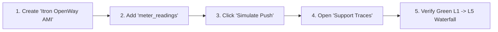

# Soopa Integration Platform (`apps/ip`)
# Gear 1: Transactional Energy Pipeline Manual Testing Guide (L1 $\to$ L5)

- **Target System:** Gear 1 Transactional Data Plane (`ip.engine`, `ip.solutions.domains.energy`)
- **Storage Layer:** PostgreSQL ACID Journal & Domain Tables (Tenant Shard)
- **Engine:** Row-oriented CDC, Canonical Normalization, Outbox Relay, Stitch DAGs, Outbound Delivery
- **Repository Location:** [`apps/ip/docs/gear1_manual_testing_guide.md`](file:///Users/apple/soopa_mono/apps/ip/docs/gear1_manual_testing_guide.md)

---

## 1. Gear 1 Configuration & Specification Matrix

| Role in Pipeline | Vendor Name | Connection Name | App Catalog ID | Entity Name | Primary Key Field | Cursor Field | Target PostgreSQL Table |
| :--- | :--- | :--- | :--- | :--- | :--- | :--- | :--- |
| **Inbound Source** | **Itron** (OpenWay Riva) | `Itron OpenWay AMI` | `universal_simulator` | `meter_readings` | `meter_serial` | `timestamp` | `public.mdm_meter_readings` |
| **Master Premise** | **Oracle** (CC&B) | `Oracle CC&B Master` | `universal_simulator` | `service_points` | `service_point_id` | `updated_at` | `public.mdm_service_points` |
| **Outbound Destination**| **SAP** (S/4HANA IS-U) | `SAP S/4HANA Utilities`| `universal_simulator` | `billing_readings` | `reading_id` | `reading_timestamp` | `public.mdm_billing_readings` & `public.outbound_records` $\to$ SAP HTTP |

---

## 2. Exact Schemas & JSON Blueprints

### 2.1 Inbound Source: AMI Meter Reading (`meter_readings`)
* **Vendor:** Itron (Product: OpenWay Riva AMI)
* **Connection Name:** `Itron OpenWay AMI`
* **Modal Fields to Enter:**
  - **Entity Name:** `meter_readings`
  - **Primary Key:** `meter_serial`
  - **Cursor Field:** `timestamp`
  - **Velocity Mode:** `Transactional Entity`
  - **Records per Pull:** `5`
* **Copy-Paste Blueprint:**
```json
{
  "meter_serial": "MTR-ENERGY-1001",
  "timestamp": "2026-11-12T12:00:00Z",
  "kwh_delivered": 14.52,
  "kwh_received": 0.0,
  "voltage_avg": 240.1,
  "interval_minutes": 15,
  "service_point_id": "SP-NORTH-401"
}
```

---

### 2.2 Master Premise: Service Point (`service_points`)
* **Vendor:** Oracle (Product: CC&B - Customer Care & Billing)
* **Connection Name:** `Oracle CC&B Master`
* **Modal Fields to Enter:**
  - **Entity Name:** `service_points`
  - **Primary Key:** `service_point_id`
  - **Cursor Field:** `updated_at`
  - **Velocity Mode:** `Transactional Entity`
  - **Records per Pull:** `5`
* **Copy-Paste Blueprint:**
```json
{
  "service_point_id": "SP-NORTH-401",
  "meter_serial": "MTR-ENERGY-1001",
  "customer_id": "CUST-CORP-9021",
  "service_address": "742 Evergreen Terrace, Sector 4",
  "grid_region": "NORTH_SUB_GRID_A",
  "status": "ACTIVE",
  "updated_at": "2026-11-12T08:00:00Z"
}
```

---

### 2.3 Outbound Destination: ERP Billing (`billing_readings`)
* **Vendor:** SAP (Product: S/4HANA Utilities IS-U)
* **Connection Name:** `SAP S/4HANA Utilities`
* **Canonical Entity Type:** `MDM_BILLING_READING` (`energy.mdm_billing_reading`)
* **Target PostgreSQL Table:** `public.mdm_billing_readings` (renders directly in the UI **Entities** tab)
* **Modal Fields to Enter:**
  - **Entity Name:** `billing_readings`
  - **Primary Key:** `reading_id`
  - **Cursor Field:** `reading_timestamp`
  - **Velocity Mode:** `Transactional Entity`
  - **Records per Pull:** `5`
* **Copy-Paste Blueprint:**
```json
{
  "reading_id": "BILL-RDG-1001",
  "meter_serial": "MTR-ENERGY-1001",
  "kwh_delivered": 14.52,
  "reading_timestamp": "2026-11-12T12:00:00Z",
  "service_point_id": "SP-NORTH-401"
}
```

---

## 3. Workflow A: 100% Visual UI Testing (Zero Terminal)

Follow these steps directly in the web browser at `http://localhost:5173`:



### Step 1: Create Source Connection
1. In the left navigation, click **Apps** (or **Connections**).
2. Click **"+ New Connection"** in the top right.
3. In the modal:
   - **App Catalog:** Select **Universal Simulator**.
   - **Connection Name:** Enter `Itron OpenWay AMI`.
   - **Authentication:** `No Auth`.
4. Click **Connect & Save**. Click on the connection card to open details.

### Step 2: Add the `meter_readings` Entity
1. On the Connection Detail page, scroll to **Simulator Entities**.
2. Click **"+ Add Entity"**.
3. Fill in the modal:
   - **Entity Name:** `meter_readings`
   - **Primary Key:** `meter_serial`
   - **Cursor:** `timestamp`
   - **Records per Pull:** `5`
4. Paste the **Section 2.1 JSON Blueprint** into the **Sample Blueprint** box.
5. Click **Save Entity**.

### Step 3: Trigger Ingestion (1-Click Push)
1. On the new `meter_readings` row, click the **[Simulate Push]** button (radio tower icon).
2. A green notification confirms: *"Simulated push for 'meter_readings' (1 record ingested into L1)"*.

### Step 4: Verify Support Trace Waterfall
1. Click **Support Traces** in the left sidebar.
2. Click on the topmost trace for `MTR-ENERGY-1001`.
3. Verify that all 5 layers are green:
```text
[ L1 Ingested ✓ ] ──► [ L2 Replicated ✓ ] ──► [ L3 Normalized ✓ ] ──► [ L4 Routed ✓ ] ──► [ L5 Delivered ✓ ]
```
4. Click on **L3 Normalized**: Observe that `kwh_delivered = 14.52`, and all lineage sextet fields (`trace_id`, `parent_trace_id`, `original_trace_id`, `replay_count`) are populated.

---

## 4. Workflow B: Terminal / cURL REST API Testing

If you prefer testing directly against the API:

### Step 1: Create the Source Connection
```bash
curl -X POST "http://localhost:8000/api/v1/tenants/TENANT_ID/ip/connections" \
  -H "Content-Type: application/json" \
  -H "Authorization: Bearer YOUR_TOKEN" \
  -d '{
    "app_id": "universal_simulator",
    "name": "Itron OpenWay AMI",
    "auth_type": "NO_AUTH",
    "public_config": {"seed": 3001, "records_per_pull": 5},
    "raw_credentials": {},
    "endpoint_for_fingerprint": "Itron OpenWay AMI"
  }'
```
*Note returned `id` as `SOURCE_CONN_ID`.*

### Step 2: Register Entity Blueprint
```bash
curl -X POST "http://localhost:8000/api/v1/tenants/TENANT_ID/ip/connections/SOURCE_CONN_ID/simulator/entities" \
  -H "Content-Type: application/json" \
  -H "Authorization: Bearer YOUR_TOKEN" \
  -d '{
    "entity_name": "meter_readings",
    "primary_key_field": "meter_serial",
    "cursor_field": "timestamp",
    "sample_blueprint": {
      "meter_serial": "MTR-ENERGY-1001",
      "timestamp": "2026-11-12T12:00:00Z",
      "kwh_delivered": 14.52,
      "kwh_received": 0.0,
      "voltage_avg": 240.1,
      "interval_minutes": 15,
      "service_point_id": "SP-NORTH-401"
    },
    "records_per_pull": 5
  }'
```

### Step 3: Trigger Ingress Push Webhook (L1 $\to$ L5)
```bash
curl -X POST "http://localhost:8000/api/v1/ip/ingress/TENANT_SLUG/universal_simulator/SOURCE_CONN_ID?stream=meter_readings" \
  -H "Content-Type: application/json" \
  -H "X-Correlation-ID: corr_manual_001" \
  -d '{
    "meter_serial": "MTR-ENERGY-1001",
    "timestamp": "2026-11-12T12:00:00Z",
    "kwh_delivered": 14.52,
    "kwh_received": 0.0,
    "voltage_avg": 240.1,
    "interval_minutes": 15,
    "service_point_id": "SP-NORTH-401"
  }'
```
*Expected Response:* HTTP `202 Accepted` with `record_id` and assigned `trace_id`.

---

## 5. Physical Database Verification Queries (PostgreSQL)

Connect to your PostgreSQL tenant shard (`psql`) and run these verification queries:

### 1. Verify Layer 1 (Inbound Raw Journal)
```sql
SELECT id, stream_name, payload_hash, length(raw_payload) AS bytes, created_at
FROM public.inbound_records
WHERE tenant_id = 'TENANT_ID'
ORDER BY created_at DESC LIMIT 1;
```

### 2. Verify Layer 2 (Replica Lake & Deduplication)
```sql
SELECT id, stream_name, record_key, replica_hash, cdc_operation, updated_at
FROM public.replica_records
WHERE tenant_id = 'TENANT_ID'
ORDER BY updated_at DESC LIMIT 1;
```

### 3. Verify Layer 3 (Normalized Canonical Tables & Lineage Sextet)
```sql
-- AMI Meter Readings
SELECT id, meter_serial_number, reading_timestamp, kwh_delivered, quality_flag,
       trace_id, parent_trace_id, original_trace_id, replay_count
FROM public.mdm_meter_readings
WHERE tenant_id = 'TENANT_ID'
ORDER BY reading_timestamp DESC LIMIT 1;

-- SAP Billing Readings
SELECT id, reading_id, meter_serial_number, service_point_id, reading_timestamp, kwh_delivered, quality_flag,
       trace_id, parent_trace_id, original_trace_id, replay_count
FROM public.mdm_billing_readings
WHERE tenant_id = 'TENANT_ID'
ORDER BY reading_timestamp DESC LIMIT 1;
```

### 4. Verify Layer 4 (Stitch Orchestration DAG)
```sql
SELECT id, workflow_id, status, started_at, finished_at
FROM public.workflow_runs
WHERE tenant_id = 'TENANT_ID'
ORDER BY started_at DESC LIMIT 1;
```

### 5. Verify Layer 5 (Outbound Egress Delivery)
```sql
SELECT id, connection_id, stream_name, idempotency_key, status, response_status_code, delivered_at
FROM public.outbound_records
WHERE tenant_id = 'TENANT_ID'
ORDER BY created_at DESC LIMIT 1;
```

---

## 6. Pass/Fail Assertion Checklist

| Verification Point | Pass Criteria |
| :--- | :--- |
| **L1 Ingress SLA** | HTTP `202 Accepted` returned in $<20\text{ms}$ with valid `record_id`. |
| **L2 Deduplication** | Sending the identical payload twice does not cause duplicate key errors; updates existing replica. |
| **L3 Domain Precision** | Exact reading preserved: `kwh_delivered = 14.52`, `meter_serial_number = 'MTR-ENERGY-1001'`. |
| **L3 Lineage Sextet** | All 4 lineage fields (`trace_id`, `parent_trace_id`, `original_trace_id`, `replay_count`) are non-null and accurate. |
| **L4 Stitch Routing** | Workflow run status is `COMPLETED`. |
| **L5 Delivery Status** | Outbound record status is `DELIVERED` with HTTP 200 receipt. |
