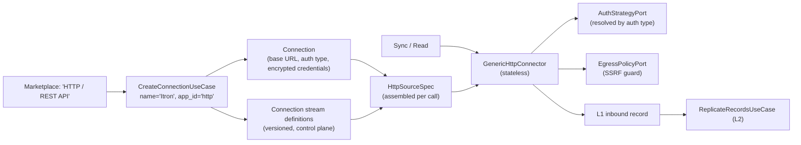

# Design: Generic HTTP Connector (No Per-App Manifests or Classes)

**Status:** Proposed
**Scope:** `apps/ip/packages/ip`, connectors and connection lifecycle
**Related:** `l2_replica_design.md` (stream definition, extractors), `domain_migrations_design.md`

## 1. Problem

Today Itron is a custom Python class, `ItronMdmConnector` (about 560 lines, `connector_type="CUSTOM_PYTHON"`):
- It uses static API-key auth (an `X-API-Key` header). There is no OAuth2.
- It calls an invented REST contract on a URL the customer supplies (`/api/v1/health`, `/api/v1/streams/{stream}/records`).
- Nothing in it is specific to Itron. It is a generic REST client with Itron's name on it.

The earlier proposal to replace it with an `ITRON_MDM_MANIFEST` has the same flaw: **app-specific code or config checked into our repo for every HTTP app**. With hundreds of target apps, that doesn't scale and needs a deploy for each new integration.

Two related problems in the current design:
1. **`DeclarativeHttpConnector` is built from a static manifest** in `ConnectorCatalogRegistry` and cached **per `app_id`**. So the stream configuration belongs to the app, not to the connection.
2. **Auth is chosen with `if auth_type == ...` branches** inside the connector (`_build_auth_headers`), even though `AuthStrategyPort` implementations already exist. Every new auth type means editing the connector (an Open/Closed violation).

## 2. Target mental model

> The support user searches **"HTTP"** in the marketplace, creates a connection, enters the base URL and auth that Itron provides, defines the streams, and **names the connection "Itron"**. That's all. No code, no manifest, no deploy.

- **The marketplace has one entry:** `http`, "HTTP / REST API".
- **"Itron" is only the connection's name.** The `app_id` stays `http`.
- **Everything app-specific is per-connection data:** base URL, auth, headers, streams, pagination, keys, and write actions.

This is how comparable products work:

| Product | Equivalent |
|---|---|
| n8n | HTTP Request node plus credentials |
| Activepieces | HTTP piece |
| Airbyte | Connector Builder (low-code manifest). In Airbyte it is authored per connector. **Ours is authored per connection, at runtime.** |

## 3. Architecture

### 3.1 `HttpSourceSpec`: the per-connection contract
A typed, immutable value object, assembled from the connection on every call. It is not a module-level manifest.

| Field | Notes |
|---|---|
| `base_url` | https only, validated (see section 5) |
| `auth_type` | Enum: `NONE`, `BASIC`, `BEARER`, `API_KEY`, `OAUTH2_CLIENT_CREDENTIALS` |
| `default_headers` | Non-secret only. Headers like `Host` and `Authorization` are blocked here |
| `check_request` | Optional `HttpRequestSpec`. If missing, the check reads the first stream with `limit=1` |
| `streams` | `tuple[HttpStreamDefinition, ...]` |

Credentials are never part of the spec. They stay in `Connection.encrypted_credentials` and go only to the auth strategy.

### 3.2 `HttpStreamDefinition` = request side + replication side
It composes the `StreamDefinition` from the L2 design, so the definition isn't duplicated.

| Part | Fields |
|---|---|
| `request: HttpRequestSpec` | `path`, `method`, `query_params`, `headers`, `body_template`, `pagination` (Enum: `NONE`, `CURSOR`, `OFFSET_LIMIT`, `PAGE_NUMBER`, `LINK_HEADER`), `incremental_param` (request parameter the checkpoint is injected into, e.g. `updated_since`) |
| `replication: StreamDefinition` | `record_path`, `primary_key`, `cursor_field`, `cursor_kind`, `sync_mode`, `deletion_marker`, `extractor_id` (defaults to `declarative`) |
| `write: HttpWriteSpec \| None` | Optional outbound (L5) actions per operation: `CREATE`, `UPDATE`, `DELETE` → method plus path template (e.g. `/meters/{record_id}`) |
| `normalizer_id` | Optional L3 mapping, e.g. `energy.ami_meter_reading.v1`. **Bound to the stream, not to an app.** |

### 3.3 Where stream definitions live
- They are stored in the **control plane**, per connection, in the existing versioned connection catalog. Each change creates a new version, and the active version is used.
- They are validated at the API boundary into `HttpStreamDefinition` and rejected with typed errors when invalid.
- Saving a new version is an audited domain event (`ConnectionStreamsUpdatedEvent`).

### 3.4 `GenericHttpConnector`: stateless, one instance per process
- **Signature:** `read_stream(spec, stream, credentials, checkpoint) -> AsyncIterator[Result[HttpPage, IpError]]`. Same pattern for `check`, `write_record` and `list_objects`.
- **No per-app caching.** `ConnectorCatalogRegistry` returns the single `http` connector, and the connection supplies the spec.
- **Auth through polymorphism:** an `AuthStrategyResolver` maps `auth_type` to the existing `AuthStrategyPort` implementations, so the connector has no `if/else` on auth type.
- **Pagination through strategies:** one `PaginationStrategy` per pagination Enum value. Adding a style means adding a class, not editing the connector.
- **Errors are values:** HTTP 4xx/5xx, timeouts and invalid config come back as typed `Result` errors (`UpstreamHttpError`, `UpstreamNetworkError`, `InvalidConnectionConfigError`). The connector never raises for these.

### 3.5 Discovery (generic HTTP has no schema endpoint)
- **Discovery means sampling.** Fetch the first page of each stream and infer a JSON schema from the records. Airbyte's Connector Builder test-read does the same.
- **UI flow:** "Test stream" shows sample records, the inferred fields, and a suggested `primary_key` (for example `id`) and `cursor_field` (for example `updated_at`).
- **Storage:** inferred schemas are saved with the stream version, for later schema-drift detection.

## 4. Curated manifests (Stripe, HubSpot, Salesforce, ServiceNow)

A manifest stops being a separate kind of connector. It becomes a **template**: a pre-filled `HttpSourceSpec` that the UI loads into the same generic HTTP form.
- One execution path (`GenericHttpConnector`) for every HTTP app.
- Templates are optional shortcuts for popular apps. New integrations never need one.

## 5. Security (the user controls the URL, so egress must be locked down)

| Threat | Control |
|---|---|
| SSRF to internal hosts | `EgressPolicyPort` resolves DNS and blocks private, loopback, link-local and cloud-metadata ranges **on the resolved IP**, then pins that IP for the request (stops DNS rebinding) |
| Redirect escape | Redirects only to the same origin. Anything else is an error result |
| Plain-text transport | https only |
| Header injection | Blocked header names; secrets only through the auth strategy |
| Resource abuse | Timeouts, maximum response size, maximum pages per run, per-connection rate limit |
| Customer private networks | Handled by a separate egress strategy (for example a private-link or agent egress adapter) chosen in the composition root. **Not** an `allow_private_ips` boolean passed into the connector |

## 6. Removing Itron

| Item | Action |
|---|---|
| `ip/application/connectors/itron_mdm_connector.py` + tests | Delete |
| Itron registration in `registry_loader.py` | Delete. Register the single `http` connector |
| `ItronMdmTransformer` | Becomes an L3 normalizer keyed by `normalizer_id` (for example `energy.ami_meter_reading.v1` and `energy.ami_service_point.v1`) and bound to streams. Its `extract_replica` part is removed (see the L2 design) |
| E2E tests | Use a generic HTTP connection **named "Itron"** against `pytest-httpserver`: streams `service_points` and `meter_readings` → L1 → L2 → L3 |

## 7. Tests
- **Pure unit tests:** `HttpSourceSpec` and `HttpStreamDefinition` validation, pagination strategies, path and body template rendering, schema inference, auth resolver mapping.
- **Narrow integration tests** (`pytest-httpserver`, real Postgres with SAVEPOINT rollback; no mocks):
  - check succeeds and fails
  - each pagination style
  - incremental checkpoint injection
  - write create, update and delete
  - SSRF: private IP, redirect to another origin, rebinding
  - creating, versioning and reading stream definitions
- **E2E:** an HTTP connection named "Itron" goes from L1 to L3 canonical Energy rows.

## 8. Implementation steps (red, green, refactor)
1. Domain value objects: `HttpSourceSpec`, `HttpRequestSpec`, `HttpStreamDefinition`, `HttpWriteSpec`, plus the pagination and auth Enums.
2. `AuthStrategyResolver` over the existing `AuthStrategyPort` implementations. Remove `_build_auth_headers` branching.
3. `PaginationStrategy` implementations and `EgressPolicyPort` with its default public-internet adapter.
4. `GenericHttpConnector`, which replaces `DeclarativeHttpConnector` and the per-`app_id` cache.
5. Stream definition persistence (versioned, control plane), plus create, update and test-stream use cases.
6. Convert the curated manifests into templates.
7. Delete `ItronMdmConnector`. Re-key `ItronMdmTransformer` as an L3 normalizer by `normalizer_id`.
8. Run `ruff`, `mypy`, `tach check`, `cov:business` (95%), `cov` (85%), then `pnpm db:migrate` if control-plane tables change.

## 9. Decisions

| # | Decision | Recommendation |
|---|---|---|
| 1 | Keep Stripe, HubSpot, Salesforce and ServiceNow as **templates** of the generic HTTP spec, or delete them? | Keep them as templates |
| 2 | Store stream definitions in the existing versioned connection catalog, or in a new `connection_streams` table? | Existing catalog, if its schema fits. Otherwise a new table |
| 3 | Auth types in v1 | `NONE`, `BASIC`, `BEARER`, `API_KEY`, `OAUTH2_CLIENT_CREDENTIALS`. OAuth2 authorization-code (user consent) stays with curated apps |
