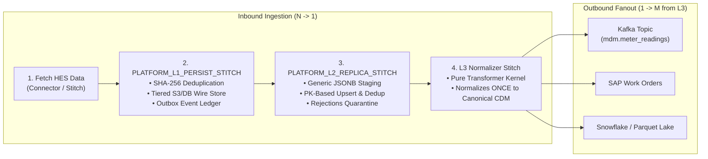
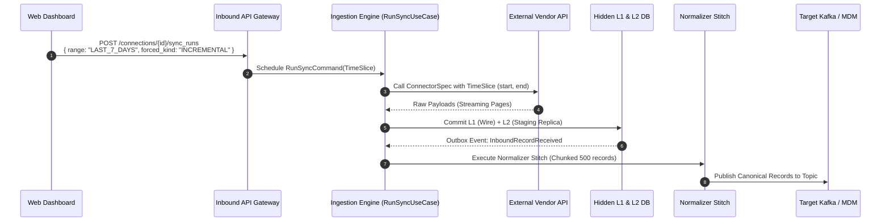
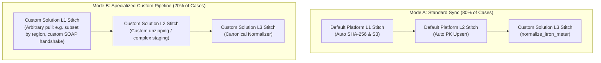

# Gold Standard Architecture: Pipeline & Platform Library Stitches

**Document Version:** 1.1.0  
**Status:** Approved Architectural Standard  
**Scope:** `apps/ip/packages/ip` (Integration Platform), Solution SDK, Runtime Engine, and Domain Solutions  
**Target Audience:** Solution Engineers, Enterprise Software Architects, and Platform Engineers  

---

## 1. Executive Summary & Core Paradigm

In enterprise integration and data processing platforms (such as Smart Grid Energy, Logistics, and ERP), pipelines must satisfy two competing requirements:
1. **High-Velocity Solution Engineering:** Solution Engineers must be able to integrate new vendor systems (e.g., Landis+Gyr, Itron, Oracle MDM, SAP) in hours without writing repetitive infrastructure plumbing.
2. **Enterprise-Grade Resilience & Durability:** Pipelines must process millions of records with constant $O(1)$ memory, zero data loss, SHA-256 auditability, and atomic transactional integrity.

To reconcile these requirements, the SOOPA Integration Platform adopts the **Decoupled Function-Stitch & Platform Library Pattern**:
* **Pure Domain Logic ($f(x) \to y$):** Normalizers and transformers are authored as 100% pure, side-effect-free functions with zero network, database, or I/O dependencies, enabling instantaneous mock-free unit testing.
* **Orchestration Stitches:** Workflows are composed of discrete, observable steps called **Stitches**, each executing a specific role with typed inputs, granular error policies, metric reporting, and execution logs.
* **Universal Built-in Library Stitches (L1 & L2):** Data persistence (L1 Wire Storage) and staging replication (L2 Operational Store) are **never authored by Solution Engineers** for standard syncs. They are provided out-of-the-box as pre-packaged, battle-tested platform library stitches.
* **Hub-and-Spoke Canonical Fanout ($N \to 1 \to M$):** Data is normalized **ONCE** into Canonical L3 domain entities. Downstream distribution (Oracle MDM, SAP, Data Lake) fans out **from the normalized L3 data**, eliminating $N \times M$ point-to-point transformations.



---

## 2. The Hub-and-Spoke Fanout Law ($N \to 1 \to M$)

### 2.1 The Fundamental Anti-Pattern: Point-to-Point ($N \times M$)
If every target application (Oracle MDM, SAP, Snowflake) required its own custom transformation directly from raw staging (L2), adding a new HES vendor would require authoring $M$ new transformers, and adding a new target app would require authoring $N$ new transformers.

### 2.2 The Enterprise Solution: Normalize Once to Canonical L3
* **Inbound Phase ($N \to 1$):** Each source vendor (Landis+Gyr, Itron, Siemens) maps into the single Canonical Domain Model (`CanonicalMeterReading`).
* **Outbound Phase ($1 \to M$):** Once a record is validated in canonical L3 format, delivery sinks (Kafka publisher, SAP HTTP client, Parquet exporter) consume the exact same normalized structure.

> [!NOTE]
> The **only** scenario where L2 branches into multiple normalizers is when a single raw vendor payload contains **multiple distinct business entities** (e.g., a file containing both meter interval reads and tamper alarm events). For the same business entity, normalization runs strictly once.

---

## 3. The Anatomy of a Normalizer Stitch

### 3.1 Layer 1: The Pure Mapping Kernel
The Solution Engineer writes only pure domain logic. This function is completely isolated from the database, Kafka, or HTTP protocols:

```python
# File: apps/ip/src/ip/solutions/domains/energy/landis/normalizer.py
from ip.sdk.typing import JsonDict

def normalize_landis_meter(raw: JsonDict) -> JsonDict:
    """Pure domain mapping from Landis+Gyr raw payload to canonical MDM schema.
    
    Zero I/O, zero network, zero database calls. Guaranteed testable in 0.1ms.
    """
    if "serial_number" not in raw:
        msg = "Missing required serial_number field in Landis payload"
        raise ValueError(msg)
        
    return {
        "meter_id": str(raw["serial_number"]),
        "kwh_reading": float(raw["active_energy_kwh"]),
        "read_time": str(raw["read_time"]),
        "quality_code": str(raw.get("status_code", "VALID")),
    }
```

### 3.2 Layer 2: The Orchestration Stitch Specification
The pure kernel is wrapped and registered as an executable `StitchSpec`:

```python
# File: apps/ip/src/ip/solutions/domains/energy/landis/normalizer.py
from ip.sdk.specs import StitchSpec, retry_policy
from ip.engine.adapters.outbound.stitches.handlers.normalizer_step_handler import (
    create_normalizer_stitch_handler,
)

NORMALIZE_LANDIS_METER_STITCH = StitchSpec(
    name="energy.landis.normalize_meter",
    fn=create_normalizer_stitch_handler(normalize_landis_meter),
    retry=retry_policy(max_attempts=3, backoff_seconds=2),
    description="Transforms raw Landis+Gyr meter payloads into canonical MDM records",
)
```

---

## 4. UI "Sync" Button Contract & Time-Slicing

How does an operator clicking "Sync Last 7 Days" in the web UI trigger the pipeline?



1. **Standardized Parameter (`TimeSlice`):** The UI passes universal parameters (`FULL_REFRESH`, `INCREMENTAL`, `LAST_7_DAYS`).
2. **Connector Parameter Mapping:** The Solution Engineer maps `cmd.start_time` and `cmd.end_time` into the vendor's HTTP query.
3. **Automated Staging:** The platform calls the vendor, saves to hidden L1 and L2, and emits the Outbox event.
4. **Automated Normalization:** The Normalizer Stitch processes the newly staged records and dispatches them downstream.

---

## 5. Dual Operational Modes: Platform Defaults vs Custom Overrides

The platform adheres to **"Convention over Configuration with Override Superpowers"**:



* **Mode A (Platform Defaults):** Solution engineers write only L3 (`normalize_itron_meter`). The platform automatically executes `PLATFORM_L1_PERSIST_STITCH` and `PLATFORM_L2_REPLICA_STITCH`.
* **Mode B (Custom Overrides):** For proprietary protocols, specialized subsets (e.g., "pull only meters with active faults"), or custom schedules, Solution Engineers can author a **Custom L1 Stitch** or **Custom L2 Stitch** while retaining identical DAG tracing and retry semantics.

---

## 6. High-Volume Streaming & Memory Bounding

* **Memory Invariant ($O(1)$ RAM):** At no point in the pipeline does a worker hold more than one chunk (default: 500 records) in memory.
* **Chunk Commits:** Each chunk executes as a single, isolated database transaction across L1, L2, and the Outbox.
* **Database Cooperative Yielding:** Workers yield execution between chunks (`await asyncio.sleep(0.05)`) to prevent table locks and allow PostgreSQL autovacuum to run smoothly.

---

## 7. Dead-Letter Queue (DLQ) & Quarantine Strategy

A single malformed record must never cause an entire batch sync of 500,000 records to fail:
* **System Failures (503, DB timeout):** Retried via exponential backoff.
* **Data / Validation Failures (missing field, corrupted date):** Quarantined into `replica_rejections` / DLQ. The pipeline continues uninterrupted for all valid records.
