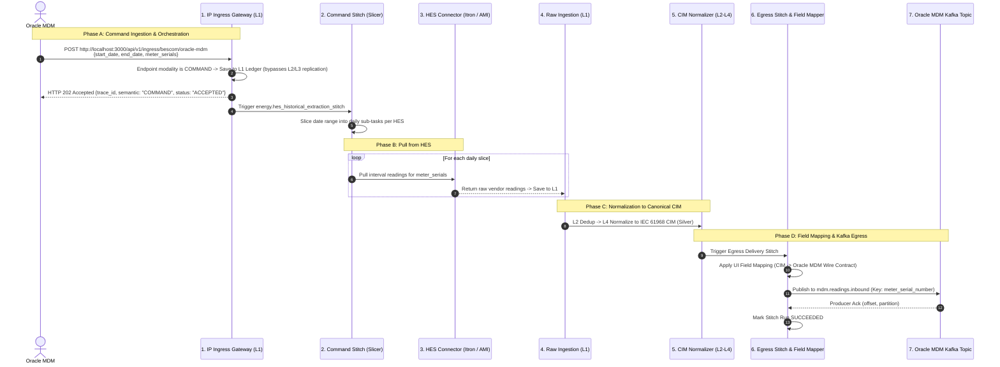

# Tester Guide: Oracle MDM Webhook Command to HES Pull & Kafka Egress Pipeline

- **Target Architecture:** Two-Phase Asynchronous Orchestrated Integration Pipeline (`apps/ip`)
- **Ingress Webhook URL:** `http://localhost:3000/api/v1/ingress/bescom/oracle-mdm`
- **Modality:** `COMMAND` (Triggers L1 Perimeter Ingest $\to$ Slicing Stitch; bypasses L2/L3 replica)
- **Pipeline Flow:**  
  `Webhook Command Request` $\to$ `Ingest L1` $\to$ `Stitch (Date Slicing)` $\to$ `Send Request to HES` $\to$ `Response Save to L1` $\to$ `L1 to L4 (CIM Normalization)` $\to$ `Stitch (Wire Mapping)` $\to$ `Push to Kafka`
- **Target Audience:** QA Engineers, System Testers, Solution Architects, Integration Operators
- **Doc Location:** [`apps/ip/docs/hes_pull_to_mdm_kafka_push_stitch_guide.md`](file:///Users/apple/soopa_mono/apps/ip/docs/hes_pull_to_mdm_kafka_push_stitch_guide.md)

---

## 1. End-to-End Pipeline Architecture (The Complete Picture)

This test validates the **Two-Phase Asynchronous Integration Pipeline** between Oracle MDM, the Integration Platform (IP), external Head-End Systems (HES), and the enterprise Kafka event broker.



---

## 2. Test Environment & Prerequisites

Ensure the following local stack services are running before starting:

| Service / Container | Expected Port / URL | Purpose |
| :--- | :--- | :--- |
| **Ingress Gateway / Dashboard** | `http://localhost:3000` | Ingress perimeter gateway receiving `oracle-mdm` pushes |
| **IP Web API (`ip-api`)** | `http://localhost:8000` | Core control-plane and data-plane service |
| **IP Worker (`ip-worker`)** | Background container | Executes Stitch DAGs, date slicing, and Kafka producer |
| **PostgreSQL Database** | `localhost:5432` | Stores L1 Inbound Records, L4 Normalization, and Stitch Ledgers |
| **Kafka / Redpanda Broker** | `localhost:9092` | Receives final outbound messages on `mdm.readings.inbound` |
| **Tenant UI Dashboard** | `http://localhost:3000` (or `:5173`) | Connections management and Field Mapper UI |

---

## 3. Step-by-Step Testing Procedure

### Step 1: Set Up the Required Connections in the UI

Open your browser and navigate to `http://localhost:3000/tenant/ip/connections` (or port `:5173`). Verify the three connections:

#### 1.1 Webhook Command Ingress Connection (MDM Trigger)
* **App / Connector**: `Webhook`
* **Connection Name**: `Oracle MDM Command Ingress`
* **Tenant Slug**: `bescom`
* **Endpoint Slug**: `oracle-mdm`
* **Ingress URL**:  
  `http://localhost:3000/api/v1/ingress/bescom/oracle-mdm`
* **Modality / Semantic**: Set route payload semantic to `COMMAND`.

#### 1.2 HES Source Connection (Itron / AMI Head-End)
* **App / Connector**: `Universal Simulator` (or `HES REST Connector`)
* **Connection Name**: `HES Itron OpenWay AMI`
* **Entity / Stream**: `meter_readings` (Primary Key: `meter_serial`, Cursor: `timestamp`)

#### 1.3 Destination Connection: Oracle MDM Kafka
* **App / Connector**: `Apache Kafka` (or `Redpanda`)
* **Connection Name**: `Oracle MDM Kafka`
* **Bootstrap Servers**: `localhost:9092`
* **Default Topic**: `mdm.readings.inbound`
* Click **Test Connection** $\to$ Confirm green checkmark $\to$ Click **Create**.

---

### Step 2: Configure Destination Wire Contract & Field Mapping (UI)

Navigate to **Stitch & Field Mapper**:  
`http://localhost:3000/tenant/ip/stitches/mapper`

1. **Enter Stitch Pipeline Name**:
   * In the **Stitch Pipeline Name** input field at the top of the card, enter:  
     `HES Meter Readings to Oracle MDM Kafka Wire Sync`  
   * *(Note: The platform will auto-generate a sensible suggestion like `Meter Readings ➔ mdm.readings.inbound Wire Stitch` as soon as you select your source and destination, but you can freely customize it).*
2. **Select Source Connection**: `HES Itron OpenWay AMI`
3. **Select Entity**: `meter_readings`
4. **Select Destination Connection**: `Oracle MDM Kafka`
5. **Select Destination Topic**:
   * Click the dropdown $\to$ Scroll down and select **`Custom Schema`**.
   * In the modal dialog:
     * **Topic / Directory**: `mdm.readings.inbound`
     * **Monaco Editor Surface**: You will see the clean floating options (zero artificial box):
       ```
       [Cloud Icon]
       Paste  OR  Drag & Drop  OR  [ Upload ]
       ```
     * Paste the target **Oracle MDM Wire Contract**:
       ```json
       {
         "meterNumber": "string",
         "readingTime": "string",
         "intervalValue": 0.0,
         "unitOfMeasure": "KWH"
       }
       ```
     * Click **Format** in the editor footer $\to$ Verify syntax is valid.
     * Click **Apply & Select** in the modal footer.
6. **Configure Field Mappings in the Middle Column**:
   * `meter_serial` $\longrightarrow$ `meterNumber` (`DIRECT`)
   * `timestamp` $\longrightarrow$ `readingTime` (`DIRECT`)
   * `kwh_delivered` $\longrightarrow$ `intervalValue` (`DIRECT`)
   * `unitOfMeasure` $\longrightarrow$ Constant `"KWH"` (`CONSTANT`)
7. **Verify Live Preview**:
   * Inspect the bottom-right JSON viewer to ensure the projected output matches Oracle MDM wire format.
8. **Click Deploy & Activate Stitch**:
   * Verify the confirmation banner appears:
     - **Name**: `HES Meter Readings to Oracle MDM Kafka Wire Sync`
     - **Flow**: `meter_readings ──▶ mdm.readings.inbound`
     - **Stitch ID Pill**: Copyable technical ID (e.g. `stitch_01...`)
   * Click **View in Stitches Canvas** (or navigate to `/tenant/ip/stitches`):
     - In the **Active Stitches** table, verify your stitch appears prominently with its friendly name **`HES Meter Readings to Oracle MDM Kafka Wire Sync`** as the primary column, with its underlying DAG ID (`stitch.meter_readings`) displayed below it.

---

### Step 3: Trigger the Webhook Command Request from Oracle MDM

Because the webhook endpoint `/api/v1/ingress/bescom/oracle-mdm` is pre-configured with route modality **`COMMAND`**, the platform automatically processes all payloads posted to this endpoint as commands. 

> **Tester Note**: Oracle MDM is an external system and does **not** include internal platform flags like `"modality": "command"`. The platform determines modality strictly from the endpoint definition.

Execute this clean `curl` command (notice: `tenant_id` and `modality` are **never** passed in the body; the platform resolves tenant `bescom` and endpoint modality `COMMAND` directly from the URL):

```bash
curl -X POST "http://localhost:3000/api/v1/ingress/bescom/oracle-mdm" \
  -H "Content-Type: application/json" \
  -H "X-Correlation-ID: MDM-REQ-2026-11-8891" \
  -d '{
    "correlation_id": "MDM-REQ-2026-11-8891",
    "start_date": "2026-10-01T00:00:00Z",
    "end_date": "2026-10-03T00:00:00Z",
    "hes_connection_ids": ["ip_conn_itron_openway_north"],
    "destination_connection_id": "conn_kafka_mdm",
    "destination_topic": "mdm.readings.inbound",
    "filter_criteria": {
      "meter_serials": ["MTR-ENERGY-1001"],
      "reading_type": "INTERVAL_15_MIN"
    }
  }'
```

#### Expected HTTP Response (Sub-20ms):
```json
{
  "trace_id": "ip_trc_01J...",
  "record_id": "inb_rec_01J...",
  "status": "ACCEPTED",
  "semantic": "COMMAND",
  "matched_event": "*",
  "target": "energy.hes_historical_extraction_stitch"
}
```

---

### Step 4: Verify Command Ingest in L1 & Slicing Stitch

1. **Verify L1 Inbound Record**:
   * In PostgreSQL table `ip_inbound_records` or UI Inbound Log:
     - `app_id`: `oracle-mdm`
     - `tenant_id`: `bescom`
     - `trace_id`: Matches response `trace_id`.
   * **Critical Invariant Verification**: Verify that **zero** rows were added to `ip_replica_records`. Because the modality is `command`, L2 replication and L3 entity normalization are bypassed!
2. **Verify Stitch Slicing Execution**:
   * Navigate to `http://localhost:3000/tenant/ip/stitches` $\to$ **Execution Runs**.
   * Locate the run for `energy.hes_historical_extraction_stitch`:
     * **Step 1 (`SliceRangeStepHandler`)**: Decomposes `2026-10-01` to `2026-10-03` into 2 daily slices:
       - Slice 1: `2026-10-01T00:00:00Z` to `2026-10-02T00:00:00Z`
       - Slice 2: `2026-10-02T00:00:00Z` to `2026-10-03T00:00:00Z`
     * Status: `SUCCEEDED`.

---

### Step 5: Verify HES Request, L1 Save & L4 Normalization

1. **HES Pull Execution**:
   * The Stitch invokes the HES pull connector for each daily slice.
   * HES returns raw interval readings for `MTR-ENERGY-1001`.
2. **Response Saved to L1**:
   * HES responses land in L1 `ip_raw_records`.
3. **L4 Canonical Normalization**:
   * The raw readings pass through `AmiMeterReadingTransformer`.
   * Normalized into IEC 61968 CIM format:
     - `EnergyEntityType.MDM_METER_READING`
     - Validated timestamps, finite floats, and quality flags.
   * View the records in the UI:  
     `Connections` $\to$ `HES Itron OpenWay AMI` $\to$ `Entities` $\to$ `Normalized Entity` tab.

---

### Step 6: Verify Egress Stitch & Kafka Topic Delivery

1. **Verify Egress Stitch Run**:
   * Navigate to `/tenant/ip/stitches` $\to$ **Execution Runs**.
   * Observe the Egress Delivery Stitch run:
     * **Input**: Normalized CIM reading from Step 5.
     * **Transformation**: Applied UI Field Mapping rules.
     * **Delivery Destination**: `Oracle MDM Kafka (mdm.readings.inbound)`.
     * **Run Status**: `SUCCEEDED`.
2. **Verify Published Kafka Message via Terminal CLI**:
   * Run the Kafka consumer command:
     ```bash
     # Using Redpanda CLI (rpk):
     rpk topic consume mdm.readings.inbound --num 1
     
     # Or using standard Apache Kafka CLI:
     kafka-console-consumer --bootstrap-server localhost:9092 \
       --topic mdm.readings.inbound \
       --from-beginning \
       --max-messages 1 \
       --property print.key=true \
       --property print.headers=true
     ```

#### Expected Output on Kafka Topic:
* **Message Partition Key**: `"MTR-ENERGY-1001"`
* **Message Headers**:
  - `trace_id`: `"ip_trc_..."`
  - `correlation_id`: `"MDM-REQ-2026-11-8891"`
  - `source_connection`: `"ip_conn_itron_openway_north"`
* **Message Value (JSON Matching Oracle MDM Wire Contract)**:
  ```json
  {
    "meterNumber": "MTR-ENERGY-1001",
    "readingTime": "2026-10-01T12:00:00Z",
    "intervalValue": 42.5,
    "unitOfMeasure": "KWH"
  }
  ```
* **Result**: **PASS** — Complete Two-Phase Pipeline verified from Ingress Webhook Command (`bescom/oracle-mdm`) to Kafka Topic!

---

## 4. Tester Verification Matrix (Pass / Fail Checklist)

| Test Stage | Action | Expected Outcome | Result |
| :--- | :--- | :--- | :---: |
| **1. Webhook Command Ingest** | `POST /api/v1/ingress/bescom/oracle-mdm` | Returns `HTTP 202 Accepted` with `semantic: "COMMAND"` within 20ms | [ ] PASS |
| **2. Post-L1 Bypass** | Check `ip_replica_records` table | 0 rows added for command stream (bypasses L2 replica) | [ ] PASS |
| **3. Command Stitch Slicing** | Inspect `energy.hes_historical_extraction_stitch` | Date range decomposed into atomic daily slices | [ ] PASS |
| **4. HES Pull & L1 Save** | Stitch invokes HES pull | Vendor reading records saved to L1 `ip_raw_records` | [ ] PASS |
| **5. L4 CIM Normalization** | Check `Normalized Entity` tab in UI | Readings normalized to IEC 61968 CIM format | [ ] PASS |
| **6. Custom Schema Monaco** | Upload/Paste wire contract in mapper | Clean editor without box, format & clear in footer | [ ] PASS |
| **7. Field Mapping & Preview** | Map CIM fields $\to$ Oracle MDM fields | Live preview displays exact Oracle MDM wire shape | [ ] PASS |
| **8. Kafka Egress Delivery** | Consume from `mdm.readings.inbound` | Message received with key, trace headers, & mapped payload | [ ] PASS |

---

## 5. Troubleshooting & Diagnostics

| Failure Mode | Diagnosis / Log Check | Fix |
| :--- | :--- | :--- |
| **Webhook returns `404 Not Found`** | Endpoint slug `oracle-mdm` does not exist for tenant `bescom`. | Verify that the Webhook Connection has endpoint slug `oracle-mdm` in the UI. |
| **Webhook returns `401 Unauthorized`** | Secret/token mismatch in webhook URL or signature header. | Check verification strategy on the Webhook Connection (set to `NO_AUTH` for local testing). |
| **Command Stitch does not trigger** | Outbox relay not running or stream not matched to workflow. | Ensure `ip-worker` is running and route targets `energy.hes_historical_extraction_stitch`. |
| **Date Slicing produces 0 tasks** | `start_date` is after `end_date` or format is not ISO-8601. | Verify timestamps: `YYYY-MM-DDTHH:MM:SSZ`. |
| **HES pull returns empty records** | Simulator entity has no records for the requested meter serials. | Add matching meter serials (e.g. `MTR-ENERGY-1001`) to the HES Simulator. |
| **Kafka produces error `TopicNotFound`** | Topic auto-creation is disabled on Kafka broker. | Create topic manually: `rpk topic create mdm.readings.inbound` or check broker config. |
| **Field Mapper Deploy button disabled** | Required destination wire fields unmapped. | Ensure all non-nullable wire contract fields have an active mapping rule. |
