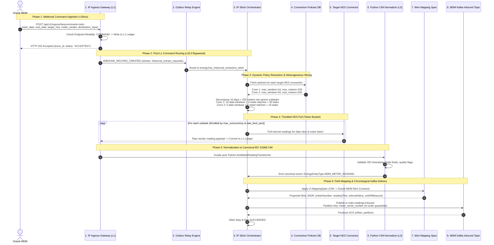

# Enterprise Architecture Design Document
## Multi-HES Historical Extraction to MDM Kafka Pipeline: Dynamic Policy-Driven Orchestration, Task Runtime Policies, and Zero-Code Evolution

**Author:** Enterprise Architecture & Integration Platform Team  
**Standard:** Enterprise Grade · Zero Shortcuts · Strict Hexagonal Architecture · Ubiquitous Language · DDD  
**Domain:** Utility Smart Grid MDM / AMI Integration (`apps/ip`)  
**Use Case:** MDM Webhook-Triggered On-Demand Historical Interval/Billing Extraction across Heterogeneous Head-End Systems (HES) with Chronological Kafka Delivery  
**Status:** Approved Production Architecture Blueprint  

---

## 1. Executive Summary & Problem Statement

In smart grid utility integration, a Meter Data Management (MDM) system (such as Oracle Utilities MDM or SAP for Utilities) frequently issues on-demand extraction requests for historical interval meter readings across thousands of endpoints.

Traditional integration architectures suffer from three critical architectural anti-patterns:

```
┌────────────────────────────────────────────────────────────────────────────────────────┐
│                        THE 3 HISTORICAL EXTRACTION ANTI-PATTERNS                       │
├────────────────────────────────┬───────────────────────────────────────────────────────┤
│ 1. Client-Vendor Coupling      │ Forcing the MDM to know that Vendor 1 handles 1 day,  │
│ (Leaky Abstraction)            │ Vendor 2 handles 2 days, and Vendor 3 handles 5 days. │
│                                │ Breaks if a single request spans multiple vendors!    │
├────────────────────────────────┼───────────────────────────────────────────────────────┤
│ 2. Monolithic Config Bloat     │ Stuffing rate limits, concurrency ceilings, and time  │
│ (Untyped JSON Pitfall)         │ windows into unvalidated JSON blobs (public_config).   │
│                                │ Zero schema enforcement, zero indexing, zero audits.  │
├────────────────────────────────┼───────────────────────────────────────────────────────┤
│ 3. Code-Bound Task Policies    │ Hardcoding step timeouts and retries in Python code.   │
│ (Ops / SRE Nightmare)          │ When a vendor API slows down, changing a 30s timeout  │
│                                │ requires a PR, CI build, Docker deploy, and restart.   │
└────────────────────────────────┴───────────────────────────────────────────────────────┘
```

### The Solution: The 4-Pillar Decoupled Architecture

The platform solves these challenges through **four strictly isolated architectural pillars**:

1. **Client Intent (`ip.inbound_records`):** The MDM only expresses pure business intent (*"Give me 10 days for meters MTR-001 to MTR-250"*). It is 100% agnostic of vendor limitations.
2. **Operational Policies (`ip.connection_policies`):** A dedicated, strongly-typed table that models each connection's physical API constraints (slicing windows, entity volume limits, concurrency ceilings, rate limits, blackout windows).
3. **Hybrid Orchestration (`ip.stitches` & `ip.stitch_task_configs`):** Workflow topologies and data transformations are authored in **authoritative Python code** (versioned in Git, 100% type-safe), while **Task Runtime Policies** (timeouts, retries, concurrency, and DLQ fallbacks) are configurable in the **UI**.
4. **Declarative Translation (`ip.mapping_specs`):** Canonical IEC 61968 CIM entities are projected into the destination wire contract using simple, visual field mappings configured in the UI.

---

## 2. Ubiquitous Language: The Connection Trinity

In strict accordance with Domain-Driven Design (DDD), all components share an unambiguous ubiquitous taxonomy centered around the **`Connection`** aggregate:

```
┌─────────────────────────────────────────────────────────────────────────────┐
│ 1. IDENTITY & CREDENTIALS: ip.connections                                   │
│    Who and Where: Base URL, OAuth2 tokens, mTLS certs, encryption keys.     │
└─────────────────────────────────────────────────────────────────────────────┘
                                       │
                                       ▼
┌─────────────────────────────────────────────────────────────────────────────┐
│ 2. DATA CONTRACTS: ip.connection_entities                                   │
│    What: Stream schemas, field data types, primary keys (e.g. meter_readings│
└─────────────────────────────────────────────────────────────────────────────┘
                                       │
                                       ▼
┌─────────────────────────────────────────────────────────────────────────────┐
│ 3. OPERATIONAL POLICIES: ip.connection_policies                             │
│    How & When: Slicing windows, concurrency gates, rate limits, blackouts.  │
└─────────────────────────────────────────────────────────────────────────────┘
```

> **Architectural Taxonomy Note (`connection_policies` vs. `vendor_policies`):**  
> We standardize on **`connection_policies`**. In enterprise utility grids, a single vendor (e.g. Itron) frequently has multiple connections (e.g. North Region on-premise datacenter with strict 1-day limits vs. South Region cloud-hosted endpoint with 4-day limits). Furthermore, internal utility endpoints (GIS, CIS) are internal systems, not third-party "vendors". Naming the table `connection_policies` maintains 100% symmetry with `connections` and `connection_entities`.

---

## 3. High-Level Flow & Sequence Diagram



---

## 4. Database Schema Specifications (DDL)

Both tables strictly reside in the **Global Control Plane database (`global_db`, schema `ip`)** and are added by amending the existing single migration file (`0001_initial_global_schema.py`):

### 4.1 Connection Operational Policies: `ip.connection_policies`

```sql
CREATE TABLE ip.connection_policies (
    id VARCHAR(64) PRIMARY KEY,                         -- e.g. "cpol_01jf89kz..."
    tenant_id VARCHAR(64) NOT NULL,
    connection_id VARCHAR(64) NOT NULL UNIQUE           -- 1:1 with Connection
        REFERENCES ip.connections(id) ON DELETE CASCADE,

    -- 1. Temporal Slicing Boundaries
    max_query_window_days INT NOT NULL DEFAULT 1,       -- Max days allowed in a single query
    max_query_window_hours INT,                         -- Fine-grained slicing for high-frequency RTUs
    min_query_window_minutes INT NOT NULL DEFAULT 15,   -- Lower bound (interval resolution)

    -- 2. Entity Volume Boundaries (Multi-Meter Slicing)
    max_entities_per_call INT NOT NULL DEFAULT 100,     -- Max meter serials per single API request
    max_records_per_batch INT NOT NULL DEFAULT 10000,   -- Safety ceiling preventing worker OOM
    supports_wildcard_queries BOOLEAN NOT NULL DEFAULT false, -- If false, requires explicit meter serials

    -- 3. Concurrency & Rate Limiting (Token Bucket)
    max_concurrency INT NOT NULL DEFAULT 2,             -- Max simultaneous requests to this connection
    rate_limit_rpm INT NOT NULL DEFAULT 60,             -- Max allowable requests per minute
    cooldown_seconds_between_calls FLOAT DEFAULT 0.0,   -- Inter-request pause (e.g. 0.5s)

    -- 4. Temporal Maintenance & Blackout Windows
    blackout_cron_schedule VARCHAR(64),                 -- e.g. "0 2 * * *" (Nightly maintenance)
    blackout_duration_minutes INT DEFAULT 0,

    -- 5. Extensibility & Status
    vendor_quirks JSONB NOT NULL DEFAULT '{}'::jsonb,   -- Custom HTTP headers, pagination quirks
    is_enabled BOOLEAN NOT NULL DEFAULT true,           -- Soft enable/disable switch
    
    created_at TIMESTAMPTZ NOT NULL,
    updated_at TIMESTAMPTZ NOT NULL,

    CONSTRAINT chk_ip_cpol_window_days CHECK (max_query_window_days > 0),
    CONSTRAINT chk_ip_cpol_concurrency CHECK (max_concurrency > 0),
    CONSTRAINT chk_ip_cpol_rpm CHECK (rate_limit_rpm > 0)
);

CREATE INDEX idx_ip_conn_policies_lookup ON ip.connection_policies(tenant_id, connection_id);
```

### 4.2 DAG Task Runtime Configuration: `ip.stitch_task_configs`

```sql
CREATE TABLE ip.stitch_task_configs (
    id VARCHAR(64) PRIMARY KEY,                         -- e.g. "stc_01jf..."
    tenant_id VARCHAR(64) NOT NULL,
    stitch_id VARCHAR(64) NOT NULL                      -- Scoped to the Stitch
        REFERENCES ip.stitches(id) ON DELETE CASCADE,
    node_key VARCHAR(64) NOT NULL,                      -- Target DAG Node (e.g. "slice_date_range", "pull_hes")

    -- 1. Timeouts & Deadlines
    timeout_seconds INT NOT NULL DEFAULT 60,            -- Worker step timeout before abort
    heartbeat_interval_seconds INT NOT NULL DEFAULT 15, -- Worker liveness lease heartbeat

    -- 2. Retry Policy & Exponential Backoff
    max_attempts INT NOT NULL DEFAULT 5,                -- Maximum retry count before failure
    initial_delay_seconds FLOAT NOT NULL DEFAULT 2.0,   -- First retry sleep
    backoff_multiplier FLOAT NOT NULL DEFAULT 2.0,      -- Exponential backoff factor
    max_delay_seconds FLOAT NOT NULL DEFAULT 60.0,      -- Upper ceiling for retry sleep

    -- 3. Concurrency & Queue Priority
    queue_name VARCHAR(64) NOT NULL DEFAULT 'default',  -- e.g. "critical", "bulk", "default"
    max_in_flight_tasks INT NOT NULL DEFAULT 3,         -- Max parallel executions of this specific node

    -- 4. Failure & Quarantine Disposition
    failure_disposition VARCHAR(32) NOT NULL DEFAULT 'RETRY_THEN_QUARANTINE',
    quarantine_stream_name VARCHAR(128) DEFAULT 'dead_letter_records',

    created_at TIMESTAMPTZ NOT NULL,
    updated_at TIMESTAMPTZ NOT NULL,

    CONSTRAINT uq_ip_stitch_task_config_node UNIQUE (tenant_id, stitch_id, node_key)
);

CREATE INDEX idx_ip_stitch_task_configs_lookup ON ip.stitch_task_configs(tenant_id, stitch_id, node_key);
```

---

## 5. The Heterogeneous Dynamic Slicing Algorithm

When an extraction command arrives, the engine performs **Heterogeneous Two-Dimensional Slicing** (slicing across both Time and Entity dimensions) based on the target connection's operational policy:

### 5.1 Slicing Specification with Explosion Guardrails

```python
"""Heterogeneous Dynamic Policy Slicing Algorithm."""

from __future__ import annotations

from dataclasses import dataclass
from datetime import datetime, timedelta
from typing import Final, Sequence

MAX_DECOMPOSED_TASKS_PER_REQUEST: Final[int] = 500


@dataclass(frozen=True)
class ConnectionPolicyProfile:
    connection_id: str
    max_window_days: int
    max_entities_per_call: int
    supports_wildcard_queries: bool


@dataclass(frozen=True)
class ExtractionSubtask:
    task_id: str
    connection_id: str
    slice_start: datetime
    slice_end: datetime
    meter_serials_batch: tuple[str, ...]


def decompose_extraction_request(
    *,
    start_date: datetime,
    end_date: datetime,
    meter_serials: Sequence[str],
    policies: Sequence[ConnectionPolicyProfile],
) -> list[ExtractionSubtask]:
    subtasks: list[ExtractionSubtask] = []
    task_idx = 0

    for pol in policies:
        # Check wildcard policy
        if not meter_serials and not pol.supports_wildcard_queries:
            raise ValueError(
                f"Connection '{pol.connection_id}' requires explicit meter_serials. "
                "Wildcard queries are disabled by connection policy."
            )

        time_delta = timedelta(days=pol.max_window_days)
        
        # Dimension 1: Entity / Meter Batch Slicing
        meter_batches: list[tuple[str, ...]] = []
        if meter_serials:
            for i in range(0, len(meter_serials), pol.max_entities_per_call):
                meter_batches.append(tuple(meter_serials[i : i + pol.max_entities_per_call]))
        else:
            meter_batches.append(())

        # Dimension 2: Time Window Slicing
        current_start = start_date
        while current_start < end_date:
            current_end = min(current_start + time_delta, end_date)

            for meter_batch in meter_batches:
                if len(subtasks) >= MAX_DECOMPOSED_TASKS_PER_REQUEST:
                    raise ValueError(
                        f"Decomposition exploded beyond safety ceiling of "
                        f"{MAX_DECOMPOSED_TASKS_PER_REQUEST} subtasks."
                    )

                subtasks.append(
                    ExtractionSubtask(
                        task_id=f"slice_{task_idx}_{pol.connection_id}",
                        connection_id=pol.connection_id,
                        slice_start=current_start,
                        slice_end=current_end,
                        meter_serials_batch=meter_batch,
                    )
                )
                task_idx += 1

            current_start = current_end

    return subtasks
```

### 5.2 Multi-Vendor Execution Trace

Given a request for **10 days** (`Oct 01` to `Oct 11`) and **250 meters**:

| Connection Profile | Max Window | Max Meters/Call | Time Slices | Meter Batches | Total Subtasks Generated |
| :--- | :---: | :---: | :---: | :---: | :---: |
| **Connection 1 (Itron)** | 1 Day | 100 | 10 | 3 (100, 100, 50) | **30 Tasks** |
| **Connection 2 (Landis+Gyr)** | 2 Days | 200 | 5 | 2 (200, 50) | **10 Tasks** |
| **Connection 3 (Sensus)** | 5 Days | 250 | 2 | 1 (250) | **2 Tasks** |
| **Total Fleet** | — | — | — | — | **42 Atomic Subtasks** |

---

## 6. The Zero-Code 1-Year Vendor Upgrade Walkthrough

One year after deployment, Vendor 1 upgrades their infrastructure to support **4-day query windows**:

```
                       HOW VENDOR 1 UPGRADES TO 4 DAYS
                       
  1. Operator updates Connection in UI (or sends standard API call):
     PATCH /api/v1/tenants/bescom/ip/connections/conn_vendor_1_hes/policy
     { "max_query_window_days": 4 }
                           │
                           ▼
  2. Database executes:
     UPDATE ip.connection_policies 
     SET max_query_window_days = 4, updated_at = NOW()
     WHERE connection_id = 'conn_vendor_1_hes';
                           │
                           ▼
  3. Database emits ConnectionPolicyUpdatedEvent
     (In-Memory Cache evicted immediately)
                           │
                           ▼
  4. Next MDM Request for 10 Days arrives:
     Orchestrator computes: 10 days / 4 days = 3 Time Windows:
     - Slice 1: Oct 01 - Oct 05 (4 Days)
     - Slice 2: Oct 05 - Oct 09 (4 Days)
     - Slice 3: Oct 09 - Oct 11 (2 Days - Remainder)
                           │
                           ▼
  Outcome: Tasks for Vendor 1 drop from 30 tasks ──▶ 9 tasks!
  Developer Code Changes: ZERO.
  MDM Changes: ZERO.
  Downtime / Restarts: ZERO.
```

---

## 7. The Hybrid Orchestration Model: Code vs. UI Matrix

```
┌────────────────────────────────────────────────────────────────────────────────────────┐
│                        THE HYBRID ORCHESTRATION RESPONSIBILITY MATRIX                  │
├──────────────────────────┬──────────────────────────┬──────────────────────────────────┤
│ Architectural Concern    │ Authored in Python Code  │ Configured in the UI / DB        │
├──────────────────────────┼──────────────────────────┼──────────────────────────────────┤
│ DAG Topology & Sequence  │ ✅ Pure Python Definition│ ❌ Read-Only Visualization       │
│ (A -> B -> C)            │ (Versioned in Git)       │ (Inspect in Stitches Canvas)     │
├──────────────────────────┼──────────────────────────┼──────────────────────────────────┤
│ Data Normalization       │ ✅ Pure Python Code      │ ❌ Zero procedural code in UI    │
│ (Raw -> IEC 61968 CIM)   │ (AmiMeterReading)        │ (Strictly forbidden)             │
├──────────────────────────┼──────────────────────────┼──────────────────────────────────┤
│ Connection Physical Limits│ ❌ Zero hardcoding      │ ✅ Policies Tab                  │
│ (Window, RPM, Concurrency│ (Violates information    │ (ip.connection_policies)         │
│ per HES connection)      │ hiding)                  │                                  │
├──────────────────────────┼──────────────────────────┼──────────────────────────────────┤
│ Task Runtime Policies    │ ❌ Zero hardcoding       │ ✅ Task Runtime Config Drawer    │
│ (Timeouts, Retries,      │ (Forces Docker rebuilds  │ (ip.stitch_task_configs)         │
│ Concurrency, Priority)   │ during vendor incidents) │ Editable by SREs in seconds      │
├──────────────────────────┼──────────────────────────┼──────────────────────────────────┤
│ Destination Wire Mapping │ ❌ Zero hardcoding       │ ✅ Visual Field Mapper           │
│ (CIM -> meterNumber)     │ (Vendors change formats) │ (ip.mapping_specs)               │
└──────────────────────────┴──────────────────────────┴──────────────────────────────────┘
```

---

## 8. Reference Code Specification (Pure Hexagonal Architecture)

### 8.1 DTO-First Port Contracts (`ip/engine/ports/outbound/`)

```python
"""Connection Policies and Task Configuration DTO-First Contracts."""

from __future__ import annotations

from dataclasses import dataclass, field
from datetime import datetime
from typing import Protocol

from seedwork.domain.types import JsonDict


@dataclass(frozen=True, kw_only=True)
class ConnectionPolicyDTO:
    """Strongly-typed DTO mapping ip.connection_policies table."""

    id: str
    tenant_id: str
    connection_id: str
    max_query_window_days: int = 1
    max_query_window_hours: int | None = None
    min_query_window_minutes: int = 15
    max_entities_per_call: int = 100
    max_records_per_batch: int = 10000
    max_concurrency: int = 2
    rate_limit_rpm: int = 60
    cooldown_seconds_between_calls: float = 0.0
    supports_wildcard_queries: bool = False
    blackout_cron_schedule: str | None = None
    blackout_duration_minutes: int = 0
    vendor_quirks: JsonDict = field(default_factory=dict)
    is_enabled: bool = True
    created_at: datetime
    updated_at: datetime


@dataclass(frozen=True, kw_only=True)
class StitchTaskConfigDTO:
    """Strongly-typed DTO mapping ip.stitch_task_configs table."""

    id: str
    tenant_id: str
    stitch_id: str
    node_key: str
    timeout_seconds: int = 60
    heartbeat_interval_seconds: int = 15
    max_attempts: int = 5
    initial_delay_seconds: float = 2.0
    backoff_multiplier: float = 2.0
    max_delay_seconds: float = 60.0
    queue_name: str = "default"
    max_in_flight_tasks: int = 3
    failure_disposition: str = "RETRY_THEN_QUARANTINE"
    quarantine_stream_name: str = "dead_letter_records"
    created_at: datetime
    updated_at: datetime


class ConnectionPolicyRepositoryPort(Protocol):
    """Outbound Port: Reads and updates connection operational policies."""

    async def get_by_connection_id(
        self, tenant_id: str, connection_id: str
    ) -> ConnectionPolicyDTO | None: ...

    async def save(
        self, tenant_id: str, policy: ConnectionPolicyDTO
    ) -> None: ...


class StitchTaskConfigRepositoryPort(Protocol):
    """Outbound Port: Reads and updates DAG task runtime policies."""

    async def get_by_node(
        self, tenant_id: str, stitch_id: str, node_key: str
    ) -> StitchTaskConfigDTO | None: ...

    async def save(
        self, tenant_id: str, config: StitchTaskConfigDTO
    ) -> None: ...
```

### 8.2 Hardened Policy Slicing Step Handler (`ip/engine/adapters/outbound/stitches/step_handlers.py`)

```python
"""Hardened Dynamic Policy Slicing Step Handler with Guardrails."""

from __future__ import annotations

from datetime import datetime, timedelta
from typing import Final

import structlog
from orchestration.domain.constants import EffectPolicy, StepFailureCode
from orchestration.domain.exceptions import Result
from orchestration.domain.failures import StepFailure, TerminalFailure
from orchestration.ports.inbound.step_handler_port import StepContext, StepHandlerPort
from seedwork.domain.types import JsonDict

from ip.engine.domain.stitch.enums import StitchStepType
from ip.engine.domain.stitch.stitch import SliceTaskDTO
from ip.engine.ports.outbound.policy_port import ConnectionPolicyRepositoryPort

logger = structlog.get_logger(__name__)

MAX_DECOMPOSED_TASKS_PER_REQUEST: Final[int] = 500


class DynamicPolicySliceStepHandler(StepHandlerPort[JsonDict, JsonDict]):
    """Pure domain-agnostic step handler with policy-aware slicing and explosion limits."""

    def __init__(self, policy_repo: ConnectionPolicyRepositoryPort) -> None:
        self._policy_repo = policy_repo

    @property
    def step_type(self) -> str:
        return StitchStepType.SLICE_RANGE.value

    @property
    def effect_policy(self) -> EffectPolicy:
        return EffectPolicy.PURE

    async def execute(
        self, context: StepContext, step_input: JsonDict
    ) -> Result[JsonDict, StepFailure]:
        bound_logger = logger.bind(
            tenant_id=context.tenant_id,
            step_run_id=context.step_run_id,
            trace_id=context.trace_id,
        )

        try:
            start_date = datetime.fromisoformat(step_input["start_date"].replace("Z", "+00:00"))
            end_date = datetime.fromisoformat(step_input["end_date"].replace("Z", "+00:00"))
        except (KeyError, ValueError) as exc:
            bound_logger.error("slicing_input_invalid_dates", error=str(exc))
            return Result.err(
                TerminalFailure(
                    code=StepFailureCode.VALIDATION_REJECTED,
                    detail=f"Invalid ISO-8601 start_date or end_date: {exc}",
                )
            )

        if end_date < start_date:
            return Result.err(
                TerminalFailure(
                    code=StepFailureCode.VALIDATION_REJECTED,
                    detail="end_date must be strictly greater than or equal to start_date.",
                )
            )

        target_connections: list[str] = step_input.get("hes_connection_ids", [])
        if not target_connections:
            return Result.err(
                TerminalFailure(
                    code=StepFailureCode.VALIDATION_REJECTED,
                    detail="At least one target HES connection must be specified.",
                )
            )

        meter_serials: list[str] = step_input.get("filter_criteria", {}).get("meter_serials", [])
        destination: JsonDict = step_input.get("destination", {})

        tasks: list[JsonDict] = []
        task_idx = 0

        for conn_id in target_connections:
            pol = await self._policy_repo.get_by_connection_id(
                tenant_id=context.tenant_id, connection_id=conn_id
            )
            max_days = pol.max_query_window_days if pol and pol.is_enabled else 1
            max_meters = pol.max_entities_per_call if pol and pol.is_enabled else 100

            # Guard against wildcard queries on endpoints that prohibit them
            if not meter_serials and pol and not pol.supports_wildcard_queries:
                bound_logger.error("wildcard_query_rejected_by_policy", connection_id=conn_id)
                return Result.err(
                    TerminalFailure(
                        code=StepFailureCode.VALIDATION_REJECTED,
                        detail=(
                            f"Connection '{conn_id}' requires explicit meter_serials. "
                            "Wildcard meter queries are disabled by connection policy."
                        ),
                    )
                )

            # Dimension 1: Meter Chunking
            meter_batches = [
                meter_serials[i : i + max_meters]
                for i in range(0, len(meter_serials) or 1, max_meters)
            ]

            # Dimension 2: Time Window Chunking
            delta = timedelta(days=max_days)
            current_start = start_date
            while current_start < end_date:
                current_end = min(current_start + delta, end_date)

                for m_batch in meter_batches:
                    if len(tasks) >= MAX_DECOMPOSED_TASKS_PER_REQUEST:
                        bound_logger.error(
                            "slicing_task_ceiling_exceeded",
                            limit=MAX_DECOMPOSED_TASKS_PER_REQUEST,
                            current_total=len(tasks),
                        )
                        return Result.err(
                            TerminalFailure(
                                code=StepFailureCode.VALIDATION_REJECTED,
                                detail=(
                                    f"Decomposition exploded beyond safety ceiling of "
                                    f"{MAX_DECOMPOSED_TASKS_PER_REQUEST} subtasks. "
                                    "Please narrow requested date range or meter list."
                                ),
                            )
                        )

                    task = SliceTaskDTO(
                        task_id=f"slice_{task_idx}_{conn_id}",
                        connection_id=conn_id,
                        slice_start=current_start.isoformat(),
                        slice_end=current_end.isoformat(),
                        filter_criteria={"meter_serials": m_batch},
                        destination=destination,
                    )
                    tasks.append(task.to_payload())
                    task_idx += 1

                current_start = current_end

        bound_logger.info(
            "policy_slicing_completed_successfully",
            total_tasks=len(tasks),
            target_connections_count=len(target_connections),
        )
        return Result.ok({"total_slices": len(tasks), "tasks": tasks})
```

---

## 9. Resilience, Concurrency Throttling & Fault Domains

### 9.1 Token-Bucket Concurrency & Rate Limiting
To prevent accidental denial-of-service against the vendor HES:
1. Each HES Connection has a dedicated **Lease Bucket** backed by Redis or PostgreSQL `pg_locks`.
2. The orchestrator worker respects `max_concurrency: N`.
3. If 30 tasks are ready, only $N$ tasks are claimed simultaneously. When Task 1 completes, Task $N+1$ is immediately claimed.
4. If a vendor returns `HTTP 429 Too Many Requests`, the worker pauses that specific connection's queue by the vendor's `Retry-After` header without blocking tasks destined for other connections!

### 9.2 Fault Domain Isolation (Partial Failures)
* **The Invariant:** A failure in Day 7 for Connection 1 **never aborts** Days 1–6 or Days 8–10, and **never aborts** Connection 2.
* Each subtask runs in its own database transaction (`SAVEPOINT`).
* Succeeded subtasks commit immediately, normalize to CIM, and publish to Kafka.
* Failed subtasks enter exponential backoff according to the `stitch_task_configs` retry policy.

### 9.3 Chronological Kafka Partitioning
* All interval readings published to Kafka use the meter's serial number (`meter_serial_number`) as the **Kafka Partition Key**.
* **Guaranteed Invariant:** Even though worker threads pull different days concurrently, Kafka guarantees that **all readings for Meter `MTR-1001` arrive on the exact same Kafka partition in strict, deterministic chronological order.**

---

## 10. Summary Compliance Matrix

| Requirement | Implementation Mechanism | Enterprise Standard |
| :--- | :--- | :--- |
| **Complete MDM Decoupling** | MDM expresses pure time range; zero slice parameters | Guaranteed |
| **Heterogeneous Slicing** | Dynamic window resolution per HES via `ip.connection_policies` | Guaranteed |
| **Zero-Code Evolution** | Bumping policies in UI/API takes effect on the next millisecond | 100% Code-Free |
| **Operational Agility** | SREs adjust task timeouts, retries, and concurrency via `ip.stitch_task_configs` | Zero-Downtime Governance |
| **Authoritative Normalization**| Complex parsing and IEC 61968 CIM validation in typed Python | 100% Testable Core |
| **Declarative Wire Translation**| Simple UI field mapper (`ip.mapping_specs`) projects CIM $\to$ wire contract | Zero Python Code for Egress |
| **DDoS Protection** | Token-bucket rate limiter and concurrency gates per connection | Vendor Safe |
| **In-Order Delivery** | Kafka partition key = `meter_serial_number` | Chronological Guarantee |
