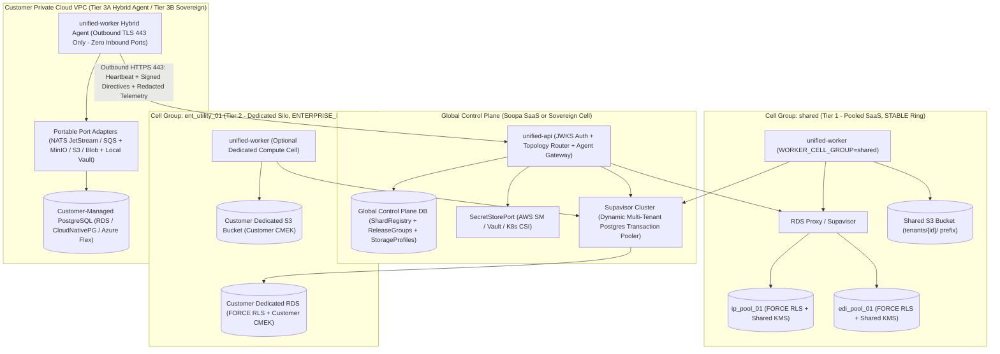
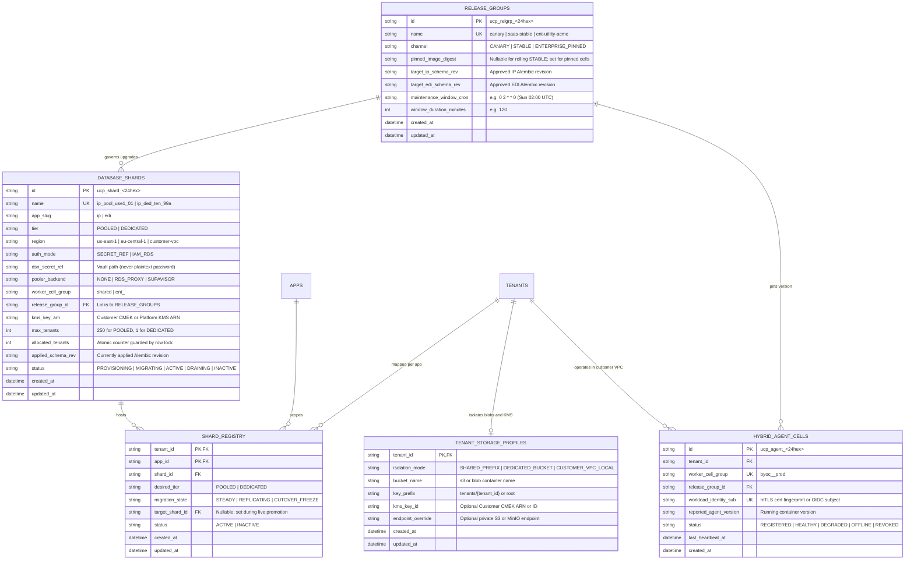
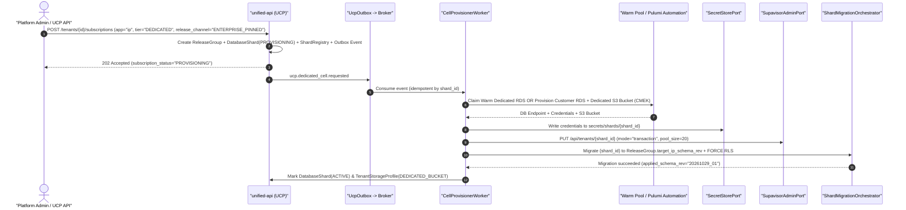
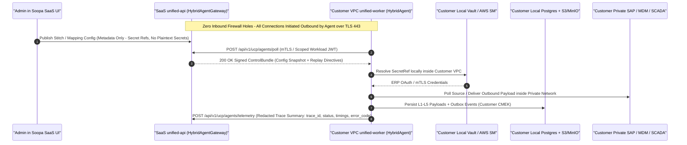

# Enterprise Architecture Design: Hybrid Multi-Tenancy, Database-per-Customer & Private Cloud (BYOC)

- **Document:** Unified Tenancy Continuum & Sovereign Cloud Deployment Specification (`v2.0`)
- **Scope:** `core/platform/packages/{database,outbox,pubsub,storage,secret-store,seedwork}`, `core/ucp`, `core/platform/apps/{unified-api,unified-worker,platform-migrator}`, `apps/{ip,edi}`, `infra/cloud/aws`, and `infra/k8s/charts/soopa-cell`
- **Architecture Style:** Hexagonal Modular Monolith • Cell-Based Topology • Shopify Single-Image Multi-Role Runtime • Control-Plane / Data-Plane Split

---

## 1. Executive Vision & Architectural Invariants

Enterprise integration customers span a wide regulatory spectrum—from fast-moving mid-market teams that expect instant self-serve onboarding, to regulated Energy utilities (NERC-CIP), Healthcare networks (HIPAA), and Financial institutions (PCI-DSS / SOC 2 Type II) that mandate dedicated physical databases, customer-managed encryption keys (CMEK), pinned upgrade maintenance windows, or execution inside their own private cloud VPC.

Rather than maintaining divergent forks for SaaS vs. Enterprise vs. On-Premises, Soopa implements a **Unified 4-Tier Cell & Deployment Continuum** powered by **one single Modular Monolith codebase and container image** ([Dockerfile](../../../Dockerfile)):

| Tier | Tenancy & Deployment Mode | Control Plane (`ucp`, `identity`) | Data Plane (`ip`, `edi` DB + Payloads + KMS) | Compute (`unified-api`, `unified-worker`) | Target Persona |
| :--- | :--- | :--- | :--- | :--- | :--- |
| **Tier 1: Pooled SaaS Cell** | `ShardTier.POOLED` | Shared Soopa SaaS Global DB | Shared regional app shards (`ip_pool_01`, `edi_pool_01`) + **Postgres `FORCE RLS`** + shared S3 prefix | Shared multi-tenant worker fleet (`STABLE` ring) | SMB & Mid-Market (instant `<1s` provisioning, lowest COGS) |
| **Tier 2: Dedicated Silo Cell** | `ShardTier.DEDICATED` | Shared Soopa SaaS Global DB (SSO, PBAC, Billing) | **Dedicated Customer Postgres + Dedicated S3 Bucket + Customer KMS Key (CMEK)** fronted by **Supavisor** | Shared fleet *or* Dedicated Worker Cell (`ENTERPRISE_PINNED` ring optional) | Enterprise SaaS requiring physical data isolation, custom backups & change-freeze windows |
| **Tier 3A: Hybrid BYOC Agent** | `DeploymentTopology.HYBRID_BYOC` | Shared Soopa SaaS UI & Control Plane | **Customer VPC** (Customer RDS/Postgres + Customer S3/Blob + Customer Vault; **zero raw payload transit to SaaS**) | SaaS UI/Control API; **Outbound-Only `unified-worker` Agent** inside Customer VPC | Enterprises integrating private SAP/Oracle/MDM/SCADA without opening inbound firewall ports |
| **Tier 3B: Sovereign Private Cloud** | `DeploymentTopology.SOVEREIGN_CELL` | **100% Customer Private Cloud** (Self-hosted Zitadel + Global DB) | **100% Customer Private Cloud** (Postgres + S3/MinIO/Blob + Vault) | **100% Customer Private Cloud** (AWS ECS Pulumi *or* K8s Helm on EKS/AKS/GKE/OpenShift) | Regulated Utilities (NERC-CIP), Defense, Sovereign Gov, Air-Gapped Data Centers |

---

### 1.1 Open-Source Reference Architecture Lineage (Composite Gold Standard)

No single open-source platform solves pooled RLS efficiency, dynamic database-per-customer pooling, ringed enterprise release governance, and zero-inbound-port private cloud execution on its own. Soopa synthesizes **four best-in-class open-source architectures**, adopting each strictly at the layer where it excels while avoiding its anti-patterns:

| Architectural Layer | Gold-Standard OSS Inspiration | License | Adopted Pattern in Soopa | Deliberately Rejected Anti-Patterns |
| :--- | :--- | :--- | :--- | :--- |
| **Cell Routing & Tenant Mobility** | **GitLab Cells & Topology Service** (`gitlab-org/cells/topology-service`) | `MIT` | Uniform **Cell** abstraction across Pooled Shards and Dedicated Customer Silos routed through an authoritative Topology Registry ([`sharding.py`](../../../core/platform/packages/database/src/database/models/sharding.py) + [`tenant_shard_resolver.py`](../../../core/platform/packages/database/src/database/tenant_shard_resolver.py)) with live `POOLED` $\rightarrow$ `DEDICATED` cutover. | Duplicating the Control Plane per Dedicated SaaS tenant when only Data-Plane isolation is required. |
| **Dynamic Multi-Tenant Connection Pooling** | **Supabase Supavisor** (`supabase/supavisor`) | `Apache-2.0` | Centralized, horizontally scalable Elixir/BEAM Postgres wire-protocol proxy that dynamically registers hundreds of dedicated customer DB pools via API in **Transaction Mode**—avoiding `N` static PgBouncer sidecars or `\$110/mo`-per-tenant RDS Proxies. | Unbounded direct worker-to-Postgres pools (`N shards * M workers`) or static `pgbouncer.ini` file reloads. |
| **Release Rings & Control-Plane Lifecycle** | **Frappe Press** (`frappe/press` — *domain concepts only*) | `AGPLv3` *(study only; zero code reuse)* | First-class Control-Plane state machines for **Release Groups (`CANARY`, `STABLE`, `ENTERPRISE_PINNED`)**, scheduled maintenance windows, backup/restore drills, and one-click tier promotion in [`ucp`](../../../core/ucp/packages/ucp/pyproject.toml). | Frappe's mandatory 1-DB-per-SMB-site model (no pooled RLS tier) and mutable SSH/Ansible Linux VM orchestration (`site_config.json`). |
| **Private Cloud Hybrid Agent & Sovereign K8s** | **Airbyte Hybrid Data Planes** / **Dagster Hybrid Agent** *(3A)* & **CloudNativePG + NATS JetStream + External Secrets** *(3B)* | `ELv2` / `Apache-2.0` | **Tier 3A:** Outbound-only mTLS/JWT customer VPC worker polling signed directives over TLS `443` while keeping secrets and L1–L5 payloads local. **Tier 3B:** Declarative CNCF Kubernetes Operators packaged into one `soopa-cell` Helm chart + Cosign air-gap bundle. | Requiring inbound SSH/VPN tunnels from Soopa SaaS into customer VPCs. |

---

### 1.2 Non-Negotiable Architectural Invariants

> [!IMPORTANT]
> Every module, adapter, and infrastructure stack in this specification strictly enforces nine invariants:

1. **Zero Domain Awareness of Tenancy Tier or Cloud Vendor:** Business use cases and repositories inside [`apps/ip`](../packages/ip/pyproject.toml) and [`apps/edi`](../../edi/packages/edi/pyproject.toml) must **never** branch on `if tenant.is_dedicated:` or `if cloud == "azure":`. Routing to a pooled shard, a dedicated customer RDS instance, or an on-prem PostgreSQL cluster is 100% transparent behind [`DatabaseRouterPort`](../../../core/platform/packages/database/src/database/router.py) and [`PayloadStoragePort`](../../../core/platform/packages/storage/src/storage/ports/payload_storage_port.py).
2. **Zero Plaintext Database Credentials in Metadata Tables:** `ucp.database_shards` must never store plaintext passwords or credential-bearing DSNs. Shards store an immutable `dsn_secret_ref` resolved via [`SecretStorePort`](../../../core/platform/packages/secret-store/src/secret_store/ports/secret_store_port.py) (or short-lived IAM RDS auth tokens).
3. **Defense-in-Depth Row-Level Security (Even on Dedicated Shards):** PostgreSQL `ENABLE` + `FORCE ROW LEVEL SECURITY` (`platform.current_tenant_id`) is enforced on **both** `POOLED` and `DEDICATED` Data-Plane databases. Even if a routing bug ever pointed Tenant A at Tenant B's dedicated database, PostgreSQL cryptographically returns zero rows.
4. **Bounded Connection Pools & Dynamic Transaction Multiplexing:** Worker containers enforce **Ref-Counted LRU + Idle-TTL Engine Eviction** paired with **`Supavisor` / `RDS Proxy` Transaction Pooling**, preventing `AsyncEngine` exhaustion across hundreds of dedicated customer databases.
5. **Full Data-Plane Silo Completeness (`DB + Blob + Secrets + KMS`):** "Database-per-customer" must never leak `>64 KB` offloaded payloads into a shared S3 bucket encrypted with a shared key. Dedicated isolation encompasses **PostgreSQL + Object Storage + KMS Key (CMEK)** as an atomic `TenantCell`.
6. **Expand-and-Contract Schema Compatibility Across Release Rings:** Because `ENTERPRISE_PINNED` cells may lag `STABLE` SaaS by one minor release until their approved maintenance window, all Data-Plane Alembic migrations strictly follow **Expand $\rightarrow$ Migrate Code $\rightarrow$ Contract** (additive non-breaking DDL first; destructive column drops deferred until no active `ReleaseGroup` pins the prior version).
7. **Zero Raw Payload Transit in Hybrid BYOC (`Tier 3A`):** Customer VPC agents exchange only **signed control directives** and **redacted execution telemetry** (`trace_id`, `status`, `stage_timings`, error codes) with the SaaS Control Plane—raw business records and vault secrets never leave the customer VPC.
8. **First-Class Error Handling (`Result<T, E>`) & Co-Located CQRS DTOs:** Shard resolution, capacity exhaustion, maintenance freezes, and vault lookups return strongly-typed `Result` objects rather than raising procedural exceptions, with frozen `@dataclass` Commands co-located inside their handling Use Cases.
9. **Zero Unbounded SQL Mutations:** Online tenant promotion (`POOLED` $\rightarrow$ `DEDICATED`) and post-cutover source shard cleanup strictly execute in chunked loops (`LIMIT 1000` + `commit()` + `await asyncio.sleep(0.1)`) so live pooled tenants experience zero lock contention or autovacuum starvation.

---

## 2. Current-State Baseline & Gap Matrix

An audit of the monorepo confirms that ~75% of the core runtime abstractions already exist, with seven targeted gaps to close:

| Subsystem | Existing Implementation | Current Gap | Target Remediation |
| :--- | :--- | :--- | :--- |
| **Shard Metadata & Security** | [`sharding.py`](../../../core/platform/packages/database/src/database/models/sharding.py) defines `DatabaseShard` & `ShardRegistry` | Stores plaintext `dsn: String(1024)`; lacks `tier`, `app_slug`, `region`, `max_tenants`, `kms_key_arn`, `pooler_backend`, `release_group_id` | Replace `dsn` with `dsn_secret_ref` + capacity, CMEK, `Supavisor`, and `ReleaseGroup` metadata |
| **Shard Allocation on Subscribe** | [`app_subscription_manager.py`](../../../core/ucp/packages/ucp/src/ucp/application/use_cases/app_subscription_manager.py#L59-L61) | Hardcodes `shard_id = "edi_shard_1"` for every subscription | Inject polymorphic `ShardAllocationStrategyPort` (`LeastLoadedPooledStrategy` vs. `DedicatedCellStrategy`) |
| **Engine Pool & Multiplexing** | [`router.py`](../../../core/platform/packages/database/src/database/router.py#L71) `self._engines: dict[str, AsyncEngine]` | Never evicts idle shard engines; no multi-tenant pooler (`Supavisor`) registration | Add ref-counted `BoundedLruEngineRegistry` + `SupavisorAdminPort` transaction-pool integration |
| **Offloaded Payload Storage** | [`s3_storage_adapter.py`](../../../core/platform/packages/storage/src/storage/adapters/s3_storage_adapter.py) | Single global `self.bucket`; no per-tenant bucket or customer KMS key (`SSEKMSKeyId`) override | Add `TenantAwarePayloadStorageRouter` + `TenantStorageProfile` supporting dedicated buckets & CMEK |
| **Ringed Multi-Shard Migrations** | [`cli.py`](../../../core/platform/apps/platform-migrator/src/platform_migrator/cli.py) | Migrates `global_db`; lacks concurrent shard fan-out or `ReleaseGroup` ring filtering | Add `ShardMigrationOrchestrator` (`--scope shards --app ip --channel STABLE --concurrency 8`) |
| **Hybrid BYOC Control Channel** | [`registry.py`](../../../core/platform/apps/unified-worker/src/unified_worker/registry.py) modular worker runtime | Assumes direct SQL/SQS connectivity to Control Plane | Add `HybridAgentGateway` (`ucp`) + outbound-only TLS `443` `ControlPlaneAgentClient` for Tier 3A |
| **Multi-Cloud / K8s Portability** | [`infra/cloud/aws/README.md`](../../../infra/cloud/aws/README.md), `pubsub/aws`, `secret-store/aws` | Concrete adapters & IaC target AWS ECS + SQS + Secrets Manager | Add `NATS JetStream`, `HashiCorp Vault`, `K8s CSI` adapters + universal `soopa-cell` Helm v3 Chart |

---

## 3. Unified Architecture & Data Model Specification

### 3.1 Multi-Tier Cell Topology



---

### 3.2 Control-Plane Topology & Release Ring Schema (`core/platform/packages/database`)



---

### 3.3 Strongly-Typed Enums & Boundary Contracts

Per our **Co-Located CQRS Standard** and **First-Class Error Handling (`Result<T, E>`)**, semantic constants live in `constants.py`, shared read responses live in `responses.py`, and write `Command` dataclasses are co-located directly inside their handling Use Case files—with zero `Any`, zero `# type: ignore`, and zero ORM leakage:

```python
# core/platform/packages/database/src/database/constants.py
from enum import StrEnum


class ShardTier(StrEnum):
    POOLED = "POOLED"
    DEDICATED = "DEDICATED"


class ShardAuthMode(StrEnum):
    SECRET_REF = "SECRET_REF"
    IAM_RDS = "IAM_RDS"


class PoolerBackend(StrEnum):
    NONE = "NONE"
    RDS_PROXY = "RDS_PROXY"
    SUPAVISOR = "SUPAVISOR"


class ReleaseChannel(StrEnum):
    CANARY = "CANARY"
    STABLE = "STABLE"
    ENTERPRISE_PINNED = "ENTERPRISE_PINNED"


class DatabaseShardLifecycleStatus(StrEnum):
    PROVISIONING = "PROVISIONING"
    MIGRATING = "MIGRATING"
    ACTIVE = "ACTIVE"
    DRAINING = "DRAINING"
    INACTIVE = "INACTIVE"


class StorageIsolationMode(StrEnum):
    SHARED_PREFIX = "SHARED_PREFIX"
    DEDICATED_BUCKET = "DEDICATED_BUCKET"
    CUSTOMER_VPC_LOCAL = "CUSTOMER_VPC_LOCAL"


class ShardRoutingErrorCode(StrEnum):
    TENANT_SHARD_NOT_FOUND = "TENANT_SHARD_NOT_FOUND"
    SHARD_MAINTENANCE_FREEZE = "SHARD_MAINTENANCE_FREEZE"
    POOLED_CAPACITY_EXHAUSTED = "POOLED_CAPACITY_EXHAUSTED"
    DEDICATED_SHARD_NOT_READY = "DEDICATED_SHARD_NOT_READY"
    ISOLATION_INVARIANT_VIOLATION = "ISOLATION_INVARIANT_VIOLATION"
    SECRET_RESOLUTION_FAILED = "SECRET_RESOLUTION_FAILED"
```

```python
# core/platform/packages/database/src/database/responses.py
from dataclasses import dataclass
from database.constants import (
    DatabaseShardLifecycleStatus,
    PoolerBackend,
    ReleaseChannel,
    ShardAuthMode,
    ShardRoutingErrorCode,
    ShardTier,
)


@dataclass(frozen=True, kw_only=True)
class ShardRoutingProblem:
    code: ShardRoutingErrorCode
    message: str
    tenant_id: str
    app_slug: str
    retry_after_seconds: int | None = None


@dataclass(frozen=True, kw_only=True)
class DatabaseShardSummary:
    id: str
    name: str
    app_slug: str
    tier: ShardTier
    region: str
    auth_mode: ShardAuthMode
    dsn_secret_ref: str
    pooler_backend: PoolerBackend
    worker_cell_group: str
    release_group_id: str
    release_channel: ReleaseChannel
    kms_key_arn: str | None
    max_tenants: int
    allocated_tenants: int
    applied_schema_rev: str | None
    status: DatabaseShardLifecycleStatus


@dataclass(frozen=True, kw_only=True)
class ResolvedShardConnection:
    shard_id: str
    shard_name: str
    tier: ShardTier
    dsn: str
    pooler_backend: PoolerBackend
    worker_cell_group: str

    @property
    def uses_transaction_multiplexing(self) -> bool:
        return self.pooler_backend in (PoolerBackend.RDS_PROXY, PoolerBackend.SUPAVISOR)
```

---

## 4. Pillar 1: Hybrid Multi-Tenancy & Dynamic Connection Pool Engineering

### 4.1 Polymorphic Shard Allocation Strategy (Replacing Hardcoded `edi_shard_1`)

Instead of hardcoding `shard_id = "edi_shard_1"` inside [`app_subscription_manager.py`](../../../core/ucp/packages/ucp/src/ucp/application/use_cases/app_subscription_manager.py#L60), `SubscribeAppCommand` accepts `desired_tier: ShardTier = ShardTier.POOLED` and `preferred_region: str`, delegating placement to an injected `ShardAllocationStrategyPort`:

```python
from typing import Protocol
from database.responses import DatabaseShardSummary, ShardRoutingProblem
from seedwork.result import Result


class ShardAllocationStrategyPort(Protocol):
    """Strategy port assigning a tenant+app subscription to an isolated or pooled physical cell."""

    async def allocate(
        self,
        tenant_id: str,
        app_id: str,
        app_slug: str,
        region: str,
    ) -> Result[DatabaseShardSummary, ShardRoutingProblem]: ...
```

- **`LeastLoadedPooledShardStrategy` (`ShardTier.POOLED`):**
  Executes an atomic SQL query selecting the `ACTIVE` `POOLED` shard in `ReleaseChannel.STABLE` for `(app_slug, region)` with the lowest `allocated_tenants / max_tenants` ratio where `allocated_tenants < max_tenants` using `FOR UPDATE SKIP LOCKED`, increments `allocated_tenants = allocated_tenants + 1`, and inserts the `ShardRegistry` row inside the same UCP Unit of Work. If all regional pooled shards are full, returns `Result.err(ShardRoutingProblem(code=POOLED_CAPACITY_EXHAUSTED, ...))` and logs `logger.error("shard_pool_capacity_exhausted", app_slug=app_slug, region=region)`.
- **`PreWarmOrDedicatedShardStrategy` (`ShardTier.DEDICATED`):**
  Claims a pre-warmed unallocated `DEDICATED` cell (`max_tenants == 1 AND allocated_tenants == 0`) from the standby pool for `<5s` enterprise onboarding, **or** creates a `PROVISIONING` `DatabaseShard` bound to the customer's `ReleaseGroup` and emits `DedicatedShardProvisioningRequestedEvent` via `UcpOutbox`. A database `CHECK (tier != 'DEDICATED' OR max_tenants = 1)` constraint mathematically prevents two tenants from ever sharing a `DEDICATED` shard.

---

### 4.2 Connection Pool Mathematics: `Supavisor` + `BoundedLruEngineRegistry`

> [!WARNING]
> **The Two Failure Modes of Multi-Database SaaS:**
> 1. **Direct Worker Connection Explosion:** With `125` shards (`5` pooled + `120` dedicated) across `16` worker/API containers (`pool_size=10, max_overflow=20`), an unbounded `dict[str, AsyncEngine]` opens up to $125 \times 16 \times 30 = 60{,}000$ PostgreSQL backends—crashing dedicated RDS instances (`max_connections ~ 400`).
> 2. **Per-Tenant Proxy Cost Explosion:** Provisioning a dedicated AWS RDS Proxy (`~\$110/mo` minimum) or static sidecar `PgBouncer` deployment for each of `200` dedicated customer databases wastes `\$22,000+/mo` in idle proxy infrastructure and requires config reloads on every onboarding.

We eliminate both failure modes using **three coordinated layers** inspired by **Supabase `Supavisor`**:

1. **Centralized Multi-Tenant Transaction Pooler (`Supavisor` — `PoolerBackend.SUPAVISOR`):**
   - A stateless 2-node `Supavisor` cluster sits between `unified-api` / `unified-worker` and all Tier-2 `DEDICATED` customer PostgreSQL instances.
   - When `CellProvisionerWorker` activates a new `DEDICATED` shard (`ucp_shard_99a`), it invokes `SupavisorAdminPort.upsert_tenant_pool(...)` (`PUT /api/tenants/ucp_shard_99a`) configuring `mode_type="transaction"`, `default_pool_size=20`, and upstream TLS verification—**zero proxy restarts, zero static config files, and zero idle Postgres connections when the tenant is quiet**.
   - Application containers connect through `Supavisor` routing username `postgres.ucp_shard_99a` with `prepared_statement_cache_size=0` and lightweight local pools (`pool_size=2, max_overflow=4`).
   - Because [`router.py`](../../../core/platform/packages/database/src/database/router.py#L164) sets `SELECT set_config('platform.current_tenant_id', :tenant_id, true)` (`is_local = true`), RLS state resets automatically on every `COMMIT`/`ROLLBACK`—making `Supavisor` transaction mode **100% RLS-safe**.
2. **Ref-Counted `BoundedLruEngineRegistry` inside `DatabaseRouter`:**
   - Enforces `max_cached_shard_engines: int = 32` and `idle_engine_ttl_secs: int = 300` per Python process.
   - Tracks `active_checkouts: int` and `last_used_monotonic: float` per `shard_id`.
   - Evicts and calls `await engine.dispose()` only when `active_checkouts == 0`, guaranteeing zero mid-transaction disconnects while bounding Python memory and socket descriptors regardless of whether Soopa hosts `50` or `5,000` dedicated databases.
3. **Worker Cell Partitioning (`WORKER_CELL_GROUP`):**
   - [`multi_shard_outbox_drain_relay.py`](../../../core/platform/packages/outbox/src/outbox/adapters/inbound/multi_shard_outbox_drain_relay.py) and Data-Plane sweepers filter shards by `worker_cell_group == settings.worker_cell_group`.
   - High-volume enterprise customers (e.g., an electric utility ingesting 10M AMI meter reads/hour) receive an isolated `worker_cell_group="ent_utility_01"` so compute, queue polling, and DB pools have **zero noisy-neighbor overlap** with shared SaaS tenants.

---

## 5. Pillar 2: Database, Storage, KMS & Release-Ring Lifecycle

### 5.1 Complete Data Silo (`DB + Object Storage + Customer CMEK`)

True compliance isolation isolates **every byte of customer payload**, not just SQL tables:

- **Vault-Backed Shard DSNs (`CachingSecretShardResolver`):**
  [`tenant_shard_resolver.py`](../../../core/platform/packages/database/src/database/tenant_shard_resolver.py) joins `ShardRegistry` $\rightarrow$ `DatabaseShard`, resolves credentials via `SecretStorePort.get_secret(shard.dsn_secret_ref)` (5-minute in-memory TTL with instant auth-failure invalidation for zero-downtime secret rotation), and returns `Result[ResolvedShardConnection, ShardRoutingProblem]`.
- **Tenant-Scoped Object Storage & Customer CMEK (`TenantAwarePayloadStorageRouter`):**
  Implements [`payload_storage_port.py`](../../../core/platform/packages/storage/src/storage/ports/payload_storage_port.py) transparently for `strace`, `ip`, and `edi`:
  - **Self-Describing Multi-Bucket URIs:** `s3://{profile.bucket_name}/{profile.key_prefix}/inbound/{message_id}.bin` (replacing the single-bucket assumption in [`s3_storage_adapter.py`](../../../core/platform/packages/storage/src/storage/adapters/s3_storage_adapter.py#L45)).
  - **Cryptographic Kill-Switch (`SSE-KMS` BYOK):** When `profile.kms_key_id` is present, all object writes inject `ServerSideEncryption="aws:kms"` and `SSEKMSKeyId=profile.kms_key_id`. Revoking the customer's KMS grant renders both their dedicated RDS storage and offloaded L1–L5 payloads cryptographically unreadable within minutes.

---

### 5.2 Automated Dedicated Cell Provisioning Workflow



---

### 5.3 Release Rings & Enterprise Maintenance Windows (`ReleaseGroup` — Frappe Press Pattern)

Enterprise compliance customers (utilities during storm freeze, retail EDI during peak season, audited banks) cannot tolerate unannounced midday schema changes or worker restarts. Borrowing the **Release Group** concept from Frappe Press, every `DatabaseShard` and `HybridAgentCell` belongs to one of three rings:

| Ring (`ReleaseChannel`) | Target Cells | Schema & Worker Rollout Policy |
| :--- | :--- | :--- |
| **`CANARY`** | Internal dogfooding tenants + `ip_pool_canary_01` | Migrated and deployed automatically first on every `main` release pipeline; soaked with synthetic L1–L5 traffic before promoting `STABLE`. |
| **`STABLE`** | All standard `POOLED` shards + standard `DEDICATED` shards | Migrated automatically during standard CI/CD deployment via `platform-migrator migrate --scope shards --channel STABLE`. |
| **`ENTERPRISE_PINNED`** | Regulated `DEDICATED` cells + Tier 3A `HYBRID_BYOC` cells | Skipped during routine `STABLE` deploys. `ReleaseWindowScheduler` in `scheduler-worker` evaluates `maintenance_window_cron` (or manual admin promotion in `ucp`) to advance `target_*_schema_rev`, trigger `ShardMigrationOrchestrator --release-group <id>`, and roll the cell's pinned worker deployment. |

```bash
# 1. Migrate Global Control Plane DB
python -m platform_migrator migrate --scope global

# 2. Canary Gate (blocks pipeline on any failure)
python -m platform_migrator migrate --scope shards --app ip --channel CANARY --strict-all

# 3. General SaaS Rollout (advisory-locked per shard, skips ENTERPRISE_PINNED cells)
python -m platform_migrator migrate --scope shards --app ip --channel STABLE --concurrency 8
python -m platform_migrator migrate --scope shards --app edi --channel STABLE --concurrency 8

# 4. Scheduled Maintenance Window Upgrade for a Pinned Enterprise Cell
python -m platform_migrator migrate --scope shards --release-group ucp_relgrp_acme_prod --strict-all
```

- **Per-Shard Advisory Lock & Bulkhead:** `ShardMigrationOrchestrator` acquires `pg_try_advisory_lock(hashtext('soopa_migrator_' || app_slug))` per database and isolates transient network failures on peered customer shards without halting healthy shards.
- **Expand/Contract Enforcement:** Shared `unified-api` stateless pods stay backward-compatible with `N-1` pinned shard schemas by strictly separating additive migrations (*Expand*) from legacy column removals (*Contract*, gated in CI until zero `DATABASE_SHARDS` report an older `applied_schema_rev`).

---

### 5.4 Zero-Downtime Online Promotion (`POOLED` $\rightarrow$ `DEDICATED` — GitLab Cell Mover Pattern)

Moving a live tenant from `ShardTier.POOLED` to `ShardTier.DEDICATED` follows a deterministic **5-Phase Online Cutover Protocol**:

1. **Phase 1 — Provision & Prepare Target Cell:** Provision `ip_ded_cust_acme`, register its `Supavisor` pool, apply matching `applied_schema_rev` + `FORCE RLS`, and set `ShardRegistry.target_shard_id = ip_ded_cust_acme.id`, `migration_state = REPLICATING`.
2. **Phase 2 — Keyset-Chunked Online Backfill (`0ms` Downtime):** Copy rows `WHERE tenant_id = :tid` from the source pooled shard in keyset-paginated batches (`LIMIT 1000`), copy S3 blobs from the shared prefix into the customer's CMEK bucket, and rewrite `storage_uri` on the target copy.
3. **Phase 3 — Brief Write Freeze (`<2 Seconds`):** Set `migration_state = CUTOVER_FREEZE`. `TenantShardResolver` returns `Result.err(ShardRoutingProblem(code=SHARD_MAINTENANCE_FREEZE, retry_after_seconds=2))` (HTTP `503` with `Retry-After: 2`; queue consumers NACK with `2s` visibility delay—zero data loss).
4. **Phase 4 — Final Delta Sync & Atomic Topology Swap:** Copy remaining rows written since Phase 2 watermark, atomically swap `ShardRegistry.shard_id = target_shard_id, migration_state = STEADY`, decrement source `allocated_tenants`, and emit `tenant.shard_cutover.completed` to invalidate resolver caches across all pods.
5. **Phase 5 — Chunked Source Purge (Post-Verification Window):** After a 24-hour verification window, purge old pooled rows strictly in chunked batches (`DELETE ... WHERE ctid IN (SELECT ctid FROM ... WHERE tenant_id = :tid LIMIT 1000)` + `commit()` + `await asyncio.sleep(0.1)`).

---

## 6. Pillar 3: Customer Private Cloud (BYOC) & Multi-Cloud Sovereign Architecture

### 6.1 Choosing Between the Two Private Cloud Modes

| Dimension | Mode 3A: Hybrid BYOC Data-Plane Agent | Mode 3B: Autonomous Sovereign Cell |
| :--- | :--- | :--- |
| **Control Plane & Admin UI** | Hosted by Soopa SaaS (`dashboard.soopa.io`) | Hosted 100% inside Customer VPC (`soopa.internal.corp`) |
| **Data Plane DB, Queues & Payloads** | **100% inside Customer VPC** (raw payloads & secrets never leave customer network) | **100% inside Customer VPC** (zero external network dependency) |
| **Inbound Firewall Rules Required** | **Zero inbound ports** (outbound TLS `443` only) | Customer-owned internal Ingress / Private ALB |
| **Air-Gapped / Disconnected Operation** | No (requires outbound HTTPS `443` to Soopa Control Plane) | **Yes — 100% Air-Gap Capable** (bundled Zitadel + OpenObserve) |
| **Best Fit** | Enterprises integrating private ERP/MDM/Databases wanting SaaS UI + local data residency | Regulated Electric Utilities (NERC-CIP), Defense, Sovereign Gov, Air-Gapped Data Centers |

---

### 6.2 Mode 3A Specification: Outbound-Only Hybrid BYOC Agent Protocol (Airbyte / Dagster Pattern)

In **Mode 3A**, the customer designs flows, mappings, stitches, and RBAC policies in Soopa's SaaS UI, while **all connector credentials, database connections, inbound webhooks/files, transformations, and L1–L5 payloads remain strictly inside the customer's VPC**.



1. **Cryptographic Enrollment & Workload Identity:**
   - Admin registers a `HybridAgentCell` in `ucp` and receives a single-use enrollment token (`ttl=15m`).
   - On first boot inside the customer's EKS/AKS/ECS cluster, `unified-worker` exchanges the enrollment token over TLS `443` for a short-lived asymmetric workload credential bound strictly to `(tenant_id, worker_cell_group)`—incapable of reading any other tenant's metadata.
2. **Signed Control Directives (Config Pull):**
   - `HybridAgentSyncLoop` long-polls `POST /api/v1/ucp/agents/poll` every `15s`, sending health metrics (`reported_agent_version`, `applied_schema_rev`, queue lag) and pulling immutable versioned snapshots of flow/mapping/stitch definitions plus control commands (e.g., `ReplayTraceDirective` referencing a local `trace_id`).
3. **Strict Data-Residency Boundary (Redacted Telemetry Push):**
   - Raw request/response bodies (`L1`–`L5`) stay in `LocalDB` + customer S3/MinIO (`StorageIsolationMode.CUSTOMER_VPC_LOCAL`).
   - Only non-sensitive operational metadata (`trace_id`, `correlation_key_hash`, `stage`, `status`, `duration_ms`, `error_code`) is emitted back to SaaS so operators see real-time health dashboards without exposing regulated customer data.

---

### 6.3 Cloud-Agnostic Infrastructure Adapter Matrix (Zero Domain Coupling)

All infrastructure dependencies sit behind Hexagonal Ports in `core/platform/packages/*`. Supporting AWS, Azure, GCP, and Air-Gapped Kubernetes requires **only** concrete outbound adapters wired in the Composition Root:

| Capability Package | Abstract Hexagonal Port | AWS Native Profile (`aws`) | Portable Kubernetes / Air-Gap Profile (`k8s_oss`) | Azure Private Cloud (`azure`) | GCP Private Cloud (`gcp`) |
| :--- | :--- | :--- | :--- | :--- | :--- |
| **`database`** | [`router.py`](../../../core/platform/packages/database/src/database/router.py) (`DatabaseRouterPort`) | Amazon RDS / Aurora + **Supavisor** / RDS Proxy | **CloudNativePG** + **Supavisor** / PgBouncer | Azure PostgreSQL Flexible Server + Supavisor | Cloud SQL / AlloyDB + Supavisor |
| **`pubsub`** | [`message_consumer_port.py`](../../../core/platform/packages/pubsub/src/pubsub/ports/message_consumer_port.py) + `EventPublisherPort` | `AwsSnsPublisher` + `AwsSqsConsumer` *(Existing)* | **`NatsJetStreamAdapter`** *(single-binary CNCF broker: FIFO, Ack/Nack, DLQ)* | `AzureServiceBusAdapter` *(or `k8s_oss` on AKS)* | `GcpPubSubAdapter` *(or `k8s_oss` on GKE)* |
| **`storage`** | [`payload_storage_port.py`](../../../core/platform/packages/storage/src/storage/ports/payload_storage_port.py) | `Aioboto3PayloadStorage` *(Existing)* | **`Aioboto3PayloadStorage` + MinIO / Ceph RGW** *(via `endpoint_url`)* | `AzureBlobPayloadStorage` | `GcsPayloadStorage` |
| **`secret-store`** | [`secret_store_port.py`](../../../core/platform/packages/secret-store/src/secret_store/ports/secret_store_port.py) | `AwsSecretsManagerAdapter` *(Existing)* | **`HashiCorpVaultAdapter`** + **`K8sMountedCsiSecretAdapter`** (`/mnt/secrets`) | `AzureKeyVaultAdapter` *(or External Secrets CSI)* | `GcpSecretManagerAdapter` *(or External Secrets CSI)* |
| **`identity`** | [`token_verifier_port.py`](../../../core/platform/packages/identity/src/identity/ports/outbound/token_verifier_port.py) | Self-hosted **Zitadel** on ECS *(Existing)* | Self-hosted **Zitadel** Helm subchart *(or customer Okta / Entra ID OIDC JWKS)* | Zitadel on AKS *or* Microsoft Entra ID OIDC | Zitadel on GKE *or* Google Cloud Identity OIDC |
| **`observability`** | `OTLP Exporter` + `structlog` JSON | **OpenObserve** on ECS / CloudWatch *(Existing)* | **OpenObserve** Helm subchart *(or customer Datadog / Grafana Tempo OTLP)* | OpenObserve *or* Azure Monitor OTLP | OpenObserve *or* Cloud Trace OTLP |

> [!TIP]
> **Strategic Leverage of `k8s_oss` First:** Building the **`k8s_oss` Portable Profile (`CloudNativePG + Supavisor + NATS JetStream + MinIO S3 + Vault/External-Secrets CSI`)** unlocks **AWS EKS, Azure AKS, GCP GKE, Red Hat OpenShift, and Air-Gapped Bare-Metal** in one shot—with zero cloud-vendor lock-in.

---

### 6.4 Composition Root Wiring & IaC Injection Standard

Per `AGENTS.md` (**IaC Injection — Zero Dynamic Resource Discovery** and **Zero Adapter-to-Adapter Coupling**), applications never call cloud discovery APIs at runtime (`sqs:GetQueueUrl`, Kubernetes API, etc.). Pulumi or Helm injects explicit endpoints into `settings.py`, and each package's `provider.py` instantiates the concrete adapter:

```python
# core/platform/packages/pubsub/src/pubsub/provider.py
from enum import StrEnum
from pubsub.ports.message_consumer_port import MessageConsumerPort


class PubSubBackend(StrEnum):
    AWS_SQS = "aws_sqs"
    NATS_JETSTREAM = "nats_jetstream"
    RABBITMQ = "rabbitmq"


def create_message_consumer(settings: PubSubConsumerSettings) -> MessageConsumerPort:
    """Composition-root factory selecting the broker adapter strictly from IaC-injected env vars."""
    match settings.backend:
        case PubSubBackend.AWS_SQS:
            return AwsSqsConsumer(queue_url=settings.queue_url, region=settings.aws_region)
        case PubSubBackend.NATS_JETSTREAM:
            return NatsJetStreamConsumer(
                servers=settings.nats_servers,
                stream_name=settings.stream_name,
                durable_consumer_name=settings.consumer_group,
                ack_wait_seconds=settings.visibility_timeout_seconds,
            )
        case PubSubBackend.RABBITMQ:
            return RabbitMqConsumer(
                amqp_url=settings.amqp_url,
                queue_name=settings.queue_url,
                prefetch_count=settings.max_concurrency,
            )
```

---

### 6.5 Enterprise Private Cloud Packaging (`Pulumi` + `Helm` + `Cosign Air-Gap Bundle`)

1. **AWS Private Cloud Cell (`infra/cloud/aws/customer-cell/`):**
   Parameterized Pulumi stack deploying into a new VPC or customer-supplied `existing_vpc_id` / private subnets with RDS Multi-AZ + Customer CMEK, Private ALB + AWS PrivateLink, Zitadel, OpenObserve, and ECS Fargate roles (`ENABLED_APPS=["ip", "edi"]`).
2. **Universal Kubernetes Cell (`infra/k8s/charts/soopa-cell/`):**
   Single Helm v3 chart supporting two profiles (`values-hybrid-agent.yaml` for Tier 3A; `values-sovereign-cell.yaml` for Tier 3B):
   - `soopa-migrator` (`helm.sh/hook: pre-install,pre-upgrade` Job running `platform-migrator migrate`)
   - `soopa-unified-api` (`HPA`, readiness/liveness probes, `PodDisruptionBudget`, zero-trust `NetworkPolicy`)
   - `soopa-unified-worker-realtime` & `soopa-unified-worker-bulk` (KEDA `ScaledObject` scaling on SQS or NATS JetStream lag)
   - `soopa-scheduler-worker` (singleton leader-elected `Deployment`)
   - `soopa-dashboard` (immutable non-root SPA container)
   - Optional CNCF subcharts toggled via `values.yaml`: `cloudnative-pg`, `supavisor`, `nats`, `minio`, `external-secrets`, `zitadel`, `openobserve`.
3. **Signed Air-Gapped Release Bundle (`Zarf` / OCI Tarball):**
   CI signs container digests with **Cosign**, attaches **CycloneDX SBOMs** + **Trivy CVE attestations**, and produces a single offline bundle (`soopa-enterprise-vX.Y.Z-airgap.tar.zst`) for customer Harbor / Artifactory / ECR mirroring.

---

## 7. Standardized Monorepo File Taxonomy

All modules adhere strictly to our **Co-Located CQRS Standard** (frozen `@dataclass` Commands co-located inside each Use Case file; shared read projections in `responses.py` / `queries.py`):

```text
core/platform/packages/
├── database/src/database/
│   ├── constants.py                                # ShardTier, PoolerBackend, ReleaseChannel, ShardRoutingErrorCode
│   ├── responses.py                                # DatabaseShardSummary, ResolvedShardConnection, ShardRoutingProblem
│   ├── engine_registry.py                          # BoundedLruEngineRegistry (LRU + idle TTL + active checkout ref-counting)
│   ├── ports/
│   │   └── pooler_admin_port.py                    # SupavisorAdminPort for dynamic tenant pool lifecycle
│   ├── adapters/
│   │   └── supavisor_http_adapter.py               # Uses platform shttp to register/remove tenant pools in Supavisor
│   ├── models/
│   │   ├── sharding.py                             # ReleaseGroup, DatabaseShard, ShardRegistry, HybridAgentCell
│   │   └── storage_profiles.py                     # TenantStorageProfile ORM model
│   ├── router.py                                   # DatabaseRouterPort + DatabaseRouter (Supavisor/RDS Proxy + FORCE RLS)
│   └── tenant_shard_resolver.py                    # Vault-backed CachingTenantShardResolver returning Result<...>
├── storage/src/storage/
│   ├── constants.py                                # StorageIsolationMode
│   ├── responses.py                                # TenantStorageProfileSummary
│   ├── ports/
│   │   ├── payload_storage_port.py                 # Existing PayloadStoragePort
│   │   └── storage_profile_resolver_port.py        # Port resolving per-tenant bucket/prefix/CMEK
│   └── adapters/
│       ├── s3_storage_adapter.py                   # Multi-bucket URI parsing + SSE-KMS CMEK support
│       └── tenant_aware_storage_router.py          # Routes POOLED vs DEDICATED_BUCKET vs CUSTOMER_VPC_LOCAL
├── secret-store/src/secret_store/adapters/
│   ├── aws_secrets_manager.py                      # Existing AWS Secrets Manager adapter
│   ├── hashicorp_vault_adapter.py                  # AppRole / K8s-Auth KV-v2 adapter (via platform shttp)
│   └── k8s_mounted_secret_adapter.py               # Pure /mnt/secrets CSI SecretProviderClass adapter
└── pubsub/src/pubsub/
    ├── provider.py                                 # Backend-agnostic factory (aws_sqs | nats_jetstream | rabbitmq)
    ├── aws/                                        # Existing AWS SNS/SQS adapters
    └── nats/                                       # Portable NATS JetStream publisher & Ack/Nack consumer

core/ucp/packages/ucp/src/ucp/
├── application/
│   ├── responses/sharding_responses.py             # CellTopologyView, ReleaseGroupView, HybridAgentHealthView
│   └── use_cases/
│       ├── app_subscription_manager.py             # Wired to ShardAllocationStrategyPort (removes hardcoded edi_shard_1)
│       ├── sharding/
│       │   ├── allocate_tenant_shard_use_case.py   # Co-locates AllocateTenantShardCommand
│       │   ├── promote_tenant_cell_use_case.py     # Co-locates PromoteTenantCellCommand (5-phase live cutover)
│       │   └── manage_release_group_use_case.py    # Co-locates AssignReleaseGroupCommand & TriggerPinnedUpgradeCommand
│       └── hybrid_agent/
│           ├── enroll_hybrid_agent_use_case.py     # Co-locates EnrollHybridAgentCommand
│           └── poll_agent_directives_use_case.py   # Co-locates PollAgentDirectivesCommand & IngestRedactedTelemetryCommand
└── adapters/outbound/database/
    └── shard_allocation_strategies.py              # LeastLoadedPooledShardStrategy & PreWarmOrDedicatedShardStrategy

core/platform/apps/platform-migrator/src/platform_migrator/
└── runners/
    └── shard_migration_orchestrator.py             # Concurrent advisory-locked, ReleaseChannel-aware shard migrator

infra/
├── cloud/aws/
│   ├── data/dedicated_tenant_cell.py               # Reusable Pulumi ComponentResource (Customer RDS + S3 + CMEK + Supavisor)
│   └── customer-cell/                              # Single-tenant BYOC AWS VPC Pulumi stack
└── k8s/charts/soopa-cell/                          # Universal Helm v3 chart (EKS, AKS, GKE, OpenShift, Air-Gap)
    ├── Chart.yaml
    ├── values.yaml                                 # Base defaults
    ├── values-hybrid-agent.yaml                    # Tier 3A outbound-only customer VPC worker profile
    ├── values-sovereign-cell.yaml                  # Tier 3B full autonomous private cloud profile
    └── templates/
```

---

## 8. Phased Implementation Roadmap & Verification Strategy

### 8.1 Delivery Phases

| Phase | Scope | Key Deliverables |
| :--- | :--- | :--- |
| **Phase 1: Hybrid Cell Topology, `Supavisor` & Vault-Backed Routing** | `database`, `ucp`, `secret-store` | Evolve `DatabaseShard` (`dsn_secret_ref`, `tier`, `pooler_backend`, `release_group_id`), implement `BoundedLruEngineRegistry` + `SupavisorHttpAdapter` (using platform `shttp`), and wire `ShardAllocationStrategyPort` into `AppSubscriptionManager`. |
| **Phase 2: Full Customer Data Silo (`DB + S3 + CMEK`) & Ringed Multi-Shard Migrator** | `storage`, `platform-migrator`, `apps/{ip,edi}` | Ship `TenantStorageProfile` + `TenantAwarePayloadStorageRouter` (dedicated bucket + `SSE-KMS` CMEK), verify `FORCE ROW LEVEL SECURITY` on all Data-Plane tables, and build `ShardMigrationOrchestrator` with `CANARY` / `STABLE` / `ENTERPRISE_PINNED` ring filtering + `ReleaseWindowScheduler`. |
| **Phase 3: Warm Dedicated Cell Pool & Zero-Downtime `POOLED` $\rightarrow$ `DEDICATED` Mover** | `ucp`, `infra/cloud/aws/data` | Build Pulumi `DedicatedTenantCell` + standby warm pool (`<5s` claim) and the 5-phase `PromoteTenantCellUseCase` (`REPLICATING` $\rightarrow$ `<2s CUTOVER_FREEZE` $\rightarrow$ chunked source purge). |
| **Phase 4: Tier 3A Outbound Hybrid BYOC Agent & Cloud-Agnostic `k8s_oss` Adapters** | `ucp`, `unified-worker`, `pubsub`, `secret-store` | Ship `HybridAgentGateway` + outbound TLS `443` `ControlPlaneAgentClient` (zero inbound ports, zero raw payload transit) alongside `NatsJetStreamAdapter`, `HashiCorpVaultAdapter`, and `K8sMountedCsiSecretAdapter`. |
| **Phase 5: Sovereign AWS Stack, Universal `soopa-cell` Helm Chart & Air-Gap Bundle** | `infra/cloud/aws/customer-cell`, `infra/k8s/charts/soopa-cell` | Deliver `values-hybrid-agent.yaml` + `values-sovereign-cell.yaml` Helm chart (KEDA, NetworkPolicies, CNCF subcharts), BYOC AWS VPC Pulumi stack, and Cosign-signed offline OCI tarball pipeline. |

### 8.2 Enterprise Verification & Zero-Mock Test Pyramid

1. **Pure Domain & Strategy Tests (Zero Mocks):**
   - Verify `LeastLoadedPooledShardStrategy`, `PreWarmOrDedicatedShardStrategy` (`max_tenants = 1` invariant), `BoundedLruEngineRegistry` ref-counted eviction (never disposing an engine with `active_checkouts > 0`), `ReleaseChannel` filtering (`STABLE` deploys never touch `ENTERPRISE_PINNED` shards), and `TenantAwarePayloadStorageRouter` CMEK URI resolution.
2. **PostgreSQL `SAVEPOINT` Narrow Integration Tests:**
   - Against physical `pooled_shard_a` and `dedicated_shard_b` test databases:
     - Prove pooled tenants A1 & A2 have **zero cross-tenant visibility under `FORCE ROW LEVEL SECURITY`** including across transaction-multiplexed checkouts (`is_local = true`).
     - Prove enterprise tenant B routes 100% of IP/EDI L1–L5 writes and reads to `dedicated_shard_b` through identical API/Worker code paths.
     - Prove live `POOLED` $\rightarrow$ `DEDICATED` promotion preserves 100% of traces, returns `503 Retry-After: 2` during `CUTOVER_FREEZE`, and cleans source rows in bounded chunks.
3. **Multi-Cloud Adapter & Hybrid Agent Contract Tests (Real Containers, Zero Mocks):**
   - Run identical `MessageConsumerPort`, `PayloadStoragePort`, and `SecretStorePort` contract suites against **LocalStack (SQS/S3/SecretsManager)** and **NATS JetStream + MinIO + Vault** containers.
   - Verify the `HybridAgent` contract suite asserts **zero raw L1–L5 payload fields** ever appear on the `/api/v1/ucp/agents/telemetry` wire payload.
4. **Static Architectural Gatekeeping (`tach`, `mypy`, `ruff`, `helm lint`):**
   - Enforce zero domain imports of cloud SDKs, zero `# type: ignore` or `Any`, `shttp` reuse inside `SupavisorHttpAdapter` / `HashiCorpVaultAdapter`, and `helm lint --strict` + `kubeconform` validation on `infra/k8s/charts/soopa-cell`.
