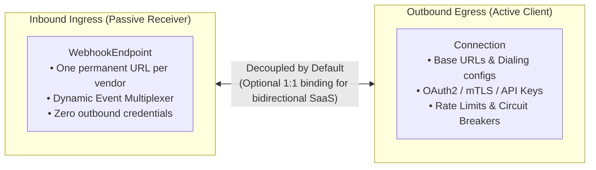
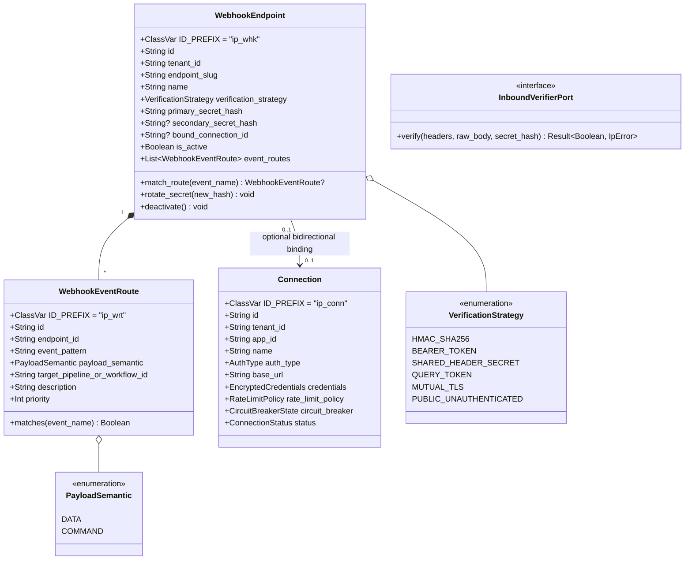
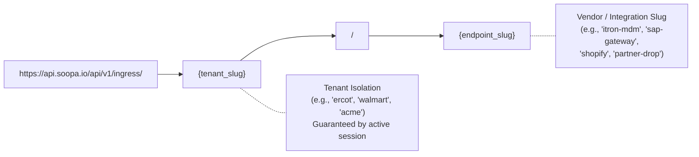
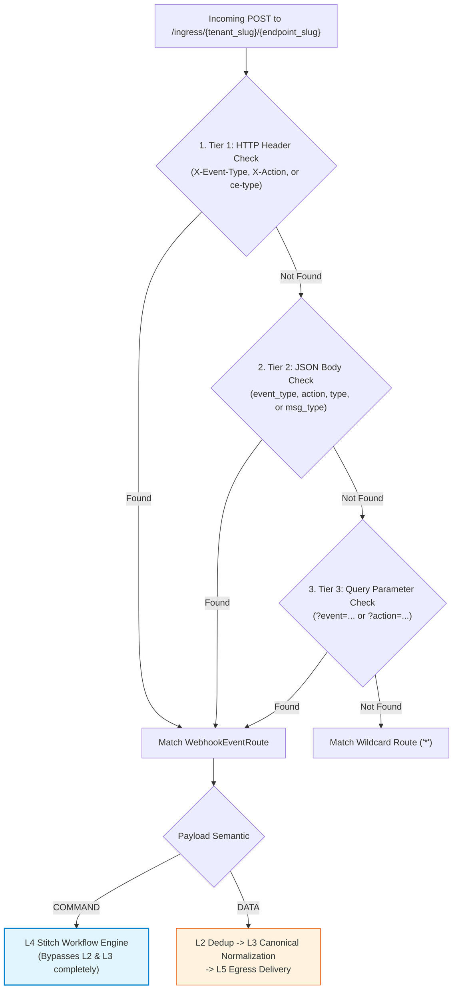
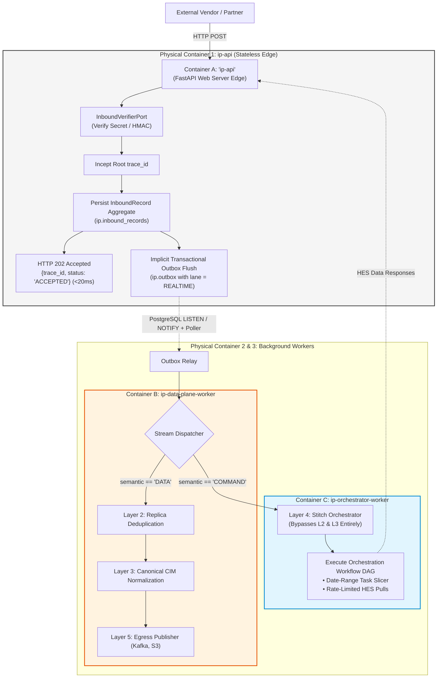
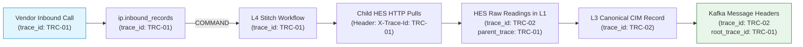

# Enterprise Architecture Design: Ingress Endpoints, Connections & Multiplexed Execution (Data vs. Command)

- **Document:** Core Architecture Specification & System Design Blueprint
- **Target Domain:** Integration Platform Core (`apps/ip`)
- **Scope:** Universal / Domain-Agnostic (Applies identically to Energy, Logistics, Retail, Finance, or Custom Systems)
- **Status:** Approved Enterprise Architecture Standard (Gold Standard 10/10)

---

## 1. Executive Summary & Architectural Invariants

In modern enterprise integration platforms, inbound event reception and outbound external communications serve diametrically opposed roles. Conflating them under a monolithic concept of a "Connection" introduces severe operational and security liabilities. 

Furthermore, hardcoding internal domain taxonomies (`energy`, `finance`, `tms`) into public webhook URLs creates tight coupling and vendor friction.



### The Architectural Invariants:
1. **Directional Invariance:** Inbound Ingress (`WebhookEndpoint`) and Outbound Egress/Polling (`Connection`) are strictly decoupled, first-class Aggregate Roots. Inbound endpoints **never** require an outbound connection.
2. **Domain-Agnostic Clean URLs:** Public URLs must NEVER leak internal monorepo domains or bounded contexts. Public paths use clean tenant + vendor slugs:
   $$\text{POST } /api/v1/ingress/\{\text{tenant\_slug}\}/\{\text{endpoint\_slug}\}$$
3. **Multiplexed Single Ingress Gateway:** A vendor receives **ONE permanent webhook URL** that handles multiple distinct commands and multiple data streams without provisioning new URLs.
4. **All Tiers Supported Simultaneously:** The platform evaluates event discriminators across all three industry tiers (HTTP Headers $\to$ Body JSON $\to$ Query Parameters $\to$ Default Wildcard) in sub-millisecond time.
5. **Perimeter Invariance:** Every external push request crosses Layer 1 for authentication, root trace inception, and sub-20ms immutable audit logging.
6. **Semantic Bifurcation (Data vs. Command):**
   - **`DATA` Modality:** Proceeds down the Data Plane (**L1 $\to$ L2 $\to$ L3 $\to$ L5**).
   - **`COMMAND` Modality:** Bypasses L2 and L3 entirely and dispatches directly to the Orchestration Plane (**L1 $\to$ L4 Workflow DAG**).
7. **Strict Physical API/Worker Decoupling:** The web API container executes ONLY the HTTP perimeter ingestion ($<20\text{ms}$ response). Outbox polling, workflow orchestration, and data transformation are physically isolated into dedicated background worker containers.

---

## 2. Core Domain Model (Hexagonal DDD)



### 2.1 The `Connection` Aggregate Root (Active Outbound Client)
Represents the configuration and operational state required for IP to **actively call out** to an external system:
- **Direction:** Outbound (Active Dialing).
- **ID Standard:** `f"{Connection.ID_PREFIX}_{os.urandom(12).hex()}"` (e.g. `ip_conn_311d0154e9e02dda782d9d37`).
- **Core Responsibilities:**
  - Manages outbound client credentials (OAuth2 grant flows, API keys, mTLS certs).
  - Enforces client-side rate limits, token-bucket throttling, and connection-level circuit breakers.
  - Houses base endpoints and path templates for outbound HTTP/REST, SOAP, or SFTP interactions.
- **Usage:** Consumed by L1 Pull Pollers and L5 Delivery Publishers.

### 2.2 The `WebhookEndpoint` Aggregate Root (Passive Inbound Gateway)
Represents a provisioned HTTP ingress address that allows external systems to **push data or instructions into IP**:
- **Direction:** Inbound (Passive Listener).
- **ID Standard:** `f"{WebhookEndpoint.ID_PREFIX}_{os.urandom(12).hex()}"` (e.g. `ip_whk_9a4f21b8c0e1`).
- **Core Responsibilities:**
  - Exposes an immutable, clean `/{tenant_slug}/{endpoint_slug}` URL.
  - Holds policy metadata for secret rotation, active status, and optional bidirectional connection binding.
  - Evaluates matched `WebhookEventRoute` children via `match_route(event_name)`.
  - Pure domain model: delegates raw cryptographic execution to `InboundVerifierPort`.
- **Usage:** Consumed by the L1 Ingress Gateway (`ReceivePushUseCase`).

---

## 3. Universal Clean URL Design (No Internal Domain Leakage)

Public webhook URLs must remain permanent, brandable, and resilient to internal code reorganizations.

$$\text{POST } \text{https://api.soopa.io/api/v1/ingress/}\{\text{tenant\_slug}\}/\{\text{endpoint\_slug}\}$$



### 3.1 Real-World Clean URL Examples:

| Organization | Integration Partner | Clean Public Ingress URL |
| :--- | :--- | :--- |
| **ERCOT Utility** | Itron MDM | `POST https://api.soopa.io/api/v1/ingress/ercot/itron-mdm` |
| **ERCOT Utility** | Landis+Gyr HES | `POST https://api.soopa.io/api/v1/ingress/ercot/landis-gyr` |
| **Retail Corp** | Shopify Store | `POST https://api.soopa.io/api/v1/ingress/walmart/shopify` |
| **Logistics Corp**| Partner Fleet TMS | `POST https://api.soopa.io/api/v1/ingress/freight-corp/fleet-telematics` |

---

## 4. Multiplexed Event Discrimination: All 3 Tiers Supported

When a vendor posts to `https://api.soopa.io/api/v1/ingress/{tenant_slug}/{endpoint_slug}`, IP evaluates a **3-Tier Discrimination Hierarchy** in strict priority order to identify the specific event and route it:



### 4.1 Discrimination Evaluation Tiers (All Supported):
1. **Tier 1 (HTTP Headers - Modern Enterprise):**
   - Inspects standard event headers (`X-Event-Type`, `X-Action`, `X-Command`, or CNCF CloudEvents standard `ce-type`).
   - Evaluated in $< 1\mu\text{s}$ via dictionary lookup before reading or parsing request bodies.
2. **Tier 2 (Body Inspection - Enterprise Standard):**
   - For platforms where headers cannot be dynamically configured (Salesforce, SAP, custom vendor systems).
   - Inspects parsed root JSON keys: `"event_type"`, `"action"`, `"type"`, `"command"`, `"msg_type"`.
3. **Tier 3 (Query Parameters - Legacy & Rigid Vendors):**
   - For legacy systems that can only configure a fixed destination URL string and cannot alter headers or payload envelopes: `?event=historical_extract` or `?action=sync`.
4. **Default Wildcard Route (`*`):**
   - If no discriminator is present across any tier, falls back to the endpoint's configured default wildcard route (`*`).

### 4.2 Sub-Millisecond Resolution Code Contract

```python
from collections.abc import Mapping
from typing import Final
from seedwork.domain.types import JsonDict

HEADER_CANDIDATES: Final[tuple[str, ...]] = (
    "x-event-type",
    "x-action",
    "x-command",
    "ce-type",
)

BODY_CANDIDATES: Final[tuple[str, ...]] = (
    "event_type",
    "action",
    "type",
    "command",
    "msg_type",
)

QUERY_CANDIDATES: Final[tuple[str, ...]] = (
    "event",
    "action",
    "event_type",
    "type",
)

def resolve_event_discriminator(
    headers: Mapping[str, str],
    parsed_body: JsonDict | None,
    query_params: Mapping[str, str],
) -> str | None:
    """Evaluates Tier 1 -> Tier 2 -> Tier 3 discrimination in < 0.1ms."""
    # 1. Tier 1: Fast header check (O(1) dictionary lookup)
    for header in HEADER_CANDIDATES:
        if val := headers.get(header):
            return val.strip()

    # 2. Tier 2: Body JSON attribute check
    if parsed_body and isinstance(parsed_body, dict):
        for field in BODY_CANDIDATES:
            if val := parsed_body.get(field):
                if isinstance(val, str):
                    return val.strip()

    # 3. Tier 3: Query parameter fallback
    for param in QUERY_CANDIDATES:
        if val := query_params.get(param):
            return val.strip()

    # 4. Fallback: None (will match wildcard route '*')
    return None
```

### 4.3 Error Handling for Unmapped Events
If an incoming event discriminator cannot be matched to any `WebhookEventRoute` and no wildcard (`*`) route exists:
- L1 **still logs the raw payload** in `ip.inbound_records` with status `REJECTED_UNMAPPED_ROUTE`.
- The gateway returns `HTTP 422 Unprocessable Entity` with structured problem payload:
  ```json
  {
    "type": "https://errors.soopa.io/ip/unmapped-event-route",
    "title": "Unmapped Event Route",
    "status": 422,
    "detail": "Event discriminator 'unknown_event_xyz' has no active route on endpoint 'itron-mdm'.",
    "trace_id": "ip_trc_9a4f21b8c0e1"
  }
  ```

---

## 5. Event Routing Matrix (Data vs. Command Execution)

A single vendor endpoint handles an arbitrary number of distinct commands and data streams via its internal route table:

```
Endpoint: https://api.soopa.io/api/v1/ingress/ercot/itron-mdm
```

| Inbound Event Name | Discriminator Source | Payload Semantic | Target Execution Engine | Target Description |
| :--- | :--- | :--- | :--- | :--- |
| **`historical_extract.request`** | Header `X-Event-Type` | **`COMMAND`** | **L4 Stitch Orchestrator** | Multi-HES Date Slicer & Pull DAG |
| **`meter_service.disconnect`** | Header `X-Event-Type` | **`COMMAND`** | **L4 Stitch Orchestrator** | Remote Disconnect Safety DAG |
| **`meter_readings.batch`** | Header `X-Event-Type` | **`DATA`** | **L2 $\to$ L3 $\to$ L5** | IEC 61968 CIM Normalizer $\to$ Kafka |
| **`billing_determinants`** | JSON attribute `type` | **`DATA`** | **L2 $\to$ L3 $\to$ L5** | Monthly Register Aggregator $\to$ Postgres |
| **`*` (Default Fallback)** | None | **`DATA`** | **L2 $\to$ L3** | Raw Journal Dedup & Storage |

---

## 6. The Bifurcated Pipeline & Physical Container Architecture



### 6.1 Why Layer 1 ALWAYS Executes (Even for Commands)
1. **Asynchronous Non-Blocking Acknowledgment:** Returns `HTTP 202 Accepted` in $< 20\text{ ms}$ regardless of how long the downstream processing or extraction takes.
2. **Root Trace Inception:** Establishes the master `trace_id` for complete operational lineage across all child tasks and outbound messages.
3. **Immutable Audit Trail:** Durably stored in `ip.inbound_records` with raw payloads backed by permanent tiered object storage for compliance and replay.

### 6.2 The Post-L1 Fork
- **`DATA` Modality**: The dispatcher emits `ReplicateRecordCommand` to write to `ip.replica_records`, execute schema validation, run domain transformers, and produce normalized DTOs.
- **`COMMAND` Modality**: The dispatcher **skips L2 and L3 entirely**. It emits `ExecuteStitchWorkflowCommand` to the L4 Workflow Engine to run the DAG.
- **Invariant**: When the L4 workflow invokes outbound `Connection` clients to pull records from external systems, **that returned data re-enters IP as `DATA`**, seamlessly flowing through L1 $\to$ L2 $\to$ L3 $\to$ L5.

### 6.3 Strict Physical API/Worker Decoupling
To comply with enterprise stability mandates:
- **`ip-api` Container**: Pure HTTP ingress. NEVER runs `while True` queue polling loops, SQS listeners, or Outbox Relays inside its lifespan.
- **Worker Containers**: Physically isolated Docker containers (`ip-orchestrator-worker`, `ip-data-plane-worker`) built from the identical monorepo image running different entrypoint commands.

### 6.4 DDD Aggregate Outbox Publishing Guarantee
Procedural outbox publishing (calling `outbox.publish(...)` inside a use case) is strictly prohibited. Instead:
1. `InboundRecord.create(...)` records its own state change via `self.add_domain_event(InboundRecordCreatedEvent(...))`.
2. When the repository adapter commits `await uow.inbound_records.save(record)`, the adapter's Unit of Work implicitly drains `record.domain_events` and writes them into `ip.outbox` in the **exact same PostgreSQL transaction**.

---

## 7. Customer Support UI & 1-Click Vendor Hand-Off

Customer Support agents can provision a vendor integration in **under 10 seconds** without touching code or internal domain configurations:

```
┌────────────────────────────────────────────────────────────────────────┐
│  Webhook Gateway: Itron MDM                                        [✕] │
├────────────────────────────────────────────────────────────────────────┤
│  Vendor / Endpoint Slug *                                              │
│  [ itron-mdm                                                 ]         │
│                                                                        │
│  Security / Verification                                               │
│  [ Shared Secret Token (Auto-Generated) ▼ ]                            │
├────────────────────────────────────────────────────────────────────────┤
│  ⚡ READY TO SHARE WITH VENDOR                                         │
│                                                                        │
│  Permanent Webhook URL                                                 │
│  ┌───────────────────────────────────────────────────────────┬───────┐ │
│  │ https://api.soopa.io/api/v1/ingress/ercot/itron-mdm       │ Copy  │ │
│  └───────────────────────────────────────────────────────────┴───────┘ │
│                                                                        │
│  Secret Header Value (X-Webhook-Token)                                 │
│  ┌───────────────────────────────────────────────────────────┬───────┐ │
│  │ wh_sec_98f5b60bcd06f8d2f4c4d4f41d47f84a                  │ Copy  │ │
│  └───────────────────────────────────────────────────────────┴───────┘ │
│                                                                        │
│  [ 📋 Copy 1-Click Vendor Email Template ]                             │
├────────────────────────────────────────────────────────────────────────┤
│  EVENT ROUTING RULES (Multiplexed)                                     │
│                                                                        │
│  Event Pattern               Semantic   Target Pipeline / Workflow     │
│  ────────────────────────────────────────────────────────────────────  │
│  historical_extract.request  COMMAND ➔  Multi-HES Date Slicer DAG [✎]  │
│  meter_service.disconnect    COMMAND ➔  Emergency Disconnect DAG  [✎]  │
│  meter_readings.batch        DATA    ➔  CIM AMI Canonical L3      [✎]  │
│  * (Default fallback)        DATA    ➔  Raw Journal Ingest        [✎]  │
│                                                                        │
│  [ + Add Event Rule ]                                                  │
└────────────────────────────────────────────────────────────────────────┘
```

### The 1-Click Vendor Email Template:
Clicking **`Copy 1-Click Vendor Email Template`** places the following in the agent's clipboard:

```text
Hi Itron MDM Team,

Here is your dedicated webhook endpoint to interface with our platform:

Endpoint URL:
https://api.soopa.io/api/v1/ingress/ercot/itron-mdm

Method: POST
Content-Type: application/json

Authentication:
Please provide this secret in the header of every request:
Header: X-Webhook-Token: wh_sec_98f5b60bcd06f8d2f4c4d4f41d47f84a

Event Types Supported:
- Historical Extraction: Header "X-Event-Type: historical_extract.request"
- Service Disconnect:    Header "X-Event-Type: meter_service.disconnect"
- Meter Readings Drop:   Header "X-Event-Type: meter_readings.batch"

Response Contract:
HTTP 202 Accepted { "trace_id": "...", "status": "ACCEPTED" }
```

---

## 8. Physical Data Model, Schemas & CQRS Contracts

### 8.1 Database Schema: `ip.webhook_endpoints` & `ip.webhook_event_routes`

```sql
-- 1. Inbound Webhook Endpoints
CREATE TABLE IF NOT EXISTS ip.webhook_endpoints (
    id VARCHAR(64) PRIMARY KEY,
    tenant_id VARCHAR(64) NOT NULL,
    endpoint_slug VARCHAR(128) NOT NULL,
    name VARCHAR(255) NOT NULL,
    description TEXT,
    verification_strategy VARCHAR(32) NOT NULL DEFAULT 'SHARED_HEADER_SECRET',
    primary_secret_hash VARCHAR(255) NOT NULL,
    secondary_secret_hash VARCHAR(255),
    secret_rotated_at TIMESTAMPTZ,
    bound_connection_id VARCHAR(64) REFERENCES ip.connections(id) ON DELETE SET NULL,
    is_active BOOLEAN NOT NULL DEFAULT TRUE,
    created_at TIMESTAMPTZ NOT NULL DEFAULT CURRENT_TIMESTAMP,
    updated_at TIMESTAMPTZ NOT NULL DEFAULT CURRENT_TIMESTAMP,
    
    CONSTRAINT uq_tenant_endpoint_slug UNIQUE (tenant_id, endpoint_slug)
);

CREATE INDEX idx_webhook_slug_lookup 
ON ip.webhook_endpoints (tenant_id, endpoint_slug) 
WHERE is_active = TRUE;

-- 2. Multiplexed Event Routes per Endpoint
CREATE TABLE IF NOT EXISTS ip.webhook_event_routes (
    id VARCHAR(64) PRIMARY KEY,
    endpoint_id VARCHAR(64) NOT NULL REFERENCES ip.webhook_endpoints(id) ON DELETE CASCADE,
    event_pattern VARCHAR(128) NOT NULL, -- e.g. 'historical_extract.request', 'meter_readings.*', '*'
    payload_semantic VARCHAR(32) NOT NULL DEFAULT 'DATA', -- 'DATA' | 'COMMAND'
    target_pipeline_or_workflow_id VARCHAR(128) NOT NULL,
    priority INT NOT NULL DEFAULT 100, -- Lower value = evaluated first
    is_active BOOLEAN NOT NULL DEFAULT TRUE,
    created_at TIMESTAMPTZ NOT NULL DEFAULT CURRENT_TIMESTAMP,
    
    CONSTRAINT uq_endpoint_event_pattern UNIQUE (endpoint_id, event_pattern)
);

CREATE INDEX idx_event_route_lookup 
ON ip.webhook_event_routes (endpoint_id, priority ASC) 
WHERE is_active = TRUE;
```

### 8.2 Strongly-Typed Domain Enums

```python
from enum import StrEnum

class PayloadSemantic(StrEnum):
    """Semantic purpose of an inbound webhook event."""
    DATA = "DATA"
    COMMAND = "COMMAND"

class VerificationStrategy(StrEnum):
    """Supported cryptographic authentication mechanisms."""
    HMAC_SHA256 = "HMAC_SHA256"
    BEARER_TOKEN = "BEARER_TOKEN"
    SHARED_HEADER_SECRET = "SHARED_HEADER_SECRET"
    QUERY_TOKEN = "QUERY_TOKEN"
    MUTUAL_TLS = "MUTUAL_TLS"
    PUBLIC_UNAUTHENTICATED = "PUBLIC_UNAUTHENTICATED"
```

### 8.3 Application Commands (CQRS Boundary)

```python
from dataclasses import dataclass
from seedwork.domain.types import JsonDict

@dataclass(frozen=True)
class CreateWebhookEndpointCommand:
    """Command to provision a new passive inbound webhook."""
    tenant_id: str
    endpoint_slug: str
    name: str
    description: str = ""
    verification_strategy: VerificationStrategy = VerificationStrategy.SHARED_HEADER_SECRET
    bound_connection_id: str | None = None

@dataclass(frozen=True)
class AddWebhookEventRouteCommand:
    """Command to attach a multiplexed event route to an endpoint."""
    tenant_id: str
    endpoint_id: str
    event_pattern: str
    payload_semantic: PayloadSemantic
    target_pipeline_or_workflow_id: str
    priority: int = 100
```

### 8.4 Ingress Event Contract: `InboundRecordCreatedEvent`

```python
@dataclass(frozen=True)
class InboundRecordCreatedEvent(DomainEvent):
    """Pure domain event emitted by L1 Ingress Gateway."""
    
    record_id: str
    tenant_id: str
    endpoint_id: str
    endpoint_slug: str
    matched_event_pattern: str
    payload_semantic: PayloadSemantic
    target_pipeline_or_workflow_id: str
    bound_connection_id: str | None
    trace_id: str
    correlation_id: str | None
    batch_record_count: int
    received_at: str
```

### 8.5 L1 Ledger Retention & Chunked PostgreSQL Sweeper
To prevent disk exhaustion on high-volume inbound channels while satisfying enterprise data governance and audit retention mandates:
1. **Permanent Object Storage Archival Guarantee:** Prior to any pruning from the active database table, inbound record payloads and full metadata envelopes are durably archived into permanent tiered object storage (`S3`/`GCS`/`TieredStoragePort`). The background sweeping process strictly validates that archival is completed and confirmed durable before any record is eligible for deletion.
2. **Rolling Operational Database Retention Window:** Active transactional rows in `ip.inbound_records` are retained in PostgreSQL for a rolling 30-day operational compliance window to service low-latency replay and audit queries.
3. **Chunked Iteration (Zero Table Locking):** The background sweeper task in `ip-data-plane-worker` runs an asynchronous chunked loop over verified-archived records older than the 30-day threshold:
   ```python
   async def sweep_stale_inbound_records(session: AsyncSession, threshold_date: datetime) -> int:
       total_deleted = 0
       while True:
           # Chunked subquery prevents long-lived exclusive row/table locks
           query = (
               delete(InboundRecordModel)
               .where(
                   InboundRecordModel.id.in_(
                       select(InboundRecordModel.id)
                       .where(InboundRecordModel.received_at < threshold_date)
                       .limit(500)
                       .with_for_update(skip_locked=True)
                   )
               )
           )
           res = await session.execute(query)
           deleted_count = res.rowcount
           await session.commit()
           total_deleted += deleted_count
           
           if deleted_count < 500:
               break
           # Yield event loop to allow autovacuum and live API transactions
           await asyncio.sleep(0.1)
           
       return total_deleted
   ```

---

## 9. Observability & End-to-End Trace Lineage

The master `trace_id` established at L1 ingress is threaded across both `DATA` and `COMMAND` workflows:



In the IP UI's **Traces** tab, entering `TRC-01` displays the unified lifecycle: the vendor's command webhook, the execution status of the L4 DAG, all child HTTP queries issued to external vendor connections, and the resulting Kafka delivery records.

---

## 10. Summary Architectural Comparison

| Dimension | Inbound Webhooks (`WebhookEndpoint`) | Outbound Connections (`Connection`) |
| :--- | :--- | :--- |
| **Direction** | Inbound (Passive Listener) | Outbound (Active Dialing Client) |
| **Entity ID Prefix** | `ip_whk_...` | `ip_conn_...` |
| **Primary Address** | `/api/v1/ingress/{tenant_slug}/{endpoint_slug}` | Target Host URL (e.g. `https://api.itron.com`) |
| **Vendor URL Count** | **ONE permanent URL** per vendor integration | None (Internal configuration only) |
| **Multiplexing** | **Supported across all 3 Tiers** (Header $\to$ Body $\to$ Query) | N/A (Client initiates explicit requests) |
| **Security Controls** | HMAC signatures, Token headers, mTLS | OAuth2 tokens, encrypted client secrets, mTLS certs |
| **Execution Path** | **`DATA`** $\to$ L2/L3/L5 \| **`COMMAND`** $\to$ L4 Workflow | Executed by L1 Pull Pollers or L5 Outbound Deliverers |
| **Runtime Container** | Ingested via `ip-api` container only | Invoked by `ip-data-plane` or `ip-orchestrator` |

---

## 11. Platform Package Reuse (Alignment with Monorepo Architecture)

To enforce monorepo DRY rules and zero duplicate infrastructure, IP implements its Ingress and Egress capabilities by consuming centralized platform packages:

```
                            core/platform
                                  │
         ┌────────────────────────┴────────────────────────┐
         ▼                                                 ▼
core/platform/packages/webhooks/receivers         core/platform/packages/egress
┌──────────────────────────────────────┐          ┌──────────────────────────────────────┐
│  Universal Webhook Receiver Core     │          │  Resilient Egress & shttp Core       │
├──────────────────────────────────────┤          ├──────────────────────────────────────┤
│ • Cryptographic HMAC verification    │          │ • SSRF shield & private IP blocking  │
│ • Timing-safe secret comparison      │          │ • Exponential backoff with jitter    │
│ • Raw body buffering to Kafka/Outbox │          │ • OAuth2 token lifecycle & refresh   │
└──────────────────────────────────────┘          └──────────────────────────────────────┘
         ▲                                                 ▲
         │                                                 │
    Used by IP for:                                   Used by IP for:
    WebhookEndpoint (Ingress)                         Connection (Outbound Dialing)
```

1. **`WebhookEndpoint` (Inbound Ingress):**
   - Uses `from webhooks.receivers import VendorHmacGuard, RawIngestionPort, timing_safe_verify_hmac`.
   - IP does **not** write bespoke HMAC or token verification algorithms; it relies strictly on the platform's audited crypto routines in `core/platform/packages/webhooks`.
2. **`Connection` (Outbound Egress & Polling):**
   - Uses `from egress.ports.resilient_http_port import ResilientHttpPort` and `core/platform/packages/shttp`.
   - IP does **not** write bespoke HTTP clients or SSRF protection; all outbound dials to external vendor APIs (Itron, HES, Salesforce) pass through `shttp`'s perimeter-hardened client with automatic secret retrieval from `core/platform/packages/secret-store`.

