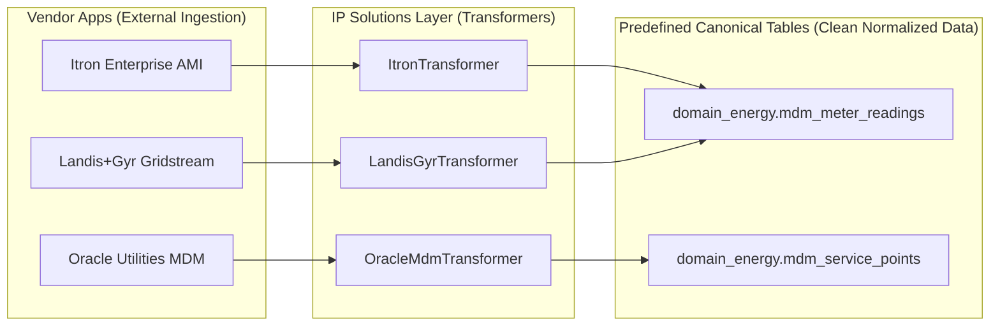
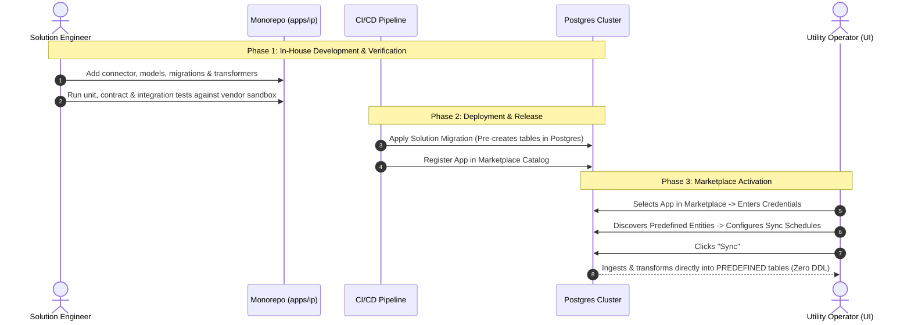

# Integration Platform: Predefined Normalized Schema & Marketplace Lifecycle Architecture

**Document Version**: 2.0.0
**Context**: Integration Platform (`apps/ip`) — Control Plane, Ingestion Engine & Vertical Solutions
**Applicability**: Core Platform Engineers, Solution Engineers, Architecture Board

---

## 1. Executive Summary & Core Paradigm

Our Integration Platform is built specifically to serve vertical enterprise sectors (initiating in **Energy & Utilities**, followed by **Logistics/TMS**, **Billing**, and **ERP**).

We do not run arbitrary, unstructured data pipes. Instead, our platform operates on **Predefined Canonical Solutions**:
1. For each vertical application (e.g., Itron Enterprise AMI, Oracle Utilities MDM, Landis+Gyr Gridstream), we analyze the vendor's object schemas (Meters, Interval Reads, Service Points, Outages, Transformers).
2. We design and maintain **predefined, standardized normalized tables** for those objects.
3. Multiple vendor connectors in the same sector transform their distinct raw payloads into the **same canonical tables**, giving utility customers a unified, vendor-agnostic data layer.
4. All tables, columns, and transformers are pre-verified and migrated via **versioned solution migrations**. There is **ZERO runtime dynamic DDL** (`CREATE TABLE` / `ALTER TABLE` inside worker threads), ensuring zero catalog lock contention, zero container restarts, and zero interference between apps or tenants.

---

## 2. Platform Architecture: Engine vs. Solutions

Our codebase enforces a strict separation between the domain-agnostic **IP Engine** and vertical **IP Solutions**.

```
┌──────────────────────────────────────────────────────────────────────────────┐
│                              IP ENGINE (Platform Core)                       │
│  Package: apps/ip/packages/ip/src/ip/engine/                                 │
│  ──────────────────────────────────────────────────────────────────────────  │
│  * Layer 1: Inbound Wire Gateway (Webhooks, Ingest Polling, S3 Offload)      │
│  * Layer 2: Universal Staging Replica (Snapshots, Keyset Cursors, Gen IDs)   │
│  * Checkpoint & State Control (ip.connection_stream_state)                   │
│  * Outbox Relay, Polling Sweeper, Schedulers, Replay Engine, Traces          │
│  * UI Shell, Command Palette, AES-256-GCM Secret Encryption, RBAC            │
│  ──────────────────────────────────────────────────────────────────────────  │
│  * 100% Domain-Agnostic: Has zero knowledge of kWh, meters, or shipments.   │
│  * Stable Kernel: Never touches business logic; never modified for new apps. │
└──────────────────────────────────────┬───────────────────────────────────────┘
                                       │ Implements abstract Ports:
                                       │  - CatalogRegistryPort
                                       │  - TransformerRegistryPort
                                       │  - CanonicalWriterPort
                                       ▼
┌──────────────────────────────────────────────────────────────────────────────┐
│                       IP SOLUTIONS (Vertical Domains & Apps)                 │
│  Package: apps/ip/packages/ip/src/ip/solutions/                              │
│  ──────────────────────────────────────────────────────────────────────────  │
│  * solutions/domains/energy/                                                 │
│      - Predefined Tables: mdm_meter_readings, mdm_service_points             │
│      - Connector Adapters: Itron AMI, Oracle MDM, Landis+Gyr                 │
│      - Solution Transformers: Raw L2 Snapshots -> L3 Canonical Records       │
│      - Solution Migrations: Versioned DDL for energy tables                  │
│  * solutions/domains/tms/ (Freight Logistics Domain)                         │
│  * solutions/domains/billing/ (Future Vertical Domains)                      │
│  ──────────────────────────────────────────────────────────────────────────  │
│  * Open-Closed Principle (OCP): New apps are purely ADDITIVE packages.       │
└──────────────────────────────────────────────────────────────────────────────┘
```

### Why This Separation is Essential:
* **Zero Engine Code Churn**: Adding a new Energy connector or updating an existing app never alters engine plumbing.
* **Blast-Radius Containment**: An issue with an Itron transformer or schema update cannot affect L1 wire ingestion, the Scheduler, or the Replay engine.
* **Unified Execution**: Engine and Solutions share the same in-memory process space within our Modular Monolith, allowing transformers to execute at native CPU speeds without HTTP/gRPC overhead.

---

## 3. Physical Table Anatomy for Predefined Normalized Tables

Every predefined normalized table within a Solution domain follows an established, enterprise-grade 3-tier structure:

```sql
CREATE TABLE IF NOT EXISTS domain_energy.mdm_meter_readings (
    -- TIER 1: System Identity & Traceability Envelope (Standard across ALL tables)
    id VARCHAR(64) NOT NULL,
    tenant_id VARCHAR(128) NOT NULL,
    trace_id VARCHAR(64) NOT NULL,
    correlation_id VARCHAR(255),
    parent_trace_id VARCHAR(64),
    original_trace_id VARCHAR(64),
    replay_count INT NOT NULL DEFAULT 0,
    source_connection_id VARCHAR(64) NOT NULL,
    source_replica_id VARCHAR(64) NOT NULL,
    transformation_id VARCHAR(128) NOT NULL,
    transformation_version INT NOT NULL DEFAULT 1,
    synced_at TIMESTAMPTZ NOT NULL DEFAULT NOW(),

    -- TIER 2: Promoted Typed Domain Columns (First-class SQL types for indexing & aggregations)
    meter_serial_number VARCHAR(128) NOT NULL,
    service_point_id VARCHAR(128),
    reading_timestamp TIMESTAMPTZ NOT NULL,
    interval_minutes INT NOT NULL DEFAULT 15,
    kwh_delivered FLOAT NOT NULL,
    kwh_received FLOAT NOT NULL DEFAULT 0.0,
    voltage_avg FLOAT,
    quality_flag VARCHAR(32) NOT NULL DEFAULT 'VALIDATED',
    recorded_at TIMESTAMPTZ NOT NULL,

    -- TIER 3: Custom / Tenant Extension Envelope (Catches tenant-specific metadata tags)
    _custom_attributes JSONB NOT NULL DEFAULT '{}'::jsonb,

    PRIMARY KEY (id, reading_timestamp)
);

-- Operational Indices (Always created concurrently)
CREATE INDEX CONCURRENTLY IF NOT EXISTS idx_mdm_readings_meter_ts
ON domain_energy.mdm_meter_readings (tenant_id, meter_serial_number, reading_timestamp);

CREATE INDEX CONCURRENTLY IF NOT EXISTS idx_mdm_readings_trace
ON domain_energy.mdm_meter_readings (tenant_id, trace_id);
```

### Column Tiers:
1. **Tier 1 (System Identity Envelope)**: Links every row directly to its L1 inbound payload and L2 replica snapshot, enabling full end-to-end trace waterfalls and automated single-record replay.
2. **Tier 2 (Promoted Typed Columns)**: Standardized columns with native SQL types, enabling high-performance queries, mathematical aggregations (`SUM(kwh_delivered)`), and relational constraints.
3. **Tier 3 (`_custom_attributes JSONB`)**: Accommodates utility-specific custom metadata tags (e.g. `feeder_circuit_id`) without requiring custom DDL migrations for individual tenants.

---

## 4. Multi-Vendor Normalization

A core capability of our platform is decoupling business data from hardware vendors:



* **Zero Vendor Lock-in**: Utility operators query `mdm_meter_readings`. Whether they use Itron, Landis+Gyr, or both across different operating regions, their downstream dashboards, billing jobs, and reporting workflows interact with a single unified schema.

---

## 5. The 3 Lifecycles & Operational Workflows



### Lifecycle 1: Updating an Existing Predefined Table (e.g. Itron adds a new field in API v2)

* **Trigger**: A vendor API adds a new field (e.g., `solar_generation_kw` in meter readings).
* **Operational Steps**:
  1. **Model Update**: Add `solar_generation_kw: Mapped[float | None] = mapped_column(Float, nullable=True)` to `solutions/domains/energy/models.py`.
  2. **Transformer Update**: Update `ItronTransformer` to map the incoming field.
  3. **Additive Migration**: Add an Alembic migration in `solutions/domains/energy/migrations/`:
     ```sql
     ALTER TABLE domain_energy.mdm_meter_readings
     ADD COLUMN IF NOT EXISTS solar_generation_kw FLOAT;
     ```
  4. **Deploy**: CI/CD runs tests and applies the migration during rolling deployment.
* **Zero Downtime Guarantee**: In PostgreSQL 11+, `ALTER TABLE ... ADD COLUMN ... NULL` is a **metadata-only catalog operation** taking < 5ms. No table rewrites, no table locks, and zero disruption to active data flows.

---

### Lifecycle 2: Introducing a New Object (e.g. Itron adds `voltage_events`)

* **Trigger**: A vendor introduces a new object type (e.g., power quality voltage events).
* **Operational Steps**:
  1. **Define Model**: Create `MdmVoltageEventRecord` in `solutions/domains/energy/models.py`.
  2. **Add Migration**: Add migration script in `energy/migrations/`:
     ```sql
     CREATE TABLE IF NOT EXISTS domain_energy.mdm_voltage_events (...);
     ```
  3. **Implement Transformer**: Create `VoltageEventTransformer` mapping raw L2 events into `MdmVoltageEventRecord`.
  4. **Update Connector Manifest**: Add `voltage_events` to the Itron connector spec in the catalog.
  5. **Deploy**: CI/CD applies the migration and deploys the update.
* **Marketplace Discovery**:
  - The new table is pre-created in the database.
  - In the UI, existing Itron connections immediately display "Voltage Events" in the **"Discover Entities"** dropdown.
  - The operator toggles it on, sets a schedule, and data begins syncing immediately.
  - Existing tables (`mdm_meter_readings`) experience zero locks or latency impact.

---

### Lifecycle 3: Onboarding a New App or New Sector (Marketplace Launch)

* **Trigger**: Onboarding a new vendor connector (e.g., Landis+Gyr, SAP IS-U) or a new sector (e.g., Logistics / TMS).
* **Operational Steps**:
  1. **Package Development**: Build the connector, auth strategies, and transformers under `solutions/domains/{domain}/`.
  2. **Canonical Mapping**: If the app belongs to an existing sector (Energy), its transformer maps data into existing canonical tables (`mdm_meter_readings`). If it introduces novel objects, add new predefined tables.
  3. **Testing**: Run narrow integration tests and contract tests against vendor sandboxes.
  4. **Release**: Apply migrations and register the connector in the Catalog Manifest.
  5. **Marketplace Availability**:
     - The app appears under **"All Apps"** in the Marketplace.
     - Any tenant can click **Connect**, complete authentication, select entities, and sync.
     - The predefined tables are already live in the database, waiting for data.

---

## 6. Deployment Architecture: Single Modular Monolith

### Strict Standard: One Image, Multiple Container Roles

Per monorepo rules, `engine` and `solutions` are **never deployed as separate microservices**. They build and deploy as a **single unified Docker image**:

```
                              ┌─────────────────────────────────────────┐
                              │     UNIFIED DOCKER IMAGE                │
                              │  (Contains IP Engine + IP Solutions)   │
                              └────────────────────┬────────────────────┘
                                                   │
         ┌─────────────────────────────────────────┼─────────────────────────────────────────┐
         ▼                                         ▼                                         ▼
┌──────────────────┐                     ┌──────────────────┐                     ┌──────────────────┐
│  API Web Server  │                     │  Ingestion Worker │                     │   Cron Sweeper   │
│ (FastAPI / HTTP) │                     │ (SQS / Streaming)│                     │(Outbox & Checks) │
└──────────────────┘                     └──────────────────┘                     └──────────────────┘
```

### Architectural Benefits:
1. **Elimination of Network Serialization**: High-frequency streaming (millions of 15-minute smart meter reads) processes in-memory at native CPU speed. There is no intermediate HTTP/gRPC serialization layer between engine and solutions.
2. **Atomic Ingestion Transactions**: Writing canonical rows to `domain_energy.mdm_meter_readings` and updating the stream cursor in `ip.connection_stream_state` occurs inside the **same atomic database transaction**, eliminating distributed 2-phase commit failure modes.
3. **Operational Simplicity**: A single CI/CD pipeline tests, builds, and deploys the entire platform.

---

## 7. Concrete Monorepo Layout

```
apps/ip/packages/ip/src/ip/
├── engine/                                   # Platform Core (Domain-Agnostic)
│   ├── adapters/
│   │   ├── inbound/api/                      # FastAPI Routers, Auth Guards
│   │   └── outbound/database/                # L1/L2 Repositories, Control Plane Models
│   ├── application/use_cases/                # Sync, Replay, Checkpoint Orchestration
│   ├── domain/                               # Traces, Checkpoint States, Enums
│   └── ports/                                # Abstract Ports (Catalog, Transformer, Storage)
│
└── solutions/                                # Vertical Solutions (Domain-Specific)
    ├── connectors/                           # Common Connector Utilities & Registry
    │   └── registry_loader.py                # Marketplace Catalog Discovery
    └── domains/
        ├── energy/                           # Energy & Utilities Solution
        │   ├── canonical.py                  # Domain Dataclasses (MeterRead, ServicePoint)
        │   ├── migrations/                   # Predefined Table Migrations (Alembic)
        │   │   └── 0001_energy_schema.py
        │   ├── models.py                     # SQLAlchemy ORM Models (mdm_meter_readings)
        │   ├── ports.py                      # Energy Canonical Repository Ports
        │   ├── repository.py                 # Concrete Data Plane Persistence
        │   └── transformers.py               # Vendor Payloads -> Canonical Mappings
        │
        └── tms/                              # Logistics & Freight Solution
            ├── canonical.py                  # Domain Dataclasses (Shipment, Stop)
            ├── migrations/                   # Predefined Table Migrations (Alembic)
            ├── models.py                     # SQLAlchemy ORM Models (tms_shipments)
            ├── ports.py                      # Logistics Repository Ports
            └── repository.py                 # Logistics Data Plane Persistence
```

---

## 8. Summary of Architectural Guarantees

1. **Predefined Tables**: All tables are pre-modeled, pre-migrated, and pre-verified by Solution modules before being published to the Marketplace.
2. **Zero Runtime DDL**: Ingestion workers run pure parameterized SQL inserts/upserts. Workers never execute `CREATE TABLE` or `ALTER TABLE` at runtime.
3. **Zero-Lock Online Evolution**: Schema updates (adding columns) use nullable `ALTER TABLE` operations that execute in < 5ms without table rewrites or query locks.
4. **Single Image Deployment**: Engine and Solutions compile into a single Docker image, running distinct container roles (API, Worker, Cron) without microservice network latency.
5. **No Platform Restarts**: Adding new apps, creating new tables, or updating schemas requires zero downtime and zero platform restarts for existing tenants and pipelines.
