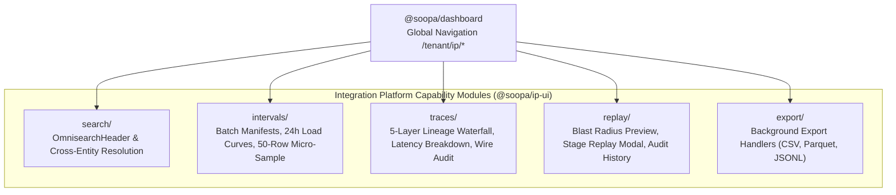
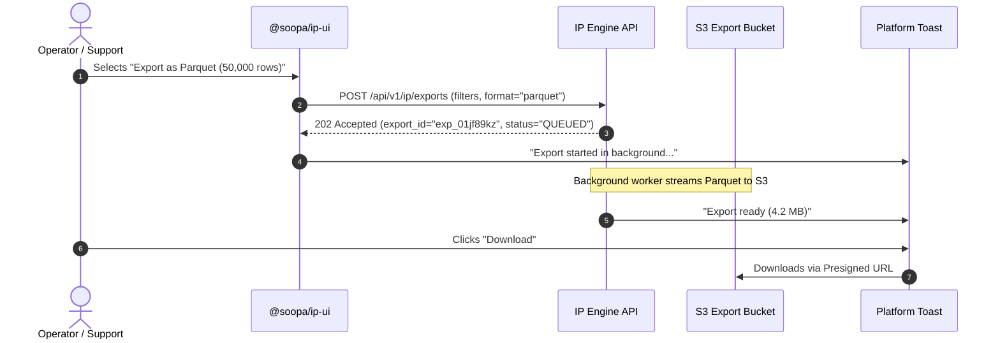

# Enterprise UI/UX Architecture & Design Specification
## Operational Transparency & Remediation Console: Capability-Driven UI for a Code-First Integration Platform

- **Domain:** Utility Integration Platform (`apps/ip/packages/ui`, `@soopa/ip-ui`)
- **Document Status:** Approved UI/UX Design Specification
- **Design Philosophy:** Code-First Pipeline Execution · Zero Drag-and-Drop Bloat · Pure Capability-Driven Taxonomy
- **Target Audience:** Frontend Engineers, Systems Architects, Operations Leads, Integration Engineers
- **File Location:** `apps/ip/docs/ip_code_first_support_first_ui_design.md`

---

## 1. Executive Summary & Design Philosophy

### 1.1 The Code-First Doctrine
The gold standard for an enterprise integration platform is **Code-First**:
* **Code Owns Implementation:** Connectors, data contracts, topological DAG stitches, vectorized streaming workers, and schema transformations are authored in versioned, testable Python code (`apps/ip`).
* **UI Owns Operational Transparency & Remediation:** The user interface does **not** attempt to replicate brittle, low-code drag-and-drop workflow builders or canvas visualizers. Instead, the UI is an **Operational Glass Box** designed exclusively for:
  1. **Sub-Second Entity Search:** Resolving queries across 100M+ records in under 2 seconds.
  2. **Website-Speed Data Viewing:** Inspecting multi-gigabyte streams and batches in under 50ms with zero browser memory crashes.
  3. **Universal Multi-Stage Replay:** Executing surgical, point-and-click re-runs from any pipeline stage with complete auditability.
  4. **Future-Proof Data Export:** Non-blocking async export hooks ready for the platform File Management service.

### 1.2 Strict Capability-Driven Taxonomy (Zero Persona-Based Taxonomies)
In strict accordance with Domain-Driven Design (DDD) and monorepo architectural invariants (`.agents/AGENTS.md`):
* **No Persona Folders:** There is **no** `support/`, `admin/`, or `developer/` directory or UI module. Capabilities belong to domains and systems, not personas.
* **Functional Alignment:** The frontend codebase, routes, and components are partitioned strictly by **capability**:
  * `search/` — Global Omnisearch & cross-entity resolution.
  * `intervals/` — High-frequency streaming batches, load curves, TOU rollups, and micro-sample data grids.
  * `traces/` — 5-stage pipeline lineage, waterfall latency breakdowns, and wire-level audits.
  * `replay/` — Universal multi-stage replay execution, blast radius preview, and immutable audit ledgers.
  * `export/` — Non-blocking async data extraction and file formatting.

```
┌──────────────────────────────────────────────────────────────────────────────────────────────────┐
│                               THE 4 CORE USER MANDATES & SLA TARGETS                             │
├───────────────────────────────────┬───────────────────────────┬──────────────────────────────────┤
│ Mandate                           │ SLA Target                │ Functional Capability            │
├───────────────────────────────────┼───────────────────────────┼──────────────────────────────────┤
│ 1. Sub-Second Answers             │ < 2.0s Total Resolution   │ search/ + intervals/             │
│ 2. Universal Stage Replay         │ < 3 Clicks / Zero Ambiguity│ replay/                          │
│ 3. Website-Speed Data Viewing     │ < 50ms Page Render        │ intervals/ (3-Tier Projections)  │
│ 4. Future-Proof Data Export       │ Non-Blocking Background   │ export/ (File Service Hook)      │
└───────────────────────────────────┴───────────────────────────┴──────────────────────────────────┘
```

---

## 2. Information Architecture (Capability-Driven Topology)



---

## 3. Capability: `search/` (Sub-Second Investigation Resolution)

### 3.1 Global Omnisearch Component (`IpOmnisearchHeader.tsx`)
Located prominently in the IP navigation bar (invoked via `Cmd+K` or direct input), accepting any technical or business identifier:

* `MTR-98214` (Meter Serial Number)
* `SP-40019` (Service Point ID / Usage Point)
* `ip_bat_01jf89kz` (Batch Manifest ID)
* `trc_01jf89kz` (Pipeline Trace ID)
* `CR-99214` (Correlation ID / Customer Account Number)

```
┌────────────────────────────────────────────────────────────────────────────────────────┐
│  🔍  Search meter serial, service point, batch ID, trace ID, or account...      [Cmd+K]│
└────────────────────────────────────────────────────────────────────────────────────────┘
```

### 3.2 Instant Resolution Backend Mechanics
* **Query Dispatch:** The frontend calls `GET /api/v1/ip/meter-readings/search?q={term}`.
* **Dual Indexing:**
  1. **ClickHouse Inverted Sparse Index ($< 20\text{ms}$):** Locates exact meter records in `ip.meter_readings`.
  2. **PostgreSQL Shard Index ($< 10\text{ms}$):** Queries `ip_batch_manifests` and `inbound_records`.
* **Total Network + Query Latency:** **$< 250\text{ms}$** (exceeding the $< 2\text{s}$ SLA).

### 3.3 360-Degree Entity Inspection Card (`Entity360InspectionCard.tsx`)
Displays immediate operational facts without navigating through nested sub-pages:

```
┌──────────────────────────────────────────────────────────────────────────────────────────────────────────┐
│ Meter: MTR-98214 (Service Point: SP-40019)           Tenant: apex-energy       Status: 🟢 HEALTHY        │
├──────────────────────────────────────────────────────────────────────────────────────────────────────────┤
│ 5-Stage Lineage:                                                                                         │
│   [L1: Ingested] ──12ms──> [L2: Staged Replica] ──45ms──> [L3: Normalized] ──18ms──> [L4: Stitch Egress]│
│   Batch: ip_bat_01jf89kz   Hash: 8f3a9e... (Unique)       IEC CIM Part 9         MDM Kafka Partition 4   │
├──────────────────────────────────────────────────────────────────────────────────────────────────────────┤
│ 24-Hour Consumption & Quality Summary:                                                                   │
│   • Total Delivered: 42.80 kWh     • Total Received: 0.12 kWh     • Avg Voltage: 240.2 V                 │
│   • Expected Intervals: 96/96      • Valid: 96 (100%)             • Quarantined: 0 (0%)                  │
│                                                                                                          │
│   [ 24h Load Curve Sparkline / Interactive Bar Chart: Peak at 18:00 (3.2 kW) ]                           │
├──────────────────────────────────────────────────────────────────────────────────────────────────────────┤
│ Downstream Delivery Verification:                                                                        │
│   • Sink: Oracle Utilities MDM (Topic: mdm.meter_readings.inbound)                                      │
│   • Kafka Receipt: Offset 482190 (Acked at 2026-11-21T16:00:02Z)                                         │
│   • Actions: [ Replay Stage... ]   [ Copy Trace ID ]   [ View Wire JSON ]   [ Export Data ]              │
└──────────────────────────────────────────────────────────────────────────────────────────────────────────┘
```

---

## 4. Capability: `replay/` (Universal Multi-Stage Replay)

When external sinks fail or upstream data sources send malformed data, operators replay transactions directly from the exact pipeline stage required.

### 4.1 The 4 Replay Stages
```
   ┌───────────────────────┐
   │ L1: Inbound Ingress   │ Full re-ingest from original raw wire payload (resets L2-L5).
   └──────────┬────────────┘
              ▼
   ┌───────────────────────┐
   │ L2: Staged Replica    │ Re-run normalization (e.g. after deploying updated transformation code).
   └──────────┬────────────┘
              ▼
   ┌───────────────────────┐
   │ L3: Canonical CIM     │ Re-evaluate Stitch DAG routing rules without re-normalizing.
   └──────────┬────────────┘
              ▼
   ┌───────────────────────┐
   │ L4: Wire Egress       │ Re-dispatch outbound payload to external sink (e.g. Kafka/API retry).
   └───────────────────────┘
```

### 4.2 2-Step Safe Replay Modal (`ReplayStageModal.tsx`)

#### Step 1: Preview Blast Radius (`POST /api/v1/.../ip/replay/preview`)
* User selects the **Source Stage** to restart from.
* Backend computes impact without mutating state:
  * Exact count of affected records (e.g., 25,000 readings).
  * Downstream sink targets.
  * Optional side-by-side JSON modification diff (Monaco editor).

#### Step 2: Execution & Audit Logging (`POST /api/v1/.../ip/replay/execute`)
* **Compliance Invariant:** The user **must** enter an explicit audit reason (e.g., `"Re-running normalization after deploying patch for Itron timestamp offset"`).
* Execution creates an immutable record in `ip.ip_replay_ledger` with:
  * `original_target_id`: The historical batch or trace.
  * `parent_trace_id`: The previous trace ID.
  * `new_trace_id`: A freshly generated, isolated trace.
  * `caller_id`: Authenticated user identity.

```
┌────────────────────────────────────────────────────────────────────────────────────────┐
│ Universal Stage Replay                                                           [✕]   │
├────────────────────────────────────────────────────────────────────────────────────────┤
│ Target: Batch ip_bat_01jf89kz (25,000 meter readings)                                 │
│                                                                                        │
│ Select Replay Stage:                                                                   │
│   ○ L1: Inbound Raw Ingress (Complete pipeline re-ingest)                              │
│   ● L2: Staged Replica (Re-run L3 Normalization & L4 Stitches)                         │
│   ○ L3: Canonical CIM (Re-run L4 Stitches only)                                        │
│   ○ L4: Outbound Wire Egress (Re-dispatch to Kafka/Sink)                               │
│                                                                                        │
│ Blast Radius Preview:                                                                  │
│   • Affected Records: 25,000 readings                                                  │
│   • Target Sinks: Oracle MDM Kafka (mdm.meter_readings.inbound)                         │
│   • Projected Execution Time: ~1.2s                                                    │
│                                                                                        │
│ Compliance Audit Reason (Required):                                                    │
│   [ Re-running normalization after deploying patch for Itron timestamp offset        ]│
├────────────────────────────────────────────────────────────────────────────────────────┤
│                                                    [ Cancel ]   [ Execute Replay (2) ] │
└────────────────────────────────────────────────────────────────────────────────────────┘
```

### 4.3 Replay Ledger & History (`ReplayHistoryTable.tsx`)
A dedicated table under the replay capability displaying historical replay executions, status (`IN_FLIGHT`, `COMPLETED`, `FAILED`), caller identity, and affected record counts.

---

## 5. Capability: `intervals/` (Website-Speed Data Viewing)

When an operator opens a 500MB batch containing 2,500,000 meter readings, **the browser never freezes or crashes with an Out-of-Memory (OOM) error**.

### 5.1 The 3-Tier Instant Projection Stack
Instead of downloading raw blobs into the browser, the frontend requests **three pre-computed tiers**:

```
┌─────────────────────────────────────────────────────────────────────────────────────────┐
│ Tier 1: Manifest Summary Card (< 10ms) (`StreamBatchManifestCard.tsx`)                  │
│ Pre-computed metadata from PostgreSQL ip_batch_manifests:                                │
│ [Total: 2,500,000]   [Valid: 2,499,950 (99.99%)]   [Quarantined: 50]   [Time: 12.4s]   │
├─────────────────────────────────────────────────────────────────────────────────────────┤
│ Tier 2: Hourly Aggregate Rollup Chart (< 15ms) (`HourlyAggregateChart.tsx`)             │
│ 24 pre-computed data points from ClickHouse:                                            │
│  kWh                                                                                    │
│   │     ╭──╮                                                                            │
│   │ ╭───╯  ╰───╮                                                                        │
│   └─┴──────────┴────> Hours (00:00 to 23:00)                                            │
├─────────────────────────────────────────────────────────────────────────────────────────┤
│ Tier 3: TanStack Virtualized Table (< 25ms) (`VirtualizedMicroSampleGrid.tsx`)          │
│ 50-row micro-sample from ClickHouse/Parquet with cursor-pagination:                      │
│ Meter Serial   Interval End (UTC)     Delivered (kWh)   Received (kWh)   Status         │
│ MTR-000001     2026-11-21 16:00:00    0.412             0.000            🟢 VALID       │
│ MTR-000002     2026-11-21 16:00:00    1.820             0.000            🟢 VALID       │
│ MTR-000050     2026-11-21 16:00:00    0.000             0.000            🔴 QUARANTINED │
│ [Showing rows 1-50 of 2,500,000]                                     [Next 50 >]        │
└─────────────────────────────────────────────────────────────────────────────────────────┘
```

### 5.2 Performance Architecture (Zero DOM Bloat)
* **DOM Virtualization:** TanStack Virtual Table renders strictly the ~20 table rows currently visible inside the DOM viewport.
* **Payload Bound:** The network response payload is strictly bounded to $< 25\text{ KB}$ of JSON regardless of batch scale.
* **Total Perceived Latency:** Screen render completes in **$< 45\text{ms}$**.

---

## 6. Capability: `export/` (Future-Proof Data Export Architecture)

Support engineers and auditors frequently require data exports. Because Soopa will introduce a centralized platform **File Management Service** in a future phase, the UI implements a **non-blocking architectural hook**:

### 6.1 UI Action Placement
Every data grid and detail view incorporates an `Export` dropdown button (`DataExportDropdown.tsx`):
* `Export as CSV (.csv)`
* `Export as Apache Parquet (.parquet)`
* `Export as JSON Lines (.jsonl)`

### 6.2 The File Management Contract


> [!NOTE]
> **Implementation Phasing:**  
> In the current phase, clicking "Export" triggers the export job endpoint and provides immediate CSV/JSON download for in-memory micro-samples ($< 10{,}000$ rows). For massive batches ($> 1{,}000{,}000$ rows), the button links into the background async export contract, ready for seamless connection to the future File Management package.

---

## 7. Component Taxonomy & Directory Layout

The frontend codebase is partitioned strictly by functional capability, completely devoid of persona names:

```
apps/ip/packages/ui/src/
├── presentation/
│   ├── search/                               # Capability: Global search & entity resolution
│   │   ├── IpOmnisearchHeader.tsx            # Global Cmd+K input & auto-resolver
│   │   └── Entity360InspectionCard.tsx       # 360-degree device/batch summary
│   ├── replay/                               # Capability: Universal multi-stage replay
│   │   ├── ReplayStageModal.tsx              # 2-step preview & execute replay dialog
│   │   ├── ReplayBlastRadiusPreview.tsx      # Record count & downstream sink preview
│   │   └── ReplayHistoryTable.tsx            # Immutable replay execution ledger
│   ├── intervals/                            # Capability: High-frequency telemetry & batches
│   │   ├── StreamBatchManifestCard.tsx       # Tier 1: Manifest metadata card
│   │   ├── HourlyAggregateChart.tsx          # Tier 2: 24h load curve chart
│   │   ├── VirtualizedMicroSampleGrid.tsx    # Tier 3: 50-row virtualized data grid
│   │   ├── DailyCompletenessRibbonPanel.tsx  # Missing interval detection ribbon
│   │   └── DailyTouBillingRollupsTable.tsx   # Peak/Shoulder/Off-Peak billing table
│   ├── traces/                               # Capability: 5-stage pipeline lineage
│   │   ├── IpTraceWaterfallPage.tsx          # Waterfall latency per stage
│   │   └── TraceWaterfallStages.tsx          # L1 -> L5 breadcrumb visualization
│   ├── export/                               # Capability: Data export hooks
│   │   └── DataExportDropdown.tsx            # Non-blocking CSV/Parquet/JSONL export button
│   └── shared/                               # Monorepo design system (@soopa/ui)
│       ├── CopyableIdPill.tsx
│       ├── StatusBadge.tsx
│       └── SplitInspectorDrawer.tsx
├── application/                              # Pure React Query hooks & mutations
│   ├── use-omnisearch-query.ts               # Calls /api/v1/ip/meter-readings/search
│   ├── use-micro-sample-query.ts             # Calls /api/v1/ip/meter-readings/batches/{id}/sample
│   ├── use-replay-queries.ts                 # Calls /api/v1/ip/replay/history
│   └── use-replay-mutations.ts               # Calls /api/v1/ip/replay/preview & /execute
├── ports/                                    # TypeScript Port interfaces
│   ├── search-repository.port.ts
│   ├── replay-repository.port.ts
│   └── interval-repository.port.ts
└── adapters/http/                            # Pure HTTP adapters returning Result<T, ApiProblem>
    ├── repositories/
    │   ├── http-search.repository.ts
    │   ├── http-replay.repository.ts
    │   └── http-interval.repository.ts
    └── mappers/                              # DTO to Domain mappers
        ├── search.mapper.ts
        ├── replay.mapper.ts
        └── interval.mapper.ts
```

---

## 8. Summary of Benefits

1. **Sub-10s Dispute Resolution:** Support agents and operators paste any identifier into `search/` and see immediate 24h consumption, quality flags, and delivery status.
2. **Zero Browser Crashes:** Operators inspect massive batches in `intervals/` with instant $< 50\text{ms}$ rendering through virtualized 50-row micro-samples.
3. **Safe, Self-Service Replay:** Operators preview the blast radius and execute replays from any stage (L1–L4) in `replay/` with mandatory compliance audit logging.
4. **Strict DDD & Capability Taxonomy:** 100% capability-driven directory structure (`search/`, `intervals/`, `traces/`, `replay/`, `export/`) with zero persona-based naming.
5. **Code-First Purity:** Connectors and DAG stitches remain versioned, testable Python code, while the UI serves as a high-visibility operational glass box.
