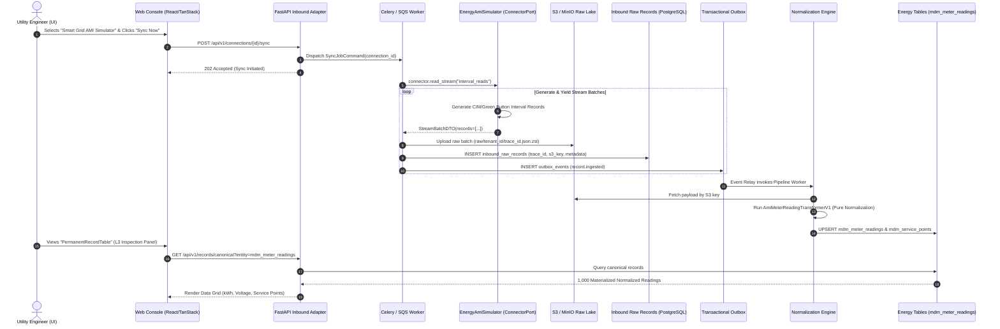

# Enterprise Architecture Specification: First-Class Sandbox Simulator Connectors

**Document Reference:** `IP-ARCH-2026-004`
**Classification:** Core Enterprise Architecture Standard
**Status:** Approved / Canonical
**Target Context:** `apps/ip` (Integration Platform Modular Monolith)
**Related Documents:** [ip_canonical_solutions_and_schema_lifecycle_architecture.md](file:///Users/apple/soopa_mono/apps/ip/docs/ip_canonical_solutions_and_schema_lifecycle_architecture.md)

---

## 1. Executive Summary & Problem Space

### 1.1 The Integration Cold-Start Dilemma
In high-consequence verticals—predominantly the **Energy and Smart Grid sector** (AMI, MDM, SCADA, OMS, GIS, CIS)—integrating external vendor enterprise systems (e.g., Itron OpenWay Riva, Oracle Utilities C2M, Siemens EnergyIP, Landis+Gyr Command Center) presents an insurmountable cold-start barrier during development, continuous integration, and commercial sales demos:
1. **Infosec & Firewall Lead Times**: Procuring vendor API credentials, mutual TLS (mTLS) certificates, dedicated VPN tunnels, and infosec compliance clearance typically takes between 3 to 9 months per utility client.
2. **Customer Onboarding & Evaluation Inertia**: Enterprise utility architects, CIOs, and systems integrators evaluate software by testing it. If an evaluation workspace cannot immediately trigger a sync and inspect materialized data in the normalized schema without submitting IT tickets, platform adoption stalls.
3. **Flaws of Traditional Mocking**:
   - Traditional unit test mocks (`unittest.mock`) only run inside CLI test runners; they completely bypass the real UI, real S3 bucket uploads, real PostgreSQL Outbox events, Celery/SQS workers, and UI data inspection panels.
   - External mock servers (e.g., running WireMock or Prism in local Docker containers) introduce severe developer friction, require brittle port mappings, and cannot be executed natively by a business user clicking "Connect" in a cloud-hosted staging or demo environment.

### 1.2 The Industry Gold Standard: The "Bogus Gateway" Pattern
Leading integration and transaction platforms solve this cold-start dilemma by shipping a **First-Class In-Engine Sandbox Simulator**:
- **Shopify**: Ships the **Bogus Gateway**, a native payment gateway implementing the identical interface as Stripe or PayPal, allowing developers and store owners to run real checkouts, webhooks, and fulfillment orders without a merchant account.
- **Stripe**: Ships **Test Clocks** and built-in synthetic tokens (`tok_visa`), exercising 100% of the real ledger, billing engine, and webhook relays.
- **Plaid**: Embeds the **Sandbox Institution** (`ins_109508`, `user_good`) directly into their core API, simulating instantaneous ACH verification, transaction histories, and balance updates.
- **AWS**: Ships localized runtime emulators (e.g., DynamoDB Local, SQS emulators) allowing full protocol parity without AWS cloud authentication.

This document establishes the canonical design for the **First-Class Sandbox Simulator Architecture** within our Integration Platform (`apps/ip`).

---

## 2. Strict Compliance with Enterprise Standards (`AGENTS.md`)

Implementing synthetic data generation within a production codebase requires strict architectural guardrails to prevent codebase degradation and maintain test/production isolation.

### 2.1 The Cardinal Rule: Zero Environment Conditionals
Our enterprise architecture guidelines explicitly enforce:
> *"Strict Test/Prod Separation: Production code MUST NEVER import testing tools, define testing strategies, or contain environment branches (e.g. `if app_env == 'test':`) to alter dependency injection or logic."*

#### ❌ The Forbidden Anti-Pattern (Control Coupling & Code Pollution)
```python
# 🚨 STRICT VIOLATION: Polluting production vendor connector with environment flags
class ItronAmiConnector(ConnectorPort):
    async def read_stream(self, stream_name: str) -> AsyncIterator[dict]:
        if settings.APP_ENV == "test" or settings.USE_MOCKS:  # FORBIDDEN
            yield {"meter_id": "fake_123", "kwh": 42.0}
            return
        async with self._soap_client as client:
            yield await client.fetch()
```

#### ✅ The Enterprise Gold Standard (Polymorphic Separation)
```python
# Production Vendor Connector (100% Pure External Protocol)
class ItronAmiConnector(ConnectorPort):
    async def read_stream(self, stream_name: str) -> AsyncIterator[dict]:
        async with self._soap_client as client:
            async for record in client.fetch_readings():
                yield record

# First-Class Sandbox Connector (100% Pure Synthetic Protocol Adapter)
class EnergyAmiSimulatorConnector(ConnectorPort):
    async def read_stream(self, stream_name: str) -> AsyncIterator[dict]:
        async for record in self._generator.generate_stream(stream_name):
            yield record
```
**Architectural Verification:**
1. **Zero Test Framework Imports**: The simulator connector imports neither `pytest` nor `unittest.mock`. It is a legitimate, production-certified Python class implementing `ConnectorPort`.
2. **Zero Control Coupling**: The core engine (Sync Dispatcher, S3 Ingestion, Outbox Relay, L1/L2 Builders, L3 Normalizers) operates completely blind to the data origin. It invokes `connector.read_stream()`. Whether bytes originated from Itron's SOAP endpoint or the simulator's deterministic generator, the engine's execution path is **100% identical**.
3. **No Dynamic Mocks for Pure Logic**: The domain models, canonical schemas, and transformation pipelines are exercised with real data structures—not mocks.

---

## 3. Directory Taxonomy: The 4 Pillars of `ip.solutions`

Under `apps/ip/packages/ip/src/ip/solutions`, four foundational pillars organize all business capabilities:

```text
┌─────────────────────────┐       ┌─────────────────────────┐       ┌─────────────────────────┐       ┌─────────────────────────┐
│       connectors/       │ ───▶  │      transformers/      │ ───▶  │        stitches/        │ ───▶  │        domains/         │
│  (Data Sources/Ingest)  │       │  (Pure Canonical Maps)  │       │ (Cross-Stream Merging)  │       │ (SQL Schema & Storage)  │
└─────────────────────────┘       └─────────────────────────┘       └─────────────────────────┘       └─────────────────────────┘
```

### 3.1 Why Simulators Belong Inside `connectors/`
A simulator is structurally an **Ingestion Source**. Its single responsibility is to act as a data ingress adapter conforming to `ConnectorPort`.

Creating a 5th top-level directory (`ip/solutions/sandbox/`) is explicitly rejected because it introduces a **Shadow Architecture**:
- It falsely implies that the sandbox possesses its own sandbox schemas, sandbox transformers, or sandbox database tables.
- The fundamental value of the Bogus Gateway pattern is that **the simulator feeds directly into the real production `transformers/energy` and commits into the real production `domains/energy` tables**.
- Only the source of the bits is simulated; everything downstream is 100% production code.

### 3.2 Domain-Partitioned Internal Taxonomy
Dumping all simulators into a flat `connectors/sandbox/` directory violates Domain-Driven Design (the "Junk Drawer" antipattern). Simulators must be strictly partitioned by **Bounded Domain Vertical**:

```text
apps/ip/packages/ip/src/ip/solutions/
├── connectors/                                 # 🏛️ PILLAR 1: INGESTION ADAPTERS
│   ├── manifests/                              # Declarative SaaS specs (Salesforce, Stripe, etc.)
│   │   ├── salesforce.py
│   │   ├── stripe.py
│   │   └── ...
│   ├── sandbox/                                # 🧪 FIRST-CLASS SIMULATORS
│   │   ├── __init__.py
│   │   ├── energy/                             # Vertical: Energy & Smart Grid
│   │   │   ├── __init__.py
│   │   │   ├── ami_simulator_connector.py      # Implements ConnectorPort for AMI
│   │   │   ├── scada_simulator_connector.py    # Implements ConnectorPort for SCADA
│   │   │   └── generators/
│   │   │       ├── __init__.py
│   │   │       ├── interval_reading_gen.py     # Deterministic kWh/voltage physics
│   │   │       └── service_point_gen.py        # Meters, topologies, serials
│   │   └── tms/                                # Vertical: Transportation Management
│   │       ├── __init__.py
│   │       ├── carrier_simulator_connector.py
│   │       └── generators/
│   │           └── freight_load_gen.py
│   ├── registry_loader.py                      # Bootstraps builtin connectors & manifests
│   └── generic_http_connector.py
│
├── domains/                                    # 🏛️ PILLAR 2: TARGET SCHEMAS & STORAGE
│   ├── energy/                                 # Canonical Energy L3 Tables & Repos
│   │   ├── migrations/
│   │   ├── models.py                           # SQLAlchemy models: mdm_meter_readings, mdm_service_points
│   │   ├── canonical.py                        # Domain Value Objects & Enums
│   │   ├── repository.py                       # Data access adapters
│   │   └── writers.py
│   └── tms/
│
├── transformers/                               # 🏛️ PILLAR 3: PURE TRANSFORMATION HOOKS
│   ├── energy/                                 # L3 pure normalizers (ReplicaSnapshot -> Canonical)
│   │   └── itron_mdm.py
│   └── tms/
│
└── stitches/                                   # 🏛️ PILLAR 4: CROSS-STREAM CORRELATION
    ├── energy/
    └── tms/
```

### 3.3 Separation of Transport vs Data Physics
Inside each vertical simulator package, we enforce strict separation of concerns:
1. **The Transport Layer (`ami_simulator_connector.py`)**:
   - Manages connection lifecycle (`test_connection`, `connect`).
   - Implements cursor-based pagination and stream iteration (`read_stream`).
   - Emits raw dictionaries adhering to the ingestion contract.
2. **The Physics / Generation Engine (`generators/interval_reading_gen.py`)**:
   - Manages domain-accurate math, timestamps, interval alignments, and energy unit physics.
   - Implements deterministic PRNG (Pseudo-Random Number Generation) based on seed parameters, guaranteeing repeatable test runs.

---

## 4. End-to-End Pipeline Execution: The Zero-Mock Flow

The following sequence details how a single click on the UI triggers the complete production data pipeline without invoking any third-party networks:



---

## 5. Domain Realism & Energy Sector Physics

To serve as a genuine integration sandbox for smart grid utilities, the simulator cannot simply emit random lorem-ipsum values. It must reflect **ANSI C12.19, IEC 61968-9 (CIM), and NAESB ESPI (Green Button)** standards.

### 5.1 Supported Streams & Canonical Entities

The `EnergyAmiSimulatorConnector` natively provides two high-volume streams:

| Stream Name | Target Canonical Table | Source Frequency | Primary Data Attributes |
| :--- | :--- | :--- | :--- |
| `service_points` | `mdm_service_points` | Topology (Slow) | Service Point ID, Meter Serial, Latitude/Longitude, Status (`ACTIVE`, `INACTIVE`), Phase Wiring (`SINGLE_PHASE`, `THREE_PHASE`), Multiplier. |
| `interval_reads` | `mdm_meter_readings` | 15-Minute Intervals | Timestamp (UTC ISO 8601), Interval Duration (900s), Active Energy ($kWh$), Peak Demand ($kW$), Reactive Energy ($kVARh$), RMS Voltage ($V$), Quality Flag (`VALID`, `ESTIMATED`, `SUSPECT`). |

### 5.2 Deterministic Physics Model
The interval generator (`interval_reading_gen.py`) models real-world physical grid phenomena:
1. **Diurnal Solar & Demand Curves**:
   - Residential curve: Peaks at morning (07:00–09:00) and evening (18:00–22:00).
   - Commercial/Industrial curve: Flat high plateau during business hours (08:00–18:00).
   - Distributed Generation (Solar): Midday negative net consumption between 11:00 and 15:00.
2. **Voltage Fluctuation & Sag**:
   - Nominal voltage centered at $120.0\text{V}$ (or $240.0\text{V}$) with a normal Gaussian jitter ($\sigma = 1.2\text{V}$) and occasional simulated sags down to $112.0\text{V}$.
3. **Deterministic Seeding**:
   - Generators accept an optional `seed` parameter (defaulting to the connection ID). The same connection will always reproduce identical historical curves across consecutive test runs, ensuring deterministic test fixtures.

### 5.3 Simulating Chaos & Grid Edge Cases
The simulator connector exposes configurable properties in its schema, allowing utility QA engineers to stress-test their alerting rules:
```json
{
  "failure_rate_percent": 2.5,
  "clock_drift_seconds": 180,
  "simulate_power_outage": false,
  "simulate_solar_backfeed": true
}
```
- **Power Outage Simulation**: Generates zero-energy intervals with `quality_flag = "POWER_OUTAGE"`.
- **Clock Drift**: Meters report timestamps misaligned with strict 15-minute boundaries, testing the engine's L2 timestamp normalization.

---

## 6. Catalog, UI & Tenant Governance

### 6.1 Catalog Registration
The simulator is registered in `ConnectorCatalogRegistry` through `ip.solutions.connectors.registry_loader`:

```python
CatalogAppSummaryDTO(
    app_id="energy_ami_simulator",
    display_name="Smart Grid AMI (Simulator)",
    category="Energy AMI",
    auth_type="NO_AUTH",
    description="Pre-configured high-fidelity Smart Grid AMI simulator generating realistic 15-minute interval telemetry and service point topologies.",
    connector_type="NATIVE_SIMULATOR",
)
```

### 6.2 UI Presentation (Shopify Style)
In `IpConnectionsPage.tsx`:
- The simulator appears under the **"Energy AMI"** category filter alongside real production vendors (**Itron OpenWay**, **Oracle Utilities C2M**).
- It is visually distinguished by a subtle `Simulator` status pill.
- The "Connect" modal requires **zero credentials** (no API keys, no URLs, no certificate uploads). Clicking **"Create Connection"** provisions the connection instantly with sensible defaults.

### 6.3 Tenant Security & Environment Fencing
Although the simulator contains no test framework code, enterprise clients operating in certified Production Cloud environments may choose to disable synthetic generators:
1. **Workspace Capability Flags**: Every tenant workspace includes an `allow_simulator_connectors: bool` capability flag.
2. **Production Policy**:
   - Development & Staging Workspaces: `allow_simulator_connectors = True` (Default).
   - Sales Evaluation / Demo Workspaces: `allow_simulator_connectors = True` (Default).
   - Utility Live Production Workspaces: `allow_simulator_connectors = False` (Enforced via RBAC and catalog filter).

---

## 7. Implementation Plan

```text
Phase 1: Domain Physics & Generators
└── Implement apps/ip/packages/ip/src/ip/solutions/connectors/sandbox/energy/generators/
    ├── interval_reading_gen.py
    └── service_point_gen.py

Phase 2: Simulator Adapter
└── Implement apps/ip/packages/ip/src/ip/solutions/connectors/sandbox/energy/ami_simulator_connector.py
    └── Implements ConnectorPort (connect, test_connection, read_stream, stream_specs)

Phase 3: Catalog Registration
└── Register in apps/ip/packages/ip/src/ip/solutions/connectors/registry_loader.py
    └── Add energy_ami_simulator to the builtin catalog

Phase 4: End-to-End Narrow Integration Verification
└── Add tests/integration/solutions/connectors/sandbox/test_ami_simulator.py
    └── Verify connection -> stream reading -> L3 transformer -> PostgreSQL DB commit
```

---

## 8. Summary Comparison Matrix

| Architectural Invariant | Traditional Mocking / Testing Stubs | First-Class Sandbox Simulator (Bogus Gateway) |
| :--- | :--- | :--- |
| **Port & Adapter Isolation** | Frequently bypasses ports via mock monkey-patching. | Pure adapter implementing `ConnectorPort`. Zero engine coupling. |
| **Engine Execution** | Bypasses S3, DB transactions, outbox events, and workers. | Executes 100% of real production engine code, S3, and PostgreSQL. |
| **UI Verifiability** | Cannot be viewed or clicked from the web browser. | Accessible directly in the UI Catalog; triggers live UI table updates. |
| **Vendor Independence** | Requires vendor credentials or isolated Docker containers. | Zero credentials required; zero network dependencies; runs out of the box. |
| **Clean Architecture Integrity** | Can cause test tools to bleed into production modules. | Isolated in `solutions/connectors/sandbox/energy/`. No test imports. |
