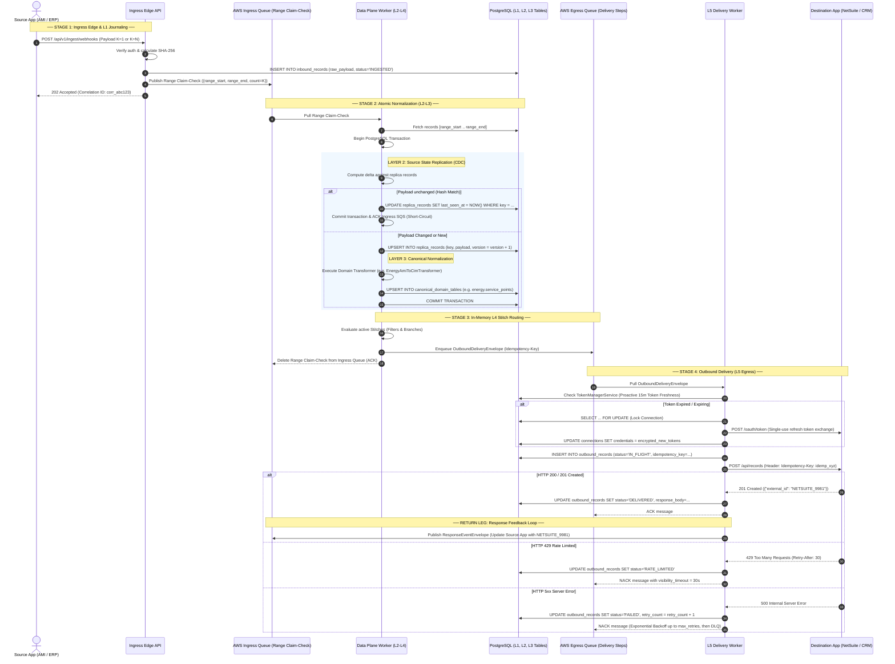

# Soopa Integration Platform (`apps/ip`)
## Gear-1 Data Plane Architecture & End-to-End L1–L5 Flow Specification

- **Document:** Gear-1 Operational Data Plane Architecture, Range-Event Claim-Check Topology & L1–L5 Execution Lifecycle
- **Status:** Approved Architecture Specification
- **Location:** `apps/ip/docs/ip_gear1_data_plane_flow_architecture.md`
- **Bounded Context:** Integration Platform Data & Control Planes (`ip.engine`)

---

## 1. Scope & Core Architecture Principles

### 1.1 Scope (Gear-1 Operational Flows)
Gear 1 governs all **Stateful, Row-Oriented, Transactional Business Entities** within the Soopa Integration Platform:
- Customer accounts, service points, physical meters, tariff configurations, billing invoices, work orders, and field-service tickets.
- High-integrity ACID semantics executed against PostgreSQL.

*(High-frequency 15-minute interval smart-meter telemetry is isolated to Gear-2 columnar streaming in ClickHouse/Arrow).*

### 1.2 Core Architectural Principles
1. **Queues at Boundaries**:
   - `ingress-queue` buffers external incoming traffic and absorbs bursts.
   - `egress-queue` buffers outbound mutations and absorbs downstream partner API rate limits.
2. **Atomic In-Memory Data Plane**:
   - Internal state transitions (L2 Replica $\to$ L3 Canonical) execute in worker memory and commit within a **single ACID PostgreSQL transaction**.
3. **Range-Event Claim-Check Pattern**:
   - SQS carries **only lightweight Claim-Check range pointers (~1 KB)**.
   - Raw payloads live immutably in the **L1 `public.inbound_records` table** (with S3/MinIO offload for payloads $\ge 64\text{ KB}$).
   - A single unified Range Event format processes both single events ($K=1$) and bulk batches ($K=N$).

---

## 2. End-to-End System Topology

```
[External Sources] (Webhooks / Smart Meter APIs / ERPs / Pollers)
       │
       ▼
┌────────────────────────────────────────────────────────────────────────┐
│  STAGE 1: INGRESS PERIMETER (LAYER 1 JOURNAL & RANGE CLAIM-CHECK)      │
│  • Receives payload (Single Record or Bulk Batch).                     │
│  • Writes raw data to L1 Table: `public.inbound_records`               │
│    (Immutable raw ledger; payloads >= 64 KB offload to S3/MinIO).      │
│  • Enqueues Range Claim-Check to `ingress-queue` (AWS SQS):            │
│    { "tenant_id": "...", "stream": "...", "start_id": "...",           │
│      "end_id": "...", "count": K }                                     │
│  • Returns HTTP 202 Accepted to caller (< 10ms).                       │
└───────────────────────────────────┬────────────────────────────────────┘
                                    │
                                    ▼ (Range Claim-Check: 1 to K Records)
┌────────────────────────────────────────────────────────────────────────┐
│  STAGE 2: DATA PLANE NORMALIZATION (LAYER 2 ──► LAYER 3)               │
│  • Worker pulls Range Claim-Check from `ingress-queue`.                │
│  • Reads raw records [start_id .. end_id] from `inbound_records`.      │
│  • Single PostgreSQL Transaction (ACID):                               │
│    - Upserts L2 Replica Table (`public.replica_records`) for CDC/Hash. │
│    - Upserts L3 Canonical Table (e.g. `energy.service_points`).        │
│    - Commits transaction.                                              │
│  • Evaluates L4 Stitch Rules in-memory (Filters, Branching, Routing).  │
│  • Enqueues Outbound Action Steps to `egress-queue` (AWS SQS).         │
│  • Deletes Range Claim-Check from `ingress-queue` (ACK).               │
└───────────────────────────────────┬────────────────────────────────────┘
                                    │
                                    ▼ (Outbound Action Steps)
┌────────────────────────────────────────────────────────────────────────┐
│  STAGE 3: OUTBOUND DELIVERY GATEWAY (LAYER 5 EGRESS & RETURN LEG)      │
│  • Delivery Worker pulls action from `egress-queue`.                   │
│  • Manages OAuth2 token refresh with PostgreSQL row locks.             │
│  • Inserts `public.outbound_records` with status='IN_FLIGHT'.          │
│  • Executes HTTP POST/PUT to Destination App (NetSuite, Salesforce).   │
│  • On 200/201: Marks record as 'DELIVERED' & ACKs SQS.                 │
│  • On 429: NACKs to SQS with visibility = `Retry-After`.               │
│  • On 5xx: Retries with exponential backoff, then moves to DLQ.        │
│  • Return Leg: Destination's generated ID (e.g. ERP Order #) is        │
│    wrapped in a Response Envelope and pushed to `ingress-queue` (L0)   │
│    to update Source App A without circular locks.                      │
└────────────────────────────────────────────────────────────────────────┘
```

---

## 3. The Range-Event (1–N) Claim-Check Specification

A single unified JSON schema coordinates both single real-time transactions and bulk historical imports:

```json
{
  "event": "records.ingested",
  "tenant_id": "iam_ten_98f5b60bcd06f8d2",
  "stream": "service_points",
  "batch_id": "batch_be2f1c4f5c44f78b",
  "range_start": "inb_00100",
  "range_end": "inb_00599",
  "count": 500,
  "trace_id": "tr_c9876a12b456"
}
```

### Ingestion Range Modes

| Mode | Range Count ($K$) | Start / End ID | Worker Execution Behavior |
| :--- | :--- | :--- | :--- |
| **Real-Time Webhook / Single Event** | **$K = 1$** | `range_start == range_end` | Worker fetches single row by ID, executes L2/L3 in $< 10\text{ms}$. |
| **Bulk Import / Historical Backfill** | **$K = 500$** | `range_start != range_end` | Worker fetches 500 rows in one bulk query, executes batch L2/L3 upsert in a single transaction. |

---

## 4. Step-by-Step Chronological Execution Sequence

### Phase A: Ingress Perimeter & L1 Raw Journaling
1. **External Reception**: Source system (Smart Meter AMI, ERP, or Webhook) submits data to the platform Ingress HTTP endpoint.
2. **Signature & Integrity Verification**: Ingress Edge validates authentication, computes payload SHA-256 hash, and generates a global `trace_id`.
3. **Persist to L1 Inbound Table (`public.inbound_records`)**: Ingress Edge writes records directly to `public.inbound_records` with status `INGESTED` (payloads $\ge 64\text{ KB}$ are offloaded to S3/MinIO, with URI pointer stored in the row).
4. **Publish Range Claim-Check**: Ingress Edge constructs a Range Event envelope (`start_id`, `end_id`, `count = K`) and pushes it to `ingress-queue` (AWS SQS).
5. **Immediate Client ACK**: Ingress Edge returns `HTTP 202 Accepted` with `batch_id` and `trace_id` in $< 10\text{ms}$.

### Phase B: Data Plane Atomic Normalization (L2 → L3)
6. **Pull Range Claim-Check**: Normalization Worker pulls the Range Event from `ingress-queue`.
7. **Fetch Raw Records**: Worker fetches raw payloads for the range `[range_start .. range_end]` from `public.inbound_records`.
8. **Open Single ACID Transaction**: Worker begins transaction (`BEGIN`).
9. **L2 CDC & Deduplication (`public.replica_records`)**: Worker compares incoming payload hashes against current replica records:
   - Identical hashes are marked with updated `last_seen_at` and short-circuited.
   - New or modified records are upserted into `public.replica_records` with version incremented.
10. **L3 Canonical Normalization**: Worker transforms data into domain canonical structures (e.g. `energy.service_points`), enforces domain invariants, and upserts into target domain tables.
11. **Commit Transaction**: Worker issues `COMMIT`. All updates (L2 and L3) persist atomically.

### Phase C: Layer-4 Stitch Evaluation & Action Dispatch
12. **Match Active Stitches**: Worker matches active visual Stitches (integration recipes) subscribed to this stream.
13. **Evaluate Filters & Conditions**: Worker applies filter logic (e.g. `status == 'ACTIVE'`, `voltage > 240V`). Non-matching events are dropped with an audit log.
14. **Evaluate Branching & Target Mapping**: Worker maps canonical entities into target-specific schemas (e.g. NetSuite Customer, Salesforce Account) and assigns a deterministic `idempotency_key`.
15. **Enqueue Outbound Actions**: Worker pushes `stitch.step.deliver` envelopes into `egress-queue` (AWS SQS).
16. **Delete from Ingress Queue (ACK)**: Worker deletes the Range Claim-Check message from `ingress-queue`.

### Phase D: Outbound Delivery Gateway (Layer 5)
17. **Pull Action Step**: L5 Delivery Worker pulls action envelope from `egress-queue`.
18. **Verify Credentials & Tokens**: Worker verifies token freshness via `TokenManagerService` (acquiring PostgreSQL row lock `SELECT ... FOR UPDATE` if refresh is required).
19. **Pre-stage Outbound Ledger**: Worker writes to `public.outbound_records` with status `IN_FLIGHT` and `idempotency_key`.
20. **External Network Call**: Worker sends HTTP POST/PUT to Destination App with `Idempotency-Key` header.
21. **Classify Response**:
    - **HTTP 200/201 (Success)**: Reads response body (e.g. `{"external_id": "NETSUITE_9981"}`), marks record `DELIVERED`, and deletes message from `egress-queue`.
    - **HTTP 429 (Rate Limited)**: Reads `Retry-After` header, marks record `RATE_LIMITED`, and releases SQS message back with matching visibility timeout.
    - **HTTP 5xx (Server Error)**: Marks record `FAILED` with retry increment; SQS retries with exponential backoff until threshold, then moves to `public.quarantine_records` (DLQ).

### Phase E: Response & Callback Feedback Loop (Return Leg)
22. **Package Response Envelope**: On successful response with generated identifiers (e.g. `NETSUITE_9981`), L5 Worker builds a `ResponseEventEnvelope` with `originating_trace_id`.
23. **Ingress Loopback**: L5 Worker pushes the response envelope back into **`ingress-queue` (L0)**. It is ingested as a new event through L1 $\to$ L2 $\to$ L3 to update Source App A or register cross-system foreign keys in `ip.entity_maps` without circular database locks.

---

## 5. End-to-End Sequence Diagram



---

## 6. Architectural Quality Attributes & Durability Matrix

| Quality Attribute | Architectural Mechanism | Enterprise Guarantee |
| :--- | :--- | :--- |
| **Payload Scalability** | **Claim-Check Pattern** | Bypasses SQS 256 KB hard limit. Large payloads live in `inbound_records` / S3; SQS handles only 1 KB range pointers. |
| **Throughput Optimization** | **Range Events (1 to $N$)** | Unifies single events ($K=1$) and bulk batches ($K=500$). Eliminates SQS queue flooding and leverages bulk SQL operations. |
| **Write Atomicity** | **Single DB Transaction** | L2 Replica and L3 Canonical update together or roll back together. Zero partial-state corruption. |
| **Crash Safety** | **Queue Visibility Timeout** | If a worker crashes before completing L3, SQS re-delivers the range message. L2 hash check ensures idempotency. |
| **Egress Resilience** | **Dedicated Egress SQS + DLQ** | Slow 3rd-party APIs (NetSuite, Salesforce) can never backpressure the database or stall incoming meter ingestion. |
| **Ordering & Dedup** | **L2 Replica Merkle Hashing** | Identical updates are short-circuited immediately, preventing duplicate downstream syncs. |
