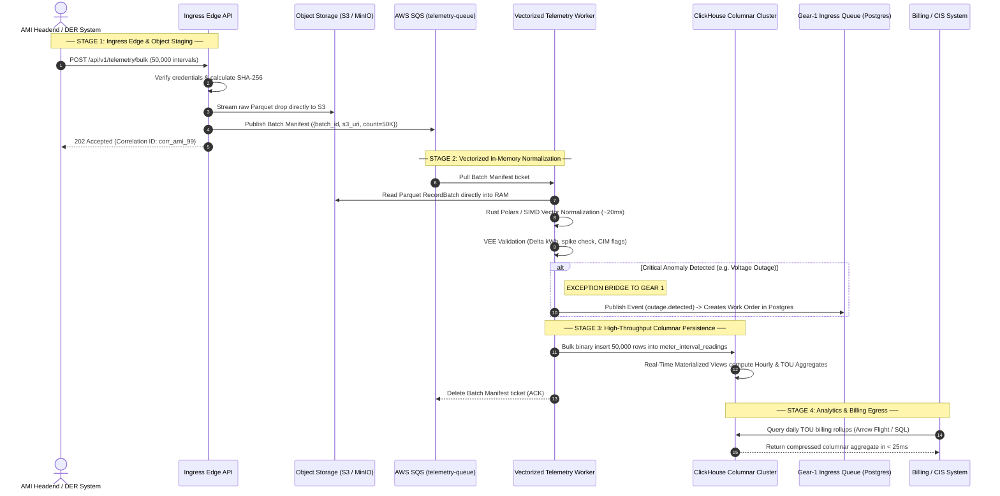

# Soopa Integration Platform (`apps/ip`)
## Gear-2 High-Frequency Telemetry Data Plane Architecture & End-to-End Flow Specification

- **Document:** Gear-2 High-Frequency Telemetry Data Plane Architecture, Vectorized Columnar Pipeline & Execution Lifecycle
- **Status:** Approved Architecture Specification
- **Location:** `apps/ip/docs/ip_gear2_data_plane_flow_architecture.md`
- **Bounded Context:** Integration Platform Data & Visibility Planes (`ip.engine`)

---

## 1. Scope & Core Architecture Principles

### 1.1 Scope (Gear-2 High-Frequency Telemetry)
Gear 2 governs all **High-Frequency, Time-Series, Columnar Telemetry Streams** within the Soopa Integration Platform:
- 15-minute and 5-minute interval readings across millions of smart electric, water, and gas meters (AMI/AMR).
- Distributed Energy Resource (DER) solar generation, inverter voltage, battery state-of-charge, and EV charging telemetry.
- Throughput scale: **10 Million to 1 Billion+ intervals/day**, processed in macro-batches of 10,000 to 50,000 rows.

### 1.2 Core Architectural Principles
1. **Object Storage as Ingress Shock Absorber**:
   - Ingress Edge streams raw multi-meter interval drops directly into **Object Storage (S3 / MinIO)** in Parquet/Arrow format, returning `HTTP 202 Accepted` in $< 10\text{ms}$.
   - Telemetry queue (`telemetry-queue`) carries **only a lightweight ~1 KB Batch Manifest ticket** (`{batch_id, s3_uri, count, tenant_id}`).
2. **In-Memory Vectorized Normalization (Zero Python Loop Overhead)**:
   - Telemetry Workers stream Parquet chunks directly into RAM using **Apache Arrow & Rust Polars**.
   - Schema mapping, GEM identifier lookups, and Validation, Estimation & Editing (VEE) run via SIMD vector operations across 50,000 rows in **`~20ms`** ($> 2\text{M}$ rows/sec/core).
3. **High-Throughput Columnar Engine (ClickHouse)**:
   - Normalized vectors are flushed directly into ClickHouse (`MergeTree` family) at **$> 1\text{M}$ rows/sec/node**.
   - Multi-tenant columnar partitioning delivers **15:1 ZSTD compression** on disk.
   - Materialized Views compute hourly, daily, and Time-of-Use (TOU) rollups incrementally in real time.
4. **Exception-Only Bridge to Gear 1**:
   - Operational anomalies (e.g. sustained over-voltage $> 260\text{V}$, tamper detection, power outage signals) emit structured domain events directly to Gear-1 `ingress-queue` to generate field-service work orders in PostgreSQL.

---

## 2. End-to-End System Topology

```
[Smart Meter Headends / AMI Ingress] (Drops of 10K–50K readings)
       │
       ▼
┌────────────────────────────────────────────────────────────────────────┐
│  STAGE 1: INGRESS EDGE & OBJECT STAGING                                │
│  • Receives bulk AMI payload (CIM XML, CSV, JSON, Parquet).            │
│  • Streams raw batch directly to Object Storage (S3 / MinIO).          │
│  • Enqueues Batch Manifest ticket to `telemetry-queue` (AWS SQS):      │
│    { "batch_id": "...", "s3_uri": "s3://.../drop_01.parquet",           │
│      "count": 50000, "tenant_id": "..." }                              │
│  • Returns HTTP 202 Accepted to caller (< 10ms).                       │
└───────────────────────────────────┬────────────────────────────────────┘
                                    │
                                    ▼ (Batch Manifest - 1 KB)
┌────────────────────────────────────────────────────────────────────────┐
│  STAGE 2: VECTORIZED IN-MEMORY NORMALIZATION (ARROW / POLARS)          │
│  • Telemetry Worker pulls Batch Manifest from `telemetry-queue`.       │
│  • Streams raw Parquet chunk into RAM as an Apache Arrow RecordBatch.  │
│  • Vectorized GEM Rosetta resolution: joins meter-to-service-point IDs.│
│  • VEE Pipeline (Validation, Estimation, Editing):                     │
│    - Vectorized spike detection and delta kWh calculation.             │
│    - Assigns IEC 61968 CIM quality flags (VALID, ESTIMATED, ANOMALOUS).│
│  • Emits Anomaly Events (e.g. Outage/Voltage Spikes) to Gear-1.        │
└───────────────────────────────────┬────────────────────────────────────┘
                                    │
                                    ▼ (Normalized Arrow Vector)
┌────────────────────────────────────────────────────────────────────────┐
│  STAGE 3: COLUMNAR PERSISTENCE & REAL-TIME ROLLUPS (CLICKHOUSE)        │
│  • Worker executes bulk zero-copy stream insert to ClickHouse:         │
│    `telemetry.meter_interval_readings` (ReplacingMergeTree).           │
│  • Native disk compression (15:1 ZSTD); indexed by (tenant, meter, ts).│
│  • Real-Time Materialized Views automatically update:                  │
│    - `telemetry.hourly_interval_rollups`                               │
│    - `telemetry.daily_tou_billing_aggregates`                          │
│  • Worker deletes Batch Manifest from `telemetry-queue` (ACK).         │
└───────────────────────────────────┬────────────────────────────────────┘
                                    │
                                    ▼ (Sub-25ms Analytical Queries)
┌────────────────────────────────────────────────────────────────────────┐
│  STAGE 4: VISIBILITY & BILLING EGRESS                                  │
│  • Command Center Dashboard: Sub-25ms heatmaps & meter search.         │
│  • Billing Engine Egress: Downstream CIS/Billing systems query         │
│    daily TOU aggregates directly via Arrow Flight / SQL.               │
│  • Long-Term Archival: Background compaction tiers historical Parquet  │
│    to cold S3 storage after 90 days.                                   │
└────────────────────────────────────────────────────────────────────────┘
```

---

## 3. The Batch Manifest Claim-Check Specification

A lightweight JSON manifest coordinates multi-tenant macro-batches across the distributed storage and compute tiers:

```json
{
  "event": "telemetry.batch.ingested",
  "tenant_id": "iam_ten_98f5b60bcd06f8d2",
  "batch_id": "batch_ami_20261106_120000_be2f1c",
  "s3_uri": "s3://soopa-telemetry-raw/tenants/iam_ten_98f5/2026/11/06/drop_1200_part01.parquet",
  "format": "PARQUET",
  "row_count": 50000,
  "stream": "smart_meter_intervals",
  "checksum_sha256": "e3b0c44298fc1c149afbf4c8996fb92427ae41e4649b934ca495991b7852b855",
  "trace_id": "tr_telemetry_9981a"
}
```

---

## 4. Step-by-Step Chronological Execution Sequence

### Phase A: Ingress Perimeter & S3 Object Staging
1. **External Bulk Drop**: AMI Headend (Itron, Landis+Gyr, Sensus) or DER aggregator transmits a batch of 10,000–50,000 meter interval readings via HTTP POST or SFTP upload.
2. **Authentication & Stream Classification**: Ingress Edge verifies tenant credentials, validates file headers, and assigns `trace_id`.
3. **Direct-to-Object Staging**: Ingress Edge streams the raw batch directly to S3/MinIO under a partitioned path (`s3://raw/{tenant_id}/{year}/{month}/{day}/{batch_id}.parquet`), computing SHA-256 in-flight.
4. **Publish Batch Manifest**: Ingress Edge constructs a 1 KB Batch Manifest ticket and publishes it to `telemetry-queue` (AWS SQS).
5. **Immediate Client ACK**: Ingress Edge returns `HTTP 202 Accepted` with `batch_id` and `trace_id` in $< 10\text{ms}$.

### Phase B: Vectorized In-Memory Normalization (Arrow / Polars)
6. **Pull Batch Manifest**: High-concurrency Telemetry Worker pulls manifest from `telemetry-queue`.
7. **Zero-Copy Stream Read**: Worker reads the S3 Parquet file directly into host RAM as an Apache Arrow `RecordBatch` (bypassing Python object instantiation).
8. **Vectorized GEM Rosetta Resolution**: Worker performs an in-memory vector join against a locally cached dictionary of `(external_meter_id) -> (canonical_service_point_id)`.
9. **Vectorized VEE Validation**: Polars SIMD expressions validate interval regularity, compute delta kWh from cumulative registers, and assign IEC 61968 CIM status flags:
   - `FLAG_VALID`: Expected interval, normal consumption.
   - `FLAG_SPIKE`: Extreme delta exceeding physical threshold.
   - `FLAG_REVERSE_FLOW`: Negative net generation (solar DER export).
10. **Anomaly Detection & Gear-1 Bridge**: If anomalous readings meet operational criteria (e.g., zero voltage indicating power outage), Worker emits an isolated `outage.detected` event directly to Gear-1 `ingress-queue` to initiate emergency work-order workflows in PostgreSQL.

### Phase C: High-Throughput Columnar Persistence (ClickHouse)
11. **Bulk Columnar Flush**: Worker streams the normalized Arrow table directly into ClickHouse table `telemetry.meter_interval_readings` using the native binary ClickHouse protocol (zero serialization overhead).
12. **Real-Time Materialized Aggregations**: ClickHouse triggers internal `MATERIALIZED VIEW` engines on commit:
    - Increments hourly kWh totals in `telemetry.hourly_rollups`.
    - Updates peak, off-peak, and shoulder buckets in `telemetry.daily_tou_billing_aggregates`.
13. **Delete Batch Manifest (ACK)**: Worker deletes the Batch Manifest message from `telemetry-queue`.

### Phase D: Analytics, Visibility & Billing Egress
14. **Sub-25ms Dashboard Querying**: User queries from `@soopa/ip-ui` (heatmaps, meter intervals, aggregation charts) query ClickHouse directly with tenant row-level policies applied, returning in $< 25\text{ms}$.
15. **Billing System Egress**: Upstream CIS and billing systems pull aggregated monthly/daily totals directly via SQL or Arrow Flight streaming without touching row-level raw intervals.
16. **Cold Tier Compaction**: Background lifecycle rules compress and move raw S3 Parquet objects older than 90 days to S3 Glacier / Cold storage for long-term audit retention.

---

## 5. End-to-End Sequence Diagram



---

## 6. Architectural Quality Attributes & Performance Matrix

| Quality Attribute | Architectural Mechanism | Enterprise Benchmark |
| :--- | :--- | :--- |
| **Ingestion Throughput** | **Direct-to-S3 Staging + ClickHouse Bulk Stream** | Ingests $> 1\text{M}$ intervals/second across worker nodes without database locks. |
| **Compute Efficiency** | **Vectorized Apache Arrow / Rust Polars in RAM** | Normalizes 50,000 intervals in $\approx 20\text{ms}$ with zero Python per-row overhead. |
| **Storage Compression** | **ClickHouse Columnar ZSTD + S3 Parquet** | Achieves **15:1 to 20:1 compression ratio**, minimizing cloud storage costs for billions of rows. |
| **Query Latency** | **ClickHouse Materialized Views** | Single-meter searches and 96-slot interval heatmaps return in **$< 25\text{ms}$** across billions of rows. |
| **Blast Radius Isolation** | **Exception-Only Bridge to Gear 1** | Ingestion of 500M intervals never touches PostgreSQL WAL or connection pools; connects to Gear 1 only on actionable outages/anomalies. |
| **Crash Durability** | **S3 Immutability + SQS Visibility Timeout** | Raw files in S3 are permanent. If a worker crashes mid-normalization, SQS re-delivers the manifest ticket with zero data loss. |
