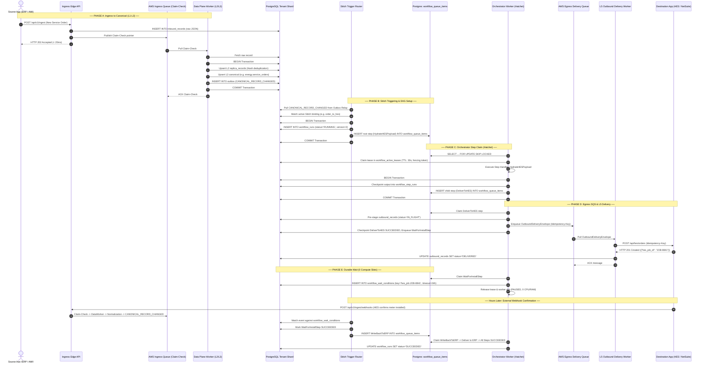

# Soopa Integration Platform (`apps/ip`)
## Orchestrator Engine, Stitches, and Queue Topology Architecture

- **Document:** Orchestrator (Hatchet-Inspired) Worker, Stitch DAG Lifecycles & Queue Association Specification
- **Status:** Approved Architecture Specification
- **Location:** `apps/ip/docs/ip_orchestrator_and_stitches_workflow_architecture.md`
- **Bounded Contexts:** `ip.engine`, `core.platform.packages.orchestration`

---

## 1. Executive Summary & Ubiquitous Language

The Integration Platform is not a simple one-way piping tool; it coordinates **complex, multi-step business flows between enterprise applications**:
- An ERP submits an account creation $\to$ Platform provisions smart meter in Head-End System (HES) $\to$ HES returns meter identifier minutes or hours later $\to$ Platform writes HES ID back to ERP.
- If any container, worker, or third-party API crashes or times out halfway through, the platform must **resume exactly at the failed step**, **never repeat an external side-effect twice**, and **never drop an asynchronous callback**.

This capability is governed by three tightly associated components:
1. **The Orchestrator Engine (`core/platform/packages/orchestration`)**: A generic, Postgres-native durable workflow engine inspired by **Hatchet**. It manages DAG state, step dependencies, lease claims, retries, durable timers, and fencing tokens.
2. **Stitches (`apps/ip/packages/ip/src/ip/engine/solutions/stitches`)**: The business integration recipes. A Stitch is a versioned DAG of typed steps (e.g. `energy.service_order_to_hes`) built on top of the generic Orchestrator Engine.
3. **The Queue Topology**: A strict two-tier queue separation that distinguishes **external boundary network queues (AWS SQS)** from **internal workflow step queues (Postgres `workflow_queue_items`)**.

---

## 2. Core Concepts & Their Association

```
┌──────────────────────────────────────────────────────────────────────────────────┐
│                             THE 3-TIER ASSOCIATION                               │
│                                                                                  │
│  1. STITCHES (DAG)       ───► The Recipe: Defines business steps, conditions,    │
│                               transformations, and wait points.                  │
│                                                                                  │
│  2. ORCHESTRATOR WORKER  ───► The Chef: Background worker that claims steps via  │
│                               Postgres `SKIP LOCKED`, executes them, checkpoints │
│                               results, and commits atomically in the DB shard.   │
│                                                                                  │
│  3. QUEUES (Two Tiers)   ───► Boundary SQS vs. Internal Postgres Step Queue:     │
│                               • AWS SQS: Buffers external network APIs.          │
│                               • Postgres Queue: Coordinates steps inside a Stitch│
└──────────────────────────────────────────────────────────────────────────────────┘
```

### 2.1 The Orchestrator Engine (Hatchet-Inspired)
Instead of running a separate heavy orchestrator cluster (like Temporal) that stores state in a separate database, our orchestrator engine is **PostgreSQL-native and co-located in the tenant's data plane shard**:
- **`FOR UPDATE SKIP LOCKED`**: High-throughput queue polling with zero lock contention.
- **Active Lease Table (`workflow_active_leases`)**: Compact unpartitioned table storing active worker leases. Workers heartbeat every 5s; dead worker steps are reaped within 30s.
- **3-Counter Retry Policy**:
  - `retry_count`: Monotonically increasing fencing token protecting against split-brain zombies.
  - `app_retry_count`: The user-facing failure retry budget (e.g., 3 attempts).
  - `internal_retry_count`: Worker crash / lease expiration budget. **A worker crash never burns a user's retry budget.**
- **Atomic Shard Commit**: Because workflow state lives in the tenant database shard alongside `replica_records`, `normalized_records`, `entity_maps`, and `outbox`, a step checkpoint commits **in the exact same ACID transaction** as its business effects.

### 2.2 Stitches (The Integration Recipes)
A **Stitch** is the concrete integration flow that connects source applications to target applications:
- It replaces hardcoded procedural pipelines with a static, typed DAG.
- **Typed Step Nodes**:
  - `HydratePayloadStep` (L4): Pure transformation mapping canonical data to destination wire formats.
  - `DeliverStep` / `WriteBackStep` (L5): Outbound HTTP mutations against external APIs.
  - `WaitForEventStep`: Persists a durable wait condition (e.g., waiting for asynchronous AMI meter installation confirmation). Uses **0 worker slots and 0 threads** while waiting.
  - `BranchStep`: Conditional routing predicates (e.g., `voltage > 240V` vs `voltage <= 240V`).
  - `ResolveIdentityStep`: Consults the Global Entity Map (`ip.entity_maps`) to resolve external IDs.

### 2.3 The Queue Association: Boundary SQS vs. Internal Engine Queue

| Queue Mechanism | Technology | Responsibility | Where it sits |
| :--- | :--- | :--- | :--- |
| **Ingress Queue** | **AWS SQS** | Ingest buffer absorbing external webhook/API bursts. Carries lightweight Claim-Check pointers. | Between External Sources and L1 Ingress. |
| **Internal Step Queue** | **PostgreSQL (`workflow_queue_items`)** | Enqueues ready-to-execute DAG steps within an active Stitch run using `SKIP LOCKED`. | **Within** the Orchestrator Engine across DAG steps. |
| **Egress Delivery Queue** | **AWS SQS** | Buffers outbound HTTP mutations to destination apps and handles `Retry-After` rate-limiting. | Between L4 Stitch rules and L5 Delivery Worker. |

> [!IMPORTANT]
> **No SQS Between Internal DAG Steps**: We **never** use SQS between Step A and Step B inside a Stitch run. Step dependencies, fairness, and retries are managed by PostgreSQL `workflow_queue_items` so that step completion and next-step activation commit atomically in a single transaction.

### 2.4 Why L1–L3 Stream vs L4–L5 Orchestration?

| Layer | Engine Pattern | Why |
| :--- | :--- | :--- |
| **L1 $\to$ L2 $\to$ L3** | **SEDA / Outbox Stream** | High throughput, bulk SQL batches ($K=500$), fast deduplication. Starting a heavy workflow at L1 would cause massive DB write amplification for records discarded at L2. |
| **L4 $\to$ L5** | **Hatchet Orchestration** | Complex branching, 1-to-$N$ Stitch fan-out, external API rate limits, crash checkpoints, and durable multi-hour waits (`WAIT_FOR_EVENT`). |

---

## 3. End-to-End System Topology

```
[ External Source App ] (AMI, ERP, Webhook)
         │
         ▼
 ┌─────────────────────────────────────────────────────────┐
 │ INGRESS PERIMETER (L1)                                  │
 │ • Writes raw payload to `inbound_records`.              │
 │ • Enqueues Range Claim-Check to AWS SQS Ingress Queue.  │
 └────────────────────────────┬────────────────────────────┘
                              │
                              ▼ [AWS SQS: Ingress Queue]
 ┌─────────────────────────────────────────────────────────┐
 │ DATA PLANE NORMALIZATION (L2 & L3)                      │
 │ • Reads `inbound_records` range.                        │
 │ • Sequential: L2 Replica Snapshot ──► L3 Canonical.     │
 │ • Emits `CANONICAL_RECORD_CHANGED` to Outbox.           │
 └────────────────────────────┬────────────────────────────┘
                              │
                              ▼ [Outbox Event Relay]
 ┌─────────────────────────────────────────────────────────┐
 │ STITCH TRIGGER ROUTER (Orchestrator Entry)              │
 │ • Matches `CANONICAL_RECORD_CHANGED` against Bindings.  │
 │ • Instantiates `WorkflowRun` (Stitch Instance).         │
 │ • Enqueues Root Steps into `workflow_queue_items`.      │
 └────────────────────────────┬────────────────────────────┘
                              │
                              ▼ [Postgres: workflow_queue_items]
 ┌─────────────────────────────────────────────────────────┐
 │ HATCHET-INSPIRED ORCHESTRATOR WORKER                    │
 │ 1. Claims ready step (`SKIP LOCKED` + Lease + Fencing). │
 │ 2. Executes Step Handler (e.g. Hydrate, Map, Branch).   │
 │ 3. Checkpoints Output & Enqueues Children (Atomic Tx).  │
 │ 4. If step is `WAIT_FOR_EVENT` ──► Releases lease.      │
 │ 5. If step is Outbound Delivery ──► Enqueues to Egress. │
 └────────────────────────────┬────────────────────────────┘
                              │
                              ▼ [AWS SQS: Egress Delivery Queue]
 ┌─────────────────────────────────────────────────────────┐
 │ L5 OUTBOUND DELIVERY WORKER                             │
 │ • Pulls delivery step with Idempotency-Key.             │
 │ • Locks OAuth2 tokens (`SELECT FOR UPDATE`).            │
 │ • Executes HTTP POST/PUT to Destination App.            │
 │ • On 200/201: Checkpoints `DELIVERED` & binds GEM.      │
 │ • On 429: NACKs to SQS with `Retry-After` visibility.   │
 └─────────────────────────────────────────────────────────┘
```

---

## 4. Step-by-Step Chronological Execution Flow

### Phase A: Ingress to Canonical Normalization (L1 $\to$ L3)
1. **External Reception (L1)**: Source app posts raw payload to Ingress Edge API.
2. **Ingress Claim-Check Enqueue**: Ingress Edge writes to `inbound_records`, enqueues Claim-Check pointer (`record_ids`) to **AWS SQS Ingress Queue**, and returns `HTTP 202 Accepted` (<20ms).
3. **Data Plane Execution**: Orchestrator worker consumes Claim-Check:
   - Evaluates **L2 Replica**: deduplicates via SHA-256 data hash.
   - Evaluates **L3 Canonical Normalization**: transforms replica into canonical domain model and updates Global Entity Map (GEM).
   - Emits `CANONICAL_RECORD_CHANGED` into transactional outbox.

---

### Phase B: Stitch Triggering & Run Instantiation
4. **Trigger Router Matching**: The `ip-flow-trigger-worker` processes `CANONICAL_RECORD_CHANGED`.
5. **Evaluate Active Bindings**: It queries active `StitchBinding` configurations for the tenant:
   - Checks filter predicates (e.g., `event.domain == 'energy'` and `payload.status == 'ACTIVE'`).
   - If filters do not match, the event is dropped with an audit log.
6. **Instantiate Stitch Run**: For matching bindings, the router creates a `WorkflowRun` record in status `RUNNING`:
   - Assigns a global `run_id`, `trace_id`, and `correlation_id`.
   - Pins the run to the current immutable Stitch version (e.g. `v2`).
7. **Enqueue Root Step(s)**: Identifies the root step(s) of the Stitch DAG (nodes with zero incoming parent edges), marks them `READY`, and inserts them into **`workflow_queue_items`**.

---

### Phase C: Orchestrator Step Execution (Hatchet Protocol)
8. **Worker Claim (Tx A)**: A stateless flow worker queries `workflow_queue_items` using `SELECT ... FOR UPDATE SKIP LOCKED`:
   - Deletes the queue item.
   - Inserts an `Attempt` record into `workflow_active_leases` with a 30-second TTL and increments `retry_count` (fencing token).
   - Commits Transaction A.
9. **Idempotency & Reconciliation Check**:
   - If `attempt_number > 1`, the worker checks whether the step's effect already succeeded (e.g. by querying destination API or outbound ledger via `idempotency_key`).
   - If already completed (`FOUND`), the worker adopts the previous output and skips re-execution.
10. **Step Execution**: The worker executes the registered Python step handler:
    - Example: `HydratePayloadStep` maps canonical data into the destination system's schema.
    - Sends heartbeat every 5 seconds to extend `lease_expires_at`.
11. **Atomic Checkpoint & Activation (Tx B)**: On successful handler execution, the worker opens Transaction B:
    - Verifies the fencing token (`WHERE attempt_id = :id AND fencing_token = :token`).
    - Checkpoints step output JSON into `workflow_step_runs`.
    - Marks step status as `SUCCEEDED`.
    - Evaluates downstream child steps: if all parent dependencies are satisfied, child steps are set to `READY` and inserted into `workflow_queue_items`.
    - Commits Transaction B.

---

### Phase D: Outbound Handoff to Egress Queue (L5 Delivery)
12. **Outbound Delivery Step Encountered**: When the Stitch DAG reaches a delivery step (e.g. `DeliverOrderToNetSuiteStep`), the step writes an `outbound_records` ledger entry in status `IN_FLIGHT`.
13. **Enqueue to AWS SQS Egress Queue**: The delivery step enqueues an `OutboundDeliveryEnvelope` to the **AWS SQS Egress Delivery Queue**.
14. **Isolated Delivery Processing**: The dedicated `ip-delivery-worker` pulls the envelope:
    - Acquires PostgreSQL row lock `SELECT ... FOR UPDATE` on `ip.connections` to refresh OAuth2 tokens if expiring.
    - Executes HTTP POST/PUT with `Idempotency-Key` header.
    - On 200/201: marks `outbound_records` as `DELIVERED`, records duration and response ID, and ACKs SQS.
    - On 429: extracts `Retry-After` header and NACKs SQS with visibility timeout matching the rate limit.

---

### Phase E: Asynchronous Replies & Durable Waits (`WAIT_FOR_EVENT`)
15. **Durable Wait Node Encountered**: If the Stitch DAG requires an asynchronous callback (e.g., waiting for field technician installation confirmation):
    - The step enters `WAIT_FOR_EVENT` status.
    - Inserts a record into `workflow_wait_conditions` specifying `match_key` (e.g., `hes_order_id:ORD-9912`) and `timeout_seconds = 86400` (24h).
    - **Releases worker slot and terminates execution**. Zero threads or database locks are held.
16. **Async Callback Ingestion**: Hours later, when the external confirmation arrives:
    - It enters through standard **L1 $\to$ L2 $\to$ L3** ingestion to maintain full auditability.
17. **Wait Condition Resolution**: The Trigger Router matches incoming event attributes against `workflow_wait_conditions`:
    - Adopts the callback payload as the output of the `WAIT_FOR_EVENT` step.
    - Marks the step `SUCCEEDED`.
    - Enqueues dependent child steps (e.g., `WriteBackStatusToERP`) into `workflow_queue_items`.

---

### Phase F: Workflow Completion & Audit Ledger
18. **Terminal Node Reached**: When all terminal steps in the DAG finish with `SUCCEEDED`, the engine updates `WorkflowRun` status to `SUCCEEDED`.
19. **Loop & Echo Suppression**: The engine records the `CausationDepth`. If write-back generates incoming feedback, the platform recognizes its own write-intent and suppresses infinite echo loops.
20. **Observability Indexing**: The entire trace tree (L1 Ingest $\to$ L2 Replica $\to$ L3 Canonical $\to$ L4 Stitch Run $\to$ L5 Outbound) is queryable in the Timeline Waterfall UI by `trace_id` or `correlation_id`.

---

## 5. End-to-End Sequence Diagram



---

## 6. A Simple, Concrete Example: New Smart Meter Activation

To make this completely tangible, let's follow **one real-world order** from start to finish.

### The Business Scenario
A customer moves into an apartment. **NetSuite ERP** requests a new smart meter installation. The Integration Platform must:
1. Receive the request and normalize it.
2. Tell the smart meter Head-End System (HES) to provision the meter.
3. Wait **3 hours** while a field technician physically installs the hardware.
4. When HES confirms installation via webhook, write the final meter serial number back into NetSuite.

---

### Visual Stitch DAG Recipe
The Stitch recipe defines 4 simple steps:

```
[ Step 1: Hydrate Payload ]
     │ (Maps Canonical Order -> HES REST API JSON)
     ▼
[ Step 2: Deliver to HES ]
     │ (HTTP POST /api/orders -> Returns `hes_job_id: "JOB-8841"`)
     ▼
[ Step 3: Wait for Install Webhook ]
     │ (Durable Wait Condition: `match_key = "hes_job:JOB-8841"`, Timeout = 24h)
     ▼
[ Step 4: Write-Back to NetSuite ]
       (HTTP PUT /netsuite/orders/1001 { status: "ACTIVE", meter_sn: "MTR-9942" })
```

---

### Step-by-Step Flow Through Queues and Workers

#### Step 1: NetSuite Submits Order (L1 Ingress $\to$ L3 Canonical)
- **NetSuite** POSTs:
  ```json
  { "order_id": "ORD-1001", "address": "742 Evergreen Terrace", "action": "INSTALL_METER" }
  ```
- **L1 Edge**: Saves raw JSON in `inbound_records`, puts pointer in `ingress-queue` (AWS SQS), and returns `HTTP 202 Accepted` to NetSuite in **8ms**.
- **Data Plane Worker**: Pulls from SQS, deduplicates in `replica_records` (L2), normalizes into `energy.service_orders` (L3), and writes `CANONICAL_RECORD_CHANGED` to the PostgreSQL outbox.

#### Step 2: Stitch Trigger Router Launches the Run
- **Trigger Router**: Sees `CANONICAL_RECORD_CHANGED` for `energy.service_orders`.
- It matches the active Stitch binding `new_meter_activation`.
- It creates a run in PostgreSQL:
  ```sql
  INSERT INTO workflow_runs (run_id, workflow_id, status)
  VALUES ('run_abc123', 'new_meter_activation', 'RUNNING');
  ```
- It inserts **Step 1** into PostgreSQL:
  ```sql
  INSERT INTO workflow_queue_items (step_id, step_name, status)
  VALUES ('step_1', 'HydratePayloadStep', 'READY');
  ```

#### Step 3: Orchestrator Worker Executes Step 1 (Transform)
- **Hatchet Orchestrator Worker**: Polls PostgreSQL:
  ```sql
  SELECT * FROM workflow_queue_items FOR UPDATE SKIP LOCKED LIMIT 1;
  ```
- It claims **Step 1**, records a lease in `workflow_active_leases`, and runs the transformation code.
- In **one atomic transaction**:
  - Saves transformed HES payload into `workflow_step_runs`.
  - Marks Step 1 as `SUCCEEDED`.
  - Inserts **Step 2** (`DeliverToHESStep`) into `workflow_queue_items`.

#### Step 4: Orchestrator Worker Executes Step 2 (Outbound Handoff)
- Worker claims **Step 2** from `workflow_queue_items`.
- Because this step talks to an external network API, it enqueues an action to **AWS SQS `egress-queue`** and marks Step 2 `SUCCEEDED`.
- **L5 Delivery Worker**: Pulls from SQS, makes an HTTP POST to the Head-End System:
  ```http
  POST /api/v2/meter-orders
  { "customer_address": "742 Evergreen Terrace" }
  ```
- HES responds with `HTTP 201 Created`:
  ```json
  { "status": "PENDING_INSTALLATION", "hes_job_id": "JOB-8841" }
  ```
- Delivery worker marks the outbound ledger `DELIVERED` and activates **Step 3**.

#### Step 5: Step 3 Enters Durable Wait (Zero Resource Usage)
- Worker claims **Step 3** (`WaitForInstallStep`).
- It recognizes this is a `WAIT_FOR_EVENT` node.
- It inserts a match condition into PostgreSQL:
  ```sql
  INSERT INTO workflow_wait_conditions (run_id, match_key, timeout_seconds)
  VALUES ('run_abc123', 'hes_job:JOB-8841', 86400);
  ```
- **The worker releases its lease and finishes immediately.**
- **Result:** For the next 3 hours, **zero CPU, zero RAM, zero threads, and zero database locks** are consumed.

#### Step 6: 3 Hours Later — Webhook Wakes Up the Stitch
- The technician finishes installing the meter. The HES sends an asynchronous webhook:
  ```json
  { "hes_job_id": "JOB-8841", "meter_serial_number": "MTR-9942", "status": "COMPLETED" }
  ```
- The webhook enters through normal **L1 $\to$ L2 $\to$ L3** ingestion for full auditability.
- When `CANONICAL_RECORD_CHANGED` fires, the Trigger Router checks `workflow_wait_conditions`:
  - It finds a match on `hes_job:JOB-8841`!
  - It marks Step 3 `SUCCEEDED`.
  - It inserts **Step 4** (`WriteBackToNetSuite`) into `workflow_queue_items`.

#### Step 7: Step 4 Completes the Flow
- Worker claims **Step 4**, dispatches via `egress-queue` to NetSuite:
  ```http
  PUT /netsuite/orders/ORD-1001
  { "status": "ACTIVE", "installed_meter": "MTR-9942" }
  ```
- NetSuite returns `HTTP 200 OK`.
- All steps are now `SUCCEEDED`.
- The engine marks `WorkflowRun` (`run_abc123`) as `SUCCEEDED`.
- The entire history is recorded in `workflow_step_runs` and visible on the Timeline Trace view.

---

## 7. Architectural Quality Attributes & Guarantees

| Quality Attribute | Architectural Mechanism | Guarantee |
| :--- | :--- | :--- |
| **Crash Durability** | **Postgres Active Lease Table** | If a worker dies mid-step, its lease expires in 30s. The reaper re-enqueues the step. Completed steps are never re-run. |
| **Zombie Protection** | **Fencing Token (`retry_count`)** | A stalled worker that wakes up cannot overwrite state; its commit fails if the fencing token was incremented. |
| **Blast Radius Isolation** | **Dedicated Egress SQS Queue** | Slow or degraded destination APIs (NetSuite, Salesforce) buffer in SQS and never hold database connections or block incoming ingestion. |
| **Atomic Coordination** | **Single Shard Transactions** | Step checkpoints and business state changes (entity links, outbox events) commit in a single ACID transaction. |
| **Resource Efficiency** | **Durable Waits / Sleeps** | Long waits (hours/days) consume zero memory or compute slots; they are passive records matched on event receipt. |
