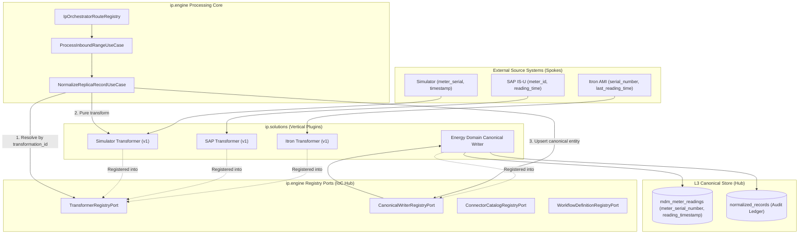

# Integration Platform (IP): Registry-Driven Plugin & Canonical Normalization Architecture

## 1. Executive Architecture Summary

The Soopa Integration Platform (`apps/ip`) employs a strict **Hexagonal Plugin Architecture** driven by **Inversion of Control (IoC)** and **Hub-and-Spoke Domain Normalization**.

The architecture enforces three structural invariants:
1. **Engine Purity**: The generic core platform (`ip.engine`) has zero dependencies on vertical solutions, external vendors, or industry schemas. All vendor-specific implementations live in isolated solution modules (`ip.solutions`) and are consumed exclusively via abstract **Registry Ports**.
2. **Hub-and-Spoke Canonical Normalization**: External applications converge into a single, unified domain language. The target Canonical Entity acts as the immutable "Hub", while discrete, vendor-specific Transformers act as pure "Spokes".
3. **Dynamic Control-Plane Binding**: Stream-to-transformer relationships are stored in the control plane database (`ip.transformations`), enabling independent versioning, zero-downtime upgrades, and safe shadow execution.



---

## 2. The 4 Platform Registry Ports

The `ip.engine` processing kernel interacts with vendor-specific behaviors exclusively through four strongly-typed Registry Ports:

### 2.1 `TransformerRegistryPort` (L2 $\rightarrow$ L3 Normalization)
- **Port Definition**: [`ip.engine.ports.outbound.transformer_port.TransformerRegistryPort`](apps/ip/packages/ip/src/ip/engine/ports/outbound/transformer_port.py#L39)
- **Contract (`TransformerPort`)**:
  ```python
  class TransformerPort(Protocol):
      @property
      def transformation_id(self) -> str: ...
      @property
      def transformation_version(self) -> int: ...
      @property
      def target_types(self) -> tuple[str, ...]: ...
      def transform(
          self, replica: ReplicaSnapshot, context: TransformationContext
      ) -> TransformationResult: ...
  ```
- **Lifecycle**: Pure in-memory computation. Given a `ReplicaSnapshot` (L2 row state), it deterministically outputs `CanonicalDraft` objects and validation rejections. Zero network, database, or clock access.

### 2.2 `CanonicalWriterRegistryPort` (L3 Domain Persistence)
- **Port Definition**: [`ip.engine.ports.outbound.canonical_writer_port.CanonicalWriterRegistryPort`](apps/ip/packages/ip/src/ip/engine/ports/outbound/canonical_writer_port.py)
- **Contract (`CanonicalWriterPort`)**:
  ```python
  class CanonicalWriterPort(Protocol):
      @property
      def canonical_type(self) -> str: ...
      async def write(
          self,
          uow: IpDataPlaneUnitOfWorkPort,
          drafts: Sequence[CanonicalDraft],
          context: CanonicalWriterContext,
      ) -> Result[CanonicalWriterResult, IpError]: ...
  ```
- **Lifecycle**: Translates drafts into strongly-typed domain ORM models (e.g. `MdmMeterReadingRecord`) and executes atomic SQL upserts into dedicated domain tables (`mdm_meter_readings`) alongside the `normalized_records` audit ledger within the tenant's data plane transaction.

### 2.3 `ConnectorCatalogRegistryPort` (L1 Ingest & L5 Outbound)
- **Port Definition**: [`ip.engine.ports.outbound.connector_catalog_port.ConnectorCatalogRegistryPort`](apps/ip/packages/ip/src/ip/engine/ports/outbound/connector_catalog_port.py)
- **Responsibilities**:
  - Exposes metadata blueprints (`ConnectorSpecDTO`) for UI catalog discovery.
  - Dynamically provisions connector instances (`universal_simulator`, `sftp`, `http`).
  - Executes protocol-level interactions (`discover()`, `pull()`, `fetch()`, `write()`).

### 2.4 `WorkflowDefinitionRegistryPort` (L4 Stitch DAGs)
- **Port Definition**: [`ip.engine.ports.outbound.stitch_port.WorkflowDefinitionRegistryPort`](apps/ip/packages/ip/src/ip/engine/ports/outbound/stitch_port.py)
- **Responsibilities**:
  - Registers declarative DAG workflows (`WorkflowDefinition`).
  - Executes post-normalization event-driven pipelines (e.g., dispatching SAP work orders or emitting webhooks).

---

## 3. Hub-and-Spoke Canonical Entity Architecture

### 3.1 The Canonical Entity (The Destination "Hub")
The Canonical Entity establishes the single, ubiquitous standard for an entire industry vertical. Downstream systems (analytics, billing, Stitches, AI models) integrate **only** with this canonical contract.

**Canonical Entity Definition (`energy.mdm_meter_reading`):**
| Field | Type | Description |
| :--- | :--- | :--- |
| `meter_serial_number` | `String(128)` | Physical hardware identifier of the smart meter. |
| `reading_timestamp` | `Timestamp (UTC)` | Exact moment the meter pulse was recorded in the field. |
| `interval_minutes` | `Integer` | Duration of the consumption interval (e.g., 15 mins). |
| `kwh_delivered` | `Float` | Forward active energy consumption. |
| `kwh_received` | `Float` | Reverse active energy generation (solar/DER). |
| `voltage_avg` | `Float` | Root-mean-square line voltage. |
| `service_point_id` | `String(128)` | Reference to premise location (resolved via GEM). |
| `quality_flag` | `String(32)` | Validation state (`VALIDATED`, `ESTIMATED`, `FLAGGED`). |

### 3.2 Discrete Transformers (The Source "Spokes")
Each external application possesses its own distinct data format. Rather than using fuzzy fallback chains, each source has a **dedicated, single-responsibility transformer**:

#### 1. Simulator Transformer (`simulator.meter_reading.v1`)
- **Source Contract**: `{ "meter_serial": "MTR-101", "timestamp": "2026-11-12T12:00:00Z", "voltage_avg": 240.1, ... }`
- **Mapping**:
  - `meter_serial` $\longrightarrow$ `meter_serial_number`
  - `timestamp` $\longrightarrow$ `reading_timestamp`

#### 2. Itron AMI Transformer (`itron.meter_reading.v1`)
- **Source Contract**: `{ "serial_number": "ITR-9901", "last_reading_time": "2026-11-12T12:00:00Z", ... }`
- **Mapping**:
  - `serial_number` $\longrightarrow$ `meter_serial_number`
  - `last_reading_time` $\longrightarrow$ `reading_timestamp`

#### 3. SAP IS-U Transformer (`sap_isu.meter_reading.v1`)
- **Source Contract**: `{ "meter_id": "SAP-M-55", "reading_time": "2026-11-12T12:00:00Z", ... }`
- **Mapping**:
  - `meter_id` $\longrightarrow$ `meter_serial_number`
  - `reading_time` $\longrightarrow$ `reading_timestamp`

---

## 4. Control Plane Binding & Runtime Execution

### 4.1 Binding Table (`ip.transformations`)
Stream-to-transformer configurations are stored in the control plane:

```sql
SELECT 
    connection_id,
    stream_name,
    transformation_id,
    transformation_version,
    mode
FROM ip.transformations;
```

| connection_id | stream_name | transformation_id | transformation_version | mode |
| :--- | :--- | :--- | :--- | :--- |
| `conn_itron_live` | `meter_readings` | `energy.itron_meter_reading` | `1` | `ACTIVE` |
| `conn_sap_nightly` | `meter_readings` | `sap_isu.meter_reading` | `1` | `ACTIVE` |
| `conn_sandbox_sim` | `meter_readings` | `energy.ami_meter_reading` | `2` | `ACTIVE` |

### 4.2 Step-by-Step Processing Flow

1. **Ingest (L1)**: Raw wire payload enters via `InboundRecord`.
2. **Replicate (L2)**: Universal replication computes content hash and updates `replica_records`.
3. **Lookup Binding**: Worker queries `Transformation` for `(connection_id, stream_name)`.
4. **Resolve Transformer**: Worker calls `transformer_registry.get(transformation_id, version)`.
5. **Pure Transform**: Selected transformer validates types, normalizes timestamps, and outputs `CanonicalDraft`.
6. **Lookup Writer**: Worker calls `writer_registry.get(draft.canonical_type)`.
7. **Atomic Write**: Canonical writer persists to `mdm_meter_readings` and `normalized_records` within the shard transaction.

---

## 5. UI Presentation & Entity-Centric Inspection

The UI data inspection component (`NormalizedEntityDataTable`) enforces strict separation between Layer 1 source attributes and Layer 3 canonical attributes:

1. **Primary Key Priority**:
   - Primary key attributes (e.g. `meter_serial_number`, `service_point_external_id`, `id`) are dynamically sorted to **Index 0**.
   - Decorated with a distinct, prominent `PK` badge.
2. **Strict Canonical Rendering (Zero Ghost Columns)**:
   - When inspecting normalized data (L3), columns are derived **exclusively from `canonicalData`**.
   - Raw source wire field names (e.g. `timestamp`, `meter_serial`) do not create empty ghost columns.
   - Each business concept is displayed under **exactly one canonical column** containing its actual value.
3. **Role-Based Visibility**:
   - Customer view: Strictly displays L3 canonical records and execution traces.
   - Support view: Full audit access across L1 wire, L2 replica, L3 canonical, and GEM identity crosswalks.
