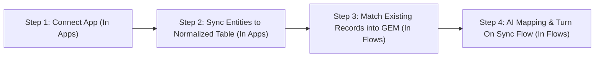
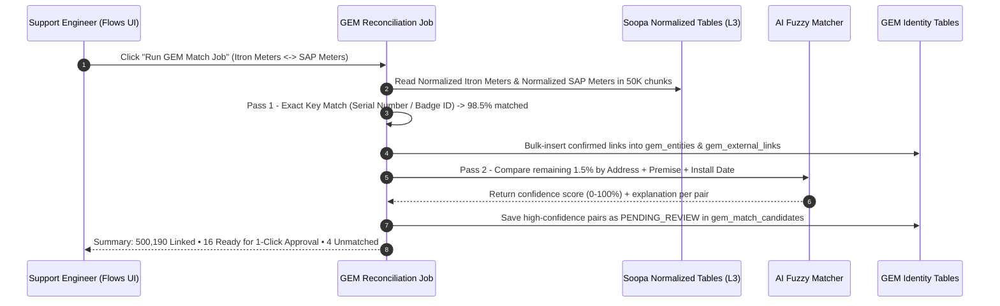

# Soopa IP: Simplified Shopify-Style UX & 4-Step Onboarding Design

- **Document Status:** Product & UX Architecture Specification (`v1.0` — Gold Standard)
- **Target Audience:** Product, Support & Onboarding Engineers, Utility Customers, Frontend & Backend Teams
- **Frontend Package:** `@soopa/ip-ui` (`apps/ip/packages/ui`)
- **Core Goal:** Replace backend-jargon navigation with a clean, **Shopify-simple 4-tab interface** built around how teams actually onboard apps, match existing records into GEM, and run sync flows—working seamlessly for **both** everyday business data and 15-minute smart meter data.

---

## 1. Why We Are Simplifying the UI

### 1.1 The Problem with the Current 5-Tab Sidebar

Our current sidebar (`Command Center`, `Support Traces`, `Apps`, `Transformation`, `Stitches`) mirrors our internal backend layers (`L1` through `L5`) instead of how a human sets up and runs an integration:

- **`Transformation` feels out of place:** A user should not have to leave `Apps` or `Stitches` and open a separate code-heavy menu just to map fields.
- **Missing Day-1 Identity Matching (`GEM Job`):** When a customer connects two live systems (for example, **Itron** and **SAP**), both systems *already* have 500,000 meters and customers in production. There was no clear place to run a job that matches those existing records and creates **GEM (Global Entity Mapping)** links before live syncing starts.
- **Confusing Developer Jargon:** Names like *Command Center* and *Support Traces* sound like internal engineering tools rather than clean, everyday business workspaces.

### 1.2 Old Sidebar vs. New Shopify-Style 4-Tab Sidebar

| Old Sidebar (Confusing) | New Sidebar (Simple & Clear) | Plain-English Purpose |
| :--- | :--- | :--- |
| `Command Center` | **1. Overview** | Morning health check: Are all apps and sync flows healthy? Zero missing data bar + items needing attention. |
| `Apps` + *(Inbound `Transformation`)* | **2. Apps** | Connect every app and sync its required entities into **Soopa’s Normalized Tables** (with built-in AI field mapping if needed). |
| `Stitches` + *(Outbound `Transformation`)* + **NEW `GEM Match Job`** | **3. Flows** *(Stitches)* | Link **Source App $\rightarrow$ Destination App**: (A) Run the **GEM Existing-Record Match Job**, and (B) Set up AI-suggested destination mappings & rules. |
| `Support Traces` | **4. Activity** | Search any meter, customer, or order (`Cmd+K`), view its plain-English step-by-step history, and click **Fix & Re-Send**. |

> [!IMPORTANT]
> **Notice What Disappeared:** `Transformation` is no longer a confusing standalone menu. Inbound normalization lives naturally inside **Apps**, and destination mapping lives naturally inside **Flows**.

---

## 2. The Core 4-Step Onboarding & Sync Workflow

Every integration in Soopa IP follows the **exact same 4 logical steps**, whether the team is syncing 1,000 customer move-ins or 50 million 15-minute smart meter readings:



### Step 1 — Connect Each App (`Apps` $\rightarrow$ `Add App`)
- The Support Engineer picks an app from the catalog (e.g., **Itron OpenWay**, **SAP Billing**, **Salesforce**, **ServiceNow**), enters credentials, and clicks **Test & Save**.
- Every connected app starts on equal footing—**every app is treated as a Source App to Soopa first** so Soopa has an accurate, normalized picture of its records.

### Step 2 — Fetch Required Entities into Soopa’s Normalized Tables (`Apps` $\rightarrow$ `Synced Data`)
- Inside the connected App, the Support Engineer checks the boxes for the entities they need:
  - *Example in Itron:* `[x] Smart Meters`, `[x] 15-Minute Usage Readings`
  - *Example in SAP:* `[x] Customers`, `[x] Billing Accounts`, `[x] Installed Meters`
- **How Mapping to Normalized Tables Works:**
  - For standard apps (like Itron or SAP), Soopa already knows the standard fields out of the box.
  - If the customer added custom fields in their app, an inline **AI Field Assistant** suggests how those fields map into Soopa’s Normalized Table (`Normalized Meters`, `Normalized Customers`, `Normalized Readings`) right inside the same drawer.
- Clicking **Start Sync** pulls existing and new data into Soopa’s Normalized Tables. *(Behind the scenes, Soopa automatically uses fast batch mode for 15-minute readings and instant mode for normal records—the user does nothing extra.)*

### Step 3 — Run the Existing-Record Match Job to Populate GEM (`Flows` $\rightarrow$ `Identity Match`)
- **Real-World Problem Solved:** Before syncing Itron readings into SAP, Soopa must know which Itron meter corresponds to which SAP meter that *already exists* in SAP (`Itron MTR-700` = `SAP EQ-900700`).
- **One-Click GEM Job:** When setting up a Flow between **Itron** and **SAP**, the Support Engineer clicks **"Match Existing Records (GEM Job)"**:
  1. Soopa compares **Normalized Itron Meters** against **Normalized SAP Meters** using unique keys (Serial Number, Badge Number, Premise Address, Service Point ID).
  2. **Exact Matches (`~98%+`):** Automatically linked in the **GEM Table** (`Itron ID <-> GEM ID <-> SAP ID`).
  3. **AI Suggested Matches (`~1–2%`):** Slight spelling or formatting differences (e.g., `"102 Oak St"` vs `"102 Oak Street Apt A"`) are shown in a simple side-by-side review list for 1-click approval.
  4. **Unmatched Records:** Clearly listed (*"15 brand-new meters exist in Itron that are not in SAP yet"*), allowing the team to either auto-create them in SAP or hold them.

### Step 4 — Create the Sync Flow (`Stitch`) with AI Suggestions (`Flows` $\rightarrow$ `Mapping & Rules`)
- Now that both apps are synced to Normalized Tables and linked in GEM, the Support Engineer defines **what syncs from Source App to Destination App**:
  - *Example 1 (Simple Business Sync):* When a `Customer` updates in **Salesforce**, update the linked `Billing Account` in **SAP**.
  - *Example 2 (15-Min Meter Sync + Outage Alert):* When `15-Minute Readings` arrive from **Itron**, send daily Peak/Off-Peak totals to **SAP Billing** AND immediately open a **ServiceNow Outage Ticket** if `Voltage = 0`.
- **AI Mapping Assistant:** AI automatically suggests the field mappings and plain-English rules from Source $\rightarrow$ Destination.
- **Preview & Turn Live:** The engineer previews 10 real records (or runs a risk-free 24-hour background test), then switches the Flow **ON**.

---

## 3. Screen-by-Screen Visualization of the 4 Tabs

### Tab 1: `Overview` (Simple Daily Health Check)

Designed for both utility customers and our Support Team to check overall health in 5 seconds:

```text
+----------------------------------------------------------------------------------------------------+
| [Overview]   Apps   Flows   Activity                                  [Search Meter / Order Cmd+K] |
+----------------------------------------------------------------------------------------------------+
| DATA GUARANTEE (LAST 24 HOURS):                                                                    |
| Received: 48,162,010  =  Synced: 48,161,840  +  In Progress: 151  +  On Hold: 19    (0 Missing!)   |
+---------------------------------+---------------------------------+--------------------------------+
| CONNECTED APPS                  | ACTIVE FLOWS (STITCHES)         | ITEMS NEEDING ATTENTION        |
| 4 of 4 Apps Healthy             | 6 of 6 Flows Running            | 19 Records Safely On Hold      |
| Itron, SAP, Salesforce, OMS     | Avg Sync Speed: 1.4s            | 14 Meter Glitches • 5 Unlinked |
+---------------------------------+---------------------------------+--------------------------------+
| NEEDS YOUR REVIEW                                                                                  |
| • [GEM Match]  5 New Itron Meters need SAP Account link (AI found 4 likely matches)   [Review 5]   |
| • [Safety Hold] 14 Meter Readings paused before SAP Billing (abnormal spike detected) [Inspect 14] |
+----------------------------------------------------------------------------------------------------+
```

---

### Tab 2: `Apps` (Connect & Sync to Normalized Tables)

Inside `Apps -> Itron OpenWay`, everything needed to connect and populate Soopa’s Normalized Tables lives in one clean view—no separate `Transformation` tab needed:

```text
+----------------------------------------------------------------------------------------------------+
| Overview   [Apps]   Flows   Activity                                                               |
+----------------------------------------------------------------------------------------------------+
| Apps > Itron OpenWay                                                [Status: Connected & Syncing]  |
|----------------------------------------------------------------------------------------------------|
| [1. Connection Credentials]    [2. Synced Data (To Normalized Tables)]                             |
+----------------------------------------------------------------------------------------------------+
| SELECT DATA TO SYNC INTO SOOPA NORMALIZED TABLES:                                                  |
|                                                                                                    |
| [x] Smart Meters        -> Syncs to: Normalized Meters      | 500,210 Synced | [Field Mapping ✓]   |
| [x] 15-Minute Readings  -> Syncs to: Normalized Readings    | 48.0M / Day    | [Field Mapping ✓]   |
| [ ] Meter Tamper Logs   -> Not enabled                      | --             | [Enable]            |
|                                                                                                    |
| TODAY'S 15-MINUTE READING ARRIVAL (96 Daily 15-Min Slots, 12:00 AM -> 11:45 PM):                   |
| [🟩🟩🟩🟩🟩🟩🟩🟩🟩🟩🟩🟩🟩🟩🟩🟩🟩🟩🟩🟩🟩🟩🟩🟩...🟩🟩🟨🟩]  99.96% Arrived Today               |
+----------------------------------------------------------------------------------------------------+
```

- Clicking **`[Field Mapping ✓]`** opens a simple slide-over panel showing how Itron fields map into Soopa's Normalized Table, with **"Ask AI to Map Custom Fields"** built right in.

---

### Tab 3: `Flows` (GEM Matching Job + Source-to-Destination Stitches)

Creating or managing a Flow (`Stitch`) walks the user through a foolproof **3-step wizard** on one page:

```text
+----------------------------------------------------------------------------------------------------+
| Overview   Apps   [Flows]   Activity                                                               |
+----------------------------------------------------------------------------------------------------+
| Flow: Sync Itron Meters & Daily Usage  -->  SAP Billing                         [Status: ACTIVE]   |
+----------------------------------------------------------------------------------------------------+
| STEP 1: SOURCE & DESTINATION                                                                       |
|   Source App: [Itron OpenWay (Normalized Meters & Readings)]  -->  Destination: [SAP S/4HANA]      |
|----------------------------------------------------------------------------------------------------|
| STEP 2: EXISTING RECORD MATCHING (GEM TABLE)                                                       |
|   Match Rule: Itron Serial Number == SAP Equipment Serial Number (+ AI Address Match fallback)     |
|   GEM Status: 500,190 Linked  •  16 AI Suggestions Ready  •  4 Only in Itron                       |
|   [Run GEM Match Job Now]    [Review 16 AI Matches]                                                |
|----------------------------------------------------------------------------------------------------|
| STEP 3: AI MAPPING & SYNC RULES (STITCH)                                                           |
|   AI Mapped 9 of 9 SAP Billing Fields Automatically:                                               |
|   • GEM Linked SAP Equipment ID     -->  SAP.EquipmentNumber                                       |
|   • Daily Peak Usage (4 PM - 9 PM)  -->  SAP.Register_Peak_kWh                                     |
|   • Daily Off-Peak Usage            -->  SAP.Register_OffPeak_kWh                                  |
|   • Safety Rule: Pause reading if usage spike > 10x home's normal 14-day average                   |
|                                                                                                    |
|   [Preview on 10 Real Meters]    [Test Quietly for 24h]    [Save & Update Flow]                    |
+----------------------------------------------------------------------------------------------------+
```

---

### Tab 4: `Activity` (Plain-English Search, History & 1-Click Replay)

Replaces the technical `Support Traces` label with a clear **Activity & Lookup** workspace for support teams:

- **Search Anything (`Cmd+K`):** Type a Meter Number (`MTR-700`), Customer Name, SAP Account (`EQ-900700`), or Order ID.
- **Plain-English Step-by-Step Timeline:**
  1. *Received from Itron (`2:15 PM`)*
  2. *Saved to Normalized Readings*
  3. *Matched to SAP Account `EQ-900700` via GEM*
  4. *Sent to SAP Billing (or Paused by Safety Rule)*
- **24-Hour Usage Bar Chart (For Meter Lookups):** Shows all 96 fifteen-minute bars for the day so support agents immediately spot a missing or paused 15-minute slot.
- **One-Click Recovery:** Fix and re-send **one single record** in 1 second, or re-send **an entire 2-hour window** after destination maintenance without slowing down live traffic.

---

## 4. Deep Dive on Step 3: How the GEM Existing-Record Match Job Works

Because Day-1 existing record matching is critical for onboarding without duplicates, Soopa runs the **GEM Reconciliation Job** as a first-class background workflow:



### Three Clear Outcomes of Every GEM Match Job
1. **Auto-Linked (`100%` Exact Key Match):** Written immediately to `gem_entities` and `gem_external_links`. Ready for live syncing right away.
2. **Needs 1-Click Approval (`85%–99%` AI Match):** Displayed in a clean 2-column table (*Left: Itron Record* vs. *Right: SAP Record*, highlighting why AI matched them) with **[Approve]** / **[Approve All >95%]** / **[Reject]** buttons.
3. **Only Exists in Source (`<85%` Match):** Support chooses a simple policy: *"Create as new record in Destination"*, *"Wait until Destination creates it"*, or *"Ignore"*.

---

## 5. How the Simple 4-Tab UI Maps to Our 5-Layer Dual-Gear Backend

Simplifying the UI **does not sacrifice any backend rigor**. Our 5-layer architecture (`L1`–`L5`), `GEM`, and Dual-Gear engine (`Gear 1` + `Gear 2`) remain 100% intact underneath—hidden behind human-friendly workflows:

| What the User Sees in the UI | What Runs Under the Hood (Invisible to User) |
| :--- | :--- |
| **Tab 1: `Overview`** | Queries ClickHouse Visibility Plane (`<25ms`) + PostgreSQL Reconciliation Counts (`chk_zero_loss_reconciliation`). |
| **Tab 2: `Apps` $\rightarrow$ Connect & Sync to Normalized Table** | Runs **`L1` Raw Ingress** + **`L2` Deduplicated Replica** + **`L3` Inbound Normalization** (auto-routing normal entities to Gear 1 and 15-min telemetry to Gear 2 Polars/Arrow). |
| **Tab 3: `Flows` $\rightarrow$ Run GEM Match Job** | Runs chunked **`ReconcileExistingEntitiesUseCase`** across `L3` Normalized Tables to populate `gem_entities` and `gem_external_links` without locking PostgreSQL. |
| **Tab 3: `Flows` $\rightarrow$ AI Mapping & Activate Flow** | Compiles **`L4` Stitch / TOU Rollup Rules** + **`Gear 2 -> Gear 1` Urgent Event Promotion** + **`L5` Destination Mapper & Idempotent Delivery**. |
| **Tab 4: `Activity` $\rightarrow$ Search & Fix/Re-Send** | Queries **`L9` ClickHouse Hot Timeline + S3 Cold Archive** (`<20ms–55ms`) and dispatches replays onto the isolated **`P2` Bulkhead Queue**. |

---

## 6. Frontend Consolidation Plan (`@soopa/ip-ui`)

When implementing this simplified UX in `apps/ip/packages/ui/src/presentation/`, existing screens consolidate cleanly with zero wasted work:

1. **Navigation Shell:** Update sidebar items from 5 technical links to the 4 clear tabs: **`Overview`**, **`Apps`**, **`Flows`**, and **`Activity`**.
2. **`Overview` (`command-center/`):** Rename user-facing labels on `IpCommandCenterPage.tsx` to **Overview**, adding the **Zero Missing Data Guarantee Bar** and **GEM Match Review** alert card.
3. **`Apps` (`connections/` + inbound `transformations/`):** Embed `TransformationWorkbenchPanel.tsx` directly inside `IpConnectionDetailPage.tsx` as the inline **"Field Mapping (To Normalized Table)"** drawer, and remove standalone `Transformations` from the left sidebar.
4. **`Flows` (`stitches/` + new `GemMatchJobPanel`):** Upgrade `IpStitchDefinitionPage.tsx` into the unified **3-Step Flow Screen** (*1. Source & Destination* $\rightarrow$ *2. GEM Existing-Record Match Job* $\rightarrow$ *3. AI Destination Mapping & Visual Rules*).
5. **`Activity` (`traces/`):** Relabel `IpTracesTimelinePage.tsx` and `IpTraceWaterfallPage.tsx` to **Activity**, replacing raw `L1`–`L5` layer codes in default labels with plain-English step names (*Received $\rightarrow$ Normalized $\rightarrow$ Linked via GEM $\rightarrow$ Delivered*) while keeping raw payload inspection one click away for engineers.
