# Enterprise Architectural Design Document
## Stitch & Visual Field Mapper: The Gold-Standard Hybrid Architecture Paradigm (Python Engine + Visual UI Field Mapper)

**Author:** Enterprise Architecture & Integration Platform Team  
**Standard:** Enterprise Grade · Zero Shortcuts · Strict Hexagonal Architecture · Ubiquitous Language · DDD  
**Scope:** Data Plane (High-Throughput Ingestion, Normalization, Stitch Orchestration) & Control Plane (Visual Stitch & Field Mapper UI)  
**Status:** Approved for Implementation & Production Rollout  

---

## 1. Executive Summary & Ubiquitous Language

### 1.1 Ubiquitous Language Alignment (DDD)
The platform enforces strict Domain-Driven Design (DDD) ubiquitous language across code, documentation, and user interfaces:
- **Stitch (L4 Orchestration DAG):** An event-driven Directed Acyclic Graph (DAG) that binds an L3 Canonical Event (e.g. `energy.mdm_meter_reading`), executes optional context lookup/enrichment, evaluates an outbound wire projection rule, and delivers records to an external sink (e.g. Apache Kafka, SFTP, REST Webhook).
- **Stitch & Field Mapper:** The dedicated 5-step operational interface guiding integration engineers to align canonical L3 schemas to external wire contracts, test projections live with Monaco split-screen diffs, and activate stitches.
- **Unified Terminology:** The concepts of "Route" and "Workbench" are eliminated. Pipeline orchestration is 100% standardized on **Stitch**, and the visual configuration tool is **Stitch & Field Mapper**.

### 1.2 The Hybrid Paradigm: Division of Responsibilities
The architecture establishes a strict separation of concerns between code and configuration:

```
┌────────────────────────────────────────────────────────────────────────┐
│                      PYTHON CODE (AUTHORITATIVE CORE)                  │
│  - Single source of truth for business logic and data contracts        │
│  - Ingestion connectors, deduplication, and IEC 61968 CIM transformers │
│  - L4 Stitch DAG orchestration framework and Step Handlers             │
│  - L5 Egress Kafka connectors with partition keying and retries        │
│  - Strict static typing (mypy), zero Any, zero type suppressions       │
└──────────────────────────────────┬─────────────────────────────────────┘
                                   │ Compiles & Executes
                                   ▼
┌────────────────────────────────────────────────────────────────────────┐
│                     UI / CONTROL PLANE (VISUAL MAPPER)                 │
│  - Discovered schema inspection and external wire contract ingestion   │
│  - 3-Modality contract input: File Upload, Drag & Drop, or Paste       │
│  - Visual 3-column field alignment matrix with 1-click Auto-Mapping    │
│  - Live Monaco split-screen diff preview before pipeline deployment    │
│  - Stitch activation button and real-time trace timeline/waterfalls    │
└────────────────────────────────────────────────────────────────────────┘
```

- **Engine in Python:** Heavy-lifting execution, connection pooling, idempotency, backpressure, IEC 61968 CIM normalization, and Kafka delivery are 100% written, unit-tested, and compiled in Python.
- **Mapping in UI:** Declarative field alignment, contract upload, and projection diff preview live in the UI. When an external consumer changes a property name (e.g. `meter_serial_number` $\to$ `meterNumber`), an operator adjusts the mapping in the UI in 30 seconds with **zero code deployments, zero PR cycles, and zero container restarts**.

---

## 2. Directory Structure & Code Organization (Strict Bounded Contexts)

The Python codebase follows strict **Hexagonal Architecture (Ports and Adapters)** decoupled into a domain-agnostic generic platform engine (`engine/`) and domain-specific utility/logistics solutions (`solutions/domains/`).

In accordance with Domain-Driven Design (DDD) and Modular Monolith principles, **all domain logic—including its L4 Stitch workflows—is strictly co-located inside its respective Bounded Context (`solutions/domains/<domain>/`)**:

```
apps/ip/packages/ip/src/ip/
├── engine/                                   # Domain-Agnostic Generic Platform Engine
│   ├── domain/                               # Pure Enterprise Domain Entities (Zero Framework Leaks)
│   │   ├── connection/                       # Connection aggregate root, auth specs, credentials
│   │   │   ├── connection.py                 # Connection entity with lifecycle state machine
│   │   │   └── enums.py                      # ConnectionStatus, AuthType, IngressModality
│   │   ├── stitch/                           # L4 Stitch Orchestration Entities
│   │   │   ├── stitch.py                     # Stitch aggregate, DagNode, SliceRangeStepOutput
│   │   │   └── enums.py                      # StitchStatus, StepExecutionStatus, TriggerMode
│   │   ├── normalization/                    # L3 Normalization Engine Entities
│   │   │   ├── transformation.py             # CanonicalDraft, ReplicaSnapshot, TransformationResult
│   │   │   ├── registries.py                 # TransformerRegistry (in-memory lookup by domain ID)
│   │   │   └── enums.py                      # NormalizationRejectionReason
│   │   ├── replication/                      # L2 Deduplication & Replica Entities
│   │   │   ├── replica_record.py             # Fingerprint computation and SHA-256 deduplication
│   │   │   └── stream_definition.py          # Stream schema, cursor fields, primary keys
│   │   ├── dispatch/                         # L5 Outbound Wire Dispatch Entities
│   │   │   └── outbound_record.py            # OutboundRecord entity with delivery status
│   │   └── trace/                            # Enterprise Observability & Audit Lineage
│   │       ├── trace_event.py                # IpTraceEvent entity spanning L1 through L5
│   │       └── enums.py                      # IpTraceEventType, StageStatus
│   │
│   ├── ports/                                # Abstract Ports (Protocols / Interfaces)
│   │   ├── outbound/                         # Outbound Infrastructure Contracts
│   │   │   ├── transformer_port.py           # TransformerPort protocol for pure normalizers
│   │   │   ├── connector_port.py             # ConnectorPort protocol (discover, read, write)
│   │   │   ├── stitch_catalog_port.py        # StitchCatalogPort for DAG definitions
│   │   │   ├── catalog_registry_port.py      # CatalogRegistryPort for app connectors
│   │   │   └── kafka_client_port.py          # KafkaClientPort protocol (produce, flush)
│   │   └── inbound/                          # Inbound Worker Interfaces
│   │
│   ├── application/                          # Application Layer (CQRS Use Cases & Pure DTOs)
│   │   ├── stitches/                         # Stitch Orchestration Use Cases
│   │   │   ├── register_stitch_use_case.py   # Register & activate stitch DAG in control plane
│   │   │   └── dispatch_stitch_run_use_case.py# Execute DAG nodes across workers
│   │   ├── normalization/                    # Normalization Use Cases
│   │   │   └── normalize_replica_use_case.py # Execute TransformerPort on replica snapshot
│   │   ├── ingress/                          # Inbound Ingestion Use Cases
│   │   │   └── ingest_record_use_case.py     # L1 immutable ledger ingestion
│   │   ├── delivery/                         # Egress Delivery Use Cases
│   │   │   └── deliver_outbound_record_use_case.py # Evaluate mapping rule and write to sink
│   │   └── connections/                      # Connection Management Use Cases
│   │       ├── create_connection_use_case.py
│   │       └── connection_entity_use_cases.py# Manage discovered streams & checkpoint states
│   │
│   ├── adapters/                             # Infrastructure Adapters (Pluggable Concrete Drivers)
│   │   ├── inbound/                          # Inbound Webhooks & SQS Queue Consumers
│   │   │   └── workers/                      # SQS pollers and event dispatchers
│   │   └── outbound/                         # Outbound Connectors, Storage & Databases
│   │       ├── connectors/                   # Connector Adapters
│   │       │   ├── kafka_connector.py        # Apache Kafka Connector (write_record, discover)
│   │       │   ├── confluent_kafka_client.py # Confluent Kafka Producer adapter
│   │       │   ├── redpanda_connector.py     # Redpanda streaming adapter
│   │       │   ├── webhook_connector.py      # HTTP Ingress & Egress Webhook adapter
│   │       │   └── declarative_http_connector.py # Generic REST JSON adapter
│   │       ├── stitches/                     # Stitch Execution Adapters
│   │       │   ├── step_handlers.py          # StepHandlerPort: Enrichment, Projection, KafkaSink
│   │       │   └── stitch_catalog_registry.py# Storage repository for Stitch definitions
│   │       └── database/                     # SQLAlchemy Repositories & Data Mappers
│   │           ├── control_plane/            # Connections, Stitches, SyncRuns tables
│   │           └── data_plane/               # Inbound, Replica, Normalized, Outbound tables
│   │
│   └── bootstrap/                            # IoC Composition Root & Container
│       └── container.py                      # Assembles adapters and injects ports into use cases
│
└── solutions/                                # Domain-Specific Business Solutions
    ├── domains/                              # Bounded Context Implementations (Fully Self-Contained)
    │   ├── energy/                           # Smart Grid Advanced Metering Infrastructure (AMI) Context
    │   │   ├── canonical.py                  # IEC 61968 CIM DTOs (CanonicalMeterReadingDTO)
    │   │   ├── models.py                     # SQLAlchemy ORM models (mdm_meter_readings)
    │   │   ├── repository.py                 # SqlAlchemyEnergyDomainRepository with strict mappers
    │   │   ├── transformers/                 # L2 -> L3 Inbound Normalization (TransformerPort)
    │   │   │   ├── ami/                      # Generic AMI & Simulator Normalizers
    │   │   │   │   ├── meter_reading.py      # AmiMeterReadingTransformer (IEC 61968 CIM Part 9)
    │   │   │   │   └── service_point.py      # AmiServicePointTransformer
    │   │   │   ├── itron/                    # Itron OpenWay / ChoiceConnect Normalizers
    │   │   │   │   ├── meter_reading.py      # ItronMeterReadingTransformer
    │   │   │   │   └── service_point.py      # ItronServicePointTransformer
    │   │   │   └── sap/                      # SAP IS-U Normalizers
    │   │   │       └── billing_reading.py    # SapBillingReadingTransformer
    │   │   └── stitches/                     # L4 Domain Orchestration Workflows (DAGs)
    │   │       ├── meter_reading_erp_sync.py # The Energy ERP/Kafka Sync DAG definition
    │   │       └── outage_restoration.py     # The AMI Outage Restoration DAG definition
    │   │
    │   └── tms/                              # Transportation Management Logistics Context
    │       ├── canonical.py                  # CanonicalLoadDTO, CanonicalCarrierDTO
    │       ├── models.py                     # tms_loads, tms_carriers ORM models
    │       ├── repository.py                 # SqlAlchemyTmsDomainRepository
    │       ├── transformers/                 # L2 -> L3 Inbound Normalization (Strict Taxonomy)
    │       │   ├── load.py                   # MercuryGateLoadTransformer
    │       │   └── carrier.py                # MercuryGateCarrierTransformer
    │       └── stitches/                     # L4 Domain Orchestration Workflows (DAGs)
    │           └── load_carrier_assignment.py# The Load Assignment DAG definition
    │
    └── registry_loader.py                    # Top-Level IoC Assembly & Discovery Root
                                              # (Imports domain stitches & transformers to wire into Engine)
```

---

## 3. Schema Architecture: Where Schemas Are Saved & Managed

The platform manages schemas across three distinct lifecycle stages:

```
┌─────────────────────────────────────────────────────────────────────────────────┐
│                             SCHEMA STORAGE MATRIX                                │
├──────────────────────┬───────────────────────────────┬──────────────────────────┤
│ Schema Lifecycle Tier│ Storage Authority & Format    │ Database Physical Table  │
├──────────────────────┼───────────────────────────────┼──────────────────────────┤
│ 1. Source Discovered │ Discovered from Source API    │ `ip_connection_entities` │
│    Schema            │ Stored as JSONB field list    │ (column: `fields`)       │
├──────────────────────┼───────────────────────────────┼──────────────────────────┤
│ 2. L3 Canonical CIM  │ Python Code (Frozen DTOs)     │ `mdm_meter_readings`     │
│    Model             │ Managed via SQLAlchemy & DDL  │ `mdm_service_points`     │
├──────────────────────┼───────────────────────────────┼──────────────────────────┤
│ 3. Target Wire       │ Uploaded/Pasted in UI         │ `ip_stitches`            │
│    Contract          │ Stored as JSONB AST + raw     │ (columns: `target_wire_  │
│                      │ contract string               │ schema`, `rules`)        │
└──────────────────────┴───────────────────────────────┴──────────────────────────┘
```

### 3.1 Tier 1: Source Discovered Schemas (Inbound)
- **Source:** Automatically discovered during connector discovery (`ConnectorPort.discover()`) or extracted from push webhook payloads.
- **Where It Is Saved:**
  - Persisted in PostgreSQL table **`ip_connection_entities`**.
  - Column **`fields: jsonb`** holds the strongly-typed schema metadata:
    ```json
    [
      { "name": "meter_id", "type": "string", "nullable": false, "description": "Vendor meter serial" },
      { "name": "ts", "type": "string", "nullable": false, "description": "ISO-8601 reading timestamp" },
      { "name": "val", "type": "number", "nullable": false, "description": "Interval kWh value" },
      { "name": "status", "type": "string", "nullable": true, "description": "Vendor quality code" }
    ]
    ```
- **Control Plane Access:** Exposed via `useConnectionEntitiesQuery(connectionId)`.

### 3.2 Tier 2: L3 Canonical CIM Schemas (The Enterprise Hub)
- **Authority:** Authored in **authoritative Python code** as immutable dataclasses conforming to international standards (**IEC 61968 CIM Part 9**):
  - File: `solutions/domains/energy/canonical.py` $\to$ `CanonicalMeterReadingDTO`.
- **Where It Is Saved:**
  - Physical database table: **`mdm_meter_readings`** (and `mdm_service_points`).
  - Columns: `meter_serial_number`, `reading_timestamp`, `kwh_delivered`, `kwh_received`, `voltage_avg`, `interval_minutes`, `quality_flag`.
- **Control Plane Access:** The `TransformerRegistryPort` serves canonical schema definitions to the UI via `StreamTransformationSummaryDTO`, enabling the UI to render the canonical field catalog (`displayName`, `standard`, `fields`).

### 3.3 Tier 3: Target Wire Schemas & Compiled Mapping Rules (Outbound)
- **Source:** Provided by the user in Step 2 of the Stitch & Field Mapper (via Upload, Drag & Drop, or Monaco Paste).
- **Where It Is Saved:**
  - Persisted in PostgreSQL table **`ip_stitches`** (and `ip_egress_field_mappings`).
  - Three dedicated columns store the complete configuration:
    1. **`target_wire_schema: jsonb`**: The parsed, strongly-typed target field definitions (`name`, `type`, `required`, `description`).
    2. **`raw_contract_definition: text`**: The original unparsed file contents (uploaded `.json` schema or sample `.json`).
    3. **`rules: jsonb`**: The compiled declarative mapping AST:
       ```json
       [
         { "targetField": "meterNumber", "sourceField": "meter_serial_number", "ruleType": "DIRECT" },
         { "targetField": "readingTime", "sourceField": "reading_timestamp", "ruleType": "DIRECT" },
         { "targetField": "intervalValue", "sourceField": "kwh_delivered", "ruleType": "DIRECT" },
         { "targetField": "voltageAvg", "sourceField": "voltage_avg", "ruleType": "DIRECT" },
         { "targetField": "readingStatus", "sourceField": "quality_flag", "ruleType": "DIRECT" }
       ]
       ```
- **Runtime Execution:** The L4 worker loads `rules: jsonb` from `ip_stitches`, instantiates `WireProjectionStepHandler`, and projects records in microseconds.

---

## 4. UI Ingestion Modalities: Upload, Drag & Drop, or Paste Schema

Step 2 of the **Stitch & Field Mapper** ([`IpStitchFieldMapperPage.tsx`](file:///Users/apple/soopa_mono/apps/ip/packages/ui/src/presentation/stitch-mapper/IpStitchFieldMapperPage.tsx#L530-L585)) provides three seamless options for integration engineers to define the target wire contract:

```
┌────────────────────────────────────────────────────────────────────────┐
│                   STEP 2: TARGET WIRE CONTRACT INGESTION               │
│                                                                        │
│   [ 📁 Upload Schema (.json) ]   [ ✨ Infer Target Fields ]            │
│                                                                        │
│   ┌────────────────────────────────────────────────────────────────┐   │
│   │              DRAG & DROP SCHEMA FILE HERE                      │   │
│   │     Drop .json, .schema.json, or click to browse local files   │   │
│   └────────────────────────────────────────────────────────────────┘   │
│                                                                        │
│   Or Paste / Edit JSON Directly Below:                                 │
│   ┌────────────────────────────────────────────────────────────────┐   │
│   │ 1 {                                                            │   │
│   │ 2   "meterNumber": "MTR-100",                                  │   │
│   │ 3   "readingTime": "2026-11-15T00:00:00Z",                     │   │
│   │ 4   "intervalValue": 42.5,                                     │   │
│   │ 5   "voltageAvg": 240.0,                                       │   │
│   │ 6   "readingStatus": "VALID"                                   │   │
│   │ 7 }                                                            │   │
│   └────────────────────────────────────────────────────────────────┘   │
│                                                                        │
│   ✔ Detected 5 target field(s) from contract · Schema verified valid   │
└────────────────────────────────────────────────────────────────────────┘
```

### 4.1 Ingestion Options
1. **Option A: File Upload:**
   - Clicking `[ Upload Schema (.json) ]` opens the native operating system file picker filtered to `.json` and `.schema.json`.
   - On selection, a `FileReader` reads the text into the editor.
2. **Option B: Drag & Drop Dropzone:**
   - A dedicated dropzone area detects file hover with visual highlight feedback (`border-primary bg-primary/10`).
   - Dropping any valid JSON file immediately loads the file contents.
3. **Option C: Monaco JSON Paste & In-Place Editing:**
   - Direct copy-pasting from API documentation, Confluent Schema Registry, or customer emails into the embedded Monaco editor with live JSON syntax highlighting and linting.

### 4.2 The Client-Side Inference Engine (`inferSchemaFromSampleJson`)
Regardless of which method the user chooses (Upload, Drop, or Paste), the pure domain function [`inferSchemaFromSampleJson()`](file:///Users/apple/soopa_mono/apps/ip/packages/ui/src/domain/field-mapping.ts) processes the text:
- **JSON Schema Mode:** If the payload contains `$schema` or `properties: { ... }`, it parses the property keys, extracts JSON Schema data types (`string`, `number`, `boolean`, `object`), and detects required fields via `required: ["meterNumber", ...]`.
- **Sample Payload Mode:** If the payload is a sample JSON record (e.g. `{ "meterNumber": "MTR-100", "intervalValue": 42.5 }`), it analyzes key names, infers JavaScript primitive types (`number`, `string`, `boolean`), and constructs the target field model.
- **Immediate Auto-Map:** The inference engine automatically passes the detected fields to `autoMapFields()`, fuzzy-matching source CIM fields to target wire fields instantly.

---

## 5. End-to-End Workflow with Concrete Utility Testing Example

### Example Scenario: Zonos HES AMI Readings $\to$ IEC 61968 CIM $\to$ Oracle MDM Kafka

```mermaid
flowchart LR
    subgraph INGRESS["1. Inbound Ingestion"]
        HES["Zonos HES\nSimulator"] -->|Raw JSON| L1["L1 Inbound\nRecord"]
        L1 -->|Fingerprint| L2["L2 Replica\nSnapshot"]
    end

    subgraph PYTHON_L3["2. Stage 1: Python CIM Normalization"]
        L2 -->|AmiMeterReadingTransformer| CIM["L3 Canonical CIM\nmdm_meter_readings"]
        CIM -.->|Canonical Event| EVT["energy.mdm_meter_reading"]
    end

    subgraph UI_MAPPING["3. Stitch & Field Mapper (UI)"]
        EVT --> UI_CONFIG["Upload / Paste Oracle MDM Schema\nAuto-Map Fields\nMonaco Live Diff Preview\nDeploy Stitch"]
    end

    subgraph PYTHON_L4["4. Stage 2: Python Stitch DAG & Egress"]
        UI_CONFIG -->|Registers| STITCH["Stitch DAG Worker\nenergy.meter_reading_erp_sync_stitch"]
        STITCH -->|Compiled Rules| PROJ["Wire Projection\nStep Handler"]
        PROJ -->|KafkaProducerClient| KAFKA["Oracle MDM Kafka\nTopic: mdm.readings.inbound\nKey: meterNumber"]
    end

    style INGRESS fill:#e1f5fe,stroke:#0288d1,stroke-width:1.5px
    style PYTHON_L3 fill:#e8f5e9,stroke:#388e3c,stroke-width:1.5px
    style UI_MAPPING fill:#fff3e0,stroke:#f57c00,stroke-width:1.5px
    style PYTHON_L4 fill:#f3e5f5,stroke:#7b1fa2,stroke-width:1.5px
```



### 5.1 Step-by-Step Execution Path

#### Step 1: Raw Inbound Telemetry (Zonos HES)
Zonos HES pushes a raw smart meter interval reading:
```json
{
  "meter_id": "MTR-ZONOS-9901",
  "ts": "2026-11-15T00:00:00Z",
  "val": 42.5,
  "status": "OK"
}
```

#### Step 2: Python Inbound Normalization (`AmiMeterReadingTransformer`)
Executing in pure Python code:
1. Resiliently aliases `meter_id` to canonical `meter_serial_number`.
2. Validates ISO-8601 UTC timestamp and checks finite float bounds.
3. Produces a `CanonicalDraft` adhering to **IEC 61968 CIM Part 9**:
   ```python
   CanonicalDraft(
       canonical_type="EnergyEntityType.MDM_METER_READING",
       source_id="MTR-ZONOS-9901:2026-11-15T00:00:00Z",
       fields={
           "meter_serial_number": "MTR-ZONOS-9901",
           "reading_timestamp": "2026-11-15T00:00:00Z",
           "kwh_delivered": 42.5,
           "voltage_avg": 240.0,
           "interval_minutes": 15,
           "quality_flag": "VALIDATED",
       }
   )
   ```
4. Saves record into `mdm_meter_readings` table and emits canonical event `energy.mdm_meter_reading`.

#### Step 3: Stitch & Field Mapper (UI Control Plane)
1. **Source & Canonical Selection (Step 1):** Operator opens `/tenant/ip/stitches/mapper?sourceConnectionId=conn_zonos&stream=meter_readings`. The page verifies bound L3 CIM transformer `energy.ami_meter_reading`.
2. **Contract Ingestion (Step 2):** Operator drags and drops `oracle_mdm_readings_contract.json` into the dropzone (or clicks upload/paste):
   ```json
   {
     "meterNumber": "MTR-100",
     "readingTime": "2026-11-15T00:00:00Z",
     "intervalValue": 0.0,
     "voltageAvg": 0.0,
     "readingStatus": "VALID"
   }
   ```
3. **Visual Alignment Matrix (Step 3):** Operator clicks `[ ✨ Auto-Map ]`. The domain synonym engine automatically aligns:
   - `meter_serial_number` $\xrightarrow{\text{DIRECT}}$ `meterNumber`
   - `reading_timestamp` $\xrightarrow{\text{DIRECT}}$ `readingTime`
   - `kwh_delivered` $\xrightarrow{\text{DIRECT}}$ `intervalValue`
   - `voltage_avg` $\xrightarrow{\text{DIRECT}}$ `voltageAvg`
   - `quality_flag` $\xrightarrow{\text{DIRECT}}$ `readingStatus`
4. **Live Monaco Diff Preview (Step 4):**
   - *Left (CIM Source):*
     ```json
     {
       "meter_serial_number": "MTR-ZONOS-9901",
       "reading_timestamp": "2026-11-15T00:00:00Z",
       "kwh_delivered": 42.5,
       "voltage_avg": 240.0,
       "quality_flag": "VALIDATED"
     }
     ```
   - *Right (Oracle MDM Target Wire):*
     ```json
     {
       "meterNumber": "MTR-ZONOS-9901",
       "readingTime": "2026-11-15T00:00:00Z",
       "intervalValue": 42.5,
       "voltageAvg": 240.0,
       "readingStatus": "VALID"
     }
     ```
5. **Stitch Deployment (Step 5):** Operator clicks `[ Deploy & Activate Stitch ]`. The UI persists the stitch configuration into `ip_stitches` via `useRegisterStitchMutation`.

#### Step 4: Python L4 Stitch DAG Execution & Kafka Egress
1. The Stitch worker receives event `energy.mdm_meter_reading`.
2. The `WireProjectionStepHandler` evaluates the compiled rules from `ip_stitches` in microseconds.
3. The projected payload is passed to [`KafkaConnector.write_record()`](file:///Users/apple/soopa_mono/apps/ip/packages/ip/src/ip/engine/adapters/outbound/connectors/kafka_connector.py), which uses `ConfluentKafkaClient` to produce the message to `mdm.readings.inbound` with partition key `MTR-ZONOS-9901`.
4. The transaction writes trace event `OUTBOUND_DISPATCHED` to `ip_trace_events` with zero loss.

---

## 6. Enterprise Quality Invariants

- **Strict Hexagonal Purity:** Domain entities have zero dependencies on frameworks, databases, or UI libraries.
- **Zero Type Suppressions:** Zero `# type: ignore` in Python, zero `@ts-ignore` in TypeScript. Checked monorepo-wide.
- **Zero `Any` Crutches:** Every schema, DTO, and payload uses explicit Pydantic schemas or TypeScript interfaces.
- **Zero Mocks for Pure Domain Logic:** Transformers and mapping evaluators are pure functions tested with real inputs and outputs.
- **Single Source of Configuration Truth:** Environment variables and `.env` parity drive all infrastructure configurations without hardcoded connection strings.
