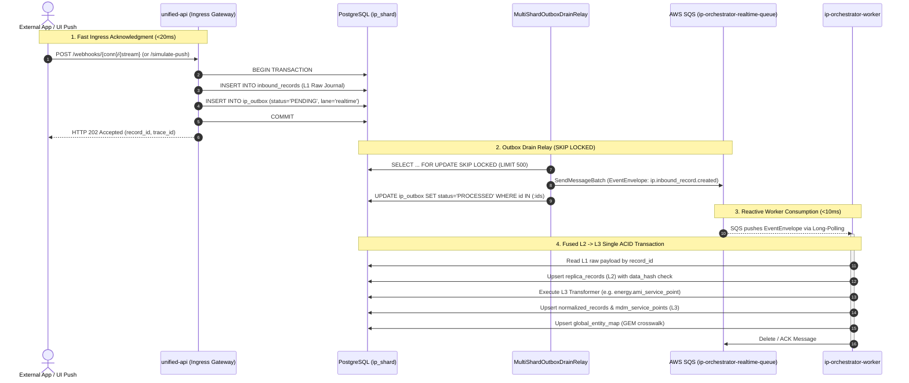
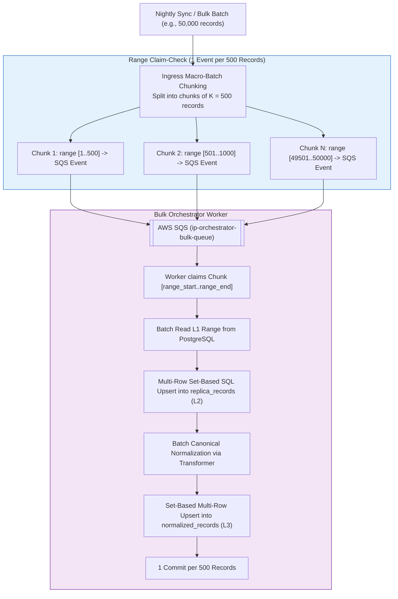
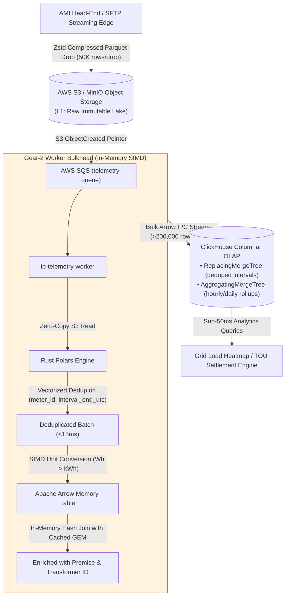

# Enterprise Data Plane Architecture: The 3 Canonical Data Paths

**Bounded Context:** Integration Platform Data Plane (`apps/ip`)  
**Status:** Approved Enterprise Architecture Standard  
**Target Systems:** PostgreSQL (OLTP), Apache Arrow & Rust Polars (In-Memory SIMD), ClickHouse (Columnar OLAP), AWS SQS / S3  

---

## 1. Executive Summary

The Integration Platform classifies all Data Plane workloads into **three isolated architectural paths**, each tailored to its specific volume, concurrency, and latency characteristics:

```mermaid
flowchart TD
    subgraph INGRESS["Ingress Classification Edge"]
        P1_IN["Path 1: Transactional Events\n• Live Webhook / Support Replay\n• N = 1 (Real-Time Low-to-Medium Frequency)"]
        P2_IN["Path 2: Bulk Entity Snapshots\n• Nightly Sync / SFTP Drops\n• N = 10K - 500K (Batch Frequency)"]
        P3_IN["Path 3: Time-Series Telemetry\n• 15-Min Smart Meter Pulses\n• N = Millions (Continuous 24/7)"]
    end

    subgraph PATH1["Path 1: Transactional Business Plane (PostgreSQL)"]
        P1_L1["L1: inbound_records (ACID Journal)"] --> P1_OUTBOX["Transactional Outbox (ip_outbox)"]
        P1_OUTBOX --> P1_L2["L2: replica_records (CDC & Hash-Dedup)"]
        P1_L2 --> P1_L3["L3: mdm_service_points / GEM (ACID)"]
        P1_L3 --> P1_L4["L4: Stitch DAG Orchestrator"]
    end

    subgraph PATH2["Path 2: Bulk Entity Plane (PostgreSQL Set-Based)"]
        P2_CHUNK["Macro-Batch Chunking (K = 500)"] --> P2_CLAIM["L1: Range Claim-Check Pointer"]
        P2_CLAIM --> P2_MERGE["L2: Set-Based SQL ON CONFLICT"]
        P2_MERGE --> P2_L3["L3: Batch Normalized Entity Tables"]
    end

    subgraph PATH3["Path 3: Gear-2 High-Frequency Plane (ClickHouse + Polars)"]
        P3_S3["L1: S3 / MinIO Parquet Drop (50K/drop)"] --> P3_SIMD["Vectorized Polars + Arrow SIMD"]
        P3_SIMD --> P3_CH["L3: ClickHouse ReplacingMergeTree"]
        P3_CH --> P3_ROLLUP["Materialized Aggregations (Hourly/Daily)"]
    end

    P1_IN --> PATH1
    P2_IN --> PATH2
    P3_IN --> PATH3

    style PATH1 fill:#e8f5e9,stroke:#2e7d32,stroke-width:2px
    style PATH2 fill:#e3f2fd,stroke:#1565c0,stroke-width:2px
    style PATH3 fill:#fff3e0,stroke:#e65100,stroke-width:2px
```



---

## 2. Path 1: Transactional Events (Real-Time Entity Updates)

### 2.1 Scope & Profile
* **Workload**: Discrete, interactive business updates from external applications (e.g., customer address changed in Salesforce, service point energized in CIS, meter installed in SAP, Move-in/Move-out final billing read, UI "Simulate Push", or Customer Care manual replay).
* **Scale**: Tens to tens of thousands of records per day ($N = 1$ per event).
* **Storage Engine**: **PostgreSQL** (Row-oriented OLTP for strict ACID consistency).
* **Target Latency**: **`< 100 milliseconds`** end-to-end.

### 2.2 Execution Flow


### 2.3 Implementation Details
1. **Atomic Ingress Journal**: The API container writes the raw payload to `inbound_records` and inserts a pending event into `public.ip_outbox` in the same transaction, returning `HTTP 202 Accepted` in `< 20ms`.
2. **Outbox Drain Relay**: `MultiShardOutboxDrainRelay` claims batches of 500 rows using `SELECT ... FOR UPDATE SKIP LOCKED` ordered by `(lane DESC, created_at ASC)`, publishes them to `ip-orchestrator-realtime-queue`, and marks them `PROCESSED` in a single SQL update.
3. **Fused L2 $\to$ L3 Processing**: `ProcessInboundRangeUseCase` merges L2 replica change-detection (`data_hash`) and L3 canonical normalization into a single PostgreSQL transaction.
4. **Global Entity Map (GEM)**: Cross-entity foreign keys resolve against `global_entity_map`. Out-of-order child records register in `pending_references` and automatically resolve when the parent record commits.

---

## 3. Path 2: Bulk Entity Snapshots (Nightly Push / Nightly Pull)

### 3.1 Scope & Profile
* **Workload**: Scheduled nightly pulls or batch drops of entity records (e.g., syncing 50,000 accounts, meters, or tariffs from SAP, Oracle CC&B, or an SFTP CSV/JSON batch).
* **Scale**: 10,000 to 500,000 records per sync ($N = K$).
* **Storage Engine**: **PostgreSQL** (Set-Based Multi-Row SQL Operations).
* **Target Latency**: **Minutes** (Optimized for database throughput and zero connection pool exhaustion).

### 3.2 Execution Flow (Range Claim-Check)


### 3.3 Implementation Details
1. **Range Claim-Check**: Incoming batches are partitioned into chunks of 500 records. A 50,000-record batch generates exactly 100 SQS chunk-pointer messages (`range_start`, `range_end`, `count=500`).
2. **Dedicated Bulk Lane**: Chunks route to `ip-orchestrator-bulk-queue`, keeping `ip-orchestrator-realtime-queue` clear for Path 1 traffic.
3. **Set-Based Multi-Row SQL**: Workers execute multi-row `INSERT ... ON CONFLICT (tenant_id, connection_id, stream, record_key) DO UPDATE` statements, processing 500 records per transaction commit.

---

## 4. Path 3: Meter & Time-Series Telemetry (Gear-2 Engine)

### 4.1 Scope & Profile
* **Workload**: High-frequency smart meter interval pulses (15-min or 5-min intervals) streaming 24/7/365 to monitor grid load, power quality, and Time-of-Use (TOU) tariffs.
* **Scale**: 500,000 smart meters $\times$ 96 intervals/day = **48,000,000 to 480,000,000 records every day**.
* **Storage Engine**: **ClickHouse Columnar OLAP** (`ReplacingMergeTree` + `AggregatingMergeTree`) + **Rust Polars & Apache Arrow** in-memory SIMD.
* **Isolation**: All telemetry data flows strictly through object storage and ClickHouse.

### 4.2 Execution Flow (Gear-2 Columnar Pipeline)


### 4.3 Implementation Details (Current Implementation vs. Target Capabilities)
1. **S3 Object Drop**: Telemetry drops directly into S3/MinIO as raw macro-batches (JSON or Parquet) and claim-check pointers.
2. **In-Memory Vectorized Pipeline**:
   - *Current Implementation*: `VectorizedIntervalBatchNormalizerAdapter` executes zero-loss intra-batch deduplication, baseline median calculation, and VEE spike quarantine in Python memory.
   - *Target Capability*: Compiled Rust Polars SIMD dataframe execution for processing $50{,}000+$ row Parquet files in $< 15\text{ms}$.
3. **Columnar Streaming Storage**:
   - *Current Implementation*: `ColumnarIntervalRollupRepositoryAdapter` manages the physical DDL contracts (`ip_intervals.interval_readings_15m` and materialized views) with unit/integration testing executed against in-memory or PostgreSQL test harnesses.
   - *Target Capability*: Direct Apache Arrow IPC streaming into ClickHouse columnar clusters at $> 200{,}000\text{ rows/second}$.
4. **Materialized Aggregations**: ClickHouse `AggregatingMergeTree` tables compute real-time hourly and daily rollups on write.

---

## 5. Outbox Architecture & Evolutionary Strategy

### 5.1 Outbox Engine Implementation
Paths 1 and 2 utilize the Transactional Outbox pattern implemented via `OutboxRelayPort`:

```mermaid
flowchart TD
    subgraph APPLICATION_LAYER["Application & Domain Layer"]
        UC["ReceivePushUseCase / RunSyncUseCase"]
        UOW["IpDataPlaneUnitOfWorkPort"]
        UC --> UOW
        UOW -->|"Atomic commit"| OUTBOX_TABLE[("ip_outbox table")]
    end

    subgraph INFRASTRUCTURE_LAYER["Infrastructure Layer (Swappable Adapters)"]
        OUTBOX_TABLE --> PORT["OutboxRelayPort (Interface)"]
        
        PORT -.->|Current Implementation (Up to 10M-20M/day)| ADAPTER_A["MultiShardOutboxDrainRelay\n(FOR UPDATE SKIP LOCKED)\n• Batched at 500 rows\n• Priority: ORDER BY lane DESC, created_at ASC\n• Sub-second latency"]
        PORT -.->|Scale Evolution (> 20M/day)| ADAPTER_B["CDC Relay Adapter\n(Debezium / AWS Aurora CDC)\n• Reads Postgres WAL directly"]
    end

    ADAPTER_A --> SQS[["AWS SQS"]]
    ADAPTER_B --> SQS

    style APPLICATION_LAYER fill:#e8f5e9,stroke:#2e7d32
    style ADAPTER_A fill:#e3f2fd,stroke:#1565c0
    style ADAPTER_B fill:#f3e5f5,stroke:#6a1b9a
```

### 5.2 Operating Profile of `MultiShardOutboxDrainRelay`
* **Throughput Capacity**: Draining in batches of 500 rows (`LIMIT 500`) handles up to 10,000,000 records/day with **$0.23\text{ batch queries/second}$** average and **$1\text{ to } 2\text{ batch queries/second}$** peak.
* **Partial B-Tree Index**:
  ```sql
  CREATE INDEX ix_ip_dp_outbox_pending
  ON public.ip_outbox (lane, created_at)
  WHERE status = 'PENDING';
  ```
  Claiming 500 rows takes `< 5ms` with $< 2\%$ CPU utilization on standard PostgreSQL hardware.
* **Evolution Path**: When sustained traffic exceeds 20,000,000 records/day, the adapter behind `OutboxRelayPort` transitions to Log-Based CDC (Debezium / AWS Aurora CDC) reading directly from the Write-Ahead Log (WAL), requiring zero changes to application use cases or domain models.

---

## 6. Comprehensive System Comparison

| Dimension | Path 1: Transactional Events | Path 2: Bulk Entity Snapshots | Path 3: Time-Series Telemetry (Gear-2) |
| :--- | :--- | :--- | :--- |
| **Typical Data Types** | Customer profile, account status, meter install, dispute read | 50K customers, assets, or tariffs from SAP/Salesforce | 15-min smart meter pulses (kWh delivered, voltage, quality) |
| **Data Volume / Frequency** | $1 - 1,000$ events/hr (Discrete) | $10\text{K} - 500\text{K}$ records/job (Nightly) | $48\text{M} - 480\text{M}$ records/day (Continuous 24/7) |
| **L1 Storage Layer** | PostgreSQL `inbound_records` (ACID) | PostgreSQL `inbound_records` (Chunked) | AWS S3 / MinIO Object Storage (Parquet files) |
| **Queue / Broker Modality** | SQS `realtime-queue` ($N = 1$) | SQS `bulk-queue` ($1\text{ msg} = 500\text{ records}$) | SQS `telemetry-queue` ($1\text{ msg} = \text{S3 file pointer}$) |
| **Processing Engine** | Row-oriented Python Use Case | Set-based Multi-Row SQL Upserts | Vectorized Rust Polars + Apache Arrow SIMD |
| **L2 Deduplication** | Row SHA-256 in `replica_records` | Set-based `ON CONFLICT DO UPDATE` | Polars in-memory composite hash deduplication |
| **L3 Target Storage** | PostgreSQL `normalized_records` & domain tables | PostgreSQL `normalized_records` (Set-based) | ClickHouse `ReplacingMergeTree` |
| **Global Entity Map (GEM)** | Relational table query & foreign key join | Batch dictionary lookup & set-based update | In-memory Arrow dictionary hash-join in RAM |
| **Processing SLA** | **`< 100 milliseconds`** | **Minutes** | **`< 2 seconds per 50K batch`** |

---

## 7. Execution of UI Simulator Push

When a user clicks **"Simulate Push"** in the UI:
1. It executes as a **Path 1 (Transactional Event)**.
2. `unified-api` writes the synthesized record to `inbound_records` (L1) and stages an `InboundRecordCreatedEvent` into `public.ip_outbox` in the same database transaction.
3. `MultiShardOutboxDrainRelay` claims the outbox record using `FOR UPDATE SKIP LOCKED` and publishes to `ip-orchestrator-realtime-queue`.
4. `ip-orchestrator-worker` consumes the message from SQS.
5. It reads L1, writes the L2 replica, executes the auto-bound `energy.ami_meter_reading` transformer, and persists the normalized record into `mdm_meter_readings` (L3).
6. The UI's TanStack table immediately renders the newly created record.
