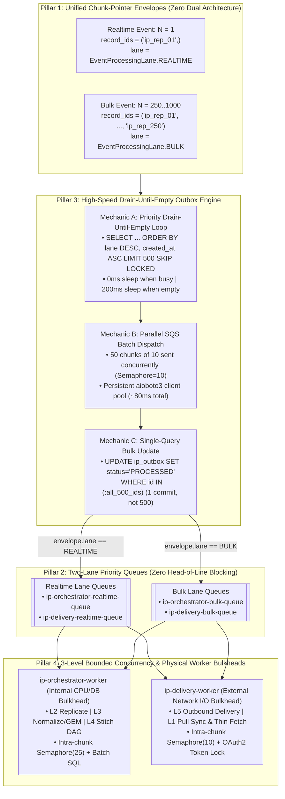

# Gold-Standard Design Document: High-Scalability IP Worker Topology & Transactional Outbox Event Architecture

**Bounded Context:** `apps/ip` (`ip.engine` & `ip.application`) & Shared Platform (`seedwork`, `database`, `outbox`, `strace`, `pubsub`, `orchestration`, `unified-worker`)  
**Status:** Architecture Specification (v5 — Pure 2-Plane `ip.engine` / `ip.application` Taxonomy, Zero `ip/bootstrap`, Global `EventEnvelope`, & 4 High-Scalability Pillars)  
**Target Modules:**
- `core/platform/packages/seedwork/src/seedwork/events.py`
- `core/platform/packages/database/src/database/models/common.py`
- `core/platform/packages/outbox/src/outbox/`
- `core/platform/packages/pubsub/src/pubsub/`
- `core/platform/packages/strace/src/strace/`
- `apps/ip/packages/ip/src/ip/engine/`
- `apps/ip/packages/ip/src/ip/application/`
- `core/platform/apps/unified-worker/src/unified_worker/registry.py`

**Competitive Benchmark:** Shopify (Pod-Sharded Outbox & Single-Image Multi-Role Topology), Hatchet v1 (`FOR UPDATE SKIP LOCKED` DAG Scheduler), CloudEvents 1.0 Specification, Airbyte OSS, n8n, Activepieces, and [`platform_vs_application_architecture_plan.md`](./platform_vs_application_architecture_plan.md).

---

## 1. Executive Summary & Core Architectural Decisions

The Integration Platform (`apps/ip`) starts with the **Energy & Utilities sector** (Smart Grid AMI meter interval reads, MDM, CIS, SAP IS-U, Oracle CC&B, SFTP bulk dumps) alongside 500+ enterprise SaaS connectors. It must simultaneously handle:
1. **Real-Time Events ($N=1$):** Sub-second webhook ingestion, thin-webhook fetches, and interactive Customer Support single-record replays.
2. **Massive Bulk Streams ($N=10^4 - 10^7$):** Millions of smart-meter interval readings, SFTP file drops, full-refresh generation sweeps, and stream-wide mapping backfills.

### 1.1 Why `unified-api` Never Publishes to SQS Inline
- **Strict API / Broker Decoupling:** When an external partner (e.g., Itron AMI Head-End or Salesforce) sends a webhook to `unified-api`, or when an operator triggers a replay, `unified-api` executes **only one fast PostgreSQL transaction** (`inbound_records` + `public.ip_outbox` with `status = 'PENDING'`) and immediately returns `HTTP 202 Accepted`.
- `unified-api` **never** makes synchronous network calls to AWS SQS and **never** opens a second database transaction to mark outbox rows `PROCESSED`. All outbox draining is handled asynchronously by dedicated background workers.

### 1.2 Why PostgreSQL `LISTEN/NOTIFY` Is Rejected for the Data Plane
While `LISTEN/NOTIFY` is suitable for the low-volume **Control Plane** (`ip.outbox` in `global_db`, where connection or mapping changes occur a few times per minute), using `LISTEN/NOTIFY` on the high-volume **Data Plane** (`public.ip_outbox` on tenant shards) is an **anti-pattern**:
1. **Global Commit Serialization (`AsyncQueueLock`):** In PostgreSQL internals (`src/backend/commands/async.c`), `NOTIFY` writes to a single cluster-wide SLRU shared-memory ring buffer (`pg_notify`) during `PreCommit_Notify()`, acquiring an **exclusive global lock**. Under heavy Energy workloads (thousands of concurrent commits/sec), an `AFTER INSERT` trigger calling `pg_notify()` serializes every `COMMIT` across the database shard.
2. **Per-Row Trigger Amplification ($5\times$):** Across 5 pipeline layers (`L1 -> L2 -> L3 -> L4 -> L5`), a burst of 10,000 records fires 50,000 `pg_notify` signals just to wake up a worker that is already awake and draining the table.
3. **Fixed 8 GB SLRU Ring-Buffer Ceiling:** If a listener lags during a utility billing-window spike, `pg_notify` fills up and PostgreSQL blocks or rejects new `COMMIT`s.
4. **Breaks PgBouncer Transaction Pooling:** `LISTEN` requires a permanently pinned stateful connection per shard per worker replica, bypassing PgBouncer `transaction` pooling mode.

### 1.3 Why Sharded PostgreSQL + AWS SQS + S3 Is Superior to Kafka / Debezium / Temporal for an Enterprise iPaaS

| Enterprise iPaaS Requirement | What Happens in **Apache Kafka + Debezium CDC** | What Happens in **Sharded PostgreSQL + AWS SQS + S3 (Our Stack)** |
| :--- | :--- | :--- |
| **Customer Support Search & 1-Click Replay (`MTR-101`)** | **Impossible natively.** Kafka is a sequential log; cannot query `WHERE correlation_id = 'MTR-101'` in `<10ms` or replay 1 failed meter from the middle of a topic. | **Native (`<10ms`).** Indexed `(tenant_id, correlation_id)` across all 5 layers + 1-click single, modified, or bulk replay from `L1`, `L2`, `L3`, or `L5`. |
| **Per-Tenant / Per-Destination Rate Limits (`429 Retry-After`)** | **Partition Head-of-Line Blocking.** Pausing a partition when Customer A gets `429 Retry-After: 60s` freezes every other message on that partition. | **Zero Blocking.** SQS visibility timeouts + Postgres `next_attempt_at` park only the rate-limited record while other traffic flows at full speed. |
| **L2 Deduplication & L3 GEM Crosswalk (`MTR-101 <-> EQUIP-99`)** | **Still requires Postgres anyway.** Kafka cannot perform ACID primary-key upserts, `data_hash` deduplication, or relational foreign-key resolution (`pending_references`). | **Single ACID Engine.** Domain state, GEM crosswalk, `ip_trace_events`, and `ip_outbox` commit atomically in **one transaction**. |
| **L4 Durable Stitches (`WAIT_FOR_EVENT` for 3 days)** | **Impossible in Kafka.** A consumer cannot hold an uncommitted offset for days waiting for an external SAP confirmation event. | **Native.** `workflow_step_runs` parks in Postgres (`WAITING`) for days with zero compute cost until the matching event arrives. |
| **Database Disk Outage Risk (WAL Slots)** | **High Risk.** Debezium requires a Postgres Logical Replication Slot per shard. If a connector lags during an Energy spike, Postgres cannot purge WAL files, **filling disk to 100% and crashing the DB**. | **Zero WAL Slot Risk.** `FOR UPDATE SKIP LOCKED` never blocks Postgres WAL cleanup and never risks disk exhaustion. |

---

## 2. Global `EventEnvelope` & `OutboxMixin` Refactoring (CloudEvents 1.0 Gold Standard)

To enforce **Zero Dual Architecture**, we eliminate all bounded-context envelope wrapper classes (no `IpEventEnvelopeMessage`, no `EdiDataPlaneEventMessage`, no `IdentityEventMessage`) and upgrade the global [`seedwork.events.EventEnvelope`](../../../core/platform/packages/seedwork/src/seedwork/events.py), [`seedwork.events.DomainEvent`](../../../core/platform/packages/seedwork/src/seedwork/events.py), and [`database.models.common.OutboxMixin`](../../../core/platform/packages/database/src/database/models/common.py) with first-class routing and tracing headers.

### 2.1 Why First-Class Envelope & Outbox Columns Are Mandatory (Envelope vs. Payload Separation)
1. **Priority Draining *Inside* the Outbox Table (Zero DB Head-of-Line Blocking):**
   - If a utility dumps 100,000 `BULK` events into `public.ip_outbox` and 1 second later a live customer webhook inserts 1 `REALTIME` event, storing `lane` as a physical indexed column on `OutboxMixin` (`(status, lane, created_at) WHERE status = 'PENDING'`) allows the Outbox Drain Worker to query `ORDER BY lane DESC, created_at ASC` (`'realtime' > 'bulk'`). Live `REALTIME` webhooks jump straight to the front of the line **inside PostgreSQL** before even reaching SQS.
2. **Infrastructure Never Inspects Opaque Business `payload`:**
   - Routers (`EventTypeOutboxRouter`), brokers (`AwsBatchPublisherBase`), and inbound dispatchers (`EventEnvelopeDispatcher`) route, filter, and bind structured logs using strictly typed `EventEnvelope` attributes (`id`, `source`, `event_type`, `tenant_id`, `idempotency_key`, `trace_id`, `correlation_id`, `lane`), never `payload.get(...)`.
3. **Direct SQL Observability & Native SQS/SNS `MessageAttributes`:**
   - Indexing `trace_id` on `OutboxMixin` allows instant SQL lookup of pending/failed outbox events by `trace_id`, and `AwsBatchPublisherBase` promotes `event_type`, `lane`, and `trace_id` to native SQS/SNS `MessageAttributes`.

### 2.2 Upgraded `seedwork.events` Contract (`core/platform/packages/seedwork/src/seedwork/events.py`)

```python
from enum import StrEnum

class EventProcessingLane(StrEnum):
    """Standard enterprise execution lane for separating realtime interactive vs bulk workloads."""

    REALTIME = "realtime"
    BULK = "bulk"


@dataclass(frozen=True)
class EventEnvelope:
    """
    Standard Enterprise Event Envelope (CloudEvents 1.0 compliant).
    Must be used by all Bounded Contexts on both Outbound (Outbox -> Broker)
    and Inbound (Broker -> Worker Dispatcher) boundaries.
    """

    id: str
    source: str
    event_type: str
    tenant_id: str | None
    idempotency_key: str | None
    payload: JsonDict
    trace_id: str | None = None
    correlation_id: str | None = None
    lane: EventProcessingLane = EventProcessingLane.REALTIME


@dataclass(frozen=True)
class DomainEvent(ABC):
    """Base class for all immutable @dataclass(frozen=True) domain events."""

    idempotency_key: str = field(
        default_factory=lambda: generate_id(SystemIdPrefix.IDEMPOTENCY), kw_only=True
    )

    @property
    @abstractmethod
    def event_name(self) -> str:
        raise NotImplementedError

    @abstractmethod
    def get_routing_tenant_id(self) -> str | None:
        raise NotImplementedError

    def get_trace_id(self) -> str | None:
        return None

    def get_correlation_id(self) -> str | None:
        return None

    def get_processing_lane(self) -> EventProcessingLane:
        return EventProcessingLane.REALTIME
```

### 2.3 Upgraded `OutboxMixin` (`core/platform/packages/database/src/database/models/common.py`)

```python
class OutboxMixin:
    """Shared columns for Outbox across Global and Tenant schemas."""

    @declared_attr
    def idempotency_key(cls) -> Mapped[str]:
        return mapped_column(String(255), nullable=False, unique=True)

    @declared_attr
    def event_type(cls) -> Mapped[str]:
        return mapped_column(String(100), nullable=False)

    @declared_attr
    def trace_id(cls) -> Mapped[str | None]:
        return mapped_column(String(64), nullable=True, index=True)

    @declared_attr
    def correlation_id(cls) -> Mapped[str | None]:
        return mapped_column(String(255), nullable=True)

    @declared_attr
    def lane(cls) -> Mapped[str]:
        return mapped_column(
            String(32),
            nullable=False,
            default=EventProcessingLane.REALTIME.value,
            server_default=text("'realtime'"),
        )

    @declared_attr
    def payload(cls) -> Mapped[dict[str, Any]]:
        return mapped_column(JSONB, nullable=False)
    # ... existing status, attempts, published_at, error_reason, created_at, updated_at, owner_token, lease_expires_at
```

And on [`IpDataPlaneOutboxRecord`](../packages/ip/src/ip/engine/adapters/outbound/database/models/data_plane.py) (`public.ip_outbox`), the partial index is upgraded to:
```sql
CREATE INDEX ix_ip_dp_outbox_pending
ON public.ip_outbox (status, lane, created_at)
WHERE status = 'PENDING';
```

### 2.4 Centralized `EventEnvelopeDispatcher` (`core/platform/packages/pubsub/src/pubsub/envelope_dispatcher.py`)
We provide a single platform-wide inbound adapter in `core/platform/packages/pubsub`:
- Receives raw `JsonDict` from `SqsConsumerManager` (unwrapping SNS-wrapped payloads if present).
- Validates directly into `seedwork.events.EventEnvelope` via `TypeAdapter(EventEnvelope).validate_python(raw)` (raising `ConsumerTerminalError` immediately if malformed).
- Binds `event_id=envelope.id`, `source=envelope.source`, `event_type=envelope.event_type`, `tenant_id=envelope.tenant_id`, `trace_id=envelope.trace_id`, `correlation_id=envelope.correlation_id`, and `lane=envelope.lane` to `structlog`.
- Dispatches the `EventEnvelope` to the registered route callback.

---

## 3. The 4 Pillars of High Scalability (Realtime + Bulk Energy Scale)

To handle both **1-record real-time webhooks (<100ms)** and **10,000,000-record Energy bulk syncs** on a single unified architecture, our design is built on **four foundational pillars**:



---

### Pillar 1: Unified Chunk-Pointer Envelopes ($N=1$ for Realtime, $N=K$ for Bulk) — Zero Dual Architecture

In AWS SQS, a single `SendMessageBatch` HTTP call carries at most 10 messages. If a pipeline emits 1 outbox row and 1 SQS message per individual meter reading during a 100,000-record bulk import, it generates **400,000 outbox rows** and **40,000 SQS HTTP calls** across L1 $\to$ L2 $\to$ L3 $\to$ L4.

To eliminate this amplification **without** introducing dual codepaths ("single mode" vs. "batch mode"), **every Data Plane event is always a Chunk-Pointer Event**:
- **Realtime Webhook / Single Replay ($N=1$):** A chunk pointer of length 1 (`record_ids = ("ip_rep_01",)`), `lane = EventProcessingLane.REALTIME`.
- **Bulk Pull Sync / SFTP File / Bulk Replay ($N=250\text{–}1,000$):** A chunk pointer of length $K$ (`record_ids = ("ip_rep_01", ..., "ip_rep_250")`), `lane = EventProcessingLane.BULK`.

| Pipeline Transition | Event Type (`IpEventType`) | Chunk-Pointer Payload Contract | Realtime ($N=1$) vs. Bulk ($N=K$) Behavior |
| :--- | :--- | :--- | :--- |
| **L1 $\to$ L2** | `ip.inbound_record.created` | `record_ids: tuple[str, ...]` (points to `inbound_records.id`s) | For a webhook, `inbound_records` holds $N=1$ inline JSON payload (`lane=REALTIME`). For a bulk pull/SFTP chunk, `inbound_records` points to an S3 object holding $N=500\text{–}1,000$ records (`lane=BULK`). **Always 1 outbox row per L1 batch.** |
| **L2 $\to$ L3** | `ip.replica_record.changed` | `record_ids: tuple[str, ...]` (1 to 250 changed `replica_records.id`s), `stream: str`, `connection_id: str` | `ReplicateRecordsUseCase` extracts all $N$ records from the L1 payload, upserts changed replicas (`INSERT`, `UPDATE`, `TOMBSTONE`), and emits **chunked `ReplicaRecordChangedEvent`s** (up to 250 `record_ids` per outbox event). For a webhook ($N=1$), `len(record_ids) == 1`. For 1,000 bulk records, it emits **4 outbox events instead of 1,000** ($250\times$ reduction). |
| **L3 $\to$ L4** | `ip.canonical_record.changed` / `ip.normalized_record.created` | `record_ids: tuple[str, ...]`, `canonical_type: str`, `connection_id: str` | L3 normalizes all `record_ids` in the chunk with bounded concurrency and emits coalesced canonical chunk events to L4 `DispatchCanonicalEventToStitchesUseCase`. |
| **L4 $\to$ L5** | `ip.outbound_record.created` | `record_ids: tuple[str, ...]` (1 to 100 pending `outbound_records.id`s), `connection_id: str` | L4 Stitch destination step (or `RETRY_DELIVER` replay) creates `OutboundRecord`s and emits a chunk pointer to `ip-delivery-worker`, which dispatches them with bounded concurrency. |

---

### Pillar 2: Two-Lane Priority Queues (`realtime` vs. `bulk`) — Zero Head-of-Line Blocking

**The Problem:** At 10:00 AM, a utility starts a bulk sync of 1,000,000 historical meter readings. At 10:01 AM, a live customer webhook or support agent single-record replay arrives. If both share a single outbox order and SQS queue, the live event sits behind thousands of bulk chunks (**Head-of-Line Blocking**).

**The Solution (End-to-End Priority Across Both PostgreSQL and SQS):**
1. **PostgreSQL Outbox Priority Index (`(status, lane, created_at) WHERE status = 'PENDING'`):**
   - `SqlAlchemyShardedOutboxRepository.claim_next_events()` orders by `lane DESC, created_at ASC` (`'realtime' > 'bulk'`). Even if 100,000 `bulk` events are sitting in `public.ip_outbox`, a newly inserted `realtime` event is claimed **first** on the very next batch.
2. **SQS Queue Lane Separation (`EventTypeOutboxRouter`):**
   - `EventTypeOutboxRouter` inspects `envelope.lane` (the first-class `EventProcessingLane` header on `seedwork.events.EventEnvelope`):
     - Routes `(event_type, EventProcessingLane.REALTIME)` to **`ip-orchestrator-realtime-queue`** and **`ip-delivery-realtime-queue`**.
     - Routes `(event_type, EventProcessingLane.BULK)` to **`ip-orchestrator-bulk-queue`** and **`ip-delivery-bulk-queue`**.
   - Both `ip-orchestrator-worker` and `ip-delivery-worker` attach dedicated `SqsConsumerManager` instances to both lanes, guaranteeing that live webhooks always have an open fast lane.

---

### Pillar 3: High-Speed "Drain-Until-Empty" Outbox Engine (`FOR UPDATE SKIP LOCKED` + Parallel SQS + Bulk SQL Update)

Our audit of [`core/platform/packages/outbox`](../../../core/platform/packages/outbox/src/outbox/application/outbox_processor_use_case.py) and [`core/platform/packages/pubsub`](../../../core/platform/packages/pubsub/src/pubsub/aws/aws_batch_publisher_base.py) uncovered two major throughput bottlenecks that we fix directly in the shared platform packages:

#### Mechanic A: "Drain-Until-Empty" Loop (`MultiShardOutboxDrainRelay`)
- Replaces `LISTEN/NOTIFY` on the Data Plane shards.
- For each tenant shard (`db_router.get_all_shards(app_slug="ip")`), claims up to `500` events in one SQLAlchemy ORM query using `with_for_update(skip_locked=True)`:
  - Claims rows where `status == 'PENDING'` (**with `0` seconds artificial delay**, since `unified-api` never publishes inline!) **OR** `(status == 'PROCESSING' AND lease_expires_at < NOW())` (automatic crash recovery in the exact same query!), ordered by `lane DESC, created_at ASC`.
  - Uses the partial B-tree index `ix_ip_dp_outbox_pending (status, lane, created_at) WHERE status = 'PENDING'`. When the shard has 0 pending events, checking this partial index takes **`<0.2 ms`** regardless of how many `PROCESSED` rows exist.
  - **When `len(events) > 0`:** Immediately loops again with **`0 ms` sleep** after publishing until the shard's pending queue is 100% empty.
  - **When `len(events) == 0`:** Sleeps briefly (`poll_interval_seconds = 0.2`) before the next check.
  - **Horizontal Scaling:** Because of `FOR UPDATE SKIP LOCKED`, spinning up 10 `ip-dp-jobs-worker` containers automatically partitions batches across all 10 workers with zero lock contention and zero duplicate claims.

#### Mechanic B: Concurrent SQS 10-Message Batch Dispatch (Upgrading [`AwsBatchPublisherBase`](../../../core/platform/packages/pubsub/src/pubsub/aws/aws_batch_publisher_base.py))
- Currently, [`AwsBatchPublisherBase._publish_batch_internal()`](../../../core/platform/packages/pubsub/src/pubsub/aws/aws_batch_publisher_base.py) sends 10-message chunks **sequentially** in a `for` loop (`50` sequential HTTP round-trips for 500 events $\approx 1,000\text{ ms}$).
- **Upgrade:** For standard (non-FIFO) queues, partition `events` into 10-message chunks and dispatch them **concurrently** bounded by `asyncio.Semaphore(max_concurrent_batches=10)` over a persistent `aioboto3` client, cutting 500-event publish time from `~1,000 ms` to **`~80 ms`**. Also promote `event_type`, `lane`, and `trace_id` to SQS/SNS `MessageAttributes`.

#### Mechanic C: Single-Query Bulk Completion (Upgrading [`OutboxRepositoryPort`](../../../core/platform/packages/outbox/src/outbox/ports/outbox_repository_port.py), [`OutboxProcessorUseCase`](../../../core/platform/packages/outbox/src/outbox/application/outbox_processor_use_case.py), and [`OutboxSweeperUseCase`](../../../core/platform/packages/outbox/src/outbox/application/outbox_sweeper_use_case.py))
- Currently, `OutboxProcessorUseCase` and `OutboxSweeperUseCase` loop over `events` and call `repository.mark_completed(event.id, worker_id)` **500 separate times** (500 DB sessions and 500 commits!).
- **Upgrade:** Add `mark_completed_batch(event_ids: Sequence[str], worker_id: str) -> None` and `mark_failed_batch(event_ids: Sequence[str], worker_id: str, error_message: str) -> None` to `OutboxRepositoryPort`:
  ```python
  stmt = (
      update(self._model_cls)
      .where(
          self._model_cls.id.in_(event_ids),
          self._model_cls.status == OutboxStatus.PROCESSING.value,
          self._model_cls.owner_token == worker_id,
      )
      .values(
          status=OutboxStatus.PROCESSED.value,
          published_at=now,
          updated_at=now,
          lease_expires_at=None,
          owner_token=None,
      )
  )
  ```
  All 500 events are marked `PROCESSED` in **1 single SQL statement and 1 single DB commit**.

---

### Pillar 4: 3-Level Bounded Concurrency (`asyncio.Semaphore`) & Physical Worker Bulkheads

#### 4.1 Three-Level Bounded Concurrency Hierarchy
To maximize throughput while protecting PostgreSQL connection pools and external customer APIs from exhaustion, concurrency is strictly bounded at three levels:
1. **Level 1 — Outbox Relay Concurrency (`ip-dp-jobs-worker`):**
   - Drains up to `shard_concurrency = 5` tenant shards in parallel.
   - Claims up to `batch_size = 500` chunk-events per shard query.
   - Publishes up to `sqs_batch_concurrency = 10` parallel `SendMessageBatch` HTTP calls (100 messages in-flight per shard).
2. **Level 2 — SQS Consumer Concurrency (`SqsConsumerManager`):**
   - Polls and processes multiple SQS `EventEnvelope` chunk-messages concurrently per worker container on both the `realtime` and `bulk` queue consumers.
3. **Level 3 — Intra-Chunk Item Concurrency (`ip-orchestrator-worker` & `ip-delivery-worker`):**
   - Inside a single Chunk-Pointer `EventEnvelope`:
     - When $N=1$ (Realtime Webhook): Executes the single item immediately with zero task-spawning overhead.
     - When $N=K$ (Bulk Chunk of 250 items): Executes items across a bounded `asyncio.Semaphore(intra_chunk_concurrency)` (e.g., `25` for internal L3 normalization; `10` for external L5 delivery), ensuring predictable latency and bounded DB session usage.

#### 4.2 Physical Compute vs. External I/O Worker Bulkheads (`unified-worker`)
Following our **Shopify-Style Single-Image, Multiple-Containers** paradigm, we physically isolate fast internal compute from slow external network I/O across four worker entrypoints in [`core/platform/apps/unified-worker/src/unified_worker/registry.py`](../../../core/platform/apps/unified-worker/src/unified_worker/registry.py):

1. **`ip-orchestrator-worker` (`ip.engine.adapters.inbound.workers.ip_orchestrator_worker.IpOrchestratorWorkerModule`) — *Fast Internal Compute & DB Bulkhead*:**
   - Consumes `ip-orchestrator-realtime-queue` and `ip-orchestrator-bulk-queue` via `EventEnvelopeDispatcher`.
   - Executes **only** in-cluster CPU and shard-DB stages (`5–15ms` per record, **zero** external internet calls):
     - **L2 Replication:** [`ReplicateRecordsUseCase`](../packages/ip/src/ip/engine/application/use_cases/replication/replicate_records_use_case.py) & [`SweepStaleReplicasUseCase`](../packages/ip/src/ip/engine/application/use_cases/replication/sweep_stale_replicas_use_case.py)
     - **L3 Normalization & GEM:** [`NormalizeReplicaRecordUseCase`](../packages/ip/src/ip/engine/application/use_cases/normalization/normalize_replica_record_use_case.py) & [`BackfillStreamNormalizationUseCase`](../packages/ip/src/ip/engine/application/use_cases/normalization/backfill_stream_normalization_use_case.py)
     - **L4 Durable Stitch Orchestration:** [`DispatchCanonicalEventToStitchesUseCase`](../packages/ip/src/ip/engine/application/use_cases/stitch/dispatch_canonical_event_to_stitches_use_case.py) + immediate inline [`ExecuteStitchWorkerTickUseCase`](../packages/ip/src/ip/engine/application/use_cases/stitch/execute_stitch_worker_tick_use_case.py), plus a background `IpMultiShardStitchTickLoop` for waking expired `SLEEP` timers.
2. **`ip-delivery-worker` (`ip.engine.adapters.inbound.workers.ip_delivery_worker.IpDeliveryWorkerModule`) — *External Network I/O Bulkhead*:**
   - Consumes `ip-delivery-realtime-queue` and `ip-delivery-bulk-queue` via `EventEnvelopeDispatcher`.
   - Physically isolates slow, rate-limited, or flaky third-party ERP/CRM/MDM/AMI network calls (`500ms–30s`):
     - **L5 Outbound Delivery:** [`DeliverOutboundRecordUseCase`](../packages/ip/src/ip/engine/application/use_cases/delivery/deliver_outbound_record_use_case.py) (with `TokenManagerService` distributed OAuth2 refresh lock, crash reconciliation via `reconcile_in_flight()`, `429 Retry-After` extraction, and S3 wire-payload offload).
     - **L1 Thin-Webhook Fetch:** [`FetchRecordUseCase`](../packages/ip/src/ip/engine/application/use_cases/ingestion/fetch_record_use_case.py)
     - **L1 Pull Sync Execution:** [`RunSyncUseCase`](../packages/ip/src/ip/engine/application/use_cases/ingestion/run_sync_use_case.py)
3. **`ip-dp-jobs-worker` (`ip.engine.adapters.inbound.workers.ip_dp_jobs_worker.IpDpJobsWorkerModule`) — *Data Plane High-Speed Outbox Drain & Retention Worker*:**
   - Runs **`MultiShardOutboxDrainRelay`** (Pillar 3 Drain-Until-Empty loop across all IP tenant shards, `batch_size=500`, `0ms` active sleep / `200ms` idle sleep, concurrent SQS batching, bulk `ANY(:ids)` completion).
   - Consumes `ip-dp-jobs-queue` for scheduled maintenance jobs (`ip.data_plane.outbox_sweeper`, `ip.data_plane.outbox_cleanup`, `ip.data_plane.data_retention_cleanup`).
4. **`ip-cp-jobs-worker` (`ip.engine.adapters.inbound.workers.ip_cp_jobs_worker.IpCpJobsWorkerModule`) — *Control Plane Outbox & Jobs Worker*:**
   - Runs `PostgresOutboxRelay` (`LISTEN ip_cp_outbox_channel` on `global_db`, where config change volume is <1 event/sec) + `OutboxSweeperUseCase` and `OutboxCleanerUseCase`.

---

## 4. Pure 2-Plane Taxonomy Inside `apps/ip/packages/ip/src/ip/` (Zero `apps/ip/apps/` & Zero `ip/bootstrap/`)

Per [`platform_vs_application_architecture_plan.md`](./platform_vs_application_architecture_plan.md), `apps/ip/packages/ip/src/ip/` contains **only two top-level directories**: **`ip/engine/`** and **`ip/application/`**.
- We **eliminate `ip/bootstrap/`**: `container.py`, `settings.py`, and `lifespan.py` are pure Engine components and live directly inside `ip/engine/`.
- We **never create `apps/ip/apps/*`**: In Hexagonal Architecture, background workers are **Inbound Driving Adapters** of the Engine and live directly inside `ip/engine/adapters/inbound/workers/`.
- **How `ip.engine` Discovers `ip.application` Plugins With Zero Coupling:**
  - `ip.engine` **never** imports `ip.application` (strictly enforced by `tach.toml`).
  - `ip.application` exposes a clean plugin registrar (`ip.application.register_plugins(container)`) discovered via standard Python entry points (`importlib.metadata.entry_points(group="ip.plugins")`) or invoked by the host shell, keeping dependency direction 100% unidirectional (`ip.application -> ip.engine`).

| Plane | Directory (`apps/ip/packages/ip/src/ip/...`) | What Belongs Here | `tach.toml` Dependency Rule |
| :--- | :--- | :--- | :--- |
| **1. IP Platform Kernel (`ip.engine`)** | `ip/engine/{domain,ports,application,adapters,container.py,settings.py,lifespan.py}` | All 5-layer SEDA pipeline logic, repositories, outbox, DI container, lifespan, and all 4 `LaunchableWorker` inbound adapters (`ip/engine/adapters/inbound/workers/`). | **Zero imports from `ip.application.*`.** Operates purely on `ip.engine` ports, use cases, and shared platform packages. |
| **2. IP Application Layer (`ip.application`)** | `ip/application/{domains,connectors,transformers,stitches}/` | Industry verticals (`energy`, `tms`), partner connectors (`itron`, `salesforce`, `sftp_csv`), pure L3 mappers, and L4 stitch templates. | Depends strictly inward on `ip.engine.domain` and `ip.engine.ports` (plus `ip.engine.adapters` for ORM base/connectors). |

And [`core/platform/apps/unified-worker/src/unified_worker/registry.py`](../../../core/platform/apps/unified-worker/src/unified_worker/registry.py) registers the four workers directly from `ip.engine.adapters.inbound.workers`:
```python
    "ip-orchestrator-worker": "ip.engine.adapters.inbound.workers.ip_orchestrator_worker.IpOrchestratorWorkerModule",
    "ip-delivery-worker": "ip.engine.adapters.inbound.workers.ip_delivery_worker.IpDeliveryWorkerModule",
    "ip-cp-jobs-worker": "ip.engine.adapters.inbound.workers.ip_cp_jobs_worker.IpCpJobsWorkerModule",
    "ip-dp-jobs-worker": "ip.engine.adapters.inbound.workers.ip_dp_jobs_worker.IpDpJobsWorkerModule",
```

---

## 5. Exact Package & File Taxonomy

```text
core/platform/packages/seedwork/src/seedwork/
└── events.py                                         # UPGRADE: Add EventProcessingLane(REALTIME, BULK) & trace_id/correlation_id/lane to EventEnvelope & DomainEvent

core/platform/packages/database/src/database/models/
└── common.py                                         # UPGRADE: Add trace_id, correlation_id, lane columns to OutboxMixin

core/platform/packages/pubsub/src/pubsub/
├── envelope_dispatcher.py                            # NEW: Centralized EventEnvelopeDispatcher validating raw JsonDict -> seedwork.events.EventEnvelope
└── aws/
    └── aws_batch_publisher_base.py                   # UPGRADE: Concurrent 10-msg batch dispatch via Semaphore(10) + lane/trace_id MessageAttributes

core/platform/packages/outbox/src/outbox/
├── ports/
│   └── outbox_repository_port.py                     # UPGRADE: Add mark_completed_batch() & mark_failed_batch()
├── application/
│   ├── outbox_processor_use_case.py                  # UPGRADE: Use single-query mark_completed_batch()
│   └── outbox_sweeper_use_case.py                    # UPGRADE: Use single-query mark_completed_batch()
└── adapters/
    ├── inbound/
    │   ├── postgres_outbox_relay.py                  # Existing single-DB LISTEN/NOTIFY relay (Control Plane)
    │   └── multi_shard_outbox_drain_relay.py         # NEW: High-speed Drain-Until-Empty multi-shard relay (Data Plane)
    └── outbound/
        ├── event_type_router.py                      # NEW: Lane-aware EventTypeOutboxRouter(OutboxPublisherPort) using envelope.lane
        ├── sqlalchemy_global_outbox_repository.py    # NEW: Generic ORM OutboxRepositoryPort & Cleanup for Global DB
        └── sqlalchemy_sharded_outbox_repository.py   # NEW: Generic ORM OutboxRepositoryPort & Cleanup for Tenant Shards

core/platform/packages/strace/src/strace/
├── adapters/
│   └── retention_repository.py                       # NEW: Generic SqlAlchemyShardedTraceRetentionRepository
└── application/
    └── clean_trace_retention_use_case.py             # NEW: Generic chunked trace + processed_event retention cleaner

apps/ip/packages/ip/src/ip/
├── engine/                                           # PLANE 1: Pure IP Platform Kernel (ZERO imports from ip.application)
│   ├── container.py                                  # Declarative IoC Container (moved from ip/bootstrap/container.py)
│   ├── lifespan.py                                   # Engine startup/shutdown hooks (moved from ip/bootstrap/lifespan.py)
│   ├── settings.py                                   # IpEngineSettings (queue URLs, concurrency, retention config)
│   ├── domain/
│   │   ├── enums.py                                  # Add IpJobName, IpOutboxChannel, IpOutboxSource
│   │   └── events.py                                 # Upgrade Data Plane events with chunk-pointer record_ids & get_trace_id()/get_processing_lane()
│   ├── ports/
│   │   └── outbound/
│   │       └── uow.py                                # Add record_idempotency() to IpTenantUnitOfWorkPort
│   └── adapters/
│       ├── inbound/
│       │   └── workers/                              # Pure IP Engine Inbound Worker Adapters & LaunchableWorker Modules
│       │       ├── __init__.py
│       │       ├── ip_payload_dtos.py                # Typed chunk-pointer payload DTOs (IpReplicaRecordChunkPayloadDTO, etc.)
│       │       ├── ip_disposition.py                 # IpWorkerResultDispositionHandler (Result -> ConsumerAction.ACK/NACK/DLQ)
│       │       ├── ip_orchestrator_route_registry.py # Bounded-concurrency chunk handlers for L2, L3, L4 accepting EventEnvelope
│       │       ├── ip_delivery_route_registry.py     # Bounded-concurrency chunk handlers for L5 & L1 Fetch/Sync accepting EventEnvelope
│       │       ├── ip_stitch_tick_loop.py            # IpMultiShardStitchTickLoop for waking expired L4 SLEEP steps
│       │       ├── ip_orchestrator_worker.py         # IpOrchestratorWorkerModule(LaunchableWorker)
│       │       ├── ip_delivery_worker.py             # IpDeliveryWorkerModule(LaunchableWorker)
│       │       ├── ip_cp_jobs_worker.py              # IpCpJobsWorkerModule(LaunchableWorker)
│       │       └── ip_dp_jobs_worker.py              # IpDpJobsWorkerModule(LaunchableWorker)
│       └── outbound/
│           ├── database/
│           │   ├── base_repository.py                # Populate trace_id, correlation_id, lane when draining DomainEvents into Outbox
│           │   ├── models/data_plane.py              # Add IpProcessedEventModel + (status, lane, created_at) partial index on IpDataPlaneOutboxRecord
│           │   └── data_plane/uow.py                 # IpDataPlaneUnitOfWorkProvider
│           └── pubsub/
│               └── publisher_factory.py              # create_ip_cp_outbox_publisher() & create_ip_dp_outbox_publisher() (realtime + bulk lanes)
└── application/                                      # PLANE 2: Pure IP Application Plugins (energy, tms, connectors, transformers, stitches)

core/platform/apps/unified-worker/src/unified_worker/
└── registry.py                                       # Register ip-orchestrator-worker, ip-delivery-worker, ip-cp-jobs-worker, ip-dp-jobs-worker
```

---

## 6. Hexagonal Testing Pyramid & Coverage Distribution Plan

All tests strictly obey **Zero Mocks (`unittest.mock`, `MagicMock`, `AsyncMock`, `patch`, `monkeypatch` forbidden in unit tests)** and **Transactional Savepoint Rollbacks** in integration tests:

1. **Tier 1 — Pure Domain & Application Unit Tests (Zero Mocks, In-Memory Fakes):**
   - `core/platform/packages/pubsub/tests/unit/test_envelope_dispatcher.py`: Verifies `EventEnvelopeDispatcher` parsing raw `JsonDict` (and SNS-wrapped bodies) directly into `seedwork.events.EventEnvelope` with `trace_id`, `correlation_id`, and `lane`, and raising `ConsumerTerminalError` on malformed inputs.
   - `core/platform/packages/outbox/tests/unit/test_event_type_router.py`: Verifies `EventTypeOutboxRouter` routing by `(envelope.event_type, envelope.lane)` (`EventProcessingLane.REALTIME` vs `EventProcessingLane.BULK`), batch partitioning, and partial failure propagation.
   - `core/platform/packages/outbox/tests/unit/test_multi_shard_outbox_drain_relay.py`: Verifies Drain-Until-Empty loop (`0ms` sleep when batch is non-empty, backoff sleep when empty), `mark_completed_batch` single-call invocation, and bounded shard concurrency.
   - `apps/ip/packages/ip/tests/unit/engine/test_worker_chunk_dispatch_and_disposition.py`:
     - Verifies `IpOrchestratorRouteRegistry` and `IpDeliveryRouteRegistry` accepting global `seedwork.events.EventEnvelope` for **both Realtime ($N=1$) and Bulk ($N=250$) Chunk-Pointer Events** with bounded `asyncio.Semaphore` concurrency.
     - Verifies `IpWorkerResultDispositionHandler` mapping `Result[T, IpError]` dispositions (`RETRY`, `FAIL`, `DLQ`, `IGNORE`) to `ConsumerTransientError`, `ConsumerTerminalError`, and ACK.
2. **Tier 2 — Narrow Integration Tests (Real PostgreSQL with Nested Savepoint Rollbacks):**
   - `core/platform/packages/outbox/tests/integration/test_sqlalchemy_outbox_repositories.py`:
     - Tests `SqlAlchemyGlobalOutboxRepository` and `SqlAlchemyShardedOutboxRepository` on real PostgreSQL (`ip.outbox` and `public.ip_outbox`): verifies `REALTIME` lane priority ordering ahead of `BULK` rows, concurrent `claim_next_events` (`FOR UPDATE SKIP LOCKED`), single-query `mark_completed_batch` (`WHERE id IN (...)`), `mark_failed_batch`, `sweep_stuck_events`, and `cleanup_outbox`.
   - `core/platform/packages/strace/tests/integration/test_trace_retention_repository.py`:
     - Tests chunked retention cleanup of `ip_trace_events` and `ip_processed_events` on real PostgreSQL.
3. **Tier 3 — End-to-End Pipeline Integration Tests (Realtime $N=1$ & Bulk $N=K$ across L1 $\to$ L2 $\to$ L3 $\to$ L4 $\to$ L5 + Replay):**
   - `apps/ip/packages/ip/tests/integration/test_end_to_end_outbox_worker_pipeline.py`:
     - Exercises the full transactional outbox pipeline on real PostgreSQL for both a **Realtime Webhook ($N=1$ on `EventProcessingLane.REALTIME`)** and a **Bulk Meter Sync Batch ($N=50$ on `EventProcessingLane.BULK`)** from L1 Ingestion $\to$ Outbox Drain $\to$ L2 Replication $\to$ Outbox Drain $\to$ L3 Normalization/GEM $\to$ Outbox Drain $\to$ L4 Stitch Execution $\to$ Outbox Drain $\to$ L5 Outbound Delivery, followed by Phase 9 Trace Waterfall (`GetIpTraceUseCase`) and Replay (`ReplayTransactionUseCase`).
