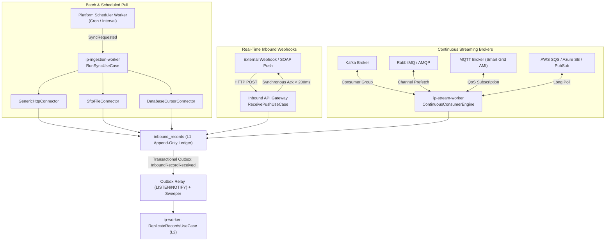
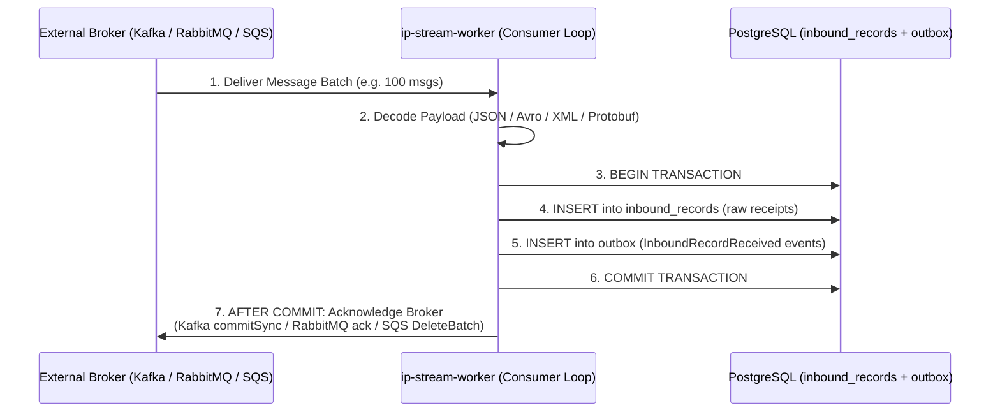

# Design: L1 Ingestion Layer (Pull, Push, and Streaming Subscribe)

**Status:** Proposed
**Scope:** `apps/ip/packages/ip`, ingesting data from external APIs, file servers, databases, and message brokers into the L1 `inbound_records` ledger
**Related:** `generic_http_connector_design.md` (HTTP transport), `l2_replica_design.md` (downstream replication)

---

## 1. Goal

Ingest data from any external system—**HTTP REST/SOAP APIs, SFTP/S3 files, relational databases, Kafka, RabbitMQ, MQTT, and cloud queues (SQS, Azure Service Bus, GCP Pub/Sub)**—into our enterprise platform **reliably, without data loss, and with end-to-end auditability**.

L1 is the immutable, append-only raw receipt ledger of the platform. Once a raw batch or message is committed to L1, an outbox event (`InboundRecordReceived`) guarantees delivery to L2.

---

## 2. Competitive Architectural Benchmark

We benchmarked how open-source platforms handle ingestion across batch and streaming sources:

| Capability | Airbyte (OSS) | Activepieces (OSS) | n8n (OSS) | **Soopa IP Ingestion (Our Design)** |
| :--- | :--- | :--- | :--- | :--- |
| **Kafka Ingestion** | **Batch job only**. Runs bounded poll loop, buffers all records in RAM ArrayList, commits offsets *before* sink writes (at-most-once risk). | ❌ No Kafka trigger. | **Continuous subscriber** (`KafkaTriggerV2`). Supports `onSuccess` offset commit. | **Continuous subscriber** in dedicated `ip-stream-worker`. Commits Kafka offset **only after** L1 DB transaction commits (true at-least-once). |
| **RabbitMQ / AMQP** | ❌ No source connector (destination only). | **Scheduled polling**. Calls `channel.get()` and **immediately ACKs** before flow runs (data lost if crash occurs). | **Continuous subscriber**. Supports `acknowledge: executionFinishesSuccessfully`. | **Continuous subscriber**. Prefetch batching + channel ACK **only after** L1 DB transaction commits. |
| **MQTT (IoT / Smart Grid AMI)** | ❌ Archived / destination only. | ❌ No MQTT trigger. | Continuous subscriber with QoS 0/1/2. In-memory execution. | **Continuous subscriber**. Subscribes to AMI/IoT topics, writes L1 + outbox before QoS ACK. |
| **Cloud Queues (AWS SQS, Pub/Sub, Azure SB)** | SQS is a simple HTTP GET poll without `DeleteMessage` (a peek; messages reappear). | SQS is action-only (send message, no trigger). | Queue nodes exist primarily as actions or custom polling. | **Native Long-Poll & Streaming Subscribers**. SQS batch receive $\to$ L1 commit $\to$ `DeleteMessageBatch`. |
| **File Drops (SFTP / S3 / Blob)** | Python File-CDK. State = file URI $\to$ `last_modified` map. Capped history; no delete detection. | Polling helper (last item / timestamp). | Polling node on interval. | **Chunked File Puller**. Streaming parser (CSV, JSONL, Parquet), streaming S3/SFTP read, file-hash watermarking. |
| **Database Pull (Postgres / MySQL / Oracle)** | JDBC bulk CDK with cursor watermarking and split partitions. | Database triggers via polling queries. | Polling query node with static dedupe. | **Cursor-Watermarked Partition Puller**. High-watermark checkpointing with bounded window. |
| **Raw Durability & Deduplication** | Writes directly to warehouse staging/raw tables. | No raw ledger; directly triggers flow execution in memory. | Directly triggers execution in memory; no persistent raw receipts. | **Append-only `inbound_records` ledger** with tiered S3 offload (>64KB) + SHA-256 payload deduplication. |
| **Worker / Container Physical Isolation** | Ephemeral runner containers per sync. | Web / worker pool. | Runs triggers inside main/worker node memory. | **Physical isolation**: Web API (push only) $\ne$ Ingestion Worker (pull) $\ne$ Stream Worker (continuous brokers). |

---

## 3. The Three Ingestion Strategies



Every ingestion path converges onto the **exact same downstream contract**:
1. An immutable record written to `inbound_records`.
2. An `InboundRecordReceived` event written to the transactional outbox in the same PostgreSQL transaction.
3. L2 (`ReplicateRecordsUseCase`) processes records identically regardless of how they entered the platform.

---

## 4. Strategy 1: Pull (APIs, SFTP/Files, Databases)

### 4.1 Transport Implementations
- **HTTP REST / SOAP**: Handled via `GenericHttpConnector` using `HttpSourceSpec` and cursor pagination.
- **SFTP / S3 Files**:
  - Discovers files via glob pattern (`/meter_reads/**/*.csv`).
  - Maintains `file_watermark` state: `{ file_path: { modified_at: iso, size: int, content_hash: str } }`.
  - Streams file contents in chunks (never loading multi-gigabyte CSV/Parquet files into RAM).
- **Databases (JDBC / SQL)**:
  - Executes incremental query: `SELECT * FROM table WHERE {cursor_field} > :last_checkpoint ORDER BY {cursor_field} ASC LIMIT :batch_size`.
  - Captures high watermark before closing chunk.

### 4.2 Sync Run Lifecycle (`SyncRun` Aggregate)
- **Modes**: `INITIAL` (resumable full scan), `INCREMENTAL` (cursor-based delta), `FULL_REFRESH` (overwrite fallback), `RECONCILIATION` (safety sweep for push/stream).
- **Concurrency Guard**: PostgreSQL partial unique index on `(connection_id, stream) WHERE status IN ('PENDING', 'RUNNING')` guarantees zero overlapping runs for the same stream.
- **Atomic Checkpoint Commit**: The cursor or page token in `stream_state` advances **in the same transaction** that writes the page to `inbound_records` and the outbox event.
- **Lookback Overlap Window**: Incremental syncs read from `checkpoint - 5 minutes` to eliminate clock skew and timestamp collision misses. L2 deduplicates redundant records via SHA-256 content hashes.

---

## 5. Strategy 2: Push (Webhooks, SOAP Outbound Messages)

### 5.1 Architecture & Performance
- **Endpoint**: `POST /ip/v1/inbound/{ingest_key}` (opaque, rotatable token).
- **Sub-200ms Latency**: The API Gateway container executes zero business transformations. It verifies, writes to L1 + Outbox in one transaction, and returns the response.
- **Pluggable Security (`InboundVerifierPort`)**:
  - HMAC SHA-256 (Stripe, Shopify, GitHub).
  - Shared Secret Header / Bearer Token.
  - Mutual TLS (mTLS) with client certificate verification.
  - Salesforce SOAP Organization ID / Session verification.
- **Deduplication**: Unique constraint on `(connection_id, external_event_id)` drops network duplicate retries from webhook emitters without triggering duplicate downstream jobs.
- **Thin Webhooks (Fetch-on-Notify)**:
  - If a webhook contains only an ID notification (e.g. HubSpot, Salesforce CDC), L1 writes a `PUSH_THIN` record and emits `FetchRecordRequested`.
  - An ingestion worker invokes the connector's `fetch_one` spec and writes the hydrated record as `FETCH_ON_NOTIFY`.
  - Delete notices skip the fetch and pass a tombstone directly to L2.

---

## 6. Strategy 3: Subscribe (Kafka, RabbitMQ, MQTT, SQS, Cloud Queues)

This strategy handles streaming event streams and message brokers where Soopa IP maintains active, long-lived subscriptions.

### 6.1 Physical Worker Isolation (`ip-stream-worker`)
In compliance with `AGENTS.md` (Strict API/Worker Decoupling):
- **Never run streaming poll loops inside the FastAPI web server.**
- Continuous subscribers live inside a dedicated `ip-stream-worker` container entrypoint.
- Each active streaming connection initializes a supervised connection runner managed by `StreamSubscriptionSupervisor`.

### 6.2 The Strict At-Least-Once Handshake
To prevent the data loss seen in Airbyte (early commit) and Activepieces (instant ACK on read), Soopa IP enforces an atomic handshake:



**Failure Semantics:**
- If the database, network, or worker crashes at steps 3–6: the broker never receives an ACK.
- The broker redelivers the messages to another consumer instance.
- Step 4 deduplicates via `(connection_id, external_event_id)` or downstream in L2 via SHA-256 content hashing. **Zero data loss, zero duplicate downstream processing.**

### 6.3 Supported Streaming Transports

#### 1. Apache Kafka (`KafkaSubscribeTransport`)
- **Library**: `aiokafka` (async Python native client).
- **Consumer Group**: `soopa-ip-{tenant_id}-{connection_id}`.
- **Offset Management**: `enable_auto_commit = False`. Offsets are committed via `commit({topic_partition: offset + 1})` strictly after L1 DB transaction commit.
- **Deserialization**:
  - Raw String / JSON.
  - Apache Avro with Confluent Schema Registry / AWS Glue Schema Registry (dynamic schema download and caching).
  - Protobuf with compiled descriptors.
- **Partition Assignment & Rebalancing**: Listens to rebalance callbacks; flushes in-flight L1 transactions before revoking partitions.

#### 2. RabbitMQ / AMQP 0-9-1 (`AmqpSubscribeTransport`)
- **Library**: `aio-pika`.
- **Channel Prefetch (`basic_qos`)**: Configurable prefetch count (default: 50 messages) to balance throughput and memory footprint.
- **Acknowledgment**: `message.ack()` sent strictly after L1 commit.
- **Poison Pill Handling**: Unparsable messages exceeding retry count are routed to a Dead Letter Exchange (`soopa.dlx`) with headers detailing error reason.

#### 3. MQTT (`MqttSubscribeTransport` — Smart Grid AMI & IoT)
- **Library**: `aiomqtt` (MQTT 3.1.1 / 5.0).
- **Use Case**: Energy AMI smart meters streaming interval readings over cellular/mesh gateways.
- **QoS**: QoS 1 (At least once) or QoS 2 (Exactly once).
- **Wildcard Subscriptions**: Supports hierarchical topics (`grid/region-1/meters/+/readings`).
- **Acknowledgment**: PUBACK / PUBREC returned only after L1 commit.

#### 4. AWS SQS / Azure Service Bus / GCP Pub/Sub (`CloudQueueSubscribeTransport`)
- **AWS SQS**: Long-polling (`WaitTimeSeconds = 20`, `MaxNumberOfMessages = 10`). Deletes messages via `delete_message_batch` after L1 commit.
- **Azure Service Bus**: `receive_messages(max_message_count=50)` with `PEEK_LOCK` mode. Calls `complete_message()` after L1 commit.
- **GCP Pub/Sub**: Streaming pull subscriber with flow control. Acknowledges (`ack()`) after L1 commit.

---

## 7. Transport-Agnostic Abstraction Layer

All ingestion transports implement a strict port:

```python
class SourceTransportPort(Protocol):
    """Hexagonal outbound adapter port for reading data from external systems."""

    async def test_connection(self, config: JsonDict, credentials: JsonDict) -> Result[None, ConnectionCheckError]:
        """Validates network connectivity and credentials."""
        ...

class PullTransportPort(SourceTransportPort, Protocol):
    """Transport that is polled periodically by the scheduler."""

    async def fetch_page(
        self,
        stream: StreamDefinition,
        checkpoint: StreamCheckpoint | None,
        limit: int,
    ) -> Result[FetchPageResult, IngestionError]:
        ...

class SubscribeTransportPort(SourceTransportPort, Protocol):
    """Transport that maintains a persistent streaming connection."""

    async def start_consumer(
        self,
        stream: StreamDefinition,
        message_handler: Callable[[RawMessageBatch], Awaitable[AckVerdict]],
        stop_signal: asyncio.Event,
    ) -> None:
        ...
```

---

## 8. Payload Decoders (`InboundPayloadDecoderPort`)

Raw bytes received from any transport pass through pure, zero-I/O decoders:
1. **JSONDecoder**: Standard and streaming JSON array parsing.
2. **XmlDecoder**: Secure XML parsing (defusedxml, blocking entity expansion attacks).
3. **AvroDecoder**: Binary Avro deserialization with Schema Registry integration.
4. **CsvDecoder**: Dialect-sniffing CSV/TSV streaming parser.
5. **BinaryPassThroughDecoder**: Preserves raw binary bytes (for image/document drops).

---

## 9. L1 Data Model (`inbound_records`)

```sql
CREATE TABLE inbound_records (
    id VARCHAR(64) PRIMARY KEY,
    tenant_id VARCHAR(128) NOT NULL,
    connection_id VARCHAR(64) NOT NULL,
    stream VARCHAR(128) NOT NULL,

    -- Ingestion Provenance
    transport_type VARCHAR(32) NOT NULL, -- HTTP, SFTP, DATABASE, KAFKA, RABBITMQ, MQTT, SQS
    ingestion_mode VARCHAR(32) NOT NULL, -- PULL_INCREMENTAL, PULL_INITIAL, PUSH_FULL, PUSH_THIN, STREAM_SUBSCRIBE

    -- Streaming / Push Metadata
    external_event_id VARCHAR(255),      -- Broker message ID / Webhook delivery ID
    partition_id VARCHAR(64),            -- Kafka partition / RabbitMQ queue name
    broker_offset VARCHAR(64),           -- Kafka offset / SQS sequence number

    -- Content Storage
    content_type VARCHAR(128) NOT NULL,
    payload JSONB,                       -- Inline payload if <= 64KB
    payload_ref VARCHAR(512),            -- S3 object key if > 64KB
    payload_hash VARCHAR(64) NOT NULL,   -- SHA-256 content hash
    payload_bytes INTEGER NOT NULL,

    -- Timestamps & Lineage
    received_at TIMESTAMPTZ NOT NULL DEFAULT NOW(),
    source_timestamp TIMESTAMPTZ,        -- Timestamp assigned by upstream broker/app
    trace_id VARCHAR(64) NOT NULL,
    correlation_id VARCHAR(255),
    parent_trace_id VARCHAR(64)
);

-- Deduplication index for push and streaming deliveries
CREATE UNIQUE INDEX uq_inbound_stream_event
ON inbound_records (connection_id, stream, external_event_id)
WHERE external_event_id IS NOT NULL;
```

---

## 10. Summary: Why This Design Is Superior

1. **Zero Data Loss (Unlike Airbyte Kafka & Activepieces RabbitMQ)**: Offsets and ACKs are dispatched **strictly after** the database transaction commits the raw L1 receipt and outbox event.
2. **True Streaming (Unlike Airbyte Batch Kafka)**: Real-time, continuous message consumption with millisecond latency into the L1 ledger, rather than scheduled batch intervals.
3. **Durable Raw Receipts (Unlike n8n)**: All data is durably ledgered in PostgreSQL with S3 offloading before any application logic executes. If downstream normalization fails, the raw data is never lost and can be replayed at will.
4. **Physical Container Isolation**: Continuous streaming pollers run inside `ip-stream-worker`, leaving the web API container 100% pure and responsive.
