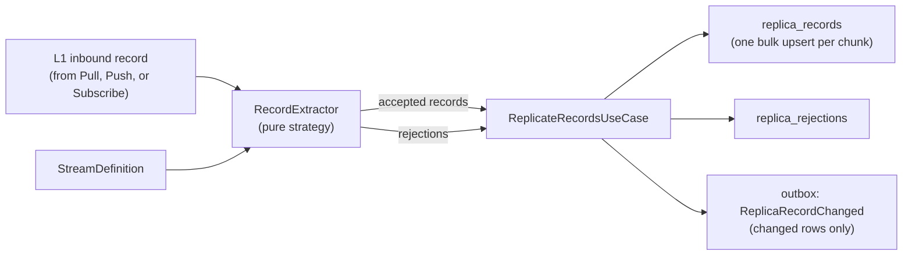

# Design: L2 Replica Layer (One Replicate Function with Pluggable Extractors)

**Status:** Proposed. Rebuilt from scratch, benchmarked against Airbyte.
**Scope:** `apps/ip/packages/ip`, the L2 Replica layer

## 1. Principles

1. **One replicate function for every app.** Hash checks, upsert, versioning, deletes, checkpointing and outbox events are written once, in `ReplicateRecordsUseCase`. There are no per-app functions like `UpsertItronObject` or `UpsertStripeObject`.
2. **Only extraction varies per app, and it is pure.** A `RecordExtractor` turns a raw source payload into `(primary key, cursor, data)`, with no database or network access.
3. **Extraction is configuration first.** Most apps need no code: a stream definition (record path, primary key, cursor field) drives the default extractor. A generic HTTP connection that the user names "Itron" needs no code.
4. **L2 is generic. L3 is typed.** L2 is **one** JSONB table for all apps and entities. Typed tables exist only in the **L3 normalized layer**, as canonical domain tables (`mdm_meter_readings`, `mdm_service_points`, `tms_loads`, ...).

| Layer | Tables | Shape |
|---|---|---|
| L1 Inbound | `inbound_records` | Raw payload, append-only (the full history) |
| **L2 Replica** | **One `replica_records` table** | Generic: `connection_id + stream + record_key + data (JSONB)` |
| L3 Normalized | Canonical tables per domain, defined in code | Typed columns, domain-driven |

> [!NOTE]
> Airbyte generates a **typed table per stream** because it is a warehouse loader and customers query those tables directly. We do **not** copy that at L2. It would mean creating and changing tables at runtime for every connection. The typed business model belongs in L3, which is stable because we design it.

## 2. Airbyte benchmark

| Airbyte concept | Our equivalent |
|---|---|
| `DeclarativeStream` | `StreamDefinition` (per connection and stream) |
| `RecordSelector` + `DpathExtractor(field_path)` | `DeclarativeRecordExtractor` + `record_path` |
| `primary_key` (single or composite) | `primary_key` (list of paths) |
| `cursor_field` + `incremental_sync` | `cursor_field` + `cursor_kind`, `sync_mode` |
| `AirbyteStateMessage` | `stream_state` checkpoint (committed atomically, see section 5) |
| Raw table (`_airbyte_raw_id`, `_airbyte_data`, `_airbyte_extracted_at`) | L1 `inbound_records` |
| Typing and deduping step (latest row per primary key, ordered by cursor) | Dedupe **at write time** inside the L2 upsert |
| `_airbyte_meta.changes` | `replica_rejections` with typed reason codes |
| `_airbyte_generation_id` | `generation_id` / `last_seen_generation` (full-refresh deletes) |

## 3. Architecture



**One database transaction per chunk:** rows, rejections, and outbox events are committed together. (Source read checkpoints are owned by L1 upon receipt).

## 4. Components

### 4.1 `StreamDefinition`: configuration, not code
Stored with the connection.

| Field | Notes |
|---|---|
| `stream` | Stream name, e.g. `service_points` |
| `record_path` | Path to the record list in the response, e.g. `["data", "items"]` |
| `primary_key` | List of paths, so composite keys work, e.g. `[["meter_id"], ["timestamp"]]` |
| `cursor_field`, `cursor_kind` | Optional. `cursor_kind` is an Enum: `DATETIME`, `INTEGER` or `STRING` |
| `sync_mode` | Enum: `INCREMENTAL`, `FULL_REFRESH` |
| `deletion_marker` | Optional path and value meaning "deleted at source" |
| `extractor_id` | Defaults to `declarative`. Set only for exotic payloads (e.g. `salesforce_soap_outbound`) |

### 4.2 `RecordExtractorPort`: pure strategy
```python
class RecordExtractorPort(Protocol):
    def extract(self, raw: JsonValue, stream: StreamDefinition) -> ExtractionBatch: ...

@dataclass(frozen=True)
class ExtractedRecord:
    primary_key_values: tuple[JsonScalar, ...]
    cursor_value: CursorValue | None
    data: JsonDict
    is_deleted: bool

@dataclass(frozen=True)
class ExtractionRejection:
    reason: RejectionReason      # Enum: MISSING_PRIMARY_KEY, INVALID_CURSOR, NOT_AN_OBJECT, ...
    record_index: int
    detail: str

@dataclass(frozen=True)
class ExtractionBatch:
    records: tuple[ExtractedRecord, ...]
    rejections: tuple[ExtractionRejection, ...]
```
- **`DeclarativeRecordExtractor`** is the default, configured by `StreamDefinition`.
- **Custom extractors** are small pure classes in `RecordExtractorRegistry`, keyed by `extractor_id`, **not by app name**. They must use real parsers (an XML parser, not regex). They never drop a record silently: every failure becomes an `ExtractionRejection`.
- **Extraction (L2) is separate from normalization (L3).** `TransformerHookPort.extract_replica` is removed. The transformer only does L2 → L3 normalization.

### 4.3 Domain rules (pure)
- **`record_key`:** SHA-256 of the canonical JSON of `primary_key_values` (sorted keys, compact separators).
- **`data_hash`:** SHA-256 of the canonical JSON of `data`.
- **`ReplicaMergePolicy`** returns a `MergeOutcome` Enum:

| Outcome | When | Effect |
|---|---|---|
| `INSERT` | The key is new | Version 1, event emitted |
| `UPDATE` | The hash changed and the cursor is the same or newer | Version + 1, event emitted |
| `NOOP` | The hash is unchanged | Only `last_seen_generation` and `extracted_at` are refreshed, no event |
| `STALE` | The incoming cursor is older than the stored one | Ignored and logged, no event |
| `TOMBSTONE` | A deletion marker was seen, or the row is missing after a full refresh | `deleted_at` set, event emitted |

### 4.4 `ReplicateRecordsUseCase`: the single replicate function
```python
@dataclass(frozen=True)
class ReplicateRecordsCommand:
    tenant_id: str
    connection_id: str
    stream: str
    inbound_record_id: str       # lineage to L1
    generation_id: int
    sync_id: str
    trace_id: str
    correlation_id: str | None
```
Steps:
1. Load the `StreamDefinition`.
2. Resolve the extractor by `extractor_id` and run it. This is pure.
3. Compute `record_key` and `data_hash`.
4. Call `ReplicaRecordRepositoryPort.merge_batch(...)` once per chunk of about 500 records.
5. Save the rejections.
6. Add one outbox event per row that actually changed (`ReplicaRecordChanged`).
7. Commit once, and return `Result[ReplicationSummary, ReplicationError]`, where the summary holds counts of inserted, updated, no-op, stale, tombstoned and rejected rows.

### 4.5 Repository: one SQL statement per chunk
`INSERT ... ON CONFLICT (tenant_id, connection_id, stream, record_key) DO UPDATE`:
- `last_seen_generation` and `extracted_at` are always refreshed.
- `data`, `data_hash`, `cursor_value` and `version = version + 1` are written **only when** the hash differs **and** the incoming cursor is null, or at least as new as the stored one.
- `RETURNING` reports the merge outcome per row, which decides which rows get outbox events.
- It is idempotent. Replaying the same L1 page produces no new versions and no new events.

### 4.6 Full-refresh deletes
When a `FULL_REFRESH` generation completes, rows with `last_seen_generation < generation_id` are tombstoned. This runs in chunks (`LIMIT`, commit, `await asyncio.sleep(0.1)`). Rows are never hard-deleted.

## 5. Schema (tenant shard)

**`replica_records`** (current state, one row per source record):

| Column | Purpose |
|---|---|
| `id`, `tenant_id`, `connection_id`, `stream`, `record_key` | Identity. **Unique on `(tenant_id, connection_id, stream, record_key)`** |
| `primary_key_values` (jsonb) | Human-readable key |
| `cursor_value`, `cursor_kind` | Out-of-order protection |
| `data` (jsonb), `data_hash` | Payload and change detector |
| `version` | Starts at 1, incremented on each real change |
| `generation_id`, `last_seen_generation` | Full-refresh delete detection |
| `first_seen_at`, `extracted_at`, `updated_at`, `deleted_at` | Lifecycle |
| `source_inbound_record_id`, `trace_id`, `correlation_id` | Lineage and business timeline |

**`replica_rejections`** stores `id`, `tenant_id`, `connection_id`, `stream`, `inbound_record_id`, `record_index`, `reason`, `detail`, `trace_id` and `created_at`.

Both tables belong to the **engine core** migration branch (see `domain_migrations_design.md`).

## 6. Where we beat Airbyte

| Concern | Airbyte | Ours |
|---|---|---|
| Dedupe | Batch typing-and-deduping step **after** raw rows are loaded | **At write time** in one upsert, so there is no window with duplicates |
| Change detection | None, every synced row is rewritten | Hash-based no-op: no new version and no event when nothing changed |
| Out-of-order data | Resolved by cursor during dedupe | Resolved by cursor inside the upsert, so stale writes never land |
| Checkpoint safety | State acknowledged after the destination commits (at-least-once) | Rows, checkpoint and outbox in **one transaction** (effectively exactly-once) |
| Bad rows | `_airbyte_meta` records fields set to null | Typed `replica_rejections`, visible on the timeline |
| Deletes | CDC only, or overwrite | CDC marker **plus** generation tombstones, with events |
| Lineage | `_airbyte_raw_id` | L1 id + `trace_id` + `correlation_id`, end to end |
| Downstream | None (loader only) | `ReplicaRecordChanged` drives L3 normalization and stitches |

## 7. Tests
- **Pure unit tests (≥95% coverage):** `DeclarativeRecordExtractor` (paths, composite keys, deletion marker, rejections), canonical key and hash, and every `ReplicaMergePolicy` outcome.
- **Narrow integration tests** (real Postgres, rolled back with SAVEPOINT): `merge_batch` for insert, no-op, update, stale and tombstone. Also idempotent replay, the full-refresh tombstone sweep, and atomic checkpoint with outbox.
- **E2E:** a generic HTTP connection named "Itron": page → L1 → L2 → L3 `mdm_service_points`.

## 8. Implementation steps (red, green, refactor)
1. Domain: `StreamDefinition`, `ExtractedRecord`, `ExtractionBatch`, `RejectionReason`, `MergeOutcome`, `ReplicaMergePolicy`, key and hash functions.
2. `RecordExtractorPort`, `DeclarativeRecordExtractor`, `RecordExtractorRegistry`.
3. Schema: rework `replica_records` and add `replica_rejections` in the engine core migration.
4. `SqlAlchemyReplicaRecordRepository.merge_batch` and `SqlAlchemyReplicaRejectionRepository`.
5. `ReplicateRecordsUseCase`, wired in the worker composition root.
6. Full-refresh tombstone sweeper (chunked).
7. Remove `TransformerHookPort.extract_replica` and the old replica code paths, then update the tests.
8. Run `ruff`, `mypy`, `tach check`, `cov:business` (95%) and `cov` (85%), then `pnpm db:migrate`.

## 9. Decisions

| # | Decision | Status |
|---|---|---|
| 1 | L2 is one generic JSONB `replica_records` table. Typed tables only in L3 | ✅ Decided |
| 2 | Pull/source checkpoint owned by L1 upon receipt (removed from L2) | ✅ Decided (Aligned with L1 design) |
| 3 | History: current state plus version, with L1 replay for history, versus an extra append-only `replica_record_versions` table | ⏳ Open. Recommended: state plus version (L1 is already the raw history) |
| 4 | Custom extractors keyed by `extractor_id` on the stream, not by app name | ⏳ Open. Recommended: `extractor_id` |
