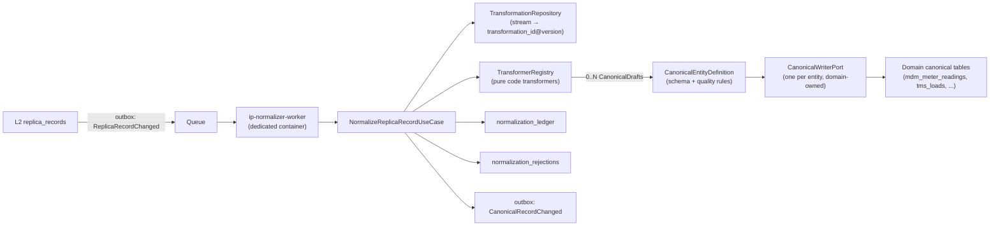

# Design: L3 Normalization Layer (Replica to Canonical Domain Data)

**Status:** Proposed
**Scope:** `apps/ip/packages/ip`, the L3 normalization engine and canonical domains, from L2 replica to L3 canonical only
**Related:** `l2_replica_design.md` (emits `ReplicaRecordChanged`), `domain_migrations_design.md` (domains own their tables), `generic_http_connector_design.md` (streams are bound to transformations)

## 1. Goal

Turn each source's replica (L2) into **typed, validated, canonical domain records** (L3). The data must be traceable, replayable and safe to evolve. For example, Itron, Sensus and Landis+Gyr meter data all end up in one Energy `meter_reading` model.

## 2. Principles

1. **The domain owns the target. The transformer owns the translation.** A domain (Energy, TMS, Finance) owns its canonical entities: schema, quality rules, table and writer. A **transformer** translates one *source stream shape* into one or more canonical entities. Transformers are keyed by `transformation_id` and bound to streams via `Transformation` records, **not** to an app or a domain.
2. **Transformers are pure application code.** We write and own them, since customers don't write L2–L3 transformations. Each transformer is a pure, typed Python class: no I/O, checked by mypy, reviewed in pull requests and tested with golden fixtures.
3. **One generic engine.** A single normalizer worker and a single use case run every transformer. There is no per-domain worker and no per-app pipeline code.
4. **Transformers are versioned.** Every canonical row records the replica version and the transformer version (`transformation_id@transformation_version`) that produced it. Changing a transformer means releasing a new version and replaying from L2. No resync from the source is needed.
5. **Errors are data.** Transformation and validation failures become typed rejections on the business timeline. Only infrastructure failures are retried.

## 3. Industry benchmark

| Approach | Who | Strengths | Gaps we close |
|---|---|---|---|
| Load raw data, transform in the warehouse with dbt | Airbyte, Fivetran (dbt packages) | Code-reviewed models, versioned in git | Batch only, no record-level events, no record-level lineage or rejections |
| Per-flow mapping step | Activepieces, n8n | Flexible | No canonical model; mappings duplicated in every flow |
| Common Model plus per-provider transformers in code | Merge.dev, Apideck, Codat, Rutter | Canonical models per category, `remote_data` passthrough | Limited replay, no shadow comparison, little lineage visible to customers |
| Canonical data model plus message translator | MuleSoft, Boomi, Workato | Enterprise canonical models | Usually stateless: no replay, no record-level lineage |
| **Ours** | | Code transformers into typed canonical models (like Merge), **plus** versioned replay from L2, shadow mode with diffs, out-of-order protection, typed rejections, late-arriving references and end-to-end lineage | |

**Energy alignment:** canonical Energy entities should follow **IEC CIM (61968/61970)** naming and semantics where practical (meters, usage points, readings, reading types). **MultiSpeak** support then becomes just another transformer.

## 4. Architecture



- **One transaction per replica event:** canonical upserts, ledger, rejections and outbox events are committed together.
- **Deployment:** `ip-normalizer-worker` is a separate entrypoint in the single image, like the other workers. The pipeline is `SqsConsumerManager → Dispatcher → NormalizeReplicaRecordUseCase`. `ReplicaRecordChanged` is delivered by the platform outbox **relay** (real time) plus the **sweeper** (fallback).
- **What this layer ends with:** `CanonicalRecordChanged` events, for any downstream consumer.

## 5. Components

### 5.1 `CanonicalEntityDefinition` (owned by the domain)
Each canonical entity is declared once inside its domain package.

| Element | Example (`energy.meter_reading`) |
|---|---|
| `canonical_type` | `energy.meter_reading` |
| `schema_version` | `1`. Additive changes keep the version; breaking changes become `v2` through the domain's migration branch |
| Model | Frozen dataclass `MeterReading(meter_serial_number, usage_point_ref, reading_timestamp, interval_minutes, kwh_delivered, kwh_received, quality_flag)` |
| Natural key | `(source_connection_id, source_id)`. Rows are source-scoped (see section 7) |
| Quality rules | Pure rules with a severity Enum. `REJECT`: missing serial or timestamp. `FLAG`: `kwh_delivered < 0`, timestamp in the future |
| References | `usage_point_ref` → `energy.service_point`, resolved by source id (see section 5.6) |
| Writer | `CanonicalWriterPort[MeterReading]`, implemented in the domain's database adapter |

Every canonical table also has:
- **Lineage:** `source_connection_id`, `source_replica_id`, `source_replica_version`, `transformation_id`, `transformation_version`, `trace_id`, `correlation_id`
- **Lifecycle:** `deleted_at`
- **Overflow:** `extensions` JSONB, for source fields the transformer chooses to pass through unmapped

### 5.2 Transformers: pure application code
```python
class TransformerPort(Protocol):
    @property
    def transformation_id(self) -> str: ...            # e.g. "energy.ami_meter_reading"
    @property
    def transformation_version(self) -> int: ...       # constant in code, bumped on behaviour change
    @property
    def target_types(self) -> tuple[str, ...]: ...

    def transform(self, replica: ReplicaSnapshot, context: TransformationContext) -> TransformationResult: ...

@dataclass(frozen=True)
class CanonicalDraft:
    canonical_type: str
    source_id: str
    fields: CanonicalFields              # typed per entity, validated by the entity definition
    references: tuple[SourceReference, ...]
    extensions: JsonDict

@dataclass(frozen=True)
class TransformationResult:
    drafts: tuple[CanonicalDraft, ...]   # 0..N: one replica can produce several canonical records
    rejections: tuple[TransformationRejection, ...]
```

Rules for every transformer:
- **Pure:** no database, network, clock or random calls. The same input always gives the same output.
- **Location:** the transformer lives in the domain package it targets (for example `ip/application/domains/energy/transformers/ami_meter_reading_transformer.py`). A transformer may import only its target domain's canonical models and the engine's transformer port.
- **Registration:** transformers are registered in `TransformerRegistry` in the composition root, by `(transformation_id, transformation_version)`.
- **Golden fixtures:** each version ships replica input → expected `TransformationResult` fixtures, run in CI.
- **Versioning:** any change in behaviour bumps `transformation_version`. During a rollout the old and new versions are both registered (for example `AmiMeterReadingTransformerV1`, `V2`) so shadow mode can compare them (section 5.5). The old version is removed after promotion.

### 5.3 `Transformation`: which transformer runs for which stream
Stored in the control plane (`ip.transformations`) per `(connection_id, stream)`:

| Field | Notes |
|---|---|
| `transformation_id`, `transformation_version` | The active transformer version |
| `mode` | Enum: `ACTIVE` (writes canonical rows), `SHADOW` (runs and records diffs only), `DISABLED` |
| `shadow_transformation_version` | Optional candidate version that runs alongside the active one |

A new connection such as "Itron" gets its normalization by configuring a `Transformation` for its streams pointing to an existing transformer (for example `energy.ami_meter_reading`). That's a control-plane setting, not a code change. A new *source shape* needs a new transformer, which is code and a rolling deploy.

### 5.4 `NormalizeReplicaRecordUseCase`: the single engine
```python
@dataclass(frozen=True)
class NormalizeReplicaRecordCommand:
    tenant_id: str
    replica_record_id: str
    replica_version: int
    trace_id: str
    correlation_id: str | None
```
Steps:
1. Load the replica snapshot and the transformation configuration.
2. **Version guard:** skip if the ledger already holds this `(replica_record_id, transformation_id, transformation_version)` at a replica version greater than or equal to this one. This keeps processing idempotent and handles out-of-order delivery on standard queues.
3. Resolve the transformer and run it. This is pure.
4. Validate each draft against its `CanonicalEntityDefinition`. `REJECT` rules become rejections; `FLAG` rules set `quality_flag`.
5. Resolve references (section 5.6).
6. Upsert through each entity's `CanonicalWriterPort`. Drafts produced last time but not this time are tombstoned. For example, if an Account changes from carrier to vendor, the old carrier row is soft-deleted.
7. If the replica itself is a tombstone, soft-delete all canonical rows it produced.
8. Write the ledger and rejections, add `CanonicalRecordChanged` outbox events (changed rows only), and commit once.
9. Return `Result[NormalizationSummary, NormalizationError]`.

**Failure policy (Strategy pattern, no boolean flags):** an injected `NormalizationErrorPolicyPort` classifies failures:
- **Terminal domain failures** (transformation, validation): stored as rejections, then the message is acknowledged.
- **Infrastructure failures** (database, timeout): NACK, so the queue retries, with a dead-letter queue after the maximum number of attempts.

### 5.5 Replay, backfill and shadow mode
- **Shadow mode:** deploy the new transformer version, then set it as the transformation's `shadow_transformation_version`. It runs next to the active version and writes **only** to `normalization_shadow_diffs` (field-level differences). Canonical tables are untouched.
- **Promotion:** after reviewing the diffs, the operator promotes the version. This is an audited control-plane change, recorded as a `TransformationVersionPromoted` event, and it starts the backfill.
- **Backfill:** a chunked job walks the stream's replica rows (`LIMIT`, commit, `await asyncio.sleep(0.1)`) and re-normalizes them with the new version. Writes are idempotent, and lineage shows which version produced each row.

### 5.6 References and late-arriving data
- References are written as **source references**, `(connection_id, canonical_type, source_id)`, and resolved to canonical IDs when possible.
- **When the referenced record doesn't exist yet** (for example a reading arrives before its service point), the row is stored with the reference unresolved. It is **not** rejected. A `pending_references` entry is recorded; when the referenced entity is later normalized, its `CanonicalRecordChanged` event resolves the pending references. This is the standard "late-arriving dimension" pattern.

## 6. Storage

| Table | Plane / owner | Purpose |
|---|---|---|
| `transformations` | Control plane, engine | `(connection_id, stream)` → active and shadow transformer version, mode |
| `normalization_ledger` | Tenant shard, engine core | `(replica_record_id, transformation_id, transformation_version)` → last replica version, produced canonical refs, outcome, timestamps, `trace_id` |
| `normalization_rejections` | Tenant shard, engine core | Replica ref, transformer version, reason Enum, field, detail, `trace_id` |
| `normalization_shadow_diffs` | Tenant shard, engine core | Replica ref, candidate version, field-level diff |
| `pending_references` | Tenant shard, engine core | Unresolved source references waiting for their target |
| Canonical tables (`mdm_meter_readings`, `mdm_service_points`, `tms_loads`, ...) | Tenant shard, **domain migration branch** | Typed canonical data, plus lineage, `extensions` and `deleted_at` |

> [!IMPORTANT]
> The current generic `normalized_records` table would become a **second L3 storage model** next to the typed domain tables, which is a dual architecture. It is replaced by `normalization_ledger` (lineage and state only, no payload copy), and the typed domain tables become the only canonical store.

## 7. Multi-source convergence (MDM)

- **Phase 1 (this design):** canonical rows are **source-scoped**, keyed by `(source_connection_id, source_id)`. Several MDM systems converge on **one schema**, with each source's rows kept apart and fully traceable.
- **Phase 2 (optional, separate design):** a **golden record** across sources.
  - Identity matching rules (for example the same meter serial) link source rows in the existing global entity map.
  - **Survivorship rules** per field (source priority, most recent wins, most complete wins) build the golden view.
  - Kept separate so Phase 1 stays simple and deterministic.

## 8. Observability and timeline
- Trace events: `L3_NORMALIZED`, `L3_REJECTED`, `L3_SKIPPED_STALE`, `L3_TOMBSTONED`, `L3_REFERENCE_PENDING` and `L3_REFERENCE_RESOLVED`. Each carries `trace_id`, `correlation_id`, transformation id and version.
- Structured logs through `structlog` at every state transition, with context bound to fields (no f-string messages).
- Metrics per transformer version: normalized, rejected, flagged and pending-reference counts; backfill progress; shadow diff rate.

## 9. Governance
- **Transformer changes** go through normal code review, CI with golden fixtures, and a rolling deploy.
- **Transformation changes and promotions** are audited control-plane events (`TransformationChanged`, `TransformationVersionPromoted`), restricted by role.
- **Tenant isolation:** canonical tables use the shared tenant-isolation (RLS) helper from engine core.

## 10. Tests
- **Pure unit tests (≥95% coverage):**
  - every transformer against its golden fixtures, including fan-out, rejections and edge cases
  - quality rules per entity
  - version guard logic
  - tombstone diffing of produced drafts
- **Narrow integration tests** (real Postgres, rolled back with SAVEPOINT):
  - writer upserts per entity
  - idempotent replay
  - stale replica version skipped
  - pending reference resolved later
  - replica tombstone cascades
  - shadow diffs written while canonical tables stay untouched
  - chunked backfill
- **E2E:** an HTTP connection named "Itron" goes page → L1 → L2 → L3 `mdm_service_points` and `mdm_meter_readings`, with full lineage on the timeline.

## 11. Implementation steps (red, green, refactor)
1. Domain primitives: `CanonicalEntityDefinition`, `CanonicalDraft`, `TransformationResult`, `TransformationRejection`, quality rule and severity Enums.
2. Energy and TMS entity definitions plus writers (in their own packages and migration branches).
3. `TransformerPort` and `TransformerRegistry`. Port `ItronMdmTransformer` to `energy` transformers (`ami_meter_reading`, `ami_service_point`) and `MercuryGateTransformer` to `tms` transformers, each with golden fixtures.
4. Control plane: `transformations`, plus bind and promote use cases.
5. Tenant engine core: `normalization_ledger`, `normalization_rejections`, `normalization_shadow_diffs` and `pending_references`. Remove `normalized_records`.
6. `NormalizeReplicaRecordUseCase` plus `NormalizationErrorPolicyPort`.
7. `ip-normalizer-worker` entrypoint: SQS consumer, dispatcher, outbox relay and sweeper wiring.
8. Backfill job (chunked) and shadow mode.
9. Remove `TransformerHookPort` and `TransformerBrokerAdapter`; they are replaced by `TransformerPort` and the engine.
10. Run `ruff`, `mypy`, `tach check`, `cov:business` (95%) and `cov` (85%), then `pnpm db:migrate`.

## 12. Decisions

| # | Decision | Recommendation |
|---|---|---|
| 1 | Replica → canonical transformers are pure application code, with no runtime transformation language | ✅ Decided |
| 2 | Replace generic `normalized_records` with `normalization_ledger` plus typed domain tables | Yes, to avoid a dual L3 architecture |
| 3 | Align Energy canonical entities with IEC CIM naming | Yes, where practical |
| 4 | Golden record across sources (Phase 2) | Defer to a separate design |
| 5 | Queue ordering | Standard queue plus version guard (FIFO not required) |
