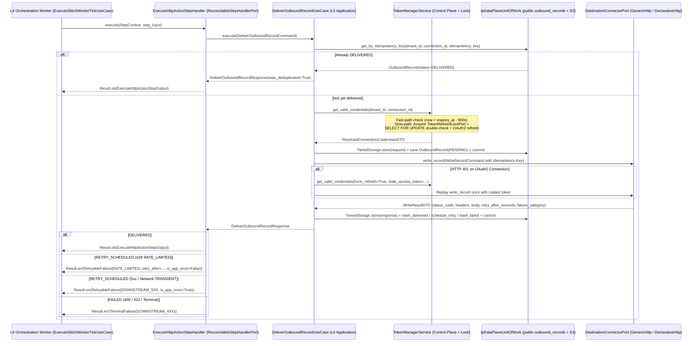

# Soopa Integration Platform (`apps/ip`)
## Layer-5 Outbound Delivery & Distributed Credential Lifecycle Design

- **Document:** Layer-5 Outbound Gateway, Distributed OAuth2 Token Refresh & Crash-Safe Stitch Dispatch Specification
- **Status:** Locked Architecture Specification
- **Location:** `apps/ip/docs/l5_delivery_design.md`
- **Bounded Context:** Integration Platform Engine (`ip.engine`)

---

## 1. Architectural Objectives & Industry Benchmark Comparison

Layer 5 (`L5_DELIVER`) is the outbound egress perimeter of the Integration Platform. Every mutation dispatched from an L4 Durable Stitch workflow (`core/platform/packages/orchestration`) to an external ERP, CRM, MDM, CIS, or SaaS destination passes through Layer 5.

Our Layer-5 architecture is explicitly designed to be **strictly superior** to **Airbyte** (`airbyte-cdk`, `bulk/toolkits/load-http`), **n8n** (`HttpRequestV3`, `SingleFlightLease`), and **Activepieces** (`app-connection.handler.ts`, `FetchHttpClient`) across all five enterprise reliability dimensions:

| Dimension | Airbyte | n8n | Activepieces | **Soopa IP Platform (L5)** |
| :--- | :--- | :--- | :--- | :--- |
| **1. Outbound Write Contract** | `DestinationSyncMode` (`append`, `overwrite`, `append_dedup`) for analytical staging; `load-http` for batch reverse-ETL. | Per-node CRUD (`HttpRequestV3`) with in-memory `Promise.allSettled` batch sleep loops. | Imperative per-piece TypeScript `createAction({ run })` with no standard write contract. | **Typed `WriteRecordCommand` (`CREATE`, `UPDATE`, `UPSERT`, `DELETE`) with first-class `idempotency_key` and wire-level `WriteResultDTO`.** |
| **2. Idempotency & Crash Reconciliation** | Ref-counted watermarks (`GlobalAsyncStateManager`) + `_airbyte_tmp` dedup for `append_dedup`; at-least-once duplicates in `append` / HTTP. | **Hazardous**: `retryOnFail` re-runs the entire `runNode()` batch from index 0, duplicating prior `POST`s. | **Step-level skip only** (`isCompleted`); crash before 15s snapshot flush or step retry duplicates `POST`s. | **2-Phase Outbound Ledger + L4 `ReconcilableStepHandlerPort`**: Pre-stages `OutboundRecord(PENDING)` with deterministic `idempotency_key`, injects `Idempotency-Key` header, short-circuits already-`DELIVERED` keys, and reconciles `IN_FLIGHT_EFFECT` steps after worker crashes. |
| **3. Distributed OAuth2 Refresh & Single-Use Token Rotation** | Container-local `OAuthAuthenticator` emits `CONTROL` message; **no cross-worker lock** (concurrent syncs break single-use refresh tokens). | Reactive `401` + `SingleFlightLease`; **falls back to unlocked refresh on 10s timeout** (`single-flight-lease.ts`), burning single-use tokens. | Proactive 15m buffer + Redis `RedLock` + double-checked DB re-read + `mergeNonNull` rotation + marks `ERROR` on `invalid_grant`. | **Proactive (15m buffer) + Reactive (`401` single-replay) via `TokenRefreshLockPort` + PostgreSQL `SELECT ... FOR UPDATE` double-checked locking**, single-use refresh token rotation, and `Connection.mark_error` transition on `invalid_grant`. |
| **4. HTTP `429 Retry-After` & Error Classification** | `WaitTimeFromHeader("Retry-After")` + `HttpResponseFilter` (`TRANSIENT_ERROR`, `CONFIG_ERROR`, `SYSTEM_ERROR`). | **Ignores `Retry-After` on `429`**; rewrites error message to suggest manual batching; blind fixed retry ($\le 5\text{s}$). | `FetchHttpClient` **only retries $\ge 500$**; ignores `429` & `Retry-After`; step retry blindly retries `4xx` validation errors. | **First-Class `OutboundFailureCategory`**: Parses `Retry-After` (delta-seconds & HTTP-date) and `X-RateLimit-Reset`, routes `RATE_LIMITED` to L4 `orchestration` with `is_app_error=False` (preserving user retry budget), retries `TRANSIENT` (`5xx`/network), and fails fast on `VALIDATION_ERROR` (`400`/`422`). |
| **5. Wire Audit Ledger, Redaction, & S3 Tiered Offloading** | S3 staging & DLQ, but no queryable per-request HTTP wire ledger. | Monolithic `execution_data` JSON blob in DB; no wire-level outbound ledger. | Zstd S3 `FLOW_RUN_LOG` step snapshots (15s flush); no wire-level HTTP ledger. | **Partitioned `public.outbound_records` ledger** indexed by `(tenant_id, trace_id, correlation_id)` with **automatic sensitive header redaction** and **$\ge 64\text{ KB}$ S3 tiered offloading** for both request and response payloads. |

---

## 2. End-to-End Execution Topology (`L4 -> L5 -> Destination`)

---

## 3. Coordinated OAuth2 Token Lifecycle (`TokenManagerService`)

### 3.1 The Single-Use Refresh Token Problem
External systems such as QuickBooks Online, Xero, NetSuite, and certain Energy MDM OAuth2 providers issue **single-use rotating refresh tokens**. If two workers simultaneously detect an expired `access_token` and both send `grant_type=refresh_token` with the same `refresh_token`:
1. Worker A succeeds and receives `(access_token_1, refresh_token_1)`.
2. Worker B arrives 20ms later with the now-revoked `refresh_token_0`, receives `400 invalid_grant`, and either crashes the sync (Airbyte) or overwrites the connection with an error state.

### 3.2 Double-Checked Locking Protocol
`TokenManagerService` eliminates this race condition using a two-tier protocol:

1. **Tier 1 — Lock-Free Fast Path:**
   - Loads `Connection` via `ConnectionRepositoryPort.get_by_id(connection_id)` and decrypts `encrypted_credentials` using `CipherPort`.
   - If `auth_type` is not `OAUTH2` / `OAUTH2_CLIENT_CREDENTIALS`, returns credentials immediately.
   - If `not force_refresh` and `expires_at_epoch - now > DEFAULT_TOKEN_REFRESH_BUFFER_SECONDS` ($900\text{s}$), returns credentials immediately without acquiring any lock.
2. **Tier 2 — Coordinated Refresh Path (`TokenRefreshLockPort` + `SELECT ... FOR UPDATE`):**
   - Acquires per-connection lock via `TokenRefreshLockPort.acquire(connection_id)`.
   - Inside `IpControlPlaneUnitOfWorkPort`, calls `connections.get_by_id_for_update(connection_id)` (`SELECT ... FOR UPDATE`).
   - **Double-Check:** Decrypts the freshly locked `Connection.encrypted_credentials`:
     - If `force_refresh` was triggered by a `401` with `stale_access_token` and `current_db_access_token != stale_access_token`, another worker already rotated the token. Returns `current_db_credentials` immediately.
     - If `not force_refresh` and `current_db_expires_at - now > 900`, another worker already refreshed the token. Returns `current_db_credentials` immediately.
   - **Token Endpoint Exchange & Non-Null Merge:**
     - Invokes `OAuth2Strategy.refresh_if_needed()`.
     - Merges `access_token = new_access_token`, `refresh_token = new_refresh_token or old_refresh_token` (preserving long-lived refresh tokens when the IdP omits `refresh_token`, or rotating when a new single-use token is returned), and `expires_at_epoch`.
     - Encrypts the merged dictionary via `CipherPort.encrypt()`, calls `connection.update_tokens(...)`, persists via `connections.save(connection)`, and commits the Control Plane UoW.
   - **Terminal Refresh Failure (`invalid_grant`):**
     - If the IdP rejects the refresh request, `TokenManagerService` calls `connection.mark_error(error_code=IpErrorCode.UNAUTHORIZED.value, error_message=...)` (transitioning the connection to `ConnectionStatus.ERROR` and emitting `ConnectionErrorRecordedEvent` to the Control Plane Outbox), commits the state transition, and returns `Result.fail(InvalidCredentialsError(...))`.

---

## 4. First-Class Outbound Error Classification & `Retry-After` Extraction

`outbound_error_classifier.py` provides a pure, zero-dependency domain classifier:

| HTTP Status / Fault | `OutboundFailureCategory` | `FailureDisposition` | L4 `orchestration` Mapping |
| :--- | :--- | :--- | :--- |
| `200`–`299` | `None` (Success) | — | `StepStatus.SUCCEEDED` |
| `409 Conflict` (when `conflict_strategy == IDEMPOTENT_SUCCESS`) | `CONFLICT_IDEMPOTENT` | `IGNORE` (Idempotent OK) | `StepStatus.SUCCEEDED` |
| `429 Too Many Requests` | `RATE_LIMITED` | `RETRY` | `RetryableFailure(RATE_LIMITED, retry_after=parsed_header, is_app_error=False)` — increments `internal_retry_count` without burning user `max_retries` |
| `401 Unauthorized` / `403` (expired token) | `AUTH_EXPIRED` | Reactive 1x token refresh & replay; if still `401` $\rightarrow$ `FAIL` | `TerminalFailure(DOWNSTREAM_4XX)` |
| `408`, `500`, `502`, `503`, `504`, Network / Timeout | `TRANSIENT` | `RETRY` | `RetryableFailure(DOWNSTREAM_5XX, is_app_error=True)` |
| `400`, `409` (default `FAIL`), `422` | `VALIDATION_ERROR` | `FAIL` | `TerminalFailure(VALIDATION_REJECTED)` |
| `404`, `405`, `410`, SSRF / Config | `TERMINAL` | `FAIL` | `TerminalFailure(DOWNSTREAM_4XX)` |

### `Retry-After` & Rate-Limit Header Parsing
`parse_retry_after_seconds(headers, now)` inspects headers case-insensitively in priority order:
1. `Retry-After`: Parses non-negative integer delta-seconds (e.g., `"45"`) or RFC 7231 HTTP-date timestamps (e.g., `"Mon, 26 Oct 2026 12:00:00 GMT"`).
2. `X-RateLimit-Reset` / `RateLimit-Reset`: Parses delta-seconds or UTC epoch seconds, clamping to `[1, 3600]`.

---

## 5. Wire Audit Ledger, Header Redaction, & Crash Reconciliation

### 5.1 Sensitive Header Redaction
All `request_headers` and `response_headers` persisted on `OutboundRecord` pass through `redact_sensitive_headers()`, which case-insensitively masks `Authorization`, `Proxy-Authorization`, `X-Api-Key`, `Api-Key`, `Cookie`, `Set-Cookie`, and `X-Auth-Token` with `"***REDACTED***"`.

### 5.2 Dual-Direction S3 Tiered Offloading ($\ge 64\text{ KB}$)
Both outgoing request payloads and incoming response payloads are evaluated against `DEFAULT_INLINE_THRESHOLD_BYTES` ($65,536\text{ bytes}$):
- Payloads $< 64\text{ KB}$ are stored inline in `request_body` / `response_body` (`JSONB`).
- Payloads $\ge 64\text{ KB}$ are offloaded via `TieredStoragePort.store()` to S3 (`request_s3_key` / `response_s3_key`), keeping `request_sha256` and `request_size_bytes` indexed in PostgreSQL.

### 5.3 L4 Crash Reconciliation (`ExecuteHttpActionStepHandler.reconcile`)
When a worker crashes while an `ip.stitch.execute_http_action` step is in `StepStatus.IN_FLIGHT_EFFECT`, `ReapExpiredLeasesUseCase` invokes `ExecuteHttpActionStepHandler.reconcile(context, step_input)`:
1. Queries `OutboundRecordRepositoryPort.get_by_idempotency_key(context.tenant_id, connection_id, context.idempotency_key)`.
2. If the record is already `OutboundDispatchStatus.DELIVERED`, returns `ReconcileOutcome.adopt(output)` so `ReapExpiredLeasesUseCase` completes the step via `CompleteStepUseCase` and advances downstream DAG nodes without re-sending the HTTP mutation.
3. If the record is `PENDING`, `RETRY_SCHEDULED`, or not found, returns `ReconcileOutcome.not_found()` so the step is safely re-queued with the identical `context.idempotency_key`.
