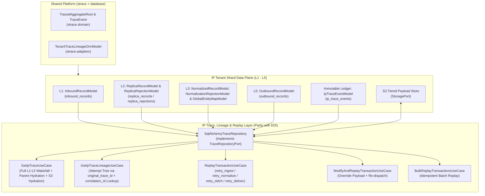

# Gold-Standard Design Document: Unified Trace, Lineage & Deterministic Replay Engine (Phase 9)

**Bounded Context:** `apps/ip` (Integration Platform Engine) & Shared Platform (`seedwork`, `database`)
**Status:** Architecture Specification (Aligned with Platform Trace & EDI Taxonomy)
**Target Modules:** `core/platform/packages/seedwork`, `core/platform/packages/database`, `apps/ip/packages/ip/src/ip/engine/`
**Competitive Benchmark:** Airbyte OSS (`airbyte-config` / `airbyte-commons-protocol`), n8n (`packages/cli/src/executions`), Activepieces (`packages/server/api/src/app/flows/flow-run`), Hatchet v1 (`pkg/repository/sqlcv1`)

---

## 1. Executive Summary & Architectural Alignment

A critical requirement of our monorepo (`AGENTS.md`) is **Strict Consistency Enforcement (Zero Dual-Architectures)** and **Strict File Taxonomy Consistency** across Bounded Contexts (`apps/edi` and `apps/ip`).

Our audit of the codebase confirms that distributed business tracing was **already upgraded in common platform code** (`commit a2c7fb120`) to support both **EDI** and **IP**:

### 1.1 What Already Exists in Common Platform & IP
1. **`strace.domain.TraceEvent` & `strace.domain.TracedAggregateRoot`** (`core/platform/packages/strace/src/strace/domain/models.py`):
   - `TraceEvent`: Immutable audit event with `id`, `tenant_id`, `trace_id`, `event_type`, `actor`, `correlation_id`, `created_at`, and `metadata: JsonDict | None`.
   - `TracedAggregateRoot`: Base DDD aggregate root with `trace_id`, `tenant_id`, `correlation_id`, `parent_trace_id`, `original_trace_id`, `replay_count`, and `_trace_events: list[TraceEvent]`.
2. **`strace.adapters.TenantTraceLineageOrmModel` & `strace.adapters.orm.TraceableMixin`** (`core/platform/packages/strace/src/strace/adapters/orm.py`):
   - Standardized SQLAlchemy mixin and declarative base defining `trace_id`, `correlation_id`, `parent_trace_id`, and `original_trace_id`.
3. **IP Domain Aggregates & Automatic Trace Draining (`apps/ip`)**:
   - `InboundRecord`, `NormalizedRecord`, `GlobalEntityMap`, and `OutboundRecord` already inherit from `TracedAggregateRoot`.
   - `IpTraceEvent` (`ip/engine/domain/models/timeline_entry.py`) already inherits from `strace.domain.TraceEvent`.
   - `TenantSqlAlchemyRepository._drain_trace_events()` (`ip/engine/adapters/outbound/database/base_repository.py`) already drains `aggregate.trace_events` into `IpTraceEventModel` (`ip_trace_events`) atomically within the same SQLAlchemy transaction.

### 1.2 How EDI Uses the Platform Trace Architecture (`apps/edi`)
In `apps/edi`, the trace, lineage, and replay layer leverages the centralized `strace` platform package:
- **Centralized Platform Trace Repository:** `strace.adapters.SqlAlchemyTraceRepository` (implements `strace.ports.TraceRepositoryPort`).
  - Queries all stage tables (`EdiMessage`, `EdiJson`, `ApiGateway`, `TraceEvent`) registered in `EDI_TRACE_STAGE_SPECS`.
  - **Lineage Resolution:** Merges attempts sharing `original_trace_id == root_trace_id` ordered chronologically via `aggregate_trace_lineage_attempts()` (`TraceLineageItemDTO`).
- **Use Cases (`edi/application/use_cases/transactions/`):**
  - `get_edi_trace_use_case.py` (`GetEdiTraceUseCase`): Assembles the composite waterfall from stage repositories and walks parent hops upstream when upstream stages were not duplicated on replay.
  - `get_edi_trace_lineage_use_case.py` (`GetEdiTraceLineageUseCase`): Yields `TraceLineageItemDTO` sequences.
  - `replay_transaction_use_case.py` (`ReplayTransactionUseCase`)
  - `modify_and_replay_use_case.py` (`ModifyAndReplayTransactionUseCase`)
  - `bulk_replay_transactions_use_case.py` (`BulkReplayTransactionsUseCase`)
- **Domain Clone Methods:** `clone_for_transform_retry()` and `clone_for_delivery_retry()` on `EdiMessageDomainModel` / `EdiJsonDomainModel`.

### 1.3 Gaps to Close in IP (Eliminating Drift & Completing Phase 9)
1. **ORM `TraceableMixin` Adoption in IP:** `InboundRecordModel`, `NormalizedRecordModel`, `GlobalEntityMapModel`, and `OutboundRecordModel` in `ip/engine/adapters/outbound/database/models/data_plane.py` currently declare `trace_id`, `correlation_id`, `parent_trace_id`, `original_trace_id` manually instead of inheriting `TraceableMixin` from `database.models.common`.
2. **Exact Taxonomy Parity with EDI:** Instead of inventing divergent names (`TimelineQueryRepositoryPort` or `GetTraceWaterfallUseCase`), IP must use the exact same file and class taxonomy as EDI:
   - `ip/engine/ports/outbound/trace_repository.py` (`TraceRepositoryPort`)
   - `ip/engine/adapters/outbound/database/trace_repository.py` (`SqlAlchemyTraceRepository`)
   - `ip/engine/application/dtos/trace.py` (`IpTraceDTO`, `IpTraceLineageItemDTO`)
   - `ip/engine/application/use_cases/transactions/get_ip_trace_use_case.py` (`GetIpTraceUseCase`)
   - `ip/engine/application/use_cases/transactions/get_ip_trace_lineage_use_case.py` (`GetIpTraceLineageUseCase`)
   - `ip/engine/application/use_cases/transactions/replay_transaction_use_case.py` (`ReplayTransactionUseCase`)
   - `ip/engine/application/use_cases/transactions/modify_and_replay_use_case.py` (`ModifyAndReplayTransactionUseCase`)
   - `ip/engine/application/use_cases/transactions/bulk_replay_transactions_use_case.py` (`BulkReplayTransactionsUseCase`)
3. **First-Class Error Handling (`Result[T, IpError]`) & Strict Typing:** While EDI's older replay use cases raised `ValueError` or used `dict[str, Any]`, IP's implementation will strictly enforce our 8 architectural principles: `Result[T, IpError]` returns (never raising exceptions for known errors), zero `Any`, and frozen dataclasses for all DTOs.

---

## 2. Competitive Benchmark: Airbyte vs. n8n vs. Activepieces vs. Hatchet v1 vs. Soopa

| Capability | Airbyte OSS | n8n | Activepieces | Hatchet v1 | **Soopa Platform (EDI + IP)** |
| :--- | :--- | :--- | :--- | :--- | :--- |
| **Record-Level Business Key Search (`correlation_id`)** | **None.** Tracks only batch `Job` and `Attempt` metrics (`recordsEmitted`, `bytesCommitted`). Cannot search for `meter_id=MTR-99`. | **Partial.** `ExecutionMetadataEntity` (`execution_metadata`), requires manual `n8n.setCustomData()` per workflow. | **None.** `FlowRunEntity` filters only by `flowId`, `status`, `created`, and array `tags`. | **Partial.** `v1_task_events_olap` stores `additional_metadata` JSONB on task runs. | **Native (`TraceableMixin`).** Composite B-Tree index `(tenant_id, correlation_id)` across `inbound_records`, `replica_records`, `normalized_records`, `outbound_records`, and `ip_trace_events`. |
| **Cross-Stage Lineage Waterfall** | **None.** Source extraction, normalization, and destination write are opaque inside batch container logs. | **Single-Layer Only.** Tracks node execution within one workflow (`ExecutionDataEntity`), disconnected from canonical storage. | **Single-Layer Only.** Stores compressed step tree in a single blob (`logsFileId`). | **DAG Task Level Only.** Tracks `v1_dag_to_task` and `v1_task_events_olap`, unaware of L1/L2/L3/L5 data plane records. | **Full 5-Layer Data Plane + Parent Hydration.** `SqlAlchemyTraceRepository` stitches L1 (`InboundRecord`), L2 (`ReplicaRecord` + `ReplicaRejection`), L3 (`NormalizedRecord` + `NormalizationRejection` + `GlobalEntityMap`), L4 (`WorkflowRun`), L5 (`OutboundRecord`), and `IpTraceEvent`, automatically walking `parent_trace_id` upstream. |
| **Tiered Payload Inspection & Secret Redaction** | **None.** Raw payloads are never stored for inspection unless debug logging is dumped. | **All-or-Nothing.** `execution_data.data` stores all node I/O in one row; S3 is only for binary attachments. | **Coarse Blob.** Whole run state is Zstd-compressed into S3/File (`logsFileId`). | **Dual-Write Cutover.** `v1_payload` offloads task inputs/outputs via `ExternalStore`. | **Per-Record Tiered Storage + Auto-Hydration.** Payloads $\le 64\text{ KB}$ inline JSONB; $> 64\text{ KB}$ offloaded to S3 (`request_s3_key` / `response_s3_key`) with SHA-256 checksums, hydrated on-demand via `StoragePort`, and redacted via `redact_sensitive_headers()`. |
| **Deterministic Multi-Stage Replay & Lineage** | **Coarse Stream Reset.** Cannot replay one failed record; must re-run sync or reset entire stream cursor. | **Shallow Retry.** `retryOf` / `retrySuccessId` links only 1 hop (no `original_trace_id` root tree); cannot replay from L2/L3 canonical state. | **Destructive Overwrite.** `FlowRetryStrategy.FROM_FAILED_STEP` mutates the existing `FlowRun` row in place, destroying failed attempt history! | **In-Place DAG Reset.** `ReplayTasks` resets existing `v1_task` rows and increments `app_retry_count`. | **Non-Destructive Multi-Stage Lineage (`TracedAggregateRoot`).** Every replay mints a fresh `trace_id`, preserves `original_trace_id` and `parent_trace_id`, increments `replay_count`, and supports replay from L1 (`retry_ingest`), L2 (`retry_normalize`), L3 (`retry_stitch`), or L5 (`retry_deliver`), plus `ModifyAndReplay` and `BulkReplay`. |

---

## 3. Architecture & Component Specification



### 3.1 Shared Platform Alignment (`TraceableMixin` in IP ORM Models)

In `core/platform/packages/database/src/database/models/common.py`, `TraceableMixin` defines:
- `trace_id: Mapped[str]`
- `correlation_id: Mapped[str | None]`
- `parent_trace_id: Mapped[str | None]`
- `original_trace_id: Mapped[str | None]`

We will update `InboundRecordModel`, `NormalizedRecordModel`, `GlobalEntityMapModel`, and `OutboundRecordModel` in `apps/ip/packages/ip/src/ip/engine/adapters/outbound/database/models/data_plane.py` to inherit directly from `TraceableMixin` (eliminating duplicated column definitions while preserving their existing table-specific composite indexes).

### 3.2 Domain Clone Methods on IP Traced Aggregate Roots

Matching `EdiMessageDomainModel.clone_for_transform_retry()` and `clone_for_delivery_retry()` in `apps/edi`, IP's traced aggregates (`InboundRecord`, `NormalizedRecord`, `OutboundRecord`) will implement explicit domain clone methods for replay:

1. **`InboundRecord.clone_for_replay(self, *, new_id: str, new_trace_id: str, actor: str = "SYSTEM") -> InboundRecord`**:
   - Creates a new `InboundRecord` with `id=new_id`, `trace_id=new_trace_id`, `parent_trace_id=self.trace_id`, `original_trace_id=self.original_trace_id or self.trace_id`, `replay_count=self.replay_count + 1`, `external_event_id=None` (so unique constraint `uq_inbound_external_event` does not reject the replay clone), records an `IpTraceEvent` (`REPLAY_TRIGGERED`), and emits `InboundRecordCreatedEvent` for L2 replication.
2. **`NormalizedRecord.clone_for_replay(self, *, new_id: str, new_trace_id: str, modified_canonical_data: CanonicalDataDict | None = None, actor: str = "SYSTEM") -> NormalizedRecord`**:
   - Creates a new `NormalizedRecord` with `id=new_id`, `trace_id=new_trace_id`, `parent_trace_id=self.trace_id`, `original_trace_id=self.original_trace_id or self.trace_id`, `replay_count=self.replay_count + 1`, optional `modified_canonical_data` override, records an `IpTraceEvent`, and emits `NormalizedRecordCreatedEvent` for L4 Stitch execution.
3. **`OutboundRecord.clone_for_delivery_retry(self, *, new_id: str, new_trace_id: str, actor: str = "SYSTEM") -> OutboundRecord`**:
   - Creates a new `PENDING` `OutboundRecord` with `id=new_id`, `trace_id=new_trace_id`, `parent_trace_id=self.trace_id`, `original_trace_id=self.original_trace_id or self.trace_id`, `replay_count=self.replay_count + 1`, fresh `idempotency_key=f"{new_trace_id}:{self.stream_name}:{self.operation}"`, `attempt_number=1`, `error_message=None`, `failure_category=None`, and records an `IpTraceEvent`.

### 3.3 DTOs (`apps/ip/packages/ip/src/ip/engine/application/dtos/trace.py`)

Mirroring `apps/edi/packages/edi/src/edi/application/dtos/trace.py` (`EdiTraceDTO` and `EdiTraceLineageItemDTO`), all trace DTOs are `@dataclass(frozen=True, kw_only=True)` with zero `Any`:

```python
@dataclass(frozen=True, kw_only=True)
class IpTraceLineageItemDTO:
    trace_id: str
    correlation_id: str | None
    status: str
    primary_layer: str
    created_at: datetime
    replay_count: int
    parent_trace_id: str | None = None
    original_trace_id: str | None = None


@dataclass(frozen=True, kw_only=True)
class IpTraceDTO:
    trace_id: str
    tenant_id: str
    correlation_id: str | None
    original_trace_id: str
    parent_trace_id: str | None
    replay_count: int
    status: str
    inbound_record: InboundRecord | None = None
    replica_records: tuple[ReplicaRecord, ...] = ()
    replica_rejections: tuple[ReplicaRejection, ...] = ()
    normalized_records: tuple[NormalizedRecord, ...] = ()
    normalization_rejections: tuple[NormalizationRejection, ...] = ()
    entity_mappings: tuple[GlobalEntityMap, ...] = ()
    outbound_records: tuple[OutboundRecord, ...] = ()
    trace_events: tuple[IpTraceEvent, ...] = ()
```

### 3.4 Outbound Port & SQLAlchemy Repository (`trace_repository.py`)

1. **Port (`ip/engine/ports/outbound/trace_repository.py`):**
   - `TraceRepositoryPort(Protocol)`:
     - `async def get_ip_trace(self, tenant_id: str, trace_id: str, *, hydrate_payloads: bool = False) -> IpTraceDTO | None`
     - `async def get_trace_lineage(self, tenant_id: str, trace_id: str) -> list[IpTraceLineageItemDTO]`
     - `async def find_traces_by_correlation_id(self, tenant_id: str, correlation_id: str, *, limit: int = 50) -> list[IpTraceLineageItemDTO]`
2. **Adapter (`ip/engine/adapters/outbound/database/trace_repository.py`):**
   - `SqlAlchemyTraceRepository`:
     - Queries L1 (`InboundRecordModel`), L2 (`ReplicaRecordModel`, `ReplicaRejectionModel`), L3 (`NormalizedRecordModel`, `NormalizationRejectionModel`, `GlobalEntityMapModel`), L5 (`OutboundRecordModel`), and `IpTraceEventModel` (`ip_trace_events`) for `(tenant_id, trace_id)`.
     - **Upstream Parent Hydration (Exact EDI Pattern):** Just like `SqlAlchemyTraceRepository.get_edi_trace()` in `apps/edi`, if `inbound_record` or `normalized_records` are empty because `trace_id` is a mid-pipeline replay child (e.g., `retry_stitch` or `retry_deliver` with `parent_trace_id`), walks `parent_trace_id` backward (up to 10 hops) to hydrate the upstream `inbound_record`, `replica_records`, and `normalized_records`!
     - **On-Demand S3 Hydration (Exact EDI Pattern):** When `hydrate_payloads=True` and `storage_port` is injected, downloads `request_s3_key` / `response_s3_key` on `InboundRecord` and `OutboundRecord` and parses JSON safely, applying `redact_sensitive_headers()` to ensure zero secret leakage.
     - **Lineage Tree Resolution:** Resolves `root_trace_id = record.original_trace_id or trace_id` and queries all trace attempts sharing that root trace ID across L1/L3/L5, returning them sorted chronologically as `list[IpTraceLineageItemDTO]`.

### 3.5 Application Use Cases (`ip/engine/application/use_cases/transactions/`)

Matching `apps/edi/packages/edi/src/edi/application/use_cases/transactions/` 1-for-1 in naming and responsibility, while returning `Result[T, IpError]`:

1. **`get_ip_trace_use_case.py` (`GetIpTraceUseCase`)**:
   - Co-located `GetIpTraceQuery(tenant_id, trace_id, hydrate_payloads=False)`.
   - Returns `Result[IpTraceDTO, IpError]` (`IpError.not_found` if trace does not exist).
2. **`get_ip_trace_lineage_use_case.py` (`GetIpTraceLineageUseCase`)**:
   - Co-located `GetIpTraceLineageQuery(tenant_id, trace_id)` and `SearchTracesByCorrelationQuery(tenant_id, correlation_id, limit=50)`.
   - Returns `Result[list[IpTraceLineageItemDTO], IpError]`.
3. **`replay_transaction_use_case.py` (`ReplayTransactionUseCase`)**:
   - Co-located `ReplayTransactionCommand(tenant_id, trace_id, stage, actor="SYSTEM")` where `stage: ReplayStage` (`RETRY_INGEST`, `RETRY_NORMALIZE`, `RETRY_STITCH`, `RETRY_DELIVER`).
   - Walks `parent_trace_id` if needed to locate the source record for the requested stage, clones the aggregate via `clone_for_replay()`, persists the cloned aggregate and its `IpTraceEvent` + outbox `DomainEvent` in the `IpDataPlaneUnitOfWork`, and returns `Result[ReplayTransactionResultDTO, IpError]`.
4. **`modify_and_replay_use_case.py` (`ModifyAndReplayTransactionUseCase`)**:
   - Co-located `ModifyAndReplayCommand(tenant_id, trace_id, stage, modified_payload, actor="SYSTEM")`.
   - Clones the `InboundRecord` (with modified `request_body`) or `NormalizedRecord` (with modified `canonical_data`), records an audit `IpTraceEvent` (`MODIFIED_AND_REPLAYED` with `actor`), and dispatches the new trace through the pipeline.
5. **`bulk_replay_transactions_use_case.py` (`BulkReplayTransactionsUseCase`)**:
   - Co-located `BulkReplayCommand(tenant_id, trace_ids, stage, actor="SYSTEM")`.
   - Deduplicates `trace_ids`, replays each valid transaction inside the UoW, and returns `Result[BulkReplayResultDTO, IpError]` containing `succeeded_trace_ids`, `new_trace_ids`, and structured per-trace failures.

---

## 4. Adherence to the 8 Enterprise Architectural Principles

1. **No Dual Architecture:** Reuses `strace.domain.TracedAggregateRoot`, `strace.domain.TraceEvent`, and `strace.adapters.TenantTraceLineageOrmModel`, and mirrors `apps/edi`'s exact use case taxonomy (`get_ip_trace_use_case.py`, `get_ip_trace_lineage_use_case.py`, `replay_transaction_use_case.py`, `modify_and_replay_use_case.py`, `bulk_replay_transactions_use_case.py`).
2. **No Duplicated Code:** Eliminates manual `trace_id`/`correlation_id`/`parent_trace_id`/`original_trace_id` column duplication in IP's `data_plane.py` by inheriting `TenantTraceLineageOrmModel`. Reuses `redact_sensitive_headers()` and `TenantSqlAlchemyRepository._drain_trace_events()`.
3. **Reuse Soopa Platform Code:** Uses `strace.domain`, `strace.adapters`, `storage.ports.outbound.StoragePort`, and `outbox`.
4. **Zero IP Platform $\leftrightarrow$ Application Leakage:** All trace and replay components reside strictly in `ip.engine.*` and depend only on platform packages (`seedwork`, `database`, `storage`, `observability`).
5. **First-Class Error Handling:** Every use case returns `Result[T, IpError]`. Missing traces, non-replayable stages, or invalid payload modifications return typed `Err(IpError)` without raising exceptions for known operational outcomes.
6. **Zero `dict[str, Any]` / Proper DTOs:** All queries, commands, and trace responses are `@dataclass(frozen=True, kw_only=True)` using `JsonDict` / domain models.
7. **Hexagonal Pyramid Testing:**
   - **Domain Unit Tests:** Aggregate clone methods (`InboundRecord.clone_for_replay`, `NormalizedRecord.clone_for_replay`, `OutboundRecord.clone_for_delivery_retry`) and lineage invariants.
   - **Application Unit Tests:** `GetIpTraceUseCase`, `GetIpTraceLineageUseCase`, `ReplayTransactionUseCase`, `ModifyAndReplayTransactionUseCase`, `BulkReplayTransactionsUseCase` against in-memory fakes.
   - **Adapter Unit & Narrow Integration Tests:** `SqlAlchemyTraceRepository` testing upstream `parent_trace_id` hydration, S3 payload hydration via `StoragePort`, `original_trace_id` lineage ordering, and `correlation_id` lookup.
8. **Balanced Pyramid Coverage:** Full distribution across domain, application use cases, and database/storage adapters.
