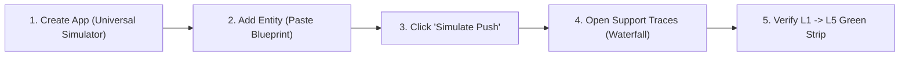

# Soopa Integration Platform (`apps/ip`)
# Master Manual Testing Guide: Transactional (Gear 1) & Timeseries (Gear 2)

- **Document:** Definitive Manual Testing Specification & Step-by-Step Operator Manual
- **Target Audience:** Support Engineers, QA Engineers, Utility Operators, Product Testers
- **Target System:** Soopa Integration Platform Data Plane (`ip.engine`, `ip.solutions.domains.energy`)
- **Repository Location:** [`apps/ip/docs/manual_testing_guide.md`](file:///Users/apple/soopa_mono/apps/ip/docs/manual_testing_guide.md)

---

## 1. Quick Reference: Entity Specification Matrix

This table contains all parameters required to configure Connections and Entities in the UI or via REST API:

| Pipeline Gear | Vendor Name | Connection Name | App ID | Entity / Stream Name | Primary Key Field | Cursor Field | Target Storage |
| :--- | :--- | :--- | :--- | :--- | :--- | :--- | :--- |
| **Gear 1** (Source) | **Itron** | `Itron OpenWay AMI` | `universal_simulator` | `meter_readings` | `meter_serial` | `timestamp` | PostgreSQL `mdm_meter_readings` |
| **Gear 1** (Source Master) | **Oracle** | `Oracle CC&B Master` | `universal_simulator` | `service_points` | `service_point_id` | `updated_at` | PostgreSQL `mdm_service_points` |
| **Gear 1** (Destination) | **SAP** | `SAP S/4HANA Utilities` | `universal_simulator` | `billing_readings` | `reading_id` | `reading_timestamp` | PostgreSQL `mdm_billing_readings` & `outbound_records` $\to$ SAP HTTP |
| **Gear 2** (Columnar Stream) | **Landis+Gyr** | `Landis+Gyr Gridstream AMI` | `universal_simulator` | `interval_readings` | `meter_id` *(composite in storage)* | `interval_end` | S3 / ClickHouse `meter_interval_readings_local` |

---

## 2. Complete Schemas & Blueprints (Copy-Paste Ready)

### 2.1 Gear 1: Source Smart Meter Reading (`meter_readings`)
* **Vendor:** Itron (Product: OpenWay Riva AMI)
* **Connection Name:** `Itron OpenWay AMI`
* **Use Case:** Move-in/move-out final read, on-demand customer service ping, or monthly billing cutoff snapshot.
* **Simulator Entity Modal Inputs:**
  - **Entity Name:** `meter_readings`
  - **Primary Key:** `meter_serial`
  - **Cursor Field:** `timestamp`
  - **Velocity Mode:** `Transactional Entity`
  - **Records per Pull:** `5`
* **JSON Payload Blueprint:**
```json
{
  "meter_serial": "MTR-ENERGY-1001",
  "timestamp": "2026-11-12T12:00:00Z",
  "kwh_delivered": 14.52,
  "kwh_received": 0.0,
  "voltage_avg": 240.1,
  "interval_minutes": 15,
  "service_point_id": "SP-NORTH-401"
}
```

---

### 2.2 Gear 1: Source Service Point / Premise Master (`service_points`)
* **Vendor:** Oracle (Product: CC&B - Customer Care & Billing)
* **Connection Name:** `Oracle CC&B Master`
* **Use Case:** Master premise registration, meter attachment, and customer service point configuration.
* **Simulator Entity Modal Inputs:**
  - **Entity Name:** `service_points`
  - **Primary Key:** `service_point_id`
  - **Cursor Field:** `updated_at`
  - **Velocity Mode:** `Transactional Entity`
  - **Records per Pull:** `5`
* **JSON Payload Blueprint:**
```json
{
  "service_point_id": "SP-NORTH-401",
  "meter_serial": "MTR-ENERGY-1001",
  "customer_id": "CUST-CORP-9021",
  "service_address": "742 Evergreen Terrace, Sector 4",
  "grid_region": "NORTH_SUB_GRID_A",
  "status": "ACTIVE",
  "updated_at": "2026-11-12T08:00:00Z"
}
```

---

### 2.3 Gear 1: Destination Utility ERP Billing (`billing_readings`)
* **Vendor:** SAP (Product: S/4HANA Utilities IS-U)
* **Connection Name:** `SAP S/4HANA Utilities`
* **Use Case:** Final bill generation, billing determinants reconciliation, and invoicing payload delivery.
* **Canonical Entity Type:** `MDM_BILLING_READING` (`energy.mdm_billing_reading`)
* **Target Table:** PostgreSQL `public.mdm_billing_readings` (renders directly in the UI **Entities** tab)
* **Simulator Entity Modal Inputs:**
  - **Entity Name:** `billing_readings`
  - **Primary Key:** `reading_id`
  - **Cursor Field:** `reading_timestamp`
  - **Velocity Mode:** `Transactional Entity`
  - **Records per Pull:** `5`
* **JSON Payload Blueprint:**
```json
{
  "reading_id": "BILL-RDG-1001",
  "meter_serial": "MTR-ENERGY-1001",
  "kwh_delivered": 14.52,
  "reading_timestamp": "2026-11-12T12:00:00Z",
  "service_point_id": "SP-NORTH-401"
}
```

---

### 2.4 Gear 2: High-Frequency Timeseries Macro-Batch (`interval_readings`)
* **Vendor:** Landis+Gyr (Product: Gridstream AMI)
* **Connection Name:** `Landis+Gyr Gridstream AMI`
* **Use Case:** Automated 15-minute interval streaming (power quality, TOU tariffs, outage detection).
* **Simulator / Stream Inputs:**
  - **Stream Name:** `interval_readings`
  - **Primary Key:** Composite `(source_meter_id, channel_id, interval_end_utc)`
  - **Cursor Field:** `interval_end`
  - **Format:** Macro-Batch JSON Array (or Zstd Parquet)
* **JSON Payload Blueprint:**
```json
[
  {
    "meter_id": "MTR-SMART-9001",
    "feeder_id": "F-NORTH-12",
    "substation_id": "SUB-WEST-01",
    "interval_end": "2026-11-12T12:15:00Z",
    "kwh_delivered": 1.45,
    "kwh_received": 0.0,
    "voltage_v": 240.2,
    "quality": "VALID"
  },
  {
    "meter_id": "MTR-SMART-9002",
    "feeder_id": "F-NORTH-12",
    "substation_id": "SUB-WEST-01",
    "interval_end": "2026-11-12T12:15:00Z",
    "kwh_delivered": 0.98,
    "kwh_received": 0.0,
    "voltage_avg": 240.0,
    "quality": "VALID"
  }
]
```

---

## 3. Workflow 1: Visual Web UI Manual Testing (Zero Terminal)

Use this workflow to test the end-to-end pipeline visually from your browser:



### Step 1: Create Connection
1. Open `http://localhost:5173/apps` (or `http://localhost:3000`).
2. Click **"+ New Connection"** (top right).
3. Fill in:
   - **App Catalog:** `Universal Simulator`
   - **Connection Name:** `Itron OpenWay AMI`
   - **Auth Type:** `No Auth`
4. Click **Connect & Save**. Open the connection card.

### Step 2: Add the Entity
1. On the Connection Details page, scroll to **Simulator Entities**.
2. Click **"+ Add Entity"**.
3. Fill in the modal:
   - **Entity Name:** `meter_readings`
   - **Primary Key:** `meter_serial`
   - **Cursor:** `timestamp`
   - **Records per Pull:** `5`
4. In the **Sample Blueprint** box, paste the Section 2.1 JSON blueprint.
5. Click **Save Entity**.

### Step 3: Trigger Ingestion (1-Click Push)
1. On the `meter_readings` row in the table, click the **[Simulate Push]** button (radio tower icon).
2. A green notification appears: *"Simulated push for 'meter_readings' (1 record ingested into L1)"*.

### Step 4: Inspect Support Trace Waterfall
1. Click **Support Traces** in the left sidebar.
2. Click on the topmost trace row for `MTR-ENERGY-1001`.
3. Verify the **5-Layer Stage Strip** is completely green:
```text
[ L1 Ingested ✓ ] ──► [ L2 Replicated ✓ ] ──► [ L3 Normalized ✓ ] ──► [ L4 Routed ✓ ] ──► [ L5 Delivered ✓ ]
```
4. Click each stage pill:
   - **L1 Ingested:** Raw JSON wire payload and timestamp.
   - **L2 Replicated:** SHA-256 replica deduplication hash.
   - **L3 Normalized:** Canonical `mdm_meter_readings` record with full lineage sextet (`trace_id`, `parent_trace_id`, `original_trace_id`, `replay_count`).
   - **L4 Routed:** Stitch DAG workflow execution status (`COMPLETED`).
   - **L5 Delivered:** Outbound delivery receipt and response status code `200`.

---

## 4. Workflow 2: REST API / cURL Manual Testing

### Step 1: Create Source Connection
```bash
curl -X POST "http://localhost:8000/api/v1/tenants/TENANT_ID/ip/connections" \
  -H "Content-Type: application/json" \
  -H "Authorization: Bearer YOUR_TOKEN" \
  -d '{
    "app_id": "universal_simulator",
    "name": "Itron OpenWay AMI",
    "auth_type": "NO_AUTH",
    "public_config": {"seed": 3001, "records_per_pull": 5},
    "raw_credentials": {},
    "endpoint_for_fingerprint": "Itron OpenWay AMI"
  }'
```
*Save returned `id` as `SOURCE_CONN_ID`.*

### Step 2: Register Entity Blueprint
```bash
curl -X POST "http://localhost:8000/api/v1/tenants/TENANT_ID/ip/connections/SOURCE_CONN_ID/simulator/entities" \
  -H "Content-Type: application/json" \
  -H "Authorization: Bearer YOUR_TOKEN" \
  -d '{
    "entity_name": "meter_readings",
    "primary_key_field": "meter_serial",
    "cursor_field": "timestamp",
    "sample_blueprint": {
      "meter_serial": "MTR-ENERGY-1001",
      "timestamp": "2026-11-12T12:00:00Z",
      "kwh_delivered": 14.52,
      "kwh_received": 0.0,
      "voltage_avg": 240.1,
      "interval_minutes": 15,
      "service_point_id": "SP-NORTH-401"
    },
    "records_per_pull": 5
  }'
```

### Step 3: Trigger Push Webhook (Ingress $\to$ L1)
```bash
curl -X POST "http://localhost:8000/api/v1/ip/ingress/TENANT_SLUG/universal_simulator/SOURCE_CONN_ID?stream=meter_readings" \
  -H "Content-Type: application/json" \
  -H "X-Correlation-ID: corr_manual_001" \
  -d '{
    "meter_serial": "MTR-ENERGY-1001",
    "timestamp": "2026-11-12T12:00:00Z",
    "kwh_delivered": 14.52,
    "kwh_received": 0.0,
    "voltage_avg": 240.1,
    "interval_minutes": 15,
    "service_point_id": "SP-NORTH-401"
  }'
```
*Expected Output:* HTTP `202 Accepted` with `record_id` and `trace_id`.

### Step 4: Trigger Timeseries Ingestion (Gear 2 Macro-Batch)
```bash
curl -X POST "http://localhost:8000/api/v1/tenants/TENANT_ID/ip/intervals/ingress/SOURCE_CONN_ID?stream=interval_readings" \
  -H "Content-Type: application/json" \
  -H "Authorization: Bearer YOUR_TOKEN" \
  -d '[
    {
      "meter_id": "MTR-SMART-9001",
      "feeder_id": "F-NORTH-12",
      "substation_id": "SUB-WEST-01",
      "interval_end": "2026-11-12T12:15:00Z",
      "kwh_delivered": 1.45,
      "voltage_v": 240.2
    },
    {
      "meter_id": "MTR-SMART-9002",
      "feeder_id": "F-NORTH-12",
      "substation_id": "SUB-WEST-01",
      "interval_end": "2026-11-12T12:15:00Z",
      "kwh_delivered": 0.98,
      "voltage_v": 240.0
    }
  ]'
```
*Expected Output:* HTTP `202 Accepted` with `batch_id`.

### Step 5: Execute Vectorized Processing & Zero-Loss Balancing
```bash
curl -X POST "http://localhost:8000/api/v1/tenants/TENANT_ID/ip/intervals/batches/BATCH_ID/process" \
  -H "Authorization: Bearer YOUR_TOKEN"
```
*Expected Output:*
```json
{
  "batch_id": "ip_bat_...",
  "status": "COMPLETED",
  "raw_ingested": 2,
  "duplicates_dropped": 0,
  "valid_canonical": 2,
  "quarantined_held": 0,
  "is_zero_loss_balanced": true
}
```

---

## 5. Database Verification Queries (SQL)

### 5.1 PostgreSQL Tenant Shard Verification (Gear 1)
```sql
-- L1: Raw Ingress Journal
SELECT id, stream_name, payload_hash, created_at 
FROM public.inbound_records 
WHERE tenant_id = 'TENANT_ID' 
ORDER BY created_at DESC LIMIT 1;

-- L2: Replica Lake & Deduplication State
SELECT id, stream_name, record_key, replica_hash, cdc_operation 
FROM public.replica_records 
WHERE tenant_id = 'TENANT_ID' 
ORDER BY updated_at DESC LIMIT 1;

-- L3: Canonical Domain Table (Verifying Lineage Sextet for Meter Readings)
SELECT id, meter_serial_number, reading_timestamp, kwh_delivered, 
       quality_flag, trace_id, parent_trace_id, original_trace_id, replay_count
FROM public.mdm_meter_readings 
WHERE tenant_id = 'TENANT_ID' 
ORDER BY reading_timestamp DESC LIMIT 1;

-- L3: Canonical Domain Table (Verifying SAP Billing Readings)
SELECT id, reading_id, meter_serial_number, service_point_id, reading_timestamp, 
       kwh_delivered, quality_flag, trace_id, parent_trace_id, original_trace_id, replay_count
FROM public.mdm_billing_readings
WHERE tenant_id = 'TENANT_ID'
ORDER BY reading_timestamp DESC LIMIT 1;

-- L4: Stitch Workflow DAG Orchestration
SELECT id, workflow_id, status, started_at, finished_at 
FROM public.workflow_runs 
WHERE tenant_id = 'TENANT_ID' 
ORDER BY started_at DESC LIMIT 1;

-- L5: Outbound Egress Delivery Record
SELECT id, connection_id, stream_name, idempotency_key, status, response_status_code 
FROM public.outbound_records 
WHERE tenant_id = 'TENANT_ID' 
ORDER BY created_at DESC LIMIT 1;
```

### 5.2 ClickHouse Columnar Verification (Gear 2)
In `clickhouse-client`:
```sql
-- Individual Telemetry Intervals
SELECT gem_device_id, source_meter_id, interval_end_utc, scaled_kwh_delivered, voltage_v, quality_status 
FROM telemetry.meter_interval_readings_local 
WHERE tenant_id = 'TENANT_ID' 
ORDER BY interval_end_utc DESC LIMIT 5;

-- Hourly TOU Pre-Aggregated View
SELECT hour_start_utc, count() AS interval_count, sum(total_kwh_delivered) AS total_kwh 
FROM telemetry.hourly_interval_rollups_local 
WHERE tenant_id = 'TENANT_ID' 
GROUP BY hour_start_utc 
ORDER BY hour_start_utc DESC LIMIT 5;
```

---

## 6. Pass/Fail Assertion Checklist

| Verification Point | Pass Criteria |
| :--- | :--- |
| **L1 Response Time** | Returns HTTP `202 Accepted` in $<20\text{ms}$ with valid `record_id` / `batch_id`. |
| **L2 Deduplication** | Re-sending identical payload updates `replica_records` without creating duplicate canonical rows. |
| **L3 Domain Precision** | `kwh_delivered` stored in `mdm_meter_readings` matches exact value ($14.52$). |
| **L3 Lineage Sextet** | `trace_id`, `parent_trace_id`, `original_trace_id`, and `replay_count` are fully populated. |
| **L4 Stitch DAG** | `workflow_runs` status transitions to `COMPLETED`. |
| **L5 Egress Delivery** | `outbound_records` status is `DELIVERED` with HTTP 200 receipt. |
| **Gear 2 Zero-Loss** | Invariant holds: `raw_ingested == valid_canonical + duplicates_dropped + quarantined_held`. |
