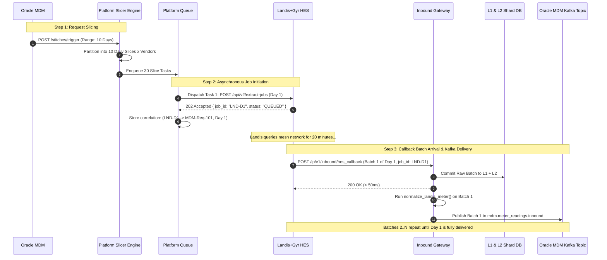

# Architectural Standard: Smart Grid AMI Asynchronous Sliced Multi-HES to Kafka Pipeline

**Document Version:** 1.0.0  
**Status:** Approved Architectural Standard  
**Scope:** `apps/ip/packages/ip` (Integration Platform), Solution SDK, Runtime Engine, and Energy Domain Solutions  
**Target Audience:** Solution Engineers, Smart Grid Systems Architects, and Platform Engineers  

---

## 1. Executive Summary & Problem Space

In Smart Grid Advanced Metering Infrastructure (AMI), Head-End Systems (HES) such as **Landis+Gyr Command Center**, **Itron OpenWay**, and **Siemens EnergyIP** manage millions of physical meters across radio-frequency (RF) mesh and cellular networks. 

Integrating Head-End Systems with enterprise Meter Data Management (MDM) engines (e.g., Oracle MDM) presents two physical constraints:
1. **The 24-Hour Query Limit (The Need for Slicing):** HES APIs reject multi-day queries (e.g., a 10-day request) with `400 Bad Request: Window Exceeds 24 Hours` or time out due to RF mesh network bandwidth saturation.
2. **Asynchronous Non-Blocking Processing:** Extracting 15-minute interval readings for 100,000 smart meters takes 15–45 minutes. HES systems **never** return interval readings synchronously in an HTTP response. They acknowledge with `202 Accepted` + `job_id`, process the read requests across the mesh grid, and **asynchronously push the data back** to the platform via webhook callbacks or streaming batches.

To solve this, the SOOPA Integration Platform provides the **Asynchronous Sliced Multi-Vendor Pipeline**:
* **The Platform Time-Slicer Engine:** Automatically decomposes a multi-day Oracle MDM request into atomic, 1-day tasks across all HES vendors.
* **Queue-Backed Fanout:** Each `(Vendor, Day)` slice executes as an independent task on the durable orchestration queue with isolated retries and rate-limiting.
* **Two-Phase Stitch Execution:** Phase 1 initiates the extraction job and correlates the `job_id`. Phase 2 handles asynchronous callback batches through **L1 (Wire)** $\to$ **L2 (Staging)** $\to$ **L3 (Canonical Normalizer)** $\to$ **Oracle MDM Kafka Queue**.
* **Zero Infrastructure Boilerplate:** The Solution Engineer writes **only pure functions** returning `RequestSpec`, `CanonicalMeterReading`, and `KafkaMessageSpec`.

```mermaid
flowchart TD
    MDM["1. Oracle MDM Request Event<br/>oracle_mdm.meter_readings.requested<br/>(10 Days: 2026-11-01 to 2026-11-11)"]
    
    subgraph SlicingEngine["Phase 1: Time Slicer & Queue Fanout (Platform Engine)"]
        MDM --> SLICER["Time Slicer Engine<br/>10 Days x 3 HES Vendors = 30 Independent Slice Tasks"]
        SLICER --> Q["Durable Orchestration Queue"]
        
        Q --> T_L1["Task 1: Landis Day 1"]
        Q --> T_L2["Task 2: Landis Day 2 ... Day 10"]
        Q --> T_I1["Task 11: Itron Day 1 ... Day 10"]
        Q --> T_S1["Task 21: Siemens Day 1 ... Day 10"]
    end

    subgraph HES_Dispatch["Phase 2: Job Initiation (Asynchronous 202 Accepted)"]
        T_L1 -->|HTTP POST| HES_L["Landis+Gyr HES API"]
        T_I1 -->|HTTP POST| HES_I["Itron OpenWay API"]
        T_S1 -->|HTTP POST| HES_S["Siemens EnergyIP API"]
        
        HES_L -->>|202 Accepted {job_id: LND-D1}| CORR["Platform Job Correlation Ledger"]
        HES_I -->>|202 Accepted {job_id: ITR-D1}| CORR
        HES_S -->>|202 Accepted {job_id: SIE-D1}| CORR
    end

    subgraph CallbackDelivery["Phase 3: Asynchronous Callback & Streaming Kafka Ingestion"]
        HES_L -.->|POST Callback Batches 1..N| GW["Inbound Callback Gateway<br/>POST /ip/v1/inbound/hes_callback"]
        HES_I -.->|POST Callback Batches 1..N| GW
        HES_S -.->|POST Callback Batches 1..N| GW
        
        GW --> L1_L2["L1 (Wire Audit Ledger) + L2 (Staging Replica)"]
        L1_L2 --> NORM["Pure Normalizer (L3)<br/>normalize_landis_meter() / normalize_itron_meter()"]
        NORM --> KAFKA["Oracle MDM Kafka Queue<br/>mdm.meter_readings.inbound (Key = meter_id)"]
    end
```

---

## 2. The Solution Engineer's Code (100% Pure Functions)

The Solution Engineer writes zero async network loops, zero calendar date math, and zero Kafka client boilerplate.

### 2.1 The Connectors: 1-Day Slice Job Request Builders
Each connector takes a single **1-day `TimeSlice`** and returns a `RequestSpec`:

```python
# File: apps/ip/src/ip/solutions/domains/energy/landis/connectors.py
from __future__ import annotations

from ip.sdk import RequestBuilder, RequestSpec, TimeSlice


def request_landis_slice_job(slice_cmd: TimeSlice) -> RequestSpec:
    """Pure function. Builds a 1-day asynchronous extraction request for Landis+Gyr."""
    return (
        RequestBuilder.post("/api/v2/extract-jobs")
        .with_body({
            "start_time": slice_cmd.start_time,
            "end_time": slice_cmd.end_time,
            "reading_type": "15_MIN_INTERVAL",
            "callback_url": "https://api.soopa.io/ip/v1/inbound/hes_callback",
        })
        .build()
    )


# File: apps/ip/src/ip/solutions/domains/energy/itron/connectors.py

def request_itron_slice_job(slice_cmd: TimeSlice) -> RequestSpec:
    """Pure function. Builds a 1-day asynchronous extraction request for Itron."""
    return (
        RequestBuilder.post("/api/v1/async-jobs/meter-reads")
        .with_body({
            "from_utc": slice_cmd.start_time,
            "to_utc": slice_cmd.end_time,
            "callback_url": "https://api.soopa.io/ip/v1/inbound/hes_callback",
        })
        .build()
    )
```

---

### 2.2 The Normalizers: Mapping Delivered Callback Batches (L3)
When HES finishes reading the grid and pushes batches to our callback endpoint, the pure normalizers convert vendor-specific payloads into the canonical domain model:

```python
# File: apps/ip/src/ip/solutions/domains/energy/landis/normalizer.py
from __future__ import annotations

from ip.solutions.domains.energy.canonical import CanonicalMeterReading
from seedwork.domain.types import JsonDict


def normalize_landis_meter(raw: JsonDict) -> CanonicalMeterReading:
    """Pure function. Maps Landis raw payload into CanonicalMeterReading."""
    return CanonicalMeterReading(
        meter_id=str(raw["serial_number"]),
        kwh_reading=float(raw["active_energy_kwh"]),
        read_time=str(raw["read_time"]),
        quality=str(raw.get("status_code", "VALID")),
    )


# File: apps/ip/src/ip/solutions/domains/energy/itron/normalizer.py

def normalize_itron_meter(raw: JsonDict) -> CanonicalMeterReading:
    """Pure function. Maps Itron raw payload into CanonicalMeterReading."""
    return CanonicalMeterReading(
        meter_id=str(raw["MeterID"]),
        kwh_reading=float(raw["Value_kWh"]),
        read_time=str(raw["TimestampUTC"]),
        quality=str(raw.get("Flag", "OK")),
    )
```
> [!NOTE]
> Regardless of whether data originated in Landis, Itron, or Siemens, both normalizers emit the identical `CanonicalMeterReading` dataclass.

---

### 2.3 The Destination Sink: Oracle MDM Kafka Message Builder
Because all vendors normalize into `CanonicalMeterReading`, the Kafka message builder is written **strictly once**:

```python
# File: apps/ip/src/ip/solutions/domains/energy/mdm/sinks.py
from __future__ import annotations

from ip.sdk import KafkaMessageSpec
from ip.solutions.domains.energy.canonical import CanonicalMeterReading


def to_mdm_kafka_message(reading: CanonicalMeterReading) -> KafkaMessageSpec:
    """Pure function. Formats reading for the Oracle MDM Kafka topic."""
    return KafkaMessageSpec(
        topic="mdm.meter_readings.inbound",
        partition_key=reading.meter_id,  # Guarantees FIFO per meter
        payload={
            "meterId": reading.meter_id,
            "readingKwh": reading.kwh_reading,
            "timestamp": reading.read_time,
            "qualityFlag": reading.quality,
        },
    )
```

---

## 3. The Declarative Sliced Stitches (The Wiring)

The Solution Engineer registers the Stitches. The **`slicing`** rule is declared as a first-class property of the Stitch:

```python
# File: apps/ip/src/ip/solutions/domains/energy/stitches/hes_sliced_sync.py
from __future__ import annotations

from ip.sdk import SlicingRule, Stitch
from ip.solutions.domains.energy.itron.connectors import request_itron_slice_job
from ip.solutions.domains.energy.itron.normalizer import normalize_itron_meter
from ip.solutions.domains.energy.landis.connectors import request_landis_slice_job
from ip.solutions.domains.energy.landis.normalizer import normalize_landis_meter
from ip.solutions.domains.energy.mdm.sinks import to_mdm_kafka_message

# ==============================================================================
# Stitch 1: Landis+Gyr Sliced Asynchronous Sync
# ==============================================================================
LANDIS_SLICED_SYNC_STITCH = Stitch(
    name="energy.landis_sliced_sync",
    trigger="oracle_mdm.meter_readings.requested",
    # Declarative rule: Platform splits range into 1-day queue tasks automatically:
    slicing=SlicingRule(unit="DAYS", size=1),
    source=request_landis_slice_job,        # Phase 1: Initiates 1-day job on HES
    transformer=normalize_landis_meter,     # Phase 2: Normalizes arriving batches
    destination=to_mdm_kafka_message,       # Phase 2: Emits to Kafka topic
    description="Decomposes MDM requests into daily slices and streams Landis data to Kafka",
)

# ==============================================================================
# Stitch 2: Itron OpenWay Sliced Asynchronous Sync
# ==============================================================================
ITRON_SLICED_SYNC_STITCH = Stitch(
    name="energy.itron_sliced_sync",
    trigger="oracle_mdm.meter_readings.requested",
    slicing=SlicingRule(unit="DAYS", size=1),
    source=request_itron_slice_job,
    transformer=normalize_itron_meter,
    destination=to_mdm_kafka_message,
    description="Decomposes MDM requests into daily slices and streams Itron data to Kafka",
)
```

---

## 4. End-to-End Execution Sequence



---

## 5. Production Invariants & Guarantees

### 5.1 Granular Fault Isolation (Per-Day Retries)
In legacy systems, if Day 4 of Itron failed, the entire 10-day sync for all vendors had to be re-run from scratch.
* In SOOPA, each `(Vendor, Day)` slice is an independent queue task.
* If **Day 4 of Itron** times out on the HES side, **only Day 4 of Itron is retried**.
* Days 1, 2, 3, 5, 6, 7, 8, 9, 10 for Landis, Itron, and Siemens proceed and deliver to Kafka without interruption.

### 5.2 Rate Limiting & Concurrency Throttling
Head-End Systems have strict concurrency quotas (e.g., maximum 2 simultaneous extraction jobs). 
* The platform queue enforces concurrency limits per connection:
  ```python
  connection.concurrency_limit = 2  # Dispatches at most 2 slices to Landis at once
  ```
* As soon as Landis completes Day 1, the queue worker dispatches Day 3, keeping HES utilization smooth without causing server overload.

### 5.3 Constant $O(1)$ Memory Footprint
A 10-day extraction across 100,000 smart meters yields **96,000,000 interval reading rows**.
* Attempting to load this dataset into memory results in fatal `OutOfMemoryError` crashes.
* In our platform, data flows in bounded streaming chunks:
  $$\text{Incoming Batch (500 rows)} \longrightarrow \text{L1/L2 Commit} \longrightarrow \text{Pure Normalizer} \longrightarrow \text{Kafka Produce}$$
* Memory usage remains **under 50 MB** continuously throughout the entire 96-million-record extraction.

### 5.4 Meter-Level FIFO Ordering in Kafka
By mapping `reading.meter_id` as the **Kafka partition key**, Kafka guarantees that all readings for Meter `#M-8819` land on the exact same Kafka partition in strictly increasing chronological order.

---

## 6. Summary Comparison: Transactional vs. Sliced AMI Workflows

| Dimension | Transactional Sync (TMS $\to$ QuickBooks) | Asynchronous Sliced Sync (HES $\to$ Oracle MDM) |
| :--- | :--- | :--- |
| **Trigger Mechanism** | Single Inbound Webhook (`POST /inbound/tms`) | Oracle MDM Event (`oracle_mdm.requested`) |
| **Slicing Required?** | **No** (Single invoice transaction) | **Yes** (`SlicingRule(unit="DAYS", size=1)`) |
| **Initiation Protocol** | Direct Event Trigger | Asynchronous `202 Accepted` + `job_id` |
| **Delivery Protocol** | Synchronous Outbound POST to QuickBooks | Asynchronous Webhook Callback Batches from HES |
| **Memory Profile** | $< 1\text{ MB}$ per event | $O(1)$ constant memory across 96,000,000 rows |
| **Destination** | HTTP Mutation (`upsert_qb_bill`) | Kafka Partitioned Topic (`mdm.meter_readings.inbound`) |
| **Solution Code Purity** | 100% Pure (Zero network, zero async) | 100% Pure (Zero network, zero calendar loops) |
