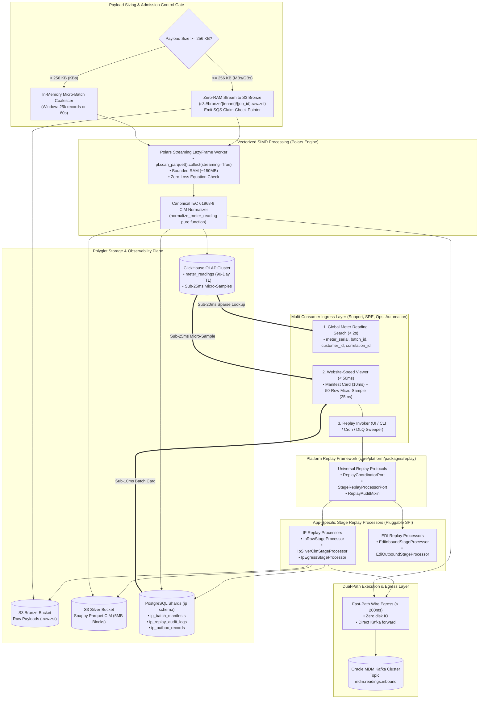
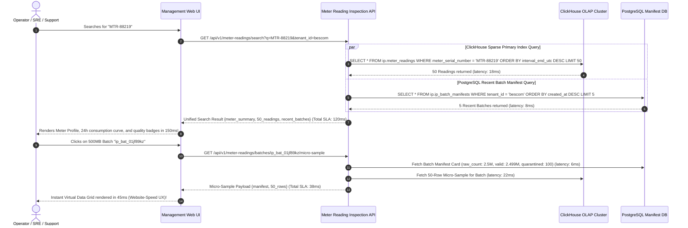
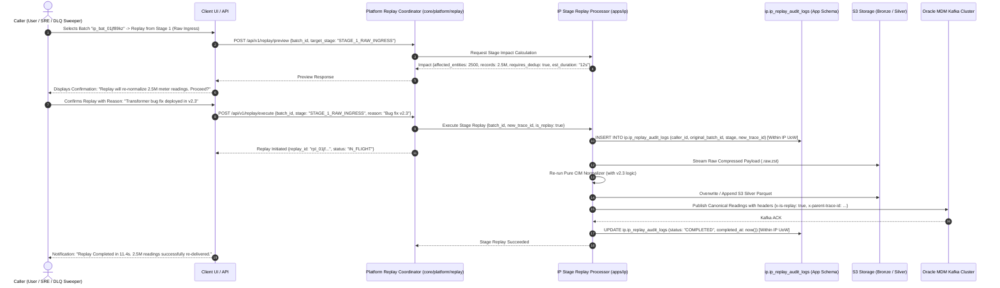

# Pipeline B Implementation Design: High-Volume Smart Grid Meter Readings & Asynchronous HES-to-MDM Integration
## Gold Standard Architecture Blueprint for Multi-HES Backfill, Continuous Meter Readings & Cross-Platform Replay

- **Domain:** Utility Integration Platform (`apps/ip`, `core/platform`)
- **Document Status:** Approved Production Implementation Specification
- **Version:** 2.6.0 (Enterprise Gold Standard: Pure System Adapters & Use-Case Solutions Pipeline Architecture)
- **Target Audience:** Principal Systems Architects, Solution Engineers, Platform SREs, Operations Leads
- **File Location:** `apps/ip/docs/smart_grid_ami_energy_pipeline_b_implementation_design.md`

---

## 1. Executive Summary & Ubiquitous Language

This document establishes the end-to-end implementation architecture for **Pipeline B (High-Volume Columnar & Streaming Meter Readings Engine)** within the Soopa Integration Platform. 

In utility Advanced Metering Infrastructure (AMI), integration platforms must ingest, normalize, and forward high-frequency smart meter readings between heterogeneous Head-End Systems (HES) and Meter Data Management (MDM) systems (such as Oracle Utilities MDM or SAP for Utilities).

```
┌──────────────────────────────────────────────────────────────────────────────────────────────────┐
│                                 THE TWO TARGET ENERGY USE CASES                                  │
├─────────────────────────────────┬────────────────────────────────────────────────────────────────┤
│ Use Case 1: Missing Data /      │ MDM issues on-demand requests for missing historical intervals.│
│ Historical Backfill             │ • HES 1: Delivers backfill as large BATCH FILES (SFTP/S3/HTTP).│
│ (Asynchronous Pull -> Push)     │ • HES 2: Streams backfill from a KAFKA REPLAY TOPIC.           │
│                                 │ Output: Delivery to Oracle MDM Kafka topic + S3 Silver Parquet.│
├─────────────────────────────────┼────────────────────────────────────────────────────────────────┤
│ Use Case 2: Continuous 24/7/365 │ 500,000+ smart meters stream 15-minute readings continuously   │
│ Meter Readings Stream           │ (48,000,000 to 100,000,000+ readings per day).                │
│ (Streaming Egress + Audit)      │ • Fast-Path Egress: Sub-second wire forward to MDM Kafka.      │
│                                 │ • Audit & Support Path: Micro-Batch Coalesced Parquet + OLAP.  │
└─────────────────────────────────┴────────────────────────────────────────────────────────────────┘
```

> **Ubiquitous Language Tenet: Domain-Driven Business Terminology**  
> We deliberately reject technical jargon like "Telemetry" (which is overloaded with Prometheus, Grafana, and OpenTelemetry observability). In strict accordance with Domain-Driven Design (DDD), all components use customer- and business-friendly domain names:  
> - In Utility / Energy: **`meter_readings`**  
> - In AdTech: **`advertise_impressions`**  
> - In Logistics: **`shipment_tracking`**  
> - In E-Commerce: **`order_transactions`**  

---

## 2. The 3 Non-Negotiable Operational Mandates

The user and business stakeholders have established three **strictly non-negotiable** operational requirements for the platform:

```
┌──────────────────────────────────────────────────────────────────────────────────────────────────┐
│                             THE 3 NON-NEGOTIABLE OPERATIONAL MANDATES                            │
├───────────────────────────────────┬──────────────────────────────────────────────────────────────┤
│ 1. Sub-Second Query & Resolution  │ Any operator, engineer, or support agent can answer any      │
│    (Few Seconds SLA)              │ question in FEW SECONDS (< 2s) across 100M+ rows.            │
├───────────────────────────────────┼──────────────────────────────────────────────────────────────┤
│ 2. Website-Speed Data Viewing     │ Users view any dataset or batch in MILLISECONDS (< 50ms) as  │
│    (Milliseconds SLA)             │ if viewing a normal web page (zero 500MB browser OOMs).      │
├───────────────────────────────────┼──────────────────────────────────────────────────────────────┤
│ 3. Universal Multi-Stage Replay   │ Cross-Platform Replay capability (core/platform/replay) to   │
│    (Point-and-Click Replay)       │ REPLAY DATA FROM ANY STAGE with preview & idempotency.       │
└───────────────────────────────────┴──────────────────────────────────────────────────────────────┘
```

### 2.1 Mandate 1: Sub-Second Query & Investigation Resolution (< 2s SLA)

Whether an investigation is initiated by customer support answering a customer dispute ("Why did my bill spike on Tuesday?"), an SRE diagnosing a data anomaly, or an automated health check:

- **The Problem:** Querying 100M+ meter reading rows in relational PostgreSQL causes table locks and 30-second timeouts. Querying S3 directly via Athena or full scan takes 15–45 seconds.
- **The Architectural Solution:**
  - **ClickHouse Inverted Sparse Index:** `ip.meter_readings` is partitioned by `(tenant_id, toYYYYMM(interval_end_utc))` with a primary sorting key of `(tenant_id, meter_serial_number, interval_end_utc)`.
  - ClickHouse's sparse index (8,192 rows per granule) locates the exact physical disk blocks for a meter serial number in **$< 20\text{ms}$**, reading $< 100\text{KB}$ off NVMe storage.
  - **Unified Meter Reading Search Engine (`GET /api/v1/meter-readings/search?q={term}`):**
    - The API accepts any technical or business identifier (`meter_serial_number`, `customer_id`, `service_point_id`, `batch_id`, `correlation_id`, `trace_id`).
    - If the term matches a meter serial: Dispatches indexed lookup to ClickHouse ($< 30\text{ms}$).
    - If the term matches a batch or correlation ID: Dispatches indexed lookup to PostgreSQL `ip_batch_manifests` ($< 10\text{ms}$).
    - Consolidates a 360-degree meter reading summary card: Total readings received, quality status breakdown (valid vs. quarantined), consumption rollups, and MDM delivery receipts.

### 2.2 Mandate 2: Website-Speed Data Viewing (< 50ms SLA)

When an operator clicks on an on-demand backfill job or a 500MB batch containing 2.5 million meter readings, the web page must load and render **instantaneously in milliseconds**, exactly like browsing a normal website.

- **The Problem:** Downloading a 500MB raw JSON/CSV file into the browser crashes the browser tab with an Out-of-Memory (OOM) error and freezes the UI thread.
- **The Architectural Solution:**
  - **Strict Prohibition of Raw Blob Browser Downloads:** The browser client NEVER downloads or parses raw S3 Bronze or Silver files for display.
  - **The 3-Tier Instant Projection Architecture:**
    1. **Tier 1 (Manifest Card - $< 10\text{ms}$):** PostgreSQL `ip_batch_manifests` returns the pre-computed batch summary: Total Ingested, Valid Count, Quarantined Count, Window Range, Status, and S3 URIs.
    2. **Tier 2 (Pre-Computed Hourly Aggregate Rollup - $< 15\text{ms}$):** ClickHouse returns a 24-point or 96-point hourly aggregate series (`sum(kwh)`, `avg(voltage)`) for visualization.
    3. **Tier 3 (50-Row Micro-Sample Data Grid - $< 25\text{ms}$):** ClickHouse returns a cursor-paginated 50-row micro-sample (`LIMIT 50 OFFSET 0`).
    4. **Client-Side Virtualized Rendering:** TanStack Virtual Table renders the 50 rows in $< 5\text{ms}$ with zero DOM thrashing. Total perceived latency: **$< 45\text{ms}$**.

### 2.3 Mandate 3: Universal Multi-Stage Replay (Platform Protocols with App-Owned State)

Replay is **NOT** coupled to a specific user persona (support vs ops), and it strictly follows our **Modular Monolith & DDD Invariants**:

> **Architectural Symmetry with Outbox & Process Events**  
> In the Soopa Architecture, generic infrastructure patterns are centralized in `core/platform`, but **EVERY APP OWNS ITS OWN DATABASE SCHEMA, STATE, OUTBOX, PROCESS EVENTS, AND AUDIT LOGS**:
> - **Outbox Pattern:** `core/platform/packages/outbox` provides the generic outbox relay and mixins, but `apps/ip` writes to `ip.ip_outbox_records` and `apps/edi` writes to `edi.control_plane_outbox`.
> - **Process Events:** `core/platform/packages/strace` provides the event models, but each app manages its own local event streams.
> - **Replay Pattern:** `core/platform/packages/replay` provides the generic coordinator protocols (`ReplayCoordinatorPort`, `StageReplayProcessorPort`), while each app owns its **own replay execution, its own local audit ledger (`ip.ip_replay_audit_logs`), and its own outbox commits** inside its local Unit of Work.

```
┌────────────────────────────────────────────────────────────────────────────────────────┐
│                        CENTRALIZED PLATFORM REPLAY ENGINE                              │
│                           (core/platform/packages/replay)                              │
├────────────────────────────────────────────────────────────────────────────────────────┤
│ • Generic Replay Coordinator Protocols (ReplayCoordinatorPort & ReplayCoordinator)     │
│ • Universal Stage Contracts (ReplayStage: STAGE_1_RAW, STAGE_2_REPLICA, etc.)          │
│ • Universal Replay DTOs (ReplayPreviewRequestDTO, ExecuteReplayCommandDTO)             │
│ • Generic Audit Mixin (ReplayAuditMixin) used by app models                            │
│ • Pluggable App SPI (StageReplayProcessorPort implemented by IP and EDI)               │
└────────────────────────────────────────────────────────────────────────────────────────┘
                                      │
              ┌───────────────────────┴───────────────────────┐
              ▼                                               ▼
┌───────────────────────────┐                   ┌───────────────────────────┐
│     apps/ip (Schema ip)   │                   │    apps/edi (Schema edi)  │
├───────────────────────────┤                   ├───────────────────────────┤
│ • ip.ip_replay_audit_logs │                   │ • edi.edi_replay_audit_logs│
│ • ip.ip_batch_manifests   │                   │ • edi.edi_transactions    │
│ • ip.ip_outbox_records    │                   │ • edi.control_plane_outbox│
│ • IP Stage Processors     │                   │ • EDI Stage Processors    │
└───────────────────────────┘                   └───────────────────────────┘
```

- **Universal Replay Stages:**
  - **Stage 1: Raw Ingress (Bronze):** Re-executes from immutable raw vendor payload (`.raw.zst`). Use when: Transformer logic bug fixed or VEE validation rules updated.
  - **Stage 2: Staged Replica:** Re-executes canonical normalization from deduplicated replica storage. Use when: Un-quarantining a batch or adjusting deduplication rules.
  - **Stage 3: Canonical Model (Silver CIM):** Bypasses normalizer completely; reads canonical CIM Parquet and re-projects wire mapping. Use when: MDM destination mapping changed or wire schema updated.
  - **Stage 4: Wire Delivery Egress:** Republishes pre-formatted wire messages to Oracle MDM Kafka. Use when: Kafka broker experienced transient outage or partition offset was uncommitted.

- **Universal Replay Safeguards:**
  1. **Side-Effect Impact Preview:** Before triggering replay, callers invoke `POST /api/v1/replay/preview`. The coordinator evaluates: number of entities affected, date window, whether downstream systems will receive duplicate deliveries, and estimated completion time.
  2. **App-Local Audit Trail (`ip.ip_replay_audit_logs`):** Every replay event records `caller_id`, `reason`, `source_stage`, `original_batch_id`, and `new_trace_id`, committed in the same database transaction as the batch state transition.
  3. **Idempotency Guardrails:** Downstream payloads carry cryptographic idempotency keys (`idempotency_token = sha256(...)`), guaranteeing destination systems never double-count records.

---

## 3. High-Level Architectural Blueprint



---

## 4. Execution Sequence Diagrams

### 4.1 Meter Reading Search & Website-Speed Inspection Flow



---

### 4.2 Universal Platform Replay Flow with Side-Effect Preview



---

## 5. Solution Engineer Decision Framework (What to Use and When)

Solution Engineers authoring utility integrations must never reinvent streaming infrastructure, partition management, or retry loops. Instead, they write standard **`StitchSpec`** definitions (or register a `Stitch` in the database), selecting the appropriate **Ingress Modality**, **Sizing Policy**, and **Egress Destination**.

> **Ubiquitous Language Note: No New Abstractions — Pipelines ARE Stitches**  
> In the Soopa Platform, we do NOT invent new pipeline abstractions. A **"Pipeline" is literally a Stitch** (`ip.stitches`). The `StitchSpec` is the single universal blueprint across the entire platform that sews together a **Trigger/Source**, a **Pure Transformer**, an **Operational Sizing/Storage Policy**, and an **Outbound Destination**. Solution Engineers author 100% pure Python code; the platform engine handles all physical execution.

### 5.1 The Ingress Selection Matrix

```
┌─────────────────────────┬──────────────────────┬───────────────────────┬────────────────────────────┐
│ Scenario                │ Ingress Modality     │ Sizing Handling       │ Engine Execution Path      │
├─────────────────────────┼──────────────────────┼───────────────────────┼────────────────────────────┤
│ HES 1 Missing Data      │ BATCH_FILE           │ Claim-Check           │ S3 Bronze -> Polars Worker │
│ (SFTP/S3/Webhook)       │                      │ (>= 256 KB)           │ -> S3 Silver -> MDM Kafka  │
├─────────────────────────┼──────────────────────┼───────────────────────┼────────────────────────────┤
│ HES 2 Missing Data      │ KAFKA_REPLAY_STREAM  │ Micro-Batch Coalescer │ Consumer Drain -> Buffer   │
│ (Backfill Replay Topic) │                      │ (< 256 KB records)    │ -> S3 Silver -> MDM Kafka  │
├─────────────────────────┼──────────────────────┼───────────────────────┼────────────────────────────┤
│ 24/7/365 Continuous     │ CONTINUOUS_STREAM    │ Dual-Path Split:      │ 1. In-Memory -> MDM Kafka  │
│ Smart Meter Readings    │                      │ Direct Egress + Buffer│ 2. Coalescer -> S3/OLAP    │
└─────────────────────────┴──────────────────────┴───────────────────────┴────────────────────────────┘
```

### 5.2 The Pure Business Logic Pattern (System Adapters: Pure Building Blocks)

In strict accordance with the gold standard established in `enterprise_stitch_and_transactional_integration_architecture.md` (e.g. `upsert_qb_bill`), **pure business logic functions are completely decoupled from runtime execution and Stitches**:

1. **Zero Runtime Leaks:** Pure request builders and normalizers NEVER take `ctx: StitchContext`, NEVER import HTTP clients, and NEVER use `async` or `await`.
2. **Zero Knowledge of Stitches or Other Systems:** A vendor request builder (e.g. `fetch_itron_meter_readings`) only knows about its domain input (`MeterReadingExtractCommand`) and its immutable output (`RequestSpec`). It does not know if it is called from a Stitch, a CLI, or a unit test. It NEVER imports another vendor or Oracle MDM.
3. **No Monolithic Files:** We strictly reject dumping monolithic request handlers (e.g. a global `requests.py`) at the domain root. Each vendor owns its pure building blocks in its dedicated vendor adapter package with explicit vendor prefixes.

#### Pure Request Builders (Vendor-Specific, Zero I/O)

```python
# File: apps/ip/packages/ip/src/ip/solutions/domains/energy/itron/fetch_itron_meter_readings.py
def fetch_itron_meter_readings(cmd: MeterReadingExtractCommand) -> RequestSpec:
    """Pure request builder. Assembles Itron OpenWay SOAP 1.2 XML extract spec."""
    soap_body = build_soap_envelope(
        service_namespace="http://itron.com/openway/collection/v1",
        operation_name="ExtractIntervalData",
        payload_xml=build_itron_extract_payload(cmd),
    )
    return (
        RequestBuilder.post("/AsynchronousCollection/v1/Extract")
        .with_headers(build_soap_headers("ExtractIntervalData"))
        .with_body(soap_body)
        .build()
    )

# File: apps/ip/packages/ip/src/ip/solutions/domains/energy/siemens/fetch_siemens_meter_readings.py
def fetch_siemens_meter_readings(cmd: MeterReadingExtractCommand) -> RequestSpec:
    """Pure request builder. Assembles Siemens EnergyIP REST JSON extract spec."""
    return (
        RequestBuilder.post("/energyip/api/v1/meter-readings/intervals")
        .with_headers(build_siemens_headers())
        .with_body(build_siemens_query_payload(cmd))
        .build()
    )

# File: apps/ip/packages/ip/src/ip/solutions/domains/energy/landis/fetch_landis_meter_readings.py
def fetch_landis_meter_readings(cmd: MeterReadingExtractCommand) -> RequestSpec:
    """Pure request builder. Assembles Landis+Gyr Gridstream REST JSON extract spec."""
    return (
        RequestBuilder.post("/api/v2/meter-readings/query")
        .with_headers(build_landis_headers())
        .with_body(build_landis_query_payload(cmd))
        .build()
    )
```

#### Pure Canonical Normalizers (Vendor-Specific, Zero Mocks)

```python
# File: apps/ip/packages/ip/src/ip/solutions/domains/energy/itron/normalize_itron_meter_readings.py
def normalize_itron_meter_reading(raw: JsonDict) -> CanonicalMeterReadingDTO:
    """Pure canonical normalizer mapping raw Itron JSON to CanonicalMeterReadingDTO."""
    ...

# File: apps/ip/packages/ip/src/ip/solutions/domains/energy/siemens/normalize_siemens_meter_readings.py
def normalize_siemens_meter_reading(raw: JsonDict) -> CanonicalMeterReadingDTO:
    """Pure canonical normalizer mapping raw Siemens EnergyIP JSON to CanonicalMeterReadingDTO."""
    ...

# File: apps/ip/packages/ip/src/ip/solutions/domains/energy/landis/normalize_landis_meter_readings.py
def normalize_landis_meter_reading(raw: JsonDict) -> CanonicalMeterReadingDTO:
    """Pure canonical normalizer mapping raw Landis Gridstream JSON to CanonicalMeterReadingDTO."""
    ...
```

---

### 5.3 Integration Solutions Layer: Use-Case Stitches (No Leaks, No God Files)

A **Stitch** (`StitchSpec`), by definition, is an **Integration Workflow / Pipeline** that sews together two or more disparate applications (e.g. Oracle MDM $\to$ HES $\to$ Kafka).

#### Why Stitches Must NOT Live Inside Vendor Packages:
1. **Zero Adapter Leakage:** If a stitch connecting Oracle MDM to 3 HES systems were placed inside `oracle_mdm/`, it would force `oracle_mdm/` to import `itron`, `siemens`, and `landis`. That directly violates the **Zero Adapter-to-Adapter Coupling** rule in `.agents/AGENTS.md`. Conversely, placing it in `landis/` would leak Siemens and Itron into Landis.
2. **True System Isolation:** Vendor packages (`itron/`, `siemens/`, `landis/`) are pure System Adapters (leaf nodes). They do not know who calls them, which destination they egress to, or which other systems exist in the utility.
3. **Use-Case Organization:** Stitches live in the **Integration Solutions Layer** (`energy/stitches/<use_case>/`), organized strictly by **Business Use Case**:

```python
# File: apps/ip/packages/ip/src/ip/solutions/domains/energy/stitches/backfill/landis_backfill_stitch.py
from datetime import timedelta
from ip.sdk import StitchSpec, retry_policy
from ip.solutions.domains.energy.landis.fetch_landis_meter_readings import (
    fetch_landis_meter_readings,
)
from ip.solutions.domains.energy.landis.normalize_landis_meter_readings import (
    normalize_landis_meter_reading,
)

LANDIS_METER_READINGS_BACKFILL_STITCH = StitchSpec(
    id="energy.landis_meter_readings_backfill",
    name="Landis+Gyr Gridstream Meter Readings Backfill to Oracle MDM",
    trigger="command.hes.landis_backfill",
    connector=fetch_landis_meter_readings,      # Pure function from landis adapter
    transformer=normalize_landis_meter_reading, # Pure function from landis adapter
    destination="mdm.meter_readings.inbound",  # Kafka topic egress
    retry=retry_policy(max_attempts=3, initial_backoff=timedelta(seconds=2)),
)

# File: apps/ip/packages/ip/src/ip/solutions/domains/energy/stitches/backfill/multi_hes_backfill_stitch.py
from datetime import timedelta
from ip.sdk import StitchSpec, retry_policy
from ip.solutions.domains.energy.itron.fetch_itron_meter_readings import fetch_itron_meter_readings
from ip.solutions.domains.energy.itron.normalize_itron_meter_readings import normalize_itron_meter_reading
from ip.solutions.domains.energy.siemens.fetch_siemens_meter_readings import fetch_siemens_meter_readings
from ip.solutions.domains.energy.siemens.normalize_siemens_meter_readings import normalize_siemens_meter_reading
from ip.solutions.domains.energy.landis.fetch_landis_meter_readings import fetch_landis_meter_readings
from ip.solutions.domains.energy.landis.normalize_landis_meter_readings import normalize_landis_meter_reading

# Composite Multi-HES Backfill Stitch coordinating Oracle MDM extract commands across all 3 HES systems:
MULTI_HES_BACKFILL_STITCH = StitchSpec(
    id="energy.multi_hes_meter_readings_backfill",
    name="Multi-HES Asynchronous Historical Backfill to Oracle MDM",
    trigger="command.hes.multi_hes_backfill",
    connector=execute_multi_hes_backfill,       # Pure workflow dispatcher
    transformer=None,                           # Handled per-vendor inside workflow
    destination="mdm.meter_readings.inbound",
    retry=retry_policy(max_attempts=3, initial_backoff=timedelta(seconds=2)),
)
```

---

### 5.4 Domain Directory Structure & Taxonomy (System Adapters vs. Use-Case Stitches)

The architecture establishes a strict physical separation between **System Adapters (Pure Building Blocks)** and **Integration Solutions (Use-Case Pipelines)**:

```
apps/ip/packages/ip/src/ip/solutions/domains/energy/
├── __init__.py                                 # Energy domain export surface
├── canonical.py                                # Pure Canonical CIM DTOs (shared domain model)
├── commands.py                                 # Pure Domain Commands (shared extract/outage commands)
│
├── itron/                                      # SYSTEM ADAPTER: Itron OpenWay (Leaf node)
│   ├── __init__.py                             # Re-exports Itron building blocks
│   ├── fetch_itron_meter_readings.py           # Pure RequestSpec builder for Itron SOAP
│   ├── normalize_itron_meter_readings.py       # Pure Canonical CIM normalizer for Itron
│   ├── itron_payloads.py                       # Pure Wire SOAP XML Body & Envelope serializers
│   └── itron_headers.py                        # Pure SOAP HTTP headers factory
│
├── siemens/                                    # SYSTEM ADAPTER: Siemens EnergyIP (Leaf node)
│   ├── __init__.py                             # Re-exports Siemens building blocks
│   ├── fetch_siemens_meter_readings.py         # Pure RequestSpec builder for Siemens REST
│   ├── normalize_siemens_meter_readings.py     # Pure Canonical CIM normalizer for Siemens
│   ├── siemens_payloads.py                     # Pure Wire REST JSON query serializers
│   └── siemens_headers.py                      # Pure REST HTTP headers factory
│
├── landis/                                     # SYSTEM ADAPTER: Landis+Gyr Gridstream (Leaf node)
│   ├── __init__.py                             # Re-exports Landis building blocks
│   ├── fetch_landis_meter_readings.py          # SINGLE SOURCE OF TRUTH: Meter reading request builder
│   ├── normalize_landis_meter_readings.py      # SINGLE SOURCE OF TRUTH: Meter reading normalizer
│   ├── fetch_landis_outages.py                 # SINGLE SOURCE OF TRUTH: Outage event request builder
│   ├── normalize_landis_outages.py             # SINGLE SOURCE OF TRUTH: Outage event normalizer
│   ├── landis_payloads.py                      # Pure Wire REST JSON serializers
│   └── landis_headers.py                       # Pure Landis REST headers factory
│
├── stitches/                                   # INTEGRATION SOLUTIONS LAYER (The Pipelines)
│   ├── __init__.py
│   ├── backfill/                               # BUSINESS USE CASE 1: Historical Backfill
│   │   ├── __init__.py
│   │   ├── multi_hes_backfill_stitch.py        # Oracle MDM -> [Itron, Siemens, Landis] -> MDM Kafka
│   │   ├── landis_backfill_stitch.py           # Point-to-point Landis backfill StitchSpec
│   │   ├── itron_backfill_stitch.py            # Point-to-point Itron backfill StitchSpec
│   │   └── siemens_backfill_stitch.py          # Point-to-point Siemens backfill StitchSpec
│   │
│   ├── continuous_stream/                      # BUSINESS USE CASE 2: 24/7/365 Continuous Streaming
│   │   ├── __init__.py
│   │   ├── landis_stream_stitch.py             # Landis stream StitchSpec
│   │   ├── itron_stream_stitch.py              # Itron stream StitchSpec
│   │   └── siemens_stream_stitch.py            # Siemens stream StitchSpec
│   │
│   └── outages/                                # BUSINESS USE CASE 3: Outage Ingestion
│       ├── __init__.py
│       └── landis_outages_stitch.py            # Landis outage StitchSpec
│
└── building_blocks/                            # CROSS-VENDOR REUSABLE UTILITIES & COMMON STITCHES
    ├── __init__.py
    ├── common.py                               # ISO timestamp validators, float sanitation
    ├── protocol_headers.py                     # Universal header utilities
    ├── soap_envelopes.py                       # SOAP 1.1 / 1.2 XML envelope wrappers
    └── stitches/                               # Reusable Atomic Pipeline Steps (Vendor-Agnostic)
        ├── push_to_mdm_kafka_stitch.py         # Universal Oracle MDM Kafka delivery step
        └── time_slice_fanout_stitch.py         # Universal temporal daily slice fanout step
```

#### Key Taxonomy Rules
1. **Zero Adapter-to-Adapter Coupling:** Vendor adapters (`itron/`, `siemens/`, `landis/`) are 100% self-contained leaf nodes. They NEVER import another vendor adapter and NEVER import Oracle MDM.
2. **Multi-App Pipelines Belong in `stitches/<use_case>/`:** Stitches are integration solutions that span multiple applications. Grouping them by business use case (`backfill/`, `continuous_stream/`, `outages/`) gives multi-vendor stitches (like `multi_hes_backfill_stitch.py`) a natural home without leaking into any vendor adapter.
3. **Vendor Name in Filenames (Unambiguous Ergonomics):** Every file name includes the vendor name (`fetch_landis_meter_readings.py`, `landis_backfill_stitch.py`). In IDE quick-open (`Cmd+P`), editor tabs, Datadog traces, and Sentry alerts, the component identity is immediately obvious without path hunting.
4. **Single Source of Truth per Entity:** `fetch_landis_meter_readings` exists in **strictly ONE place**: `landis/fetch_landis_meter_readings.py`. Stitches, on-demand support APIs, CLI tools, and replay workers all import that single pure function.
5. **1 Stitch File per Pipeline (No God Files):** Each pipeline has its own focused file (`landis_backfill_stitch.py`, `multi_hes_backfill_stitch.py`). We never bundle all stitches into a single monolithic `stitches.py` file.
6. **Pure Business Logic Remains Pure:** Functions in vendor adapters remain 100% pure Python with zero `async`, zero `StitchContext`, zero network calls, and testable with zero mocks in 0.01ms. Stitches simply import them and bind `StitchSpec(connector=..., transformer=..., destination=...)`.

---

### 5.5 Pure Python Architecture: Zero Frameworks, Zero Network, Zero Mocks

In strict alignment with the Enterprise Architectural Standards in `.agents/AGENTS.md`:

1. **100% Pure Python Code:**
   - **No Network Calls:** Solution Engineers NEVER write `requests`, `httpx`, `aiohttp`, `boto3`, or `ctx.http.dispatch`.
   - **No Database Calls:** Solution Engineers NEVER write `SELECT`, `INSERT`, `asyncpg`, or SQL queries.
   - **No Framework Magic:** Zero decorators (`@task`, `@step`, `@app.route`), zero global singletons, and zero inheritance from third-party framework classes.
   - **Pure Input -> Pure Output:** A normalizer is a standard Python function: `normalize(raw_dict, ctx) -> CanonicalMeterReadingDTO`.
2. **Zero Mocks for Pure Business Logic:**
   - Because the code is 100% pure Python, unit tests pass a standard Python dictionary `{"meter_id": "MTR-1", "timestamp": "...", "val": 1.25}` and assert the resulting `CanonicalMeterReadingDTO`.
   - Tests execute in **0.01 milliseconds** without mocking databases, HTTP sessions, or message brokers.
3. **Platform Engine Executes Physical I/O:**
   - The platform runtime engine takes the pure Python `StitchSpec`, injects adapters via Hexagonal Ports, manages S3 streaming, coordinates Kafka consumer groups, and publishes to MDM Kafka topics entirely out-of-band.

---

## 6. End-to-End Component Architecture & The Polyglot Tech Stack

```
┌─────────────────────────┬──────────────────────┬────────────────────────────────────────────────────────┐
│ Layer                   │ Technology           │ Primary Responsibility & Performance SLA               │
├─────────────────────────┼──────────────────────┼────────────────────────────────────────────────────────┤
│ Ingress & API           │ FastAPI + asyncpg    │ < 20ms HTTP Ingestion; S3 Presigned URL negotiation.   │
│ Streaming Ingress       │ aiokafka / confluent │ Micro-batch drain from HES 2 replay & reading topics.  │
│ Sizing Buffer           │ In-Memory Coalescer  │ Sliding buffer (25k rows / 60s); zero S3 small files.  │
│ Vectorized Transform    │ Polars (Rust/SIMD)   │ 10M rows in ~12s; bounded memory footprint (~150MB).   │
│ Raw Storage (Bronze)    │ AWS S3 / MinIO       │ Raw payloads compressed with Zstandard (.raw.zst).     │
│ Canonical Store (Silver)│ AWS S3 Snappy Parq   │ Columnar CIM dataset partitioned by date/tenant.       │
│ Analytical Search Index │ ClickHouse OLAP      │ Sub-50ms 50-row micro-samples; < 2s global search.     │
│ Metadata Reconciliation │ PostgreSQL 16+       │ ip_batch_manifests transactional state & zero-loss.    │
│ Platform Replay Engine  │ core/platform/replay │ Cross-platform replay orchestration and audit trail.   │
│ Destination Egress      │ Kafka High-Throughput│ Snappy-compressed, linger.ms=20, acks=all wire delivery│
└─────────────────────────┴──────────────────────┴────────────────────────────────────────────────────────┘
```

---

## 7. Data Models, DTO Contracts & DDL Specifications

### 7.1 Centralized Platform Replay Contracts (`core/platform/packages/replay`)

In strict accordance with `.agents/AGENTS.md`, generic replay infrastructure is extracted to `core/platform/packages/replay` and shared across `apps/ip`, `apps/edi`, and future bounded contexts. DTOs are named purely by their functionality:

```python
"""Universal Platform Replay DTOs and Contracts (core/platform/packages/replay)."""

from __future__ import annotations
from dataclasses import dataclass
from datetime import datetime
from enum import StrEnum
from typing import Protocol
from seedwork.domain.exceptions import Result
from seedwork.domain.types import JsonDict

class ReplayStage(StrEnum):
    """Universal pipeline stages available for re-execution."""
    STAGE_1_RAW_INGRESS = "STAGE_1_RAW_INGRESS"         # Raw pristine payload
    STAGE_2_STAGED_REPLICA = "STAGE_2_STAGED_REPLICA"   # Deduplicated replica
    STAGE_3_CANONICAL_MODEL = "STAGE_3_CANONICAL_MODEL" # Canonical domain model (CIM)
    STAGE_4_WIRE_EGRESS = "STAGE_4_WIRE_EGRESS"         # Final destination wire delivery

@dataclass(frozen=True, slots=True)
class ReplayPreviewRequestDTO:
    """Request to compute the side-effects and boundaries of a proposed replay."""
    entity_or_batch_id: str
    tenant_id: str
    target_stage: ReplayStage
    modified_payload: JsonDict | None = None

@dataclass(frozen=True, slots=True)
class ReplayPreviewResponseDTO:
    """Calculated side-effects and impact summary of a proposed replay."""
    entity_or_batch_id: str
    target_stage: ReplayStage
    affected_entity_count: int
    total_record_count: int
    window_start_utc: datetime
    window_end_utc: datetime
    estimated_duration_seconds: float
    will_deliver_to_egress: bool
    requires_idempotency_key: bool

@dataclass(frozen=True, slots=True)
class ExecuteReplayCommandDTO:
    """Command to execute a multi-stage replay across any domain."""
    entity_or_batch_id: str
    tenant_id: str
    target_stage: ReplayStage
    caller_id: str
    reason: str
    idempotency_token: str
    modified_payload: JsonDict | None = None

@dataclass(frozen=True, slots=True)
class ReplayExecutionResultDTO:
    """Immediate outcome of initiating a multi-stage replay."""
    replay_id: str
    original_entity_or_batch_id: str
    new_trace_id: str
    target_stage: ReplayStage
    status: str
    initiated_at_utc: datetime

class StageReplayProcessorPort(Protocol):
    """Polymorphic interface implemented by domain apps (apps/ip, apps/edi)."""
    stage: ReplayStage

    async def replay_stage(
        self,
        tenant_id: str,
        target_id: str,
        new_trace_id: str,
        parent_trace_id: str,
        is_replay: bool = True,
        modified_payload: JsonDict | None = None,
    ) -> Result[bool, Exception]:
        """Re-executes the specified pipeline stage for the target batch or record."""
        ...
```

---

### 7.2 Meter Reading Inspection DTOs (`ip.application.dtos.meter_reading_inspection_dto`)

These DTOs are named by their **domain entity (meter readings)**, not by who invokes them:

```python
"""Domain-specific Meter Reading Inspection DTOs for High-Volume AMI Intervals."""

from __future__ import annotations
from dataclasses import dataclass
from datetime import datetime

@dataclass(frozen=True, slots=True)
class MeterReadingSearchFilterDTO:
    """Query filters for high-speed primary key search."""
    tenant_id: str
    meter_serial_number: str | None = None
    service_point_id: str | None = None
    start_time_utc: datetime | None = None
    end_time_utc: datetime | None = None
    quality_status: str | None = None
    correlation_id: str | None = None
    limit: int = 50
    offset: int = 0

@dataclass(frozen=True, slots=True)
class MeterReadingSummaryDTO:
    """Instant summary projection for a single meter device."""
    meter_serial_number: str
    tenant_id: str
    latest_interval_end_utc: datetime
    active_quality_status: str
    total_readings_24h: int
    total_kwh_delivered_24h: float
    total_kwh_received_24h: float
    average_voltage_v: float
    last_delivery_receipt_id: str | None

@dataclass(frozen=True, slots=True)
class BatchReadingSampleResponseDTO:
    """Instant 50-row micro-sample data grid projection."""
    batch_id: str
    tenant_id: str
    total_count: int
    valid_count: int
    quarantined_count: int
    window_start_utc: datetime
    window_end_utc: datetime
    micro_sample_records: tuple[dict[str, object], ...]
```

---

### 7.3 App-Owned PostgreSQL Schema: `ip.ip_replay_audit_logs`

Following DDD and Modular Monolith principles, **`core/platform/packages/replay` provides the generic `ReplayAuditMixin` and coordinator protocols**, while **each app physically owns its own schema, relational tables, and audit ledgers**:
- `apps/ip` writes to `ip.ip_replay_audit_logs` (committed atomically within IP's local Unit of Work).
- `apps/edi` writes to `edi.edi_replay_audit_logs` (committed atomically within EDI's local Unit of Work).

This guarantees that replay executions, state transitions, and outbox emissions occur within a single atomic PostgreSQL transaction, with zero cross-schema distributed transaction risks.

```sql
-- PostgreSQL DDL: ip.ip_replay_audit_logs (Schema: ip)
CREATE TABLE ip.ip_replay_audit_logs (
    id VARCHAR(64) PRIMARY KEY,                         -- e.g. "rpl_01jf89kz..."
    tenant_id VARCHAR(64) NOT NULL,
    original_target_id VARCHAR(64) NOT NULL,            -- batch_id ("ip_bat_...")
    new_trace_id VARCHAR(64) NOT NULL,
    parent_trace_id VARCHAR(64) NOT NULL,
    source_stage VARCHAR(32) NOT NULL,                  -- STAGE_1_RAW_INGRESS, STAGE_2_STAGED_REPLICA, STAGE_3_CANONICAL_CIM, STAGE_4_WIRE_EGRESS
    caller_id VARCHAR(64) NOT NULL,                     -- Actor: user_id, "sre_cron", "dlq_sweeper"
    reason TEXT NOT NULL,                               -- Mandatory reason for compliance audit
    affected_records INT NOT NULL,
    status VARCHAR(32) NOT NULL DEFAULT 'IN_FLIGHT',    -- IN_FLIGHT, COMPLETED, FAILED
    error_message TEXT,
    created_at TIMESTAMPTZ NOT NULL DEFAULT NOW(),
    completed_at TIMESTAMPTZ
);

CREATE INDEX idx_ip_replay_lookup ON ip.ip_replay_audit_logs(tenant_id, original_target_id);
CREATE INDEX idx_ip_replay_caller ON ip.ip_replay_audit_logs(tenant_id, caller_id, created_at DESC);
CREATE INDEX idx_ip_replay_status ON ip.ip_replay_audit_logs(tenant_id, status, created_at DESC);
```

---

### 7.4 ClickHouse Schema: Sub-50ms Meter Readings OLAP & Omnisearch Index

```sql
-- ClickHouse DDL: meter_readings
CREATE TABLE IF NOT EXISTS ip.meter_readings (
    tenant_id LowCardinality(String),
    meter_serial_number String,
    interval_end_utc DateTime64(3, 'UTC'),
    service_point_id LowCardinality(String),
    connection_id LowCardinality(String),
    batch_id String,
    scaled_kwh_delivered Float64,
    scaled_kwh_received Float64,
    voltage_v Float32,
    quality_status LowCardinality(String),               -- VALID, ESTIMATED, QUARANTINED_SPIKE
    parquet_row_offset UInt32,
    trace_id String,
    correlation_id String,
    created_at DateTime DEFAULT now()
)
ENGINE = MergeTree()
PARTITION BY (tenant_id, toYYYYMM(interval_end_utc))
ORDER BY (tenant_id, meter_serial_number, interval_end_utc)
TTL interval_end_utc + INTERVAL 90 DAY DELETE
SETTINGS index_granularity = 8192;
```

---

## 8. Implementation Plan & Verification Matrix

### Phase 1: SDK, Platform Replay Extraction & Contracts
- Extract generic replay infrastructure into `core/platform/packages/replay` (`ReplayCoordinatorPort`, `StageReplayProcessorPort`, `platform_replay.dtos`).
- Define `ip.application.dtos.energy_pipeline_dto` and `meter_reading_inspection_dto`.
- Define `StitchSpec` energy extensions, `IngressModality`, and `TransformationContext` in `ip.sdk`.
- Implement unit tests verifying pure normalizer functions with zero mocks.

### Phase 2: Ingress & Storage Adapters
- Implement S3 multipart streaming uploader with zstandard compression for Claim-Check payloads.
- Implement the In-Memory Micro-Batch Coalescer with dual eviction triggers ($25{,}000$ readings or $60\text{s}$).
- Implement high-throughput Kafka producer adapter with Snappy compression and `linger.ms=20`.

### Phase 3: Polars Vectorized Worker Engine
- Implement `PolarsStreamingWorker` consuming Claim-Check pointers from SQS.
- Utilize `pl.scan_parquet().collect(streaming=True)` to bound memory usage to $\le 150\text{MB}$ RAM.
- Enforce the Zero-Loss Accounting check before committing batch completion.

### Phase 4: ClickHouse Indexing, Platform Replay Integration & APIs
- Create `ip.meter_readings` MergeTree table in ClickHouse with 90-day rolling TTL.
- Implement domain stage replay processors in `apps/ip` and register them with `core/platform/packages/replay`.
- Implement Meter Reading Search API (`GET /api/v1/meter-readings/search`) achieving $< 2\text{s}$ SLA.
- Implement Website-Speed Micro-Sample API (`GET /api/v1/meter-readings/batches/{id}/micro-sample`) achieving $< 50\text{ms}$ SLA.
- Implement Universal Platform Replay APIs (`POST /api/v1/replay/preview`, `POST /api/v1/replay/execute`).

### Phase 5: Solution Blueprints
- Author `hes1_file_backfill_stitch`: Slices date ranges, initiates HES 1 file pull, receives callback, streams to S3 Bronze, and runs Polars pipeline.
- Author `hes2_kafka_backfill_stitch`: Activates bounded Kafka consumer drain, coalesces micro-batches, and delivers to MDM Kafka.
- Author `hes_continuous_meter_readings_worker`: Runs the Dual-Path splitter (Fast-Path Kafka egress + Micro-Batch Parquet/ClickHouse storage).

### Phase 6: Testing & Benchmarks
- **Narrow Integration Tests**: Testcontainers-backed tests validating real S3, Kafka, ClickHouse, and Platform Replay round-trips.
- **Scale Benchmark**: Synthetic benchmark processing 10,000,000 meter readings in under 15 seconds with RAM strictly bounded under 256MB.
- **Search & Inspection Benchmark**: Automated load test confirming 100 concurrent search requests complete in under 200ms and micro-sample queries in under 35ms.
