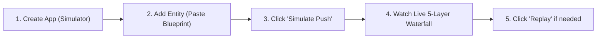

# Soopa Integration Platform (`apps/ip`)
## Non-Tech User Guide: Manual Pipeline Testing from the Web UI

- **Document:** Visual Step-by-Step UI Testing Walkthrough (Zero Code / Zero Terminal)
- **Target Audience:** Support Engineers, Customer Success, Utility Ops, Business Users
- **Frontend App:** `@soopa/ip-ui` (Integration Platform Web Interface)
- **Location:** `apps/ip/docs/ui_manual_testing_guide.md`

---

## 1. What This Guide Covers

You do **not** need terminal commands, cURL, or SQL to test the platform. The entire pipeline—from simulating an AMI smart meter to watching data flow through all 5 layers—is built into the web UI with simple point-and-click buttons.



---

## 2. Step-by-Step UI Walkthrough

### Step 1: Create a Simulated Smart Meter App
1. Open the Soopa web UI in your browser (`http://localhost:5173` or your production URL).
2. In the left navigation menu, click **Apps** (or **Connections**).
3. Click the top-right button: **"+ New Connection"**.
4. In the modal:
   - **App Catalog:** Select **Universal Simulator** (Sandbox).
   - **Connection Name:** Enter `AMI Smart Meter Simulator`.
   - **Authentication:** Leave as `No Auth` (pre-selected for simulator).
   - Click **Connect & Save**.
5. Your new connection card will appear. Click on it to open the **Connection Detail Page**.

---

### Step 2: Define the `meter_readings` Entity
1. On the Connection Detail Page, scroll down to the **Simulator Entities** section.
2. Click the **"+ Add Entity"** button.
3. In the modal, fill in these **4 fields**:

| Modal Field | What to Enter | Why |
| :--- | :--- | :--- |
| **Entity Name \*** | `meter_readings` | The stream name for meter data. |
| **Primary Key** | `meter_serial` | Tells Soopa which field uniquely identifies the meter. |
| **Cursor** | `timestamp` | Tells Soopa which field tracks reading timestamps. |
| **Records per Pull** | `5` | Batch size (default is 5). |
| **Velocity Mode** | Keep **Transactional Entity** selected. | Normal transactional mode. |

4. In the **Sample Blueprint** code box, replace the placeholder text with this sample reading:
```json
{
  "meter_serial": "MTR-ENERGY-1001",
  "timestamp": "2026-11-12T12:00:00Z",
  "kwh_delivered": 14.52,
  "kwh_received": 0.0,
  "voltage_avg": 240.1,
  "interval_minutes": 15,
  "service_point_id": "SP-NORTH-401"
}
```
5. Click **Save Entity**.
6. You will see a green toast notification: *"Entity 'meter_readings' created in this Simulator connection."*

---

### Step 3: Trigger Live Ingestion with 1-Click ("Simulate Push")
1. Look at your new `meter_readings` row in the **Simulator Entities** table.
2. Under the **Actions** column on the right, you will see three buttons:
   - **[Simulate Push]** (Radio tower icon)
   - **[Edit]** (Pencil icon)
   - **[Delete]** (Trash icon)
3. Click the **[Simulate Push]** button.
4. **What Happens:** The simulator instantly synthesizes a realistic meter reading matching your blueprint and injects it straight into Layer 1 Ingress.
5. A green success banner will appear at the bottom-right:
   *`Simulated push for "meter_readings" (1 record ingested into L1).`*

---

### Step 4: Watch the Data Travel Through the 5-Layer Waterfall
Now see where your data went and verify that it transformed correctly:

1. In the left navigation menu, click **Support Traces** (or **Activity**).
2. You will see the **Traces Timeline** table. The reading you just pushed will appear at the very top with:
   - **Entity:** `meter_readings`
   - **Record Key:** `MTR-ENERGY-1001`
   - **Status Badge:** `NORMALIZED` (or `DELIVERED` if destination flow is on).
   - **Latency:** e.g. `12ms`.
3. Click anywhere on the trace row to open the **Trace Waterfall Screen**.
4. Right across the top, you will see the visual **Five-Layer Stage Strip**:

```text
[ L1 Ingested ✓ ] ──► [ L2 Replicated ✓ ] ──► [ L3 Normalized ✓ ] ──► [ L4 Routed ✓ ] ──► [ L5 Delivered ✓ ]
```

5. Click on any stage pill to view details:
   - **Click `L1 Ingested`:** See the exact raw wire JSON received and receipt timestamp.
   - **Click `L2 Replicated`:** See the SHA-256 deduplication hash that protects against double-billing.
   - **Click `L3 Normalized`:** See the clean canonical MDM reading with calculated kWh.
   - **Click `L4 Routed`:** See which Stitch DAG workflow rules evaluated this reading.
   - **Click `L5 Delivered`:** See the destination ERP HTTP response code (200 OK) and delivery receipt.

---

### Step 5: Test Customer Support Superpowers ("Modify & Replay")

What if an external system sent a bad reading (for example, missing a timestamp) and it shows up as **REJECTED**?

Customer support agents can fix it directly in the UI without asking developers or database admins:
1. On the **Trace Waterfall** screen for that record, click the **"Modify & Replay"** button in the top right.
2. A drawer opens showing the payload.
3. Edit the typo or missing value in the visual editor.
4. Click **"Re-inject & Run"**.
5. Watch the failed record re-evaluate live and transition to **NORMALIZED** right before your eyes.

---

## 3. Summary Checklist for Business & Non-Tech Users

| Step | Action in UI | Expected Result |
| :--- | :--- | :--- |
| **1. App Setup** | Click **New Connection** $\to$ Universal Simulator | App appears as `Connected` with green status dot. |
| **2. Add Entity** | Click **Add Entity** $\to$ Name: `meter_readings`, PK: `meter_serial` | Entity shows in table with `v1` version badge. |
| **3. Push Data** | Click **[Simulate Push]** button on the row | Green toast: *"1 record ingested into L1"*. |
| **4. Traceability** | Open **Support Traces** $\to$ Click the top trace | Visual 5-layer strip shows every step from L1 to L5. |
| **5. Support Fix** | Click **Modify & Replay** on any trace | Fix typos and replay directly from browser. |
