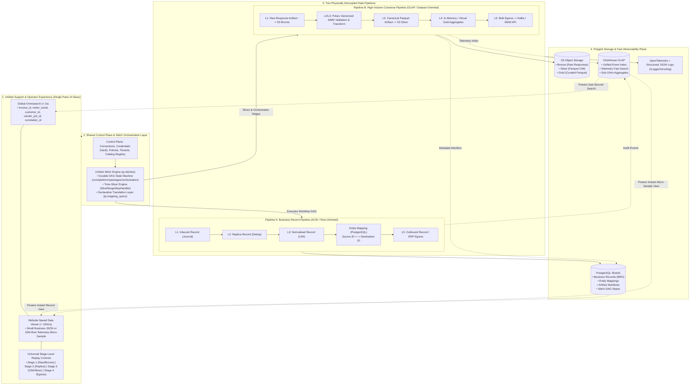
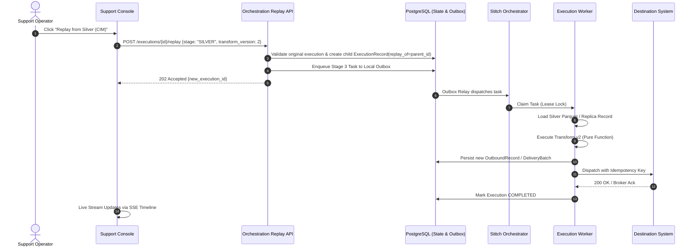

# Unified Orchestration Platform: Enterprise Architectural Standard
## Dual-Pipeline Engine with Unified Operator Experience & Millisecond Support Observability

- **Domain:** Integration Platform (`apps/ip`, `core/platform`)
- **Document Status:** Approved Gold Standard Architecture & Implementation Specification
- **Version:** 2.0.0 (Enterprise Gold Standard)
- **Target Audience:** Enterprise Software Architects, Principal Engineers, Solution Engineers, Support & SRE Leads
- **File Location:** `apps/ip/docs/unified_orchestration_architecture_design.md`

---

> ### The Core Architectural Tenet
> **"Two physically decoupled execution and storage pipelines under the hood, orchestrated via unified Stitches, presenting one frictionless, millisecond-fast support experience on top."**
>
> 1. **Under the Hood**: Solution Engineers and Architects leverage the unified **Stitch DAG** (`ip.stitches`) and **Durable Orchestration Engine** (`core/platform/packages/orchestration`) to configure two distinct workloads:
>    - **Pipeline A (Business Workflow Pipeline)**: Record-oriented transactional flows (TMS/ERP/CRM, invoices, bills, discrete utility move-in reads) persisted in sharded PostgreSQL.
>    - **Pipeline B (High-Volume Data Pipeline)**: Columnar, dataset-oriented telemetry flows (millions of smart grid AMI intervals) persisted across S3 Object Storage (Bronze/Silver/Gold Parquet) and indexed in ClickHouse.
> 2. **On the Surface (Customer Support & Operations)**: The customer support team sees **zero distinction** between the pipelines. Through a unified, single-pane-of-glass UI, operators can:
>    - **Answer any customer question in seconds** via global search across all business and technical identifiers.
>    - **View any record or dataset in milliseconds** with website-speed performance via pre-aggregated summaries and micro-sample projections.
>    - **Replay data from any stage** (Raw Ingress, Staged Replica, Canonical Normalization, or Wire Delivery) with point-and-click preview of side-effects and idempotency controls.

---



---

## 1. Executive Summary & Goals

### 1.1 The Problem Space
Enterprise integration platforms frequently fail in one of two ways:
1. **The Over-Generalized Relational Trap**: Forcing high-frequency smart meter readings (48M+ intervals/day) into transactional PostgreSQL rows, resulting in table lock contention, Write-Ahead Logging (WAL) exhaustion, and systemic crashes.
2. **The Fragmented Silo Trap**: Building two completely separate products (an iPaaS for SaaS business records and a bespoke Data Lake for utility telemetry), forcing operators and customer support engineers to switch between multiple tabs, correlate disconnected logs, and abandon unified stage replay.

### 1.2 The Gold Standard Solution
This platform resolves both traps by strictly decoupling **Physical Execution and Storage** while standardizing **Orchestration, Configuration, and Operator Experience**:
- **Architects and Solution Engineers** author integration logic through pure Solution SDK functions, declarative `MappingSpecs`, and durable `Stitches`.
- **Customer Support and Operations** interact with a unified interface where any transaction—whether a single TMS invoice or an asynchronous 5-day AMI meter reading request across three Head-End Systems—is instantly searchable, visually inspectable in milliseconds, and safely replayable from any stage.

---

## 2. Core Architectural Pillars & Support Experience Guarantees

```
┌────────────────────────────────────────────────────────────────────────────────────────┐
│                        THE 3 SUPPORT EXPERIENCE GUARANTEES                             │
│                                                                                        │
│  1. ANSWER IN SECONDS      Global inverted index across PG and ClickHouse guarantees   │
│     (Omnisearch)           any identifier (invoice, meter, job, trace) resolves in     │
│                            under 2 seconds.                                            │
│                                                                                        │
│  2. VIEW IN MILLISECONDS   Tiered UI data delivery: direct indexed PG reads for        │
│     (Website Speed)        records; pre-aggregated ClickHouse summaries and Parquet    │
│                            metadata micro-samples (<100ms) for massive datasets.       │
│                                                                                        │
│  3. REPLAY FROM ANY STAGE  Point-and-click replay at Stage 1 (Raw), Stage 2 (Replica), │
│     (Explicit Sagas)       Stage 3 (CIM Normalization), or Stage 4 (Egress Delivery)  │
│                            with explicit idempotency and side-effect guarantees.       │
└────────────────────────────────────────────────────────────────────────────────────────┘
```

### 2.1 Support Guarantee A: Answer Any Question in Seconds (Global Omnisearch)
Support engineers frequently receive ambiguous customer inquiries (e.g., *"Invoice INV-98721 was rejected"*, *"Meter MTR-84920 did not show up in Oracle MDM"*, or *"Job LND-2026-11-20 failed"*). 

The platform implements an **Inverted Omnisearch Index** hosted in ClickHouse, continuously fed via the Transactional Outbox Relay from all bounded contexts:
- **Searchable Keys**: `tenant_id`, `correlation_id`, `source_record_id`, `destination_record_id`, `meter_id`, `service_point_id`, `vendor_job_id`, `artifact_id`, `batch_id`, and `trace_id`.
- **SLA**: Query completion in $< 2\text{ seconds}$ across billions of historical events.
- **Result**: The support engineer types any keyword and instantly sees the root Stitch execution, active pipeline type (A or B), current lifecycle status, and the visual timeline.

### 2.2 Support Guarantee B: View Any Data in Milliseconds (Website Speed)
A support console must feel like a responsive modern web application, not a slow database reporting query:
- **For Business Records (Pipeline A)**: Direct primary-key lookups against sharded PostgreSQL retrieve the complete JSON payloads for Inbound, Replica, Normalized, and Outbound records in $< 30\text{ms}$.
- **For High-Volume Datasets (Pipeline B)**: The support console **never** downloads or scans 500MB Parquet files from S3 directly into the browser. Instead:
  1. **Metadata & Summary Header**: File size, checksum, row count, schema version, and data quality issue counts are retrieved instantly from `ip.artifact_manifests` in PostgreSQL ($< 15\text{ms}$).
  2. **Micro-Sample Projection**: A 50-row representative preview, interval completeness distribution, and anomaly scorecards are retrieved from ClickHouse in $< 50\text{ms}$.
  3. **Direct File Download (Optional)**: If deep offline investigation is required, an authenticated pre-signed S3 download URL is generated on-demand.

### 2.3 Support Guarantee C: Replay Data from Any Stage
The platform provides a **Four-Stage Universal Replay Protocol**:

| Stage | Replay Action | What Happens Under the Hood | Side-Effect Safety |
| :--- | :--- | :--- | :--- |
| **Stage 1: Raw Ingress / Bronze** | **Replay from Raw Source** | Re-executes the pipeline starting from the immutable `inbound_record` (Pipeline A) or S3 Bronze artifact (Pipeline B). The external source is **never re-called**. | Re-evaluates deduplication and normalization rules. |
| **Stage 2: Staging Replica** | **Re-run Deduplication / Staging** | Re-evaluates hash matching, schema validation, and CDC versioning against current tenant configurations. | Zero external network calls. |
| **Stage 3: Canonical CIM / Silver** | **Re-transform with New Version** | Applies an updated Solution SDK Transformer or `MappingSpec` version against the existing replica/Bronze data. | Updates normalized records/Silver Parquet. Emits updated domain events. |
| **Stage 4: Outbound / Egress** | **Re-drive Destination Wire Delivery** | Re-dispatches the destination payload to the target (QuickBooks, Kafka, Oracle MDM). | Enforces target idempotency keys, concurrency tokens (`sync_token`), or reconciliation before mutating. |

---

## 3. The Shared Stitch & Orchestration Layer

Both pipelines are governed by the unified **Stitch Architecture** (`ip.stitches`), backed by the platform's durable orchestration state machine (`core/platform/packages/orchestration`).

```
┌─────────────────────────────────────────────────────────────────────────────┐
│ 1. CONTRACT LAYER (ip.connection_entities)                                  │
│    What does the external system accept or produce? (Introspected Schemas)  │
└─────────────────────────────────────────────────────────────────────────────┘
                                      │
                                      ▼
┌─────────────────────────────────────────────────────────────────────────────┐
│ 2. TRANSLATION LAYER (ip.mapping_specs)                                     │
│    How does enterprise Canonical CIM project to the target wire shape?       │
└─────────────────────────────────────────────────────────────────────────────┘
                                      │
                                      ▼
┌─────────────────────────────────────────────────────────────────────────────┐
│ 3. ORCHESTRATION LAYER (ip.stitches + core/platform/packages/orchestration) │
│    When does it run, in what sequence, with what retries, gates, and sagas?  │
└─────────────────────────────────────────────────────────────────────────────┘
```

### 3.1 The Trinity Pattern (Decoupling Contracts, Mapping, and DAGs)
1. **Contract Layer (`ip.connection_entities`)**: Stores introspected source schemas (e.g. Landis+Gyr CIM JSON, Itron XML) and destination wire contracts (e.g. QuickBooks Bill JSON, Oracle MDM Kafka schema).
2. **Translation Layer (`ip.mapping_specs`)**: Pure, versioned, declarative data projections (`DIRECT`, `CONSTANT`, `EXPRESSION`, `IGNORE`). Contains **zero** awareness of network transports, queues, or retries.
3. **Orchestration Layer (`ip.stitches`)**: Durable DAG workflows that bind triggers to step execution chains and reference specific `mapping_spec_id` versions.

### 3.2 Durable Orchestration Engine Integration
The platform connects to [`core/platform/packages/orchestration`](file:///Users/apple/soopa_mono/core/platform/packages/orchestration) via the [`DurableWorkflowOrchestratorAdapter`](file:///Users/apple/soopa_mono/apps/ip/packages/ip/src/ip/engine/adapters/outbound/stitches/durable_workflow_orchestrator_adapter.py):
- **Deterministic State Machine**: Every Stitch execution creates a `WorkflowRunRecord` with sequential `WorkflowStepRunRecord` entries (`PENDING` $\to$ `RUNNING` $\to$ `COMPLETED` / `FAILED` / `SUSPENDED`).
- **Heartbeating & Lease Locks**: Long-running steps maintain worker leases in PostgreSQL to prevent duplicate concurrent processing.
- **Asynchronous Callback Suspension**: When waiting for an asynchronous HES callback or external webhook, the workflow transitions to `SUSPENDED` with an event signal listener, releasing worker threads.

---

## 4. Pipeline A Specification: Business Record Workflow Pipeline

Use Pipeline A for business entities possessing strict transactional identity and lifecycle mutations: Invoices, Bills, Purchase Orders, Vendors, Customers, Payments, and discrete utility move-in/move-out final reads.

### 4.1 Canonical BRG Flow
```text
Source Event / API Request
           │
           ▼
[L1] Inbound Record (Raw wire payload preserved in PostgreSQL)
           │
           ▼
[L2] Replica Record (Source-shaped, SHA-256 deduplicated, CDC version tracked)
           │
           ▼
[L3] Normalised Record (Projected into Enterprise Canonical Common Information Model)
           │
           ▼
[L4] Entity Mapping Lookup & Stitch DAG Validation
           │
           ▼
[L5] Outbound Record (Destination-specific payload, staged for delivery)
           │
           ▼
Destination System (e.g., QuickBooks Online, SAP ERP, Salesforce)
```

### 4.2 Source-to-Destination Entity Mapping Table
The `ip.entity_mappings` table guarantees that updates to upstream business records reliably update existing destination entities rather than generating duplicate records:

```sql
CREATE TABLE ip.entity_mappings (
    id VARCHAR(64) PRIMARY KEY,
    tenant_id VARCHAR(64) NOT NULL,
    source_connection_id VARCHAR(64) NOT NULL,
    source_system VARCHAR(64) NOT NULL,
    source_entity VARCHAR(64) NOT NULL,
    source_record_id VARCHAR(128) NOT NULL,
    destination_connection_id VARCHAR(64) NOT NULL,
    destination_system VARCHAR(64) NOT NULL,
    destination_entity VARCHAR(64) NOT NULL,
    destination_record_id VARCHAR(128) NOT NULL,
    status VARCHAR(32) NOT NULL DEFAULT 'ACTIVE',
    source_version VARCHAR(64),
    destination_version VARCHAR(64), -- e.g., QuickBooks SyncToken
    last_execution_id VARCHAR(64),
    last_synced_at TIMESTAMPTZ NOT NULL DEFAULT NOW(),
    created_at TIMESTAMPTZ NOT NULL DEFAULT NOW(),
    updated_at TIMESTAMPTZ NOT NULL DEFAULT NOW(),
    CONSTRAINT uq_ip_entity_mapping_natural_key UNIQUE (
        tenant_id,
        source_connection_id,
        source_entity,
        source_record_id,
        destination_connection_id,
        destination_entity
    )
);
CREATE INDEX idx_ip_entity_mappings_lookup ON ip.entity_mappings (
    tenant_id, source_record_id, destination_connection_id
);
```

### 4.3 Idempotent Sync Algorithm
1. **Receive Source Event**: Extract source entity identity and version (e.g., TMS Invoice `INV-1001`, version `4`).
2. **Ingest L1 & L2**: Store raw payload in `inbound_records`. Compute payload hash and verify against `replica_records`. If duplicate version exists, mark as `NOOP_DUPLICATE` and terminate cleanly.
3. **Normalize (L3)**: Map to Canonical CIM Invoice using the registered Solution Transformer.
4. **Lookup Entity Mapping**: Query `entity_mappings` by natural key `(tenant_id, source_connection_id, "Invoice", "INV-1001", destination_connection_id, "Bill")`.
5. **Branch Operation**:
   - **Case 1 (No Mapping Exists)**: Dispatch HTTP `POST /v3/company/{companyId}/bill` to QuickBooks. Extract destination `Bill.Id` (`QB-BILL-9876`) and `SyncToken` (`1`). Insert new row in `entity_mappings`.
   - **Case 2 (Active Mapping Exists)**: Read existing `destination_record_id` and `destination_version`. Dispatch HTTP `POST /v3/company/{companyId}/bill?operation=update` with `Id: QB-BILL-9876` and `SyncToken: 1`. Update mapping with new `SyncToken`.
6. **Reconciliation on Timeout**: If the destination HTTP call times out with an unknown network outcome, the retry worker executes a `GET /v3/company/{companyId}/bill` lookup by external invoice reference before attempting any subsequent write, completely preventing duplicate Bills.

---

## 5. Pipeline B Specification: High-Volume Columnar Data Pipeline

Use Pipeline B for large, append-heavy, high-frequency time-series datasets: 15-minute smart meter interval readings, grid telemetry, power quality voltage profiles, and bulk historical extracts.

### 5.1 Storage Layout: Medallion Architecture over S3 & Parquet
```text
HES Headend / Multi-Vendor AMI APIs
                 │
                 ▼
     Ingestion Connector Worker
                 │
                 ├───── Request & Job Metadata ─────► PostgreSQL (ip.data_requests, ip.data_jobs)
                 │
                 ▼
       Raw Response Payload ────────────────────────► S3 Bronze Zone (Raw Immutable Files)
                 │
                 ▼
     Vectorized Parse, Validate & Normalize (Polars / Arrow)
                 │
                 ▼
      Canonical Columnar Dataset ───────────────────► S3 Silver Zone (Compressed Parquet)
                 │
                 ▼
    In-Memory / Dynamic Views (Zero Disk Duplication) ► S3 Gold Zone (Optional Curated Parquet)
                 │
                 ├───── Fast Support Search & Metrics ─► ClickHouse OLAP Index
                 │
                 ▼
    Bounded Kafka Delivery Batches / Push Connector
                 │
                 ▼
    Destination System (Oracle MDM Kafka, SAP S/4HANA)
                 │
                 ▼
    Broker / Business Acknowledgement ──────────────► PostgreSQL (ip.delivery_batches)
```

### 5.2 The 3 Storage Zones
1. **Bronze Zone (S3 Raw Ingress)**:
   - **Format**: Original HES wire response (raw XML/JSON/CSV compressed with Zstandard).
   - **Path Convention**: `s3://{tenant-bucket}/bronze/{domain}/{source_hes}/{yyyy}/{mm}/{dd}/{job_id}.raw.zst`
   - **Immutability**: Write-Once-Read-Many (WORM). Serves as the ultimate disaster recovery and replay boundary.
2. **Silver Zone (S3 Canonical Parquet)**:
   - **Format**: Snappy-compressed Apache Parquet with strict Canonical CIM schema (`interval_start_utc`, `interval_end_utc`, `meter_id`, `kwh_delivered`, `voltage_avg`, `quality_flags`).
   - **Path Convention**: `s3://{tenant-bucket}/silver/{domain}/{yyyy}/{mm}/{dd}/part-{slice_id}.parquet`
   - **Optimization**: Partitioned by date and HES vendor; dictionary-encoded strings for meter IDs.
3. **Gold Zone (Curated Business Views)**:
   - **Storage Principle**: **Zero unnecessary duplicate physical storage**. Gold datasets (daily rollups, TOU peak buckets) are generated **in-memory** by Polars during egress or mapped via dynamic virtual views unless contractual long-term external data warehouse handoffs require physical Parquet files.

### 5.3 PostgreSQL Manifest & Operational Ledger
PostgreSQL never stores raw interval arrays. It stores relational manifests tracking artifact lifecycles, partition ranges, checksums, and delivery acknowledgements:

```sql
CREATE TABLE ip.data_requests (
    id VARCHAR(64) PRIMARY KEY,
    tenant_id VARCHAR(64) NOT NULL,
    source_domain VARCHAR(64) NOT NULL,
    requested_range_start TIMESTAMPTZ NOT NULL,
    requested_range_end TIMESTAMPTZ NOT NULL,
    total_slices INT NOT NULL DEFAULT 1,
    completed_slices INT NOT NULL DEFAULT 0,
    status VARCHAR(32) NOT NULL DEFAULT 'CREATED',
    created_at TIMESTAMPTZ NOT NULL DEFAULT NOW(),
    updated_at TIMESTAMPTZ NOT NULL DEFAULT NOW()
);

CREATE TABLE ip.data_jobs (
    id VARCHAR(64) PRIMARY KEY,
    request_id VARCHAR(64) NOT NULL REFERENCES ip.data_requests(id),
    tenant_id VARCHAR(64) NOT NULL,
    vendor_code VARCHAR(32) NOT NULL, -- e.g. LANDIS, ITRON, SIEMENS
    slice_date DATE NOT NULL,
    vendor_job_id VARCHAR(128),
    retry_count INT NOT NULL DEFAULT 0,
    status VARCHAR(32) NOT NULL DEFAULT 'QUEUED',
    created_at TIMESTAMPTZ NOT NULL DEFAULT NOW(),
    updated_at TIMESTAMPTZ NOT NULL DEFAULT NOW()
);

CREATE TABLE ip.artifact_manifests (
    id VARCHAR(64) PRIMARY KEY,
    job_id VARCHAR(64) NOT NULL REFERENCES ip.data_jobs(id),
    tenant_id VARCHAR(64) NOT NULL,
    zone VARCHAR(16) NOT NULL, -- BRONZE, SILVER, GOLD
    object_uri VARCHAR(512) NOT NULL,
    format VARCHAR(32) NOT NULL, -- RAW_ZSTD, PARQUET
    schema_version INT NOT NULL DEFAULT 1,
    checksum_sha256 VARCHAR(64) NOT NULL,
    byte_size BIGINT NOT NULL,
    row_count BIGINT NOT NULL,
    validation_status VARCHAR(32) NOT NULL DEFAULT 'PASSED',
    created_at TIMESTAMPTZ NOT NULL DEFAULT NOW()
);

CREATE TABLE ip.delivery_batches (
    id VARCHAR(64) PRIMARY KEY,
    job_id VARCHAR(64) NOT NULL REFERENCES ip.data_jobs(id),
    tenant_id VARCHAR(64) NOT NULL,
    destination_connection_id VARCHAR(64) NOT NULL,
    topic_or_endpoint VARCHAR(256) NOT NULL,
    idempotency_key VARCHAR(128) NOT NULL,
    batch_sequence INT NOT NULL,
    records_count INT NOT NULL,
    status VARCHAR(32) NOT NULL DEFAULT 'STAGED',
    broker_acked_at TIMESTAMPTZ,
    destination_acked_at TIMESTAMPTZ,
    created_at TIMESTAMPTZ NOT NULL DEFAULT NOW()
);
```

---

## 6. Sliced Asynchronous Multi-Vendor Execution (Solution SDK)

To handle real-world physical constraints (such as HES vendor 24-hour query limits and non-blocking 15–45 minute batch processing), the platform provides the **Time-Slicer Engine**:

```
Oracle MDM Request: 10 Days across 3 HES Vendors (Landis+Gyr, Itron, Siemens)
                                   │
                                   ▼
        TimeSlicer Engine (SliceRangeStepHandler)
        10 Days x 3 Vendors = 30 Atomic 1-Day Slice Tasks
                                   │
                                   ▼
        Durable Orchestration Queue (core/platform/packages/scheduler)
                                   │
     ┌─────────────────────────────┼─────────────────────────────┐
     ▼                             ▼                             ▼
Task 1..10 (Landis)         Task 11..20 (Itron)          Task 21..30 (Siemens)
POST /extract-jobs          POST /async-jobs             POST /read-orders
202 Accepted {job_id}       202 Accepted {job_id}        202 Accepted {job_id}
     │                             │                             │
     └─────────────────────────────┼─────────────────────────────┘
                                   │
                                   ▼
        Asynchronous Push Callbacks / Inbound Gateway Router
                                   │
                                   ▼
        L1 Wire Storage -> L2 Staging -> L3 Polars Normalizer -> Kafka Egress
```

### 6.1 Solution Engineer Contract (100% Pure Functions)
Solution Engineers write **zero** database mutation code, **zero** date math loops, and **zero** async Kafka plumbing. They write pure Python functions returning typed contracts:

```python
# File: apps/ip/src/ip/solutions/domains/energy/landis/connectors.py
from ip.sdk import RequestBuilder, RequestSpec, TimeSlice

def request_landis_slice_job(slice_cmd: TimeSlice) -> RequestSpec:
    """Pure function. Constructs a 1-day extraction request for Landis+Gyr."""
    return (
        RequestBuilder.post("/api/v2/extract-jobs")
        .with_body({
            "start_time": slice_cmd.start_time.isoformat(),
            "end_time": slice_cmd.end_time.isoformat(),
            "reading_type": "15_MIN_INTERVAL",
            "callback_url": "https://api.soopa.io/ip/v1/inbound/hes_callback",
        })
        .build()
    )
```

The runtime [`SliceRangeStepHandler`](file:///Users/apple/soopa_mono/apps/ip/packages/ip/src/ip/engine/adapters/outbound/stitches/handlers/slice_range_step_handler.py) automatically slices the date window, spawns child execution steps in `core/platform/packages/orchestration`, attaches correlation keys, and advances parent workflow runs as child manifests land in S3.

---

## 7. Unified Support Console Architecture & Millisecond UX

Support engineers operate from a single, unified interface that completely abstracts pipeline differences:

```
┌────────────────────────────────────────────────────────────────────────────────────────────────────────────────┐
│ SOOPA PLATFORM SUPPORT CONSOLE                                                      Tenant: [BESCOM Electric ▼] │
├────────────────────────────────────────────────────────────────────────────────────────────────────────────────┤
│ 🔍 Search: [ MTR-ENERGY-90214                                                                 ] [ Search (12ms) ]│
├────────────────────────────────────────────────────────────────────────────────────────────────────────────────┤
│ Execution: exec_01jf829ak3  │ Pipeline: B (High-Volume Telemetry) │ Status: COMPLETED │ Duration: 14m 22s      │
│ Parent Request: req_01jf828 │ Vendor: Landis+Gyr Command Center   │ Date Slice: 2026-11-19 (Day 3 of 5)        │
├────────────────────────────────────────────────────────────────────────────────────────────────────────────────┤
│ ── VISUAL STAGE TIMELINE ───────────────────────────────────────────────────────────────────────────────────── │
│  [✓] INGRESS (Bronze) ──► [✓] NORMALISE (Silver) ──► [✓] ENRICH (Gold) ──► [✓] EGRESS (Kafka)                  │
│      14:02:11 UTC              14:08:45 UTC               14:09:12 UTC         14:10:01 UTC                    │
│      5.4 MB (Raw Zstd)         96 Intervals (Parquet)     Zero Drift View      1 Batch Delivered (Acked)       │
├────────────────────────────────────────────────────────────────────────────────────────────────────────────────┤
│ ── METADATA & MICRO-SAMPLE VIEWER (<50ms) ──────────────────────────────────────────────────────────────────── │
│ Artifact ID: art_01jf829   │ Rows: 96 / 96 Intervals │ Checksum: sha256:e3b0c44298fc1c149afbf4c8996fb9242... │
│ Quality Flag: 100% Valid   │ Voltage Avg: 240.2 V    │ Total kWh: 14.82 kWh                                   │
│                                                                                                                │
│ Sample Intervals (Preview 5 of 96 rows):                                                                       │
│ ┌──────────────────────┬──────────────────────┬──────────────┬──────────────┬─────────────┬──────────────────┐ │
│ │ Interval Start (UTC) │ Interval End (UTC)   │ kWh Delivered│ kWh Received │ Voltage Avg │ Quality Status   │ │
│ ├──────────────────────┼──────────────────────┼──────────────┼──────────────┼─────────────┼──────────────────┤ │
│ │ 2026-11-19T00:00:00Z │ 2026-11-19T00:15:00Z │ 0.152        │ 0.000        │ 240.1       │ VALID (Actual)   │ │
│ │ 2026-11-19T00:15:00Z │ 2026-11-19T00:30:00Z │ 0.148        │ 0.000        │ 239.8       │ VALID (Actual)   │ │
│ │ 2026-11-19T00:30:00Z │ 2026-11-19T00:45:00Z │ 0.155        │ 0.000        │ 240.4       │ VALID (Actual)   │ │
│ └──────────────────────┴──────────────────────┴──────────────┴──────────────┴─────────────┴──────────────────┘ │
├────────────────────────────────────────────────────────────────────────────────────────────────────────────────┤
│ ── REPLAY CONTROLS ─────────────────────────────────────────────────────────────────────────────────────────── │
│ [ ↺ Replay from Bronze (Raw) ]  [ ↺ Re-Normalize (Silver CIM v2) ]  [ ↺ Redrive Egress Batch (Kafka) ]        │
└────────────────────────────────────────────────────────────────────────────────────────────────────────────────┘
```

### 7.1 Instant Search Implementation (Under the Hood)
1. **Unified Global Index in ClickHouse**:
   ```sql
   CREATE TABLE platform.support_search_index (
       tenant_id LowCardinality(String),
       entity_type LowCardinality(String), -- 'INVOICE', 'METER', 'JOB', 'CORRELATION', 'TRACE'
       entity_key String,                  -- 'INV-1001', 'MTR-ENERGY-90214', 'job_01jf...'
       pipeline_type LowCardinality(String), -- 'PIPELINE_A', 'PIPELINE_B'
       execution_id String,
       status LowCardinality(String),
       created_at DateTime64(3, 'UTC')
   ) ENGINE = ReplacingMergeTree()
   ORDER BY (tenant_id, entity_type, entity_key, created_at);
   ```
2. When an operator searches `MTR-ENERGY-90214`, ClickHouse executes a targeted index seek taking $< 10\text{ms}$, returning the exact `execution_id` and pipeline type.

### 7.2 Sub-100ms Data Viewing Implementation
- **For Pipeline A Records**: Direct query `SELECT * FROM ip.inbound_records WHERE id = :id` takes $< 5\text{ms}$.
- **For Pipeline B Datasets**:
  - The UI requests `/api/v1/ip/executions/{id}/preview`.
  - The API queries `ip.artifact_manifests` in PostgreSQL for summary statistics and fetches the 50-row micro-sample from ClickHouse (`SELECT * FROM energy.meter_readings WHERE artifact_id = :art_id LIMIT 50`).
  - Total latency across the network is $< 60\text{ms}$.

---

## 8. Universal Replay Engine Specification

Replay is an auditable, transactional operation. A replay **never** mutates history in-place; it generates a child execution linked to the parent via `replay_of_execution_id`.



### 8.1 Replay Invariants by Stage
1. **Replay Stage 1 (Raw Ingress / Bronze)**:
   - Input: Raw byte stream from `inbound_records` (Pipeline A) or S3 Bronze `.raw.zst` (Pipeline B).
   - Use Case: Source vendor transmitted corrupt data, or initial ingress parsing rules were defective.
   - External Impact: Zero outbound network calls to source. Re-evaluates entire pipeline downstream.
2. **Replay Stage 3 (CIM Normalization / Silver)**:
   - Input: Existing validated replica JSON or Bronze artifact.
   - Use Case: A field mapping rule was updated (e.g., `MappingSpec` v2 fixes unit conversion from `Wh` to `kWh`).
   - External Impact: Bypasses raw ingestion. Regenerates normalized canonical records and Silver Parquet files.
3. **Replay Stage 4 (Wire Delivery / Egress)**:
   - Input: Pre-computed `outbound_record` or Silver Parquet batch.
   - Use Case: Destination ERP was down for maintenance, or Kafka broker partition was temporarily full.
   - External Impact: Re-dispatches wire payload. Requires target idempotency key or destination pre-flight reconciliation (e.g. verifying invoice does not exist before posting).

---

## 9. Technology Architecture & Storage Matrix

| Capability | System of Record | Storage Technology | Scaling & Retention Policy |
| :--- | :--- | :--- | :--- |
| **Tenant, Connection & Credentials** | Control Plane | PostgreSQL + Secret Manager | Encrypted at rest; tenant-sharded control plane. |
| **Business Records (BRG)** | Pipeline A Operational State | PostgreSQL Shards | Active retention (90 days); partitioned by `tenant_id` and month. |
| **Entity Mappings (Source $\leftrightarrow$ Target)** | Pipeline A Operational State | PostgreSQL Shards | Permanent index. High-performance unique constraint lookup. |
| **Workflow DAG Execution State** | Orchestration Plane | PostgreSQL (`core/platform/packages/orchestration`) | Pruned after 30 days; terminal states archived to S3. |
| **Raw Telemetry & Responses (Bronze)** | Pipeline B Data Plane | S3-Compatible Object Store (MinIO / AWS S3) | Compressed Zstandard (`.raw.zst`). Lifecycle transition to Glacier/Deep Archive after 180 days. |
| **Canonical Datasets (Silver)** | Pipeline B Data Plane | S3 Columnar Parquet (`.parquet`) | Snappy-compressed Parquet. Direct target for Polars and Arrow zero-copy queries. |
| **Curated Business Views (Gold)** | Pipeline B Data Plane | In-Memory Polars / Dynamic SQL Views | **Zero disk duplication**. Ephemeral generation during egress. |
| **Artifact Manifests & Delivery Batches**| Pipeline B Operational Ledger | PostgreSQL Shards | Relational integrity tracking S3 URIs, row counts, and checksums. |
| **Global Support Search & Fast Queries** | Observability Plane | ClickHouse Columnar OLAP | `ReplacingMergeTree`. Retained for 90 days of high-speed support queries. |
| **Distributed Spans & Tracing** | Observability Plane | OpenTelemetry + Grafana Tempo | 14-day rolling buffer; sampled for errors and slow paths. |
| **Streaming Egress Transport** | Delivery Transport | Apache Kafka | Retention: 7 days. Partitioned by `tenant_id` and `meter_id`. |

---

## 10. Architectural Guardrails (Strictly Enforced)

1. **No Relational Flooding**: Never write individual smart meter interval pulses into row-by-row PostgreSQL tables. All high-frequency telemetry **must** use S3 Parquet and ClickHouse.
2. **No Monolithic Pipeline Conflation**: Always maintain the Trinity separation: `ip.connection_entities` (Contracts) $\to$ `ip.mapping_specs` (Translation) $\to$ `ip.stitches` (Orchestration).
3. **No Dual UI for Support**: Customer support engineers must **never** be forced to use different tools or consoles for Pipeline A vs. Pipeline B. The support UI must present one unified search, timeline, and replay modal.
4. **No Heavy Datasets in Workflows**: Workflow execution state in `core/platform/packages/orchestration` must carry IDs, URIs, checksums, and row counts—**never** multi-megabyte payloads or interval arrays.
5. **No Blind Replay**: Replaying an outbound create operation must always reconcile against the destination first to guarantee zero duplicate external records.
6. **No Adapter-to-Adapter Coupling**: Infrastructure adapters must depend exclusively on abstract Ports. The Composition Root is the sole authority for wiring adapters.
7. **No Unbounded Mutations**: Background batch processing and outbox relays must use chunked iteration with `LIMIT` and yield execution (`await asyncio.sleep(0.1)`).
