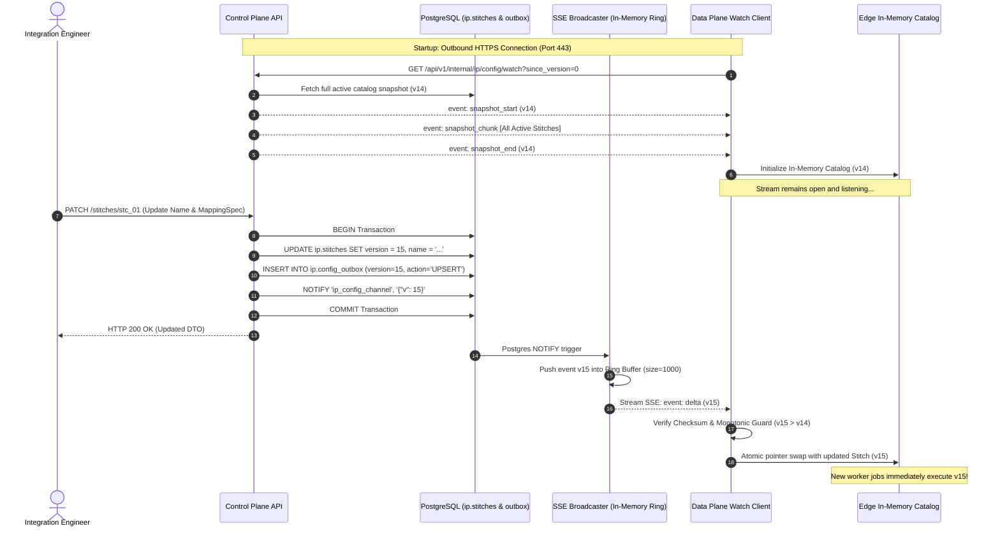

# Enterprise Architectural Design Document
## Universal Control Plane to Data Plane Configuration Synchronization: The Queue-Free HTTPS Dynamic Watch Architecture & Multi-App Federation (EDI, IP, AppX, AppY)

**Author:** Enterprise Architecture & Platform Engineering Team  
**Standard:** Enterprise Grade · Zero Shortcuts · Strict Hexagonal Architecture · Ubiquitous Language · DDD  
**Scope:** Control Plane (Write Model, Management APIs, Visual Flow Builder) & Distributed Data Plane Shards (Ingress Adapters, In-Memory Catalogs, DAG Execution Engines, Connectors)  
**Target Environments:** Amazon Web Services (AWS), Google Cloud Platform (GCP), Microsoft Azure, and Sovereign On-Premises Private Data Centers (Bare-Metal, Kubernetes, Air-Gapped)  
**Status:** Approved Architectural Blueprint & Production Standard  

---

## 1. Executive Summary & The Fallacy of Queues for Configuration Sync

Enterprise integration platforms decouple the **Control Plane** (where integration engineers manage connection credentials, field mapping specs, and business workflows) from the **Data Plane** (high-throughput, distributed ingestion workers and transformation engines).

When designing synchronization across multi-cloud deployments (AWS, GCP, Azure) and customer-owned private data centers with strict security postures, architects frequently make a classic distributed systems mistake: **reaching for message queues (SQS, SNS, GCP Pub/Sub, Azure Service Bus, Kafka) for configuration synchronization.**

### 1.1 The 5 Fatal Flaws of Message Queues for Configuration Sync

```
┌────────────────────────────────────────────────────────────────────────────────────────┐
│                        THE 5 FATAL FLAWS OF CONFIGURATION QUEUES                       │
├────────────────────────────────┬───────────────────────────────────────────────────────┤
│ 1. Cold-Start Amnesia          │ Queues buffer transient deltas. A newly booted worker │
│ (Forces Dual Architecture)     │ cannot initialize state from queues, forcing teams to │
│                                │ build a separate HTTP/DB cold-start mechanism anyway! │
├────────────────────────────────┼───────────────────────────────────────────────────────┤
│ 2. Broker Sprawl & Multi-Cloud │ Requires provisioning SNS+SQS in AWS, Pub/Sub in GCP, │
│ Lock-In                        │ Service Bus in Azure, and Kafka in private DCs.       │
│                                │ Multiplied by N applications (EDI, IP, AppX, AppY).   │
├────────────────────────────────┼───────────────────────────────────────────────────────┤
│ 3. Inbound Firewall Blockade   │ Private on-prem enterprise data centers strictly ban  │
│                                │ inbound connections. Pushing to brokers behind client │
│                                │ firewalls requires complex VPNs or transit gateways.  │
├────────────────────────────────┼───────────────────────────────────────────────────────┤
│ 4. DLQ & Poison-Pill Disasters │ Configuration invalidations stuck in Dead Letter      │
│                                │ Queues (DLQs) cause data plane shards to run on       │
│                                │ inconsistent, silently corrupted split-brain state.   │
├────────────────────────────────┼───────────────────────────────────────────────────────┤
│ 5. Broker Sizing Limits        │ Message brokers enforce strict size caps (SQS: 256KB, │
│                                │ Kafka default: 1MB). Large mapping specs or schema    │
│                                │ definitions crash the transport layer.                │
└────────────────────────────────┴───────────────────────────────────────────────────────┘
```

### 1.2 The Industry Gold Standard: The "Dynamic Watch" Paradigm

The world's highest-scale infrastructure control planes have abandoned message queues for configuration management:

* **Kubernetes API Server (`kube-apiserver`):** Kubelets, Ingress Controllers, and CoreDNS do not consume from SQS or Kafka. They open an outbound HTTPS connection to `/api/v1/watch/pods?resourceVersion=N` using HTTP chunked streaming.
* **Envoy Proxy (xDS Protocol):** Hundreds of thousands of Envoy proxies sync routing tables, clusters, and TLS certificates using **gRPC / HTTP-2 Streaming (Envoy Dynamic Discovery Service)** over Port 443.
* **LaunchDarkly & Feature Flag Engines:** Stream dynamic flag changes to millions of SDKs globally using **Server-Sent Events (SSE)** over standard HTTPS.
* **Shopify:** Utilizes centralized MySQL/PostgreSQL with transactional outbox, real-time memory caches, and HTTP/2 delta synchronization without intermediate cloud queue topologies.

### 1.3 The Soopa Platform Decision

The Soopa Platform adopts the **Queue-Free HTTPS Dynamic Watch Architecture**:
1. **Zero Broker Dependency:** No SQS, SNS, GCP Pub/Sub, Azure Service Bus, or Kafka required between Control Plane and Data Plane.
2. **Outbound-Only Port 443 (HTTPS / SSE):** Data Plane shards initiate a persistent outbound HTTP/2 / SSE connection to the Control Plane.
3. **Unified Cold-Start & Live Streaming:** The exact same HTTP connection delivers the full snapshot on connection, then streams real-time atomic deltas over the wire.
4. **Universal Multi-App Scaling:** Natively federates across `edi`, `ip`, `appX`, and `appY` with zero infrastructure provisioning overhead.

---

## 2. Multi-App Federation (EDI, IP, AppX, AppY)

A critical requirement of the Soopa platform is supporting multiple enterprise applications seamlessly. The HTTPS Dynamic Watch architecture scales across arbitrary numbers of bounded contexts without friction.

### 2.1 Domain-Driven Design (DDD) Bounded Context Isolation

Each application context retains strict domain ownership of its entities, database schemas, and versioning sequences:

```
┌────────────────────────────────────────────────────────────────────────────────────────┐
│                              CONTROL PLANE: APPS ISOLATION                             │
│                                                                                        │
│   ┌──────────────────────┐  ┌──────────────────────┐  ┌─────────────────────────────┐  │
│   │   EDI Domain (App)   │  │    IP Domain (App)   │  │     AppX / AppY Domains     │  │
│   │                      │  │                      │  │                             │  │
│   │ - TradingPartners    │  │ - Stitches           │  │ - Custom DAGs               │  │
│   │ - InboundProfiles    │  │ - MappingSpecs       │  │ - Transformation Rules      │  │
│   │ - AS2Certificates    │  │ - IngressPipelines   │  │ - Routing Policies          │  │
│   │ Version: 1, 2, 3...  │  │ Version: 1, 2, 3...  │  │ Version: 1, 2, 3...         │  │
│   └──────────┬───────────┘  └──────────┬───────────┘  └──────────────┬──────────────┘  │
│              │                         │                             │                 │
│              ▼                         ▼                             ▼                 │
│      edi.config_outbox         ip.config_outbox            app_x.config_outbox         │
└──────────────┼─────────────────────────┼─────────────────────────────┼─────────────────┘
               │                         │                             │
               └─────────────────────────┼─────────────────────────────┘
                                         │
                                         ▼
┌────────────────────────────────────────────────────────────────────────────────────────┐
│                        CORE PLATFORM STREAMING ENGINE (Seedwork)                       │
│                        core/platform/packages/config-sync                              │
│                                                                                        │
│          Endpoint: GET /api/v1/internal/{app_id}/config/watch                          │
│          Query:    ?tenant_id={tenant_id}&since_version={last_known_version}           │
└────────────────────────────────────────┬───────────────────────────────────────────────┘
                                         │
                                         │ Outbound TLS (Port 443 / SSE)
                                         │
               ┌─────────────────────────┼─────────────────────────────┐
               │                         │                             │
               ▼                         ▼                             ▼
┌──────────────────────────┐┌──────────────────────────┐┌─────────────────────────────┐
│    EDI DATA PLANE SHARD  ││    IP DATA PLANE SHARD   ││   APP-X / APP-Y DATA SHARD  │
│                          ││                          ││                             │
│ - InMemoryPartnerCatalog ││ - InMemoryStitchCatalog  ││ - InMemoryRuleCatalog       │
│ - AS2 Engine Workers     ││ - L4 Stitch Workers      ││ - Execution Workers         │
└──────────────────────────┘└──────────────────────────┘└─────────────────────────────┘
```

### 2.2 Uniform Wire Protocol & Routing Taxonomy

The streaming engine in `core/platform/packages/config-sync` exposes a standardized, app-agnostic URL taxonomy:

| Route | Role | Query Parameters | Description |
| :--- | :--- | :--- | :--- |
| `GET /api/v1/internal/{app_id}/config/watch` | Primary Watch Stream | `tenant_id`, `since_version`, `shard_id` | Opens SSE stream. Delivers snapshot if `since_version=0` (or expired), then streams deltas. |
| `GET /api/v1/internal/{app_id}/config/snapshot` | Cold Fallback Snapshot | `tenant_id` | Direct JSON snapshot query (used for edge debugging and health diagnostics). |
| `GET /api/v1/internal/config/watch` | Multiplexed Stream (Optional) | `tenant_id`, `apps=edi,ip,appX` | Enables a single edge gateway daemon to watch configuration for multiple apps in one HTTP/2 connection. |

### 2.3 Strict Domain Event Typing

All events streaming across the watch connection adhere to a strongly-typed schema:

```json
{
  "event_id": "evt_01JDJ5K7M9XYZ890ABCDEF1234",
  "app_id": "ip",
  "tenant_id": "ten_enterprise_01",
  "entity_type": "STITCH",
  "entity_id": "stc_meter_reading_erp_sync",
  "action": "UPSERT",
  "version": 15,
  "checksum": "sha256:4b227777d4dd1fc61c6f884f48641d02b4d121d3fd328cb08b5531fcacdabf8a",
  "payload": {
    "stitch_id": "stc_meter_reading_erp_sync",
    "name": "Meter Reading to SAP S/4HANA",
    "mapping_spec_id": "map_iec61968_to_sap_v3",
    "state": "ACTIVE",
    "concurrency_limit": 50,
    "version": 15
  }
}
```

For the `edi` application, the exact same envelope structure carries EDI-specific aggregates:
```json
{
  "event_id": "evt_01JDJ6B2P4QRS123CDEF5678",
  "app_id": "edi",
  "tenant_id": "ten_retail_01",
  "entity_type": "TRADING_PARTNER",
  "entity_id": "tp_walmart_edi850",
  "action": "UPSERT",
  "version": 4,
  "checksum": "sha256:8f413998e1a12cd1459a9871fc332156...",
  "payload": {
    "partner_id": "tp_walmart_edi850",
    "as2_id": "WALMART_AS2_PROD",
    "isa_qualifier": "01",
    "isa_id": "9251110000",
    "version": 4
  }
}
```

### 2.4 Why This Solves Multi-App Scaling Without Overhead
1. **Zero Multi-Topic Broker Provisioning:** Adding `appX`, `appY`, or `appZ` requires **zero new SQS queues, SNS topics, or Kafka consumer groups** to be provisioned in AWS, GCP, Azure, or on-premises.
2. **Independent Deployability:** The `edi-worker` container can be restarted, scaled to 50 pods, or upgraded without interrupting `ip-worker` or any other application.
3. **Dedicated or Shared Shards:** The platform supports both:
   - **Isolated Containers (Shopify-style):** `edi-data-plane` container watches `/edi/config/watch`; `ip-data-plane` container watches `/ip/config/watch`.
   - **Unified Edge Appliance:** A single light edge proxy container watches `/config/watch?apps=edi,ip` and loads both catalogs into memory.

---

## 3. The 3-Tier Dynamic Watch Architecture

```
┌────────────────────────────────────────────────────────────────────────────────────────┐
│                              CONTROL PLANE (CENTRAL CLUSTER)                           │
│                                                                                        │
│   FastAPI API Router ──▶ Application UseCase ──▶ Repository                            │
│                                                     │                                  │
│   ┌─────────────────────────────────────────────────┴──────────────────────────────┐   │
│   │           POSTGRESQL ACID TRANSACTION (The Single Source of Truth)             │   │
│   │   1. UPDATE ip.stitches SET version = version + 1 ...                          │   │
│   │   2. INSERT INTO ip.config_outbox (app_id, entity_id, version, payload...)     │   │
│   │   3. PERFORM pg_notify('ip_config_channel', payload_summary)                   │   │
│   └─────────────────────────────────────────────────┬──────────────────────────────┘   │
│                                                     │                                  │
│                                           LISTEN / NOTIFY                              │
│                                                     │                                  │
│                                                     ▼                                  │
│   ┌────────────────────────────────────────────────────────────────────────────────┐   │
│   │               IN-MEMORY RING BUFFER & SSE BROADCASTER ENGINE                   │   │
│   │  - Holds last 1,000 delta events per tenant in fast cyclic RAM buffer          │   │
│   │  - Dispatches to active client streams via asyncio.Event / SSE queues          │   │
│   └─────────────────────────────────────────────────┬──────────────────────────────┘   │
└─────────────────────────────────────────────────────┼──────────────────────────────────┘
                                                      │
                       HTTPS (TLS 1.3 / HTTP-2 Server-Sent Events / Chunked)
                       Port 443 ONLY · Outbound from Data Plane Shards
                                                      │
┌─────────────────────────────────────────────────────┼──────────────────────────────────┐
│                                                     ▼                                  │
│                        DATA PLANE SHARD (EDGE / PRIVATE DATA CENTER)                   │
│                                                                                        │
│   ┌────────────────────────────────────────────────────────────────────────────────┐   │
│   │             EDGE DYNAMIC WATCH CLIENT (core.platform.config_sync)              │   │
│   │  1. Connects to GET /api/v1/internal/{app_id}/config/watch?since_version=V     │   │
│   │  2. If V == 0 or expired: receives initial full snapshot                       │   │
│   │  3. Otherwise: receives streaming delta SSE events:                            │   │
│   │     event: delta                                                               │   │
│   │     data: {"action": "UPSERT", "version": 16, "payload": {...}}                │   │
│   │  4. Enforces Monotonic Invariant: if event.version <= local_version ──▶ DROP   │   │
│   │  5. Verifies Checksum: sha256(payload) == event.checksum                       │   │
│   └─────────────────────────────────────────────────┬──────────────────────────────┘   │
│                                                     │                                  │
│                                            Atomic Pointer Swap                         │
│                                                     │                                  │
│                                                     ▼                                  │
│   ┌────────────────────────────────────────────────────────────────────────────────┐   │
│   │            IN-MEMORY APPLICATION CATALOG (Zero-Downtime, Zero-Lock)            │   │
│   │  - Read Path: Local worker threads read dict reference directly (sub-microsec) │   │
│   │  - Write Path: Replace reference atomically: self._catalog = new_catalog       │   │
│   └────────────────────────────────────────────────────────────────────────────────┘   │
└────────────────────────────────────────────────────────────────────────────────────────┘
```

---

## 4. Multi-Cloud & Private Data Center Deployment Matrix

Because the transport is standard HTTPS (Port 443), **100% of cloud provider specific queue code is eliminated**:

| Architectural Role | 1. Amazon Web Services (AWS) | 2. Google Cloud Platform (GCP) | 3. Microsoft Azure | 4. Private Sovereign DC (On-Prem) |
| :--- | :--- | :--- | :--- | :--- |
| **Control Plane DB** | Amazon Aurora PostgreSQL | Cloud SQL / AlloyDB PostgreSQL | Azure Database for PostgreSQL | Self-Hosted PostgreSQL (Patroni) |
| **Control-to-Data Transport** | **HTTPS (Port 443 SSE)** | **HTTPS (Port 443 SSE)** | **HTTPS (Port 443 SSE)** | **HTTPS (Port 443 SSE)** |
| **Inbound Firewall Rules** | **None (Zero open ports)** | **None (Zero open ports)** | **None (Zero open ports)** | **None (Zero open ports)** |
| **Queue Infrastructure** | **None (Eliminated)** | **None (Eliminated)** | **None (Eliminated)** | **None (Eliminated)** |
| **Message Broker Licensing** | **$0** | **$0** | **$0** | **$0 (No Kafka/Redpanda needed)**|
| **Overflow Snapshot Storage**| Amazon S3 (Large Payloads) | Google Cloud Storage (GCS) | Azure Blob Storage | MinIO (S3 API) or PostgreSQL |
| **Client Authentication** | mTLS / JWT Bearer Token | mTLS / JWT Bearer Token | mTLS / JWT Bearer Token | mTLS / Long-Lived Pre-Shared Key |

---

## 5. Technical Specifications & Wire Protocol

### 5.1 SSE Stream Handshake & Wire Format

The Data Plane initiates the connection using standard HTTP:

```http
GET /api/v1/internal/ip/config/watch?tenant_id=ten_utility_01&since_version=14 HTTP/2
Host: control.soopa.io
Authorization: Bearer <data_plane_token>
Accept: text/event-stream
Cache-Control: no-cache
```

#### Scenario A: Client Reconnecting (Catch-Up Deltas Available in Ring Buffer)
The Control Plane replies with `HTTP 200 OK` and streams only the missing deltas:

```http
HTTP/2 200 OK
Content-Type: text/event-stream
Cache-Control: no-cache
Connection: keep-alive

event: delta
data: {"event_id": "evt_15", "entity_type": "STITCH", "action": "UPSERT", "version": 15, "payload": {...}}

event: delta
data: {"event_id": "evt_16", "entity_type": "STITCH", "action": "UPSERT", "version": 16, "payload": {...}}

event: heartbeat
data: {"timestamp": "2026-11-17T07:00:00Z", "latest_version": 16}
```

#### Scenario B: Cold-Start or Buffer Expired (`since_version=0` or `since_version` evicted)
The Control Plane detects that the client is too far behind. It streams a complete baseline snapshot:

```http
HTTP/2 200 OK
Content-Type: text/event-stream
Cache-Control: no-cache
Connection: keep-alive

event: snapshot_start
data: {"tenant_id": "ten_utility_01", "base_version": 16, "total_entities": 42}

event: snapshot_chunk
data: {"entities": [{...}, {...}, {...}]}

event: snapshot_end
data: {"final_version": 16, "checksum": "sha256:e3b0c44298fc1c149afbf4c8996fb924..."}

event: delta
data: {"event_id": "evt_17", "entity_type": "STITCH", "action": "UPSERT", "version": 17, "payload": {...}}
```

### 5.2 Sequence Diagram: The Dynamic Watch Synchronization Cycle



---

## 6. Resilience, Edge Disconnects & Cold-Start Recovery

### 6.1 The Reconnection Matrix

Network blips and container restarts are handled automatically by the client without administrative intervention:

```
┌─────────────────────────────────────────────────────────────┐
│             DATA PLANE RECONNECTION FLOW                    │
└──────────────────────────────┬──────────────────────────────┘
                               │
                               ▼
             ┌────────────────────────────────────┐
             │ Client Detects Disconnect          │
             │ (Heartbeat missed > 15s)           │
             └──────────────────┬─────────────────┘
                                │
                                ▼
             ┌────────────────────────────────────┐
             │ Backoff Sleep (Exponential + Jitter│
             │ 100ms, 200ms, 400ms... max 5s      │
             └──────────────────┬─────────────────┘
                                │
                                ▼
             ┌────────────────────────────────────┐
             │ Reconnect to Watch Endpoint        │
             │ ?since_version=last_known_version  │
             └──────────────────┬─────────────────┘
                                │
               ┌────────────────┴────────────────┐
               │                                 │
     [Version in Ring Buffer]         [Version Evicted / 0]
               ▼                                 ▼
   ┌───────────────────────┐         ┌───────────────────────┐
   │ Stream Catch-Up Deltas│         │ Stream Full Snapshot  │
   │ Apply incrementally   │         │ Overwrite cache       │
   └───────────────────────┘         └───────────────────────┘
```

### 6.2 The Monotonic Invariant
Let $C(e, t)$ be the local cache state of entity $e$ at time $t$, with version $V(C(e, t))$.  
Let an incoming watch event be $E$, carrying entity ID $e_E$ and target version $V(E)$.

$$\text{Transition Rule: } C(e_E, t^+) = 
\begin{cases} 
\text{ApplyUpdate}(E) & \text{if } V(E) > V(C(e_E, t)) \\
C(e_E, t) & \text{if } V(E) \le V(C(e_E, t)) \quad (\text{Deterministic Drop})
\end{cases}$$

This mathematical invariant guarantees that regardless of packet reordering, network reconnects, or duplicate streaming chunks, the local catalog **monotonically converges to the exact authoritative version with zero distributed locks.**

---

## 7. Reference Code Specification (Pure Hexagonal Architecture)

The following reference implementations follow strict enterprise coding standards (zero mocks for pure logic, typed dataclasses, no inline imports, and structured logging):

### 7.1 Port Contracts (`core/platform/packages/config_sync/ports.py`)

```python
"""Universal Cloud-Agnostic Dynamic Watch Port Contracts."""

from __future__ import annotations

from collections.abc import AsyncIterator
from dataclasses import dataclass
from typing import Protocol


@dataclass(frozen=True)
class ConfigDeltaEvent:
    """Strongly-typed delta event envelope."""

    event_id: str
    app_id: str
    tenant_id: str
    entity_type: str
    entity_id: str
    action: str  # UPSERT, DELETE
    version: int
    checksum: str
    payload: dict[str, object]


@dataclass(frozen=True)
class ConfigSnapshot:
    """Authoritative snapshot of an application's tenant catalog."""

    app_id: str
    tenant_id: str
    version: int
    entities: list[dict[str, object]]
    checksum: str


class ConfigCatalogProviderPort(Protocol):
    """Outbound Port: Implemented by each application domain (ip, edi, appX)."""

    async def get_tenant_snapshot(
        self, *, tenant_id: str
    ) -> ConfigSnapshot:
        ...

    async def get_deltas_since(
        self, *, tenant_id: str, since_version: int
    ) -> list[ConfigDeltaEvent]:
        ...


class ConfigWatchClientPort(Protocol):
    """Inbound Port: Implemented on the Data Plane Shard."""

    async def watch(
        self, *, app_id: str, tenant_id: str, since_version: int
    ) -> AsyncIterator[ConfigDeltaEvent | ConfigSnapshot]:
        ...
```

### 7.2 Control Plane Fast-Path SSE Endpoint (`core/platform/packages/config_sync/router.py`)

```python
"""FastAPI Dynamic Watch Streaming Router."""

from __future__ import annotations

import json
from collections.abc import AsyncIterator

from fastapi import APIRouter, Depends, Query, status
from fastapi.responses import StreamingResponse
import structlog

from core.platform.packages.config_sync.ports import (
    ConfigCatalogProviderPort,
    ConfigDeltaEvent,
    ConfigSnapshot,
)

logger = structlog.get_logger(__name__)
router = APIRouter(prefix="/api/v1/internal", tags=["internal-config-watch"])


async def _sse_event_generator(
    provider: ConfigCatalogProviderPort,
    tenant_id: str,
    since_version: int,
) -> AsyncIterator[str]:
    """Streams SSE formatted packets to the connected Data Plane shard."""
    bound_logger = logger.bind(tenant_id=tenant_id, since_version=since_version)
    bound_logger.info("config_watch_client_connected")

    try:
        # Step 1: Cold-start or Catch-up phase
        if since_version == 0:
            snapshot: ConfigSnapshot = await provider.get_tenant_snapshot(tenant_id=tenant_id)
            yield f"event: snapshot\ndata: {json.dumps(snapshot.__dict__)}\n\n"
            current_version = snapshot.version
        else:
            deltas: list[ConfigDeltaEvent] = await provider.get_deltas_since(
                tenant_id=tenant_id, since_version=since_version
            )
            for delta in deltas:
                yield f"event: delta\ndata: {json.dumps(delta.__dict__)}\n\n"
            current_version = deltas[-1].version if deltas else since_version

        # Step 2: Real-time broadcast loop (subscribes to platform broadcaster)
        # Yields live deltas as they occur in real-time
        ...
    except Exception:
        bound_logger.exception("config_watch_stream_error")
        raise


@router.get("/{app_id}/config/watch", status_code=status.HTTP_200_OK)
async def watch_app_config(
    app_id: str,
    tenant_id: str = Query(...),
    since_version: int = Query(default=0),
) -> StreamingResponse:
    """Server-Sent Events endpoint streaming real-time configuration changes."""
    # Provider is resolved via dependency injection based on app_id
    provider = ...  # Resolved from AppCatalogRegistry
    return StreamingResponse(
        _sse_event_generator(provider=provider, tenant_id=tenant_id, since_version=since_version),
        media_type="text/event-stream",
        headers={
            "Cache-Control": "no-cache",
            "Connection": "keep-alive",
            "X-Accel-Buffering": "no",
        },
    )
```

---

## 8. Architectural Comparison: Dynamic Watch vs Message Queues

| Evaluation Dimension | Traditional Message Queues (SQS/Kafka) | Queue-Free Dynamic Watch (SSE / HTTP-2) |
| :--- | :--- | :--- |
| **Cold-Start Hydration** | ❌ Fails (Requires secondary HTTP API) | ✅ Built-in (Initial snapshot on same stream) |
| **Multi-Cloud Portability** | ❌ 4 distinct SDKs (Boto3, GCP PubSub, Azure, Kafka) | ✅ Single standard HTTP client across all clouds |
| **Private DC Firewalls** | ❌ Blocks inbound traffic; complex broker agents | ✅ 100% outbound TLS over Port 443 |
| **Multi-App Scaling** | ❌ Sprawls N queues $\times$ M tenants across environments | ✅ Zero broker sprawl; pure URL routing (`/{app}/watch`) |
| **Poison-Pill / DLQ Risk**| ❌ State desynchronization when messages hit DLQ | ✅ Zero DLQs; monotonic revision guarantees truth |
| **Operational Cost** | ❌ Broker fees, cluster maintenance, partition rebalancing | ✅ Zero additional broker infrastructure |
| **Sub-Millisecond Read** | ❌ Read requires polling or local broker cache | ✅ Read directly from atomic in-memory dictionary |

---

## 9. Conclusion & Implementation Roadmap

The **Queue-Free HTTPS Dynamic Watch Architecture** is the definitive gold standard for configuration synchronization in the Soopa Platform. It satisfies all enterprise requirements:
1. **Air-Gapped & Sovereign Ready:** Deploys instantly to private customer data centers with zero open inbound ports and zero local broker installations.
2. **Multi-App Ready:** Scales seamlessly across `edi`, `ip`, `appX`, and `appY` by sharing a generic platform streaming module while preserving strict DDD bounded context isolation.
3. **Resilient by Design:** Eliminates dual-architecture cold-start bugs and DLQ configuration corruption forever through atomic in-memory pointer swaps and monotonic version invariants.
