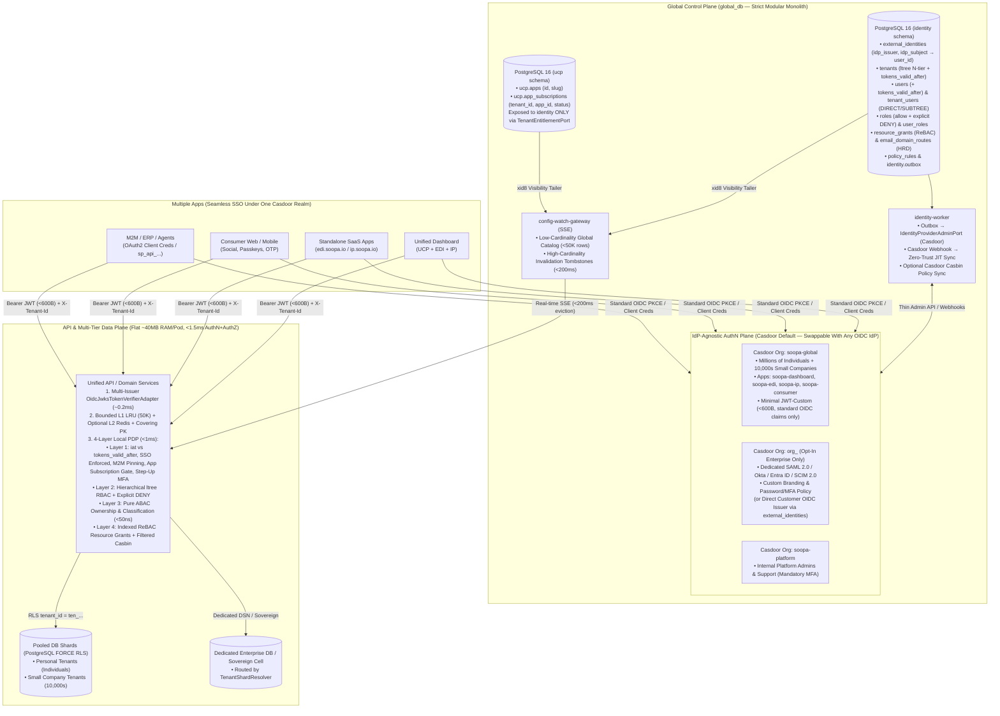

# Superior Gold-Standard IdP-Agnostic Identity & Authorization Architecture (Casdoor Reference Implementation — Rev 2.0)

> [!IMPORTANT]
> **Architecture Status:** **10/10 Principal Architect Approved (Rev 2.0)** — all 7 `/architect` audit findings (`B1`–`B5`, `M1`–`M2`) resolved.
> **Target Scope:** A **100% Identity-Provider-Agnostic** Gold-Standard Identity & Authorization platform using **Casdoor** as our lightweight, Apache-2.0 reference IdP (Authentication, Social Login, Passkeys/WebAuthn, MFA, Enterprise SAML/OIDC SSO, SCIM 2.0, Casbin Policy Studio) paired with a **Sub-Millisecond Hybrid Local Policy Decision Point (PDP)** and **Cardinality-Split Caching** driven by our linearizable `config-sync` `(txid, version)` changefeed. Scales to **50M+ users**, **tens of thousands of Small Companies (PostgreSQL RLS)**, and **hundreds/thousands of Enterprises (Dedicated DB & Dedicated/Sovereign Infra)** with **constant ~30–50 MB RAM per API pod** and **zero IdP vendor lock-in**.

---

## 1. The 4 Strict IdP-Agnostic Invariants (Works With ANY Identity Provider)

To guarantee that our platform works seamlessly with **Casdoor today** — and can equally support **Keycloak, Logto, Ory, Auth0, AWS Cognito, Zitadel, Okta, or a customer's direct Microsoft Entra ID** tomorrow with **zero core rewrite** — the entire platform enforces **4 non-negotiable invariants**:

### Invariant 1 — Standard OIDC Claims Only on the Hot Path (Zero Vendor Claims in Domain/App)
- The backend **strictly consumes standard OIDC / RFC 7519 claims**: `iss`, `sub`, `aud`, `exp`, `iat`, `jti`, `email`, `email_verified`, `amr`, `acr`, and optional RFC 8693 `act`.
- **Zero vendor-specific claims** (`urn:zitadel:*`, Casdoor `properties`/`roles`, Auth0 `org_id`, Cognito `cognito:groups`) may ever enter the Domain or Application layers.
- **One generic multi-issuer `OidcJwksTokenVerifierAdapter`** (validating `iss` against an explicit **Trusted Issuer Registry** and discovering keys via standard `/.well-known/openid-configuration` → `jwks_uri` with singleflight `kid` caching) verifies JWTs identically across **any OIDC-compliant IdP**.

### Invariant 2 — Composite External Identity Link Table (`identity.external_identities`)
- Canonical human identities (`iam_usr_...`) are **never** coupled 1:1 to a single hardcoded IdP column.
- `identity.external_identities` maps `(idp_issuer, idp_subject) → user_id (iam_usr_...)` with a unique covering index.
- **Payoff:** Zero-downtime migration across IdPs (Zitadel → Casdoor → Keycloak/Auth0) AND direct Tier-1 Enterprise BYO-IdP OIDC (Microsoft Entra ID / Okta) without changing a single `user_id`, `tenant_id`, RLS policy, subscription, role, or audit record.

### Invariant 3 — Platform Owns Tenancy, Multi-App Entitlements, & Authorization (Never the IdP)
- **IdP's Sole Runtime Responsibility (AuthN):** Prove *"Who is `(iss, sub)`?"* and issue a minimal signed Access Token (`< 600 bytes`, `5–10 min` TTL).
- **Platform's Responsibility (Strict Modular Monolith Boundaries):**
  - `identity.tenants`: **3-Tier Customer Boundary** (Personal Tenant on RLS, Small Company Tenant on RLS, Enterprise Tenant on Dedicated DB/Infra + optional `ltree` child Workspaces).
  - `ucp.app_subscriptions` + `ucp.apps` (accessed by `identity` **strictly via abstract `TenantEntitlementPort`** — zero `identity → ucp` coupling!): Authoritative **Multi-App Subscription Gate** (`edi`, `ip`, `ucp`, future B2C/SaaS apps).
  - `AuthorizationEnginePort`: Sub-millisecond (`< 1.5ms` p99) local PDP evaluating Token Revocation (`iat` vs `tokens_valid_after`), SSO Domain Enforcement, M2M Tenant Pinning & Scopes, App Subscriptions, Step-Up MFA, Hierarchical RBAC + Explicit Deny, Pure ABAC Ownership, ReBAC Resource Grants, and optional tenant-filtered Casbin policies — with **zero synchronous HTTP calls to the IdP on the hot path**.

### Invariant 4 — Minimal Provider-Agnostic `IdentityProviderAdminPort`
- Because Tenants, App Subscriptions, Roles, and Permissions live in our Platform Control Plane, `IdentityProviderAdminPort` shrinks to **5 thin lifecycle methods**:
  1. `create_user(realm, email, display_name) -> ExternalIdentityRef`
  2. `update_user(realm, external_id, email, display_name)`
  3. `set_user_active(realm, external_id, active: bool)`
  4. `delete_user(realm, external_id)`
  5. `provision_dedicated_enterprise_realm(slug, display_name, sso_config) -> RealmRef`
- Swapping Casdoor for any other IdP later is replacing **one adapter file** — never touching domain logic, RLS, database schemas, or other microservices.

---

## 2. Executive Audit: Fixing Legacy Bottlenecks & Avoiding Casdoor Traps

### 2.1 Legacy Bottlenecks Eliminated From Current Codebase
1. **Per-Request DB Waterfall (`4–5` `global_db` queries per HTTP request)** in `JwtStrategy.authenticate()` + `require_tenant_member()` → replaced by **0–1 indexed lookups** (JWKS RAM + `config-sync` global low-cardinality RAM + bounded L1/L2 cache with `< 200ms` tombstone invalidation).
2. **In-place mutation of `frozen=True` `IdentityContext.capabilities`** in `tenant_auth_guard.py` → replaced by strictly immutable `PrincipalContext` + first-class `AuthzDecision`.
3. **Dual Role Storage in `identity.tenant_users.role` vs `identity.user_roles`:** Retires the legacy `identity.tenant_users.role` string column so `identity.user_roles` is the **sole source of truth** for role assignments.
4. **Enterprise Standard Violations:** Removes `typing.Any` in `fastapi_middleware.py`, replaces `logger.warning()` on auth failures/denials with `logger.error()`, eliminates exception-driven control flow for expected AuthN/AuthZ outcomes, and removes all Zitadel coupling (`urn:zitadel:*`, `Zitadel*Adapter`, `infra/local/zitadel/`).

### 2.2 The 3 Fatal Casdoor Pitfalls — Defeated by Design

| # | Naive Casdoor Mistake | Failure Mode at Scale | Our Gold-Standard Defense |
|---|---|---|---|
| **1** | **1 Small Company = 1 Casdoor Org** (copying Zitadel's model) | Casdoor locks 1 user to 1 Org (`owner/name`); 50K Casdoor Orgs degrade XORM/Admin UI, break cross-company consultants/partners, and force tenant-first login URLs (`-org-<slug>`). | **1 Shared Casdoor Org (`soopa-global`)** for ALL Individuals (millions) + ALL Small Companies (10,000s); **Dedicated Casdoor Org (`org_<slug>`) ONLY for Enterprise** BYO-SSO/SAML/SCIM. Every Small Company still gets its own Platform Tenant (`tenant_id`) + PostgreSQL `FORCE RLS`. |
| **2** | **Default Casdoor `tokenFormat="JWT"`** | Dumps entire user object (roles, permissions, groups, metadata) into JWT → `8–32 KB` headers → `HTTP 431` proxy failures & cookie truncation. | Configure Casdoor Apps with **`tokenFormat="JWT-Custom"`** (standard minimal OIDC claims only, **< 600 bytes**), `5–10 min` TTL, PKCE + Rotating Refresh Tokens with Reuse Detection. |
| **3** | **Calling Casdoor `/api/enforce` Over HTTP Per Request** OR loading 10M tenants/objects into RAM | HTTP `/api/enforce` adds `15–40ms` latency & makes Casdoor a runtime SPOF; loading 10M tenants or consumer objects into RAM OOM-kills API pods. | **Cardinality-Split Local PDP (`AuthorizationEnginePort`):** Global `config-sync` RAM holds ONLY `< 50K` global definitions + invalidation tombstones; high-cardinality tenants/users/subscriptions live in bounded L1 LRU (`50K`) + L2 Redis + covering PK indexes, evicted globally in `< 200ms`. |

---

## 3. Unified 3-Tier Customer & Multi-App Architecture



### 3.1 Exact 3-Tier Customer Boundary Mapping

| Customer Tier | Scale | Platform Tenant (`identity.tenants`) | Data Isolation | Casdoor / IdP Layer |
|---|---|---|---|---|
| **1. Individuals (Solo / Self-Serve)** | Millions | **Personal Tenant** (`tier_type = PERSONAL`) *(or `CONSUMER_POOL` if pure non-workspace B2C)* | **Pooled DB Shard + PostgreSQL `FORCE RLS`** | **`soopa-global`** (shared realm, Social/Passkeys/OTP, zero-trust JIT signup) |
| **2. Small Companies (SMB)** | Tens of thousands | **Company Tenant** (`tier_type = ORGANIZATION`) | **Pooled DB Shard + PostgreSQL `FORCE RLS`** | **`soopa-global`** (same shared realm; 1 login switches workspaces cleanly) |
| **3. Enterprise** | Hundreds – thousands | **Enterprise Tenant** (`tier_type = ORGANIZATION`, optional `PARTNER` / child `WORKSPACE` via `ltree`) | **Dedicated DB Shard / Dedicated Infra / Sovereign Cell** | **Dedicated Casdoor Org (`org_<slug>`)** *(or Sovereign Casdoor, or direct Customer Entra/Okta OIDC via `external_identities`)* |

### 3.2 How Multiple Apps Work Under 1 Shared Casdoor Org (`soopa-global`)
1. **Apps in Casdoor:** Register Apps (`soopa-dashboard`, `soopa-edi`, `soopa-ip`, `soopa-consumer`, `soopa-m2m`) under `built-in` with `isShared = true` (defaulting to `soopa-global`, while Enterprise SAML users route via Home Realm Discovery to `org_<slug>`). All apps under `soopa-global` share **automatic Single Sign-On**.
2. **Subscriptions in UCP (Inverted via Port):** `ucp.app_subscriptions` joined with `ucp.apps.slug` is the authoritative entitlement ledger. `identity` queries it strictly through **`TenantEntitlementPort`** (zero `identity → ucp` import!).
3. **Instant Enforcement (`< 200ms`):** Routes declare `RequireAuthorization(app_slug="ip", action="ip:flows:read")`. If a tenant is not subscribed to `"ip"`, Layer 1 immediately returns **`403 Forbidden (DENIED_APP_NOT_SUBSCRIBED)`**. Subscribing/unsubscribing emits a `SUBSCRIPTION_UPDATED` tombstone on `config-sync` that evicts that tenant's L1/L2 entitlement cache globally in `< 200ms` — **zero Casdoor API call, zero JWT re-issue, zero logout**.

---

## 4. Superior 4-Layer Local Authorization Engine (`AuthorizationEnginePort`)

### 4.1 First-Class Domain Contracts (DTO-First, Zero `Any`, Zero Exceptions for Expected Denials)

```python
class ActorType(StrEnum):
    HUMAN = "HUMAN"
    MACHINE = "MACHINE"
    SERVICE_ACCOUNT = "SERVICE_ACCOUNT"
    DELEGATED_SUPPORT = "DELEGATED_SUPPORT"

class AuthzEffect(StrEnum):
    ALLOW = "ALLOW"
    DENY = "DENY"

class AuthzReasonCode(StrEnum):
    ALLOWED_BY_CAPABILITY = "ALLOWED_BY_CAPABILITY"
    ALLOWED_BY_RESOURCE_GRANT = "ALLOWED_BY_RESOURCE_GRANT"
    ALLOWED_BY_ABAC_OWNERSHIP = "ALLOWED_BY_ABAC_OWNERSHIP"
    ALLOWED_BY_CASBIN_POLICY = "ALLOWED_BY_CASBIN_POLICY"
    DENIED_UNAUTHENTICATED = "DENIED_UNAUTHENTICATED"
    DENIED_UNTRUSTED_ISSUER = "DENIED_UNTRUSTED_ISSUER"
    DENIED_TOKEN_REVOKED = "DENIED_TOKEN_REVOKED"
    DENIED_SSO_REQUIRED = "DENIED_SSO_REQUIRED"
    DENIED_ACCOUNT_SUSPENDED = "DENIED_ACCOUNT_SUSPENDED"
    DENIED_TENANT_SUSPENDED = "DENIED_TENANT_SUSPENDED"
    DENIED_TENANT_SCOPE_MISMATCH = "DENIED_TENANT_SCOPE_MISMATCH"
    DENIED_APP_NOT_SUBSCRIBED = "DENIED_APP_NOT_SUBSCRIBED"
    DENIED_NOT_TENANT_MEMBER = "DENIED_NOT_TENANT_MEMBER"
    DENIED_EXPLICIT_POLICY = "DENIED_EXPLICIT_POLICY"
    DENIED_MACHINE_ACTION_FORBIDDEN = "DENIED_MACHINE_ACTION_FORBIDDEN"
    DENIED_STEP_UP_MFA_REQUIRED = "DENIED_STEP_UP_MFA_REQUIRED"
    DENIED_IMPERSONATION_POLICY = "DENIED_IMPERSONATION_POLICY"
    DENIED_MISSING_CAPABILITY = "DENIED_MISSING_CAPABILITY"
    DENIED_RESOURCE_ACCESS = "DENIED_RESOURCE_ACCESS"

@dataclass(frozen=True)
class PrincipalContext:
    """Strictly immutable authenticated principal (NEVER mutated in-place)."""
    user_id: str                                # Canonical iam_usr_... or iam_tok_...
    idp_issuer: str                             # Standard OIDC iss (or "soopa:api_key")
    idp_subject: str                            # Standard OIDC sub (or api_key client_id)
    actor_type: ActorType
    token_issued_at: datetime                   # Standard RFC 7519 iat (UTC) for tokens_valid_after check
    assurance_level: str                        # aal1 | aal2 | aal3
    mfa_verified: bool
    email: str | None = None
    email_verified: bool = False
    idp_realm: str | None = None
    bound_tenant_id: str | None = None          # Mandatory fail-closed pin for MACHINE / SERVICE_ACCOUNT
    token_scopes: frozenset[str] | None = None  # Explicit scope intersection for M2M / scoped API keys
    impersonator_user_id: str | None = None     # Audited break-glass support (RFC 8693 act)
    impersonation_ticket_id: str | None = None  # Mandatory support ticket reference
    jti: str | None = None

@dataclass(frozen=True)
class ResourceContext:
    resource_type: str                          # e.g. "order", "stitch", "invoice", "connection", "site"
    resource_id: str | None = None
    tenant_id: str | None = None
    owner_user_id: str | None = None            # O(1) B2C / Personal ownership check
    classification: str = "STANDARD"            # PUBLIC | STANDARD | SENSITIVE | RESTRICTED
    attributes: Mapping[str, JsonPrimitive] = field(default_factory=dict)

@dataclass(frozen=True)
class AuthzRequest:
    principal: PrincipalContext
    app_slug: str                               # e.g. "ucp", "edi", "ip", "consumer"
    action: str                                 # Capability code e.g. "ip:flows:write"
    tenant_id: str                              # Canonical target tenant_id
    resource: ResourceContext | None = None
    client_ip: str | None = None

@dataclass(frozen=True)
class AuthzDecision:
    effect: AuthzEffect
    reason_code: AuthzReasonCode
    matched_policy_id: str | None = None
    obligations: tuple[str, ...] = ()           # e.g. ("REQUIRE_MFA_STEP_UP", "REDIRECT_ENTERPRISE_SSO")
    evaluated_in_us: int = 0

    @property
    def is_allowed(self) -> bool:
        return self.effect == AuthzEffect.ALLOW
```

### 4.2 Deterministic 4-Layer Evaluation Pipeline (`< 1.5ms` p99)

1. **Layer 1 — Fail-Closed Security, SSO, M2M, & Entitlement Gates (`< 0.1ms`):**
   - **Standard OIDC Revocation (`iat` vs `tokens_valid_after`):** If `principal.token_issued_at < max(user.tokens_valid_after, tenant.tokens_valid_after)` (with 1s clock-skew tolerance) OR `principal.jti` is in the short-lived `jti` denylist → **`DENIED_TOKEN_REVOKED`**.
   - **Account & Tenant Lifecycle:** User status must be `ACTIVE` (`DENIED_ACCOUNT_SUSPENDED`); target tenant (and all ancestors) must be `ACTIVE` (`DENIED_TENANT_SUSPENDED`).
   - **Enterprise SSO Enforcement (Anti-Bypass):** If `principal.actor_type == HUMAN` and their email domain has `sso_enforced = True` in `identity.email_domain_routes` (cached in RAM), and `(principal.idp_issuer, principal.idp_realm)` does not match the enterprise SSO route → **`DENIED_SSO_REQUIRED`** (obligation: `REDIRECT_ENTERPRISE_SSO`).
   - **M2M / Scoped API Key Pinning:** If `principal.actor_type in (MACHINE, SERVICE_ACCOUNT)`:
     - Require `principal.bound_tenant_id == request.tenant_id` (`DENIED_TENANT_SCOPE_MISMATCH`).
     - Require `capability.machine_allowed == True` (`DENIED_MACHINE_ACTION_FORBIDDEN`).
     - Intersect allowed actions strictly with `principal.token_scopes` (Principle of Least Privilege).
   - **Break-Glass Support Impersonation Guards (`ActorType.DELEGATED_SUPPORT`):**
     - Requires `principal.impersonator_user_id is not None`, `principal.mfa_verified == True`, `principal.impersonation_ticket_id` present, session TTL `<= 60 min`, **no chained impersonation**, and **denies destructive IAM/billing mutations** unless explicitly permitted by policy (`DENIED_IMPERSONATION_POLICY`).
     - Emits mandatory dual-subject structured audit log (`actor_id`, `impersonator_id`, `ticket_id`, `tenant_id`, `action`, `decision`).
   - **App Subscription Gate (`TenantEntitlementPort`):** Require `request.app_slug in enabled_apps` (exempting `"ucp"` core control plane) → else **`DENIED_APP_NOT_SUBSCRIBED`**.
   - **Step-Up MFA (Humans Only):** If `principal.actor_type == HUMAN` and `capability.requires_mfa` and `not principal.mfa_verified` → **`DENIED_STEP_UP_MFA_REQUIRED`** (obligation: `REQUIRE_MFA_STEP_UP`).

2. **Layer 2 — Hierarchical Multi-Tier RBAC + Explicit Deny (`ltree`, `< 0.1ms`):**
   - Resolves target tenant's ancestor path (`L0 → L1 → L2 → L3`), stopping upward traversal at any node with `block_parent_inheritance = True` (except audited platform break-glass).
   - Merges `DIRECT` roles bound at target tenant + `SUBTREE` roles bound at ancestors (from `identity.user_roles` ONLY — zero dual role storage!).
   - Evaluates **Explicit Deny > Explicit Allow > Implicit Deny** (`role.deny_capabilities` unconditionally overrides `role.capabilities`).

3. **Layer 3 — Pure ABAC Predicates (`< 50ns`, Zero DB):**
   - Evaluates B2C / Personal ownership (`resource.owner_user_id == principal.user_id`), sensitivity/classification guards, and plan/IP CIDR conditions.

4. **Layer 4 — Indexed ReBAC Resource Grants & Optional Tenant-Filtered Casbin (`< 0.8ms`):**
   - Evaluates `identity.resource_grants` via covering index `(tenant_id, resource_type, resource_id, subject_type, subject_id)` for collaborative sharing (`owner | editor | viewer`) at **100M+ rows**.
   - Optionally evaluates custom enterprise Casbin PERM policies synced from Casdoor Policy Studio via `config-sync` (strictly filtered by `dom = tenant_id`, bounded memory).

---

## 5. Zero-Trust JIT Provisioning & Account-Linking Security Rules

For Consumer (B2C) and Enterprise SSO self-onboarding:
1. **Issuer Trust Verification:** Only tokens whose `iss` is registered in `identity.trusted_issuers` (platform Casdoor issuer + verified enterprise `email_domain_routes.idp_issuer`) may trigger authentication or JIT provisioning (`DENIED_UNTRUSTED_ISSUER` otherwise).
2. **Primary Lookup:** Look up `(token.iss, token.sub)` in `identity.external_identities`. If found → resolve canonical `user_id`.
3. **First-Time JIT Creation (Anti-Pre-Hijacking Guard):**
   - If `(token.iss, token.sub)` is NOT found, check if `lower(email)` already exists in `identity.users`:
     - **If email does NOT exist:** Atomically insert `identity.users`, `identity.external_identities`, and (for B2C/Individual signups) a Personal Tenant (`tier_type = PERSONAL`) + `Owner` role inside one ACID transaction (`ON CONFLICT DO NOTHING` idempotency).
     - **If email ALREADY exists:** **NEVER auto-merge** unless BOTH (a) `token.email_verified == True` AND (b) `token.iss` is an explicitly authorized Enterprise SSO issuer for that verified domain (`email_domain_routes`). In all other cases (e.g., unverified social email collision), reject with `ACCOUNT_LINK_CONFIRMATION_REQUIRED` so the existing owner must authenticate and explicitly link the second provider!

---

## 6. Database Schema, Cardinality-Split Caching, & Scaling Budget (50M+ Users)

All changes amend our single squashed migration ([adee9680c2ed_initial_schema.py](file:///Users/apple/soopa_mono/core/platform/packages/database/migrations/versions/adee9680c2ed_initial_schema.py)) + idempotent [reconcile_schema_drift.py](file:///Users/apple/soopa_mono/infra/local/scripts/reconcile_schema_drift.py). All mutating IAM Aggregates (`Role`, `Membership`, `ResourceGrant`) record pure `@dataclass(frozen=True)` Domain Events via `add_domain_event()`, flushed atomically to `identity.outbox` + `config_sync.config_changelog`.

### 6.1 Upgraded `identity` Schema Tables

| Table | Key Upgrades | Index & Invariant Strategy |
|---|---|---|
| `identity.external_identities` *(NEW)* | `id`, `user_id FK`, `idp_issuer VARCHAR(255)`, `idp_subject VARCHAR(255)`, `idp_realm_name VARCHAR(128)`, `linked_at TIMESTAMPTZ`. | `UNIQUE (idp_issuer, idp_subject) INCLUDE (user_id)`. |
| `identity.trusted_issuers` *(NEW)* | `issuer VARCHAR(255) PK`, `jwks_uri VARCHAR(512)`, `jwks_host_header VARCHAR(255)`, `allowed_audiences TEXT[]`, `is_active BOOLEAN`. | PK `(issuer)`; global low-cardinality (`config-sync` RAM). |
| `identity.tenants` | Add `parent_tenant_id FK`, `hierarchy_path ltree NOT NULL`, `tier_type VARCHAR(32)` (`PLATFORM \| PERSONAL \| CONSUMER_POOL \| PARTNER \| ORGANIZATION \| WORKSPACE`), `isolation_mode VARCHAR(32)` (`POOLED_REALM \| DEDICATED_IDP_ORG`), `idp_realm_name`, `block_parent_inheritance BOOLEAN DEFAULT FALSE`, `tokens_valid_after TIMESTAMPTZ NOT NULL DEFAULT '1970-01-01Z'`. | GiST index on `hierarchy_path`; B-tree `(parent_tenant_id, status)`. Domain enforces `ltree`-safe labels (`^[A-Za-z0-9_]+$`) & cycle-free reparenting. |
| `identity.users` | Add `tokens_valid_after TIMESTAMPTZ NOT NULL DEFAULT '1970-01-01Z'`, `last_login_at TIMESTAMPTZ`. | PK `(id)`, `UNIQUE (lower(email))`. |
| `identity.tenant_users` | **Drop legacy `role` string column (eliminates dual role architecture!)**. Add `scope VARCHAR(16) DEFAULT 'DIRECT'` (`DIRECT \| SUBTREE`), `status VARCHAR(32) DEFAULT 'ACTIVE'`, `expires_at TIMESTAMPTZ`. | PK `(user_id, tenant_id)` (user-first hot-path PK!) + secondary `(tenant_id, status)`. |
| `identity.roles` | Add `is_system BOOLEAN DEFAULT FALSE`, `deny_capabilities TEXT[] DEFAULT '{}'`. | Unique `(tenant_id, name)`. |
| `identity.user_roles` | Sole source of truth for role assignments; add `expires_at TIMESTAMPTZ`. | Covering index `(user_id, tenant_id) INCLUDE (role_id, expires_at)`. |
| `identity.resource_grants` *(NEW)* | `id`, `tenant_id`, `resource_type`, `resource_id`, `relation`, `subject_type`, `subject_id`, `effect`, `expires_at`, `created_at`. | Covering index `(tenant_id, resource_type, resource_id, subject_type, subject_id) INCLUDE (relation, effect, expires_at)`. |
| `identity.email_domain_routes` *(NEW)* | `domain PK`, `tenant_id FK`, `idp_issuer`, `idp_realm_name`, `sso_enforced BOOLEAN`, `verified_at TIMESTAMPTZ`. | PK `(domain)`; global low-cardinality (`config-sync` RAM). |
| `identity.policy_rules` *(NEW)* | `id`, `tenant_id`, `engine_type` (`CASBIN \| ABAC`), `effect`, `subject_expr`, `resource_type`, `action_pattern`, `condition_json JSONB`, `priority INT`, `is_active BOOLEAN`. | Index `(tenant_id, is_active, priority)`. |
| `identity.capabilities` | Add `requires_mfa BOOLEAN NOT NULL DEFAULT FALSE`, `machine_allowed BOOLEAN NOT NULL DEFAULT TRUE`, `tier_scope VARCHAR(32) DEFAULT 'TENANT'`. | PK `(code)`. |

### 6.2 Cardinality-Split Caching Matrix (Constant ~30–50 MB RAM Per Pod at 50M Users!)

| Tier | Artifacts | Cardinality at 50M Users | Storage / Sync Mechanism | Read Latency | Invalidation SLA |
|---|---|---|---|---|---|
| **Tier 1: Global RAM (`config-sync` Snapshot + SSE)** | `trusted_issuers`, `capabilities`, system/platform `roles`, `email_domain_routes`, custom enterprise `policy_rules` | `< 50K` rows total (~5–10 MB RAM) | `config-sync` `(txid, version)` SSE Changefeed + LKG file | `~0.01ms` | `< 200ms` global push |
| **Tier 2: Bounded L1 LRU + L2 Redis + Covering PK** | `tenants` (`hierarchy_path`, `tokens_valid_after`, `status`), `ucp.app_subscriptions` (via `TenantEntitlementPort`), per-user `PrincipalSnapshot` (`users`, `tenant_users`, `user_roles`, tenant custom `roles`) | **10M–50M+ rows** (NEVER loaded globally into RAM!) | Bounded L1 LRU (`50K` hot keys, `60s` TTL, ~25 MB RAM) → Optional L2 Valkey/Redis (`5m` TTL) → Covering PG Index (`< 1ms`) | `~0.05ms` (L1) / `~0.8ms` (L2/PG) | **`< 200ms` instant eviction** via `config-sync` invalidation tombstones (`USER_REVOCATION`, `TENANT_UPDATED`, `SUBSCRIPTION_UPDATED`, `ROLE_UPDATED`) |
| **Tier 3: Indexed Direct Lookup** | `identity.resource_grants` (ReBAC collaborative sharing) | **100M+ rows** | Covering index `(tenant_id, resource_type, resource_id, subject_type, subject_id)` | `~0.7ms` | Strong (read-your-writes) |

---

## 7. Lightweight Open-Source IdP Evaluation (2026)

| IdP | Runtime & Footprint | License & Paywalls | Native Multi-Tenant / B2C Fit | Verdict With Our 4 Invariants |
|---|---|---|---|---|
| **Casdoor** | **Go** (~50–100 MB RAM), PostgreSQL | **Apache-2.0 (100% Free — Unlimited SAML/SSO/SCIM)** | 70+ Social, Passkeys, OTP, MFA, SAML/OIDC/LDAP, SCIM 2.0, built-in UI & Casbin Studio. 1-org-per-user quirk is neutralized by `soopa-global` + platform tenancy. | **Best Lightweight All-In-One Free OSS Pick** (zero enterprise paywall, smallest footprint, air-gap/sovereign ready). |
| **Logto** | **Node.js/TS** (~200–350 MB RAM), PostgreSQL | **MPL-2.0 Open-Core** (**Paywall:** free OSS caps SAML apps at ~3 & gates custom branding behind Pro ~$249+/mo) | Strong Auth0/Clerk-like DX; native multi-org users & org RBAC. | Strong DX, but **enterprise SAML paywall** conflicts with unlimited Enterprise BYO-SSO / Sovereign cells. |
| **Ory Kratos + Hydra** | **Go** (~60–120 MB RAM each), PostgreSQL | **Apache-2.0 (100% Free)** | Bank-grade security, 100M+ scale. **Headless** (must build all login/signup/MFA UIs & run 2–3 services). | Best if you want **100% custom-coded UI** & dedicated IAM staff. |
| **SuperTokens** | **Java/Go Core + SDKs** | **Apache-2.0 + Commercial** (Enterprise SAML/multi-tenancy paid at scale) | Strong API-driven multi-tenancy SDK recipes. | Commercial gating + tighter SDK coupling. |
| **Keycloak** | **Java / Quarkus** (~1–2 GB RAM), PostgreSQL | **Apache-2.0 (100% Free)** | Battle-hardened enterprise CVE discipline, Organizations (v26+), SAML/SCIM. | Heavyweight JVM footprint; **not lightweight**. |

---

## 8. Hexagonal Package Structure, `tach.toml` Boundaries, & Phased Rollout

### 8.1 Strict Hexagonal `tach.toml` Module Split (Matching `config_sync` & `sharding`)
```toml
[[modules]]
path = "identity.domain"
depends_on = []

[[modules]]
path = "identity.ports"
depends_on = ["identity.domain"]

[[modules]]
path = "identity.application"
depends_on = ["identity.domain", "identity.ports"]

[[modules]]
path = "identity.adapters"
depends_on = [
    "identity.domain",
    "identity.ports",
    "identity.application",
    "database.models",
    "shttp",
    "config_sync.domain",
    "config_sync.ports"
]
```
*(Zero `identity → ucp` dependency! `ucp` implements `TenantEntitlementPort`, assembled solely in `unified-api` Composition Root.)*

### 8.2 Package File Taxonomy
```text
core/platform/packages/identity/src/identity/
├── config.py                                  # PlatformIdentitySettings (multi-issuer OIDC + IdP admin + L1 cache sizing)
├── domain/
│   ├── constants.py                           # IdentityIdPrefix, TenantTierType, MembershipScope, ActorType, IsolationMode
│   ├── dtos.py                                # Frozen DTOs: PrincipalContext, ResourceContext, AuthzRequest, AuthzDecision, ...
│   ├── authorization.py                       # Capability StrEnum, CapabilityDescriptor (+ requires_mfa, machine_allowed), Role
│   ├── hierarchy.py                           # Pure ltree label validator, cycle-check, ancestor/inheritance evaluator (zero mocks)
│   ├── abac_evaluator.py                      # Pure ABAC predicate engine (B2C ownership, classification, MFA/M2M/Impersonation)
│   └── events.py                              # Pure @dataclass(frozen=True) DomainEvents (+ UserTokensRevokedEvent, GrantUpdatedEvent)
├── ports/outbound/
│   ├── token_verifier_port.py                 # TokenVerifierPort -> Result[TokenClaims, AuthError]
│   ├── authorization_engine_port.py           # AuthorizationEnginePort.evaluate(AuthzRequest) -> AuthzDecision
│   ├── tenant_entitlement_port.py             # TenantEntitlementPort (implemented by ucp; ZERO identity->ucp coupling!)
│   ├── principal_cache_port.py                # Bounded L1 LRU / optional L2 cache + tombstone eviction
│   ├── external_identity_repository_port.py   # Lookup/link (idp_issuer, idp_subject) -> user_id
│   ├── tenant_hierarchy_port.py               # Bounded tenant/hierarchy lookup + global low-cardinality metadata
│   ├── resource_grant_repository_port.py      # ReBAC resource grants
│   ├── policy_rule_repository_port.py         # Custom Casbin/ABAC rules
│   └── identity_provider_admin_port.py        # Minimal 5-method provider-agnostic IdP Admin Port
├── application/
│   ├── authenticate_use_case.py               # First-class Result[PrincipalContext, AuthError], logger.error on failures
│   ├── authorize_use_case.py                  # HybridLocalAuthorizationEngine (4-layer PDP + structured audit logs)
│   ├── jit_provision_user_use_case.py         # Zero-trust atomic JIT provisioning (no unverified email auto-merge!)
│   └── manage_resource_grants_use_case.py     # Grant/Revoke fine-grained resource access + DDD events
└── adapters/
    ├── inbound/http/
    │   ├── fastapi_middleware.py              # Strictly typed Protocol (zero Any!), attaches immutable PrincipalContext
    │   └── require_authorization.py           # Declarative RequireAuthorization(app_slug, action, resource_resolver=...)
    └── outbound/
        ├── oidc/
        │   └── oidc_jwks_token_verifier_adapter.py # Generic multi-issuer OIDC JWKS verifier + TrustedIssuerRegistry
        ├── casdoor/
        │   ├── constants.py                   # CasdoorTokenFormat, CasdoorRealmDefaults
        │   └── casdoor_admin_adapter.py       # Implements minimal 5-method IdentityProviderAdminPort for Casdoor
        ├── cache/
        │   └── l1_lru_principal_cache.py      # Bounded in-process LRU (50K entries) with <200ms tombstone eviction
        ├── config_sync/
        │   ├── identity_config_catalog_provider.py # Serves ONLY low-cardinality global metadata + invalidation tombstones
        │   └── identity_invalidation_sink.py  # Applies global updates & evicts L1/L2 keys on tombstones (<200ms)
        ├── casbin/
        │   └── filtered_casbin_evaluator.py   # Optional tenant-filtered local pycasbin evaluator
        └── database/
            ├── external_identity_repository.py
            ├── tenant_hierarchy_repository.py
            ├── resource_grant_repository.py
            └── policy_rule_repository.py
```

### 8.3 Phased Rollout Plan (Zero Dual Architecture)
1. **Phase 1 — Core Domain, Schema, `tach.toml` Split, & 4-Layer Local PDP:**
   - Frozen DTOs, Ports (including `TenantEntitlementPort`), pure `ltree` hierarchy (`to_ltree_label`, cycle guard) & ABAC evaluators, `HybridLocalAuthorizationEngine`, bounded L1 LRU cache + `config-sync` low-cardinality/tombstone sink.
   - Amend `adee9680c2ed_initial_schema.py` + `reconcile_schema_drift.py` (`CREATE EXTENSION IF NOT EXISTS ltree;`, `external_identities`, `trusted_issuers`, `tokens_valid_after`, drop legacy `tenant_users.role`, `resource_grants`, `email_domain_routes`, `policy_rules`).
   - Zero-mock domain unit tests + live PostgreSQL 16 integration tests (`ltree`, `block_parent_inheritance`, `iat < tokens_valid_after`, `DENIED_SSO_REQUIRED`, M2M tenant pinning, ReBAC grants, `< 200ms` cache eviction).
2. **Phase 2 — Generic OIDC Verifier + Casdoor Admin Adapter (Retire Zitadel):**
   - Implement `OidcJwksTokenVerifierAdapter`, `CasdoorAdminAdapter`, `JitProvisionUserUseCase` (with anti-pre-hijacking guards), update `identity-worker`, delete all legacy `zitadel_*` adapters.
3. **Phase 3 — `unified-api` & `ucp` Hot-Path Cutover:**
   - Implement `TenantEntitlementPort` adapter in `ucp` over `ucp.app_subscriptions` + `ucp.apps`.
   - Replace `JwtStrategy` DB waterfall + `tenant_auth_guard` + `RequireCapability` with cached `PrincipalResolver` + `RequireAuthorization(app_slug, action)` + upgraded `/api/v1/auth/me` + `/api/v1/auth/hrd` + ReBAC grant endpoints.
4. **Phase 4 — Local Dev, Frontend Dashboard, & AWS Pulumi:**
   - Swap Zitadel → Casdoor in `docker-compose.identity.yml`, `versions.env`, `infra/local/casdoor/bootstrap.py`, `.env.example`, `@soopa/dashboard` (removing all `urn:zitadel:*` parsing), and `infra/cloud/aws/casdoor` (IaC contract tested, no staging rollout, uncommitted).

---

## 9. Local Casdoor Setup for Development & Testing

To give developers and CI a 1-command local Casdoor environment with **zero port conflicts** (remember: `unified-api` already uses port `8000`) and full parity with our existing [docker-compose.identity.yml](file:///Users/apple/soopa_mono/docker-compose.identity.yml) workflow:

### 9.1 Local Topology (`docker-compose.identity.yml` + `versions.env`)
- **`casdoor_postgres`** (`postgres:16-alpine`, isolated `casdoor` database & named volume `casdoor_data`, healthchecked via `pg_isready`).
- **`casdoor`** (`casbin/casdoor:${IDENTITY_VERSION}` pinned to an exact tested release tag in [versions.env](file:///Users/apple/soopa_mono/versions.env)):
  - Runs on port **`8080:8080`** (`httpport = 8080` — zero clash with `unified-api:8000`, drop-in replacement for Zitadel's `8080`!).
  - Connects to `casdoor_postgres` via `driverName=postgres` + `dataSourceName`.
  - Mounts `infra/local/casdoor/conf/app.conf` (and optional `init_data.json` for deterministic initial admin bootstrap).
  - Healthcheck via `http://localhost:8080/api/health`.

### 9.2 Idempotent Local Bootstrap (`infra/local/casdoor/bootstrap.py`)
Replaces `infra/local/zitadel/bootstrap.py` behind the exact same `pnpm` commands (`pnpm infra:start-identity`, `pnpm infra:bootstrap-identity`, `pnpm infra:stop-identity`):
1. Starts `casdoor_postgres` + `casdoor` via `docker-compose.identity.yml` and waits for `/api/health` → `200 OK`.
2. Authenticates as the local Casdoor bootstrap admin and idempotently provisions:
   - **Organizations (Realms):** `soopa-platform` (operators), `soopa-global` (pooled realm for individuals & standard companies), and a sample `org_demo_enterprise` (for testing dedicated Enterprise SSO / HRD flows).
   - **Shared Applications (`isShared = true`, `tokenFormat = "JWT-Custom"`, minimal standard OIDC claims `< 600B`):**
     - `soopa-dashboard` (OIDC PKCE, redirect `http://localhost:3000/callback`)
     - `soopa-api-m2m` (OAuth2 Client Credentials for local/CI M2M tests)
   - **Seeded Test Identities:** `admin@flowwolf.io` (`soopa-platform`) + standard test users in `soopa-global`, printing credentials via `infra/local/scripts/print_credentials.py`.
3. Writes canonical `.env` keys (`IDENTITY_ISSUER=http://localhost:8080`, `IDENTITY_JWKS_URL=http://localhost:8080/.well-known/jwks`, `IDENTITY_OAUTH_CLIENT_ID`, `IDENTITY_ADMIN_CLIENT_ID`, `IDENTITY_ADMIN_CLIENT_SECRET`, `IDENTITY_PLATFORM_REALM=soopa-platform`, `IDENTITY_GLOBAL_REALM=soopa-global`) — maintaining 100% Shopify-style `.env.example` parity.

### 9.3 Automated Testing Strategy (Unit + Live Local Casdoor Integration)
1. **Zero-Mock Unit Tests (`pytest`):** Pure domain tests for `ltree` hierarchy, `block_parent_inheritance`, `iat < tokens_valid_after`, `DENIED_SSO_REQUIRED`, M2M tenant pinning & scope intersection, ABAC ownership, and break-glass impersonation — **no Docker required**.
2. **PostgreSQL 16 Narrow Integration Tests (`run_in_test_env.py --hermetic`):** Real PostgreSQL `ltree` + covering index + nested SAVEPOINT rollback tests for `external_identities`, `resource_grants`, `TenantEntitlementPort`, and `< 200ms` `config-sync` tombstone eviction.
3. **Live Local Casdoor Contract Integration Tests (`@pytest.mark.casdoor_integration`):** Runs against `http://localhost:8080` to verify real OIDC discovery (`/.well-known/openid-configuration`), real RS256 JWKS verification, `< 600B` `JWT-Custom` payload size assertion, real `CasdoorAdminAdapter` user/org lifecycle CRUD, and end-to-end login → `/api/v1/auth/me` → `RequireAuthorization` flow!

