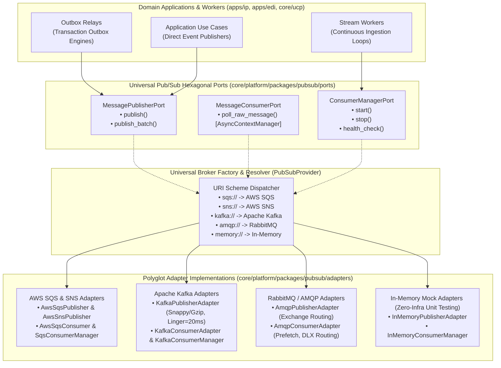

# Enterprise Multi-Broker Pub/Sub Platform Architecture

**Package:** `core/platform/packages/pubsub`  
**Status:** PROPOSED & APPROVED FOR REFACTORING  
**Version:** 3.0.0  
**Authors:** Soopa Platform Core & Integration Platform Architecture Teams  
**Target Date:** 2026-11-20  

---

## Executive Summary

Currently, `core/platform/packages/pubsub` is titled as a generic platform capability but is tightly coupled to **AWS SQS and AWS SNS**. As a result, bounded contexts (such as `apps/ip` and `apps/edi`) are forced to write and maintain duplicate messaging drivers for **Apache Kafka**, **RabbitMQ (AMQP)**, and **In-Memory** transports.

This design document establishes the architectural blueprint for refactoring `core/platform/packages/pubsub` into a **universal, vendor-neutral, polyglot messaging engine**. Bounded contexts will depend solely on abstract Hexagonal Ports (`MessagePublisherPort`, `MessageConsumerPort`, `ConsumerManagerPort`), while the centralized platform resolves concrete broker adapters dynamically via standard **URI scheme addressing** (`sqs://`, `sns://`, `kafka://`, `amqp://`, `memory://`).

---

## 1. Architectural Motivation & Violations Addressed

### 1.1 The Current Problem: Leaky Vendor Coupling
In `core/platform/packages/pubsub/src/pubsub/provider.py`:
```python
# Lines 20-25 of provider.py currently state:
# TODO(tech-debt): This provider is currently tightly coupled with AWS implementations
# (SQS/SNS). To achieve a true vendor-neutral Hexagonal Architecture, this class should
# be refactored to return generic publisher/consumer abstractions without leaking AWS
# specifics into the creation signatures, allowing seamless swapping to Google Pub/Sub
# or Kafka in the future.
```

### 1.2 Violations of `.agents/AGENTS.md` Standards
1. **Centralized Infrastructure Packages (No Duplicate Infrastructure):**
   - *Current State:* `apps/ip` maintains `kafka_subscribe_transport.py`, `amqp_subscribe_transport.py`, and `kafka_producer_adapter.py`.
   - *Target State:* All transport protocols belong strictly in `core/platform/packages/pubsub`. Bounded contexts never write raw queue pollers or socket connections.
2. **Hexagonal Architecture & Zero Adapter-to-Adapter Coupling:**
   - Business use cases and outbox relays must interact solely with abstract ports. Broker-specific dependencies (`aioboto3`, `aiokafka`, `aiormq`) are completely encapsulated within platform adapters.
3. **No Marketing Buzzwords / Enterprise Naming:**
   - Ad-hoc naming like `high_throughput_kafka_producer` is replaced with canonical capability naming: `KafkaPublisherAdapter`, `KafkaConsumerAdapter`.

---

## 2. High-Level Architectural Blueprint



---

## 3. Universal Destination Addressing (URI Scheme Standard)

All platform publishers, subscribers, and outbox routes are addressed via **standardized URIs**:

| URI Scheme | Target Broker | Typical Use Case | Example URI |
| :--- | :--- | :--- | :--- |
| `sqs://` | AWS SQS | Asynchronous point-to-point worker tasks | `sqs://edi-inbound-transactions` |
| `sns://` | AWS SNS | Fanout event distribution across microservices | `sns://arn:aws:sns:us-east-1:123456:events.fifo` |
| `kafka://` | Apache Kafka | High-throughput streaming, interval ingestion | `kafka://mdm.meter_readings.inbound` |
| `amqp://` | RabbitMQ | Low-latency transactional routing & DLX exchange | `amqp://exchange/orders.direct?routing_key=order.created` |
| `memory://` | Python `asyncio.Queue` | Fast unit testing with 0 external dependencies | `memory://test.inbound.queue` |

---

## 4. Contract Specifications & Hexagonal Ports

### 4.1 Message Envelope & Result DTOs

```python
"""Universal Pub/Sub Domain Models & DTOs (core/platform/packages/pubsub/domain)."""

from __future__ import annotations
from collections.abc import Awaitable, Callable, Mapping
from dataclasses import dataclass, field
from datetime import UTC, datetime
from enum import StrEnum
from seedwork.domain.types import JsonDict

class BrokerType(StrEnum):
    """Supported broker protocols."""
    SQS = "sqs"
    SNS = "sns"
    KAFKA = "kafka"
    AMQP = "amqp"
    MEMORY = "memory"

class ConsumerVerdict(StrEnum):
    """Consumer processing outcome."""
    ACK = "ACK"
    NACK = "NACK"
    REJECT = "REJECT"

@dataclass(frozen=True, slots=True)
class PublishResultDTO:
    """Outcome of writing an event/message to any broker."""
    destination_uri: str
    message_id: str
    partition: int | None = None
    offset: int | None = None
    timestamp_utc: datetime = field(default_factory=lambda: datetime.now(UTC))

class NackCallbackPort(Protocol):
    """Protocol for broker negative-acknowledgment with optional redelivery delay."""
    async def __call__(
        self,
        *,
        requeue: bool = True,
        visibility_timeout_seconds: int | None = None,
    ) -> None: ...

@dataclass(frozen=True, slots=True)
class AckableMessage:
    """Standardized broker-agnostic delivery envelope delivered to handlers."""
    payload: bytes | JsonDict
    headers: Mapping[str, str]
    key: bytes | None
    ack: Callable[[], Awaitable[None]]
    nack: NackCallbackPort
    destination_uri: str
    message_id: str
    partition: int | None = None
    offset: int | None = None
```

### 4.2 Universal Publisher Port (`MessagePublisherPort`)

```python
"""Universal Message Publisher Port (core/platform/packages/pubsub/ports)."""

from __future__ import annotations
from collections.abc import Mapping, Sequence
from typing import Protocol
from seedwork.domain.exceptions import Result
from seedwork.events import EventEnvelope

class MessagePublisherPort(Protocol):
    """Universal outbound port for publishing events or raw bytes to any broker."""

    async def publish(
        self,
        destination_uri: str,
        message: bytes | EventEnvelope,
        key: bytes | None = None,
        headers: Mapping[str, str] | None = None,
    ) -> Result[PublishResultDTO, Exception]:
        """Publishes a single message or EventEnvelope to the destination URI."""
        ...

    async def publish_batch(
        self,
        destination_uri: str,
        messages: Sequence[bytes | EventEnvelope],
        keys: Sequence[bytes | None] | None = None,
        headers: Sequence[Mapping[str, str] | None] | None = None,
    ) -> Result[tuple[PublishResultDTO, ...], Exception]:
        """Publishes a batch of messages with partial failure reporting."""
        ...
```

### 4.3 Universal Consumer Port & Manager (`ConsumerManagerPort`)

```python
"""Universal Consumer Manager Port (core/platform/packages/pubsub/ports)."""

from __future__ import annotations
from collections.abc import Awaitable, Callable
from typing import Protocol
from pubsub.domain.dtos import AckableMessage, ConsumerVerdict

MessageHandler = Callable[[AckableMessage], Awaitable[ConsumerVerdict | None]]

class ConsumerManagerPort(Protocol):
    """Autonomous background message pump polling a broker and dispatching to handlers."""

    async def start(self) -> None:
        """Starts the background worker pump."""
        ...

    async def stop(self) -> None:
        """Gracefully drains and stops the polling loop."""
        ...

    async def health_check(self) -> bool:
        """Returns True if the connection and polling loop are healthy."""
        ...
```

---

## 5. Polyglot Adapter Implementation Specifications

### 5.1 Apache Kafka Adapter (`KafkaPublisherAdapter` & `KafkaConsumerManager`)
- **Technology:** `aiokafka` (async, non-blocking).
- **Publisher Configuration:**
  - `compression_type`: `"snappy"` (with automatic `"gzip"` fallback).
  - `linger_ms`: `20` (enables high-throughput micro-batching across socket buffers).
  - `acks`: `"all"` (guarantees durability).
- **Consumer Configuration:**
  - `enable_auto_commit`: `False` (strict manual commit).
  - Offsets committed strictly **after** database transaction commit.

### 5.2 RabbitMQ / AMQP Adapter (`AmqpPublisherAdapter` & `AmqpConsumerManager`)
- **Technology:** `aiormq` or `aio_pika`.
- **Publisher Configuration:**
  - Confirms enabled (`publisher_confirms=True`).
  - Routes by exchange and routing key parsed from URI (`amqp://exchange/routing_key`).
- **Consumer Configuration:**
  - Prefetch count configured (e.g. `prefetch_count=50`).
  - Supports `nack(requeue=True)` for transient failures and `reject(requeue=False)` to route dead letters to Dead Letter Exchange (`soopa.dlx`).

### 5.3 In-Memory Adapter (`InMemoryPublisherAdapter` & `InMemoryConsumerManager`)
- **Technology:** Pure Python `asyncio.Queue`.
- **Primary Use Case:** Narrow unit and integration tests executing in $< 5\text{ms}$ with zero Docker containers, zero network, and zero mocks.

---

## 6. Centralized Provider Refactoring (`PubSubProvider`)

The refactored `PubSubProvider` acts as the universal composition root and resolver:

```python
class PubSubProvider:
    """Universal Platform Provider for Pub/Sub publishers, consumers, and background pumps."""

    @classmethod
    def create_publisher(cls, destination_uri: str | None = None) -> MessagePublisherPort:
        """Resolves the concrete publisher adapter based on URI scheme or default configuration."""
        ...

    @classmethod
    def create_consumer_manager(
        cls,
        source_uri: str,
        handler: MessageHandler,
        *,
        error_handler: ConsumerErrorHandlerPort | None = None,
        concurrency: int = 1,
    ) -> ConsumerManagerPort:
        """Creates an autonomous background consumer pump for SQS, Kafka, AMQP, or Memory."""
        ...
```

---

## 7. Enterprise Standardization & Legacy Deprecation

1. **Step 1 (Centralized Ports & Domain Models):**
   - Pure Domain Ports: `MessagePublisherPort`, `ConsumerManagerPort`, `AckableMessage`, and `BrokerType` in `core/platform/packages/pubsub`.
2. **Step 2 (Hexagonal Adapter Implementations):**
   - AWS SQS/SNS Outbox and Consumer Adapters strictly located under `pubsub.adapters.aws`.
   - Apache Kafka publisher and consumer manager strictly located under `pubsub.adapters.kafka`.
   - In-memory event bus and consumer manager strictly located under `pubsub.adapters.memory`.
   - AMQP adapters located under `pubsub.adapters.amqp`.
3. **Step 3 (Universal Composition Root - `PubSubProvider`):**
   - Canonical URI dispatch: `PubSubProvider.create_consumer_manager(source_uri=...)`, `PubSubProvider.create_outbox_publisher(destination_uri=...)`, and `PubSubProvider.create_publisher(destination_uri=...)`.
   - Zero backward compatibility facades: Deleted legacy signatures (`create_queue_publisher`, `create_topic_publisher`) and legacy tightly-coupled directory `src/pubsub/aws/`.
4. **Step 4 (Comprehensive Caller Migration Across Monorepo):**
   - All worker bootstrap containers across `apps/edi`, `apps/ip`, `core/platform/apps`, and `core/ucp/apps` updated to import pure `ConsumerManagerPort` and use `PubSubProvider`.
   - Zero direct imports of concrete AWS adapters outside `pubsub.adapters.aws`.
5. **Step 5 (Static Analysis & Verification):**
   - 100% test coverage with 59/59 unit tests passing.
   - Strict static type safety enforced with 0 mypy issues across 37 source files with zero `# type: ignore` and zero `Any` bypasses.
