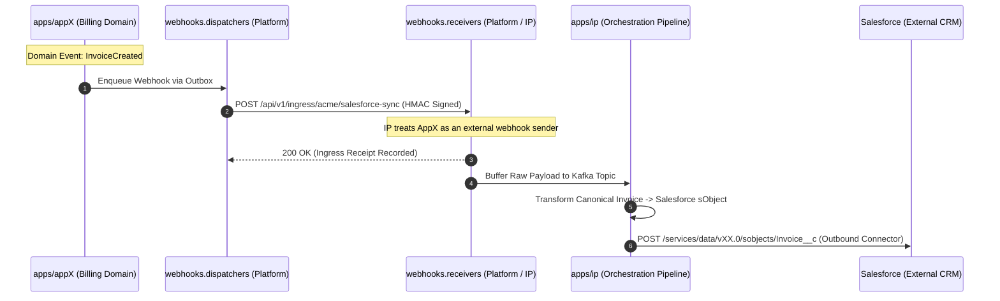

# Common Platform Webhooks, Ingress & Egress Framework Architecture

## Executive Summary

Across a modular multi-app enterprise platform comprising **Domain Applications** (`apps/edi`, `apps/appX`, `apps/appY`) and a generic **Integration Platform** (`apps/ip`), handling inbound and outbound network traffic has historically suffered from a critical cognitive trap: **the Webhook Paradox**.

- **To a Domain App (EDI, AppX)**, a "webhook" colloquially meant an **Outbound Dispatcher** (delivering parsed JSON to an external Zapier URL).
- **To the Integration Platform (IP)**, a "webhook" colloquially meant an **Inbound Receiver** (hosting an endpoint to receive meter telemetry from Itron).

Assuming that "Domain Apps only send webhooks" and "IP only receives webhooks" is an architectural anti-pattern:
1. **Domain Apps ALSO receive webhooks:** If `apps/appX` handles billing, it **must receive inbound webhooks** from Stripe or Adyen.
2. **IP ALSO sends webhooks:** When IP completes a workflow, it **must dispatch outbound webhooks** to Zapier, PagerDuty, or customer endpoints.

This document establishes the **Gold-Standard Platform Architecture**:
1. Centralizing all webhook mechanics into a single, dedicated platform package: **`core/platform/packages/webhooks`** (bifurcated into `receivers` and `dispatchers`).
2. Providing broad Ingress and Egress foundation libraries (`core/platform/packages/ingress` and `core/platform/packages/egress`).
3. Guaranteeing **zero code duplication**, **strict Bounded Context isolation**, and **zero tight coupling** between apps.

---

## 1. The Webhook Paradox & The Universal Solution

```
                         THE HISTORICAL CONFUSION
                         
          EDI Developer says:                   IP Developer says:
       "I'm creating a Webhook!"             "I'm creating a Webhook!"
                  │                                     │
                  ▼                                     ▼
        They host the URL (Zapier)            We host the URL (Soopa)
        Network packets flow OUT              Network packets flow IN
                  │                                     │
                  ▼                                     ▼
             EGRESS / PUSH                        INGRESS / RECEIVE

===================================================================================

                    THE GOLD-STANDARD UNIFIED RESOLUTION
                               (packages/webhooks)
                                        │
           ┌────────────────────────────┴────────────────────────────┐
           ▼                                                         ▼
┌──────────────────────────────────────┐  ┌──────────────────────────────────────┐
│         webhooks.receivers           │  │        webhooks.dispatchers          │
│         (INBOUND / INGRESS)          │  │         (OUTBOUND / EGRESS)          │
├──────────────────────────────────────┤  ├──────────────────────────────────────┤
│ • WE host the URL                    │  │ • THEY host the URL                  │
│ • Packets flow IN                    │  │ • Packets flow OUT                   │
│ • Validates Vendor HMAC / Signatures │  │ • Signs outgoing HMAC (X-Signature)  │
│ • Fast ACK (200 OK) + Ingestion Buff │  │ • Outbox-driven worker + Retries     │
│ • Used by:                           │  │ • Used by:                           │
│   - IP (receiving Itron meter push)  │  │   - EDI (sending to Zapier)          │
│   - AppX (receiving Stripe callbacks)│  │   - AppX (sending customer alerts)   │
│   - EDI (receiving partner MDN acks) │  │   - IP (sending to Zapier/PagerDuty) │
└──────────────────────────────────────┘  └──────────────────────────────────────┘
```

---

## 2. Directory Taxonomy: `core/platform/packages/webhooks`

The package is structured strictly following Hexagonal Architecture:

```
core/platform/packages/webhooks/
├── src/
│   └── webhooks/
│       ├── __init__.py
│       │
│       ├── crypto/                          # Shared Cryptographic Primitives
│       │   ├── hmac_signer.py               # Generates HMAC-SHA256 signatures
│       │   ├── hmac_verifier.py             # Timing-safe HMAC-SHA256 verification
│       │   └── timestamp_validator.py       # Replay-attack protection (tolerance drift)
│       │
│       ├── receivers/                       # INBOUND (Listening / Ingress)
│       │   ├── ports/
│       │   │   ├── webhook_receiver_port.py # Storage port for hosted receiver configs
│       │   │   └── raw_ingestion_port.py    # Buffer port (Kafka / Outbox)
│       │   ├── guards/
│       │   │   ├── vendor_hmac_guard.py     # FastAPI guard verifying vendor HMAC
│       │   │   ├── static_secret_guard.py   # Bearer / Header token verifier
│       │   │   └── query_param_guard.py     # URL token verifier (?token=...)
│       │   ├── application/
│       │   │   ├── create_receiver_use_case.py
│       │   │   ├── list_receivers_use_case.py
│       │   │   └── delete_receiver_use_case.py
│       │   └── adapters/
│       │       └── http/
│       │           └── universal_receiver_router.py # POST /api/v1/ingress/{t}/{ep}
│       │
│       └── dispatchers/                     # OUTBOUND (Delivery / Egress)
│           ├── ports/
│           │   ├── webhook_subscription_port.py # Registry of external subscriber URLs
│           │   └── webhook_delivery_ledger_port.py # Audit receipts log
│           ├── application/
│           │   ├── create_subscription_use_case.py
│           │   ├── list_subscriptions_use_case.py
│           │   └── execute_delivery_use_case.py
│           ├── workers/
│           │   └── webhook_outbox_worker.py # SQS/Outbox consumer loop
│           └── adapters/
│               └── http/
│                   └── resilient_dispatcher.py # Dispatches via shttp with retries & backoff
└── tests/
```

---

## 3. The Universal Architectural Boundary

### A. Zero Coupling Between Apps
- `apps/edi` has **zero** dependencies on `apps/ip`.
- `apps/appX` has **zero** dependencies on `apps/ip`.
- `apps/ip` treats `apps/edi` and `apps/appX` as **external systems**, exactly like Salesforce or QuickBooks.

### B. End-to-End Interaction Flow



---

## 4. Code Examples Across All Applications

### Case 1: Outbound Dispatch (EDI Sending Parsed JSON to Zapier)
EDI does **not** write custom retry loops, HMAC signers, or HTTP clients. It imports directly from `webhooks.dispatchers`:

```python
# apps/edi/packages/edi/src/edi/application/use_cases/deliver_edi_parsed_json_use_case.py

from dataclasses import dataclass
from webhooks.dispatchers.ports.webhook_dispatcher_port import WebhookDispatcherPort
from webhooks.dispatchers.domain.models import WebhookDispatchCommand


@dataclass(frozen=True)
class DeliverEdiJsonCommand:
    tenant_id: str
    subscription_id: str
    parsed_json: dict[str, object]


class DeliverEdiParsedJsonUseCase:
    def __init__(self, dispatcher: WebhookDispatcherPort) -> None:
        self._dispatcher = dispatcher

    async def execute(self, cmd: DeliverEdiJsonCommand) -> None:
        # Platform dispatcher handles HMAC signing, SSRF validation, and exponential backoff
        await self._dispatcher.dispatch(
            WebhookDispatchCommand(
                tenant_id=cmd.tenant_id,
                subscription_id=cmd.subscription_id,
                event_type="edi.transaction.parsed",
                payload=cmd.parsed_json,
            )
        )
```

---

### Case 2: Inbound Receiver (IP Receiving Itron Telemetry Push)
IP does **not** write custom HMAC verifiers or signature parsers. It mounts the platform's `universal_receiver_router` or uses `webhooks.receivers`:

```python
# apps/ip/packages/ip/src/ip/adapters/inbound/http/ingress_gateway_router.py

from fastapi import APIRouter, Depends, Request, Response, status
from webhooks.receivers.guards.vendor_hmac_guard import VendorHmacGuard, VerifiedEndpointContext
from webhooks.receivers.ports.raw_ingestion_port import RawIngestionPort
from webhooks.receivers.domain.models import RawIngressPayloadEnvelope


router = APIRouter(prefix="/api/v1/ingress", tags=["IP Ingress Gateway"])


@router.post("/{tenant_slug}/{endpoint_slug}", status_code=status.HTTP_200_OK)
async def receive_vendor_push(
    tenant_slug: str,
    endpoint_slug: str,
    request: Request,
    ingestion: RawIngestionPort = Depends(),
    endpoint: VerifiedEndpointContext = Depends(VendorHmacGuard),  # Platform HMAC verifier
) -> Response:
    raw_bytes = await request.body()

    # Fast ACK: Buffers payload into Kafka for async canonical transformation
    await ingestion.ingest_raw_payload(
        RawIngressPayloadEnvelope(
            tenant_id=endpoint.tenant_id,
            endpoint_id=endpoint.endpoint_id,
            headers=dict(request.headers),
            raw_body=raw_bytes,
        )
    )
    return Response(status_code=status.HTTP_200_OK, content='{"status":"received"}')
```

---

### Case 3: Inbound Receiver (AppX Receiving Stripe Payment Callbacks)
When `apps/appX` needs to receive Stripe payments, it uses the **exact same** platform package without needing IP:

```python
# apps/appx/packages/appx/src/appx/adapters/inbound/http/stripe_webhook_router.py

from fastapi import APIRouter, Depends, Request, Response, status
from webhooks.receivers.guards.vendor_hmac_guard import StripeSignatureGuard
from appx.application.use_cases.process_payment_callback_use_case import ProcessPaymentCallbackUseCase


router = APIRouter(prefix="/api/v1/billing/webhooks", tags=["Billing Inbound"])


@router.post("/stripe", status_code=status.HTTP_200_OK)
async def receive_stripe_payment(
    request: Request,
    use_case: ProcessPaymentCallbackUseCase = Depends(),
    event_payload: dict[str, object] = Depends(StripeSignatureGuard),  # Validates Stripe signature
) -> Response:
    await use_case.execute(event_payload)
    return Response(status_code=status.HTTP_200_OK, content='{"status":"processed"}')
```

---

## 5. Summary Matrix: Adherence & Reuse

| Capability | Platform Package Location | Used For (Domain Apps) | Used For (IP) |
| :--- | :--- | :--- | :--- |
| **Inbound Webhook Listeners** | `core/platform/packages/webhooks/receivers` | Receiving Stripe, Adyen, MDN acks | Receiving Itron, HES, Salesforce webhooks |
| **Outbound Webhook Dispatching** | `core/platform/packages/webhooks/dispatchers` | Sending to Zapier, Partner ERPs | Sending to PagerDuty, Customer Webhooks |
| **HMAC Sign & Verify** | `core/platform/packages/webhooks/crypto` | Timing-safe verification & signing | Timing-safe verification & signing |
| **Domain REST Ingress** | `core/platform/packages/ingress` | Standard `/api/v1/orders` APIs | IP Management APIs |
| **Active Target Dialers (Connectors)** | `core/platform/packages/egress` | Not used (Domain apps don't dial) | Dialing Salesforce, SAP, SFTP, Kafka |
| **Resilient Transport Core** | `core/platform/packages/shttp` | SSRF defense, backoff, jitter | SSRF defense, backoff, jitter |
| **Secrets Resolution** | `core/platform/packages/secret-store` | Webhook partner secrets | External system OAuth2 tokens / API keys |

---

## 6. Monorepo Migration Roadmap

1. **Extract `core/platform/packages/webhooks`**:
   - Move shared cryptographic routines (`hmac_signer.py`, `hmac_verifier.py`) into `crypto/`.
   - Generalize EDI's outbound delivery logic into `dispatchers/`.
   - Generalize IP's vendor listener logic into `receivers/`.
2. **Refactor `apps/edi`**:
   - Point EDI delivery worker to `webhooks.dispatchers`, deleting bespoke HTTP retry and signing boilerplate.
3. **Refactor `apps/ip`**:
   - Mount `webhooks.receivers` inside IP Ingress Gateway, keeping pipeline orchestration strictly isolated.
4. **Standardize `apps/ip/docs/ingress_endpoints_and_connections_architecture.md`**:
   - Update IP's internal documentation to explicitly cite `webhooks.receivers` for Ingress Endpoints and `core/platform/packages/egress` for Outbound Connections.
