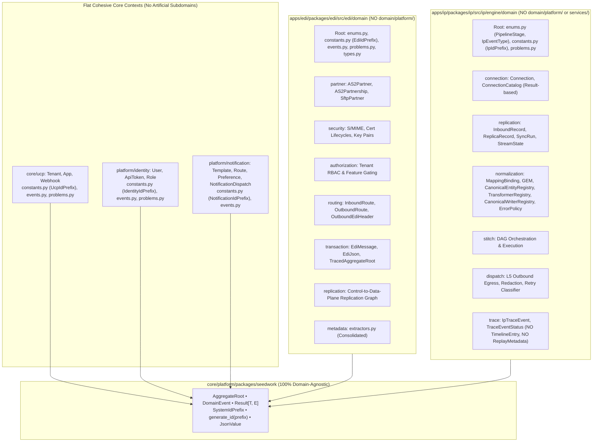

# Enterprise Gold-Standard Implementation Plan (`v2.5`): True Hexagonal Architecture, Domain Purity & Cross-Module Consistency

- **Status:** Active Implementation Plan (Phase 1, Phase 2 [including Phase 2.5], Phase 3, & Phase 4 Complete — Ready for Phase 5)
- **Scope:** `core/platform/packages/{seedwork,identity,notification,orchestration,scheduler,strace}`, `core/ucp/packages/ucp`, `apps/edi/packages/edi`, `apps/ip/packages/ip`, and `tach.toml`
- **Governing Standards:** [AGENTS.md](.agents/AGENTS.md) • Hexagonal Architecture • DDD Behavioral Aggregates • Ubiquitous Language Taxonomy (Zero Django `models.py` / `*DomainModel`) • First-Class `Result[T, E]` Error Handling • Co-Located CQRS • Narrow `SAVEPOINT` Integration Testing

---

## 1. Architectural Philosophy: Substance Over "Architecture Theater"

Simply shuffling files into folders labeled `subdomains/` is **not** enterprise gold standard. Moving an anemic `@dataclass` into a subdirectory while Use Cases still mutate its attributes via `setattr()`, raise raw `ValueError`s for expected domain conflicts, leak bounded-context constants into `seedwork`, or bypass aggregate events via `publish_outbox_event()` leaves the core architectural flaws intact.

### 1.1 The Sixteen Non-Negotiable Core Tenets

1. **Behavioral Aggregates & Internal Outbox Recording (`self.add_domain_event()`):**
   - Aggregate Roots own all state transitions and business invariants.
   - Application Use Cases must **never** mutate aggregate attributes directly (`agg.active = False` or `setattr(agg, field, val)`), must **never** call `agg.add_domain_event(...)` from outside the aggregate, and must **never** invoke procedural `publish_outbox_event(...)`.
   - Repository `save(aggregate)` implementations atomically persist the aggregate and drain `aggregate.pull_domain_events()` into the local transactional outbox via `serialize_domain_event()`.
2. **First-Class Error Handling (`seedwork.domain.exceptions.Result[T, E]`):**
   - Known, expected domain and operational outcomes (invalid state transitions, destination exclusivity conflicts, missing records, expired tokens) must **never** raise procedural exceptions (`ValueError`, custom domain exceptions) for control flow.
   - All new and refactored aggregate transitions, factories, and domain services return strongly-typed `Result[T, DomainError]` value objects (`Result.ok(...)` / `Result.fail(...)`), matching the gold standard established in [`ip/engine/domain/exceptions.py`](apps/ip/packages/ip/src/ip/engine/domain/exceptions.py#L1-L16) and [`edi/domain/exceptions.py`](apps/edi/packages/edi/src/edi/domain/exceptions.py).
   - "Problems" (RFC 7807 Problem Details) are strictly an HTTP/presentation wire format; the Domain layer models pure business errors (`EdiError`, `IpError`) and has zero coupling to HTTP terminology.
3. **100% Pure & Independent `seedwork` (Zero Bounded-Context Leakage):**
   - [`core/platform/packages/seedwork`](core/platform/packages/seedwork/src/seedwork) must contain **zero** references to bounded contexts (`edi`, `ip`, `ucp`, `identity`, `notification`, `orchestration`) or vertical solution models (`mdm`, `tms`).
   - `seedwork` provides only generic primitives (`AggregateRoot`, `DomainEvent`, `Result`, `SystemIdPrefix`, `generate_id(prefix: str)`, `JsonValue`, `JsonDict`). Each bounded context or platform package defines its own strongly-typed `*IdPrefix(StrEnum)` inside its own `domain/constants.py`.
4. **Subdomain Justification via Ubiquitous Language (No Micro-Fracturing, No Unnatural Merging):**
   - Subdomains exist **only** where distinct Ubiquitous Languages diverge within a large bounded context (`apps/edi`, `apps/ip`).
   - `security` (cryptographic S/MIME & key lifecycles) and `authorization` (tenant RBAC) must **never** be merged into `partner` (external trading counterparty).
   - Conversely, micro-fractured 8-line files (`edi/domain/metadata/extractors/x12_*.py`) and generic `domain/services/` junk drawers are consolidated into cohesive domain modules, and focused contexts (`core/ucp`, `identity`, `notification`) remain **flat and un-fractured**.
5. **Zero `platform/` or Legacy `core/` Dual-Layers Inside Domain Packages:**
   - **Zero `domain/platform/` directories** may exist anywhere in the monorepo. Cross-cutting domain primitives belong at the domain root (`domain/constants.py`, `domain/enums.py`, `domain/events.py`, `domain/problems.py`, `domain/types.py`).
   - Empty or ambiguous legacy `core/` directories alongside Hexagonal layers (such as [`ucp/core/`](core/ucp/packages/ucp/src/ucp/core/__init__.py)) are eliminated, and `edi/core/` internal parser/grammar engines are strictly isolated behind outbound ports so no dual orchestration architecture exists.
6. **Co-Located CQRS & Strict Boundary DTOs:**
   - Command and Query DTOs (`@dataclass(frozen=True)`) are **co-located directly inside the Use Case file that handles them**; shared read projections live in `queries.py` or `responses.py`.
   - Entity-based `application/dtos/*.py` folders, monolithic `application/dto.py` god-files, and Command DTOs placed inside `domain/models/` are eliminated.
   - Every Port method uses 1 DTO per ORM boundary (`tuple[ADTO, BDTO]` for joins; `JsonValue` instead of `dict[str, Any]`; zero Pydantic `BaseModel` or SQLAlchemy ORM leakage).
7. **Explicit Reflection-Free Data Mappers & Zero `getattr()` Masking:**
   - Repository mappers (`_to_domain_model`, `_update_record_from_domain`) map every attribute explicitly via standard dot notation (`record.field = aggregate.field`).
   - Dynamic reflection (`dataclasses.fields()`, `__dict__`) and defensive masking (`getattr(obj, "field", None)`) are strictly prohibited so schema drift fails immediately under `mypy` or at runtime.
8. **Zero Adapter-to-Adapter Coupling & Strict Adapter Naming Consistency:**
   - Concrete adapters (including inbound workers and SQLAlchemy UoWs) must **never** import or instantiate other concrete adapters directly; all wiring occurs exclusively in the Composition Root (`container.py` / `provider.py`).
   - Database adapter filenames and class prefixes must be 100% consistent within each package (never mixing `postgres_*.py` filenames with `SqlAlchemy*` class names).
9. **Red-Green-Refactor, Narrow `SAVEPOINT` Integration Tests & `uv` / `pnpm` Tooling:**
   - Every behavioral aggregate change follows **Red $\rightarrow$ Green $\rightarrow$ Refactor** (write failing unit tests first).
   - Every repository/mapper/UoW refactor is verified against **both** `tests/unit` and real PostgreSQL nested-`SAVEPOINT` `tests/integration` suites using **`uv run`** exclusively (`pnpm` for Node/frontend).
10. **Strict Bounded Context Ubiquitous Language ("Transaction" is EDI-Exclusive; Stages are NOT "Layers"):**
    - In IP, the business domain processes **Records & Streams** (`InboundRecord`, `ReplicaRecord`, `NormalizedRecord`, `OutboundRecord`), and the audit trail is an **Execution Trace** (`IpTraceEvent`). The word "Transaction" is **strictly prohibited in IP**; `application/use_cases/transactions/`, `transaction_dtos.py`, and `transactions_router.py` must be completely purged from IP and cleanly separated into `trace` (read queries) and `replay` (stage mutation commands):
      - **Application Layer**: `application/use_cases/trace/` for queries, `application/use_cases/replay/` for stage commands, co-located `@dataclass(frozen=True)` Command/Query DTOs inside their handling Use Cases, and `application/responses.py` (`IpTraceDTO`, `IpTraceLineageItemDTO`, `ReplayStageResultDTO`, `BulkReplayStageResultDTO`) for shared read/outcome projections.
      - **Adapter Layer**: `trace_dtos.py` for trace waterfall & lineage HTTP models, `replay_dtos.py` for stage replay HTTP schemas & mappers, `trace_router.py` mounted at `/api/v1/tenants/{tenant_id}/ip/traces` for queries, and `replay_router.py` mounted at `/api/v1/tenants/{tenant_id}/ip/traces` for stage replay commands.
    - In Hexagonal Architecture, "Layer" refers strictly to architectural tiers (Domain, Application, Adapters). SEDA pipeline steps are **Stages**, never "layers". The redundant `Layer` suffix is eliminated: `PipelineLayer` is replaced by **`PipelineStage`** (`INGEST`, `REPLICA`, `NORMALIZE`, `HYDRATE`, `DELIVER`), defined context-wide at `ip.engine.domain.enums`, not inside `trace`.
11. **Decoupled Stage-Based Replay (Replay Must NOT Know What It Is Replaying; Never Define Replay Inside Trace):**
    - **Fundamental Architectural Mismatch (Why Replay is NOT Trace):**
      - A **Trace** is an **immutable audit receipt / telemetry event** (Read Model / Query). It records historical execution facts (`IpTraceEvent`) that can never be altered.
      - **Replay** is an **operational state mutation command** (Write Model / Command). It initiates a new pipeline execution run starting from a designated stage, generating a *new* execution trace linked to the prior trace via causal lineage (`parent_trace_id`).
      - Lumping Replay and Bulk Replay into `trace` violates **Single Responsibility (SRP)**, **CQRS**, and **Interface Segregation (ISP)**. Inbound API clients inspecting traces (waterfall, lineage) shouldn't be coupled to replay command schemas.
    - **Full Architectural Separation Across Layers:**
      - **Domain Layer**: `domain/trace/` contains only immutable facts (`IpTraceEvent`, `TraceEventStatus`, `IpTraceEventType`). It has zero awareness of replay orchestrators or stage workers.
      - **Application Layer**:
        - Queries / Read Projections: `application/use_cases/trace/` (`get_ip_trace_use_case.py`, `get_ip_trace_lineage_use_case.py`) and `application/responses.py` (`IpTraceDTO`, `IpTraceLineageItemDTO`).
        - Commands / Stage Mutations: `application/use_cases/replay/` (`replay_stage_use_case.py`, `modify_and_replay_use_case.py`, `bulk_replay_stage_use_case.py`) with co-located `@dataclass(frozen=True)` commands and `application/responses.py` (`ReplayStageResultDTO`, `BulkReplayStageResultDTO`).
      - **Inbound Adapter Layer**:
        - Query DTOs & Router: `adapters/inbound/api/dtos/trace_dtos.py` (`IpTraceHttpResponse`, `IpTraceLineageItemHttpResponse`) and `routers/trace_router.py` (serving `GET /traces`, `GET /traces/search`, `GET /traces/{trace_id}`, `GET /traces/{trace_id}/lineage`).
        - Command DTOs & Router: `adapters/inbound/api/dtos/replay_dtos.py` (`ReplayStageHttpRequest`, `BulkReplayHttpRequest`, `ModifyAndReplayHttpRequest`, `ReplayStageHttpResponse`, `BulkReplayHttpResponse`) and `routers/replay_router.py` (serving `POST /traces/{trace_id}/replay`, `POST /traces/{trace_id}/modify-and-replay`, `POST /traces/bulk-replay`).
    - **Stage-Based Replay Delegation:**
      - What is replayed is **Execution from a specific Stage** (`ReplayStageCommand(stage=PipelineStage, trace_id=...)`).
      - Replay is a generic operational trigger: *"Re-run the pipeline from Stage $X$"*. Replay must **never** be a monolithic procedural God-class (`replay_transaction_use_case.py`) that inspects or mutates the internal private domain models of every stage (`InboundRecord`, `ReplicaRecord`, `NormalizedRecord`, `OutboundRecord`).
      - Replay delegates polymorphically to that stage's processor/worker (via Strategy Pattern or worker queue event dispatch). Tracing simply observes the re-execution (`status=TraceEventStatus.RETRIED`) with zero knowledge of replay orchestrators.
      - Tracing records **Causal Lineage** (`parent_trace_id`, `original_trace_id`, `attempt_number`), completely decoupled from the concept of "Replay" (delete `TraceReplayMetadata` and `TimelineEntry` aliases).
12. **Zero Presentation/Read Projections in the Domain Layer ("Timeline" is an Application View, NOT Domain):**
    - A **Timeline** is strictly an **Application / UI Read Projection** (a query/view DTO that chronologically orders discrete audit events for human operator inspection in dashboards), **never** a domain concept.
    - The Domain Layer only models business rules, invariants, and immutable audit facts: **`domain/trace/`** (`IpTraceEvent`, `TraceEventStatus`, `IpTraceEventType`).
    - The package directory `domain/timeline/` is **strictly prohibited**. The `TimelineEntry = IpTraceEvent` alias and `TimelineStatus` enum in domain models are completely purged in favor of `TraceEventStatus`.
    - Any timeline assembly or chronological sorting belongs exclusively in the Application Layer (e.g., `GetTraceTimelineUseCase` returning `TimelineDTO` / `TraceTimelineItemDTO` for API/UI consumers).
13. **Unified Business Tracing Standards (`strace` Purity, Context-Owned Events & Zero `L1`-`L5` Cartesian Explosion):**
    - **Centralized `strace` Platform Purity:** `core/platform/packages/strace` must be 100% domain-agnostic. It provides generic tracing primitives (`TracedAggregateRoot`, `TraceEvent(id, tenant_id, trace_id, event_type: str, actor, metadata, created_at)`, `TraceEventMixin`, `drain_trace_events`). It must **never** hardcode bounded-context business events (like EDI's `TRANSFORMATION_SUCCESSFUL` or `DELIVERY_FAILED` inside `strace.domain.enums.TraceEventType`). `TraceEvent.event_type` is generic `str`.
    - **EDI Trace Ownership:** EDI's trace event taxonomy (`RECEIVED`, `TRANSFORMATION_SUCCESSFUL`, `TRANSFORMATION_FAILED`, `DELIVERY_SUCCESSFUL`, `DELIVERY_ATTEMPT_FAILED`, `DELIVERY_FAILED`, `REPLAY_TRIGGERED`, `MODIFIED_AND_REPLAYED`) belongs in `apps/edi/packages/edi/src/edi/domain/enums.py` as `EdiTraceEventType`, completely isolated within the EDI bounded context.
    - **IP Trace Simplification (Eliminate 25 `L1_` to `L5_` Micro-Events):**
      - The 25 confusing strings in `IpTraceEventType` (`L1_INGEST_RECEIVED`, `L2_REPLICA_CREATED`, `L3_NORMALIZED`, `L5_DISPATCH_DELIVERED`) are an anti-pattern that glues Stage + Status into a Cartesian explosion with obsolete `L1`-`L5` layer prefixes.
      - Replace `IpTraceEventType` with clean, semantic stage event types without `L1_`-`L5_` prefixes:
        - `INGEST_RECEIVED`, `INGEST_FAILED`
        - `REPLICA_CREATED`, `REPLICA_UPDATED`, `REPLICA_TOMBSTONED`
        - `NORMALIZATION_SUCCESSFUL`, `NORMALIZATION_FAILED`, `NORMALIZATION_SKIPPED_STALE`, `NORMALIZATION_REFERENCE_PENDING`, `NORMALIZATION_REFERENCE_RESOLVED`
        - `DELIVERY_PENDING`, `DELIVERY_SUCCESSFUL`, `DELIVERY_RETRY_SCHEDULED`, `DELIVERY_FAILED`
        - `REPLAY_TRIGGERED`
      - Domain aggregates (`InboundRecord`, `ReplicaRecord`, `NormalizedRecord`, `OutboundRecord`) must append their own trace events via `self.add_trace_event(...)` during lifecycle transitions, rather than requiring use cases to instantiate verbose 10-line `IpTraceEvent.create(layer=PipelineStage.INGEST, status=TraceEventStatus.SUCCESS, ...)` blocks.
      - Repository `drain_trace_events` persists these audit events atomically in the unit of work.
14. **Pure Domain Registries & Zero Technical Implementation Leakage (No `InMemory*` in Domain):**
    - In Hexagonal Architecture, the `domain/` layer must define pure business concepts, domain registries, and ports. Storage or lookup mechanisms (such as Python `dict` in memory or in-process collections) are technical implementation details that must **never** leak into class names within the domain layer.
    - Classes named `InMemoryTransformerRegistry` and `InMemoryCanonicalWriterRegistry` in `ip/engine/domain/normalization/registries.py` violate this principle.
    - They must be renamed to clean domain registries: **`TransformerRegistry`** and **`CanonicalWriterRegistry`** (or defined as outbound Ports `TransformerRegistryPort` / `CanonicalWriterRegistryPort` in `ports/outbound/registries.py` with in-memory adapters in `adapters/` or IoC `container.py`).
15. **Zero Django-Style `models.py` Grab-Bags, Zero `domain/models/` Role Folders & Zero `*DomainModel` Suffixes:**
    - Django organizes files by technical framework role (`models.py`) rather than domain concepts, dumping unrelated aggregates, protocol wire envelopes, and read projections into monolithic grab-bags, and slapping `*DomainModel` suffixes onto domain classes to avoid collisions with ORM classes.
    - **Concept-Named Modules Only:** Every module in any `domain/` package across the monorepo MUST be named after the **Ubiquitous Language Aggregate Root or Domain Concept** it models—matching the established baseline in [`orchestration/domain/`](core/platform/packages/orchestration/src/orchestration/domain) (`definition.py`, `run.py`, `matching.py`, `scheduling.py`, `failures.py`). Generic `domain/**/models.py` files and `domain/models/` role subdirectories are **strictly prohibited** across `seedwork`, `strace`, `scheduler`, `notification`, `identity`, `ucp`, `edi`, and `ip` (note: SQLAlchemy ORM schema modules inside outbound infrastructure adapters such as `database/models/` or `ip/solutions/domains/{energy,tms}/models.py` are persistence table definitions, not Domain Layer models).
    - **Pure Ubiquitous Language Class Names:** Domain classes MUST use pure business names (`AS2Partner`, `AS2Partnership`, `SFTPPartner`, `InboundRoute`, `OutboundRoute`, `OutboundEdiHeader`, `Webhook`, `EdiMessage`, `EdiJson`, `ApiGatewayReceipt`, `ApiToken`), **never** `*DomainModel`. Outbound SQLAlchemy repository adapters disambiguate ORM table imports via `as Orm*` aliases (e.g., `from ... import AS2Partner as OrmAS2Partner`).
    - **Zero Legacy Re-Export Facades & Zero Read-Projection Aggregates:** Legacy re-export shims like `ip/engine/domain/replication/models.py` and dead read-projection classes masquerading as aggregates (`TransactionListDomainModel`) must be deleted outright, updating all import sites explicitly per Development Phase Policy.
16. **1-Aggregate-per-Repository & Cross-Module CQRS Taxonomy Parity (Zero DTOs in Domain Repository Ports):**
    - **`transaction` is a Subdomain, NOT an Aggregate Root:** In EDI, the stage Aggregate Roots inside `edi/domain/transaction/` are [`EdiMessage`](apps/edi/packages/edi/src/edi/domain/transaction/edi_message.py), [`EdiJson`](apps/edi/packages/edi/src/edi/domain/transaction/edi_json.py), and [`ApiGatewayReceipt`](apps/edi/packages/edi/src/edi/domain/transaction/gateway_receipt.py). Mixing `EdiMessage` and `EdiJson` inside a 1,276-line God-repository (`TransactionRepositoryPort` / `SqlAlchemyTransactionRepository`) with duplicate `*_dto` methods violates SRP and Hexagonal Port purity.
    - **1 Repository per Aggregate Root (Domain Models Only):** Dissolve `TransactionRepositoryPort` / `SqlAlchemyTransactionRepository` into focused single-aggregate Data-Plane repositories (`EdiMessageRepositoryPort` / `SqlAlchemyEdiMessageRepository` on `uow.edi_messages`, `EdiJsonRepositoryPort` / `SqlAlchemyEdiJsonRepository` on `uow.edi_jsons`, and `ApiGatewayRepositoryPort` / `SqlAlchemyApiGatewayRepository` on `uow.api_gateway_receipts` inside `database/data_plane/`) returning Domain Aggregates (`EdiMessage`, `EdiJson`, `ApiGatewayReceipt`) exclusively—zero boundary DTOs in `edi/ports/`.
    - **EDI / IP CQRS Folder Symmetry:** Dissolve `edi/application/use_cases/transactions/` into `edi/application/use_cases/trace/` (read waterfall, lineage, and stage-list queries) and `edi/application/use_cases/replay/` (stage replay commands), matching `apps/ip` (`Strict File Taxonomy Consistency`), with boundary read DTOs (`EdiMessageDTO`, `EdiJsonDTO`, `ApiGatewayDTO`, `EdiTraceDTO`) living solely in `edi/application/responses.py` via `.from_domain(...)` mappers.

---

## 2. Ground-Truth Monorepo Audit (Verified Against Disk)



### 2.1 `core/platform/packages/seedwork` & `core/platform/packages/strace` — Active Purity Violations Found
1. **Bounded-Context & Vertical-Domain Leakage in [`id_registry.py`](core/platform/packages/seedwork/src/seedwork/id_registry.py#L26-L94):** Defines `DomainIdPrefix` inside `seedwork` with 60+ hardcoded prefixes for `Identity`, `Notification`, `UCP`, `EDI`, `IP`, and even vertical solutions (`IP_MDM_READING`, `IP_TMS_LOAD`). Meanwhile `ip` *also* defines `IpIdPrefix` in `ip/engine/domain/platform/enums.py`—a textbook Dual Architecture.
2. **Domain Config Coupling in [`config_models.py`](core/platform/packages/seedwork/src/seedwork/infra/config_models.py#L76-L80):** `PlatformIdentitySettings` inside `seedwork` hardcodes `ucp_project_id` (`IDENTITY_UCP_PROJECT_ID`). Auth configuration belongs in `core/platform/packages/identity`, not `seedwork`.
3. **Domain Event Leakage in [`strace/domain/enums.py`](core/platform/packages/strace/src/strace/domain/enums.py#L25-L41):** `strace.domain.enums.TraceEventType` hardcodes EDI business pipeline events (`TRANSFORMATION_SUCCESSFUL`, `TRANSFORMATION_FAILED`, `DELIVERY_SUCCESSFUL`, `DELIVERY_FAILED`, `REPLAY_TRANSFORM`, `REPLAY_DELIVER`). Generic platform packages must never contain bounded-context business events; `TraceEvent.event_type` is generic `str`, and each bounded context must own its trace event taxonomy.
4. **Orchestration Prefix Leakage in [`id_registry.py`](core/platform/packages/seedwork/src/seedwork/id_registry.py#L18-L23):** `SystemIdPrefix` inside `seedwork` hardcodes `WORKFLOW_RUN`, `WORKFLOW_STEP`, `WORKFLOW_ATTEMPT`, `WORKFLOW_MATCH`, and `WORKFLOW_CONDITION`. These belong strictly to `core/platform/packages/orchestration/src/orchestration/domain/constants.py` as `WorkflowIdPrefix`.

### 2.2 `apps/edi` — Active Domain, CQRS, Outbox, Trace & Mapper Violations Found
1. **Prohibited `domain/platform/` Directory:** [`edi/domain/platform/enums.py`](apps/edi/packages/edi/src/edi/domain/platform/enums.py) and [`events.py`](apps/edi/packages/edi/src/edi/domain/platform/events.py) must move to `edi/domain/`.
2. **Micro-Fractured Extractors:** 7 eight-line files in [`edi/domain/metadata/extractors/`](apps/edi/packages/edi/src/edi/domain/metadata/extractors) (`x12_204.py` … `x12_997.py`) should consolidate into `edi/domain/metadata/extractors.py`.
3. **Trace Event Taxonomy Ownership:** EDI currently imports `TraceEventType` from `strace.domain.enums`. EDI must define its own `EdiTraceEventType` inside `edi/domain/enums.py` (`RECEIVED`, `TRANSFORMATION_SUCCESSFUL`, `TRANSFORMATION_FAILED`, `DELIVERY_SUCCESSFUL`, `DELIVERY_ATTEMPT_FAILED`, `DELIVERY_FAILED`, `REPLAY_TRIGGERED`, `MODIFIED_AND_REPLAYED`), keeping its audit taxonomy self-contained.
4. **Anemic Aggregates + Procedural Reflection Mutation:**
   - [`InboundRouteDomainModel` & `OutboundRouteDomainModel`](apps/edi/packages/edi/src/edi/domain/routing/models.py#L21-L90), [`AS2PartnerDomainModel` & `AS2PartnershipDomainModel`](apps/edi/packages/edi/src/edi/domain/partner/as2/models.py#L78-L115), and [`SftpPartnerDomainModel`](apps/edi/packages/edi/src/edi/domain/partner/sftp/models.py) are pure data containers with zero invariant methods.
   - [`update_as2_partnership_use_case.py`](apps/edi/packages/edi/src/edi/application/use_cases/as2_partnerships/update_as2_partnership_use_case.py#L46-L60) iterates `dataclasses.fields(cmd)`, mutates the aggregate via `getattr`/`setattr`, and calls `aggregate.add_domain_event(...)` procedurally from the Use Case.
5. **Legacy Procedural Outbox Methods:** [`control_plane_outbox_repository_port.py`](apps/edi/packages/edi/src/edi/ports/outbound/control_plane_outbox_repository_port.py#L8), [`control_plane/outbox_repository.py`](apps/edi/packages/edi/src/edi/adapters/outbound/database/control_plane/outbox_repository.py#L64-L213), and [`transaction_repository.py`](apps/edi/packages/edi/src/edi/adapters/outbound/database/transaction_repository.py#L201) still expose procedural `publish_outbox_event(...)` alongside `save(aggregate)`.
6. **Multi-Aggregate `TransactionRepositoryPort` God-Repository, Entity-Based `application/dtos/` & `use_cases/transactions/` Umbrella:**
   - [`transaction_repository.py`](apps/edi/packages/edi/src/edi/adapters/outbound/database/transaction_repository.py) mixes `EdiMessage` and `EdiJson` into a 1,276-line repository, exposes duplicate `get_edi_message_dto` / `get_edi_json_dtos_by_trace_id` methods returning DTOs from `ports/`, and sits outside `database/data_plane/` alongside `database/api_gateway_repository.py`.
   - [`edi/application/use_cases/transactions/`](apps/edi/packages/edi/src/edi/application/use_cases/transactions) lumps Trace queries, list queries, and Stage Replay commands under one folder instead of separating `trace/` and `replay/` to match `apps/ip`.
   - [`edi/application/dtos/`](apps/edi/packages/edi/src/edi/application/dtos) (`partners.py`, `routes.py`, `transactions.py`, `webhooks.py`) violates the Co-Located CQRS Standard.
   - `update_edi_json` and `list_edi_messages` use `getattr(..., None)` masking, and [`inbound_route_repository.py`](apps/edi/packages/edi/src/edi/adapters/outbound/database/control_plane/inbound_route_repository.py#L57) uses `getattr(..., None)` masking.

### 2.3 `apps/ip` — Compliant Baselines vs. Remaining Flaws
- **Already Gold Standard (Preserve):** [`Connection`](apps/ip/packages/ip/src/ip/engine/domain/connection/models.py#L127-L235) (`try_create`, `activate`, `mark_error`, `deactivate`, `relink` returning `Result[Connection, IpError]`) and [`SyncRun`](apps/ip/packages/ip/src/ip/engine/domain/replication/sync_run.py#L77-L160) (`request`, `start`, `complete`, `fail` recording domain events) are already behavioral aggregates, and `ip/solutions/` is cleanly separated from `ip/engine/`.
- **Remaining Flaws to Remediate:**
  1. **Prohibited `domain/platform/` & `domain/services/` Junk Drawer:** Delete `ip/engine/domain/platform/`; dissolve the 4 tiny registries/policies in [`ip/engine/domain/services/`](apps/ip/packages/ip/src/ip/engine/domain/services) into `normalization/` and outbound/application registries.
  2. **Isolate Audit Tracing in `domain/trace/` & Purge 25 Cartesian Micro-Events:**
     - Accurately name the audit trace ledger `domain/trace/` (`IpTraceEvent`, `TraceEventStatus`, `IpTraceEventType`); eliminate the redundant `TimelineEntry = IpTraceEvent` alias and remove `TraceReplayMetadata` from domain exports.
     - Replace the 25 confusing Cartesian micro-events (`L1_INGEST_RECEIVED`, `L2_REPLICA_CREATED`, `L3_NORMALIZED`, `L5_DISPATCH_DELIVERED`) with clean semantic stage trace events (`INGEST_RECEIVED`, `REPLICA_CREATED`, `NORMALIZATION_SUCCESSFUL`, `DELIVERY_SUCCESSFUL`, `REPLAY_TRIGGERED`), removing all obsolete `L1_`-`L5_` layer prefixes.
     - Domain aggregates (`InboundRecord`, `ReplicaRecord`, `NormalizedRecord`, `OutboundRecord`) must append their own trace events via `self.add_trace_event(...)` during lifecycle transitions rather than requiring verbose procedural `IpTraceEvent.create()` use case boilerplate.
  3. **Elevate Pipeline Stages to Domain Root & Drop `Layer` Suffix:** Define `PipelineStage` (`INGEST`, `REPLICA`, `NORMALIZE`, `HYDRATE`, `DELIVER`) inside `ip/engine/domain/enums.py`, completely replacing the legacy `PipelineLayer` name.
  4. **Purge "Transaction" from IP & Decouple Replay:**
     - "Transaction" is an EDI-exclusive business concept. Purge all references to "Transaction" in IP (`application/use_cases/transactions/` $\rightarrow$ `application/use_cases/replay/` and `application/use_cases/trace/`; rename `transaction_dtos.py`).
     - Refactor monolithic `ReplayTransactionUseCase` into **`ReplayStageCommand(stage=PipelineStage, trace_id=...)`**; decouple Replay so it delegates polymorphically to stage worker processors without knowing or mutating the private domain models of each stage (`InboundRecord`, `ReplicaRecord`, `NormalizedRecord`, `OutboundRecord`).
  5. **Align `SyncRun` Exceptions to `Result[SyncRun, IpError]` & Remove `getattr()`:** Convert `raise ValueError(...)` inside [`sync_run.py`](apps/ip/packages/ip/src/ip/engine/domain/replication/sync_run.py#L114) to `Result` and replace `getattr(stream, "replication", None)` in [`connection/models.py`](apps/ip/packages/ip/src/ip/engine/domain/connection/models.py#L666-L667) with typed attribute access.
  6. **Co-Located CQRS Consolidation:** Dissolve monolithic [`ip/engine/application/dto.py`](apps/ip/packages/ip/src/ip/engine/application/dto.py) + [`application/dtos/`](apps/ip/packages/ip/src/ip/engine/application/dtos) into co-located Use Case Command/Query `@dataclass(frozen=True)` definitions + `responses.py` / `queries.py`.
  7. **Inbound-to-Outbound Adapter Coupling in Workers:** [`ip_dp_jobs_worker.py`](apps/ip/packages/ip/src/ip/engine/adapters/inbound/workers/ip_dp_jobs_worker.py#L27-L88) and [`ip_cp_jobs_worker.py`](apps/ip/packages/ip/src/ip/engine/adapters/inbound/workers/ip_cp_jobs_worker.py#L22-L78) directly instantiate concrete `SqlAlchemyShardedOutboxRepository` / `SqlAlchemyGlobalOutboxRepository` instead of receiving `OutboxRepositoryPort` from `ip/engine/container.py`.
  8. **Implementation-Detail Leakage in Normalization Registries:** Classes named `InMemoryTransformerRegistry` and `InMemoryCanonicalWriterRegistry` in [`registries.py`](apps/ip/packages/ip/src/ip/engine/domain/normalization/registries.py) leak storage/infrastructure naming (`InMemory*`) into the Domain layer. Rename them to clean domain concepts: `TransformerRegistry` and `CanonicalWriterRegistry`. Update all usages across solutions, container, and tests.

### 2.4 `core/ucp`, `core/platform/packages/identity` & `core/platform/packages/notification`
- **Already Compliant:** `ucp`'s [`Tenant`](core/ucp/packages/ucp/src/ucp/domain/models/tenant.py) and [`WebhookDomainModel`](core/ucp/packages/ucp/src/ucp/domain/models/webhook.py), `identity`'s [`User`](core/platform/packages/identity/src/identity/domain/models/user.py), and `notification`'s [`NotificationDispatch`](core/platform/packages/notification/src/notification/domain/models.py) already record domain events via `self.add_domain_event()`.
- **Remaining Flaws to Remediate:**
  1. **Anemic `ApiTokenDomainModel` & Leaked Command DTOs in `identity/domain/models/`:** Elevate [`api_token.py`](core/platform/packages/identity/src/identity/domain/models/api_token.py) to a behavioral `AggregateRoot` (`create`, `rename`, `revoke`, `record_usage` returning `Result`), and move `CreateApiTokenCommand`, `UpdateApiTokenCommand`, and `ApiTokenCreatedResult` out of [`api_token_models.py`](core/platform/packages/identity/src/identity/domain/models/api_token_models.py) into their Use Cases / `responses.py`.
  2. **First-Class `Result` Alignment on `Tenant` & `User`:** Replace procedural `raise ValueError` / `raise AppSubscriptionError` / `raise StateConflictError` in `Tenant` and `User` domain transitions with `Result[Self, UcpProblem]` / `Result[Self, IdentityProblem]`.
  3. **Empty Legacy `ucp/core/` & Adapter Naming/Coupling Drift:** Delete empty [`ucp/core/`](core/ucp/packages/ucp/src/ucp/core/__init__.py); standardize mixed `postgres_*.py` filenames containing `SqlAlchemy*` classes in `notification`, `identity`, and `ucp`; and inject repository ports into `SqlAlchemy*UnitOfWork` via factory/Composition Root rather than direct concrete adapter imports.

---

## 3. Six-Phase Implementation Plan

### Phase 1: Purify `seedwork`, Purge `domain/platform/`, and Dissolve Junk Drawers

#### 1.1 Purify `core/platform/packages/seedwork`
1. **Remove `DomainIdPrefix` and Workflow Prefixes from [`seedwork/id_registry.py`](core/platform/packages/seedwork/src/seedwork/id_registry.py):**
   - Retain only truly generic `SystemIdPrefix` (`GENERIC`, `EVENT`, `JOB`, `IDEMPOTENCY`, `OUTBOX`, `CLIENT`, `TRACE`, `TX`) and ensure `generate_id(prefix: str)` accepts any `str` / `StrEnum`.
   - Relocate context-specific prefixes to their authoritative bounded contexts / platform packages:
     - `IdentityIdPrefix` $\rightarrow$ `core/platform/packages/identity/src/identity/domain/constants.py`
     - `NotificationIdPrefix` $\rightarrow$ `core/platform/packages/notification/src/notification/domain/constants.py`
     - `UcpIdPrefix` $\rightarrow$ `core/ucp/packages/ucp/src/ucp/domain/constants.py`
     - `EdiIdPrefix` $\rightarrow$ `apps/edi/packages/edi/src/edi/domain/constants.py`
     - `IpIdPrefix` $\rightarrow$ `apps/ip/packages/ip/src/ip/engine/domain/constants.py` (and vertical solution prefixes `MdmIdPrefix` / `TmsIdPrefix` into `ip/solutions/domains/{energy,tms}/`)
     - `WorkflowIdPrefix` $\rightarrow$ `core/platform/packages/orchestration/src/orchestration/domain/constants.py`
2. **Move `PlatformIdentitySettings` out of [`seedwork/infra/config_models.py`](core/platform/packages/seedwork/src/seedwork/infra/config_models.py):**
   - Relocate `PlatformIdentitySettings` (`ucp_project_id`, `tenant_role_group`, `platform_org_id`, `issuer`, `oauth_client_id`) into `core/platform/packages/identity/src/identity/config.py`.
3. **Purify Centralized `strace` Platform Package:**
   - In [`core/platform/packages/strace/src/strace/domain/enums.py`](core/platform/packages/strace/src/strace/domain/enums.py): Decouple EDI-specific pipeline actions (`TRANSFORMATION_SUCCESSFUL`, `DELIVERY_FAILED`, etc.) so `strace` is 100% domain-agnostic; `TraceEvent.event_type` remains generic `str`.
   - Define `EdiTraceEventType` inside `apps/edi/packages/edi/src/edi/domain/enums.py` (`RECEIVED`, `TRANSFORMATION_SUCCESSFUL`, `TRANSFORMATION_FAILED`, `DELIVERY_SUCCESSFUL`, `DELIVERY_ATTEMPT_FAILED`, `DELIVERY_FAILED`, `REPLAY_TRIGGERED`, `MODIFIED_AND_REPLAYED`), keeping EDI's audit taxonomy self-contained.

#### 1.2 Clean Up `apps/edi` & `apps/ip` Domain Structure
1. **`apps/edi`:**
   - Move `EdiEventType`, `EdiJobName`, `EdiOutboxSource` from `edi/domain/platform/enums.py` $\rightarrow$ `edi/domain/enums.py`; define `EdiTraceEventType` in `edi/domain/enums.py`; move `ProvisioningEvent`, `ProvisioningEventType` $\rightarrow$ `edi/domain/events.py`; delete `edi/domain/platform/`.
   - Consolidate the 7 eight-line files in `edi/domain/metadata/extractors/x12_*.py` into `edi/domain/metadata/extractors.py` and delete the `extractors/` subdirectory.
2. **`apps/ip`:**
   - Move `IpEventType`, `IpOutboxSource`, `IpOutboxChannel`, `IpJobName`, and **`PipelineStage`** (`INGEST`, `REPLICA`, `NORMALIZE`, `HYDRATE`, `DELIVER`—purging `PipelineLayer`) from `ip/engine/domain/platform/enums.py` $\rightarrow$ `ip/engine/domain/enums.py`; move `IpIdPrefix` $\rightarrow$ `ip/engine/domain/constants.py`; delete `ip/engine/domain/platform/`.
   - Dissolve `ip/engine/domain/services/`: move registries and policies into `ip/engine/domain/normalization/` without implementation-detail prefixes $\rightarrow$ `CanonicalEntityRegistry`, `CanonicalWriterRegistry` (formerly `InMemoryCanonicalWriterRegistry`), and `TransformerRegistry` (formerly `InMemoryTransformerRegistry`) into `ip/engine/domain/normalization/registries.py`, and `DefaultNormalizationErrorPolicy` into `ip/engine/domain/normalization/policies.py`; delete `ip/engine/domain/services/`. Update all references across `ip/engine/container.py`, `ip/solutions/`, and test suites.
   - Create **`ip/engine/domain/trace/`** (`IpTraceEvent`, `TraceEventStatus`, `IpTraceEventType`): completely delete `TimelineEntry = IpTraceEvent` alias, remove `TraceReplayMetadata` export, and purge old `pipeline/` and temporary `timeline/` directories.
   - Refactor **`IpTraceEventType`**: purge the 25 confusing Cartesian `L1_` to `L5_` strings (`L1_INGEST_RECEIVED`, `L2_REPLICA_CREATED`, `L3_NORMALIZED`, `L5_DISPATCH_DELIVERED`) and replace them with semantic stage trace events without layer prefixes (`INGEST_RECEIVED`, `REPLICA_CREATED`, `NORMALIZATION_SUCCESSFUL`, `DELIVERY_SUCCESSFUL`, `REPLAY_TRIGGERED`).
   - Purge "Transaction" from IP application & adapter layers: relocate `application/use_cases/transactions/` $\rightarrow$ `application/use_cases/trace/` (audit queries) and `application/use_cases/replay/` (stage replay commands); split `transaction_dtos.py` $\rightarrow$ `trace_dtos.py` (read projections) & `replay_dtos.py` (replay commands); split `transactions_router.py` $\rightarrow$ `trace_router.py` (audit queries) & `replay_router.py` (stage replay commands); consolidate read/outcome projections into `application/responses.py` with co-located Use Case Command/Query DTOs; and purge obsolete `transaction_*.py` and `use_cases/transactions/` legacy files.
3. **`core/ucp`:**
   - Delete empty legacy package directory `core/ucp/packages/ucp/src/ucp/core/`.
4. **Phase 1 Gate:** `uv run ruff check . && uv run mypy && uv run tach check && uv run pytest -m "not integration" -q`.

---

### Phase 2: Behavioral Aggregates, First-Class `Result[T, E]` Transitions & Procedural Outbox Removal (`Red -> Green -> Refactor`)

> [!IMPORTANT]
> Every aggregate change in Phase 2 strictly follows **Red $\rightarrow$ Green $\rightarrow$ Refactor**: write failing unit tests in `tests/unit/domain/` asserting both `Result.ok(...)` + emitted `DomainEvent`s and `Result.fail(...)` on invariant violations **before** modifying the aggregate or use case.

1. **EDI Behavioral Aggregates (`Result[Self, EdiError]`, Ubiquitous Language Modules & Internal Trace Recording):**
   - **Eliminate Monolithic `routing/models.py` & Single-File `models.py` Wrappers (SRP & Ubiquitous Language Alignment):**
     - Replace `routing/models.py` (and eliminate single-file `models.py` subdirectories) with flat concept modules under `edi/domain/routing/`:
       - `edi/domain/routing/inbound_route.py`: `InboundRoute` aggregate root.
       - `edi/domain/routing/outbound_route.py`: `OutboundRoute` aggregate root.
       - `edi/domain/routing/outbound_header.py`: `OutboundEdiHeader` aggregate root and `EdiEnvelopeHeaders` value object.
       - `edi/domain/routing/webhook.py`: `Webhook` aggregate root.
     - Enforce destination mutual exclusivity (`webhook_id`, `as2_partner_id`, `sftp_partner_id` — exactly one active target) via `bind_destination(...) -> Result[Self, EdiRoutingError]`.
     - Implement `create(...)`, `activate()`, `deactivate()`, and `update_matching_criteria(...)` returning `Result[Self, EdiRoutingError]` and recording `ProvisioningEvent` internally via `self.add_domain_event(...)`.
     - Update all dependent files across the monorepo explicitly without legacy facades per Development Phase Policy.
   - **`AS2Partner`, `AS2Partnership` & `SFTPPartner`** (`edi/domain/partner/as2/partner.py`, `edi/domain/partner/as2/partnership.py`, `edi/domain/partner/sftp/partner.py`):
     - Add `rotate_certificate(...)`, `activate()`, `deactivate()`, and explicit `update(...) -> Result[Self, EdiPartnerError]` methods that record `ProvisioningEvent` internally.
     - Refactor [`update_as2_partnership_use_case.py`](apps/edi/packages/edi/src/edi/application/use_cases/as2_partnerships/update_as2_partnership_use_case.py) (and all partner/route/header use cases) to delete `dataclasses.fields` / `getattr` / `setattr` loops and external `aggregate.add_domain_event(...)` calls.
   - **`EdiRecordBase(TracedAggregateRoot)`**:
     - Continue aggregate-managed trace recording via `self._append_trace(EdiTraceEventType.TRANSFORMATION_SUCCESSFUL)` / `mark_delivery_failed(...)` using local `EdiTraceEventType`.
2. **Eliminate Procedural `publish_outbox_event()` Across EDI:**
   - Remove `publish_outbox_event` and `publish_outbox_events_bulk` from [`control_plane_outbox_repository_port.py`](apps/edi/packages/edi/src/edi/ports/outbound/control_plane_outbox_repository_port.py), [`control_plane/outbox_repository.py`](apps/edi/packages/edi/src/edi/adapters/outbound/database/control_plane/outbox_repository.py), [`transaction_repository.py`](apps/edi/packages/edi/src/edi/adapters/outbound/database/transaction_repository.py), and [`edi/testing/fakes/`](apps/edi/packages/edi/src/edi/testing/fakes). All outbox persistence flows strictly through aggregate `save()` event draining.
3. **IP Domain Consistency (`Result[T, IpError]`, True L2/L3 Separation, Internal Trace Appending & Zero `getattr`):**
   - Refactor [`SyncRun.start()` / `complete()` / `fail()`](apps/ip/packages/ip/src/ip/engine/domain/replication/sync_run.py#L111-L200) to return `Result[SyncRun, InvalidSyncRunStateError]` instead of raising `ValueError`.
   - Replace `getattr(stream, "replication", None)` in `connection/connection.py` with explicit typed property access.
   - Enforce unidirectional L2 $\rightarrow$ L3 pipeline separation: elevate L3 `NormalizationLedgerEntry` to `TracedAggregateRoot` owning all `PipelineStage.NORMALIZE` trace events and `CanonicalRecordChangedEvent` outbox emissions (drained atomically by `SqlAlchemyNormalizationLedgerRepository.record_entry`), keeping `ReplicaRecord` 100% pure L2 Replication with zero upward imports from `normalization`.
4. **Identity & UCP Behavioral Completion:**
   - Elevate `ApiToken` (`identity/domain/api_token.py`) to inherit `AggregateRoot` (`ID_PREFIX = IdentityIdPrefix.TOKEN.value`) with `create(...)`, `rename(...)`, `revoke()`, `activate()`, and `record_usage(...)` returning `Result[ApiToken, IdentityError]`, and replace `ApiTokenRepositoryPort.update(**kwargs: Any)` with `save(token: ApiToken) -> ApiToken`.
   - Refactor `Tenant` (`ucp/domain/tenant.py`) and `User` (`identity/domain/user.py`) state-transition methods to return `Result[Tenant, UcpError]` / `Result[User, IdentityError]` instead of raising domain/value exceptions for expected conflicts, and encapsulate `Webhook.mark_deleted()` (`ucp/domain/webhook.py`).
5. **Phase 2.5 — Full DDD Ubiquitous Language Module & Aggregate Naming Standardization (Zero Django `models.py` / `domain/models/` / `*DomainModel`):**
   - **`core/platform/packages/{seedwork,strace,scheduler,notification}`:**
     - `seedwork/models.py` $\rightarrow$ `seedwork/domain/aggregate.py` (`AggregateRoot`, re-exported at `seedwork/__init__.py`).
     - `strace/domain/models.py` $\rightarrow$ `strace/domain/trace_event.py` (`TraceEvent`, `TracedAggregateRoot`, `TraceErrorDetails`) and `strace/domain/lineage.py` (`HasTraceLineageFields`, `TraceReplayMetadata`, `TraceLineageContext`, `TraceLineageItemDTO`, `TraceStageAttemptRow`, `extract_deepest_lineage_context`, `aggregate_trace_lineage_attempts`).
     - `scheduler/domain/models.py` $\rightarrow$ `scheduler/domain/scheduled_job.py` (`ScheduledJob`).
     - `notification/domain/models.py` $\rightarrow$ `notification/domain/enums.py` (`Channel`), `notification/domain/template.py` (`Template`), `notification/domain/preference.py` (`NotificationPreference`, `UserNotificationPreference`), and `notification/domain/dispatch.py` (`NotificationDispatch`).
   - **`core/platform/packages/identity` & `core/ucp/packages/ucp` (Dissolve `domain/models/` Role Folders & Strip `*DomainModel`):**
     - Move `identity/domain/models/{user,api_token,authorization}.py` $\rightarrow$ flat `identity/domain/{user,api_token,authorization}.py`; rename `ApiTokenDomainModel` $\rightarrow$ **`ApiToken`** (`identity/domain/models/api_token_models.py` moves to `identity/application/api_token_dtos.py` temporarily or directly to its Phase 3 home so `identity/domain/models/` is completely deleted).
     - Move `ucp/domain/models/{tenant,app,webhook}.py` $\rightarrow$ flat `ucp/domain/{tenant,app,webhook}.py`; rename `WebhookDomainModel` $\rightarrow$ **`Webhook`** and delete `ucp/domain/models/`.
   - **`apps/edi/packages/edi` (Decompose `models.py` Grab-Bags & Strip All 11 `*DomainModel` Suffixes):**
     - `edi/domain/partner/as2/models.py` $\rightarrow$ `partner/as2/partner.py` (**`AS2Partner`**), `partner/as2/partnership.py` (**`AS2Partnership`**), and `partner/as2/messages.py` (`AS2Message`, `AS2MDN`, `OutboundAS2Message`, `MDNResponse`).
     - `edi/domain/partner/sftp/models.py` $\rightarrow$ `partner/sftp/partner.py` (**`SFTPPartner`**).
     - `edi/domain/routing/{inbound,outbound,headers,webhooks}/models.py` $\rightarrow$ flat `routing/inbound_route.py` (**`InboundRoute`**), `routing/outbound_route.py` (**`OutboundRoute`**), `routing/outbound_header.py` (**`OutboundEdiHeader`**, `EdiEnvelopeHeaders`), and `routing/webhook.py` (**`Webhook`**); delete single-file wrapper directories.
     - `edi/domain/security/models.py` $\rightarrow$ `security/certificate.py` (`CertificateMetadata`).
     - `edi/domain/transaction/models.py` $\rightarrow$ `transaction/record_base.py` (`EdiRecordBase`), `transaction/edi_message.py` (**`EdiMessage`**), `transaction/edi_json.py` (**`EdiJson`**), and `transaction/gateway_receipt.py` (**`ApiGatewayReceipt`**); move `OutboxEvent` to `edi/domain/events.py`; delete unused read-projection `TransactionListDomainModel`.
     - Internal EDI sub-packages: `edi/core/bots/domain/models.py` $\rightarrow$ `structure.py`, `edi/core/pipeline/models.py` $\rightarrow$ `webhook_payload.py`, and `edi/adapters/outbound/transformer/domain/models.py` $\rightarrow$ `parsed_payload.py`.
   - **`apps/ip/packages/ip/src/ip/engine/domain/` (Delete Legacy Facade & Split Grab-Bag `models.py` Files):**
     - Delete legacy re-export facade `replication/models.py` and point all callers directly to `inbound_record.py`, `replica_record.py`, `stream_definition.py`, `stream_state.py`, and `sync_run.py`.
     - `connection/models.py` $\rightarrow$ `connection/connection.py` (`Connection`, `compute_connection_fingerprint`), `connection/catalog.py` (`ConnectionCatalog`, `DropdownOption`, `OAuthConfig`, `ConnectorProperty`, `ConnectorPropertySchema`), `connection/stream_schema.py` (`StreamField`, `StreamSchema`), and `connection/http_spec.py` (`PaginationConfig`, `HttpActionSpec`, `DeclarativeManifest`, `HttpRequestSpec`, `HttpWriteAction`, `HttpWriteSpec`, `HttpStreamDefinition`, `HttpSourceSpec`).
     - `normalization/models.py` $\rightarrow$ `normalization/transformation.py` (`Transformation`, `CanonicalEntityDefinition`, `QualityRule`, `DomainTransformerProtocol`, `SourceReference`, `CanonicalDraft`, `TransformationRejection`, `TransformationResult`, `TransformationContext`, `ReplicaSnapshot`), `normalization/normalized_record.py` (`NormalizedRecord`, `GlobalEntityMap`), and `normalization/ledger.py` (`NormalizationLedgerEntry`, `NormalizationRejectionEntry`, `PendingReferenceEntry`, `FieldShadowDiff`, `EntityShadowDiff`, `NormalizationShadowDiffEntry`).
     - `dispatch/models.py` $\rightarrow$ `dispatch/outbound_record.py` (`OutboundRecord`, `redact_sensitive_headers`, `compute_request_sha256`).
     - `stitch/models.py` $\rightarrow$ `stitch/stitch.py` (`Stitch` and step I/O value objects).
     - `trace/models.py` $\rightarrow$ `trace/trace_event.py` (`IpTraceEvent`).

---

### Phase 3: Co-Located CQRS & Boundary DTO Standardization

1. **`core/platform/packages/identity`:**
   - Delete [`identity/domain/models/api_token_models.py`](core/platform/packages/identity/src/identity/domain/models/api_token_models.py): co-locate frozen `@dataclass(frozen=True)` `CreateApiTokenCommand` and `UpdateApiTokenCommand` inside their handling Use Cases, and place `ApiTokenCreatedResponse` in `responses.py`.
2. **`apps/edi` (1-Aggregate-per-Repository, `trace/` vs `replay/` Parity & Dissolve `edi/application/dtos/`):**
   - **Split Data-Plane Stage Repositories (Prerequisite to DTO Dissolution):**
     - Replace `edi/ports/outbound/transaction_repository.py` and `edi/adapters/outbound/database/transaction_repository.py` with single-aggregate ports and `database/data_plane/` adapters returning Domain Aggregates only (zero DTOs in `edi/ports/`):
       - `edi/ports/outbound/edi_message_repository.py` (`EdiMessageRepositoryPort`) + `edi/adapters/outbound/database/data_plane/edi_message_repository.py` (`SqlAlchemyEdiMessageRepository`, `uow.edi_messages` $\rightarrow$ `EdiMessage`).
       - `edi/ports/outbound/edi_json_repository.py` (`EdiJsonRepositoryPort`) + `edi/adapters/outbound/database/data_plane/edi_json_repository.py` (`SqlAlchemyEdiJsonRepository`, `uow.edi_jsons` $\rightarrow$ `EdiJson`).
       - Relocate `edi/adapters/outbound/database/api_gateway_repository.py` $\rightarrow$ `edi/adapters/outbound/database/data_plane/api_gateway_repository.py` (`SqlAlchemyApiGatewayRepository`, `uow.api_gateway_receipts` $\rightarrow$ `ApiGatewayReceipt`).
   - **Split `edi/application/use_cases/transactions/` into `trace/` and `replay/`:**
     - `edi/application/use_cases/trace/`: `get_edi_trace_use_case.py`, `get_edi_trace_lineage_use_case.py`, `list_edi_messages_use_case.py`, `list_edi_json_use_case.py`.
     - `edi/application/use_cases/replay/`: `replay_stage_use_case.py`, `modify_and_replay_use_case.py`, `bulk_replay_stage_use_case.py` (delete `edi/application/use_cases/transactions/`).
   - **Dissolve `edi/application/dtos/` Completely:**
     - Delete `edi/application/dtos/` (`partners.py`, `routes.py`, `transactions.py`, `webhooks.py`, `trace.py`) and any `edi/ports/outbound/types.py` DTO shim; pass domain aggregates (`AS2Partner`, `AS2Partnership`) directly to `AS2MessageOrchestrator.build(...)`; keep boundary read projections (`EdiMessageDTO`, `EdiJsonDTO`, `ApiGatewayDTO`, `EdiTraceDTO`) exclusively in `edi/application/responses.py` with explicit `.from_domain(...)` mappers.
3. **`apps/ip`:**
   - Dissolve monolithic [`ip/engine/application/dto.py`](apps/ip/packages/ip/src/ip/engine/application/dto.py) and [`ip/engine/application/dtos/`](apps/ip/packages/ip/src/ip/engine/application/dtos): co-locate each Use Case's `@dataclass(frozen=True)` Command/Query at the top of its Use Case file, keeping shared read projections in [`ip/engine/application/responses.py`](apps/ip/packages/ip/src/ip/engine/application/responses.py) and `queries.py`.
   - **Purge "Transaction" & Decouple Stage Replay:**
     - Replace `transaction_dtos.py` with `trace_dtos.py` (queries) and `replay_dtos.py` (commands); split `transactions_router.py` into `trace_router.py` (read waterfall/lineage) and `replay_router.py` (stage replay execution).
     - Refactor monolithic `ReplayTransactionUseCase` into **`ReplayStageCommand(stage=PipelineStage, trace_id=...)`** and `ReplayStageUseCase` using the Strategy Pattern or worker queue event dispatching. Replay does **not** know or mutate the private domain models of each stage (`InboundRecord`, `ReplicaRecord`, `NormalizedRecord`, `OutboundRecord`).
4. **Port Signature Audit:**
   - Verify zero Port methods return `dict[str, Any]` or `Sequence[Any]`, zero DTOs span two ORM tables (use `tuple[ADTO, BDTO]` for joins), and open JSON columns use `seedwork.domain.types.JsonValue` / `JsonDict`.

---

### Phase 4: Strict Reflection-Free Data Mappers & Zero `getattr()` Masking

1. **EDI Repositories:**
   - Ensure `SqlAlchemyEdiMessageRepository`, `SqlAlchemyEdiJsonRepository`, and `SqlAlchemyApiGatewayRepository` in `edi/adapters/outbound/database/data_plane/` use explicit typed dot access (zero reflection loops in `update_edi_json` and zero `getattr(...)` masking).
   - Refactor [`inbound_route_repository.py`](apps/edi/packages/edi/src/edi/adapters/outbound/database/control_plane/inbound_route_repository.py#L57) (`getattr(record, "trading_partner_id", None)` $\rightarrow$ `record.trading_partner_id`).
   - Refactor [`edi/testing/fakes/pipeline_fakes.py`](apps/edi/packages/edi/src/edi/testing/fakes/pipeline_fakes.py) to eliminate `dataclasses.fields(...)` + `typing.cast(typing.Any, ...)` reflection.
2. **Cross-Monorepo Mapper Audit (`ip`, `ucp`, `identity`, `notification`, `orchestration`, `strace`):**
   - Verify every SQLAlchemy repository implements explicit `_to_domain_model(record) -> Aggregate` and `_update_record_from_domain(aggregate, record) -> None` helpers with standard dot notation and zero `getattr()` / `__dict__` / `dataclasses.asdict()` shortcuts.
3. **Domain Base Class Fail-Fast Invariants & Monorepo-Wide Reflection Gate:**
   - Remove defensive `hasattr(self, "_domain_events")` and `hasattr(self, "_trace_events")` masking from [`AggregateRoot`](core/platform/packages/seedwork/src/seedwork/domain/aggregate.py) and [`TracedAggregateRoot`](core/platform/packages/strace/src/strace/domain/trace_event.py), fixing any custom aggregate `__init__` to call `super().__init__()` properly so uninitialized state fails fast.
   - Expand [`test_phase4_reflection_free_invariants.py`](core/platform/packages/seedwork/tests/unit/test_phase4_reflection_free_invariants.py) to scan `domain/` and `ports/` across `core/` and `apps/` in addition to `adapters/outbound/database/` and runtime boundary modules.

---

### Phase 5: Zero Adapter-to-Adapter Coupling, Layer Purity Remediation & Database Adapter Naming Consistency

1. **Relocate IP Composition Root (`ip/engine/bootstrap/`), Break `tach` Cycle & Eliminate Concrete Downcasting:**
   - Relocate `ip/engine/container.py` to `ip/engine/bootstrap/container.py` (updating all callers explicitly with zero re-export facades) and move `LaunchableWorker` composition roots (`IpDpJobsWorkerModule`, `IpCpJobsWorkerModule`, `IpDeliveryWorkerModule`, `IpOrchestratorWorkerModule`) plus FastAPI composition helpers into `ip/engine/bootstrap/`, keeping `ip.engine.adapters.inbound.workers` and `ip.engine.adapters.inbound.api` 100% pure inbound adapters (accepting abstract Ports/UseCases only, zero `ip.engine.bootstrap` imports, zero direct `select(TenantORM)` in `api/dependencies.py`, and zero concrete `outbox.adapters.*` imports in `ip/engine/adapters/outbound/pubsub/`).
   - Eliminate `isinstance(uow, SqlAlchemyIpDataPlaneUnitOfWork)` downcasting in `_resolve_energy_domain_repo` by wiring `EnergyDomainRepositoryPort` polymorphically through the Data Plane UoW contract, deduplicate session-scoped executor adapters out of `container.py`, and remove the `ip.engine.adapters <-> ip.engine.container` circular dependency in [`tach.toml`](tach.toml).
2. **Stateless Outbox & Scheduler Repositories, Centralized `DatabaseProvider` & Uniform `SqlAlchemy*` Naming:**
   - Upgrade [`OutboxMixin`](core/platform/packages/database/src/database/models/common.py) to `@declarative_mixin` with native SQLAlchemy 2.0 `Mapped[...]` descriptors, remove stateful `self._event_shard_map` from `SqlAlchemyShardedOutboxRepository` (using stateless concurrent shard updates guarded by `owner_token`), standardize `SqlAlchemyGlobalOutboxRepository` on a single `session_factory` constructor contract, and eliminate all `cast(CursorResult[tuple[()]], ...)` / `cast(int, ...)` crutches across `SqlAlchemyGlobalOutboxRepository`, `SqlAlchemyShardedOutboxRepository`, and `SqlAlchemyJobRepository` via `.returning(...)` + `isinstance` narrowing.
   - Centralize PostgreSQL `LISTEN/NOTIFY` connection management inside `core/platform/packages/database` (`ListenConnectionPort` / `DatabaseProvider`) and rename `postgres_outbox_relay.py` (`PostgresOutboxRelay`) to `notify_outbox_relay.py` (`NotifyOutboxRelay`), refactor `identity-worker`, `scheduler-worker`, and `notification` containers/entrypoints to use `DatabaseProvider` (zero direct `get_async_engine`, `async_sessionmaker`, or `asyncpg.connect` outside `database`), standardize all database adapter class names to `SqlAlchemy*` (`SqlAlchemyTenantResolver`, `SqlAlchemyTenantUoWProvider`, `SqlAlchemyIpTenantResolver`, `SqlAlchemyIpTenantUoWProvider`), and delete all 9 obsolete duplicate/raw-SQL outbox repositories.
   - Inject abstract repository/router/resolver Ports into every `uow.py`, `tenant_uow_provider.py`, and `uow_factory.py` (`notification`, `scheduler`, `orchestration`, `identity`, `identity-worker`, `ucp`, `edi`, `edi-as2-server`, `ip`), assembling concrete adapters strictly in Composition Roots (`bootstrap/`).
3. **Platform HTTP `BearerTokenProvider` (`shttp`), Pure Zitadel Adapters & `identity-worker` Boundary Cleanup:**
   - Add generic, vendor-agnostic `BearerTokenProvider` protocol, `base_url` resolution, and `default_headers` directly to [`shttp.HttpClient`](core/platform/packages/shttp/src/shttp/client.py) using a shared-pool unauthenticated `_auth_transport` (zero recursion, zero boolean flags).
   - Keep `identity/ports/outbound/` 100% vendor- and `httpx`-free, type `ZitadelMachineTokenProvider` strictly against `shttp.HttpClient` (zero `httpx.AsyncClient` union/branching), rename `ZitadelTokenVerifierPort` / `ZitadelTokenVerifierPortOptions` $\rightarrow$ `ZitadelTokenVerifierAdapter` / `ZitadelTokenVerifierOptions`, wire `allow_private_ips` from explicit configuration settings (never hardcoded `True`), and decompose complex methods to eliminate bare `# noqa: C901` suppressions.
   - Eliminate concrete `ZitadelIdentityProviderPort` (`zitadel_identity_provider.py`): move `sync_tenant` DB reads/commits into `IdentitySyncService` via `IdentitySyncUnitOfWorkPort` (`SqlAlchemyIdentitySyncRepository`) so Zitadel adapters have zero SQLAlchemy/ORM dependencies; relocate `IdpRole` / `IdpUser` out of `identity_worker/application/dto.py` into `ports/outbound/` (eliminating `ports -> application` inversion and `dto.py`), extract inbound Pydantic event schemas/handlers from `identity_worker/bootstrap/container.py` into `adapters/inbound/workers/`, and remove `get_settings()` singleton fallbacks and raw error-string matching from `ZitadelUsersAdapter`.
4. **Remediate Cross-Layer, Cross-Adapter, Crypto Duplication & Dead-Clone Violations Across `edi`, `ucp`, `unified-api`, and EDI Workers:**
   - **Centralized `CipherPort` & EDI Decoupling**: Delete duplicate `FieldEncryptionPort`, `DBEncryptionAdapter`, and global singleton `db_encryption` (`edi/adapters/outbound/database/encryption.py`), injecting platform `CipherPort` (`security.ports` / `SecurityProvider.get_cipher`) across EDI SFTP use cases, delivery strategies, `edi/bootstrap/container.py`, `unified-api`, and `edi-delivery-worker`; relocate `Aioboto3PayloadStorage` out of `edi/adapters/outbound/database/s3.py`; decouple `HttpxAS2TesterAdapter` from `edi.adapters.inbound.as2.builder` and `edi.adapters.outbound.security` via domain AS2 envelope helpers and `CryptoServicePort`; decouple `unified_api/.../dependencies/edi/` from `edi.adapters.*`; eliminate all `typing.Any` / `cast()` crutches, blocking `socket.gethostbyname()`, and `database.exceptions.DuplicateEntityError` router catches in `unified-api` (`as2_partners.py`, `database.py`, `trading_partners/sftp.py`) by translating DB conflicts inside `SqlAlchemySFTPPartnerRepository` into domain `Result[T, EdiError]`.
   - **UCP Application Layer Purity**: Replace `from database.exceptions import DuplicateEntityError` in [`provision_tenant_use_case.py`](core/ucp/packages/ucp/src/ucp/application/use_cases/provision_tenant_use_case.py) with conflict-safe `TenantRepositoryPort` / domain error translation inside `SqlAlchemyTenantRepository`.
   - **EDI Worker Purity, Composition Roots & Dead-Clone Purge**: Delete all 11 unreachable dead provisioning/replication/ACL clone files (and their duplicate tests) from `edi-orchestrator-worker` plus the `config_sync_worker/domain/replication_graph.py` re-export facade; eliminate `is_dlq: bool` Boolean Control Coupling in `edi-delivery-worker` via polymorphic primary vs. DLQ worker/route assembly; and standardize `bootstrap/container.py` composition roots across EDI workers (`edi-orchestrator-worker`, `edi-delivery-worker`, `edi-compute-worker`, `edi-config-sync-worker`, `edi-as2-server`).
5. **Universal Monorepo-Wide Architectural AST Invariant Gate (`seedwork/tests/unit/`):**
   - Mathematically enforce with **zero hardcoded file tuples and zero silent exemptions** across all `core/` and `apps/` source modules: zero `postgres_*.py` filenames or `Postgres*` adapter classes, 100% `SqlAlchemy*` prefixes on concrete ORM database adapters, zero `*Port` suffixes on concrete adapter classes under `/adapters/`, zero concrete adapter imports in UoWs, universal zero cross-package/cross-direction concrete adapter couplings across `/adapters/`, zero `get_async_engine` / `async_sessionmaker` / `create_async_engine` / `asyncpg.connect` outside `core/platform/packages/database`, zero `ports -> application` inversions, and zero infrastructure/vendor leaks (`sqlalchemy`, `httpx`, `shttp`, `sftp`, `boto3`, `pydantic`, `database`, `adapters`) inside `domain/`, `ports/`, and `application/`.

---

### Phase 6: Static Gatekeeping (`tach`, `mypy`, `ruff`) & Full Unit + Narrow `SAVEPOINT` Integration Verification

1. **Harden [`tach.toml`](tach.toml):**
   - Set `forbid_circular_dependencies = true`.
   - Add `core/platform/packages/seedwork/src` (`depends_on = []` on core domain modules so `tach` mathematically blocks any future bounded-context import in `seedwork`) and `core/platform/packages/notification/src` (`notification.domain`, `notification.ports`, `notification.application`, `notification.adapters`) to `source_roots` and `[[modules]]`.
2. **Execute Static Analysis Gates (Zero Warnings / Zero Suppressions):**
   ```bash
   uv run tach check
   uv run ruff check .
   uv run mypy
   ```
3. **Execute All Unit Test Suites (Pure Logic, Zero Mocks for Domain):**
   ```bash
   uv run pytest core/platform/packages/seedwork -q
   uv run pytest apps/edi/packages/edi/tests/unit -q
   uv run pytest apps/ip/packages/ip/tests/unit -q
   uv run pytest core/ucp/packages/ucp/tests/unit -q
   uv run pytest core/platform/packages/identity/tests/unit -q
   uv run pytest core/platform/packages/notification/tests/unit -q
   uv run pytest core/platform/packages/orchestration -q
   uv run pytest core/platform/packages/strace -q
   ```
4. **Execute All Narrow `SAVEPOINT` PostgreSQL Integration Suites (Mandatory for Phase 4–5 Repository/UoW Refactors):**
   ```bash
   uv run pytest apps/edi/packages/edi/tests/integration -q
   uv run pytest apps/ip/packages/ip/tests/integration -q
   uv run pytest core/ucp/packages/ucp/tests/integration -q
   uv run pytest core/platform/packages/identity/tests/integration -q
   uv run pytest core/platform/packages/notification/tests/integration -q
   ```

---

## 4. Non-Negotiable Release Gate Checklist

- [x] **Pure `seedwork`**: `DomainIdPrefix` and `PlatformIdentitySettings` removed from `seedwork`; `tach.toml` enforces `depends_on = []` on `seedwork` domain primitives.
- [x] **Zero `domain/platform/` Directories**: Deleted from both `apps/edi` and `apps/ip`; cross-cutting primitives live at domain roots (`constants.py`, `enums.py`, `events.py`, `problems.py`).
- [x] **Ubiquitous Language Preserved**: `security` and `authorization` remain distinct from `partner` in EDI; `core/ucp`, `identity`, and `notification` remain flat; micro-fractured `extractors/` and `ip/engine/domain/services/` dissolved; `ip/engine/domain/trace/` isolates audit tracing (`IpTraceEvent`, `TraceEventStatus`, `IpTraceEventType`); `TimelineEntry` and `TraceReplayMetadata` aliases deleted; `PipelineStage` replaces `PipelineLayer`; "Transaction" completely purged from IP and reserved exclusively for EDI.
- [x] **Zero Presentation/Timeline Projections in Domain**: `domain/timeline/` completely eliminated; zero `timeline` imports, classes, or aliases in domain models; timeline queries exist exclusively in the Application Layer as read projections.
- [x] **Decoupled Stage-Based Replay**: Replay refactored into `ReplayStageCommand(stage=PipelineStage, trace_id=...)` delegating polymorphically to stage worker processors without knowing or mutating private stage domain aggregates; zero procedural `_replay_ingest`/`_replay_normalize` god-methods.
- [x] **Behavioral Aggregates + `Result[T, E]`**: All aggregate state transitions guard invariants internally, record `DomainEvent`s via `self.add_domain_event()`, and return `seedwork.domain.exceptions.Result[T, E]` instead of raising exceptions for expected domain outcomes.
- [x] **Zero Django-Style `models.py` / `domain/models/` & Zero `*DomainModel` Suffixes**: Zero `models.py` files or `domain/models/` directories exist in any `domain` package (`seedwork`, `strace`, `scheduler`, `notification`, `identity`, `ucp`, `edi`, `ip`); zero `*DomainModel` suffixes remain across the monorepo; legacy `replication/models.py` facade and `TransactionListDomainModel` deleted.
- [x] **Zero Procedural Outbox Publishing**: `publish_outbox_event` deleted from EDI ports/repositories/fakes; zero `aggregate.add_domain_event(...)` calls outside aggregate classes.
- [x] **1-Aggregate-per-Repository & Co-Located CQRS Compliance**: `TransactionRepositoryPort` / `SqlAlchemyTransactionRepository` split into `EdiMessageRepositoryPort` (`uow.edi_messages`), `EdiJsonRepositoryPort` (`uow.edi_jsons`), and `ApiGatewayRepositoryPort` (`uow.api_gateway_receipts`) returning domain aggregates only (zero DTOs in `edi/ports/`); `edi/application/use_cases/transactions/` split into `trace/` and `replay/`; `edi/application/dtos/`, `ip/engine/application/dto.py` + `dtos/`, and `identity/domain/models/api_token_models.py` dissolved into co-located frozen `@dataclass` Commands/Queries inside Use Cases + `responses.py` / `queries.py`.
- [x] **Reflection-Free Mappers & Zero `getattr()` Masking**: Explicit dot-notation `_to_domain_model` / `_update_record_from_domain` across all repositories; zero `dataclasses.fields()` / `__dict__` / `getattr(..., None)` masking.
- [x] **Zero Adapter-to-Adapter Coupling & Consistent Naming**: Inbound workers and UoWs wired exclusively in Composition Roots; zero mixed `postgres_*` / `SqlAlchemy*` naming within any package.
- [x] **Unified Business Tracing Standards (`strace` Purity, EDI Ownership & IP Simplification)**: `strace` platform package purified of EDI-specific pipeline event types; EDI owns `EdiTraceEventType` in `edi/domain/enums.py`; IP purges all 25 `L1_`..`L5_` Cartesian micro-events from `IpTraceEventType` in favor of semantic stage trace events (`INGEST_RECEIVED`, `REPLICA_CREATED`, `NORMALIZATION_SUCCESSFUL`, `DELIVERY_SUCCESSFUL`, `REPLAY_TRIGGERED`); aggregates append their own trace events drained atomically by unit-of-work repositories.
- [ ] **All Static, Unit & `SAVEPOINT` Integration Gates Green**: `uv run tach check` (`forbid_circular_dependencies = true`), `uv run ruff check .`, `uv run mypy` (zero `# type: ignore`, zero `Any`), and 100% of unit + PostgreSQL integration tests pass.
